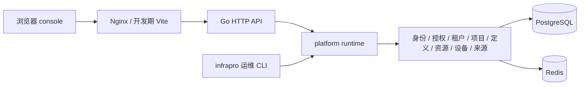
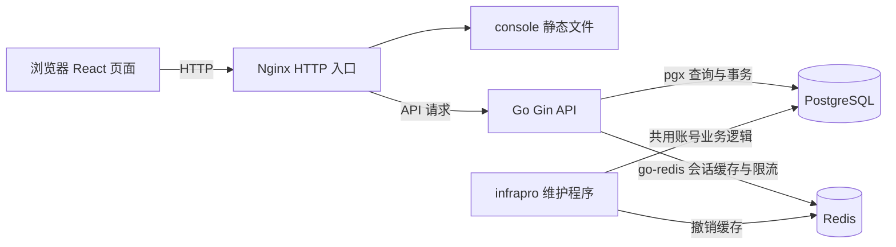
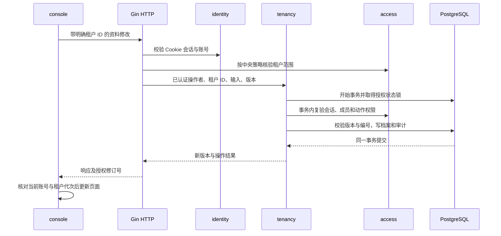
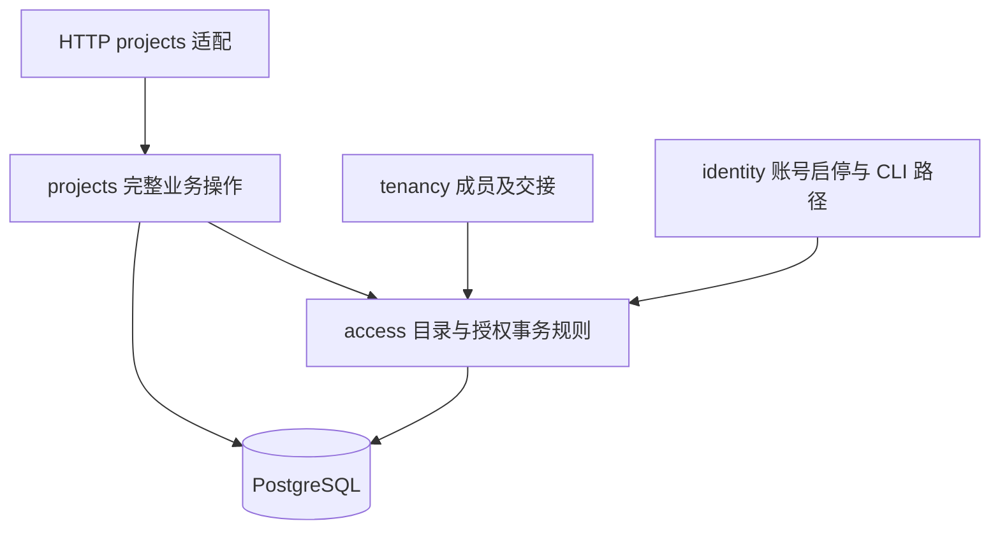
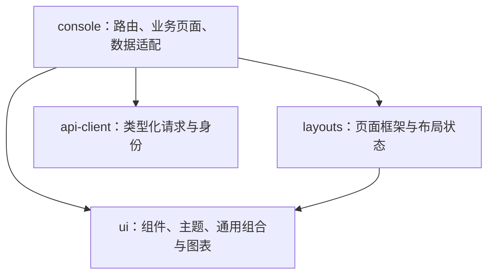

# InfraPro 架构设计

基线：2026-11-12。本文统一工程结构、模块边界、数据与事务、接口、前端、部署及恢复。业务规则与人工验收见[软件需求规格说明书](requirements.md)，选择依据和版本来源见[技术选型](technology-selection.md)。本次只重组文档，不改变实现或执行迁移。
导航：[系统上下文与运行结构](#overview) · [工程模块与依赖边界](#modules) · [账号、凭证与会话设计](#identity) · [授权、租户及生命周期设计](#access-tenancy) · [项目数据、接口与事务](#projects) · [工程定义与校验设计](#definitions) · [工程资源与项目授权设计](#resources) · [设备目录、输出、安装与来源设计](#devices) · [前端结构、交互和状态](#frontend) · [部署、配置与运行维护](#operations) · [迁移、授权发布与应急恢复](#migrations) · [检查、故障反馈与交付](#verification)


精确接口以 [OpenAPI](../contracts/openapi/api.yaml)、当前权限以 [access](../packages/go/platform/access/)、数据库结构以[迁移](../packages/go/platform/migrations/)为准。本文保留跨模块约束与详细设计；新增字段／路由须同步这些契约源。监测数据的未来架构保留在原方案中，不并入当前已实现架构。

<a id="overview"></a>

## 1 系统上下文与运行结构



部署为单个 API、单个 console、独立按需 CLI。PostgreSQL 保存持久业务真相；Redis 仅承担会话快照、活动合并及限流。来源绑定属于当前业务元数据；当前架构不含监测明细存储或采集执行器。

<a id="system-1"></a>

### 当前范围

Go workspace 包含四个独立 module：HTTP API、项目统一运维 CLI、项目共享 platform 和通用 foundation；前端保留一个 React 应用与五个 TS 共享包。当前业务覆盖账号、租户、项目、工程定义、统一资源、项目授权、设备目录与来源绑定；业务数据持久化到 PostgreSQL，Redis 提供共享缓存与限流。工程目录基线中的演示内容已移除。

```text
InfraPro/
├── apps/
│   └── console/                  唯一前端，Vite + TanStack 文件路由
├── services/
│   └── api/
│       ├── cmd/api/              可执行程序入口
│       ├── internal/
│       │   ├── bootstrap/        HTTP 监听、后台任务与优雅关闭
│       │   └── transport/http/   Gin 路由、身份适配、中间件与运行探针
│       ├── go.mod
│       └── go.sum
├── tools/infrapro/            项目统一运维 CLI，独立 Go module
│   ├── cmd/infrapro/          进程入口
│   └── internal/command/        根命令与 database、account 命令组
├── packages/
│   ├── go/
│   │   ├── foundation/          通用 config、logging，独立 Go module
│   │   └── platform/            项目共享能力，独立 Go module
│   │       ├── config/          项目配置与按命令读取的数据库配置
│   │       ├── access/          权限目录、明确范围策略与授权状态
│   │       ├── tenancy/         租户资料、成员、邀请及生命周期
│   │       ├── projects/        项目、成员、角色、管理交接和归档事务
│   │       ├── engineering/     元模型、草稿、不可变版本、依赖、校验与样例预览
│   │       ├── resources/       设施、构件、测点、业务通道、历史与幂等收据
│   │       ├── devicecatalog/   厂家、产品草稿、发布版本与固定槽位
│   │       ├── devices/         设备、输出代次、安装、项目设备授权
│   │       ├── sources/         即时来源绑定、切换、解除及历史投影
│   │       ├── location/        共享工程位置规则
│   │       ├── identity/        账号规则、事务、密码与会话缓存
│   │       ├── migrations/      嵌入式 Goose 项目数据库迁移
│   │       ├── runtime/         数据库、Redis 与业务装配
│   │       └── testsupport/     仅测试使用的隔离环境
│   └── ts/
│       ├── ui/                   shadcn 组件、通用组合、主题与 Recharts 图表
│       ├── layouts/              Admin/Auth/Settings 布局与 Zustand 布局状态
│       ├── api-client/           Fetch 客户端、生成类型、可选 React 适配入口
│       ├── tsconfig/             统一严格 TS 配置
│       └── eslint-config/        统一 ESLint 配置
├── contracts/openapi/            账号、租户、项目、工程定义、实际资源与运行探针契约源
├── configs/                      项目共用 YAML 配置示例
├── deploy/{docker,compose,nginx}/ HTTP 镜像、持久化依赖与代理部署
├── scripts/                      workspace 检查、进程管理、类型生成
├── tests/e2e/                    浏览器与代理链路验证
├── docs/
├── go.work
├── package.json
├── pnpm-workspace.yaml
├── pnpm-lock.yaml
└── Makefile
```

Go 在需要时生成 `go.work.sum`；它不同于每个 module 的 `go.sum`，不手工创建占位校验文件。

<a id="system-4"></a>

### 账号运行链路

```text
浏览器 console :5173 ── 同源账号 API → Vite 代理 → Gin :8080
                                                      ↓
                    Cookie / CSRF / 身份与归属校验 → identity
                                                        ↓
                                           PostgreSQL + Redis
```

部署探针留在 HTTP 接入层：`GET /healthz` 表示进程存活；`GET /readyz` 检查 PostgreSQL、Redis 与迁移状态。成功时仅返回 `{"status":"ok"}`，不再提供服务版本与响应时间的演示数据。它们设置 `Cache-Control: no-store` 并附带 `X-Request-ID`；不作为前端页面内容。

OpenAPI 契约生成 `api-client/src/schema.d.ts`，`pnpm contracts:check` 检查是否同步。客户端统一处理账号请求、CSRF 和业务错误。未登录请求按公开白名单处理；鉴权通过后的未知路由与不支持的方法分别返回 JSON 404、405。

<a id="modules"></a>

## 2 工程模块与依赖边界

<a id="module-2"></a>

### Go workspace

模块路径与当前 Git 仓库地址一致：

- `github.com/WenshuaiDev/InfraPro/services/api`
- `github.com/WenshuaiDev/InfraPro/tools/infrapro`
- `github.com/WenshuaiDev/InfraPro/packages/go/platform`
- `github.com/WenshuaiDev/InfraPro/packages/go/foundation`

根目录不创建 `go.mod`，`go.work` 是工作区模块清单。`scripts/go.mjs` 读取该清单，逐模块执行下载、检查、测试与构建，覆盖嵌套 module。

API 和 CLI 的 `go.mod` 保留到 platform、foundation 的仓库内相对 `replace`，platform 保留到 foundation 的相对 `replace`。模块级下载、`go mod tidy` 和 `GOWORK=off` 均能解析尚未独立发布的共享模块；没有机器绝对路径。标准开发和构建仍以根 `go.work` 为入口。API 与 CLI 可以分别构建，彼此没有模块依赖。

服务和 CLI 内部代码通过各自 `internal` 隔离。共享项目规则放在 platform，通用工具放在 foundation；共享模块不得反向导入 API 或 CLI。首期只有一个 HTTP API 服务，CLI 是按需执行的运维程序。

<a id="module-3"></a>

### pnpm 共享包与单应用

`apps/*` 和 `packages/ts/*` 构成工作区。每个应用有独立 `package.json`、Vite 配置、入口、环境变量、TypeScript 项目和构建产物。共享包使用 `workspace:*` 和显式 `exports` 引用。

共享 TS 包以源码形式交给 Vite 编译，开发时支持热更新。UI 和 layout 先在 packages 内抽象，console 只装配业务。`ui` 管理 shadcn 基础组件、通用组合、主题和 Recharts；`layouts` 组合 UI 并通过 Zustand 持有非敏感布局偏好，接收品牌、菜单、用户展示和链接渲染函数。两者不请求业务 API、不依赖具体 Router。

`api-client` 主入口不导入 React，React 使用方通过 `@infrapro/api-client/react` 接入 `IdentityProvider` 和 `useIdentity`，管理当前身份、CSRF、依赖故障和用户活动。TanStack Query 管理邀请、会话和安全记录；React Hook Form + Zod 管理表单。退出/切换账号时卸载原账号子树，取消并清理该账号的查询和页面状态。

应用内部：`app` 装配 Router、Query 和身份；`routes` 定义文件路由；`features` 包含页面与业务交互；`config` 定义品牌和真实导航；`styles/global.css` 装载 Tailwind 并显式扫描共享包；浏览器验证在仓库 `tests/e2e` 中维护。`routeTree.gen.ts` 自动生成，不手工编辑。应用仅通过包的公开 exports 引用共享源码，ESLint 检查依赖方向。用法见[前端开发约定](architecture.md#frontend)。

<a id="module-5"></a>

### 扩展方式

- 新增 Go 服务：创建 `services/<name>/go.mod`、`cmd/<name>`、`internal`，执行 `go work use ./services/<name>`；共享依赖按现有 API 的方式声明。
- 新增运维能力：在 `tools/infrapro/internal/command` 增加命令组或子命令，调用对应 platform 业务包；项目统一使用 `infrapro`，不在 API 或各业务模块另建 CLI。
- 新增 Go 共享模块：放在 `packages/go/<name>` 并加入 `go.work`。
- 当前新增业务先作为 console 的 feature 和独立路由；只有确需独立发布/部署时再拆 `apps/<name>`，继续复用 UI 和布局。
- 新增 TS 共享包：放在 `packages/ts/<name>`，声明包名、exports、实际依赖与类型检查命令。
- 新增业务接口：先更新 `contracts/openapi/api.yaml`，更新服务和客户端，再运行 `pnpm contracts:generate` 与相关检查。
- Go 单元测试放在源码旁；跨模块浏览器回归放在 `tests/e2e`。

`make dev` 当前启动 API 和 console 两个进程；新增入口时同步修改启动编排和对应 E2E 配置。`make build` 与 Go 检查脚本按工作区清单遍历，pnpm 应用构建按 `apps/*` 遍历。

<a id="module-6"></a>

### 账号业务边界

`packages/go/platform/identity` 包含业务 service、集中 SQL repository、Argon2id 和 Redis cache，不导入 Gin。数据访问与事务只在 repository，HTTP 和统一 CLI 共用 service。`services/api/internal/transport/http/identity` 负责 HTTP 适配、Cookie 与请求响应；传输层采用精确公开白名单，所有其他路由默认鉴权，写请求检查完整 Origin 与 CSRF。

platform/config 组合 foundation 的基础配置，提供同一项目配置来源。platform/runtime 装配 pgxpool、Redis 和账号业务，API 的 bootstrap 负责可取消后台任务与 HTTP 生命周期。platform/migrations 的 Goose SQL 由统一 CLI 执行，API 检查迁移版本与权限目录一致性。会话每次鉴权关联 PostgreSQL 当前状态，缓存不能恢复撤销访问。维护操作的缓存失效记录持久保存在队列表。

浏览器账号页面统一在 console 内实现，旧 screen 入口只保留 Nginx 固定跳转。共享 UI 不访问 API；OpenAPI 是类型契约源。部署使用 Nginx 单主机路径；测试使用专用 PostgreSQL schema 与 Redis 命名空间，不连接正式环境。操作说明见 [账号运行手册](architecture.md#operations)。

<a id="module-7"></a>

### 租户基础治理

`platform/tenancy` 负责档案、编号归属、初始管理员和交接；通过 `access.Actor` 的可信会话复验与 `RequireScopedTx` 在同一事务重新授权，不导入 identity 或 Gin。HTTP tenancy 适配器从 identity 建立 Actor，调用完整业务操作，不拼接多个独立写事务。`access` 按明确租户读取成员和角色；identity 的共享启停事务调用 access 的管理员保护及治理事件写入，依赖方向不成环。

授权状态锁 → 相关账号按 UUID 排序 → 会话复验 → 租户及成员 → 编号及审计。创建、交接、账号启停使用排他授权锁；资料修改使用共享授权锁。租户成员和角色变化只影响对应租户；平台角色不产生租户成员关系。前端以 URL、账号、租户与成员关系划分查询，传递 AbortSignal，页面卸载废弃写请求完成回调；确认失权清理内容，短暂故障保留草稿并阻止提交。

<a id="module-8"></a>

### 项目业务与上下层联动

`platform/projects` 拥有完整项目命令：在同一事务内完成范围检查、资格复验、版本与预览校验、成员和角色更新、编号保留、幂等收据及审计。`platform/access` 提供项目目录、策略、真实授权解释和上层保护/级联辅助；`tenancy`、`identity` 调用这些辅助处理父关系结束及应急停用。依赖保持为 projects/tenancy/identity → access，无反向依赖，HTTP 只解码各操作的严格输入并调用服务。

项目写入先取排他授权状态锁（包括资料 PATCH，避免写入审计/修订时由共享锁升级），读取取共享锁；随后按账号 UUID、会话、租户成员、项目、项目成员/角色顺序校验。上层操作、目录同步采用同一锁顺序。权限真相是 PostgreSQL 当前关系和角色，不依赖浏览器按钮或 Redis TTL。

项目成员绑定具体 tenant_membership；项目角色只绑定具体 project_membership。租户角色清空不结束关系，也不影响独立项目授权；父关系结束会在原事务中结束全部旧项目关系并撤销绑定。项目管理员不可通过普通角色分配增删。停用账号允许应急不可用；不可用租户管理员的明确修复交接可产生带原因的管理空缺，随后由新租户管理员逐项目修复。

前端区分个人 `/projects`、租户治理 `/t/$tenantId/projects` 与业务 `/t/$tenantId/p/$projectId`。查询按账号、租户成员关系、项目成员关系及授权状态划分；客户端代次校验、AbortSignal 和卸载回调保护共同防止旧结果回填。短暂故障保留草稿且停止提交，真实失权清理内容；取消确认框不会执行成功回调。非危险只读请求仅在范围取消导致 AbortError 且仍被观察时重试一次，写入从不自动重放。

项目完整事件在 `account_security_events.project_id` 下隔离；租户治理只保存允许的摘要，平台审计排除项目内容，包括目录发布的逐成员影响。账号历史清理跳过项目事件。迁移 v7 新增项目实体、永久编号归属、成员、绑定和操作收据，并以外键、唯一性和延迟约束保护完整管理结构。运行说明见[项目管理手册](architecture.md#migrations)。

<a id="module-9"></a>

### 工程定义与通用预览

`platform/engineering` 定义四种元模型职责：设施类型、指标、单位、监测模板。具体桥梁、边坡、路基路面是内容数据。依赖保持 engineering → access；HTTP 从 identity 建立可信 Actor，执行严格 JSON 解码，调用单个业务事务。接口输入不得指定作用范围、发布者或版本号。

锁顺序为共享授权状态 → 当前账号 → 会话及当前范围权限复验 → 工程目录状态 → 定义。发布、复制、创建和状态维护使用排他工程目录锁；保存草稿使用共享目录锁与独立定义行锁。发布版本、编译 Schema、单位类别快照、固定依赖与内容摘要不可变，启停状态单表维护；成功业务结果、幂等收据与审计一次提交。单位类别被引用后不可改义，删除草稿保留身份编号。

JSON Schema 2020-12 由内部有限字段模型生成，Go 使用 `santhosh-tekuri/jsonschema/v6` v6.0.3 显式执行 format 校验并关闭外部资源加载。编译缓存仅缓存内容摘要对应的规则，最多 1024 项；权限和完整依赖链可用性每次查询当前数据库。前端 React Hook Form 保存编制表单，Zod 使用无动态代码生成入口，通用解释器绘制属性、样例树和待绑定要求。共享语义样例位于 `tests/fixtures/engineering-values.json`。

公共版本和租户私有模板分别授权。租户公共目录不暴露草稿和不可新采用版本；已授权历史模板只解析其固定公共依赖，不开放全局历史搜索。复制来源摘要仅供追溯，实际依赖决定新采用资格。平台审计明确排除租户私有工程事件。前端查询按账号、租户、成员关系隔离，写入不自动重放；临时样例无持久化。实际资源通过下述 resources 模块接入固定版本，不创建独立监测方案或运行模块空壳。

迁移 v8 和操作入口见[设施类型定义手册](architecture.md#operations)。

<a id="module-10"></a>

### 租户工程资源

`platform/resources` 拥有实际设施、构件树、测点和业务通道；`engineering` 继续拥有定义。资源服务通过 `engineering.ResolvePublicTx` 在当前事务解析公共发布版本及其固定依赖，不复制定义解析 SQL。定义影响接口注入 `UsageReader`，仅返回“存在资源引用”的布尔值，不暴露租户、对象名称、ID 或数量。

资源锁顺序为授权状态 → 当前账号/会话及明确 Scope 复验 → 工程目录共享锁 → 设施行锁。租户资源普通维护及既有项目对象更新取共享授权锁；项目创建和授权治理从事务开始取得排他授权锁，避免新增授权时升级锁。构件结构变更另验 `structure_revision`；同请求以账号、租户和请求 ID 去重，业务变更、独立历史、审计摘要和收据一次提交。四类资源分别建表，以组合外键、唯一编号和触发器约束同租户同设施引用、允许关系、循环及最大正常数量。删除保留身份和编号；历史不随账号安全事件清理。

HTTP 使用显式资源策略、严格字段与 256 KiB 请求限制；read/manage 为租户权限，采用新类型或新指标另需目录读取权。React 页面复用 `engineering-fields` 控件与字段校验，位置使用共享 Go/Zod 语义样例；查询按账号、租户和成员关系隔离。构件树按直接子项分页，表单写入不自动重放，响应不确定时由用户查询收据。平台审计在筛选和游标前排除真实资源事件。

运行及迁移 v9 说明见[工程资源手册](architecture.md#operations)。

<a id="module-11"></a>

### 租户统一资源与项目授权

迁移 v10 保留四类主表与 UUID，新增项目资源政策、设施关联、逐对象授权、独立授权历史及 v2 收据。旧项目默认零关联、零授权且禁止新建设施；创建来源是不可变追溯事实，不参与授予。组合外键、当前唯一索引、能力类型约束与延迟触发器保护关联和资源身份。

资源服务入口显式接收 tenant/project Scope；HTTP 从匹配路由选 Scope，项目请求不回退租户范围。项目角色与资源能力相交，祖先摘要不提供档案、历史或维护权。列表、搜索、计数及历史先以 SQL 可见集合过滤再分页；定义与祖先集合批量解析，项目只获得可见对象的投影。租户授权治理还需项目查看与授权查看权限，不要求加入目标项目。

授权指令采用 add/update/end、预览摘要及 access/link 修订；“当前全部”在设施锁内展开并限制 1000 项，未来新增不继承。项目新对象及其标准能力、来源、两类历史和收据原子提交。共享编辑、结构修改及生命周期操作需要原因和影响确认。归档保留读取，禁止写入与扩权；有效或归档项目引用都阻止删除和项目方破坏性操作。

资源历史与授权历史独立持久保存，项目历史隐藏其他项目人员、身份、原因和历史不可见祖先。通用审计仅存最小摘要，平台审计排除资源/授权事件。v1 租户收据保持原指纹；v2 绑定入口、原成员和关联，提交重放仍检查当前执行资格，只读核对不重新执行。

<a id="module-12"></a>

### 设备目录、设备资源与来源

`devicecatalog` 拥有厂家、产品草稿及不可变发布版本；`devices` 拥有设备、输出代次、安装及项目设备／输出授权；`sources` 拥有通道到输出的即时来源关系。设备始终固定 product_version_id，输出始终固定指标、单位和七项含义。定义解析仍由 engineering 的批量事务接缝承担，位置纯规则提取到 location；前端共用 location-fields，不复制旧位置模型。

runtime.Compose 装配各模块的窄接口：resources 提供当前事务内目标／通道资格和批量投影，devices 提供显式输出资格，工程 UsageReader 只聚合引用存在性，不泄露私有身份或数量。sources 不调用会开启第二事务的资源命令。HTTP 只处理可信 Scope、严格 DTO 与错误转换；未知字段、重复键、错误修订类型及跨动作字段被拒绝。

协调顺序为授权状态→账号／会话／当前 Scope→工程目录→设备目录→租户设备协调→设施／设备／输出／来源行。资源退役、删除及授权治理加入同一顺序。来源写入复验双方当前资格和全部修订，在锁内读取一个 T，使用它结束旧来源并建立新来源；业务、独立历史、审计及收据在同一事务提交。安装也使用服务器锁内时间及半开期间，纠错额外保留旧资源引用。

项目授权对 device 和 output 分开，source_manage 与普通通道 update 分开。项目 Scope 不回退到租户权限。历史按照当前授权逐侧裁剪；只授予旧输出不能看到替换的新输出快照。前端 cache key 和响应 epoch 包含账号、成员、Scope、资源和设备授权修订；撤权清理子树并拒绝迟到响应，503 保留输入而不自动重放。

协议仅保留未来产品／协议／固定版本映射设计，本功能未创建协议表或执行入口。

<a id="identity"></a>

## 3 账号、凭证与会话设计

<a id="identity-9"></a>

### 实现结构

技术及版本统一见[技术选型](technology-selection.md)。本节说明身份业务的运行与数据约束。

#### HTTP 部署和浏览器行为

已实现的部署链路如下，浏览器与入口之间以及入口到 API 均使用 HTTP：



部署时使用同一个主机的 `/console/`、`/api/v1/` 路径。console 设置匹配的 Vite base 和 TanStack Router basepath；Nginx 提供 SPA 回退并将旧 screen 路径固定跳转到 console，API 的 401、404 或 503 保持 JSON 响应，不回退为前端 HTML。Nginx 的 HTTP 转发使用其 [proxy_pass 能力](https://nginx.org/en/docs/http/ngx_http_proxy_module.html#proxy_pass)。

开发时只保留 console 5173 和 API 8080，通过已有 `/api` 代理访问后端。浏览器统一使用相同主机名，避免混用 localhost 和 127.0.0.1。Cookie 按主机及路径生效，同浏览器标签页共享会话。退出当前会话后，其他标签页在再次请求或聚焦时同步登录状态。

HTTP 配置明确关闭 Cookie 的 Secure 属性，不添加 HSTS、强制 HTTPS 重定向或要求升级协议的 CSP 指令。保留 HttpOnly、SameSite、CSRF 校验、凭证撤销和日志脱敏。HTTP 不提供传输加密，数据库密码摘要与这些应用层控制不能保护传输中的密码和 Cookie；这是本功能按 HTTP 交付的已知限制。

登录页、账号页和涉及凭证的响应使用禁止缓存策略。邀请和重置链接以可信的控制台 HTTP 地址生成，随机凭证放在 URL fragment；前端读取后立即清除地址栏中的凭证，仅在内存中保留，并通过 POST 请求体提交。页面刷新导致内存凭证丢失时，提示重新打开原链接；刷新本身不消费凭证。涉及凭证的页面禁止 Referer 外传，不加载第三方分析脚本，API 及代理不记录含凭证的请求体。

#### 代码组织和调用边界

具体落点遵循现有 [工程目录和依赖边界](architecture.md#overview)。以下位置及功能已新增或扩展完成：

| 位置 | 实现内容 |
| --- | --- |
| `packages/go/platform/identity/` | 项目共享账号业务模块；包含 service、repository、session_cache，以及密码、会话、邀请、恢复和审计实现，不依赖 HTTP 框架 |
| `services/api/internal/transport/http/identity/` | 账号 HTTP handler 与身份适配；调用共享账号业务，不直接访问 repository |
| `services/api/internal/transport/http/` | 绑定 API 路由；统一请求 ID、Origin/CSRF 校验、身份读取和错误映射 |
| `services/api/internal/bootstrap/` | 装配 HTTP 服务生命周期和可取消后台任务，调用共享依赖装配 |
| `packages/go/platform/runtime/` | 装配数据库连接池、Redis 客户端和账号业务，供 API 与 CLI 共用 |
| `packages/go/platform/config/` | 项目共用的数据库、Redis、账号、站点及维护配置，组合现有基础配置；账号规则不放入通用 foundation 包 |
| `tools/infrapro/` | 独立 Go module，项目统一运维入口；database、account 命令组调用共享能力，避免与 HTTP 接口形成两套密码或状态规则 |
| `packages/go/platform/migrations/` | 项目数据库迁移，当前含账号表及索引 SQL、Go embed 入口、迁移版本 |
| `apps/console/src/features/` 和 `routes/` | 登录、邀请、个人资料、安全中心与文件路由装配 |
| `packages/ts/layouts/` | 共享 Admin/Auth/Settings 布局，应用传入导航与用户展示；Zustand 管理布局偏好 |
| `packages/ts/api-client/` | 账号 API 方法、生成类型及可选 React 身份状态适配；业务请求与页面样式分离 |
| `packages/ts/ui/` | 复用输入框、密码框、提交状态和错误提示等展示组件 |
| `contracts/openapi/api.yaml` | 所有账号接口、请求响应、Cookie 认证方式和错误结构的契约源 |
| `deploy/nginx/`、`deploy/compose/` | HTTP 路由、静态文件托管、PostgreSQL/Redis 配置与持久化、验收编排 |
| `tests/e2e/` 和模块内 Go 测试 | 浏览器流程、数据库一致性、接口归属和异常场景 |

HTTP Handler 负责读取与验证请求并映射响应；Service 负责业务规则和事务边界；Repository 负责参数化 SQL、行锁与数据转换。前端与维护程序复用同一业务规则。密码摘要、随机凭证与数据库细节封装在账号模块中，后续业务只获取当前账号 ID 和正常/停用状态。

#### 数据表和一致性规则

身份持久化采用以下基础表。账号使用稳定 UUID，时间统一保存为 UTC `timestamptz`；表中不增加角色、管理员或组织隔离字段。

| 表 | 主要数据 | 必须保证的约束 |
| --- | --- | --- |
| `accounts` | ID、用户名、归一化用户名、显示名称、状态、认证版本、创建和更新时间 | 归一化用户名唯一；状态限定正常或停用；账号 ID 不随资料改变 |
| `account_passwords` | 账号 ID、带参数及盐的密码摘要、修改时间 | 每个账号一条密码凭据；不保存明文密码 |
| `account_sessions` | 会话摘要、账号 ID、认证版本、创建时间、最近用户活动、绝对到期时间、撤销时间、最近密码复验时间、设备概况 | 会话摘要唯一；每次鉴权检查到期、撤销、账号状态和认证版本 |
| `account_invitations` | 邀请 ID、邀请人、凭证摘要、备注、到期时间、使用时间、撤销时间、受邀账号 ID | 每条邀请最多关联一个成功创建的账号；已过期由到期时间判定 |
| `account_password_resets` | 重置凭证摘要、目标账号、发放原因、到期、消费和撤销时间 | 同一账号最多一条未消费且未撤销的重置记录，发新链接前撤销旧记录 |
| `system_initialization` | 固定单行 ID、初始化完成时间、首个账号 ID | 迁移时建立单行记录；初始化事务锁定该行，完成状态不可由常规业务清除 |
| `account_security_events` | 事件 ID、类型、执行主体、目标对象、时间、结果、来源和请求 ID | 业务界面只追加与读取；用户查询必须限定本人可见范围 |
| `account_rate_limits` | 账号键摘要、连续密码失败次数、冷却截止时间 | 保存跨重启的账号失败冷却状态；IP、路由和凭证的短周期请求计数由 Redis 处理 |

创建首个账号、消费邀请、改密/重置、停用账号均在 PostgreSQL 事务中完成对应写入及审计。用户名竞争交给唯一约束处理，同一邀请竞争使用行锁和条件更新保证只成功一次。事务失败必须回滚，并发锁定顺序保持一致，避免邀请与账号停用相互死锁。

密码修改、密码重置或停用时递增账号认证版本，撤销旧会话，并清理对应 Redis 缓存；鉴权的有效性校验关联数据库中的账号当前版本。登录验证密码后，在发放会话前重新核对账号状态和凭据版本，防止密码刚被重置却仍发出基于旧密码的会话。到期校验在请求时执行，定时清理只负责回收空间。

账号、IP、邀请凭证等不同限流范围分别保存计数。Redis 负责共享的短周期请求限流，数据库保存账号连续密码失败冷却；不存在账号的登录尝试也进入限流，并采用等价的摘要验证路径，避免快速返回暴露账号是否存在。数据库或 Redis 连接失败时，账号接口返回不可用，不能绕过身份或限流检查。

#### Redis 会话缓存与失效

Go 通过 [go-redis v9](https://redis.io/docs/latest/develop/clients/go/) 连接共享 Redis，客户端由服务启动时创建并复用。PostgreSQL 保存账号状态、认证版本和会话撤销记录，Redis 承载会话快照、用户活动合并和高频限流。多个 API 进程与维护程序连接同一环境的 Redis。

当前版本缓存命中后仍执行一次按主键或唯一索引定位的数据库有效性校验，只读取账号状态、认证版本、会话撤销及到期字段。这样即使缓存清理失败、旧值被并发回填或 Redis 从旧持久化文件恢复，已退出、改密或停用的会话仍会立即被拒绝。缓存承担会话信息读取、活动更新合并和限流；这一设计保留了数据库校验成本。

| 缓存键 | 内容 | 生命周期 |
| --- | --- | --- |
| `infrapro:<env>:identity:v1:session:<凭证摘要>` | 会话 ID、账号 ID、认证版本、会话快照和到期时间；不含原始 Cookie 或密码 | 默认缓存上限 5 分钟，同时不超过当前会话剩余空闲及绝对时限；回填时重新计算剩余时间 |
| `infrapro:<env>:identity:v1:activity:<会话ID>` | 经服务端验证的最近用户活动时间、对应认证版本和待落库标记 | 不超过会话剩余有效期；最多每 60 秒合并落库一次，成功后清除对应待落库标记 |
| `infrapro:<env>:identity:v1:rate:<范围>:<键摘要>:<窗口>` | IP、路由、邀请或重置凭证的短周期请求计数 | 随限流窗口到期；使用短 Lua 脚本原子检查、计数并设置 TTL |

会话缓存采用带 TTL 的原子写入，不能先写出一个无期限键再补过期时间。TTL 处理参考 [Redis EXPIRE 说明](https://redis.io/docs/latest/commands/expire/)，限流计数依靠 [Redis Lua 脚本的原子执行](https://redis.io/docs/latest/develop/programmability/eval-intro/) 保证多进程一致。

具体读写规则如下：

1. 登录成功先提交数据库会话记录，再写 Redis 缓存，最后返回会话 Cookie。缓存写入失败时不向浏览器发放新会话，撤销这次新建记录并报告服务不可用。
2. 请求先读取 Redis。命中后执行上述数据库有效性校验；不通过即拒绝并删除缓存。未命中则完整读取数据库，确认仍有效后回填缓存。数据库已失效的记录不能通过回填复活。
3. 用户活动经鉴权后写入 Redis，按会话合并后条件更新数据库的最近活动时间。计算空闲时限时只使用与当前会话、认证版本匹配的活动记录；更新不能取消撤销状态，也不能改变绝对到期时间。正常落库时，Redis 丢失尚未落库的活动最多导致保守地提前 60 秒到期；落库失败则报告依赖异常并停止接受新的活动续期。
4. 当前登出先持久化撤销该会话，再删除会话和活动缓存。退出全部设备、修改密码、重置密码和停用账号先在数据库完成对应撤销，再根据受影响会话的摘要批量清缓存；单设备退出不改变其他设备会话。
5. 清缓存失败要记录并重试。数据库有效性校验负责立即阻止旧会话，不能把“缓存里还有数据”当成仍可登录。邀请与密码重置的单次消费始终由数据库事务决定，不使用缓存推测凭证是否可用。
6. Redis 返回键不存在是正常缓存未命中；连接失败、超时或限流脚本失败属于依赖故障，账号 HTTP 接口返回 503。服务恢复后按数据库有效记录重建缓存。服务器维护程序在 Redis 故障时仍可持久化停用和撤销，并报告缓存清理未完成。

缓存键包含环境与结构版本，测试只清理指定测试环境的键。Redis 使用内部网络、访问凭据、连接超时和容量限制，当前与限流共用实例时采用 `noeviction` 并为短期键设置 TTL，避免内存淘汰把限流计数静默清掉；内存不足的写失败按依赖异常处理。可启用 AOF 和持久化卷以减少重启丢失，但缓存恢复是否有效仍以 PostgreSQL 状态为准，符合 [Redis 持久化机制](https://redis.io/docs/latest/operate/oss_and_stack/management/persistence/) 的使用边界。

#### 登录与密码的实现步骤

1. 页面加载时由共享客户端获取公开密码规则与 CSRF token，再调用当前账号接口。React 身份状态区分加载中、已登录、未登录和服务暂不可用；网络错误或 503 不直接解释成退出登录。
2. 登录表单通过 Fetch 提交用户名、密码和 `X-CSRF-Token`。请求使用当前应用的同源 `/api/v1` 地址和 `credentials: same-origin`。
3. Gin 入口先检查来源、CSRF 和限流；业务层查询归一化用户名，使用 `argon2.IDKey` 验证密码并检查账号状态。
4. 验证成功后生成 32 字节随机会话凭证，计算 SHA-256 摘要存入会话表；事务提交并写入 Redis 缓存后，通过 HttpOnly Cookie 返回随机凭证，并返回账号基本资料。
5. 后续请求由认证中间件计算 Cookie 摘要，按上述规则读取 Redis、回源和校验数据库有效性；有效时将账号 ID 放入请求上下文，资料、会话和邀请操作再检查对象所属账号。
6. 浏览器检测实际用户操作并限频发送活动请求，后端仅对仍有效的会话更新 Redis 活动记录并合并落库；后台健康检查与轮询不刷新空闲时限，绝对到期时间不延长。
7. 修改密码、重置密码和登出按上文规则撤销会话。前端收到身份失效响应后清除当前用户状态，重新进入登录流程。

密码摘要使用 Go 官方扩展包的 [Argon2id 实现](https://pkg.go.dev/golang.org/x/crypto/argon2)，保存算法标识、参数、随机盐和摘要，支持后续参数升级。短而可猜的密码采用慢摘要；32 字节高熵随机凭证使用 SHA-256 摘要，两者用途不同。弱密码校验使用随服务提供的本地规则或列表，不把用户密码发送到外部服务。

#### CSRF 与 HTTP 的接入方式

`gorilla/csrf` 作为 `net/http` 中间件包裹 Gin Handler，设置固定的服务器认证密钥、Cookie 路径与 `Secure(false)`。按 [gorilla/csrf 的 HTTP 模式接口](https://pkg.go.dev/github.com/gorilla/csrf#PlaintextHTTPRequest) 在进入该中间件前标记明文 HTTP 请求，避免把 HTTP 的 Referer 当作 HTTPS 请求处理；该标记由服务配置设置，不接受客户端自行指定。

公开的 GET CSRF 接口返回页面可用的 token；登录、邀请接受、密码重置以及已登录写操作都通过 `X-CSRF-Token` 提交。服务端另外核对完整 Origin 的协议、主机和端口，只接受配置中的应用地址，拒绝缺失或不匹配的来源；同一配置按库要求映射到 `csrf.TrustedOrigins`，确保开发代理改变后端 Host 后合法请求仍可通过库内检查。登录前的表单同样受校验，不能通过跳过来源检查来解决代理问题。

CSRF 认证密钥通过服务器配置持久化，多个 API 进程保持一致；CSRF Cookie 同样按 HTTP 模式关闭 Secure。客户端遇到 CSRF 过期时刷新 token 并提示重新提交，不自动重复可能已经成功的开户或改密操作。

#### 接口设计

以下为已实现契约，前缀统一为 `/api/v1`。所有 POST、PATCH、DELETE 浏览器请求均经过来源和 CSRF 校验；“公开”仅表示无需登录，并不表示可绕过一次性凭证验证。

| 方法与路径 | 调用条件 | 用途 |
| --- | --- | --- |
| `GET /public/account-help` | 公开 | 返回维护联系方式和用户名、密码公开规则 |
| `GET /auth/csrf` | 公开 | 获取 CSRF token |
| `POST /auth/login` | 公开，需限流 | 验证用户名和密码，发放会话 Cookie |
| `GET /auth/me` | 已登录 | 获取当前账号基本资料 |
| `POST /auth/reauthenticate` | 已登录 | 验证当前密码，更新近期复验时间 |
| `POST /auth/logout` | 当前会话，允许幂等清理已失效 Cookie | 撤销当前会话并清除 Cookie |
| `POST /auth/logout-all` | 已登录 | 撤销本人所有会话 |
| `POST /auth/activity` | 已登录且会话未过期，需限频 | 记录用户活动，不延长绝对期限 |
| `PATCH /account/profile` | 已登录 | 修改自己的显示名称 |
| `POST /account/password` | 已登录，需当前密码 | 修改密码并退出全部设备 |
| `GET /account/sessions` | 已登录 | 列出本人会话 |
| `DELETE /account/sessions/{id}` | 已登录且拥有目标会话 | 撤销指定会话 |
| `GET /account/security-events` | 已登录 | 分页查看本人安全记录 |
| `GET /invitations` | 已登录 | 分页查看本人创建的邀请 |
| `POST /invitations` | 已登录且近期密码复验通过 | 生成一次性邀请链接 |
| `POST /invitations/{id}/revoke` | 已登录且拥有邀请 | 撤销邀请 |
| `POST /invitations/{id}/regenerate` | 已登录、拥有邀请且近期复验通过 | 撤销旧邀请并创建新邀请 |
| `POST /public/invitations/inspect` | 有邀请凭证，需限流 | 只校验状态，不消费邀请 |
| `POST /public/invitations/accept` | 有效邀请、未登录 | 创建账号并消费邀请 |
| `POST /public/password-resets/inspect` | 有重置凭证，需限流 | 只校验状态，不消费凭证 |
| `POST /public/password-resets/complete` | 有效重置凭证 | 设置新密码、消费凭证并撤销旧访问能力 |

首个账号创建、重置链接发放和其他账号停用只在维护程序提供。用户输入不能指定当前操作账号 ID 或额外权限；需要本人身份的接口从会话读取账号 ID。错误响应统一包含稳定业务错误码、可读信息和请求 ID，必要时附字段错误；客户端分别处理未登录、校验失败、链接失效、用户名冲突、限流和服务不可用。

#### 维护命令和迁移

已构建 `infrapro`，以下命令已实现；具体配置和启动步骤见 [账号运行手册](architecture.md#operations)：

| 命令 | 使用的技术与行为 |
| --- | --- |
| `infrapro database migrate` | Goose Provider 读取嵌入的 SQL，使用 pgx stdlib 连接数据库，应用未执行的迁移并记录版本 |
| `infrapro account bootstrap` | 使用 x/term 无回显读取密码；锁定初始化记录，原子创建首个账号 |
| `infrapro account find` | 按用户名查找账号状态，输出必要维护信息 |
| `infrapro account reset-link` | 指定账号与原因，撤销旧凭证，生成 HTTP 重置链接并仅在受控终端展示 |
| `infrapro account disable` | 填写原因，停用目标账号并撤销访问能力；显式应急选项处理最后账号失陷 |
| `infrapro account enable` | 填写原因，恢复登录资格，不恢复已撤销的凭证 |

迁移 Provider 显式配置 PostgreSQL session locker，保证并发执行只由一个迁移进程推进；正常 API 启动只检查数据库和迁移版本，不自动执行破坏性回退。维护程序与 API 使用相同配置和业务包，密码通过 [x/term.ReadPassword](https://pkg.go.dev/golang.org/x/term#ReadPassword) 输入，避免进入命令参数或 Shell 历史。

<a id="identity-10"></a>

### 运行配置与审计

账号及会话的完整配置、默认值和命令统一见[运行维护](#operations)。审计记录时间、事件、操作者、目标、结果、原因、来源与请求 ID，不包含密码、Cookie 或一次性凭证。

个人记录限本人，平台／租户／项目事件按各自权限投影。账号及租户安全事件默认保留 90 天；项目事件和独立业务历史按各自保留规则处理。恢复备份前后按统一流程撤销旧访问凭证并核对当前环境缓存，不能把恢复出的旧会话当作合法访问。

<a id="access-tenancy"></a>

## 4 授权、租户及生命周期设计

<a id="authorization-4"></a>

### 后端集中管理权限

唯一权限定义源是 **`packages/go/platform/access/` 的集中目录文件**（`catalog.go` 及按业务拆分的 `*_catalog.go`）；不是数据库或前端表单。

职责划分：

```text
packages/go/platform/access/
  catalog.go / *_catalog.go  集中权限编码、名称、分组、范围、说明及风险标记
  policy.go / *_policy.go    操作标识、所需权限、公开/认证设施分类和统一管理约束
  builtins.go         内置角色声明、开户角色预置、完整管理权限集合
  authorizer.go       有效权限计算与统一校验 Interface
  service.go          角色管理、角色绑定和授权变更事务编排
  repository*.go      授权 SQL、数据库锁、版本校验和审计写入
  catalog_sync.go     目录/内置角色的幂等同步与一致性校验
```

各文件属于同一授权 Module。它向调用者提供少量明确 Interface：读取权限快照、按操作鉴权、在事务中鉴权并执行、管理角色和账号角色绑定。查询组合、有效性、锁顺序、变更审计及越权约束集中在内部，调用者不自行拼接权限 SQL。

权限描述至少包含：`code`、中文名称、业务分组、说明、`scope`（本人/平台/租户/项目）、风险级别、生命周期状态。编码采用稳定的 `域.资源.动作`，例如 `platform.account.assign_roles`。

权限说明必须写清“可以做什么、作用于本人还是平台范围”，不能只有“管理”“操作”等模糊词。编码改名按旧权限退役、新权限增加处理，不复用旧编码表达不同含义。

#### 定义集中，调用引用

- 权限字面量只在 access 的集中目录文件定义。其他 Go 文件引用类型化常量。
- 操作与权限的对应关系只在 access 的集中策略文件定义；路由和共享业务引用相同的操作常量。
- 禁止各 feature 自行登记权限、通过 `init()` 注册权限，或在配置、环境变量、数据库管理界面新增权限。
- 由中央 Go 目录生成 TS 权限常量、类型和 OpenAPI 权限枚举；前端不手写另一份权限清单。
- CI 检查目录编码唯一、描述完整、策略引用合法、路由都有策略、生成结果同步，以及业务代码中没有权限字面量或基于角色身份的放行分支。
- 合法的角色绑定/内置角色维护代码允许引用内置角色标识；检查不得误将这类数据管理引用当作权限绕过。

权限说明嵌入角色详情与权限配置，提供中文用途、作用范围、风险及配置限制；权限编码默认隐藏，可按需显示并参与搜索。不再提供平台独立权限目录菜单，旧 `/access/permissions` 链接跳转到 `/access/roles`，沿用角色页访问权限。没有新增权限、编辑权限编码、删除权限和临时授给账号的入口。

#### 数据库投影与发布

为提供外键约束和查询，数据库保存 `permission_catalog`，但它只是代码定义的投影，不是权限定义源。HTTP 不提供写目录的接口。

使用 `infrapro access sync`，在数据库迁移后按当前发布版本同步目录与内置角色；`access check` 只检查一致性。同步只更新目录、内置角色的固定属性及其具体权限关系，不覆盖自定义角色，不重绑现有账号。

- 同步可重复执行，结果不重复；一个事务内写入目录版本、关系、审计与授权修订号。
- API 启动及就绪检查验证迁移和目录版本，不在启动时自行修改角色数据。
- 新权限默认不进入任何自定义角色。属于本人或平台范围的新权限通过发布同步进入内置平台管理员的具体权限行；基础成员只获得 `builtins.go` 明确列出的本人权限。
- 未来业务权限需要单独设计默认角色；不因前缀或通配符自动授给平台管理员。
- 权限退役时停止生效和分配，保留可解释的历史信息；自定义角色中的历史引用可移除，不能重新授予。未知或不匹配的目录使服务拒绝就绪，不能当作空目录或全部允许。
- API 与 CLI 使用同一发布版本及目录校验值；目录不兼容时采用停写切换，不能让旧实例继续按旧策略服务。

<a id="authorization-9"></a>

### 请求链路、事务与即时生效

正常请求：Cookie/CSRF 与 Origin → 现有认证 → 中央操作策略 → 最新有效权限 → 本人归属及业务校验 → 执行 → 审计。

HTTP 中间件负责尽早拒绝和统一错误；共享业务的执行 Interface 仍校验权限，防止只在路由层检查而被其他入口绕过。权限相关写入必须在执行事务内重新校验，不能相信请求开始时或前端传来的权限快照。

默认拒绝、每次请求校验和统一配置参考 [OWASP 授权指南](https://cheatsheetseries.owasp.org/cheatsheets/Authorization_Cheat_Sheet.html#validate-the-permissions-on-every-request)；具体权限集合与角色模型以用户要求和本方案为准。

#### 当前版本不缓存授权结果

继续使用 Redis 会话缓存，但不把角色或权限放入 Cookie、会话持久快照、长期 JWT 或跨请求授权缓存。每次受保护操作从 PostgreSQL 计算有效权限，当前单组织规模下优先保证行为清楚、撤权及时。

- `auth_version` 继续只用于认证凭据/会话撤销。
- 新增全局 `authorization_revision`，用于标记授权数据变化和通知前端刷新，不作为前端提供的可信授权依据。
- 普通角色变更不强迫退出所有设备；同一会话下一次操作使用新权限。
- 停用账号、修改/重置密码仍按现有逻辑撤销会话。Redis 旧快照不能重新恢复权限。
- PostgreSQL 故障时不能计算授权，返回 503；Redis 故障继续沿用当前认证不可用策略，不回退为全部允许。

将来只有性能证据说明需要时才新增授权缓存，并另行设计版本校验及失效协议。

#### 并发规则

新增 `authorization_state` 单行记录。当前版本使用明确的事务锁顺序：

1. 需要授权的普通业务事务先对该记录取共享锁；改变授权图、账号启停或目录的事务一开始就取排他锁，避免先共享后升级。
2. 在锁内读取最新权限；涉及浏览器写操作时复用现有账号/会话复验，按账号 ID 排序锁定相关账号，再按角色 ID 排序处理角色，之后处理会话、邀请及业务记录。
3. 进行权限范围、版本、最后管理账号及业务校验。
4. 一次事务提交业务变更、必要的邀请撤销、版本变化和审计，之后释放锁。

初始化需要初始化表锁时，顺序固定为授权状态 → 初始化记录 → 账号/角色 → 凭证记录。API、CLI、邀请开户及后台任务凡触及这些规则，均遵循同一顺序。原有只处理认证凭据且不读取授权状态的事务不能在持有账号锁后再反向获取授权状态锁。

共享锁保护整个已授权的数据库操作，权限变更的排他锁需要等待这些短事务结束。这样先完成的操作可以成功，撤权提交之后的新鉴权必须失败，不出现检查后被撤权仍继续落库的间隙。已经返回给客户端的数据无法追溯收回。

数据库锁的行为依据 [PostgreSQL 17 行锁文档](https://www.postgresql.org/docs/17/explicit-locking.html#LOCKING-ROWS)。密码哈希计算、交互输入、HTTP 网络调用不放在授权锁内；分页读取有上限，并设置事务超时。当前版本的代价是授权管理写入串行化，适合当前规模；后续若有吞吐瓶颈再细化锁粒度。

#### 邀请资格撤销

权限图变更可能影响多个账号，事务中计算受影响账号变更前后的有效权限。凡失去 `platform.invitation.create` 的账号，其全部待使用邀请在同一事务中永久撤销；重新授予权限不会复活旧链接。

若移除一个角色但另一个角色仍提供创建邀请权限，不撤销邀请。只失去查看、撤销或重新生成权限，也不等同于失去开户资格。

邀请检查和最终接受均检查邀请人当前正常状态及创建邀请权限；最终提交与撤权遵循同一锁规则。对无效链接保持统一提示，避免公开接口泄露邀请人角色信息。开户成功的受邀账号不会因邀请人以后失权而级联停用。

<a id="authorization-10"></a>

### 数据结构与一致性

使用现有 PostgreSQL，Goose 新增结构迁移；本功能不写历史账号权限回填逻辑。既有迁移保留，新库依次执行，避免把初始化数据来源分散到历史 SQL 中。

| 表/字段 | 核心内容与约束 |
| --- | --- |
| `permission_catalog` | `code` 主键；名称、分组、scope、说明、风险、生命周期、目录版本；仅代码同步维护 |
| `roles` | UUID 主键；名称及归一化唯一值、说明、`builtin_key` 可空且唯一、状态、`version`、时间及软删除字段 |
| `role_permissions` | `(role_id, permission_code)` 联合主键；分别引用角色和目录；同一权限不重复 |
| `account_roles` | `(account_id, role_id)` 联合主键；分配时间、分配来源和操作者信息；查询当前绑定，解绑历史由审计保存 |
| `authorization_state` | 固定单行；`revision`、目录校验值、同步时间；同时作为并发控制记录 |
| `accounts.management_version` | 账号启停或角色绑定变化时增加，用于管理表单的并发覆盖检查；不替代 `auth_version` |
| `account_security_events` 扩展 | 增加事件主体类型、对象类型和受控结构化详情，复用当前审计持久化与查询体系 |

索引至少包含 `account_roles(role_id, account_id)`、`role_permissions(permission_code, role_id)`、角色有效名称唯一索引和审计对象/时间索引。保留已有账号、会话、邀请、密码表，不建立账号权限表。

修改已有目标的写请求携带目标版本；版本不匹配返回 409，提示重新加载比较差异。创建操作没有旧目标版本。HTTP 返回角色 UUID，不允许客户端用角色名称作为关联键；所有 bigint 版本字段通过十进制字符串传输。未知账号、未知角色、退役权限、重复或超出长度限制的列表要有确定的校验结果。

同一个跨账号/角色业务事务只使用一个 `pgx.Tx`。identity 与 access 的 repository 接受同一事务，禁止各自提交后再补偿。权限 SQL 由 access 维护，密码/会话/邀请语义由 identity 维护，通过小型事务 Interface 协作；access 不反向导入 identity 的整个业务包。

<a id="authorization-11"></a>

### API 契约与错误约定

账号与平台授权通过 `/api/v1/access/roles`、`/api/v1/access/accounts`、`/api/v1/access/permissions` 和审计操作 提供。方法、完整路径、DTO、分页、错误码及生成类型统一维护在 [OpenAPI](../contracts/openapi/api.yaml) 与 [API client](../packages/ts/api-client/src/)，不在文档复制另一份字段契约。

平台角色修改、权限集合替换、账号角色替换及启停均检查当前角色覆盖范围、版本、原因、近期密码和最后管理账号。本人权限不能扩大为他人的私有会话。

服务端严格解码，不接受客户端指定的操作者、可信范围、授权标记或未知字段。范围和权限校验在服务事务中执行；冲突不自动覆盖，密码复验不自动重放。错误统一携带请求 ID：格式 400、认证／权限 401/403、不可见对象 404、修订／业务冲突 409、限流 429、依赖或繁忙 503；具体业务码以契约为准。

<a id="authorization-14"></a>

### 审计与故障处理

审计覆盖角色创建/编辑/启停/删除、角色权限替换、账号角色变化、账号启停、目录同步、初始化绑定和应急恢复。

复用 `account_security_events`，结构化记录操作者类型（账号/维护/发布）、操作者或目标账号 ID、角色 ID、操作、前后差异、原因、请求 ID、时间和来源。CLI 可补充本机运维标识用于排查，但不把该标识宣称为应用内已认证账号。

- 成功写操作与成功审计同事务提交，审计失败则业务变更回滚。
- 被拒绝的越权请求记录到统一安全日志，采用限流/聚合防止刷日志；不把回滚事务中的日志误当作已持久化审计。
- 本人安全页仅返回与本人相关的安全摘要；平台级变更详情需 `platform.audit.read`。
- 密码、Cookie、会话凭证、邀请/重置链接明文不进入日志或差异字段；沿用当前日志脱敏及保留期。
- 网络断开造成结果不确定时，读取当前版本及审计核对，不自动重新提交授权写入。
- 同步/初始化失败可重试；不自动重建数据库，不重开已经完成的初始化标记。

<a id="tenant-design-10"></a>

### 后端模块与请求链路

#### 模块职责

| Module | 本功能职责 | 调用关系与限制 |
| --- | --- | --- |
| `platform/identity` | 继续管理账号与会话；向业务提供已认证操作者 | 调用 access 的账号状态保护；不导入 tenancy |
| `platform/access` | 目录、策略、平台与租户权限求值、锁、角色绑定、管理员保护及审计基础 | 不导入 identity 或 tenancy；按明确授权 SQL 读取成员事实 |
| 新增 `platform/tenancy` | 档案、编号保留、成员建立/结束、当前管理员交接、租户查询 | 调用 access，在一个事务内完成业务；不导入 Gin |
| HTTP tenancy Adapter | 请求解析、严格字段校验、响应及错误映射 | 从 identity 获得可信操作者，调用 tenancy 的 Interface |
| `platform/runtime` | 依赖装配 | 将共享数据库池、日志、identity、access、tenancy 连接起来 |
| console tenant feature | 页面、查询、表单和租户上下文 | 通过 api-client 调用 HTTP；共享 UI 不访问业务接口 |

tenancy 对外提供少量完整业务 Interface：查询我的租户、读取租户上下文、平台查询/创建/修改/交接、租户资料读写与本租户审计。初始成员建立、编号占用、角色绑定、版本与审计封装在内部，不要求 Handler 依次调用多个写接口拼出事务。

access 扩展显式范围参数，区分本人/平台和指定租户，并提供事务内的范围授权检查。HTTP 前置校验和业务事务内复验使用同一中央策略，不能出现 Handler 放行后其他入口直接调用裸 SQL。

管理员保护放在 access 可调用的共享事务检查中，由网页和 CLI 的 `SetStatusTx` 链路统一使用。其检查按成员、角色和目标权限求值；不能让 identity 与 tenancy 互相导入，也不能依赖前端先完成一个“是否可以停用”的查询。

#### 调用链



所有写请求继续校验 Origin、CSRF、有效会话、动作权限和输入。创建、平台编辑、交接及租户资料编辑均复用最近密码复验，不新增另一套密码校验或复验有效期。

#### 操作与隔离顺序

平台接口先检查平台动作权限，再读取目标租户；无平台权限时不通过“对象存在/不存在”的不同返回泄露信息。租户接口在读取资料前核验该账号的目标成员关系。

租户不存在与本人没有有效成员关系统一返回 `404 tenant_not_found`。有有效成员但缺少动作权限时返回 `403 permission_denied`。本功能固定管理员角色包含全部三个租户动作，此区别主要确保以后扩展角色时不必改变安全语义。

数据库查询、搜索、详情、审计分页和总数都带有范围条件。不能先查询全部租户再在 Go 或前端过滤；访问错误也不得包含其他租户名称、管理员身份或编号冲突的占用者。

<a id="tenant-design-11"></a>

### 数据结构与一致性

租户当前模型由 v3–v6 累积形成，项目联动由 v7 扩展；不把早期单管理员模型单独当作最终结构。

| 持久对象 | 关键职责与约束 |
| --- | --- |
| `tenants` / `tenant_codes` | 稳定 UUID、当前资料、唯一管理员指向、active/disabled、状态原因及公开说明；旧编号永久保留归属。 |
| `tenant_memberships` | 具体账号与租户的一次关系；active/suspended/ended；同账号同租户最多一条 active 或 suspended 关系。 |
| `tenant_member_roles` | 当前关系上的多角色绑定，撤销行保留；ended 关系不得有未撤销绑定。 |
| `roles` / `role_permissions` | 平台、租户与项目分别限定 binding_scope 和 owner；租户普通成员允许零或多个合法角色。 |
| `tenant_invitations` | 固定目标账号、发起成员、令牌摘要、有效期、修订、替代与接受关系；不得当作开户邀请。 |
| `account_security_events` | 受控 tenant_id/project_id 与 actor_scope 支持审计隔离；摘要不授予对象读取权。 |
| `authorization_state` | 全局授权修订及事务协调；不复制一份租户权限真相。 |

成员和绑定通过复合外键防止跨租户拼接；当前管理员必须为 active 关系并恰有固定管理员绑定，普通成员不能取得保留能力。创建租户及管理员在同一事务内形成完整结构，以延迟约束检查最终状态，不提交无管理员的半成品。

`version`、审计 ID 和授权修订对外使用十进制字符串，避免 JavaScript Number 失真。名称、编号、角色名规范化与唯一约束按需求章节处理；真实表结构及演进见迁移 SQL。

<a id="tenant-design-12"></a>

### 接口契约

租户基础治理通过 `/api/v1/platform/tenants`、`/api/v1/platform/tenant-admin-candidates`、`/api/v1/tenants/{tenant_id}/profile` 和 `context` 提供。方法、完整路径、DTO、分页、错误码及生成类型统一维护在 [OpenAPI](../contracts/openapi/api.yaml) 与 [API client](../packages/ts/api-client/src/)，不在文档复制另一份字段契约。

平台候选接口只返回必要账号摘要；创建／编辑／交接分别检查权限。写入结果只返回该操作的最小结果，不附送完整读取资格。

服务端严格解码，不接受客户端指定的操作者、可信范围、授权标记或未知字段。范围和权限校验在服务事务中执行；冲突不自动覆盖，密码复验不自动重放。错误统一携带请求 ID：格式 400、认证／权限 401/403、不可见对象 404、修订／业务冲突 409、限流 429、依赖或繁忙 503；具体业务码以契约为准。

<a id="tenant-design-13"></a>

### 审计与可见性

#### 记录内容

| 事件 | 关键记录 |
| --- | --- |
| `tenant.created` | 租户名称、编号、说明、初始管理员及成员关系、创建原因 |
| `tenant.profile.updated` | 实际改变的字段及前后值、操作者采用的平台或租户上下文、原因 |
| `tenant.administrator.transferred` | 原/新账号、原/新成员关系、租户版本变化与交接原因 |
| `tenant.administrator.unavailable` | 应急停用导致的当前管理员不可用及原因，不包含其他租户的影响列表 |
| `tenant.administrator.available` | 未交接前账号显式恢复使当前管理员重新可用的记录 |

共同记录事件 ID、tenant_id、操作者 ID/类型、操作时的展示信息、时间、结果、请求 ID及必要的版本。账号和租户以后改名不改写历史事件。审计中的稳定 ID 与当时展示快照分别保留。

业务成功事件与业务变化同一事务写入，审计失败则业务回滚。拒绝和校验失败进入现有受控安全日志，不能记成成功事件，也不为了记录失败而提交部分业务变化。

#### 查询权限

租户审计接口先要求有效成员及 `tenant.audit.read`，SQL 固定 tenant_id，并对白名单事件输出专用 DTO。只返回该租户档案和管理员治理所需内容，不返回来源 IP、User-Agent、账号密码操作、平台角色配置或其他租户信息。

平台审计继续要求 `platform.audit.read`；其中租户事件同时要求 `platform.tenant.read`。无租户查看权限时，通用审计列表排除租户事件；显式请求租户筛选时直接拒绝。不能只隐藏筛选控件但仍把租户事件混入全局结果。

个人安全记录沿用既有范围，新增租户业务事件通过租户审计读取，避免原管理员交接后借个人安全接口继续查询租户详情。平台有权者可以追溯原/新管理员，原管理员不能凭历史成员关系继续查租户审计。

沿用当前 `audit_retention` 配置，代码默认值为 `2160h`，即 90 天；租户审计同样受该保留策略影响。成员历史和编号归属不随审计定时清理删除。若业务需要长期审计归档，应另行确定保留与备份要求，不能把本功能描述成永久保存全部事件。

<a id="membership-design-10"></a>

### 上下文隔离与撤权生效

#### 查询和请求归属

继续由当前标签页 URL 表达租户，后端会话不保存全局 active_tenant_id。新增查询键示意：

```text
['tenant', accountId, tenantId, membershipId, 'members', filters]
['tenant', accountId, tenantId, membershipId, 'member', targetMembershipId]
['tenant', accountId, tenantId, membershipId, 'invitations', filters]
['tenant', accountId, tenantId, membershipId, 'invitation', invitationId]
['account', accountId, 'my-tenants', filters]
```

邀请 token 不作为查询键，不进入可被开发工具或持久缓存复制的对象。本人邀请预览使用当前页面的短期内存状态，绑定账号代次与凭证用途；切换账号后清除。

所有列表、详情、计数、审计与写操作都在 SQL 中限定 tenant_id。membership_id 和 invitation_id 不能覆盖路径租户范围，正文中的额外 tenant_id 被拒绝。

#### 生效口径

有效访问条件为：账号正常、会话有效、目标租户成员 active、有效租户角色提供本次动作权限。恢复一个条件不意味着其他条件同时恢复。

暂停、移除和交接事务提交后，**新请求立即使用新状态**；无需退出重登。已有读取事务若先取得共享授权锁，可以先完成；撤权事务等其结束后提交，不承诺撤回已发送到客户端的数据。

前端沿用可见页面最多 30 秒定期刷新，响应授权修订变化、页面重新获得焦点和从后台恢复时立即复核。30 秒是界面同步目标，不能作为后端仍放行旧权限的期限。本功能没有任务、下载或实时订阅，不据此宣称已完成未来所有链路的十秒撤权要求。

#### 再次加入与迟到响应

- 退出、切换账号、切换租户、确认成员失权时，取消旧查询、清理对应缓存并卸载页面。
- 请求记录发起时的账号代次、租户 ID、成员 ID 和上下文代次；返回不匹配时丢弃，不写入新页面、不弹出错误归属的成功提示。
- 同账号同租户移除后再加入，新 membership_id 必须触发页面与草稿重建；不能只比较 account_id 和 tenant_id。
- 若暂停与恢复发生在两次刷新之间，当前已是合法 active 关系可正常访问；期间发起的每个请求仍按数据库当时状态判断。
- 查询把 AbortSignal 传递到底层 fetch；默认组件卸载不能当作请求被取消的证明。[TanStack Query 查询取消](https://tanstack.com/query/latest/docs/framework/react/guides/query-cancellation)
- 取消浏览器请求不能撤销已提交的数据库事务；写操作始终归属发出时的租户，超时通过对应对象查询核实。

<a id="membership-design-12"></a>

### 数据结构与数据库约束

成员与邀请结构由 `00004_tenant_membership.sql` 建立，多角色约束由 v5 扩展；不修改已应用迁移。

#### 已有表调整

| 表 | 增量变化 | 规则 |
| --- | --- | --- |
| tenant_memberships | status 增加 suspended；新增 version、状态变更时间/操作者/原因、可空 source_invitation_id | active/suspended 无结束字段；ended 必须有完整结束信息；version 对外为十进制字符串 |
| tenant_memberships | 增加 `(tenant_id, account_id, id)` 唯一约束 | 支持邀请目标与接受结果的组合外键 |
| tenant_member_roles | 保留现有授予/撤销字段和组合归属外键 | 暂停不撤销；移除、旧管理员退出、普通成员晋任时明确记录撤销 |
| tenants | 保持 administrator_membership_id | 唯一当前管理员必须属于本租户、成员 active 且有有效管理员角色 |
| roles / role_permissions | 内置普通成员角色与管理员权限扩充 | 由目录同步维护；绑定范围仍为 tenant |
| account_security_events | 复用 tenant_id、actor_scope 和结构化详情 | 新事件进入明确的租户审计允许列表 |

旧 active/ended 成员回填 version=1，状态时间依据已有 joined_at/ended_at，操作者依据 joined_by/ended_by；不得伪造新的邀请、加入或权限授予事件。

#### 新增租户邀请表

表名为 `tenant_invitations`，字段分组如下：

| 字段组 | 主要字段 | 约束 |
| --- | --- | --- |
| 身份与归属 | id、tenant_id、target_account_id | UUID，引用现有租户与账号 |
| 授予来源 | inviter_account_id、inviter_membership_id | 组合外键保证发起成员属于同租户且关联该账号 |
| 固定角色 | role_key | 基础 CHECK 固定 tenant_member；接受时按目录解析实际角色 |
| 凭证与时间 | token_hash、created_at、expires_at | 摘要唯一；到期时间晚于创建时间；不存明文 |
| 状态与版本 | status、version、closed_at、closed_by、close_reason | 状态枚举受限；终结必须有时间和可追溯原因，系统时限结转允许操作者为空 |
| 接受结果 | accepted_at、accepted_by、accepted_membership_id、accepted_context_snapshot | accepted 时必须完整，接受账号等于目标账号；快照只含当时租户名称/编号和固定角色说明 |
| 历史链 | replaces_id、replaced_by_id | 同租户同目标；一条记录至多一个替代；不改写原发起人 |
| 创建去重 | creation_request_id、creation_payload_hash | 创建者、租户、请求 ID 唯一；重新生成同样在新记录保存去重信息及操作类别 |

使用 `(tenant_id, target_account_id, accepted_membership_id)` 组合外键校验接受结果，source_invitation_id 与接受结果形成引用时使用事务内可延迟检查。邀请为 accepted 时，其关联关系可以随后 ended，不能错误要求它永远 active。

#### 唯一性与治理完整性

- 将原“同租户同账号最多一个 active”索引替换为 `WHERE status IN ('active','suspended')` 的部分唯一索引，避免暂停后绕过唯一约束再建第二条当前关系。
- 新增邀请部分唯一索引 `(tenant_id,target_account_id) WHERE status='pending'`；时间过期由业务核验，创建前显式结转有关到期记录。不要把随时间变化的“当前未过期”当成静态唯一条件；索引表达式要求结果不依赖当前时间。[PostgreSQL 17 索引表达式限制](https://www.postgresql.org/docs/17/sql-createindex.html)
- 成员角色继续通过 `(tenant_id,membership_id)` 外键防止跨租户拼接，通过 binding_scope 防止平台角色被绑定到租户成员。
- 替换 check_tenant_administrator 和 access.CheckTenantStructure 中的 `active_count = 1` 规则：允许任意数量普通成员，但只能有一条未撤销的管理员角色绑定，且对应 tenants 指向的 active 成员。
- ended 成员不能保留未撤销角色绑定；当前管理员不能 suspended 或 ended。普通成员加入时明确绑定默认角色，随后可被替换为零或多个合法角色；只有当前管理员必须保留固定单一绑定。
- 保留延迟触发器，使创建和交接能够在同事务内调整关系，但提交时检查完整性。同步检查同时验证角色目录可用性与关系结构。
- 账号不可用与结构损坏分开：应急停用可以让当前管理员账号不可用，不能因这一业务状态使整个服务 readiness 失败。

部分唯一索引用于约束符合状态条件的行，符合 PostgreSQL 的既有能力。[PostgreSQL 17 部分唯一索引](https://www.postgresql.org/docs/17/indexes-partial.html)

#### 索引、时间与版本

成员列表按 `(tenant_id,joined_at DESC,id DESC)` 建索引，按账号查当前关系保留合适索引。邀请建立租户分页、目标账号及 pending 发起成员查询索引；审计复用 tenant_id 与事件 ID 索引。所有分页有服务端上限，禁止列表逐行重复计算全部权限形成无界查询。

时间统一为 UTC timestamptz，页面显示明确时区；本功能人工验收使用 Asia/Shanghai。过期判断与最终消费使用获得相关锁之后的数据库当前时间，必要时在消费 UPDATE 中用 clock_timestamp()；等于 expires_at 即不可领取，避免事务开始未过期、等待锁后已过期却仍接受。PostgreSQL 的 now() 固定在事务起点，clock_timestamp() 表示实际当前时间。[PostgreSQL 17 时间函数](https://www.postgresql.org/docs/17/functions-datetime.html)

| 变化 | 成员 version | 邀请 version | 租户 version | authorization_revision |
| --- | --- | --- | --- | --- |
| 创建邀请 | 无 | 新建 1 | 不变 | 不变 |
| 撤销/替换/失效/落库结转过期 | 无 | 有实际变化则 +1 | 不变 | 单独邀请变化不递增 |
| 接受邀请 | 新建 1 | +1 | 不变 | +1 |
| 暂停/恢复/移除 | +1 | 如有关邀请失效则变化 | 不变 | +1 |
| 管理员交接 | 旧成员 +1；接任成员 +1 或新建 1 | 有关邀请失效则变化 | +1 | 整个事务递增一次 |
| 无效、重复、冲突或回滚 | 不变 | 不变 | 不变 | 不变 |

普通成员变化不占用租户资料版本，避免无关的成员操作使档案编辑持续冲突。版本、审计序号和授权修订对外使用字符串，客户端不自行增加数据库版本。

<a id="membership-design-13"></a>

### 事务、并发与故障处理

#### 锁顺序与事务边界

继续使用当前 authorization_state 单行锁。成员/权限读取取共享锁；邀请创建、撤销、重新生成、接受，成员状态变更、交接、账号启停和恢复后撤销凭据，从事务开始就取排他锁。是否需要排他锁与是否增加授权修订分别判断，不把两个语义绑在一个条件上。

统一顺序为：授权状态锁 → 相关账号按 UUID 排序 → 当前会话复验记录 → 需要锁定的角色 → 租户 → 成员和绑定 → 邀请与去重记录 → 审计。接受入口可在取得授权锁后先按摘要读取邀请以发现相关账号，随后按统一顺序加锁，并最终锁定/复验邀请；不得先锁邀请再反向锁账号。

账号启停、交接和邀请终结使用同一顺序。受控密码重置事务补充从授权锁开始的排序，以串行化重置撤销邀请和邀请消费；现有恢复后撤销凭据操作也统一该顺序，并继续要求停服执行。事务内不做密码慢哈希、HTTP 请求、发送通知或等待用户输入。

保持既有锁等待和语句超时；超时返回 operation_busy，显示请求编号并提示核实后重试。固定加锁顺序和短事务遵循 PostgreSQL 的锁与死锁处理原则。[PostgreSQL 17 显式锁](https://www.postgresql.org/docs/17/explicit-locking.html)

#### 必须明确的竞争结果

| 竞争 | 允许结果 |
| --- | --- |
| 同目标并发创建邀请 | 最多一个 pending；另一请求返回既有结果或冲突，不产生并行可领取链接 |
| 同 token 并发接受 | 只有一次建立关系和角色，另一次报告已接受 |
| 接受与撤销/重新生成 | 接受先提交则撤销/替换被拒绝；撤销/替换先提交则旧链接拒绝 |
| 接受与发起人交接 | 接受先提交则新普通成员保留；交接先提交则原邀请失效 |
| 接受与目标账号停用 | 接受先提交则关系存在但账号停用后无法访问；停用先提交则不能接受 |
| 接受与平台指定目标为管理员 | 接受先提交则交接复用关系并晋任；任命先提交则普通邀请失效 |
| 暂停/恢复/移除同一成员 | 同一版本只允许一个有效变更；不能用旧恢复请求复活已移除关系 |
| 暂停普通成员与交接其为管理员 | 暂停先提交则交接被拒绝；交接先提交则暂停被管理员保护拒绝 |
| 移除后创建新邀请与旧请求返回 | 新旧关系分别保存，旧响应不能恢复旧成员或污染新页面 |
| 接受在等待锁时跨过到期时间 | 使用消费时的数据库时间，过期则拒绝 |
| 任一步角色/审计写入失败 | 邀请、成员、绑定、版本和授权修订全部回滚 |

授权变化仍串行化，这是本功能沿用既有实现的取舍。验证关注当前闭环正确性，不承诺尚未实测的大规模租户写入吞吐量；锁粒度优化另依据实测推进。

#### 限流与恢复提示

成员邀请入口保护值：精确账号定位每操作者、每租户 20 次/分钟；创建与重新生成合计每操作者、每租户 10 次/分钟；本人邀请预览与接受合计每账号 30 次/分钟，并复用现有 IPRequestLimit、CredentialRequestLimit 的配置与时间窗口增加 IP 和凭证摘要维度保护（当前默认分别为 120、20 次/分钟）。以 Redis 原子计数实现，新增阈值集中在 tenancy 内部常量中，前后端不各自实现一套限制。

这些是入口防滥用保护，不是租户许可、成员名额或业务计费配额；本功能不限定成员总数。限流在数据库长事务前完成，429 带 Retry-After；依赖异常返回 503，不把故障解释为不存在或无权限。

邀请和成员历史本功能不提供删除功能，不纳入现有开户邀请清理 SQL。审计仍遵循当前部署的 audit_retention 配置（代码默认 2160 小时，即 90 天，实际部署可覆盖）；运行手册明确该保留期，不能把“保留关系历史”解释为审计永久保存。关系、邀请、绑定的关键终态和归属不能仅存在于可能过期的审计中。

<a id="membership-design-14"></a>

### HTTP 与 OpenAPI 契约

成员与定向邀请通过 `/api/v1/tenants/{tenant_id}/members`、`/api/v1/tenants/{tenant_id}/invitations` 及本人邀请领取接口 提供。方法、完整路径、DTO、分页、错误码及生成类型统一维护在 [OpenAPI](../contracts/openapi/api.yaml) 与 [API client](../packages/ts/api-client/src/)，不在文档复制另一份字段契约。

暂停／恢复／移除是独立操作，携带成员 ID、expected_version 和原因。邀请凭证用途、目标本人、发起资格、状态和到期时间在消费事务内复验；检查链接不消费凭证。

服务端严格解码，不接受客户端指定的操作者、可信范围、授权标记或未知字段。范围和权限校验在服务事务中执行；冲突不自动覆盖，密码复验不自动重放。错误统一携带请求 ID：格式 400、认证／权限 401/403、不可见对象 404、修订／业务冲突 409、限流 429、依赖或繁忙 503；具体业务码以契约为准。

<a id="membership-design-15"></a>

### 审计与可见范围

#### 业务事件

| 事件 | 必须记录的变化 |
| --- | --- |
| tenant.invitation.created | 租户、目标、发起账号及成员、固定角色、到期时间、创建原因 |
| tenant.invitation.revoked | 旧状态、新状态、撤销人和原因 |
| tenant.invitation.regenerated | 原/新邀请 ID、本次发起人、时限和原因；新旧历史关联 |
| tenant.invitation.invalidated | 具体资格变化来源、关联账号/成员、失效原因和相关操作 ID |
| tenant.invitation.expired | 仅在实际结转存储状态时记录；保存 expires_at 与结转时间，不虚构准点任务 |
| tenant.invitation.accepted | 接受账号、原发起账号/成员、新成员关系及固定角色 |
| tenant.member.joined | 新关系及加入来源；不把旧关系重写为新加入 |
| tenant.member.suspended / resumed / removed | 目标成员、前后状态/版本、角色是否仍生效、原因 |
| tenant.administrator.transferred | 延续现有事件，增加接任关系是复用还是新建及角色变化 |

所有状态写入和成功事件同事务提交。拒绝、限流、依赖错误写入现有脱敏运行日志，带请求编号；不写成成功业务事件。重复请求不重复制造“加入”或“移除”审计。

接受操作的 actor_scope 为 tenant，额外标明上下文为目标邀请确认、确认前无成员关系；记录接受者与授予者，不能伪称接受前已拥有治理权限。系统触发失效继承来源操作的 actor_type 与请求编号。

#### 展示与保留

租户审计继续由 tenant.audit.read 控制，SQL 显式过滤 tenant_id 和允许事件类型。平台审计查看租户事件继续同时要求既有 platform.audit.read 与 platform.tenant.read；普通成员不通过个人安全记录获得整个租户的邀请和人员历史。

审计详情按事件定义投影，保存必要的当时显示名称/用户名快照以及稳定 ID；不返回密码、会话 ID、token、token_hash、原始请求体或内部账号停用原因。公开的“账号不可用”联动记录仅描述对本租户的影响。

成员/邀请列表和详情也不返回其他租户关系。历史关系和角色撤销记录始终保留，审计保留期限由运行手册列明，不在本功能改变现有部署的保留策略。

<a id="tenant-role-design-12"></a>

### 数据结构与约束

#### 扩展现有表

复用 roles、role_permissions、tenant_member_roles，不另建一套权限系统。完整字段见迁移 SQL；下表解释约束。

| 对象 | 增量设计 | 用途 |
| --- | --- | --- |
| `roles` | `owner_tenant_id` 可空外键；保留 binding_scope、builtin_key、status、version | 区分全局角色定义和某租户独有角色 |
| `roles` | `source_role_id`、`source_role_version` 可空且成对；创建/修改操作者及创建请求去重信息 | 复制来源追溯、审计和创建幂等 |
| `permission_catalog` | 投影 `tenant_custom_role_assignable`，纳入代码 checksum | 让选择和后端校验使用同一规则 |
| 内置角色元数据 | 明确 `assignment_policy`，为 manual 或 administrator_transfer_only；投影并校验 | 表达普通预置与管理员角色的分配限制 |
| `tenant_memberships.version` | 角色绑定变化与成员状态变化都递增 | 避免暂停、移除和授权编辑互相覆盖 |
| `tenant_member_roles` | 沿用授予/撤销行；新授予创建新行，历史行不复活 | 多角色和重复授予历史 |
| `account_security_events` | 沿用 tenant_id、actor_scope、details | 保存配置差异、来源及实际影响 |

`source_role_id` 只是历史来源，不能参与权限求并集。角色被软删除后来源仍可解释，不级联删除副本。

#### 角色结构必须满足的组合

| binding_scope | owner_tenant_id | builtin_key | 合法含义 |
| --- | --- | --- | --- |
| platform | null | 可空 | 既有平台内置或平台自定义角色 |
| tenant | null | 必须非空 | 平台预置租户角色；另由目录同步和检查核验内置声明 |
| tenant | 必须非空 | 必须为空 | 归属于一个租户的自定义角色 |

本功能不允许“tenant 范围、无所属租户、非内置”的全局可编辑角色。角色 scope、所属租户、builtin_key 创建后不可经业务 API 改写。

名称唯一索引拆分为平台角色域、全局租户预置角色域、每租户自定义角色域，均只约束未删除对象。另通过受控服务和数据库约束检查本地名称与当前预置保留名称冲突；同步时同样检查，不能仅依赖前端。

#### 绑定与权限完整性

保留已有角色与权限 scope 组合外键，防止平台角色装入 tenant 权限，或租户角色装入 self/platform 权限。新增约束函数或延迟触发器，检查租户成员绑定的角色只能是：

```text
角色 binding_scope = tenant
AND (
  平台共享预置租户角色（owner 为空、builtin 标识非空）
  OR 角色 owner_tenant_id = 绑定 tenant_id
)
AND 遵守管理员角色分配限制。
```

成员归属仍由 `(tenant_id, membership_id)` 组合外键保障。自定义角色权限须属于允许配置的 tenant 目录；受保护管理权限不能写入自定义角色。退役权限的既有引用作为历史可留存，但新授予必须拒绝；不得利用停用/启用恢复退役能力。

改写 `tenant_structure_valid`，去掉普通成员“必须恰有一角色”的限制，保留唯一管理员及 ended 关系无未撤销绑定的规则。普通成员的未撤销绑定可以指向停用角色，这不是结构损坏。管理员角色仍必须启用且未删除。

角色归属、scope、保护规则及删除状态的改变也必须触发关联绑定检查，不能只在修改成员绑定时检查。角色停用允许保留普通绑定；有未撤销绑定的角色软删除必须失败。保留 `(membership_id, role_id)` 未撤销绑定唯一索引。

查询侧再次过滤角色归属及权限 scope，异常结构按错误处理，不把非法权限加入结果。`access check` 增加自定义租户角色、权限属性及跨租户绑定结构校验，不能将所有自定义角色当作未知内置数据。

数据库负责角色结构、归属、scope 和分配策略约束；内置标识及权限清单是否与当前代码声明一致，由同步、`access check` 和就绪校验负责。不能把“任意非空 builtin_key”当成代码已登记的证明，出现未知内置定义必须拒绝就绪。

#### 索引与版本

增加按 `owner_tenant_id`、名称、状态、ID 的角色查询索引，以及按 `(tenant_id, role_id, membership_id)` 查询未撤销绑定的索引，支持分页、使用人数和影响分析。所有分页先限定租户及来源，再排序、计数与分页，默认 20、上限 100。

角色配置变化递增 role.version；成员绑定变化递增 membership.version；实际授权或目录变化递增已有 authorization_state.revision。成员有效权限受到角色定义变化时，不通过批量改写成员资料冒充逐个授权；以角色版本和授权修订号表达。

创建和复制使用 client_request_id、规范化请求哈希和操作者/租户唯一约束：相同请求返回同一结果，不重复角色或成功审计；同键不同内容返回冲突。目标已删除也不能借旧创建请求复活。

<a id="tenant-role-design-13"></a>

### API 与契约

租户角色与授权通过 租户 `roles`、`permissions`、成员 `roles` 与预览路由，以及 `/api/v1/access/tenant-role-presets` 提供。方法、完整路径、DTO、分页、错误码及生成类型统一维护在 [OpenAPI](../contracts/openapi/api.yaml) 与 [API client](../packages/ts/api-client/src/)，不在文档复制另一份字段契约。

创建／复制／权限修改／角色启停／成员角色替换使用当前范围、版本、原因和影响预览；平台预置定义只读，不返回租户成员名单。

服务端严格解码，不接受客户端指定的操作者、可信范围、授权标记或未知字段。范围和权限校验在服务事务中执行；冲突不自动覆盖，密码复验不自动重放。错误统一携带请求 ID：格式 400、认证／权限 401/403、不可见对象 404、修订／业务冲突 409、限流 429、依赖或繁忙 503；具体业务码以契约为准。

<a id="tenant-role-design-14"></a>

### 服务职责、事务与即时生效

#### 模块分工

| 模块 | 本功能职责 |
| --- | --- |
| `packages/go/platform/access` | 唯一目录、预置角色、作用范围鉴权、租户角色 CRUD、授权并集与来源、绑定变更、影响计算、目录同步 |
| `packages/go/platform/tenancy` | 成员状态、目标关系及管理员职责、交接和邀请业务；在同一事务调用 access 的授权能力 |
| `packages/go/platform/identity` | 登录、会话、复验、账号状态；延续已有角色和邀请失效联动 |
| `services/api/internal/transport/http` | 严格 DTO 解析、认证/CSRF/策略入口、错误映射；不自行拼权限 SQL |
| `contracts/openapi/api.yaml`、TS api-client | 请求响应、错误和版本字段契约；生成前端权限与 API 类型 |
| `apps/console/src/features/tenancy` | 角色目录、权限编辑、成员授权、来源说明及影响确认 |

租户角色的校验与写入集中在 access 内部，向 tenancy 提供有限事务内接口；两者不能互相循环导入。成员授权接口可由 tenancy 编排目标关系检查后调用 access，复用授权事务，不开嵌套事务或独立提交。平台与租户业务入口清晰区分，不把“有没有 tenant_id”当成可切换的授权捷径。

#### 授权变更事务

沿用已有 authorization_state 全局共享/排他锁，当前不重构分布式授权缓存或细分锁体系。所有改变有效权限、成员资格或邀请领取结果的路径使用排他锁；读取和一般业务在当前约定下持有共享锁，并在业务事务内再验证权限。

统一顺序：授权状态锁 → 按 ID 排序的相关账号锁 → 租户/成员/角色及绑定 → 邀请和审计。普通读、成员状态、角色变更、交接、账号维护和目录同步必须遵守同一顺序，避免新旧路径形成锁顺序反转。

一次角色或绑定变更按以下顺序原子完成：

1. 校验精确登记的操作策略，锁定授权状态和相关对象。
2. 重验会话、账号、当前成员、密码复验及操作权限。
3. 核对对象归属、版本、角色合法性和可授予范围。
4. 计算变更前配置、有效权限和邀请资格，重算影响预览。
5. 写角色或绑定差异，检查管理员及租户结构。
6. 计算变更后结果，仅作废实际失去邀请资格的关系的邀请。
7. 写成功审计、对象版本和授权修订号，提交。

并发移除成员与配置其角色，最多一方按原版本成功；后者不能给 ended 关系重新绑定。并发给角色新增绑定与删除角色，不能出现“删完仍授予”。账号停用、交接或角色停用后，旧页面新提交必须按锁内现状拒绝。

#### 前后端生效边界

撤权事务提交后的新业务请求立即使用数据库当前结果，不等待缓存 TTL，不要求重新登录。已在提交前完成授权并按锁顺序执行的请求可能先完成，文档及测试按此事务边界判断。

前端查询键包含 account_id、tenant_id、membership_id；成员重新加入后旧查询不复用。沿用身份和租户授权修订刷新、窗口聚焦重查及 30 秒上下文兜底刷新；403/404 立即清理失权内容，迟到响应不得恢复旧页面或旧草稿。界面刷新间隔不构成后端权限生效延迟。

本功能不承诺跨设备毫秒级推送。前端可用即时响应、已有同源会话通知和聚焦刷新改善反馈，最终允许或拒绝始终以服务端本次请求为准。

<a id="lifecycle-design-9"></a>

### 授权、事务与即时生效

#### 模块职责

| 模块 | 本功能职责 |
| --- | --- |
| `platform/tenancy` | 状态领域操作、预览、资料/状态 DTO、邀请状态联动和治理查询 |
| `platform/access` | 权限登记、范围及状态校验、授权解释、基础邀请资格、事务锁、修订与审计 |
| `platform/identity` | 保持会话和账号职责；继续调用管理员保护和邀请失效联动 |
| HTTP tenancy/access 适配器 | 路由、精确请求校验、可信 Actor、错误和响应映射；不拼装多个独立写事务 |
| `@infrapro/api-client` | OpenAPI 类型、启停和可用性请求、结构化错误与修订传播 |
| console tenancy feature | 平台确认流程、状态卡片、租户边界、邀请受限展示 |

不新增服务、消息队列或分布式工作流。SQL 和事务仍在领域/数据访问层；HTTP 与将来的受控 CLI 应调用同一个完整操作，不直接更新 tenants.status。

#### 两层校验

HTTP 策略检查用于及早拒绝；业务 service 必须在访问数据的同一事务里重新校验。租户读取也持有共享授权锁至读取完成，租户状态变更使用排他授权锁。

当前 `tenancy.transact` 和 `access.tenantTransaction` 中范围授权在 Actor 会话复验之前。本功能接入可识别的停用错误时，要在保持锁序的前提下调整为先复验可信 Actor，再披露成员可见状态；不能让被撤销的会话通过直接调用 service 得到租户停用信息。仅在 HTTP 中先登录校验不构成领域服务已满足这一条件。

状态检查集中在 `access` 的可信租户判定路径，供 `RequireScopedTx` 和租户角色事务复用。它应先验证操作者对该租户的成员关系，再向其返回 tenant_disabled，避免通过枚举 ID 查询他人租户状态。对于邀请接受，先验证定向凭据，再走该可信租户状态校验。

个人状态摘要是新的明确 self 用途操作；不能将完整 `TenantContext` 改成无条件放行。平台治理路径继续使用 platform 权限，不能通过身份角色名称获得任意租户业务读取权。

#### 写事务顺序

1. 获取现有授权状态排他锁并核对目录校验值。
2. 按现有约定锁定相关账号，UUID 排序；复验 Actor 会话和近期密码。
3. 重验平台动作权限；锁定目标租户记录。
4. 校验 expected_version，计算当前预览；核验目标状态、恢复条件及 preview_hash。
5. 写 tenants 状态和元数据，version 加一。
6. authorization revision 加一，并写一条对应成功审计。
7. 原子提交，返回新版本与授权修订。

锁序保持“授权状态 → 相关账号 → 租户/成员/邀请 → 审计”；不得从已持有共享锁的事务中再无序升级为排他锁。重用当前有界事务的锁等待和语句超时，超时回滚并提示核实结果。

状态、版本、修订或审计中任意一步失败，全部回滚。读预览不修改状态、版本、邀请或成功审计；不得在持锁期间等待用户确认。

#### 生效时点与并发保证

以**停用事务提交**为生效边界。先获得授权锁并完成的合法业务事务可以成功；停用提交后开始获得授权锁的租户业务必须看到 disabled 并拒绝。不存在先放行、解除锁，再在独立事务写入业务的路径。

“接受邀请”和“停用租户”并发时：接受先完成，则成员正常建立但随后受停用限制；停用先完成，则接受不产生任何成员或绑定。成员、角色和管理员变更与停用也遵循同一序列化结果。

已经发送给浏览器的历史内容不能撤回。较早完成事务的响应可能晚到，前端必须按租户边界及状态代次丢弃旧结果；不会把网络返回时间等同于服务端授权时点。

#### 版本、预览与重复提交

沿用租户现有 version，资料修改、交接和状态转换共享该版本，防止旧详情页覆盖新事实。预览指纹绑定租户 ID、动作、租户版本、授权修订、目录校验值、管理员检查结果和影响统计；使用规范化排序，不把每次变化的生成时间放入指纹。

提交在事务内重算并比较，指纹不是授权凭据。邀请自然过期、成员或权限变化使影响变化时，返回 preview_changed，用户重新预览。当前全局授权修订可能使无关租户的变更也要求重新预览；本功能接受这一保守行为，不扩展每租户修订系统。

不新增专用启停幂等表。同一旧版本的重复请求只有一次可成功，随后返回 version_conflict；持有新版本却请求相同状态返回 tenant_status_unchanged，不写新事件。网络结果未知时先读取当前状态和平台审计，不能自动反复提交或声称原请求失败。

<a id="lifecycle-design-10"></a>

### 数据设计与迁移

#### tenants 新增字段

| 字段 | 数据类型 | 规则 |
| --- | --- | --- |
| `status` | text，NOT NULL，DEFAULT 'active' | CHECK 为 active/disabled |
| `status_changed_at` | timestamptz，nullable | 最近一次启停时间，由数据库写入 |
| `status_changed_by` | uuid，nullable，引用 accounts | 最近一次启停操作者 |
| `status_change_reason` | text，nullable | 最近一次内部操作原因，1–500 字符 |
| `status_notice` | text，NOT NULL，DEFAULT '' | 当前停用公开说明；active 时为空 |

状态变更三个元数据字段保持同时为空或同时有效；disabled 必须具备完整元数据和非空公开说明。新建及历史迁移的初始 active 可保留空元数据，原创建事件解释初始状态，不能伪造一次“平台恢复”。恢复后 active 保留真实最近变更元数据，但 status_notice 清空。

继续使用既有 version、updated_at、updated_by，并在真实状态转换时更新。不新增另一份成员/角色状态快照或软删除字段；完整历史保存在原审计表。

#### 数据约束与兼容性

- 管理员结构约束对 active 和 disabled 租户均生效；不得为了能停用而放宽唯一管理员及合法绑定约束。
- 编号永久归属、成员外键、角色所属租户和终态约束保持有效；停用不是释放编号或清理数据的依据。
- 平台和租户 DTO 分开投影。当前若共用 Tenant 结构或 before/after 审计快照，必须避免自动序列化新增内部原因字段。
- 状态筛选先沿用现有分页；仅在实际查询计划显示需要时增加 `(status,id)` 索引，不在本功能预设大规模性能结论。

#### 增量升级

租户启停由 `00006_tenant_lifecycle.sql` 增量建立；不得修改已执行迁移。

旧租户全部回填 active，既有账号、口令哈希、会话、租户/成员/角色 ID、成员状态、角色状态、绑定、邀请 token 哈希及到期时间、审计和编号历史逐项保留。权限目录同步仅新增本功能平台权限及对应内置授予，不创建租户或改写自定义角色。

验证新库顺序初始化及含复杂 v5 数据的升级。迁移和目录同步可重复执行而不重复生成业务事件。记录源码版本与数据库版本，不能只根据文档推断目标数据库已经升级。

回退优先前向修复。禁止通过 Down 丢弃租户状态后启动旧 API，否则原停用租户可能重新开放；确需备份恢复时停服、恢复匹配版本，并按既有规程统一撤销旧凭据，再检查后启动。这与业务上的“恢复租户”是两项独立操作。

<a id="lifecycle-design-11"></a>

### API 与错误契约

以下为本功能实现的新增/调整契约。以 `contracts/openapi/api.yaml` 为唯一类型来源，并纳入现有路由策略完整性检查。

#### 新增接口

| 方法与路径 | 权限 | 输入/输出要点 |
| --- | --- | --- |
| `POST /api/v1/platform/tenants/{tenant_id}/disable/preview` | read + disable | 无业务写入；返回 TenantStatusPreview，目标固定 disabled |
| `POST /api/v1/platform/tenants/{tenant_id}/disable` | read + disable，近期复验 | expected_version、preview_hash、reason、tenant_notice |
| `POST /api/v1/platform/tenants/{tenant_id}/enable/preview` | read + enable | 返回恢复检查和 TenantStatusPreview，目标固定 active |
| `POST /api/v1/platform/tenants/{tenant_id}/enable` | read + enable，近期复验 | expected_version、preview_hash、reason |
| `GET /api/v1/account/tenants/{tenant_id}/availability` | 已认证 + 本人 active 成员关系 | 返回最小 TenantAvailability；不授予业务权限 |

分别使用 disable/enable 路由便于静态映射具体权限，不接受请求体覆盖 tenant_id、操作者、目标状态、时间或授权修订。预览提交固定 JSON 对象 `{}`，不接受额外字段；状态提交沿用现有严格 JSON 解码，未知字段、非法 UUID、版本和超长原因直接拒绝。

`TenantStatusPreview` 至少包含 tenant_id、名称/编号、current_status、target_status、expected_version、authorization_revision、catalog_checksum、preview_hash、generated_at、影响计数、管理员检查、can_submit、blocked_reasons。提交仍须重验，不信任 can_submit。

成功提交返回 tenant_id、status、version、status_changed_at、authorization_revision，并通过现有 `X-Authorization-Revision` 传播修订。返回成功表示事务已经提交，不返回完整成员、邀请或角色数据。

#### 调整已有接口

| 接口/类型 | 调整 |
| --- | --- |
| 平台租户列表/详情 | 增加 status、状态时间、平台内部原因和公开说明；列表支持严格 `status=active/disabled` 筛选，保留管理员不可用筛选 |
| 个人租户列表 | 增加 status、can_enter、restriction_code；disabled 时只返回最小摘要，不把已有角色名称当成有效授权 |
| 平台账号租户任职摘要 | 增加独立租户状态，不混淆成员/管理员账号状态 |
| 完整租户 context、profile、成员/邀请/角色/审计 | 接入状态校验；仍受原权限及对象归属保护 |
| 租户授权解释内部模型 | 增加 tenant_status 和 tenant_disabled 原因；保留配置与角色状态，不把“可恢复权限”解释为恢复承诺 |
| 个人邀请 inspect | 增加 tenant_status、blocked_reason 和最小公开说明；区分 pending 的暂时限制与真实终态 |
| 个人邀请 accept | 在事务中检查可信租户状态，补充 tenant_disabled 错误 |
| tenant 审计 | 纳入生命周期事件并使用公开字段投影；停用期间仍不可读取 |

`TenantAvailability` 仅含租户 ID/名称/编号、status、status_changed_at、公开说明、can_enter 与 restriction_code。active 时 can_enter 只表示可进入租户上下文，不承诺任何具体业务权限；仍须随后读取 context。帮助联系方式复用既有公开帮助配置，不新增联系人系统。

#### 错误和信息披露顺序

| HTTP / code | 场景 | 客户端行为 |
| --- | --- | --- |
| 401 / 既有身份错误 | 会话失效或账号不可用 | 进入现有身份处理，不能伪装为租户停用 |
| 404 / tenant_not_found 或现有邀请不可用码 | 无关系、关系已结束/暂停、跨租户或错误凭据 | 展示当前不可访问，不提供别人的租户状态 |
| 403 / tenant_disabled | 本人有权识别的租户已停用 | 卸载业务，读取最小 availability，展示公开状态 |
| 403 / 既有权限不足码 | 有效租户中缺少动作权限 | 告知权限不足；不清空其他租户或全局登录 |
| 403 / reauthentication_required | 高风险写入缺少近期密码复验 | 复验后重新核对并确认 |
| 409 / version_conflict | 租户记录版本变化 | 保留原因输入，刷新对象和影响 |
| 409 / preview_changed | 授权、邀请或影响发生变化 | 展示新的预览，要求重新确认 |
| 409 / tenant_status_unchanged | 当前状态已是操作目标 | 核对现状，不生成重复审计 |
| 409 / tenant_restore_blocked | 当前管理员不可用等可处理恢复条件不满足 | 显示明确阻断项和已有治理入口 |
| 400 / 既有字段校验错误 | 原因、说明、版本、请求格式不合法 | 定位字段，不清空合法输入 |
| 503 / 既有依赖或繁忙错误 | 数据库、目录、Redis 或锁等待异常 | 显示暂不可用和重试；不当作停用/失权 |

身份及可信关系先于租户状态披露；确认本人有权识别后，租户停用优先于普通业务权限不足。平台动作先鉴别平台权限，再提供其有权查看的恢复检查。错误响应复用 request_id，不携带内部原因或邀请明文 token。

<a id="lifecycle-design-13"></a>

### 审计、隐私与维护边界

新增事件 `tenant.disabled`、`tenant.enabled`，对象类型 tenant，actor_scope 为 platform，复用既有审计存储及请求编号。每次真实转换只写一条成功事件，不为所有成员制造大量“角色已撤销”记录。

事件记录租户 ID 与当时名称/编号、前后状态与版本、操作人、数据库时间、内部原因、当时公开说明、影响计数和授权修订。预览失败和授权拒绝沿用现有诊断记录，不伪造成功审计。不得记录密码、会话凭据、CSRF 或邀请明文链接。

平台完整审计继续受 platform.audit.read 控制；平台租户档案读权限可查看该租户最近状态原因及公开说明，不因此取得所有审计。

租户恢复后，有 tenant.audit.read 的人员可查看本租户生命周期事件的公开投影：状态转换、时间、公开说明及“平台操作”。内部原因、平台人员的非必要身份/网络信息与内部预览明细不下发。必须同时处理顶层 reason、details.before/after、actor 等字段，不能只在 UI 隐藏一列。

租户审计筛选同样基于公开投影；不能通过内部 reason 的搜索命中情况、总数或排序间接暴露内部原因。平台资料编辑/交接的快照若携带新增状态字段，也须遵守同一字段白名单，避免内部原因通过另一事件泄露。

现有备份、保留清理、目录同步和凭据维护不因租户停用而中断。未来采集与保全链应分别设计业务访问和可靠保管规则，本功能不增加停止数据处理的全局开关。

<a id="projects"></a>

## 5 项目数据、接口与事务

<a id="project-design-12"></a>

### 数据模型与数据库约束

#### 新增表

| 表 | 关键字段 | 约束与用途 |
| --- | --- | --- |
| `projects` | id、tenant_id、name、code、purpose、description、owner_tenant_membership_id、administrator_membership_id、status、planned_start/end、version、创建修改及生命周期信息 | tenant_id 不可变；`(tenant_id,id)` 唯一；业务负责人引用本租户关系；状态仅 active/archived |
| `project_codes` | tenant_id、code、project_id、first_used_at | `(tenant_id,code)` 唯一；当前编号组合外键保证归属，旧编号永久保留 |
| `project_memberships` | id、tenant_id、project_id、tenant_membership_id、account_id、status、version、加入/状态/结束信息及原因 | 项目组合外键和租户成员三元外键；同项目同账号最多一个 active/suspended 当前关系 |
| `project_member_roles` | id、tenant_id、project_id、membership_id、role_id、binding_scope、授予/撤销人及时间 | scope 固定 project；同成员同角色最多一个未撤销绑定；关系/角色归属必须匹配 |
| `project_operation_receipts` | tenant_id、actor_id、operation、client_request_id、payload_hash、project_id、结果标识、完成时间 | 四元幂等键唯一；只保留成功操作的最小结果，不保存凭证及完整业务响应 |

项目正常创建时管理员非空。仅[管理员交接、负责人变更与失管恢复](requirements.md#project-9)的受控修复允许管理员指向为空，并必须同时保存 `management_gap_reason`、形成时间、操作者和原管理员历史引用；有现任管理员时这些当前空缺字段为空。数据库约束明确这两种结构，不能只删除 NOT NULL 而不补约束。

项目 ID 和初始管理员成员 ID 在事务内预生成；需要互相引用的组合外键使用可延迟检查，提交时必须满足全部结构，不能先提交空项目再异步补成员。

#### 扩展已有权限及审计表

| 已有对象 | 本功能变更 |
| --- | --- |
| `permission_catalog` | scope 增加 project；增加 project_custom_role_assignable；派生 binding_scope 显式映射 self/platform→platform、tenant→tenant、project→project |
| `roles` | binding_scope 增加 project，增加 owner_project_id；项目自定义角色同时持有 tenant 和 project 归属，预置项目角色两者均为空 |
| `role_permissions` | 继续共享同一权限关系表，组合外键阻止平台/租户/项目权限混装 |
| 角色来源及分配策略 | 复用 source_role_id/version；受保护分配策略扩展识别 tenant_admin 与 project_admin，分别约束 |
| `account_security_events` | 增加 project_id 及与 tenant_id 的组合外键，actor_scope 增加 project；记录经白名单构建的项目变化快照 |
| `authorization_state` | 继续使用现有授权修订和目录校验，不引入第二套项目权限真相 |

项目预置角色在 project 范围内保留名称，项目自定义角色按 owner_project_id 保证名称唯一。修改现有 `roles_tenant_name`、创建幂等索引和 `tenant_roles_valid` 等条件时必须显式限定 binding_scope=tenant，防止项目角色被误认为租户角色或发生名称冲突。

修改派生 binding_scope 时需要先处理依赖的外键/唯一约束，重建后恢复验证；不能只增加一个 scope 枚举。旧平台角色、租户角色、权限和绑定的值保持原语义。

同时检查所有平台/租户角色列表、候选、绑定、审计、目录同步与 CLI 维护查询，显式限定各自 binding_scope。禁止沿用“不是 tenant 就是 platform”或仅凭 owner_tenant_id 非空判定租户角色的二分逻辑；未知范围默认拒绝。

#### 数据完整性

1. 项目成员的 `(tenant_id,account_id,tenant_membership_id)` 必须引用对应租户关系；项目的 tenant_id 必须与该关系一致。
2. 项目绑定只能引用项目预置角色或归属于本项目的角色；普通外键之外需校验共享预置/本地角色两种合法情况。
3. ended 项目关系不得有未撤销绑定；父租户成员 ended 后不得留下当前项目关系。
4. 有管理员指向时，该关系必须 active、归属当前项目，且只持有固定管理员角色；其他关系不得绑定管理员角色。账号应急停用属于可用性异常，不破坏任职结构。
5. 空缺结构只允许带完整受控原因且无现行管理员绑定；正常创建、交接和恢复命令额外强制检查非空。
6. 自定义角色不能包含其他范围、保留能力或新增退役权限；停用角色可保留既有绑定，但禁止新增绑定。
7. 在用角色不允许软删除；软删除、角色停用和关系结束的历史不能通过物理级联删除抹去。

用组合外键、CHECK、部分唯一索引及针对受影响项目的延迟约束触发器共同保护。角色变更触发器需检查所有引用项目；测试直接 SQL 非法写入，验证规则不只存在于网页。

#### 索引、版本和查询

项目按 `(tenant_id,status,created_at,id)` 分页；成员按 `(project_id,status,joined_at,id)` 分页，增加 tenant_membership_id 和 account_id 的联动索引；当前角色绑定按 project/role/member 索引；项目审计按 `(project_id,id DESC)` 索引。

项目 version 用于资料、负责人、管理员及生命周期变化；成员 version 用于成员状态和角色集合；角色 version 用于定义、状态及删除。所有版本通过字符串传给前端，避免大整数精度问题。影响预览另组合相关对象版本和当前定义，不用列表页更新时间代替版本。

<a id="project-design-13"></a>

### 接口契约

项目治理与业务通过 `/api/v1/tenants/{tenant_id}/projects` 及项目下的 profile、context、members、roles、permissions、审计和专用生命周期命令 提供。方法、完整路径、DTO、分页、错误码及生成类型统一维护在 [OpenAPI](../contracts/openapi/api.yaml) 与 [API client](../packages/ts/api-client/src/)，不在文档复制另一份字段契约。

租户治理与项目业务分别授权；项目请求固定 tenant_id/project_id，不回退租户资格。失管恢复不赋予普通业务访问，归档时只允许需求矩阵明确的操作。

服务端严格解码，不接受客户端指定的操作者、可信范围、授权标记或未知字段。范围和权限校验在服务事务中执行；冲突不自动覆盖，密码复验不自动重放。错误统一携带请求 ID：格式 400、认证／权限 401/403、不可见对象 404、修订／业务冲突 409、限流 429、依赖或繁忙 503；具体业务码以契约为准。

<a id="project-design-14"></a>

### 后端职责、事务及即时生效

#### 模块分工

新增 `packages/go/platform/projects`，作为项目业务的深模块。HTTP 调用一次完整的 Create、ChangeMember、TransferAdministrator、Archive 等命令即可获得符合规则的结果，无须由 handler 编排“先插项目、再插成员、最后补授权”。

| 模块 | 职责 |
| --- | --- |
| `platform/projects` | 项目资料、编号、成员生命周期、负责人/管理员、归档恢复；组织完整事务 |
| `platform/access` | 唯一权限目录和策略、项目范围授权、角色及绑定、来源解释、授权修订、管理连续性与上层关系级联的事务内能力 |
| `platform/tenancy` | 租户业务；租户成员结束/管理员交接时调用 access 的项目保护及级联能力 |
| `platform/identity` | 认证和账号生命周期；共享账号启停事务增加项目管理员保护，不依赖 projects |
| `platform/migrations` | 项目及权限范围的增量约束、索引和升级检查 |
| `services/api/internal/transport/http/projects` | Gin 适配、可信 Actor、字段解析、错误映射和契约输出 |
| `platform/runtime` / API bootstrap | 装配项目模块与既有 PostgreSQL、access，不新增常驻服务 |

依赖保持 projects→access、tenancy→access、identity→access，access 不反向导入三个业务模块。共享的授权图保护及关系级联由 access 提供事务内操作，避免 identity 与 projects 的循环依赖，也避免 HTTP/CLI 各写一套 SQL 保护规则。



复用已有 PostgreSQL Adapter，不为当前只有一种存储实现增设通用 Repository 框架。领域测试与真实调用跨同一业务 Interface，重点验证可观察结果和不变规则。

#### 锁顺序与事务

沿用全局授权状态锁：普通读取取共享锁；项目写入、成员/角色/管理员/生命周期、账号与租户状态、目录同步取排他锁。项目资料操作也写入授权修订和审计，因此直接使用排他锁，避免事务中途升级锁；仍锁定目标项目并校验版本。

统一顺序为：授权状态锁 → 相关账号按 UUID 排序 → 会话复验 → 租户及租户成员 → 项目按 UUID 排序 → 项目成员/角色/绑定 → 编号、幂等收据和审计。现有账号、租户交接、角色发布及 CLI 路径都纳入相同顺序，不能只规定新接口。

在锁内复验 Actor、会话、范围、租户状态、操作权限及目标资格后，才披露状态或执行写入。预览不持有跨请求数据库锁；提交重算影响，检查版本/哈希后写入。

复用现有有界事务和锁等待配置。涉及全部项目的上层变化在一个事务内完成，超时则整体失败；不能为了分批而提前提交父关系结束。实际规模超出单事务可承受范围时再单独设计迁移，不在本功能引入异步最终一致性。

#### 授权更新与缓存

授权变化在同一事务更新修订，提交后的新请求从 PostgreSQL 当前状态重新检查。Redis 继续承担现有会话缓存和限流，不成为项目权限真相；不依靠 TTL 到期、前端按钮或重新登录才能撤权。

前端重新读取 context 和 affected 资源；一个项目失权只清理该项目范围，上层租户失效清理其全部项目，账号失效清理所有身份数据。接收到旧修订/旧代次响应时丢弃，不能覆盖新状态。

#### 权限目录发布

`access sync/check` 必须理解 project 范围、预置角色、可配置标志、管理员结构、绑定归属和项目影响；旧校验不能因遇到 project 就跳过。

同步不自动给既有自定义角色追加权限。预置定义减少权限或权限退役后，相关项目立即按新定义生效，历史快照仍可解释旧配置。固定管理员的必要管理能力不能被普通发布意外移除。

归档禁止扩权也约束预置角色发布：同步预检若发现变更将使已有归档项目的直接绑定新增权限，整次同步拒绝并报告受影响范围，不静默扩大。需另行安排明确的恢复/授权变更或调整发布内容；本功能不建设按项目冻结模板版本的系统。只有减少权限的同步及必要维护可在租户停用时执行，不能恢复其业务访问。

<a id="project-design-15"></a>

### 审计与历史保留

#### 事件与内容

记录项目创建、资料修改、编号变化、成员添加/暂停/恢复/移除、角色创建/复制/资料和权限变更/启停/删除、多角色绑定变化、管理员交接/不可用/空缺/恢复、负责人变更、归档/恢复，以及上层关系结束导致的项目级联变化。

事件包含 tenant_id、project_id、操作者及操作范围、目标 ID、时间、request_id、原因、白名单前后变化和必要的角色/权限名称快照。成功审计失败则业务事务回滚；失败尝试进入受控服务端日志，不伪装为成功业务事件。

#### 可见性

| 查看入口 | 可见内容 |
| --- | --- |
| 项目审计 | 具备 project.audit.read 的有效项目成员查看该项目完整业务变化；不返回密码、令牌、IP/UA 等维护信息 |
| 租户操作记录 | 同时具备 tenant.audit.read 和 tenant.project.read 时，可查看项目创建、管理员治理和管理异常的有限摘要；不能读取项目所有成员/角色变化 |
| 平台操作记录 | 保留平台自己执行的账号/租户治理及其必要影响摘要；不因已有平台审计权限自动展开项目业务事件 |
| 维护 CLI | 沿用受控运维访问边界，不转换成平台网页的项目数据读取权限 |

查询必须在数据库条件及响应投影中共同限定范围；搜索、筛选、分页游标和影响数量同样不能泄漏未获权内容。特别修改现有平台审计“有租户查看权限即可包含租户事件”的路径：新增 project_id 后不得顺带包含全部项目事件。

#### 保留策略

本功能不删除项目、项目成员历史、已撤销绑定、生命周期记录和项目审计。现有账号清理任务会按保留期清理 account_security_events，项目事件接入同表时必须排除 `project_id IS NOT NULL` 的记录，保证“归档保留历史”可实际成立。

现有非项目事件仍沿用其已定义保留期。项目长期归档清理或审计保留期限调整另行设计，不在本功能承诺无限容量，也不提供项目清理入口。备份必须包含新增表和项目事件。

<a id="definitions"></a>

## 6 工程定义与校验设计

<a id="definition-design-13"></a>

### 前后端校验技术及现有约束

字段定义是唯一配置来源。服务端将受支持的字段定义编译为 JSON Schema Draft 2020-12 的明确子集，保存发布版本的规范化内容及编译格式版本；客户端不能提交一份与元数据含义不同的“已编译规则”作为真相。

后端拟使用 `github.com/santhosh-tekuri/jsonschema/v6` 检验字段样例，显式启用日期与日期时间的格式断言。该库对 2020-12 与格式断言的支持已核对其[官方说明](https://github.com/santhosh-tekuri/jsonschema)。结构、依赖、单位与权限校验仍由 Go 业务逻辑执行。

支持的 Schema 关键词限制为本功能字段需要的类型、属性、必填、额外属性限制、枚举、长度、数值范围、多选数组数量/去重，以及受控日期格式等；只使用内部生成的局部引用。禁止远程引用解析、任意脚本和用户提供的新词汇。服务端从允许的已发布定义解析业务依赖，不把它们当成网络 URL 加载。

现有前端通过统一 Zod 配置启用 `jitless`，需遵守现有 CSP。基础继续使用 React Hook Form 和此 Zod 入口，对同一份受支持的字段规则进行有限映射；不为桥梁、边坡等分别手写 Zod schema。JSON Schema 的任意关键词并不因此成为受支持产品能力。

前后端使用同一组字段规则和有效/无效样例做一致性检查，覆盖零值、false、缺失、中文长度、日期、时区、数值边界和枚举数组。后端始终是最终校验依据。默认值只在明确的初始化动作中应用，关闭隐式类型强制转换和校验时数据修改。

本功能不引入需要浏览器动态代码编译的通用规则引擎。Ajv 具备标准支持，但不因采用动态 Schema 而放宽既有 CSP；未来若调整校验方案，需同时验证新增类型无需重新构建这一目标。参见[JSON Schema 2020-12](https://json-schema.org/draft/2020-12)及[Ajv 标准支持说明](https://ajv.js.org/json-schema.html)。

### 字段解释与输入边界

工程属性支持文本、整数、小数、布尔、日期、带时区日期时间、单选和多选枚举。0 和 false 是合法值，未填与 null 分开，null 不合法；数值绝对值最多 9007199254740991，不把字符串强制转为数字、不接受 NaN/Infinity。必填文本不能仅为空白，多选去重且必填时非空。默认值只在新建时显式填入，用户删除后校验不自动补回。前后端共享语义样例核对这些规则。

| 对象／边界 | 当前限制 |
| --- | --- |
| 定义正文 | 256 KiB；HTTP 元信息另留 16 KiB。 |
| 每对象属性／每类型构件类别／关系 | 最多 100 / 100 / 500。 |
| 临时样例 | 最多 500 个节点；仅页面内存，离开不生成真实资源。 |
| 文本约束／枚举选项 | 文本约束最多 10000 码点，枚举最多 200 项。 |
| 工程资源请求／属性／位置 | 总请求 256 KiB，属性 128 KiB，位置 32 KiB；位置每组数组最多 20 项。 |
| 资源及设备编号 | 1–64 位；首位 ASCII 字母或数字，后续允许字母、数字、点、下划线、短横线；ASCII 小写判重，身份及编号保留。 |
| 授权增量 | 每次规范化命令最多 1000 个明确对象；先过滤再分页，不能只用当前页替换完整范围。 |

Nginx 对配置中明确列出的工程、设备及嵌套项目 API 放宽到 272 KiB，其他 API 保留 16 KiB；Go 继续执行各业务限制。安装时间填写实际日期时间及独立时区偏移，最多 6 位小数秒；来源生效时间只取锁内服务器时间。日期、单位类别、字段固定语义、范围及可新采用依赖由 Go 最终校验。

<a id="definition-design-14"></a>

### 权限与范围隔离

#### 权限目录

权限继续由现有 `access` 统一定义，数据库和前端使用现有投影/生成机制。以下按业务分组说明能力，完整编码见集中目录：

| 范围 | 权限组 | 允许的操作 |
| --- | --- | --- |
| 平台 | 类型定义查看/编辑/发布/状态管理 | 类型详情、版本、草稿、复制、删除草稿、发布、停用恢复。 |
| 平台 | 指标单位查看/编辑/发布/状态管理 | 公共指标和单位目录及其版本管理。 |
| 平台 | 公共模板查看/编辑/发布/状态管理 | 公共监测模板管理。 |
| 租户 | 公共工程目录查看 | 在本租户上下文选用、读取和预览有权的公共内容。 |
| 租户 | 私有模板查看/编辑/发布/状态管理 | 本租户模板管理；复制还需源内容读取资格。 |
| 对应范围 | 既有审计查看能力 | 查看当前范围内获准的工程配置事件。 |

读取与修改、发布、状态管理分别校验，不凭操作者是创建者、平台管理员或租户管理员直接放行。页面进入需要读取资格，执行变更还需对应动作权限；同一人可以同时拥有全部所需权限，不要求另找审批人。

目录接入、内置角色同步沿用现有机制，不批量改写自定义角色，不增加项目权限或项目角色。本功能角色配置工作只覆盖真实提供的功能，不提前登记视频或告警的占位权限。

#### 隔离要求

- 租户 ID 从已授权的路由上下文确定，不能通过请求正文改变对象归属。
- 所有查找同时限定对象、种类与所属范围；列表、搜索、版本、复制、预览和依赖解析使用相同限制。
- 私有模板使用公共依赖不使其变成公共内容；公共对象不允许引用私有模板。
- 账号/会话、租户状态、租户成员关系和角色按当前数据库状态复验。Redis TTL、缓存页面或按钮可见性都不能延长已撤销访问。
- 平台管理身份不隐含私有模板业务资格。平台人员查看公共定义影响时，只获得有权的公共详情与必要的受限引用提示，不泄露私有模板内容。
- 当前对象不可访问时，详情和依赖错误不泄露其他租户的名称、模板编号或配置正文。

<a id="definition-design-15"></a>

### 存储设计与数据完整性

采用 PostgreSQL 关系数据加受约束 JSONB。关系数据负责身份、作用范围、版本、引用和并发；JSONB 保存可变的字段、构件和模板内容。每增加一种设施类型不新增表。

#### 逻辑存储

| 数据 | 主要信息与约束 |
| --- | --- |
| 工程定义身份 | ID、对象种类、public/tenant 范围、所属租户、稳定编号、来源、时间；作用范围内唯一。 |
| 当前草稿 | 定义 ID、内容、草稿修订、当前版本、编辑者；一个定义最多一份当前草稿。 |
| 发布版本 | 独立版本 ID、定义 ID、递增版本号、规范化内容、格式版本、内容摘要、发布时间/人；正文不可修改。 |
| 版本可用状态 | 发布版本 ID、可用/停用、状态修订、原因、操作时间/人；与不可变正文分开。 |
| 发布依赖 | 引用版本 ID、被引用版本 ID、关系类别和内容位置；均使用明确外键，不保存“最新版”引用。 |
| 单位类别目录 | 稳定键、名称、含义；被引用后禁止换义或删除。单位发布内容冻结解释所需类别信息。 |
| 编号保留 | 已使用编号及原定义身份，防止删除草稿后重新分配造成来源混淆。 |
| 操作收据 | 作用范围、操作者、操作、请求标识、载荷摘要、结果版本；保证重复提交一致。 |
| 审计 | 使用现有范围隔离的事件机制，记录定义及版本操作。 |

可采用少量共享工程定义/版本表承载类型定义、指标、单位、模板四种明确对象种类，分别使用严格的领域验证器。这里的“对象种类”区分元对象职责，不是桥梁、边坡等设施类型枚举。当前不由用户新增任意元对象种类，不建设万能实体系统。

公共类型、指标和单位不得带租户归属；只有模板可拥有租户私有范围。通过 CHECK、唯一性、外键及必要的受控事务检查保护这些约束，不能只由页面决定。

JSONB 中的已发布引用需提取为可校验的依赖关系，发布时同时写入，禁止正文和依赖表分别更新。复制来源与有效依赖分别保存。发布版本的内容摘要用于一致性检测和缓存键，不代替数据库约束或权限检查。

#### 并发及幂等

草稿写入携带预期修订，过期返回冲突，不覆盖其他人的编辑。发布时锁定当前定义，分配版本号、复验依赖、创建发布版本、写依赖、消费草稿、记录审计与收据在同一事务完成。

沿用现有授权锁顺序：授权状态与身份复验在前，工程目录/定义锁在后。发布、停用和恢复共享明确的目录变更协调机制，依赖对象按稳定顺序访问，避免检查通过后依赖先被停用的竞态。使用单个工程目录状态锁串行化发布和状态变化；草稿编辑仍按定义独立控制，不提前引入分布式锁。

相同范围、操作者和请求标识的同一操作重复提交返回相同结果，不重复生成版本或审计；载荷不同则返回冲突。返回已有收据前仍复验当前访问资格，不能用历史成功结果绕过撤权。

网络中断导致发布结果不明确时，用户可查询版本与请求结果再重试；前端不自动重放写请求。数据库失败或事务回滚不留下半份发布定义、依赖或审计。

<a id="definition-design-16"></a>

### 后端模块、HTTP 契约与错误语义

`platform/engineering` 提供草稿、发布、版本状态、固定依赖解析、复制、差异、影响及临时样例预览。HTTP 只负责可信身份／Scope、严格解码和错误映射；公开服务操作拥有完整事务，外部模块通过事务内解析接口使用定义。

平台 API 使用 `/api/v1/platform/engineering/` 下的 `type-definitions`、`metrics`、`units`、`monitoring-templates` 及 `unit-categories`。租户私有模板与租户／项目公共目录采用各自明确范围。设施业务类型如桥梁、边坡不产生专用 URL 或代码分支。完整方法、路径及响应以 [OpenAPI](../contracts/openapi/api.yaml) 为准。

格式及未知字段 400，身份／权限不足 401/403，不可见对象 404，修订、幂等与依赖状态冲突 409，定义或样例问题 422，临时故障 503。422 返回字段路径、稳定键和问题列表；失败不留下发布版本或成功审计。重复请求保留原请求标识并先核对收据，改变内容则使用新标识。

<a id="definition-design-18"></a>

### 审计与操作追溯

记录类型/指标/单位/模板创建、复制、草稿有效变更、发布、停用恢复和草稿删除。事件包含操作者、时间、作用范围、对象与版本、来源、结果及必要原因；发布事件能定位完整不可变快照。

草稿审计记录发生变化的字段或结构化差异，完整发布内容通过发布版本追溯；不把每次预览输入和全部正文反复写进普通日志。发布失败不产生成功事件，重复提交不重复记录成功。

平台公共定义事件进入平台可见范围；租户私有模板事件进入对应租户范围。复制公共模板到租户只在目标范围记录私有结果，平台日志不泄露租户模板内容。项目审计本功能不增加虚构监测事件。

审计是已发生操作的记录，不是等待其他人处理的任务，也不形成审批节点。

<a id="resources"></a>

## 7 工程资源与项目授权设计

<a id="resource-design-12"></a>

### 后端模块与调用边界

新增 `packages/go/platform/resources`，拥有设施、构件、测点、通道的完整业务操作、位置校验、结构规则、查询、变更历史和收据。使用现有 platform module，不另开 Go module 或服务。

依赖方向：`HTTP resources → platform/resources → engineering、access`；engineering 不反向依赖 resources。HTTP 只负责严格解码、建立可信 Actor/Meta 和调用单个完整业务命令。

模块职责划分：model、service、repository/queries、facilities、components、points、channels、position、history；按实际文件长度拆分，避免为了目录预建空接口。

engineering 新增有限的事务内接口：

- 解析公共发布版本及其固定依赖、返回明确 kind/schema_version/内容/可采用状态。
- 区分“新采用检查”与“解释已有引用”。接口只供可信业务层调用，不直接暴露为 HTTP 任意版本查询。
- 复用已导出的 ValidateValues 等纯校验；构件实例校验使用不阻断 min_count 的规则。
- 上层业务拥有事务与授权上下文，解析接口接受当前 pgx.Tx，不另开事务或调用自己的 HTTP API。

真实资源只接受定义模块支持的 schema_version。不兼容时明确返回错误，不把未知定义当普通 JSON 放行。

<a id="resource-design-13"></a>

### PostgreSQL 存储与约束

使用关系表保存身份、归属、状态、版本引用和父子关系；values、position、历史快照使用受校验 JSONB。不把整个设施树只存为一份 JSON 文档。

| 资源表 | 核心字段 |
| --- | --- |
| `engineering_facilities` | id、tenant_id、code/code_normalized、name、type_version_id、values、position、description、source_reference、status、revision、structure_revision、创建/更新元数据、deleted_at。 |
| `engineering_components` | id、tenant_id、facility_id、parent_component_id、category_key、code/code_normalized、name、values、position、description、status、revision、创建/更新元数据、deleted_at。 |
| `engineering_points` | id、tenant_id、facility_id、component_id、code/code_normalized、name、purpose、position、direction_description、reference_description、source_reference、status、revision、创建/更新元数据、deleted_at。 |
| `engineering_channels` | id、tenant_id、facility_id、point_id、code/code_normalized、name、metric_version_id、unit_version_id、观测语义字段、sampling、description、status、revision、创建/更新元数据、deleted_at。 |
| `engineering_resource_changes` | tenant_id、facility_id、resource_kind/resource_id、resource_revision、operation、actor_id、操作者显示快照、request_id、changed_at、before/after、changed_fields、相关定义版本。 |
| `engineering_resource_receipts` | tenant_id、actor_id、request_id、operation、payload_hash、最小结果、created_at。 |

`structure_revision` 只随构件创建、删除、换父级及状态变化递增，用于树结构相关并发；新增测点、修改说明不会无谓改变它。设施本身普通资料 revision 不因每个后代操作而递增。

必须落实的数据库约束：

1. 各表 UUID 主键，tenant_id 非空；设施 `(tenant_id,id)` 唯一。构件、测点提供 `(tenant_id,facility_id,id)` 唯一键。
2. 所有后代通过组合外键引用同租户同设施父项；可空 parent/component 表示设施根，不允许只靠应用传入的 tenant_id 推断隔离。
3. 采用的发布版本 FK 指向 engineering_versions，服务校验种类、公共归属及兼容性；数据库触发器补足 version kind、构件 category 属于设施采用类型的核心约束。
4. 状态 CHECK、revision 正数、values/position 为对象；枚举通道无单位、数值通道有单位的规则在服务和必要约束触发器中落实。
5. 唯一编号索引覆盖包括软删除在内的记录；不因退役或删除释放编号。
6. 禁止修改租户/设施归属、类型/指标/单位身份、编号等固定字段。父构件调整和测点归属纠正走指定服务校验，不提供跨设施移动。
7. 无环与删除引用保护使用递归校验和约束触发器，配合设施行锁；FK 本身不能证明没有环或父记录未被软删除。
8. 变更历史只追加；其目标必须属于同租户同设施，资源种类与目标表一致，由触发器验证，不接受客户端写入历史。
9. 收据唯一 `(tenant_id,actor_id,request_id)`；同号不同命令或内容报冲突。

索引覆盖设施列表 `(tenant_id,status,created_at,id)`、构件直接子项 `(tenant_id,facility_id,parent_component_id,id)`、测点归属 `(tenant_id,facility_id,component_id,created_at,id)`、通道 `(tenant_id,point_id,created_at,id)`、定义版本引用、资源历史时间游标。暂不为未来地图增加空间索引或安装 PostGIS。

关系和唯一约束的用法依据 [PostgreSQL 官方约束文档](https://www.postgresql.org/docs/current/ddl-constraints.html)；具体租户归属与业务规则由本项目决定。

<a id="resource-design-14"></a>

### 事务、锁、并发与幂等

#### 写入顺序

一次业务命令在一个事务中执行：

1. 获取共享 authorization_state 锁，校验目录一致性。
2. 按既有约定锁定操作者账号，Actor.Check 复验会话；复验当前租户、成员和所需权限。
3. 检查当前操作者的收据。已提交的同内容请求返回最小原结果，不重复写历史；当前授权已失效则不能借收据重放访问。
4. 需要解析定义时，取得 engineering_catalog_state 共享锁，与发布/停用排他锁协调。
5. 按 tenant_id 和 facility_id 取得设施 FOR UPDATE 锁。新建设施尚无该行，依靠编号唯一约束、收据唯一约束完成并发裁决。
6. 在设施锁下读取当前对象及父项，检查 expected_revision；涉及构件结构时额外检查 expected_structure_revision。验证最新关系、最大数量、状态与引用。
7. 写资源、对象修订、必要的结构修订、资源变更记录、租户审计摘要和收据，然后提交；任何一步失败整体回滚。

租户普通资源维护与项目既有对象更新使用共享授权锁；项目创建及授权治理从事务起点取得排他锁，不在持有设施锁后升级授权锁。与定义状态变化竞争时始终先授权锁、账号/会话，再目录锁，再设施锁；不能在拿到设施锁后倒过来申请目录锁。不得在事务中调用外部网络。

读取也必须在可信授权事务内进行。多语句资源详情/树摘要需要设施共享锁或一致性快照，避免把不同提交的父子关系拼成一次响应。列表可使用单次查询，后续修改仍复验。

#### 冲突与不确定结果

- 所有修改、状态、删除携带当前 expected_revision；构件创建/调整/状态/删除还携带设施 expected_structure_revision。
- 两人改同一对象，后提交者收到 409；保留本地输入，用户重新读取并核对，不静默覆盖或自动合并。
- 客户端每次意图生成 UUID request_id；相同请求因结果不确定而人工重试时复用，内容变化生成新号。无自动重放写请求。载荷指纹包含命令名、路径中的租户/设施/目标 ID、规范化业务内容、expected 修订和原因，不能只对请求体计算哈希而漏掉写入目标。
- 同号同内容并发只能提交一次；处理唯一冲突后以新的授权只读事务取得已提交收据，不在失败事务内继续查询。
- 收据只保存对象 ID、修订、命令和必要结构修订，不携带整份业务历史或跨租户详情。查询需当前授权、同租户、同操作者及原操作权限。
- 超时先查询收据；没有收据只表示未查到已提交结果，不能据此伪造成功。锁超时/临时故障返回可识别的 503，界面保留未提交输入。
- 已有收据对应的对象后来被修改或删除时，收据仍只说明原命令曾提交；界面重新读取当前状态，不再次创建对象。实际内容无变化的有效请求返回 changed=false、原修订，保存收据但不制造一条资源变更或重复安全审计。

<a id="resource-design-15"></a>

### 权限、范围隔离与审计

#### 租户资源权限

| 权限 | 用途 |
| --- | --- |
| `tenant.engineering.resource.read` | 设施、构件、测点、通道与业务变更历史读取；解释已有资源所需的固定定义。 |
| `tenant.engineering.resource.manage` | 创建、编辑、退役、恢复及删除，必须同时具有 read。 |
| 既有 `tenant.engineering.catalog.read` | 选择新的类型/指标/单位版本；新建设施和通道时额外校验。 |
| 既有 `tenant.audit.read` | 租户安全/操作审计入口，不自动授予全部资源详情读取。 |

两项新资源权限可用于租户自定义角色。租户管理员固定角色显式加入 read/manage；普通成员不自动加入。平台角色、项目角色、资源创建者身份都不是隐含放行条件。项目对象能力与维护委托按项目资源授权章节执行。

所有接口进入服务后复验，不能只在菜单或 HTTP 路由鉴权。跨租户路径、父子对象不属于同一范围、其他租户的资源 ID 均按不可访问/不存在处理，不返回对象名称或是否真实存在。

账号停用、租户停用、成员暂停/结束、角色移除或停用都影响当前请求；缓存不能延迟恢复写权。租户状态变化不修改资源身份及内容。

#### 审计与业务历史

业务历史用于回答“这个对象曾怎样变化”，由 resource.read 控制，记录完整必要的业务前后值、操作者和时间，不暴露 IP、会话等安全信息。事件按对象修订追加，创建、编辑、换父级/归属、退役、恢复、删除都覆盖；不提供历史回滚功能。

租户审计写资源操作摘要，object_type 固定为 engineering_facility / engineering_component / engineering_point / engineering_channel，actor_scope 按实际 tenant/project 入口记录，tenant_id 必填，项目入口另记录 project_id；只记录必要标识、变更字段与结果。共享编辑、结构和生命周期变更填写原因并核对影响；按实际入口保存历史。

平台审计过滤应在搜索、名称关联、分页、计数、游标解析之前排除以上租户业务事件。平台工程定义现有“影响查看”需纳入真实资源引用提示，只返回“存在租户资源引用”布尔值，不返回租户名称、资源名、ID 或跨租户计数。检查包括资源直接引用及经已采用定义到单位的间接引用，保留历史引用也计入存在性。

该判断通过 engineering 定义的有限 UsageReader 接口、由装配层注入 resources 的查询实现完成，接受当前事务；保持 Go 包依赖为 resources→engineering，不出现 engineering→resources。接口不返回资源列表，不授予平台调用者租户业务访问权。

资源历史保存在独立表并纳入备份，不受账号安全事件按天清理的影响。清理和审计查询的回归测试必须验证这些边界。

<a id="resource-design-16"></a>

### HTTP 契约

基础前缀为 `/api/v1/tenants/{tenant_id}/engineering/resources`。OpenAPI 是传输契约源；以下路径均必须登记真实 access policy。

| 方法与路径 | 操作 |
| --- | --- |
| GET /facilities | 分页搜索设施。 |
| POST /facilities | 创建设施。 |
| GET /facilities/{facility_id} | 设施详情及已采用类型摘要。 |
| PATCH /facilities/{facility_id} | 修改名称、属性、位置、说明和来源。 |
| GET /facilities/{facility_id}/components | 查询直接子构件，parent_id=root 或具体构件 ID。 |
| POST /facilities/{facility_id}/components | 添加构件。 |
| GET /facilities/{facility_id}/components/{component_id} | 构件详情和祖先路径。 |
| PATCH /facilities/{facility_id}/components/{component_id} | 编辑构件，必要时同设施内调整父级。 |
| GET /facilities/{facility_id}/points | 测点列表，按 owner=root/构件 ID 或全部查询。 |
| POST /facilities/{facility_id}/points | 在设施整体或构件上添加测点。 |
| GET /facilities/{facility_id}/points/{point_id} | 测点详情及归属。 |
| PATCH /facilities/{facility_id}/points/{point_id} | 编辑资料、位置或纠正同设施内归属。 |
| GET /facilities/{facility_id}/points/{point_id}/channels | 查询测点通道。 |
| POST /facilities/{facility_id}/points/{point_id}/channels | 创建业务监测通道。 |
| GET /facilities/{facility_id}/points/{point_id}/channels/{channel_id} | 通道详情。 |
| PATCH /facilities/{facility_id}/points/{point_id}/channels/{channel_id} | 修改允许编辑的非语义内容。 |
| POST {对象详情路径}/retire | 退役。 |
| POST {对象详情路径}/restore | 恢复。 |
| POST {对象详情路径}/delete | 受引用保护的软删除。 |
| GET /facilities/{facility_id}/changes | 设施及后代变更记录，可按 kind/id 过滤。 |
| GET /requests/{request_id} | 查询本人已提交操作的最小结果。 |

不增加 /plans、/draft、/publish、/complete、/activate、/bindings 或地图接口。

#### 请求与响应约定

- 请求严格拒绝未知字段；禁止客户端提交 tenant_id、created_by、status、revision 等服务器拥有字段。PATCH 对未提交字段不改动；values/position/sampling 若提交则按整体替换解释，null 仅用于明确允许清空的可选部分，不使用递归 merge 猜测删除含义。
- 写请求含 request_id；既有对象写请求含 expected_revision；结构操作增加 expected_structure_revision；原因要求见[权限、范围隔离与审计](architecture.md#resource-design-15)。
- 创建返回 201 及 `{id, revision, facility_id, structure_revision?, changed, replayed}`，其余写入返回 200；收据重放保持已约定响应形态。客户端按返回 ID 获取详情。
- 详情提供只读的定义摘要、可执行动作及阻止原因；这些用于 UI，服务端仍独立判断。状态、版本和来源信息不能由客户端声明。
- 分页 limit 默认 25、最大 100；使用 `(created_at,id)` 稳定游标，游标绑定租户、父对象、过滤条件。q 只搜索当前范围的名称/编号；设施可按类型定义及实际状态筛选，不添加本功能之外的项目路线筛选。
- 直接子构件可分页加载，含 has_children；定位深层节点由详情返回完整祖先路径。不截取 500 节点后把截断树当作全量。
- 普通列表不含软删除对象；设施列表支持 `deleted=only` 返回只读身份和历史入口，不能从该入口恢复已删除对象或读出其他租户数据。
- 已删除设施的 changes 接口依据保留记录校验租户权限；普通设施详情仍 404。删除后的子项历史也通过此接口读取。

#### 错误语义

| HTTP/错误码 | 含义及界面处理 |
| --- | --- |
| 400 invalid_request | 非法形态、未知字段、非法游标或服务端字段伪造。 |
| 401 / 403 | 沿用认证、租户停用或权限不足语义，清理确已失权内容。 |
| 404 resource_not_found | 对象不在当前可访问范围、已删除或嵌套父项不匹配。 |
| 409 resource_revision_conflict | 当前对象已变化，保留输入并提供重新读取。 |
| 409 structure_revision_conflict | 构件结构已变化，重新取得父级和数量后重试。 |
| 409 resource_code_taken | 同范围编号已占用或保留。 |
| 409 resource_referenced | 有子项或真实引用，列出可见依赖种类/数量。 |
| 409 resource_retired / ancestor_retired | 当前对象或祖先已退役，不可进行该操作。 |
| 409 definition_unavailable | 保存时拟新采用版本已停用或依赖不可用。 |
| 409 request_payload_conflict | request_id 已用于不同操作或内容。 |
| 422 resource_invalid | 属性、父子关系、最大数量、坐标结构或指标单位不合法。 |
| 503 unavailable | 数据库、锁或依赖临时故障；不声称成功，不丢输入。 |

字段错误使用稳定 code、JSON Pointer path、message；前端映射到中文字段与对应控件，不能只给出一串内部 JSON 路径。错误和 SQL 日志不打印完整请求、凭证或业务位置明细。

#### 请求示例与输入边界

为当前构件添加测点的示意请求如下，UUID 仅作格式示例。tenant_id、facility_id 来自路径，创建时没有 expected_revision，也不提交绑定状态：

```json
{
  "request_id": "61a5f3b0-6b98-4a0f-a5f8-53aa4b81a073",
  "code": "MP-01",
  "name": "主梁跨中测点",
  "component_id": "109e2b92-2522-4e84-a70f-0a0d5c43acd0",
  "purpose": "观测主梁跨中位移",
  "position": {},
  "direction_description": "",
  "reference_description": "",
  "source_reference": ""
}
```

普通测点编辑只修改提交字段，以下操作保留归属、位置与其他说明：

```json
{
  "request_id": "af5bf2c3-0ee7-46c2-a613-c48c56d630b3",
  "expected_revision": 2,
  "name": "主梁跨中竖向观测位置"
}
```

通道创建除 code/name 外，提交 metric_version_id、数值通道的 unit_version_id、timestamp_meaning、必要的 aggregation_description、可选 observation_direction/reference_basis/sampling/description。枚举通道单位只能缺省或 null。服务端读取指标形态，拒绝请求体额外的 value_shape、单位类别或枚举选项。

非必填字符串缺省归一为空字符串；可选 position 缺省归一为空对象，显式 null 清空整个位置；sampling 和 projected/geographic/elevation/local 可空；可选数组缺省归一为空数组。values 缺省为空对象，仍须通过所采用字段的 required 校验。未知键拒绝，显式 null 不能代替必填属性。

单对象写请求体上限 256 KiB，values 上限 128 KiB，position 按[通用工程位置](requirements.md#resource-9)限制；超限返回 413。采样周期必须为有限正数，文本与数组边界同时在 OpenAPI、前端和 Go 中声明。分页大小和请求体限制属于技术输入保护，不限制租户拥有多少设施或测点。

<a id="project-resource-design-12"></a>

### 数据结构及完整性约束

本节所有新增表和字段均为计划内容。继续使用 PostgreSQL 关系表、组合外键及显式检查，不新增通用权限引擎或以 JSON 权限树替代可校验的对象引用。

#### 项目资源政策

`project_resource_policies`：

| 字段 | 规则 |
| --- | --- |
| tenant_id、project_id | 组合主键，组合外键指向同租户项目。 |
| allow_facility_create | 默认 false。 |
| revision | bigint，初始 1；该项目任何政策、关联或对象授权变化后递增。对外作为字符串。 |
| updated_at、updated_by | 服务端维护；初始化时 updated_by 可空，表示系统初始化，不伪造用户操作。 |

为已有项目初始化关闭政策；新建项目在既有创建事务中插入默认政策。资源事务发现缺行应报告结构异常，不把缺行解释为允许创建。项目资料 version 与资源授权 revision 分开，避免无关资料编辑阻塞授权表单。

#### 项目设施关联

`project_facility_links`：id、tenant_id、project_id、facility_id、status、revision、created_at/by、revoked_at/by、revoke_reason。

- 同租户项目与设施组合外键；`UNIQUE(tenant_id,project_id,facility_id,id)` 供下级授权使用。
- `(tenant_id,project_id,facility_id) WHERE status='active'` 部分唯一索引。
- active 时撤销字段为空，revoked 时原因和操作者完整；revoked 不改回 active。
- 创建来源不决定关联主责。关联不能迁移到另一项目或设施，也不能物理删除。

该关联下的对象授权新增、能力修改、结束以及关联撤销都递增 link revision；同一次指令只递增一次。项目政策 revision 同时递增，单条 grant revision 只在该条能力或状态变化时递增。无实际变化的指令不写变更历史或递增修订，但可保存幂等收据。

#### 明确对象授权

`project_resource_grants`：

| 字段 | 规则 |
| --- | --- |
| id、tenant_id、project_id、facility_id、link_id | 关联同一租户、项目、设施和 link_id；组合外键约束。 |
| resource_kind | facility、component、point、channel。 |
| component_id、point_id、channel_id | facility 时全空；其他 kind 只允许对应的一列非空，各列组合外键指向同租户同设施的真实对象。不能只存一个无外键的 resource_id。 |
| can_update、can_create_component、can_create_point、can_create_channel、can_lifecycle | 明确布尔字段；按[维护能力及对象生命周期](requirements.md#project-resource-7)建立 kind 与能力组合 CHECK。有效行即包含 read。 |
| source | tenant_grant 或 project_create；由服务端决定。 |
| revision、granted_at/by、ended_at/by、end_reason | 每次修改保留历史；结束记录不复活。 |

每个 kind 分别建立“同 link_id、同目标、ended_at 为空”的部分唯一索引。对 facility 使用 link_id 唯一，对其余使用 link_id 与相应目标 ID 唯一；避免 PostgreSQL NULL 语义造成重复当前授权。

延迟约束或等价约束触发器保证：有效关联至少包含一条当前 facility 授权；revoked 关联不存在当前 grant；不能给已删除资源新增授权。允许给未删除的退役对象授予读取或能力，但实际维护仍受状态规则限制。

祖先摘要是查询结果，不持久化为可升级的授权行。撤销点位完整授权但保留其通道授权时，不需要删除通道授权；该点位会变成上下文节点。

#### 授权历史和新操作收据

新增 `project_resource_access_changes`：tenant_id、project_id、access_revision、link_id（可空）、operation、actor_id、actor_scope、actor_membership_id、request_id、reason、before、after、changed_at。

before/after 保存本次政策或授权集合的必要快照；采用 `(tenant_id,project_id,access_revision)` 唯一约束。作为独立业务历史，不依赖普通账号安全事件的保留期，不允许日常更新或删除。

新增 `project_resource_operation_receipts`，供新增租户授权治理与项目资源操作使用：entry_scope、tenant_id、project_id、actor_id、request_id、operation、payload_hash、fingerprint_version、tenant_membership_id、project_membership_id（租户治理可空）、link_id（政策操作可空）、target_kind/id、result、created_at。

主键为 `(entry_scope,tenant_id,project_id,actor_id,request_id)`，指纹仍包含操作、完整目标、规范化内容及成员上下文。项目资源收据保存实际创建或使用的 link_id；租户治理收据不要求操作者成为项目成员。

#### 现有表增量字段

- 四类工程资源增加 nullable created_project_id，使用同租户项目组合外键。旧资源保持 null，含义为既有租户来源；不根据创建人所属项目、名称或路线推断。新增来源列纳入不可变字段保护。
- engineering_resource_changes 增加 actor_scope、actor_project_id、actor_tenant_membership_id、actor_project_membership_id、actor_link_id。旧记录 actor_scope=tenant，无法确证的成员字段为 null；不回写既有 before/after。
- 资源返回中只在租户获准治理视图或当前创建来源项目中展示来源项目；其他项目不返回该 ID 或名称。
- 既有 engineering_resource_receipts 保留主键及历史数据。为扩展预览字段后的指纹兼容增加 fingerprint_version，旧行为按 v1 计算，新写入按 v2；旧租户收据不通过项目入口读取。
- 不给四类资源增加决定所有权的 owner_project_id 或必填 project_id，不迁移 UUID、编号、定义版本或业务内容。

#### 索引与查询成本

为有效关联建立项目设施列表、设施反查项目索引；为当前 grant 按 link/kind/target 建立唯一及查询索引；授权历史按 project/changed_at/id、收据按其主键查询。共享影响使用直接授权及祖先关系的批量查询，不逐对象逐项目发起 N+1 查询。

默认列表 25 条，上限 100；授权预览上限见[资源选择与授权规则](requirements.md#project-resource-6)。测试使用超过一页的数据验证分页前过滤。上线前在隔离测试数据上检查查询计划及实际延迟，不在本方案声称未经测量的容量或吞吐量。

<a id="project-resource-design-13"></a>

### 后端 Module 与 Interface 设计

#### 职责

| Module | 拥有的行为 | 不承担的行为 |
| --- | --- | --- |
| access | 账号/成员/角色有效性、平台统一权限目录、范围策略、授权锁和全局修订 | 不存放设施树、项目对象授权 SQL 或资源字段修改规则。 |
| resources | 实际资源、项目关联和对象授权、影响计算、完整事务、资源与授权历史、范围投影 | 不管理项目成员生命周期，不编制公共工程定义。 |
| projects | 项目、成员、角色、归档和恢复；新建时初始化资源政策 | 不复制资源 CRUD；归档依靠共同授权锁和项目状态约束，不逐个删除资源。 |
| engineering | 公共定义、可采用版本及固定依赖解析 | 不决定项目成员能操作哪些现场对象。 |
| HTTP Adapter | 严格解码，按注册路由构造范围，提供可信 Actor，映射响应 | 不拼接多个独立写事务，不依靠请求体选择授权范围。 |

依赖保持 resources → access/engineering、projects → access。在 projects 的既有创建事务中插入默认资源政策行，由数据库默认值确定关闭状态；resources 拥有后续政策业务规则。旧项目由迁移一次性补齐。projects 不导入 resources，也不复制授权治理业务。

#### 范围与公开调用面

resources 使用一个显式 Scope 值，包含 kind（tenant/project）、tenant_id、project_id（仅 project 时必填）；从已注册路径构造。目标只表达资源 kind、facility、point 和 id，不能覆盖 Scope。非法组合在进入查询前拒绝。

保留 List、Detail、Changes、Mutate、Receipt 的完整业务操作形式；将现有租户参数改为 Scope，内部集中分派租户或项目授权。新增 PreviewMutation、AccessDetail、PreviewAccessChange、ChangeAccess、CatalogList、CatalogVersion 等按用例组织的操作。

所有公开写操作自行开始并完成事务。HTTP 不取得裸 pgx.Tx，不接受调用者传入“已授权=true”或任意 SQL 过滤片段。内部将当前有效资格与对象能力封装为只在本次事务有效的结果，供校验、查询和投影共用，不能长期缓存这个结果。

#### 共享实现的改造顺序

1. 先使租户现有入口通过 Scope 运行，保持既有行为和测试通过。
2. 把对象字段校验、定义解析、结构校验、保存、历史写入留在共同内部函数。
3. 增加项目资格及对象授权解析，把授权条件应用到实际 SQL；不复制一套项目资源 CRUD。
4. 创建场景在共同保存流程后、同一事务内补充项目关联及授权。
5. 租户和项目分别投影详情、动作、历史、来源和影响，禁止返回全量 JSON 再在前端删字段。

engineering 对项目目录选择器提供有限的事务内公共查询与解析函数，复用现有可采用性规则。项目不能冒用 tenant.catalog 权限，也不能通过版本查询读取平台草稿、无关历史版本或租户私有模板。

<a id="project-resource-design-14"></a>

### 事务与并发设计

#### 锁模式

| 操作 | 授权状态锁 | 资源行锁及其他要求 |
| --- | --- | --- |
| 范围内读取、历史、预览 | 共享 | 需要一致资源快照时锁设施 FOR SHARE。 |
| 普通租户或项目资源编辑、生命周期操作 | 共享 | 当前账号/会话复验后锁设施 FOR UPDATE；项目状态及授权在共享授权锁期间稳定。 |
| 项目新建设施或下级对象 | 排他 | 会创建授权并递增授权修订，必须从事务开始取排他锁。 |
| 新建政策、关联、授权变更和撤权 | 排他 | 项目、政策、设施、关联及目标授权按统一顺序处理。 |
| 项目归档、成员和角色变更、租户停用 | 沿用既有排他授权锁 | 与资源操作序列化，避免先检查后撤权仍执行。 |

统一顺序：授权状态锁 → 相关账号按 UUID 排序 → 会话复验 → 租户/成员及项目状态 → 项目资源政策（需要修改时）→ 工程目录共享锁（涉及定义时）→ 设施按 UUID 排序 → 关联/对象授权 → 资源对象 → 历史、收据与审计。

创建新设施前没有设施行，先锁项目政策，再插入新设施和关联。已有设施下创建对象仍锁设施行，与原有触发器顺序一致。不得先取共享授权锁，再为写授权记录升级为排他锁。

普通资源资料变化不递增项目资源授权 revision；对应资源 revision 和必要的 structure_revision 继续负责内容并发。资源状态影响动作时，由当前数据重新计算，前端刷新相应资源。授权集合变化则递增项目政策 revision 并调用 access.Bump，不能借用资源 revision 代替授权修订。

#### 一次提交的内容

项目新建对象：资源写入、创建来源、关联/授权、授权修订、资源历史、授权历史、项目审计及收据全部原子提交。

授权变更：政策/关联/授权差异、项目授权修订、全局授权修订、独立授权历史、各范围安全审计摘要及收据全部原子提交。

普通修改：当前资格和对象授权复验、共享影响、资源/结构修订、资源历史、当前操作范围审计和收据全部原子提交。

#### 必须验证的竞争

- 撤销授权与创建测点：撤权先完成则创建拒绝；创建先完成则撤权预览必须重新反映新增授权。
- 项目归档与新建设施：不能留下已归档项目在归档后新增的资源或半条关联。
- 两项目编辑同一测点：共享同一资源 revision，后提交者收到冲突并保留输入。
- 租户“选择当前全部”与项目新增通道：提交集合变化触发 preview_changed。
- 退役/删除与追加项目引用：按完整当前引用决定结果，不能穿透保护。
- 项目重新关联与旧收据重放：旧 link_id 的收据不提供新关系的操作依据。

保持当前 PostgreSQL 授权锁方案，先验证正确性。锁粒度优化必须另有实测依据；本次不引入分布式锁或后台最终一致授权同步。

<a id="project-resource-design-15"></a>

### HTTP 契约

路径缩写：T=`/api/v1/tenants/{tenant_id}`，P=`T/projects/{project_id}`，TR=`T/engineering/resources`，PR=`P/engineering/resources`。缩写仅用于本文，OpenAPI 必须展开为实际路径。

操作标识同样区分入口：现有租户操作保留 Resource 命名空间；项目资源使用 ProjectResource；租户项目资源治理使用 ProjectResourceAccess。PolicyFor、策略注册、审计及收据不能让同一个 operation ID 同时代表租户和项目授权。

#### 租户资源授权治理

| 方法及路径 | 用途 |
| --- | --- |
| GET T/engineering/resources/facilities/{facility_id}/project-usage | 分页查看当前使用设施的项目，包含归档项目；应用相同租户治理权限组合。 |
| GET T/projects/{project_id}/resource-access | 当前政策、授权修订及关联摘要，独立分页。 |
| GET T/projects/{project_id}/resource-access/changes | 授权历史；应用租户授权查看权限。 |
| POST T/projects/{project_id}/resource-access/policy/preview | 预览开启或关闭新建设施政策。 |
| POST T/projects/{project_id}/resource-access/policy | 按预览更新政策。 |
| GET T/projects/{project_id}/resource-access/facilities/{facility_id} | 当前关联、分页对象授权及候选树；候选分页独立参数，不一次返回整座设施。 |
| POST T/projects/{project_id}/resource-access/facilities/{facility_id}/preview | 预览 create_link、change_grants 或 revoke_link 指令。 |
| POST T/projects/{project_id}/resource-access/facilities/{facility_id}/changes | 执行已预览指令。 |
| GET T/projects/{project_id}/resource-access/requests/{request_id} | 仅当前操作者的租户授权治理收据。 |

授权变更使用增量 add/update/end，不用“用当前页替换全部授权”。要求 expected_access_revision、expected_link_revision（新关联为空）、request_id、reason、preview_hash。对象输入只允许一种类型引用及该类型适用能力；拒绝未知字段和跨设施 ID。

add 使用 kind 与相应 component_id/point_id/channel_id（facility 不填目标 ID，取路径设施），capabilities 为去重后的允许能力列表且必含 read。update 使用 grant_id、expected_revision 和完整的新能力列表；end 使用 grant_id、expected_revision。create_link 必须含且仅含一条设施根授权；revoke_link 不接受额外 add/update/end。

“选择当前全部下级”通过仅用于本次指令的 select_current 表达：明确根对象、所选种类和对应能力。预览与提交使用同一选择表达式，在设施锁内重新展开、去重和限制数量；预览返回规范化对象差异及摘要。表达式不存入长期授权，不支持任意条件语言；同一目标在 add/update/end 或展开结果中发生矛盾时拒绝。提交不能只发送旧预览中的 ID 数组并丢弃该选择意图。

以下为已有关系追加对象的预览输入；提交时保持内容与 request_id 不变，并追加返回的 preview_hash：

```json
{
  "request_id": "20000000-0000-4000-8000-000000000001",
  "action": "change_grants",
  "expected_access_revision": "7",
  "expected_link_revision": "2",
  "add": [
    {
      "kind": "point",
      "point_id": "20000000-0000-4000-8000-000000000002",
      "capabilities": ["read", "update", "create_channel"]
    },
    {
      "kind": "channel",
      "channel_id": "20000000-0000-4000-8000-000000000003",
      "capabilities": ["read"]
    }
  ],
  "update": [],
  "end": [],
  "reason": "将长期观测资源授权给本项目"
}
```

#### 项目资源操作

| 方法及路径 | 用途 |
| --- | --- |
| GET/POST PR/facilities | 项目获准设施列表 / 新建设施。 |
| GET/PATCH PR/facilities/{facility_id} | 设施详情 / 获准修改。 |
| GET/POST PR/facilities/{facility_id}/components | 可见构件及上下文路径 / 获准新增构件。 |
| GET/PATCH PR/facilities/{facility_id}/components/{component_id} | 完整授权构件详情 / 允许字段修改。 |
| GET/POST PR/facilities/{facility_id}/points | 获准测点列表 / 新增测点。 |
| GET/PATCH PR/facilities/{facility_id}/points/{point_id} | 获准测点详情 / 修改。 |
| GET/POST PR/facilities/{facility_id}/points/{point_id}/channels | 获准通道列表 / 新增通道。 |
| GET/PATCH PR/facilities/{facility_id}/points/{point_id}/channels/{channel_id} | 获准通道详情 / 修改。 |
| POST 对应构件、测点、通道路径/retire 或 /restore | [维护能力及对象生命周期](requirements.md#project-resource-7)允许的受限生命周期操作。 |
| POST 对应资源路径/mutation-preview | 预览 update/retire/restore；不执行修改。 |
| GET PR/facilities/{facility_id}/changes | 只查询当前完整授权对象的资源历史。 |
| GET PR/requests/{request_id} | 当前操作者、当前项目及有效原关系的资源操作收据。 |
| GET P/engineering/catalog/{kind} | 可采用的公共 type-definitions、metrics、units 目录。 |
| GET P/engineering/catalog/{kind}/versions/{version_id} | 可采用公共版本详情；已有资源的固定历史版本由资源详情带出。 |

项目不注册设施 retire/restore、任何 delete 或授权扩张端点。注册缺失的路由按照现有受保护路由规则返回 404/405，禁止落到租户处理器。

#### 现有租户接口

保留 TR 下的既有路径，增加相应 mutation-preview，并在 PATCH、retire、restore、delete 接受预览字段和必要原因。所有共享影响及引用保护同时覆盖租户入口，不能只保护新项目路由。

未共享对象的一般资料编辑保持原请求可用；需要预览的旧客户端请求返回明确 preview_required，而不是悄悄执行或返回不明错误。开发交付必须说明这一写入契约扩展，并同步 console 和 OpenAPI。

#### 查询与响应约定

- 项目查询的作用范围、成员身份、link_id、access_revision 和规范化筛选参与游标范围；旧游标在授权变更后失效并要求回到第一页。
- 列表只按可见集合计算下一页及数量；历史先按当前明确授权过滤，再排序、分页和解析定义。
- 详情包含 resource、获准祖先/上下文摘要、固定 definitions、逐动作 actions、当前 access_revision/link_id、shared 布尔标识。
- actions 使用 read/update/create_component/create_point/create_channel/retire/restore 等逐项能力，不再用一个 canManage 控制全部按钮；对被拒动作给出适合当前范围的原因。
- 资源 revision 沿用现有字段类型；新增 bigint 授权修订通过十进制字符串传输，客户端不能自行递增。
- 写请求继续做 Origin、CSRF、严格 JSON、请求体上限和重复查询参数校验；预览 POST 也不能豁免。

项目写请求必须带 expected_access_revision；已有设施下的操作另带 expected_link_revision，新建设施不接受不存在的 link 修订。修改、退役、恢复还需目标 expected_revision；构件创建等实际结构操作继续要求 expected_structure_revision。租户普通资源请求不强制增加项目修订字段。预览读取这些期望值但不消费 request_id；正式提交才保存收据。

新增项目测点的请求形态示例，UUID 仅为文档示例：

```json
{
  "request_id": "10000000-0000-4000-8000-000000000001",
  "expected_access_revision": "7",
  "expected_link_revision": "2",
  "component_id": "10000000-0000-4000-8000-000000000002",
  "code": "P-G109-03",
  "name": "主梁位移观测点",
  "purpose": "长期位移观测",
  "position": null
}
```

响应除原有 ID 和修订外，携带实际 project_id、link_id、新 access_revision 及当前项目的可访问结果地址所需参数；不返回其他项目关系。路径租户和项目、来源项目及操作者都由服务端确定，请求体不能指定。

<a id="project-resource-design-16"></a>

### 错误、修订及幂等处理

#### 业务错误

| HTTP / code | 含义 | 前端行为 |
| --- | --- | --- |
| 403 permission_denied | 当前范围缺少操作权限 | 刷新授权；清理已失去读取资格的内容，保留仍可读取对象的非敏感输入。 |
| 404 project_not_found / resource_not_found | 项目或资源不存在、跨范围或无权访问 | 使用统一不可访问提示，不展示其他范围资料。 |
| 409 project_archived | 项目已归档，操作将写入或扩权 | 保留可读页面，结束写入并提示恢复项目后重新核对。 |
| 409 resource_access_changed | expected_access_revision 或关联修订失效 | 刷新当前范围，复核表单；不能自动重放写请求。 |
| 409 preview_required / preview_changed | 需要影响确认，或确认依据已变化 | 保留仍获准的输入，重新预览，由用户再次提交。 |
| 409 resource_revision_conflict / structure_revision_conflict | 对象或结构被并发修改 | 显示新的资料与冲突说明，不能静默覆盖或只换修订重试。 |
| 409 shared_resource_tenant_action_required | 项目生命周期操作影响其他项目或范围不完整 | 提示由租户有权人员统一处理，不透露隐藏对象数。 |
| 409 resource_referenced | 删除仍有子项或项目引用 | 按调用者权限展示依赖；无权查看的部分只给存在性提示。 |
| 409 resource_code_taken | 编号占用或保留 | 定位编号字段，不返回未授权对象的信息。 |
| 409 request_payload_conflict | 请求 ID 已用于其他内容 | 查询原请求结果；新意图使用新的请求 ID。 |
| 422 resource_invalid / grant_capability_invalid | 属性、结构、授权类型或能力非法 | 定位字段；数量上限错误不泄露隐藏实际数量。 |
| 503 unavailable | 数据库、授权复验或服务暂时故障 | 保留草稿，暂停写入，支持重新读取；不把故障当作永久失权。 |

新增错误复用统一错误响应形态，契约中逐项登记。错误 details 禁止夹带完整 SQL 对象、其他项目授权或未过滤依赖集合。

#### 幂等顺序

写操作先验证当前身份、入口范围及执行本类动作的权限，再查当前入口的收据。同请求 ID、同指纹返回已提交结果；不同指纹返回冲突。已有收据不得因当前 expected_revision 已过期而被误判成一次新提交。

返回项目资源收据前还需检查：原租户/项目成员关系仍对应当前关系，原 link_id 仍有效，当前对结果目标仍有完整读取权限。创建政策关闭或项目归档后，若当前仍可读取目标，可查询已经完成的结果；查询不是再次执行写入。若失权则不返回资源结果，也不能再次执行旧请求。

提交重放与只读收据查询分开：提交重放仍受当前写动作资格约束；只读收据接口按上述读取条件决定是否返回。租户授权治理收据按当前治理权限查询，不要求其原关联继续有效。

请求指纹包括 entry_scope、tenant_id、project_id、操作、目标、原成员上下文及规范化内容。不同入口的同名操作不会读取对方收据。租户 v1 指纹兼容逻辑只适用于原租户端点，不能成为项目请求的兼容旁路。

<a id="project-resource-design-18"></a>

### 前端范围与缓存

#### 显式范围适配

将 useResources 对 useTenant 的直接依赖改为显式资源范围 Provider，提供 scope、API Adapter、queryPrefix、路径生成、对象 actions 及当前可用状态。

租户路由从租户上下文构造 tenant Scope，项目路由从 ProjectBoundary 构造 project Scope。项目页面不能因缺少租户资源权限而请求租户资源接口；仅有有效租户成员资格及项目权限的成员应能正常工作。

ResourceEditor、FacilityPage、ComponentTree、History 和 LifecycleForm 通过范围接口使用数据和导航，不自行拼接租户专用 URL。通用字段和位置控件继续保持无业务授权依赖。

#### 查询身份

项目资源查询键至少包含 account_id、tenant_id、tenant_membership_id、project_id、project_membership_id、入口类型、project_resource_access_revision、资源 ID 与筛选。需要单关联并发的写操作另带 link_id/revision。

项目上下文响应增加 resource_access_revision 及新建政策可执行性。资源 Provider 在 ProjectBoundary 内以资源授权修订划分查询键和挂载身份，客户端另保存资源范围代次；角色不变的撤权也会清理对应内容。资源修订不加入整个 ProjectBoundary 的挂载 stamp，避免同一项目仍有权使用的成员、角色页面被一起销毁。

授权变更触发既有 access.Bump 和当前项目资源修订变化；后台每 30 秒及窗口聚焦时复验，相关接口响应发现变化时立即更新。撤权的服务端约束从事务提交后生效，已显示页面的清理依赖下一次复验，不把轮询描述为实时推送。

#### 迟到响应与失权分级

- 请求携带发起时的账号代次、成员关系、项目、授权修订及 scope generation；响应不匹配时丢弃，不显示错误项目的成功提示。
- 退出或切换账号清理账号业务缓存；项目不可访问清理该项目；单个资源或资源权限撤销只清理相应资源范围，并保留仍可使用的项目成员等页面。
- 资源级 403/404 不直接解释为整个项目不存在，应结合 context 复验判断；503 不进行永久失权清理。
- 写入开始时固定 Scope，不读取稍后切换得到的项目值；取消浏览器请求不等于撤销已提交事务。
- Mutation 不自动重试；不确定结果用原 Scope、原请求 ID 查询，不能在新项目中重发。
- 相同物理资源在不同项目的缓存分别保存；共享修改只失效各范围缓存，不把一个范围的完整响应写入另一个范围。
- 本标签页保存后刷新当前设施与列表；其他项目或标签页通过聚焦/轮询重读。需要 BroadcastChannel 等加速时只能发送失效通知，不广播资源正文，且不作为正确性前提。

<a id="project-resource-design-19"></a>

### 审计、资源历史与信息隔离

#### 三类记录

| 记录 | 内容 | 可见范围 |
| --- | --- | --- |
| 资源变更历史 | 同一对象各修订的公共资料变化、实际来源范围和操作者 | 租户资源 read 可查完整公共资源变更；来源项目元数据另按治理权限投影。项目按当前对象授权及 history.read 读取投影。 |
| 项目资源授权历史 | 政策、关联、对象及能力的新增、缩减和撤销 | 租户 authorization.read；项目只通过自身审计摘要了解本项目变化。 |
| 安全及治理审计 | 谁在何范围执行何动作、结果和请求关联 | 沿用平台、租户、项目的既有隔离，不互相开放完整事件。 |

资源维护是公共事实，项目告警说明、研究结论或项目内部备注不写入共享资源字段。实际项目业务内容留给对应未来功能。

租户资源历史中的 actor_project_id、创建来源项目及 before/after 内同类字段，只有同时具有资源授权查看与项目治理读取权限时才展示项目标识和名称；其余租户资源读取者可查看公共资源变化及既有操作者记录，但来源统一显示“项目入口”。完整存储不等于向任意审计或历史入口完整返回。

#### 项目读取共享历史

当前完整授权的对象可读取其既有资源修订，用于解释当前档案，不以本次关联时间截断公共档案历史。必须逐字段投影：

- 返回获准对象的公共业务字段、变化字段及时间。
- before/after 中曾关联但当前不可见的祖先只显示通用历史占位，不返回隐藏 ID、名称或其他资源正文。
- 对本项目产生的变更，可显示本项目操作者历史快照和本项目提交原因。
- 对租户或其他项目产生的变更，显示“其他授权范围更新”和系统生成的字段变更摘要；不返回其他项目 ID/名称、操作者账号、用户名或自由文本原因。
- 当前资源的 created_by、updated_by、创建来源项目也适用相同投影；不能因主表直接序列化而绕过历史保护。
- 历史筛选和分页在 SQL 中限定当前完整授权对象；definitions 只收集该页实际可见记录所需的固定公共依赖。

撤销读取后，资源详情及完整业务历史不再可用。项目自身操作审计可按 project.audit.read 保留当时的最小动作、对象标识和结果快照，但不通过审计接口重新开放当前资源内容、坐标或历史 before/after。新成员是否能查项目既有审计继续服从其当前项目审计角色。

#### 写入与保留

项目资源操作写 project_id 和 actor_scope=project；租户操作保留 tenant 范围。统一资源历史独立保存完整事实，按读取入口投影。授权治理同时写租户治理摘要与目标项目的最小摘要，各自一次，不复制私有项目业务内容。

| 事件 | 对象类型及范围 | 安全审计中的内容 |
| --- | --- | --- |
| resource.create/update/retire/restore/delete | 保留既有 engineering_facility/component/point/channel，tenant 范围 | 继续记录租户操作最小摘要，完整对象变化保存在资源历史。 |
| project.resource.create/update/retire/restore | 相同资源对象类型，当前 project 范围 | 本项目操作及历史对象标识；不得加入其他项目详情。 |
| resource_access.policy.updated | project_resource_policy，tenant 范围 | 政策操作结果及目标治理标识，完整差异由授权历史保存。 |
| resource_access.link.created/revoked | project_facility_link，tenant 范围 | 关联动作结果；不直接保存完整资源授权集合到通用审计正文。 |
| resource_access.grants.changed | project_resource_grant_set，tenant 范围 | 授权变更动作及请求关联，完整对象/能力差异由授权历史保存。 |
| project.resource_access.changed | 对应政策/关联对象，目标 project 范围 | 本项目授权发生何种变化的摘要，不含其他项目、人员或资源正文。 |

上述带斜线的事件表示分别登记的明确事件值，不注册宽泛通配符。租户通用审计没有额外授权查看/项目治理读取权限时，不展开关联项目名称和资源范围；按最小摘要展示。需要查看完整授权差异时跳转到重新校验权限的授权历史接口，不能直接返回存储的 before/after。

新增授权对象类型及治理事件进入明确允许/排除列表。平台审计、个人安全记录、搜索名称关联、旧游标、事件详情和错误日志均不泄露租户资源或项目范围。独立资源历史、授权历史和必要收据的清理策略必须在实施运行手册中明确；本功能不增加自动清除业务历史任务。

<a id="devices"></a>

## 8 设备目录、输出、安装与来源设计

<a id="device-design-13"></a>

### 持久化设计

#### 新增表

所有历史主键、业务引用均使用 UUID。下表是必须实现的逻辑结构；SQL 命名可保持本文名称，若实施更名须同步契约和文档，不改变职责。

| 表 | 主要列／职责 | 关键约束 |
| --- | --- | --- |
| device_catalog_state | singleton id=1，用于目录协调 | 不向 API 暴露混合公共／私有活动计数 |
| device_manufacturers | [厂家与目录归属](requirements.md#device-5)字段 | 公共 code_normalized 唯一；私有 tenant+code 唯一，均不排除软删除 |
| device_products | id、owner_tenant_id、manufacturer_id、code、revision、创建信息、deleted_at | 分公共／私有的 owner+manufacturer+code 唯一；owner、manufacturer、code 不可变 |
| device_product_drafts | product_id PK、base_version_id?、copied_from_version_id?、source_snapshot?、content JSONB、revision、修改信息 | 每产品一草稿；base_version 属于同产品，复制来源仅追溯 |
| device_product_slot_keys | product_id+key PK、首次模式、固定核心签名 | 跨版本禁止旧键变义；不靠当前草稿覆盖已使用定义 |
| device_product_versions | id、product_id、number、schema_version、content、content_hash、published_at/by、source_version_id? | product+number 唯一；正文不可 UPDATE／DELETE |
| device_product_version_states | version_id PK、enabled、revision、更新信息 | 每版本必须存在状态行；与正文分开 |
| device_product_version_slots | version_id+slot_key PK、mode、order、固定定义／allowed_shapes | 与发布 JSON 一致，发布事务一次生成；发布后不可变 |
| device_product_dependencies | product_version_id、engineering_version_id、引用字段路径 | 明确固定依赖，用于采用及存在性查询 |
| device_tenant_states | tenant_id PK | 设备／来源／关联资源写入协调行；不作为用户版本 |
| devices | [设备、槽位与输出代次](requirements.md#device-7)字段，另含 installation_revision | tenant+id 组合键、tenant+code 唯一；固定产品版本引用 |
| device_outputs | [设备、槽位与输出代次](requirements.md#device-7)输出字段 | tenant+device+slot+generation 唯一；当前 slot 唯一；版本槽位及同租户设备复合引用 |
| device_installations | [安装、拆除与历史纠错](requirements.md#device-8)字段 | 目标类型判别 CHECK、复合外键、安装期间排斥约束 |
| device_installation_target_refs | installation_id、各次纠错使用过的目标类型及资源复合键、首次记录修订 | 追加不删除，保留纠错前目标的历史引用保护 |
| monitoring_source_heads | tenant_id、facility_id、point_id、channel_id、revision；PK(tenant_id,channel_id) | 保存通道来源修订；尚无记录时逻辑修订为 0 |
| monitoring_source_bindings | [来源兼容性、绑定与换源](requirements.md#device-9)字段 | 同租户两端外键；通道、输出分别期间排斥；历史不物理删除 |
| project_device_access_states | tenant_id+project_id PK、revision、updated_at/by | 引用真实项目；无授权的项目初始修订 1 |
| project_device_grants | id、tenant_id、project_id、kind、device_id、output_id?、can_use_source、revision、授予／结束信息 | kind 判别；device 不得 can_use_source；同项目同目标至多一条有效授权 |
| device_catalog_changes | owner_tenant_id?、对象／版本、operation、actor、before/after、request_id、changed_at | 公共／私有分别读取；追加且不可变 |
| device_resource_changes | tenant、对象、设备／输出／安装／绑定关联 ID、actor_scope/project/memberships、before/after、changed_fields、reason | 独立长期历史，追加且不可变 |
| project_device_access_changes | tenant+project、access_revision、变更指令及前后快照、actor | project+revision 唯一；追加且不可变 |
| device_operation_receipts | entry_scope、tenant?、project?、actor、原成员身份、request_id、operation、payload_hash、最小 result | 按作用范围、操作者和 request_id 唯一；追加且不可变 |

设备创建的 output_revision 初始反映生成结果，installation_revision 从 0 开始；输出或安装集合变化分别递增。device.revision 仅基础资料／状态变化递增，不让无关名称编辑伪装成输出定义变更。

monitoring_source_heads 在首次写来源时于协调锁下创建，未绑定的存量通道无需批量建行；Bind／Switch／Unbind 每次实际变化递增一次。来源只改变自己的修订，不篡改现有通道资料 revision。

#### 复合引用与数据库保护

所有设备、输出、安装、绑定、授权提供用于外键的 tenant 组合唯一键。输出 FK 同时校验 device_id 和 product_version_id；来源 FK 校验 tenant+device+output 以及 tenant+facility+point+channel。需要的既有资源组合唯一键在本功能迁移中补齐，不能只在 Go 里判断。

目录的公共／私有父引用不能用简单 tenant 相等表达，使用数据库触发器检查 owner 规则，并禁止后续修改 owner。版本与 product 复合 FK 阻止混用别的产品版本。软删除父对象不等同于外键失效，触发器／命令必须拒绝新引用已删除对象。

发布内容、槽位键核心签名、已被绑定的输出语义及历史记录受数据库保护。JSONB 只用于正文、快照、Position 和审计，不把需要唯一性／同租户检查的关系塞在任意 JSON 内。

所有输出语义从创建起不可原地 UPDATE，名称／说明和受控 ended_at 除外，统一通过新代次表达变义。关闭输出时拒绝未结束来源，并检查所有绑定期间均落在该输出代次期间内；绑定开始也不得早于输出 started_at。来源行只允许一次性写结束时间／结束人／结束原因和递增修订，不能修改两端、开始时间或固定快照。复制来源字段不参与产品可用性依赖传播。

新增 `project_resource_grants.can_source_manage boolean NOT NULL DEFAULT false`，附加 `resource_kind='channel' OR NOT can_source_manage` 的具名 CHECK。扩展能力序列化、校验、历史和授权 UI；保留旧能力约束，旧项目没有隐式来源维护权。

#### 时间约束

采用 PostgreSQL 17 的 `tstzrange` 与 GiST 排斥约束表达期间不重叠；`btree_gist` 支持把 UUID 等值和时间重叠组合在同一约束内。[范围约束文档](https://www.postgresql.org/docs/17/rangetypes.html#RANGETYPES-CONSTRAINT)、[btree_gist 文档](https://www.postgresql.org/docs/17/btree-gist.html)。

迁移需要 `CREATE EXTENSION IF NOT EXISTS btree_gist`；实施环境须验证扩展可用及迁移身份具有所需权限，失败即停止迁移，不退化成只有前端检查。示意约束：

```sql
EXCLUDE USING gist (
  tenant_id WITH =,
  device_id WITH =,
  tstzrange(installed_at, uninstalled_at, '[)') WITH &&
);
```

安装按 tenant+device 限制；来源分别按 tenant+channel 和 tenant+output 建两条同类约束；输出代次按 tenant+device+slot_key 限制。结束为空表示无上界，不保存字符串 infinity。每张期间表都有 `end IS NULL OR end > start` CHECK，禁止空区间。

来源／输出当前唯一部分索引补充快速候选及冲突判断。Switch 先关闭旧行再插新行，期间相接，不依赖暂时存在两个 current 关系。数据库 SQLSTATE 23P01 转换为具体期间冲突，不能误报编号重复。

#### 查询索引与容量边界

目录按 owner+manufacturer+code，版本按 product+number 倒序；设备按 tenant+status+created_at+id，另索引 tenant+product_version、tenant+serial；输出按 tenant+device+slot+generation，当前输出单独索引。

安装按 tenant+device+installed_at+id，以及 tenant+target_kind+目标 ID 反查；来源按 tenant+channel+started_at+id、tenant+output+started_at+id，并索引未结束 device_id 以便停用预览。授权按 tenant+project+kind+目标 ID 及反向目标使用索引；历史按 owner／tenant／project+changed_at+id。

游标以稳定排序及 ID 作尾键，绑定当前作用范围、筛选和当前授权修订；禁止拿另一租户／项目游标复用。树逐级取直接子项并分页，不一次返回全部设备；只根据可见下级产生 has_visible_children。大规模影响摘要在数据库对完整集合计算，展示分页，不能用前 100 条替代完整影响。

所有项目列表／候选／历史的可见集合在 SQL 中先于排序和 LIMIT 生效，不先查全租户再在 Go 或浏览器过滤。固定定义、父设备摘要及可见资源路径批量解析，避免逐行额外查询。实施自验记录典型查询计划与分页遍历结果，不以小样例响应快宣称生产容量通过。

<a id="device-design-14"></a>

### 模块职责与依赖方向

| Module | 负责的完整行为 | 对外 Interface |
| --- | --- | --- |
| `platform/devicecatalog` | 目录归属、草稿／发布、版本采用、复制、引用与目录历史 | 目录命令／查询；事务内 `ResolveVersionTx` 和依赖存在性检查 |
| `platform/devices` | 设备主档案、输出代次、安装期间、设备项目授权及投影 | 完整设备／安装／授权命令；事务内输出读取与引用检查 |
| `platform/sources` | 两端权限、兼容性、来源 Bind/Switch/Unbind、共享影响、来源历史 | 对称候选查询、预览和完整来源命令；通道来源摘要 |
| `platform/resources` | 继续拥有设施／构件／测点／通道 | 新增有限事务内目标解析、通道授权查询及外部引用保护接缝 |
| `platform/access` | 固定权限目录、角色范围、会话复验和授权锁 | 延续现有可信 Actor 与事务能力，不导入业务 Module |

业务依赖保持 sources → devices／resources → access；devices → devicecatalog／engineering／access，devicecatalog → engineering／access。devices 安装需要的资源读取通过其拥有的小 Interface 注入，由运行装配中的 Adapter 调用 resources；resources 的外部引用保护同样由装配注入 devices/sources 的只读 Adapter，不产生反向 import。

为复用 Position 而不复制规则，将现有 resources/position.go 中纯位置类型与纯校验提取到 `platform/location`，resources 和 devices 均依赖它；保留原资源 JSON 字段、错误含义和语义样例。该 Module 不读取数据库、不查地图、不引入路线管理。前端相应把纯 Position 控件／校验提取到 `features/location-fields`，由资源和设备表单共同使用，保留现有视觉行为。

Interface 必须表达调用者可依赖的不变量、错误和事务要求。HTTP 只调用完整业务命令，不取得多个低级 repo 自行拼接 Bind。事务内接口接收同一个 pgx.Tx 和可信 scope，验证租户及必要授权，不嵌套开启新事务。禁止一组永远只转发 SQL、迫使 HTTP 理解锁序的浅层包装。

在 `platform/runtime` 增加业务装配函数，返回已接好依赖的 catalog/devices/sources/resources/engineering；现有 router 调用该装配函数。工程 UsageReader 的组合在这里完成，不再覆盖掉原 resources 检查器。CLI 不依赖 HTTP 包；只复用数据库迁移及权限目录。

测试从上述 Module 的业务 Interface 发起并使用真实数据库；纯兼容性和字段规则可用表驱动单元测试，权限、事务、期间冲突及外键不得仅用 mock 声称完成。

<a id="device-design-15"></a>

### 事务、锁顺序和并发

#### 统一顺序

本功能采用当前规模下容易核对的租户内写入协调，不先建设复杂细粒度并发框架。所有新增命令以及涉及安装／来源保护的工程资源写入，统一按以下顺序取锁：

```text
authorization_state（普通业务共享；授权治理排他）
→ 当前账号行、可信会话和当前范围角色复验
→ engineering_catalog_state（共享；既有工程定义写入按原规则）
→ device_catalog_state（目录发布／状态／归属写入排他，其余共享）
→ device_tenant_states（本租户业务写入排他，相关一致性查询共享）
→ 受影响设施行（UUID 排序）
→ 设备行（UUID 排序）
→ 输出行（UUID 排序）
→ 来源头、安装／绑定／授权行（按类型及 UUID 固定顺序）
→ 写入对象、历史、审计、收据
```

公共目录命令不涉及具体租户时跳过 tenant 及以下无关锁。锁模式从事务开始选定，禁止先共享后升级。受影响集合在取得租户协调锁后查询；需要扩充集合时按完整顺序重新开始事务，不能先锁设备再倒回设施。

新增 `platform/internal/devicecoord` 只提供上述共用锁原语，不持有业务授权或领域对象。resources 的所有 mutate 路径在已有工程目录锁后、设施锁前纳入设备目录共享锁和本租户协调锁；其 read／preview 与来源联查取得对应共享锁。devices/sources 不经 HTTP 再调用另一完整事务，只调用 Tx Interface。

租户设备／来源写入在同租户内串行化；不同租户可并行，公共目录写入短暂与采用操作互斥。这是本功能明确的实现取舍，需测量锁等待；不宣称已通过生产规模容量验证。后续优化不能移除数据库期间及唯一性约束。

授权治理沿用全局授权排他锁；账号停用、租户停用、成员结束、角色变更和对象撤权因此与普通业务提交协调。提交前在同一事务确定资格，不只在 HTTP 中间件查一次。

#### 来源命令步骤

1. 严格解析路径、操作及字段，建立可信 Scope，复验 Actor；跨范围目标返回统一不可访问。
2. 查询原作用范围与原成员身份的收据；同请求同内容按[修订、幂等、错误与历史](architecture.md#device-design-17)返回，异内容立即冲突。
3. 按顺序取得目录／租户／设施／设备／输出及当前 source head 锁；解析未结束旧绑定。
4. 核对 source_revision、channel revision、相关输出／设备修订和两类项目授权修订；查出当前实际受影响对象。
5. 同时验证角色、channel source_manage、旧／新 output use_source、项目状态以及新端兼容性和占用；Unbind 按[来源兼容性、绑定与换源](requirements.md#device-9)放宽对象状态。
6. 重算共享影响和 preview_hash，验证原因；预览失效则整体拒绝，不生成新绑定。
7. 锁后取得 T，关闭旧绑定／创建新绑定／递增 source head；数据库期间排斥约束再次保护。
8. 写来源历史、原作用范围、原成员身份、最小安全事件及收据；任意一步失败回滚全部。

设备状态命令在相同协调锁内读取完整未结束来源集合、重算影响、改状态并写历史，不逐条更新来源。安装迁移在同一事务关闭旧安装并建立新安装；输出替换同样关闭旧代次并建立新代次。

#### 必须覆盖的竞争

| 并发组合 | 必须得到的结果 |
| --- | --- |
| 两请求给同一通道绑定不同输出 | 一次成功，另一次修订／占用冲突，无双来源 |
| 同一输出绑定不同通道 | 一次成功，另一次占用冲突，不泄露无权目标 |
| 新绑定 vs 设备停用 | 按锁顺序确定先后；停用先提交则绑定拒绝，绑定先提交则停用预览须包含它 |
| 新绑定 vs 目标退役 | 同上；不得在退役后提交新的合法来源 |
| 输出替换 vs 绑定旧输出 | 替换后旧输出不再可绑定；已有绑定先提交则替换被阻止 |
| 安装补录／纠错 vs 另一次安装 | 不重叠；过期 installation_revision 拒绝 |
| 新引用 vs 厂家／设备／资源误建删除 | 新引用或删除只能在另一方合法状态下成功，软删除检查也不能绕过 |
| 绑定／安装 vs 撤权、停租户、结束成员 | 持锁复验保证失权先提交时业务写拒绝 |
| 产品发布／采用 vs 版本或指标停用 | 新采用检查当前状态；旧设备解释仍可读取 |
| 两窗口修改同一草稿或设备 | 后提交者收到 409，旧值不被悄悄覆盖 |

<a id="device-design-16"></a>

### 影响预览与生命周期保护

预览与提交复用同一个命令校验器；preview 不修改任何实体、历史或收据。preview 也需要执行该命令的权限，不能通过预览越权枚举依赖。

| 必须预览的动作 | 预览内容 |
| --- | --- |
| 厂家归档／恢复／删除、产品版本启停、设备启停／删除 | 动作前后状态、允许与阻断原因；目录侧只返回许可的引用存在性 |
| 已有输出含义替换／清空 | 当前绑定是否阻断、旧授权仍保留、新输出不继承授权 |
| 安装拆除／搬迁／纠错 | 位置和时间变化、保留的来源配置、期间冲突 |
| 已有来源或项目使用的设备首次安装 | 新增物理位置与仍保留的共享来源；不自动建立或结束绑定 |
| Bind／Switch／Unbind | 指定通道、旧／新来源、兼容性、即时生效说明、共享影响 |
| 项目设备授权与 source_manage 变更 | 具体增减能力、不会删除的业务来源、受限摘要 |
| 共享设备基础资料编辑 | 修改字段及共享影响；纯本租户未共享普通资料编辑无需额外确认 |

预览响应包含 `can_submit, required, preview_hash, changes, blockers[], shared, visible_impacts[], next_cursor?`。阻断项用稳定 code；字段错误与对象冲突分别表示。隐藏影响只给通用提示，不返回隐藏对象数量。

preview_hash 基于规范化命令输入、actor／原成员身份、入口 Scope、相关对象修订、完整关联集合、两类项目授权修订和状态；预览自己的 hash、生成时刻及服务端待生成的 T 不参与。全量集合在服务端计算摘要，不能对显示的第一页做 hash 后当作全部。

提交必须携带相同 request_id、相同业务输入、expected revisions 和 preview_hash；修改输入后需重新预览。提交重算 hash，不一致返回 `preview_changed`，输入保留。预览不是锁预约，也不是审批流程。

状态、删除、输出重定义、安装拆除／搬迁／纠错、换源／解除、授权变更及共享修改要求原因。首次设备／产品建档、空槽位配置、普通首次安装、首次 Bind 可不填原因；它们若产生共享影响，则要求填写。所有明确删除及状态动作均使用具有对象名称的确认反馈，取消不执行。

工程资源退役／删除预览须合并安装／来源影响。项目若本就不能退役共享资源，仍按既有规则要求租户统一处理；新增设备引用不降低原来的约束。安装与来源引用检查通过注入的 Tx Adapter 接入现有 mutationImpact/checkDependencies，不能在操作提交后再补检查。

<a id="device-design-17"></a>

### 修订、幂等、错误与历史

#### 写入元数据

新接口统一写元数据：`request_id`、适用的 `expected_revision`、`reason?`、`preview_hash?`。涉及输出集合增加 `expected_output_revision`，安装集合增加 `expected_installation_revision`，来源增加 `expected_source_revision` 和 `expected_channel_revision`。资源旧接口保留现有 revision 类型；新接口按[通用字段与输入规范](requirements.md#device-4)使用字符串并与数据库值比较，不能附带全面重写旧契约。

来源新端明确携带 `expected_new_output_revision/expected_new_device_revision`，有旧端时携带 `expected_binding_id/expected_binding_revision/expected_old_output_revision/expected_old_device_revision`。同一设备更换不同输出时旧／新设备修订必须指向同一个当前值。既有源或集合修订已变化时先返回冲突，不用客户端旧 ID 推断需要结束哪个关系。

项目来源写入还需 `expected_resource_access_revision, expected_link_revision, expected_device_access_revision`，均从该项目当前上下文与目标详情取得。设备授权治理用 `expected_device_access_revision` 和项目修订；单条 update/end 还带 grant_revision。未知或不可修改字段返回 400，不静默忽略。

#### 幂等和结果不确定

同 actor + entry_scope + tenant/project + request_id 唯一。目录公共收据使用平台范围的独立唯一索引；不得依赖 SQL null 的普通 UNIQUE 产生跨范围漏洞。payload_hash 包含操作、完整目标和规范化输入。

写操作完成后记录最小结果：主目标身份、改变后的修订、必要的新绑定／新输出 ID、`changed`；不保存可绕过撤权的完整详情副本。相同请求同内容重放不再次写历史，异内容返回 `request_conflict`。成功后后续对象状态变化不会重新执行原命令。

写重放仍核对当前会话、原成员身份和原操作所需资格；再次加入租户／项目的新成员关系不能借旧收据操作。只读收据查询同样验证当前范围和相关对象可读性，无法判断的越权查询返回 404。

写超时／断网时前端展示“结果待核对”，提供查询原 request_id 收据的只读操作。收据不存在不直接推断原操作已失败：原请求可能仍执行。再次提交仍使用同一 request_id 和输入，由数据库唯一性去重；不生成新 ID 自动重复业务。

#### 错误契约

| HTTP | code | 行为 |
| --- | --- | --- |
| 400 | invalid_request / invalid_cursor | 字段、类型、路径或游标上下文非法；不泄露目标详情 |
| 401 | 既有未登录错误 | 沿用身份流程 |
| 403 | 既有范围权限错误 | 已知入口无操作资格；对象不可见仍统一 404 |
| 404 | device_not_found / source_not_found / definition_not_found | 不存在、跨租户、跨项目或不可访问统一处理 |
| 409 | revision_conflict / access_revision_conflict / preview_required / preview_changed | 重新读取／预览，保留用户输入 |
| 409 | code_taken / request_conflict / device_referenced / resource_referenced | 稳定编号、请求或依赖冲突 |
| 409 | installation_overlap / source_channel_occupied / source_output_occupied / output_in_use | 期间与占用冲突；无权依赖只返回通用信息 |
| 409 | device_disabled / output_ended / target_retired / definition_unavailable | 当前状态不允许该新操作 |
| 409 | effective_time_conflict | 服务端即时生效时间不满足严格顺序，未提交变化 |
| 422 | validation_failed / source_incompatible | `issues[{path,code,message}]` 定位字段或不一致向量 |
| 413 | input_too_large | 超过明确请求大小，拒绝整批 |
| 503 | unavailable | 锁等待、死锁或数据库故障；提示核对收据后重试，不自动执行新的业务请求 |

SQL 23505 根据具名约束映射编号／当前关系／收据冲突；23P01 映射具体期间冲突；23503/23514 不把原始 SQL、租户 ID 或隐藏依赖直接返回。未知错误只记录脱敏关联信息。

#### 历史、审计及投影

业务历史独立于 account_security_events，追加保存 before/after、变更字段、原作用范围、actor ID、当时显示名、原成员关系、原因、request_id 和关联定义版本。历史变更不能通过普通更新／删除接口改写。

安装纠错前的结构化目标同时写入 device_installation_target_refs；后续资源删除检查这些引用。输出替换保留旧代次与授权，来源历史固定当时两端语义；当前产品更新不会重写它们。

租户历史仅本租户可见；项目按当前对象授权投影历史，隐藏其他项目操作者身份、自由原因和未授权对象快照。仅 output 授权不开放整台设备的历史，也不开放与该输出有关但未授权通道的详情。

平台审计扩展排除所有 owner_tenant_id／tenant_id 非空的新业务事件，覆盖搜索、详情、计数、游标与影响查询；公共目录审计不得附带私有子对象信息。业务历史不随账号安全事件定期清理。日志不记录完整正文、位置或原始报文，本功能也没有接收报文的接口。

<a id="device-design-18"></a>

### HTTP 与客户端契约

#### 路径约定

以下前缀只用于缩短表格，OpenAPI 和权限策略必须展开为真实路径：

- `P=/api/v1/platform`。
- `T=/api/v1/tenants/{tenant_id}`。
- `J=T/projects/{project_id}`，普通项目业务入口。
- `D=P/device-definitions` 或 `T/device-definitions`，分别是公共维护、当前租户私有维护；不能由 body.owner 决定。
- `C=(T 或 J)/engineering/resources/facilities/{facility_id}/points/{point_id}/channels/{channel_id}`。

`J/device-access` 是租户治理入口，策略 scope=tenant，与 `J/devices` 的 scope=project 显式区分，不能仅凭 URL 中出现 project_id 自动判断。

#### 目录接口

| Method | Path | 输入／结果 |
| --- | --- | --- |
| GET / POST | `D/manufacturers` | 列表／创建；所属范围由 D 确定 |
| GET / PATCH | `D/manufacturers/{id}` | 详情／仅允许 name、description 与写元数据 |
| POST | `D/manufacturers/{id}/state` | target_status=active/archived、修订、原因、预览 |
| POST | `D/manufacturers/{id}/delete` | 无引用误建软删除 |
| POST | `D/manufacturers/{id}/mutation-preview` | 明确 action=state/delete/update 及对应输入 |
| GET / POST | `D/products` | 按厂家／状态查询，创建身份与草稿 |
| GET | `D/products/{id}` | 身份、当前草稿摘要、发布版本分页与 actions |
| PUT | `D/products/{id}/draft` | 完整替换草稿正文，检查 draft_revision |
| POST | `D/products/{id}/drafts` | 从指定同产品版本开启新草稿 |
| POST | `D/products/{id}/draft/delete` | 删除当前草稿，保留编号 |
| POST | `D/products/{id}/validate` | 完整校验草稿并返回 issues，不发布 |
| POST | `D/products/{id}/publish` | expected_draft_revision，发布并返回 version_id/number |
| GET | `D/products/{id}/versions/{version_id}` | 校验嵌套归属后返回固定正文与独立状态 |
| POST | `D/products/{id}/versions/{version_id}/state` | enabled、expected_revision、reason、preview_hash |
| POST | `D/products/{id}/mutation-preview` | 版本 state、身份 delete 的同源预览 |
| POST | `D/products/{id}/delete` | 从未发布的无引用误建产品软删除 |
| POST | `D/products/copy` | source_version_id、目标 manufacturer_id/code；产生独立草稿 |
| GET | `D/changes` | 当前管理范围目录历史；按 manufacturer/product 过滤 |
| GET | `T/device-catalog/manufacturers`、`T/device-catalog/products` | 只读公共目录，默认可采用产品；不含私有子对象 |
| GET | `T/device-catalog/products/{id}/versions`、`T/device-catalog/products/{id}/versions/{version_id}` | 当前可采用公共版本，固定依赖可随版本解释 |

目录草稿／历史私有写路由从不接收跨 owner 内容。产品正文内暂无协议字段；发布校验拒绝 `protocol_id`、`parser` 等未实现能力。

#### 设备、安装与输出接口

| Method | Path | 说明 |
| --- | --- | --- |
| GET | `T/device-tree`、`J/device-tree` | level、parent_id、q、cursor、limit；租户合并当前可读目录／设备，项目只返回获准身份及祖先摘要 |
| GET | `T/devices/product-candidates` | 当前可采用公共＋本租户私有产品版本，按调用者目录资格过滤 |
| GET / POST | `T/devices` | 列表／登记，创建固定输出同事务 |
| GET / PATCH | `T/devices/{device_id}` | 详情／name、serial_number、description |
| POST | `T/devices/{device_id}/state` | status=enabled/disabled，明确预览、原因、修订 |
| POST | `T/devices/{device_id}/delete` | 无业务履历误建删除 |
| POST | `T/devices/{device_id}/mutation-preview` | state/delete/update/安装及输出动作的明确可辨别命令，不接受任意动作字符串 |
| GET | `T/devices/{device_id}/outputs` | 所有模板槽位及当前定义，逐页返回，不隐藏未配置槽位 |
| GET | `T/devices/{device_id}/output-generations` | 按 slot_key 查询历史输出代次，独立游标分页 |
| POST | `T/devices/{device_id}/outputs` | slot_key、完整语义、expected_output_revision，配置空槽位 |
| GET / PATCH | `T/devices/{device_id}/outputs/{output_id}` | 输出详情／仅 name、description |
| POST | `T/devices/{device_id}/outputs/{output_id}/replace` | 完整新语义及旧修订，产生新 ID |
| POST | `T/devices/{device_id}/outputs/{output_id}/end` | 仅可配置槽位，明确清空；不能自动解绑 |
| GET / POST | `T/devices/{device_id}/installations` | 期间分页／安装或已结束历史补录 |
| POST | `T/devices/{device_id}/installations/{installation_id}/end` | 拆除指定当前安装 |
| POST | `T/devices/{device_id}/installations/{installation_id}/relocate` | 一个命令迁移旧、新安装位置 |
| PATCH | `T/devices/{device_id}/installations/{installation_id}` | 事实纠错、expected_revision、expected_installation_revision、原因及预览 |
| GET | `T/devices/{device_id}/installation-targets` | 当前用户可读的资源目标；history 模式仅放宽目标状态，不放宽权限 |
| GET | `T/devices/{device_id}/changes` | 设备、安装、输出事件筛选及分页 |
| GET | `J/devices`、`J/devices/{device_id}` | 仅完整 device 授权；不能由 output-only 授权打开完整详情 |
| GET | `J/devices/{device_id}/installations` | 完整 device 授权及设备历史资格；每条目标再按当前资源资格裁剪 |
| GET | `J/device-outputs`、`J/device-outputs/{output_id}` | 明确 output 授权；最小父设备摘要 |
| GET | `J/devices/{device_id}/changes`、`J/device-outputs/{output_id}/changes` | 当前角色和对象授权下的历史投影 |

项目不注册设备写接口；没有 project scope 的安装／启停绕行入口。设备 detail 内只返回自身获准内容，输出、安装历史等集合单独分页。所有父子路径同时验证 tenant、device、output/installation 归属。

#### 来源与授权接口

| Method | Path | 说明 |
| --- | --- | --- |
| GET | `C/source` | 当前来源、source_revision、目标状态、允许展示的来源投影及 actions |
| GET | `C/source/history` | 历史期间和来源变更分页；隐藏无权快照 |
| GET | `C/source/candidates` | q、device_id?、compatible_only 默认 true；先授权后兼容筛选 |
| POST | `C/source/preview` | action=bind/switch/unbind；返回两端校验和影响，不改数据 |
| POST | `C/source/bind` | output_id、expected_source_revision=0或当前空源修订、相关写元数据 |
| POST | `C/source/switch` | expected_binding_id、output_id 和全部修订；旧来源由锁内实际状态核对 |
| POST | `C/source/unbind` | expected_binding_id、修订、原因；不要求旧来源处于启用状态 |
| GET | `(T 或 J)/device-outputs/{output_id}/channel-candidates` | 设备端发起配置的目标选择；项目必须同时满足 channel source_manage |
| GET | `(T 或 J)/device-outputs/{output_id}/source-history` | 当前输出的可见来源期间；需输出历史及目标通道历史资格，隐藏无权行，不返回隐藏数量 |
| GET | `J/device-access`、`J/device-access/candidates`、`J/device-access/changes` | 租户治理读取，当前范围与候选独立分页 |
| POST | `J/device-access/preview`、`J/device-access/changes` | 租户治理预览／提交 add/update/end |
| GET | `(P、T 或 J)/device-requests/{request_id}` | 当前范围内原操作最小收据；动态复验原操作读资格 |

设备端与通道端最终提交同一 C/source 命令，不增加第二套语义不同的绑定接口。`source_manage` 通过既有 `J/resource-access/facilities/{facility_id}/preview` 与 `/changes` 增量接口授予，扩展现有 capability enum 即可，不建立平行通道授权表。

输出详情可包含当前占用布尔值及有权读取的目标摘要；目标不可见时只说明“当前已被使用”，无目标 ID／路径。来源历史是当前授权可见的历史集合，不用结果为空推断从未被任何通道采用。输出来源反查与从通道读取来源分别执行两端投影，不返回完整内部 binding 行。

#### 关键 DTO 样例

以下 UUID 均为格式示例，非真实环境身份；实现测试使用隔离夹具生成 ID。

```json
{
  "request_id": "11111111-1111-4111-8111-111111111111",
  "expected_binding_id": "22222222-2222-4222-8222-222222222222",
  "expected_binding_revision": "1",
  "output_id": "33333333-3333-4333-8333-333333333333",
  "expected_source_revision": "4",
  "expected_channel_revision": "7",
  "expected_resource_access_revision": "12",
  "expected_link_revision": "3",
  "expected_device_access_revision": "8",
  "expected_old_output_revision": "2",
  "expected_new_output_revision": "1",
  "expected_old_device_revision": "5",
  "expected_new_device_revision": "2",
  "reason": "现场更换设备，沿用原测点和业务通道。",
  "preview_hash": "由同一输入的预览返回"
}
```

租户入口不提交项目授权修订字段；Bind 没有旧绑定／旧端修订，Unbind 没有新输出／新端修订。来源预览 DTO 是 action 和这三种命令的严格联合，不能接受不适用字段。无 source head 时仅 expected_source_revision 可为 "0"，实际对象修订均为正数。

实际设备输出／安装的集合修订也允许初始 "0"，与“实体 revision 必须为正数”分开；此处来源写入所携带的设备、输出、通道和绑定实体修订均须为正数。

```json
{
  "request_id": "44444444-4444-4444-8444-444444444444",
  "expected_installation_revision": "0",
  "target": {
    "kind": "component",
    "id": "55555555-5555-4555-8555-555555555555"
  },
  "installed_at": "2026-11-10T09:30:00+08:00",
  "location_description": "桥墩设备箱内",
  "position": null
}
```

location 目标用 `{kind:"location"}` 且 location_description 非空；补录历史额外提交 uninstalled_at。创建者、tenant_id、facility_id、device_id 均不从 body 接收。

列表统一 `{items,next_cursor}`，不承诺未计算的 total。详情返回 `visibility, actions` 与需要的修订，actions 只服务界面反馈，提交仍重新授权。错误沿用项目统一 envelope 并补充 issues，不为同一功能创造第二套 Fetch 错误协议。

#### OpenAPI Schema 拆分与必填约定

契约至少单独定义 Manufacturer、ProductIdentity、ProductDraft、ProductVersion、FixedSlot、ConfigurableSlot、Device、DeviceOutput、InstallationTarget 联合、Installation、SourceBindingProjection、SourcePreview、DeviceGrant、GrantChangeSet、WriteResult、CursorPage 和 FieldIssue。平台管理、租户管理、项目投影使用明确 Schema；不复用一个全字段对象再靠前端隐藏。

| 输入 | 必填业务内容（另加适用写元数据） | 不接受 |
| --- | --- | --- |
| ManufacturerCreate | code、name；description 默认空 | owner、status、创建人 |
| ProductCreate | manufacturer_id、code、name、model；purpose/description/release_notes 默认空，output_slots 默认 [] | owner、number、version_id |
| ProductDraftSave | 完整 content、expected_draft_revision；正文 schema_version=1 | 动态协议、任意设备扩展字段 |
| ProductCopy | source_version_id、manufacturer_id、code；name/model 可显式覆盖来源 | 持续继承／同步开关、私有转公共 |
| DeviceCreate | code、name、product_version_id；status 默认 enabled，serial_number/description 默认空 | tenant、另填厂家、所属项目／设施 |
| OutputConfigure | slot_key、name、完整可配置语义；固定核心由版本产生，现场语义可空 | 任意物理端口接线、变换公式 |
| OutputReplace | 旧 output 修订、集合修订、完整新语义、原因、预览 | 改 device、slot_key、generation 或覆盖旧历史 |
| InstallationCreate | target；installed_at 省略为当前；补录必须给结束时间 | 未来时间、另填 facility_id、来源绑定顺带变更 |
| InstallationRelocate | 当前安装修订、集合修订、新 target、可选实际 moved_at、原因、预览 | 独立 old_end/new_start 造成非同一迁移边界 |
| SourceBind/Switch/Unbind | 本章修订／幂等与 HTTP 契约中规定的身份、修订及预览；Switch/Unbind 原因必填 | effective_at、直接替换通道含义、批量抢占别的来源 |
| DeviceGrantChangeSet | expected_device_access_revision、project revision、add/update/end 数组、原因、预览 | * 通配、新输出自动授权、跨项目整表覆盖 |

FixedSlot 必须带固定 metric/unit/time 核心；ConfigurableSlot 必须带 allowed_shapes，两个模式使用 discriminator 且拒绝另一模式字段。value_shape 及 enum 代码由指标解析得出，不信任客户端重复声明。OutputConfigure/Replace 输入不包含服务端 semantic_hash、started_at、ended_at；替换固定输出时请求只携带现场语义和显示资料，核心字段由原产品模板构造。

安装日期精确到数据库微秒，客户端小数秒超过 6 位时返回字段错误，不悄悄截断区间端点。规范化后的输入参与 payload_hash；零值坐标与空值按既有 Position 校验区分。

#### 查询参数与候选反馈

所有列表支持 `q,cursor,limit`；只接受下表适用筛选，不把任意 column/order 字符串拼进 SQL。查询默认稳定创建时间＋ID 排序；版本按 number 倒序，槽位按 order＋key，历史按时间＋ID 倒序。

| 查询 | 筛选及默认行为 |
| --- | --- |
| 目录／合并树 | manufacturer_id、product_id、source=all/public/private、status；source 只筛当前可见集合，不改变权限；父节点只显示获准路径 |
| 设备列表 | manufacturer_id、product_id、product_version_id、status=enabled/disabled、installation=recorded/unrecorded；不提供 online 筛选 |
| 输出候选 | device_id、metric_version_id、unit_version_id、compatible_only=true；只列当前代次，先检查权限再给兼容性／占用原因 |
| 输出代次 | slot_key 必填；按 generation 倒序；项目只见被明确授权的 output ID |
| 安装历史 | device 路径固定；state=current/ended/all，history 模式按历史权限读取；不存在跨设备 timeline 查询绕过 |
| 来源历史 | 目标通道或输出由路径固定；按 started_at/id 倒序；不提供任意租户全局历史探测 |
| 授权编辑 | kind=device/output、当前授权或候选分别分页；query 范围固定目标项目的租户 |

候选项反馈使用稳定 reason_code，例如 incompatible_metric、incompatible_unit、incompatible_direction、device_disabled、output_occupied；不可访问对象直接不进入候选结果。不能为了给出“不兼容原因”先向用户展示其本来无权知道的对象。

<a id="frontend"></a>

## 9 前端结构、交互和状态

<a id="frontend-1"></a>

### 依赖和职责



`ui` 不导入应用、layout、Router 或 API；`layouts` 不导入应用、Router 或 API。两者通过 props 接收数据和行为。应用不直接引用 Radix，不深导入共享包的 src。根 ESLint 配置检查这些方向；共享包由 Vite 按源码编译，通过 `workspace:*` 和明确 exports 引用，React/ReactDOM 声明为 peer dependency。

新增页面先使用现有共享能力；通用 UI 或 layout 缺失时先放到 packages，再由 feature 使用。账号摘要、字段规则、菜单定义、请求和数据换算属于应用业务。暂不创建第二个空 app；全屏展示等新场景先使用单独路由和布局，独立部署需求明确后再拆 app。

<a id="frontend-2"></a>

### 共享 UI

- `@infrapro/ui/components/*`：shadcn 基础组件，保留其组合 API，例如 Button 的 `asChild`、Dialog 的 Trigger/Content。
- `@infrapro/ui/patterns/form-input`：RHF 受控字段、标签、帮助信息、字段错误与密码显示。RHF 和 Zod 规则在 feature 定义。
- `@infrapro/ui/patterns/data-table`：TanStack Table 的列与行渲染、加载/失败/空状态及游标加载更多。页面提供 `ColumnDef<T>[]`、稳定行 ID 和数据；没有总数时不显示虚构页数。
- `@infrapro/ui/patterns/confirm-dialog`：受控确认弹窗，必须传入真实 trigger 以归还焦点；pending 时禁止关闭，错误留在弹窗内。
- `@infrapro/ui/components/sonner`：共享主题的结果通知；资料保存成功使用 Sonner，字段错误仍留在表单。
- `@infrapro/ui/patterns/feedback`：FormNotice、LoadingState、EmptyState、ErrorState。
- `@infrapro/ui/theme` / `theme-init`：ThemeProvider、useTheme 和首帧主题初始化；浅/深/跟随系统，持久化键 `infrapro:theme`。

组件使用示例：

```tsx
import { Button } from '@infrapro/ui/components/button';
import { DataTable } from '@infrapro/ui/patterns/data-table';

<DataTable
  label="我的邀请"
  data={rows}
  columns={columns}
  getRowId={(row) => row.id}
  loading={query.isPending}
  error={query.error?.message}
  onRetry={() => void query.refetch()}
  hasMore={query.hasNextPage}
  loadingMore={query.isFetchingNextPage}
  onLoadMore={() => void query.fetchNextPage()}
/>
```

组件样式使用语义变量及完整 Tailwind class。`apps/console/src/styles/global.css` 是唯一 Tailwind 入口，显式扫描 console、ui、layouts；字体从 ui 包本地托管。console、ui、layouts 的 `components.json` 统一 new-york、slate、Lucide。新增 shadcn 组件时在 ui 包操作并检查落点，不在应用复制一套基础控件。组件组合时不额外套同功能代理层。

<a id="frontend-3"></a>

### 布局和导航

`@infrapro/layouts` 导出 AdminLayout、AuthLayout、AuthCard、SettingsLayout、PageContent、PageHeader，以及品牌、用户、导航、LinkRenderer、AdminLayoutMode 和 WorkspaceSwitcherHost / Renderer 类型。

AdminLayout 必填 `mode`：`plain` 用于首页和个人设置，不挂载 SidebarProvider；`workspace` 保留业务侧栏、手机抽屉和偏好。两种模式均提供主题、右上账号菜单和命令搜索，侧栏底部不再展示账号。应用传 `groups`、`userNavigation`、`user`、`brand`、`renderLink`、`onNavigate`、`onLogout`。`renderLink` 返回应用 Router 的 Link，保留正常链接和修饰键行为。layout 不获取当前账号或执行退出 API。PageContent 统一页面宽度和间距，PageHeader 接收标题、说明及可选操作区。

工作空间通过 `renderWorkspaceSwitcher(host)` 插槽呈现：`placement` 决定顶部或侧栏触发器，`nestedInDrawer` 控制嵌套模态，`ready` 表示实际抽屉焦点事件已完成，`onSelected` 只关闭手机导航。应用将 `workspaceSwitcherOpen` 传给布局，布局在始终挂载的协调点先打开手机 Sheet，监听 `mobileContentProps.onOpenAutoFocus` 并在 microtask 确认仍打开后允许选择器出现。未提供插槽时使用品牌链接兜底。

应用层 WorkspacePickerProvider 按账号隔离短暂打开意图；页面按钮调用同一 controller，搜索 / 类型 / 状态 / 分页保留在弹层内部。查询只在打开时启用，按账号、来源和筛选隔离，传 AbortSignal，30 秒及焦点刷新，关闭销毁观察者；获准列表按选择器的 60 秒缓存及授权修订规则处理。`/tenants`、`/projects` 在鉴权后 replace 到首页的一次性 `workspace` 参数；先打开 controller，再 replace 清除参数。页面搜索仅索引当前业务菜单和账号快捷入口。

AuthLayout 提供居中品牌与认证容器，AuthCard 提供标题、说明、内容和页尾；登录、邀请、找回和重置统一使用它。SettingsLayout 接收设置导航及业务内容，在窄屏时切换排列。

TanStack 文件路由在 `src/routes`，`_auth` 和 `_authenticated` 是不进入 URL 的分组。业务组件在 `features`，Vite 插件拆分路由组件。`routeTree.gen.ts` 由 `pnpm --filter @infrapro/console routes:generate` 生成。Vite base 和 Router basepath 一致，生产 `/console/`；合法回跳集中在 `config/navigation.ts` 的白名单中。

<a id="frontend-4"></a>

### 状态的唯一所有者

| 状态 | 所有者 | 生命周期 |
| --- | --- | --- |
| 当前身份、账号帮助信息、故障阶段 | api-client 的 IdentityProvider | 当前浏览器会话；焦点/可见性与可信活动驱动刷新 |
| 邀请、会话、安全记录 | TanStack Query | key 包含账号 ID；退出/切换身份时取消请求并清缓存 |
| 字段值、校验与表单错误 | React Hook Form + Zod | 业务表单生命周期；网络错误保留输入 |
| 桌面侧栏偏好 | layouts 的 Zustand store | `infrapro:layout`，version 1，只持久化 sidebarOpen |
| 选择器打开意图 | WorkspacePickerProvider | 当前账号与标签页，路由变化关闭，不持久化 |
| 手机抽屉、确认弹窗、生成链接 | 布局或 feature 本地状态 | 不跨身份持久化 |

Zustand 只在业务布局挂载时恢复 `infrapro:layout` version 1；账号页面不读取或改写侧栏偏好。Zustand 控制桌面 SidebarProvider，避免同时在 cookie、Context 和 store 保存展开状态。按 selector 订阅需要的字段，通过 store 的动作更新；`useLayoutStore.getState().reset()` 恢复展开默认值。持久化有明确白名单和类型验证，只保存非敏感界面偏好。

后续跨组件、跨页面的客户端业务状态放 `features/<feature>/state`，应用级状态放 `app`；通用布局偏好才进入 layouts。store 应有明确类型、动作和 reset。账号相关 store 使用按账号创建的 Provider，放在 IdentityProvider 的账号子树内，或在身份切换/退出时显式 reset。不要把 API 数据再拷进 Zustand；不要把密码、会话或一次性凭证写入 persist。

当前 IdentityProvider 用账号 ID 标识消费者子树。账号变化会销毁表单、链接和 QueryClient；同账号重载或短暂依赖故障不销毁草稿。查询读取传递 AbortSignal；写操作不自动重试，useOperation 防止重复网络写入并忽略已卸载页面的完成回调。CSRF 失效只更新验证材料，等待用户再次提交。

所有 Zod 导入经过 `config/validation.ts`，该入口在创建 schema 前设置 `jitless: true`，避免 CSP 下的 Function 探测。密码按 Unicode 码点计数，不 trim。邀请/重置 fragment 由 main 的早期依赖捕获并清空地址，只保留内存，不放进 query key 或存储。

<a id="frontend-5"></a>

### Recharts 共享图表

`@infrapro/ui/charts` 提供底层 ChartContainer、ChartTooltip/Content、ChartLegend/Content、ChartConfig，以及高层 SeriesChart。简单图形用 SeriesChart，特殊图形组合底层组件；请求、时间聚合、单位换算和指标含义由应用负责。

```tsx
import { SeriesChart } from '@infrapro/ui/charts';

<SeriesChart
  kind="line"
  title="测量趋势"
  data={points}
  categoryKey="time"
  series={[{ key: 'value', label: '测量值' }]}
  formatValue={(value) => `${value.toFixed(2)} mm`}
  loading={query.isPending}
  error={query.error?.message}
  onRetry={() => void query.refetch()}
/>
```

支持 line、area、bar、pie、donut；饼/环形图使用第一个数值系列。默认颜色来自共享 chart 变量，主题切换同步；可传格式化函数。图表响应容器宽度，统一 Tooltip/Legend 和加载/空/错误状态，提供屏幕阅读器数据表；折线附加虚线区别系列，饼图有文字类别和数值。动画默认关闭，减少动效设置贯穿布局。ChartContainer 支持更细的主题配置，配置 key 使用字母、数字、下划线或短横线。

<a id="frontend-7"></a>

### 授权界面

权限常量由 Go 目录生成，使用 `@infrapro/api-client` 的 `Permissions` 和 `useIdentity().can/canAll`。身份上下文以账号 ID 加失权代次隔离消费者；权限减少时清除查询与敏感草稿，旧响应和完成回调失效。无关修订变化保持草稿。管理提交在服务端确认后刷新，密码复验、冲突均不自动重放。

<a id="frontend-8"></a>

### 统一资源的双工作空间

`TenantResources` / `ProjectResources` 提供显式 Scope、API、路径和可用状态，设施、树、编辑器、历史和生命周期视图共用。项目公共目录使用专门接口，不调用租户目录；上下文节点仅展示必要路径，编辑器的归属选择禁止选中摘要节点。所有树、分页及选择按钮显式使用 `type="button"`。

项目资源 key 包含账号、两级成员身份、租户、项目、资源授权修订、资源和筛选。资源 Provider 以内层修订 key 清理表单与缓存，保留整个项目的其他可用页面；客户端资源代次丢弃迟到响应。30 秒与聚焦复验发现撤权后清理，503 保留输入并禁止提交，409 由用户复核。写入不自动重试；影响预览固定提交内容，可取消；响应不确定时只读查询原请求回执。

租户“项目资源授权”显示政策、关联、当前范围与独立授权历史；“设施项目使用”列出实际有效关联及归档状态。授权编辑器分别分页候选和当前授权，保留跨页选择，以增量指令提交，不以当前页覆盖全部。新增或共享修改的成功结果只刷新发起范围，正文不跨项目缓存复制。

<a id="frontend-9"></a>

### 设备功能约定

设备目录位于 `features/device-catalog`，台账、输出、安装和统一来源面板位于 `features/devices`，项目设备授权位于 `features/device-access`。通道详情和输出详情共用 SourcePanel；位置输入共用 `features/location-fields`。目录按直接子级分页、可加载更多并实现 tree 键盘行为；列表与表单继承现有共享组件。

设备相关查询必须使用 TenantDevices／ProjectDevices 的明确范围和缓存前缀，不借平台身份扩大租户或项目读取。表单通过 useDeviceCommand 保持稳定请求编号，确认影响后提交，503 或丢失响应由收据查验收敛。产品／输出七项语义与 Unicode、CRLF 规范化用 `contracts/fixtures/device-semantics.json` 对照 Go、SQL 和 TypeScript，禁止默认单位转换。

<a id="workspace-design-6"></a>

### 设计与技术

- React / TypeScript 在 `apps/console/src/app/workspace-switcher.tsx` 实现真实数据下的双栏、搜索结果列表及手机布局，替换 DropdownMenu。
- 复用共享 shadcn/ui Radix Dialog，负责居中、模态焦点、Esc、外部点击与关闭后焦点恢复。为共享 DialogContent 增加可选的 `overlayClassName`，只对工作空间选择器启用 Tailwind `backdrop-blur-sm`（8px）和浅/深色遮罩。
- 搜索框后的类型筛选采用用户指定的 [shadcn/ui Base UI Select](https://ui.shadcn.com/docs/components/base/select)，以已有 `@base-ui/react` 和应用主题实现触发按钮、选项浮层及选中标记。浮层挂载在 Dialog 内，保持焦点约束；方向键由 Select 管理，Esc 先关闭选项，再关闭外层弹窗。类型值仍为全部、租户、项目，沿用原有筛选查询。
- 工作空间入口采用 `GET /api/v1/me/workspaces`：kind/q/status/tenant_id/cursor/limit 过滤列表，summary 始终按完整未筛选授权集合计算 none/single/multiple。服务复用现有 access 授权计算；通过 PostgreSQL 当前成员、角色、权限及状态形成一致的入口结果。不引入新的角色、授权方式、数据表或迁移；新增路由策略影响目录校验和，已有环境需同步策略目录。治理查询和本人状态查询保留各自用途。
- 接口提供获准入口列表、分页以及独立于搜索/分页的摘要（无、唯一、多个）；唯一时返回目标标识、类型和可用落点信息，并携带授权修订。先授权过滤再分页；摘要与列表复用同一谓词，不能从已加载页数推导全量资格。
- 同步 OpenAPI 与 TypeScript API client；TanStack Query 使用账号及授权修订隔离的 key、AbortSignal、250ms 搜索防抖、30 秒刷新与授权变化失效。列表离开后保留 60 秒内存缓存，重新打开仍先核验全量授权摘要，同一授权版本复用列表并后台刷新；新修订不复用旧列表。TanStack Router 消费默认入口解析结果，保留显式目标与账号页面访问意图，避免历史回退循环。
- 切换租户不在搜索栏与列表之间插入全局加载提示。首次请求超过 200ms 时，仅在所属列表内显示骨架占位；已有结果的后台刷新不替换整块内容，加载前后弹窗及列表容器位置保持稳定。等待租户初始结果时不提前请求无租户范围的项目列表。
- 手机业务侧栏继续使用已有 Sheet 协调：等待外层焦点就绪，再打开居中 Dialog；取消保留侧栏，选中后关闭两层并将焦点交给目标页面。
- 输入框保留文本编辑按键；选择器提供上下/Home/End 浏览、Tab 焦点管理及原生按钮 Enter 操作。

<a id="account-invitations-refactor-plan-design-2"></a>

### 设计与技术

- React/TypeScript 与现有 shadcn/ui：PageHeader、Table/DataTable、Tabs、Input、Dialog、Sheet、DropdownMenu、AlertDialog；复用控制台导航、主题和布局，不加入示例数据。
- TanStack Query：按账号及筛选条件隔离分页缓存；操作后刷新列表、统计和详情；查询可取消，切换账号或丢失权限时丢弃弹窗及完整链接。记录按创建时间与 ID 倒序，每页 50 条，支持加载更多。
- Go/PostgreSQL：扩展 GET `/api/v1/invitations` 的 `q` / `status` 查询，服务端进行字面包含搜索和状态筛选；增加 `total`（当前条件的总条数）及 `counts`（当前账号全部邀请各状态数量，不受筛选和游标影响）。使用同一 SQL 快照返回列表和统计，过期状态实时计算。新增只读 GET `/api/v1/invitations/{id}`，详情也校验所属账号和读权限。不需要数据库迁移。
- OpenAPI 与类型生成：同步接口参数、响应和 TypeScript 客户端。
- 本地运行：新增详情路由会改变权限目录校验值，启动新 API 前使用同版本 CLI 执行 `access sync --dry-run`、`access sync`、`access check`；角色授权不因仅修改路由策略而扩大。
- 表单通过 React Hook Form / Zod 校验备注的 200 个 Unicode 字符上限。密码确认后要求用户再次明确提交生成，沿用现有禁止自动重放写请求的规则。生成结果的有效期来自后端，不在界面硬编码 24 小时。
- Playwright 与 Go 集成测试：验证分页筛选统计、归属隔离、真实生成/重新生成/撤销、权限收回、跨账号清理、密码确认、复制失败回退、窄屏布局。

<a id="account-management-redesign-design-2"></a>

### 技术与数据流

- React／TypeScript 拆分账号列表、表格、详情及角色编辑；复用 shadcn/ui Table、Avatar、Badge、Tabs、Dropdown Menu、Checkbox、Switch、Toggle、Input、Button 和 Base UI Drawer 的 `ResponsivePanel`。
- TanStack Table 管理列与渲染；TanStack Query、`useCursorList` 和 `ListPagination` 管理真实服务端游标。查询键包含调用者及筛选／页大小，改变条件回到第一页；不虚构总数或对单页做全局排序。
- 复用权限说明／分组和 `RoleMutationForm` 的写入校验；写入后刷新身份、列表和详情。保留 Go、PostgreSQL、Redis 与原 API，不增加依赖或迁移。

<a id="role-management-redesign-design-2"></a>

### 技术与数据流

- React／TypeScript 实现页面和共享角色列表；TanStack Table 驱动列及表格渲染，现有 TanStack Query 管理服务端查询与缓存。
- shadcn/ui Base UI Drawer 使用 `@base-ui/react` 1.9.0，负责滑入、模态遮罩、焦点和滚动管理；沿用现有 Radix Dropdown Menu、Tabs、Select、Checkbox、Switch、Toggle，Pagination 提供分页结构。移除不再使用的 Vaul 依赖。
- TanStack Router 保留租户角色深链接；列表作为父路由，详情作为侧面板子路由，关闭后回到原列表。
- 现有角色 API 返回游标及下一页，不提供总数。分页保留前页游标和缓存，提供每页数量、前后翻页及已访问页，不伪造总页数；筛选或页大小变化回到第一页。
- Go、PostgreSQL、Redis、权限目录与鉴权契约保持原实现；新界面从现有 API 读取角色和权限，保存继续调用原接口。

<a id="platform-audit-redesign-design-2"></a>

### 技术与数据流

- React／TypeScript 负责事件文案、受控差异展示、筛选及抽屉；TanStack Table 渲染语义表格，TanStack Query 复用角色列表的游标分页状态。
- shadcn/ui 与现有 Base UI Drawer 负责菜单、标签、分页、焦点、遮罩、深浅主题和移动适配，不新增 UI 依赖。
- Go／pgx 在原平台审计权限及租户可见性条件内读取 PostgreSQL 事件、真实 outcome 和对象名称；增加只读展示投影及分类／结果过滤，保留原始事件详情。不改写旧记录、不新增数据库迁移。
- 按 `(created_at DESC, id DESC)` 稳定分页，返回不透明游标；不伪造总数。兼容原数字游标，通过原记录时间定位。
- OpenAPI 和 TypeScript 客户端同步新增字段；项目共用的事件类型保留兼容。名称与权限解释不依赖调用者额外拥有账号／角色目录读取权限。

<a id="engineering-console-redesign-design-3"></a>

### 技术与实施

- TypeScript / React：重组现有页面与展示组件，继续使用真实 API client。
- shadcn UI / Tailwind：复用 Table、Input、Button、DropdownMenu、Tabs、ResponsivePanel、ListFilter、ListPagination，保持角色管理页的一致性。
- TanStack Router：保留定义 ID 和设施内部选择的深链接，增加内容标签；旧公共目录地址转向实际使用入口。
- TanStack Query：沿用账户、租户成员、项目授权版本的缓存隔离，以及列表游标与详情刷新。React Hook Form 保留未保存输入。
- 后端与数据库：使用现有 Go API 和存储，不迁移、不修改资源归属、发布或授权业务规则。


<a id="operations"></a>

## 10 部署、配置与运行维护

开发环境的 React／共享 TS 源码由 Vite 热更新；Go 变更后重新启动。`make dev` 遇端口冲突报错并停止本轮启动的应用，不自动换端口。依赖容器停止后可运行 `docker compose --env-file .env -f deploy/compose/local.yaml up -d --wait`，继续使用原配置和持久化卷。

Nginx 仅对动态 style 元素允许 `style-src-elem 'self' 'unsafe-inline'`，以支持 Radix 和 Sonner；脚本仍限 self，不开放 inline/eval。字体和脚本同源，生产不依赖外部 CDN。

<a id="operations-1"></a>

### 本地启动

工具链沿用仓库固定版本；另外需要可运行的 Docker Compose。以下命令从仓库根目录执行：

```bash
make install
pnpm setup:local
pnpm infrapro account bootstrap
pnpm dev
```

`setup:local` 首次生成权限为 `0600` 的根目录 `.env`，包含独立随机数据库密码、Redis 密码和 32 字节 CSRF 密钥；已有文件不覆盖。它启动 `infrapro-local` 的 PostgreSQL/Redis 持久化卷并执行迁移，不创建默认账号。`bootstrap` 在交互终端询问用户名、显示名称、两次密码，密码不回显、不接受参数或管道。密码支持 8–128 个 Unicode 码点，保留首尾空格；拒绝常见弱口令。

- 控制台：[http://127.0.0.1:5173/](http://127.0.0.1:5173/)
- 进程存活：[http://127.0.0.1:8080/healthz](http://127.0.0.1:8080/healthz)
- 依赖就绪：[http://127.0.0.1:8080/readyz](http://127.0.0.1:8080/readyz)

先使用初始化账号登录。前端统一使用 console；不要混用 localhost 与 127.0.0.1。同浏览器标签页共用会话，退出当前会话会使其他标签页在下一次请求时要求登录。`Ctrl+C` 停止应用进程；数据库和 Redis 留在运行状态。需要停止本地依赖时使用：

```bash
docker compose --env-file .env -f deploy/compose/local.yaml stop
```

`pnpm dev`、`pnpm preview`、`pnpm infrapro` 自动读取根目录 `.env`，已设置的进程环境变量优先；Go 二进制本身不读取 `.env`。正式运行时由进程管理器或 Compose 注入配置。构建产物为 `build/bin/api`、`build/bin/infrapro` 及`apps/console/dist/`。

<a id="operations-2"></a>

### HTTP 部署

```bash
cp deploy/compose/.env.example deploy/compose/.env
```

编辑该文件：`PUBLIC_ORIGIN` 填实际完整 HTTP Origin（无末尾斜杠，例如 `http://192.168.1.100:8088`）；`HTTP_PORT` 与端口一致；`SUPPORT_CONTACT` 填实际维护联系方式。分别生成独立的 `POSTGRES_PASSWORD`、`REDIS_PASSWORD`、`CSRF_AUTH_KEY`，建议前两项用 `openssl rand -hex 24`，CSRF 用 `openssl rand -hex 32`。保存后限制文件权限为 `0600`。不要把这些值放到 VITE 配置、版本库或前端。

```bash
docker compose --env-file deploy/compose/.env -f deploy/compose/compose.yaml up -d --build --wait
docker compose --env-file deploy/compose/.env -f deploy/compose/compose.yaml run --rm ops account bootstrap
```

访问 `PUBLIC_ORIGIN/console/`。旧 `/screen`、`/screen/` 转到 console 首页，`/screen/login` 转到 console 登录页，其他旧 screen 子路径固定转到 console 首页。迁移由使用 CLI 镜像的一次性 `migrate` 服务执行，API 不自行迁移或回退。统一运维 CLI 在独立 `ops` 容器中按需运行；API 镜像只包含 HTTP 服务。唯一前端以 `/console/` 为 Vite base；Nginx 支持深层路由刷新，API 错误保持 JSON。数据库和 Redis 只在内部网络开放，使用独立持久化卷；Redis 开启 AOF、容量限制和 `noeviction`。API 仅信任专用子网内的代理，Nginx 覆写来源 IP，避免客户端伪造限流来源。

默认专用子网为 `172.30.42.0/24`。若与服务器已有网络冲突，同时修改 Compose 的子网与 `INFRAPRO_TRUSTED_PROXIES`；不要把信任代理设置成任意来源。

本功能明确采用 HTTP：会话 Cookie 为 `infrapro_session`，`HttpOnly`、`SameSite=Lax`、`Path=/`、无 Domain、无 Secure；CSRF Cookie 同样适配 HTTP。没有 HSTS 或 HTTPS 强制跳转。HTTP 不提供传输加密，这是已确认方案的交付边界。邀请与重置凭证放在 URL fragment，页面读取后立即移除，仅保存在内存；刷新后需重新打开原链接。页面不加载第三方分析脚本，API 与 Nginx 不记录 Cookie、请求体或原始 URL。

Nginx 的访问日志保持关闭，并在当前 `server` 配置中将 `error_log` 写入 `/dev/null`，阻止上游连接失败、超时等请求错误附带原始 URL。该设置使用 [Nginx 的 `error_log` 配置](https://nginx.org/en/docs/ngx_core_module.html#error_log)。进程启动和配置错误仍由主配置记录；单个代理请求的错误详情不再保留，排障使用 API 的结构化日志、请求 ID 和 `/healthz`、`/readyz` 探针。不要临时将这个站点的请求错误日志恢复到标准错误输出，否则查询参数可能进入容器日志。

<a id="operations-3"></a>

### 配置

优先级为默认值 < `INFRAPRO_CONFIG` 指定的 YAML < 环境变量。未知 YAML 字段、错误时长、错误 Origin、未列入可信 Origin 的 console 地址、缺少密钥或依赖会明确报错。配置文件示例见 `configs/infrapro.example.yaml`。

| 环境变量 | 默认值 / 要求 |
| --- | --- |
| `INFRAPRO_DATABASE_URL` | 必填，PostgreSQL URL |
| `INFRAPRO_REDIS_URL` | 必填，带凭据的 Redis URL |
| `INFRAPRO_REDIS_KEY_PREFIX` | `infrapro:dev:identity:v1:`；每个环境独立，禁止通配符 |
| `INFRAPRO_CSRF_AUTH_KEY` | 必填，64 位十六进制随机值，多进程一致且持久保存 |
| `INFRAPRO_PUBLIC_CONSOLE_URL` | 本地 `http://127.0.0.1:5173/`；生产包含 `/console/`；用于生成邀请与重置链接 |
| `INFRAPRO_TRUSTED_ORIGINS` | 本地默认 `http://127.0.0.1:5173`；多个可信 Origin 用逗号分隔；精确匹配协议、主机、端口，不含路径 |
| `INFRAPRO_TRUSTED_PROXIES` | 默认不信任任何代理；生产填专用代理地址或 CIDR |
| `INFRAPRO_SUPPORT_CONTACT` | 必填，显示在忘记密码页 |
| `INFRAPRO_COOKIE_SECURE` | 当前仅接受 `false` |
| `INFRAPRO_SESSION_IDLE_TIMEOUT` | `2h`，只由实际用户活动续期 |
| `INFRAPRO_SESSION_ABSOLUTE_TIMEOUT` | `12h`，任何活动都不延长 |
| `INFRAPRO_SESSION_CACHE_TTL` | `5m`，同时受剩余空闲和绝对期限约束 |
| `INFRAPRO_INVITATION_TTL` / `INFRAPRO_PASSWORD_RESET_TTL` | `24h` / `30m` |
| `INFRAPRO_INVITATION_RATE` / `INFRAPRO_INVITATION_LIMIT` | 每分钟创建/重新生成最多 `5` 次；有效邀请最多 `20` 条 |
| `INFRAPRO_IP_REQUEST_LIMIT` | 同路由范围每 IP 每分钟 `120` 次 |
| `INFRAPRO_CREDENTIAL_REQUEST_LIMIT` | 同用户名、账号或凭证每分钟 `20` 次 |
| `INFRAPRO_PASSWORD_FAILURES` | `5` 次失败开始冷却，30 秒指数递增，最长 15 分钟 |
| `INFRAPRO_AUDIT_RETENTION` | `2160h`（90 天） |

业务限流使用 Redis 原子脚本；连续密码失败与冷却另存 PostgreSQL，重启不会消除。成功验证密码清除连续失败。Argon2id 当前为 64 MiB、3 次迭代、2 lanes；单进程最多同时执行 4 个密码任务。目标服务器上线前可运行下述基准，根据目标容量评估响应时间；不降低安全基线。

```bash
go test ./packages/go/platform/identity -run '^$' -bench BenchmarkPasswordHash -benchmem
```

<a id="operations-4"></a>

### 旧双应用配置迁移

前端已合并为 console，5174 不再提供服务。本次不修改数据库，也不重建账号。已有 `.env` 或 YAML 不会被初始化脚本覆盖：移除 `INFRAPRO_PUBLIC_SCREEN_URL` / `public_screen_url`；从 `INFRAPRO_TRUSTED_ORIGINS` 移除不再使用的 5174 Origin；清理 `SCREEN_PORT` 与 `VITE_OTHER_APP_URL`，保留现有数据库、Redis、CSRF 密钥和 console 地址。旧公开 screen 配置键暂时接受读取并提示弃用，值被忽略；其他未知 YAML 字段仍报错。旧本地 5174 书签请改为 5173；HTTP 部署由 Nginx 兼容上述旧路径。API 的 account-help 响应已移除 `screen_url`，应同时发布前后端。

<a id="operations-5"></a>

### 项目统一运维命令

`infrapro` 位于独立的 `tools/infrapro` Go module，面向整个项目运维；本节的 `account` 是账号命令组，`database` 负责项目数据库迁移。`pnpm infrapro --help` 查看总入口，命令组帮助不要求数据库可用。配置与迁移由 API 和 CLI 共用的 `packages/go/platform` 提供。数据库迁移命令只需要数据库连接配置。

本地以 `pnpm infrapro` 为前缀；构建后可直接使用 `build/bin/infrapro`；Compose 使用上述 `run --rm ops` 前缀。维护人员依靠服务器权限操作；网页平台角色仍按明确权限治理账号。

```bash
pnpm infrapro database migrate
pnpm infrapro access sync
pnpm infrapro access check
pnpm infrapro account bootstrap
pnpm infrapro account find --username alice
pnpm infrapro account reset-link --username alice --reason '已通过组织内人员信息核验本人身份'
pnpm infrapro account disable --username alice --reason '人员离岗'
pnpm infrapro account enable --username alice --reason '恢复工作资格'
pnpm infrapro account audit
pnpm infrapro account audit --cursor 100
```

- 初始化标记是数据库单行持久记录，不以账号数量判断。事务提交前中断可重试；提交后再执行会拒绝，不能重开初始化来找回账号。
- 发放重置链接前核验本人身份，不能仅凭知道用户名。部署方应指定维护人员、核验方式和交付渠道。链接只在交互终端展示，禁止重定向到日志或文件。发新链接撤销旧链接，但不立即改密或退出设备。
- 重置成功会撤销所有会话及未用邀请。可为停用账号发新链接；重置后仍停用，需单独 enable。
- 常规 disable 拒绝停用最后一个正常账号。确认唯一账号失陷时用 `account disable --username alice --reason '说明已确认的失陷情况' --emergency`，随后核验、reset-link、本人设新密码、enable。恢复不会复活旧会话或链接。
- Redis 故障时停用、恢复、备份后撤销仍可写入 PostgreSQL。命令会提示缓存清理待重试，数据库撤销已经生效；API 后台通过持久化清理队列重试。
- 维护端可按维护规则读取审计；网页分别按本人、平台、租户及项目审计权限返回允许范围。`audit` 每页最多 100 条，返回 `next_cursor`。审计不含密码、Cookie 或原始一次性凭证。

<a id="operations-6"></a>

### 故障与恢复

`/healthz` 只表示进程存活；`/readyz` 同时检查 PostgreSQL、Redis 和迁移版本。账号 HTTP 接口在数据库、Redis 或限流写入失败时返回 JSON 503，前端显示服务暂不可用，不把网络故障解释成退出登录。

Redis 缓存键不存在属于正常情况：会话从 PostgreSQL 回源，按原到期时间回填。每次命中缓存仍查询数据库中的撤销、账号状态和认证版本。旧缓存、旧 AOF、并发回填都不能复活撤销会话。后台活动每 30 秒合并落库；失败时停止接受活动续期，恢复成功后继续。活动只由用户交互发送，健康检查与后台读取不续期。

后台任务每批最多清理 500 条过期会话、邀请、重置及审计，按配置保留期清理；连续失败计数在最后活动一天后且冷却结束才回收。初始化、账号本体和密码摘要不被清理。缓存统计日志包括命中、未命中、失败及清理重试。应用收到停止信号后取消任务并进行有时限的活动落库。

<a id="operations-7"></a>

### 备份与恢复

备份须同时覆盖账号、密码摘要、初始化标记、审计及所有相关表。保护备份与服务器密钥，按部署方要求加密保存并定期演练。示例（从仓库根目录）：

```bash
docker compose --env-file deploy/compose/.env -f deploy/compose/compose.yaml exec -T postgres pg_dump -U infrapro -d infrapro -Fc > infrapro-backup.dump
```

恢复旧备份时先停止 API 和网页流量，在隔离或确认的目标数据库恢复完整备份，再执行迁移检查。恢复会回到备份时的业务数据状态，需要部署方确认选定的恢复点。恢复完成后、重新开放流量前执行：

```bash
docker compose --env-file deploy/compose/.env -f deploy/compose/compose.yaml run --rm --no-deps ops database migrate
docker compose --env-file deploy/compose/.env -f deploy/compose/compose.yaml run --rm --no-deps ops access sync
docker compose --env-file deploy/compose/.env -f deploy/compose/compose.yaml run --rm --no-deps ops access check
docker compose --env-file deploy/compose/.env -f deploy/compose/compose.yaml run --rm --no-deps ops account revoke-access --reason '从已验证备份恢复，统一撤销历史访问能力'
```

该命令在事务中增加全部账号认证版本，撤销所有会话和未用邀请/重置链接，记录审计，再清除当前环境前缀下的会话和活动缓存。缓存清理未完成时先恢复 Redis 并重试。不要使用 `FLUSHALL`、删除正式数据卷或清空初始化表。用户重新登录；丢失密码仍走维护重置流程。

<a id="migrations"></a>

## 11 迁移、授权发布与应急恢复

### 统一升级流程

全新环境：配置 → 持久依赖 → `database migrate` → `access sync` → `access check` → 一次性 `account bootstrap` → API 与 console。

已有环境：核对目标连接和原版本 → 备份配置／数据库／匹配构建并在隔离库恢复验证 → 停止旧写入 → 部署同版本 API／CLI／console → 执行下列命令 → 核对就绪、原账号与业务 → 开放流量。

```bash
pnpm infrapro database migrate
pnpm infrapro access sync --dry-run
pnpm infrapro access sync
pnpm infrapro access check
make dev
```

API 不自动迁移或同步目录；结构和目录不匹配拒绝启动／就绪。新增功能不自动扩充自定义角色、关联既有项目或创建样例数据。已有环境不重新 bootstrap、不清库，不把早期一次性测试库重置步骤当作日常升级。

当前迁移链为 v1–v11，文件及每版职责见[迁移清单](../packages/go/platform/migrations/README.md)。迁移采用 Goose 会话锁，源只追加；这些业务迁移不提供破坏性 Down。失败优先前向修复；恢复须停写并使用完整备份及匹配构建，恢复后执行上节的统一凭证撤销。

<a id="access-ops-3"></a>

### 发布、检查与生成

权限新增或退役在 Go 目录维护，内置基础成员默认权限在 `builtins.go` 显式指定。退役项保留目录定义，设置 `lifecycle=retired`，不复用原编码。自定义角色和现有账号绑定不会被同步覆盖。

```bash
pnpm permissions:generate
pnpm check
pnpm build
# 停止旧 API 和所有写入任务，部署同版本 API 与 CLI
pnpm infrapro database migrate
pnpm infrapro access sync
pnpm infrapro access check
```

同步幂等：完全一致时不增加版本或审计；变化时目录、内置角色、邀请资格撤销、修订号及审计原子提交。新权限不会自动加入自定义角色。旧实例因校验值不匹配不能继续服务，不采用混合版本滚动写入。

如果当前完整管理能力只来自自定义角色，新增权限可能令同步返回 `last_platform_manager`。先明确给一个正常账号绑定当前内置管理员角色，再重新同步；不扩大全部自定义角色。

<a id="access-ops-4"></a>

### 恢复管理能力

```bash
pnpm infrapro access recover-admin --username <已有用户名> --reason '已核验维护原因'
pnpm infrapro account enable --username <已有用户名> --reason '凭据恢复完毕'
```

`recover-admin` 仅添加真实的内置管理员角色绑定，不创建账号、不改密码、不启用停用账号、不重开初始化、不恢复历史会话或链接。执行者依靠主机维护权限访问数据库，审计明确标注 maintenance；它不是应用账号，也没有对应 HTTP 绕过入口。

确认账号失陷的紧急处置可保留原命令：

```bash
pnpm infrapro account disable --username <用户名> --emergency --reason '已确认失陷'
pnpm infrapro account reset-link --username <用户名> --reason '已核验本人身份'
```

应急停用允许暂时失去全部管理账号；后续必须显式恢复角色、凭据及账号状态。网页和常规 CLI 停用继续保护最后正常账号与最后完整管理账号；当前租户管理员还必须先交接其全部租户。应急影响及恢复规则见[租户运行手册](architecture.md#operations)。管理员密码也不能通过网页代改。

<a id="access-ops-5"></a>

### 日常操作和故障

- 先创建空角色，再配置权限，再给账号绑定角色。账号角色可以清空；停用角色不贡献权限但保留绑定。删除角色要求全部解绑，包括停用账号的绑定。
- 管理写入必须填写原因，并在最近 5 分钟内完成密码复验。复验后由用户再次提交，不自动重放请求。
- 409 `version_conflict`：重新读取目标、比较差异后提交；不覆盖别人更新。`role_in_use`：先解绑；`last_platform_manager`：先配置另一个正常账号的完整管理权限。
- 403 `grant_scope_exceeded`：目标角色或账号的有效配置超出操作者范围，即使目标角色停用也不能跳过。
- 403 `permission_denied`：前端刷新身份权限；保留登录状态。权限减少会销毁页面查询、草稿和邀请明文，旧响应不会恢复内容。无权限账号仍可登录、获取帮助并退出。
- 每次受保护数据库操作在授权共享锁内重新计算权限；授权变更取排他锁。普通角色变化不撤销会话，下次请求即时使用新权限。前端显示最长约 30 秒更新，也会在焦点、可见性或响应修订变化时刷新。
- 失去创建邀请权限会永久撤销该账号全部未使用邀请。恢复权限不会复活链接；移除重叠角色但仍保留创建权限则不撤销。
- 请求结果因断网不确定时，读取当前版本并在平台审计核对原因、请求 ID 和前后差异，然后决定是否重新提交。
- PostgreSQL、Redis 或目录故障均不降级放行。成功审计失败则业务回滚；越权拒绝写入限频安全日志。日志及审计不记录密码、Cookie、邀请或重置链接明文。

<a id="project-ops-4"></a>

### 应急停用及管理空缺恢复

确认账号需要应急停用时，保留可用的平台治理人员，并填写实际原因。命令与 HTTP 共用账号状态事务：

```bash
pnpm infrapro account disable --username <管理员用户名> --reason '项目管理员账号失陷' --emergency
```

普通项目管理员不可用：有权租户治理人员进入“项目治理”，勾选“仅管理员不可用或空缺”，打开治理详情→“恢复项目管理员”→选择有效租户成员→预览、原因、确认。

若不可用账号同时是租户管理员：有权平台人员在平台租户详情选择“交接管理员”，预览其全部项目影响，明确勾选受控修复确认，提交给新租户管理员；原租户及项目关系结束、绑定撤销，并记录项目管理空缺。若租户已停用，有权平台人员先恢复租户；新租户管理员再逐项目恢复管理员；已归档项目仍归档，由恢复后的项目管理员单独决定是否恢复项目。

核实账号可以恢复后执行：

```bash
pnpm infrapro account enable --username <管理员用户名> --reason '已核验账号可恢复'
```

账号启用不复活旧会话或已经结束的租户/项目关系，需要重新登录并按当前资格使用。

<a id="resource-ops-3"></a>

### 迁移与恢复

`00010_project_resource_access.sql` 增量建立项目资源关联、对象能力、新建政策、历史和收据；不复制资源、不按项目名称自动授权。旧自定义角色和普通成员不自动获得新权限。

从 v9 首次引入项目资源权限时，已归档项目或停用租户中的现任项目管理员也可完成目录同步，但要求相关权限此前均未发布、项目没有设施关联且新建设施政策关闭。该路径保留状态和成员绑定，不授予任何资源；后续扩权仍执行冻结保护。

升级前备份数据库、配置与匹配构建，并在隔离库实际恢复验证。维护窗口停止旧 API 后执行：

```bash
pnpm infrapro database migrate
pnpm infrapro access sync --dry-run
pnpm infrapro access sync
pnpm infrapro access check
make dev
```

检查 `/healthz`、`/readyz`、原账号登录和既有资源读取。迁移不支持破坏性 Down；失败优先前向修复，确需回退时停止写入并恢复匹配的完整备份和应用，按[账号维护手册](architecture.md#operations)处理旧凭据。

每次规范化授权变更最多 1000 项，列表每页 1–100 条。跨租户共享、审批、GIS/三维和原始监测数据不属于项目资源授权功能。

<a id="device-ops-2"></a>

### 迁移与回退

增量版本 **v11**，不改写 v1–v10。需要 PostgreSQL 17 的 `btree_gist`，由执行迁移的身份安装到 public；缺扩展安装权限时整个 v11 失败。扩展、组合外键、当前唯一约束、期间排斥、发布不可变和历史保护均为实际数据库约束。

旧租户／项目仅增加协调行和设备授权修订；旧通道授权的 can_source_manage 全为 false。不创建厂家、产品、设备、安装、来源、来源 head 或设备授权，也不改变旧身份、密码摘要和资源收据。

目标业务环境升级前确认连接与版本，备份并在隔离数据库恢复；维护窗口停止旧 API 后运行统一 CLI：

```bash
pnpm infrapro database migrate
pnpm infrapro access sync
pnpm infrapro access check
```

之后启动对应构建，核验 `/healthz`、`/readyz`、原账号登录、旧资源读取及设备入口。权限同步失败必须停止交付。既有环境不重复 account bootstrap。没有验证旧 API 与新库混合运行，不承诺滚动升级。

回退使用升级前完整备份及原构建；不执行破坏性 Down、不清库、不删除业务持久卷。schema-only 备份不包含 public 扩展，恢复目标必须先准备 btree_gist；完整数据库备份按已有恢复规范处理扩展。完整恢复核对包括正文、依赖、设备编号、输出代次、安装及纠错引用、来源期间／head、授权、三类历史、收据与审计。

### 完整恢复核对范围

恢复核对覆盖账号与初始化标记、会话撤销版本、全部权限及绑定、成员关系、永久编号、项目状态、定义正文与固定依赖、设施树、资源授权、产品槽位、设备输出代次、安装及纠错引用、来源期间与 head、独立历史、收据和审计。不能以备份文件可读取代替实际恢复核验。

时间和授权状态均由恢复点决定。恢复后结束旧访问凭证不改变项目或资源的业务身份；任何新授权仍经过对应业务命令。普通账号审计清理不得删除项目业务事件及独立资源／设备／来源历史。

<a id="verification"></a>

## 12 检查、故障反馈与交付

| 检查 | 命令／位置 | 目的 |
| --- | --- | --- |
| 格式、静态、类型及契约 | `make check` | Go 格式／vet、ESLint、TypeScript、OpenAPI 与权限生成同步。 |
| 构建 | `make build` | workspace 中全部 Go module、API／CLI 和 console。 |
| Go 业务与并发 | `make test-go` | 专用 PostgreSQL／Redis 下运行 race、事务及业务边界用例。 |
| 身份适配 | `pnpm test:identity` | 客户端会话、活动、失权和故障状态。 |
| 浏览器 | `make test-e2e`、`pnpm test:e2e:preview` | 独立 Chromium 环境与构建产物下的真实操作。 |
| HTTP 部署 | `pnpm test:http` | Nginx、Compose、Cookie／CSRF、CLI 和部署链路。 |
| 发布前核对 | `infrapro access sync --dry-run`、`access check` | 目录和受影响授权、冻结状态及管理能力保护。 |

首次浏览器测试安装 `pnpm exec playwright install chromium`。E2E 默认 API 18080、console 15173，不复用开发进程；报告、截图与 trace 在 `playwright-report/`、`test-results/`。测试使用专用 schema 和 Redis 前缀，不复用业务环境。

授权变化与业务命令并发、重复请求、修订冲突、半开期间排斥、跨租户／项目投影、历史保护、备份恢复和浏览器迟到响应应由对应功能测试覆盖。运行哪些检查由实际变更决定；纯文档整理检查链接、结构、内容覆盖和保护文件哈希，不据此宣称功能测试已运行。

交付时分别记录修改范围、启动入口、实际检查及结果、未验证边界、人工验收步骤和环境部署状态。只有用户明确确认才将该范围从 Awaiting acceptance 改为 Accepted。
