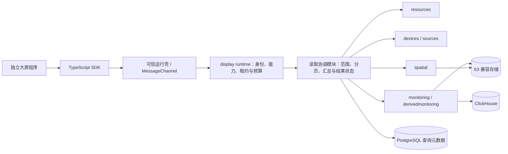

# 大屏 SDK 监测目录、详情与统计扩展开发规格

编制日期：2026-11-16。规格状态：**实施依据（用户已要求按全规格实现）**。功能状态：**Awaiting acceptance**；自验与人工验收见[实施验收账本](../verification/display-sdk-monitoring-read.md)。

本规格落实用户已确定的范围：完整补充现有系统可以提供的设施目录与详情、设备与来源、地图与空间资料，以及项目和分类监测统计；同步完成后端查询、统计、授权、控制台配置、开发工具、兼容性与自测，最终交由用户人工验收。**传感器分类和断面管理不属于本次范围。** 用户要求全规格实现后，后端、契约、迁移、SDK、工具、管理端、独立工程与自验均纳入当前实施。

本文中的新增方法、字段、权限适配、表和测试均为开发要求，不表示已实现。文档评审、开发自验、部署验证和用户功能验收分别记录。实施后状态按 In progress → Awaiting acceptance → Accepted 推进；只有用户明确确认后才可记为 Accepted。

2026-11-17 后续范围：设备分类、断面、孔位和完整混合结构现由[完整业务模型方案](sensor-classification-and-engineering-structure-proposal.md)独立扩展。本文的原范围排除不再代表平台整体缺少这些功能；新读取需显式 `structure_model: 2`，旧视图继续采用 legacy 投影。新增方法、能力和兼容规则见 [SDK 接入文档](../../packages/ts/display-sdk/README.md)及[对应验收账本](../verification/sensor-classification-and-engineering-structure.md)。

关联：[正式需求](../requirements.md) · [当前架构](../architecture.md) · [技术选型](../technology-selection.md) · [术语](../../GLOSSARY.md) · [大屏运维](../operations/visualization-display.md) · [SDK 接入](../../packages/ts/display-sdk/README.md) · [开发工具](../../packages/ts/display-devtools/README.md)。

导航：[现状](#baseline) · [范围](#scope) · [业务口径](#semantics) · [架构技术](#architecture) · [读取范围与授权](#authorization) · [接口契约](#interfaces) · [目录与设备](#directories) · [地图与空间](#spatial) · [统计](#statistics) · [一致性与连续供数](#consistency) · [管理与接入](#management) · [兼容迁移](#compatibility) · [实施交付](#delivery) · [自测](#verification) · [验收](#acceptance)。

<a id="baseline"></a>

## 0. 当前代码基线

本规格依据当前 checkout 的源码编制，包含本地尚未提交的项目改动；不以历史报告代替当前代码。此前已完成 SDK 构建、7 项客户端单测和协议一致性检查，这些检查仅验证既有能力，不构成本规格新增功能的测试证据。

| 当前实现与依据 | 本轮处理 |
| --- | --- |
| [SDK 方法](../../packages/ts/display-sdk/src/index.ts)、[类型](../../packages/ts/display-sdk/src/types.ts)、[Provider](../../packages/go/platform/runtime/display_providers.go) 已接入资源摘要、通道、监测、来源、固定成果与固定空间版本 | 保留原行为，增加完整读取接口和类型；不得只增加前端方法而遗漏服务端实现 |
| [ReadCatalog](../../packages/go/platform/resources/read_catalog.go) 只返回显式选中对象的基本字段，按 facility/component/point/channel 计数 | 不改写旧返回语义；完整目录、详情和业务分类使用新增方法 |
| [ScopedTree](../../packages/go/platform/resources/tree.go)、[List/Detail](../../packages/go/platform/resources/queries.go) 已有设施类型、层级、属性、位置、祖先路径与项目可见性 | 复用业务规则；新增大屏范围约束、批量读取与投影 |
| [设备查询](../../packages/go/platform/devices/queries.go)、[设备模型](../../packages/go/platform/devices/model.go)、[来源绑定](../../packages/go/platform/sources/model.go) 已具备档案、产品版本、输出、安装和来源关系 | 新增设备读取能力、完整授权范围、设备去重汇总和测点批量来源 |
| [空间目录](../../packages/go/platform/spatial/assets.go)、[空间读取](../../packages/go/platform/spatial/queries.go)、[坐标适配](../../packages/go/platform/runtime/spatial_resources.go) 已支持设施资料、版本、地图对象、GIS 要素、构件关联及测点定位 | 接入 SDK；补足现有定位方法的分页和总量处理，不能沿用内部 LIMIT 100 作为完整结果 |
| [全工作空间选择](../../packages/go/platform/monitoring/queries.go)、[统计](../../packages/go/platform/monitoring/analytics.go)、[派生统计](../../packages/go/platform/monitoring/calculation_analytics.go) 已有授权通道集合、快照、精确计数和后台计算 | 新增设施／设施类型分组和项目汇总，复用正式观测可见性与计算覆盖规则 |
| [大屏范围](../../packages/go/platform/display/model.go)、[绑定](../../packages/go/platform/display/bindings.go) 目前以 resources/channels/spatial/artifacts ID 集合为主，目标最多 500，动态范围仅通道 | 旧方式保留；新增服务端解析的命名读取视图和设备范围，不直接放大旧限制 |
| [查询](../../packages/go/platform/display/queries.go)、[订阅](../../packages/go/platform/display/subscriptions.go) 已有运行主体、租约、二次授权和持久事件 | 扩展领域修订、统计查询状态、分页、订阅失效和恢复 |
| [产品定义](../../packages/go/platform/devicecatalog/model.go) 没有统一传感器分类；[断面参照](../../packages/go/platform/location/position.go) 没有独立断面身份 | 本轮保持现状，不将产品／监测指标冒充传感器类别，不输出断面数量 |

现有源码说明能力可复用，不保证不经适配即可用于大屏。所有复用查询必须同时接受项目业务可见性和本实例读取范围，不能只复用控制台人员身份下的 SQL。

<a id="scope"></a>

## 1. 目标、范围与交付

### 1.1 完整范围

| 需求编号 | 必须交付的行为 | 主要落点 |
| --- | --- | --- |
| DSR-01 | 列出项目可读设施类型，按类型、状态、关键词查询具体设施 | resources、SDK、范围编辑器 |
| DSR-02 | 读取设施／构件／测点／通道的层级、详情、属性、位置、类型依据和祖先路径 | resources、SDK |
| DSR-03 | 查询项目设施地图位置；支持地图范围、分页、缺坐标状态和 GIS 要素关联 | spatial、SDK |
| DSR-04 | 按设施发现布设图、BIM、三维模型，读取获准版本、图纸页和展示文件 | spatial、SDK |
| DSR-05 | 查询构件与模型元素关系、测点挂载、对象在多份资料中的位置和固定视图设置 | spatial、SDK |
| DSR-06 | 按测点或通道批量查询设备来源、当前关系及历史关系 | sources、devices、SDK |
| DSR-07 | 查询设备档案、厂商／固定产品型号、输出、当前安装、安装历史与变更历史 | devices、SDK |
| DSR-08 | 统计项目及各设施类型、各设施的设施／构件／测点／通道数量 | resources、统计读取 |
| DSR-09 | 统计项目及各设施、各设施类型的监测数据量，可指定时间和质量 | monitoring、统计读取 |
| DSR-10 | 分别统计获授权设备与实际参与监测设备；按厂商、产品、型号或设施分组并正确去重 | devices、sources、统计读取 |
| DSR-11 | 原始通道与指定派生通道可用于最新值、明细、趋势和统计；指定派生集合不会扩展为全部派生指标 | monitoring、范围与 SDK |
| DSR-12 | 支持固定历史、完整可读历史、跟随窗口、稳定分页及统计刷新 | monitoring、查询生命周期 |
| DSR-13 | 覆盖超过旧 500 个目标限制的项目目录与统计，结果完整或明确失败 | 服务端范围、分页、后台查询 |
| DSR-14 | 完成实例级对象、字段、能力与时间授权，撤权立即影响查询、缓存、下载和订阅 | display、access、各业务模块 |
| DSR-15 | 控制台可配置、预览、发布、回退；外部工程可独立安装 SDK；旧大屏继续运行 | console、runtime、devtools |
| DSR-16 | 交付契约、迁移、操作文档、可运行验收程序、可复现测试和逐条验收证据 | 全链路 |

实施步骤是完整目标的内部顺序，不能以某组接口完成作为整轮交付。所有 DSR 项及第 14 节验收条件均完成自验后才进入功能 Awaiting acceptance。

### 1.2 明确排除

- 新建传感器分类、设备类别字典或按名称／指标推断类别；可以按现有厂商、产品、固定型号统计。
- 新建断面实体、断面管理页、断面关系迁移、断面数量统计。已有 `position.sections` 仍可作为原位置资料返回，不赋予它新的业务身份。
- 设备接入、原始报文管理、协议解析的新开发；大屏本轮读取的是已正式采用的监测数据。
- 新告警引擎、工程安全结论、设备实时在线率。设备 enabled/disabled、来源 bound/unbound、观测新旧和真实在线状态必须区分。
- 新的 BIM 建模／编辑器、真实工程模型制作、坐标测绘、桩号反算、商业底图接入和任意网络代理。
- 通用大屏设计器、项目业务大屏成品及任意写业务数据接口。交付一个覆盖规格的独立验收程序，页面用于验证接口与状态。
- 改变既有观测永久保留、派生计算规则、数据采用和撤销规则，或通过 SDK 发起计算／导出业务任务。

### 1.3 使用场景

1. 项目总览：查看各设施类型、设施和监测资源数量，查看原始数据量与已选派生结果量，按厂商／产品查看设备分布。
2. 地图下钻：选择设施 → 展开构件／测点 → 查看设备与来源 → 打开布设图或模型 → 选择指定指标 → 查询趋势和明细。
3. 历史浏览：输入上海时区的起止时刻，统计、趋势和明细采用明确时段；翻页不因新数据到达而重复或漏行。
4. 固定终端：持续更新汇总和最新值；发布更新、撤权、断线、依赖故障时展示真实状态并释放过期读取。
5. 只给汇总的大屏：允许特定分组的计数，不能因为能读汇总就读取设备序列号、监测明细、未授权对象名单或模型属性。

<a id="semantics"></a>

## 2. 业务口径与不变量

### 2.1 项目与分类

“项目全部”始终指**当前项目业务授权、实例读取授权、发布配置和当前运行身份共同允许的完整集合**。不得包含租户其他项目对象；同一租户设施可被多个项目使用，在本项目内按稳定 ID 去重。

设施类型按 `type_definition_id` 分组，类型版本另列。名称只是标签，不能按中文名称合并不同定义，也不能把同一类型的多个版本计为多类。分组标签与对象归属固定在本次查询的元数据切点。

资源数量按稳定业务对象 ID 去重；用于导航的 `visibility=context` 祖先不是可读完整资源，不计入设施／构件／测点数量。默认包含未删除的正常及退役资源并分别返回状态数量；调用者可明确筛选。删除对象仅通过合法历史读取展示，不进入当前资源总数。

### 2.2 数据量

| 字段 | 业务含义 |
| --- | --- |
| `raw.ever_published_count` | 指定可读时段内曾成功采用过的唯一监测观测数，包含后续撤销者；重复来源、再次采用及存储副本不重复计数 |
| `raw.active_count` | 当前已采用且未撤销的观测数，包含全部质量状态；不能标为“质量合格数” |
| `raw.sample_count` | 当前在用观测中满足本次质量条件、参与统计的数量 |
| `raw.quality_counts` | 当前在用观测按 good/unmarked/suspect/bad 分类的计数，不随数学统计质量筛选丢失原分类 |
| `derived.logical_output_count` | 当前可见计算成果中的逻辑输出数，采用现有派生统计定义 |
| `derived.valid_result_count` / `no_result_count` | 有数值有效结果和无有效数值结果数量；不将无结果补零 |
| `derived.sample_count` | 有效派生结果中符合本次质量筛选的样本数 |

默认质量为 `good,unmarked`，默认项目数据量读取原始通道。纳入派生通道须显式选择相应读取视图；项目原始数据视图不得自动加入所有派生通道。原始量与派生量分别返回，本轮不提供含义含混的 `total_data_count`。

所有监测计数复用正式监测引擎，不能直接对 ClickHouse 物理表 `count(*)`，也不能按导入文件行数或解析报文数统计。不同单位、方向或参考基准的通道只汇总数量和时间覆盖，不能计算跨通道平均值、极值或“综合正常率”。

### 2.3 设备计数

请求必须明确 `population`：

- `authorized`：本项目具备完整设备读取资格，且进入实例设备读取视图的设备，按 device_id 去重。只有输出授权形成的设备上下文节点不计入。
- `monitoring_bound`：在上述设备集合中，存在当前有效来源绑定，且对应业务通道和设备输出也在有效读取范围内的设备。设备多输出、多通道、多测点仍只计一台。

“设备安装在某设施”与“设备向某设施提供监测来源”分别维护。按设施查询设备时明确 `relation=installation|source`；`monitoring_bound` 采用 source，不能用安装位置替代来源关系。

同一设备可服务多个设施。按设施／设施类型分组时，组内唯一计数，项目总计再次全局去重，返回 `additivity=overlapping`；各组之和可能大于项目设备总数。按厂商、产品、产品型号分组为互斥分组。产品型号键为 `manufacturer_id + product_id + adopted_model`，`adopted_model` 取设备固定产品版本；不同厂商同型号文字不合并。

设备台账状态默认包含 enabled/disabled，另列状态计数。bound 只表示来源关系存在，不表示设备在线、正在采集或已有观测。设备、来源的当前数量不随监测历史时间范围倒推为历史台账数量。

### 2.4 时间、位置与缺失

- 时段为 RFC3339Nano 的半开区间 `[from,to)`；时间展示与自然日／月／年分组使用明确 IANA 时区，默认 Asia/Shanghai。
- 监测时间筛选作用于观测／输出时间。设施归属、类型、产品和当前来源关系取本次读取的当前元数据切点，不宣称恢复任意历史时刻的工程结构。
- 地图只标绘具有可转换地理坐标的设施。经纬度零值合法；缺位置、未知 CRS、只有桩号／局部坐标分别给出状态，不伪造 `(0,0)`，不自动继承父对象精确位置。
- 图纸像素锚点、模型局部坐标、工程位置和地图坐标保留各自坐标系与单位。源模型元素不是业务构件，二者通过显式关联连接。
- 可读集合为空为 empty；合法集合计数为零为精确零；权限不足、依赖不可用和计算未完成不能返回伪零。

<a id="architecture"></a>

## 3. 架构、职责与技术

### 3.1 调用链



display 继续拥有实例、程序包、配置、授权、发布、运行主体和 Bridge。新增 `packages/go/platform/displayread` 作为读取协调模块，集中管理新接口请求／结果、复合查询、范围证明、短期结果和统计编排；它不拥有设施、设备或观测事实。

业务查询和分组规则落在对应业务模块的只读方法中：resources 提供完整可见目录及类型汇总；devices/sources 提供授权设备、关系和去重集合；spatial 提供固定版本资料与映射；monitoring 提供固定范围的精确计数、覆盖和快照。不得把各模块私有表的规则全部复制到 display Provider。

`runtime.Compose` 安装真实实现。范围授权的 Interface 返回可复验的服务端选择与版本证明，由 display 提供 Adapter；业务读取只消费经校验的范围。仅为真实需要替换的存储、授权和后台执行建立内部 Interface，不新增通用任意查询插件。

### 3.2 技术选择

| 技术 | 使用位置与原因 |
| --- | --- |
| Go、pgx、现有业务模块 | 后端读取、权限事务、去重分组和协调逻辑；复用现有锁、错误与业务规则 |
| PostgreSQL、Goose | 范围定义、固定成员、短期查询状态、元数据投影、任务租约和修订；保证跨项目引用、事务一致性与重启恢复 |
| ClickHouse、现有监测摘要树与 math/big | 正式观测读取与精确计数，继续由 monitoring 管理可见性；不另建一套观测事实库 |
| 既有 S3 兼容存储 | 已发布空间展示文件、监测摘要及必要的大查询分块；数据库保存授权索引与校验摘要 |
| TypeScript、ESM | SDK 的方法专属请求／结果类型、精确数字、取消与生命周期；保持运行时无 npm 依赖且框架无关 |
| React、现有 UI 与表单组件 | 控制台授权、读取视图配置、预览及发布差异；复用系统 Drawer、错误提示、工作空间身份和归档规则 |
| MessageChannel、现有 SSE | 隔离应用与身份，持续供数和撤权通知；不开放任意公网或管理 API |
| Redis／进程缓存 | 可重建缓存、去重和限流；不存唯一授权、查询结果或唯一消费游标 |
| Go test/race、Node test、Playwright、现有契约生成器 | 数据库／并发、SDK、真实浏览器与外部安装验证 |

依赖版本沿用仓库锁文件，本轮不升级语言、数据库或渲染库。不新增独立部署服务；后台读取协调任务运行在现有 monitoring-worker 的独立受限执行池中，包校验 worker 继续不持有业务库／监测存储权限。

<a id="authorization"></a>

## 4. 命名读取视图与授权

### 4.1 旧绑定和新读取视图

旧 `bindings` 及 `target.binding/ids` 原样保留，既有 500 个目标限制和时间交集语义不变。

新能力通过管理端定义**命名读取视图**，例如 `project_resources`、`project_devices`、`project_raw`、`focus_derived`、`project_spatial`。读取视图只是一份服务器认可的选择约定，不复制业务对象，不是可在其他实例使用的凭据。

授权 `scope_format=2` 增加 `read_scopes`；每项具有稳定 `id`、`domain`、`selector`、`include_future`、`field_groups`，channels 另有 `time_window={from?,to?}`。不可变配置 `config_format=2` 增加 `read_views`；每个名称固定 `scope_id`、domain、selector、include_future、field_groups、可选 time_window，以及固定成员集合引用／摘要。selector 为带 kind 的判别联合，kind 只能取下表对应值。发布保存这些定义和证明，不能只存指向可变授权的名称。

Manifest 2 的 `read_view_schema` 声明名称、domain、required、用途和是否允许动态成员，不声明项目／租户身份，也不自行授权。运行查询通过 `target.view` 选择已经发布的视图；调用者传入的过滤条件只能继续收窄。

| domain | selector 的选择方式 | 可选收窄条件 |
| --- | --- | --- |
| resources | `project`、`facilities`、`ids` | facility_ids、type_definition_ids、kinds、statuses |
| channels | `project`、`facilities`、`ids` | facility_ids、source_kinds、metric_refs、owner_refs |
| devices | `project`、`ids` | manufacturer_ids、product_ids、statuses、output_ids；设施关系用于查询收窄，不推导设备授权 |
| spatial | `project`、`facilities`、`ids` | facility_ids、asset_kinds；ids 始终是固定版本 ID |

`project` 的身份从运行主体取得。`facilities` 要求明确设施 ID 集；`ids` 指该 domain 的对象 ID。只支持上述有限结构化谓词，不接受 SQL、脚本、表达式、任意 URL 或名称模糊授权。ID 相交、谓词相交、字段相交在后端执行。

devices 范围分别保存完整设备资格与可读输出资格：ids 是设备 ID，output_ids 是独立输出 ID 的白名单；二者不互相扩权。project 选择也须分别求交项目设备授权和输出授权。只有输出授权时可保存最小设备上下文供来源投影，但 devices.get 不可返回完整档案，authorized 计数不包含该上下文。完整设备授权产生哪些输出资格沿用设备领域规则，实例输出白名单可继续收窄。

channels 的 project/facilities 选择默认 source_kinds=[direct]。派生通道通过专用视图显式选择通道 ID 或固定派生指标版本；控制台必须预览匹配数量及未来成员策略，不默认勾选全部派生通道。

### 4.2 固定成员与未来对象

- `include_future=false` 为默认。保存授权／配置时分别在服务端固定当时的成员集合；后续删除或撤权会收缩有效集合，新对象不会自动进入。成员集合可大于 500，通过持久选择保存，不向浏览器一次返回全部 ID。
- `include_future=true` 须在授权与配置两处明确允许。只纳入其固定选择条件内、后来取得项目业务资格的对象；不是对租户所有未来对象的授权。
- 配置范围必须落在授权范围内。发布验证当前成员，并证明未来谓词也为子集；无法证明的组合要求收窄，不能凭当前成员暂时相同放行。
- 授权收窄、字段撤销和到期立即作用于所有发布。扩大授权本身不扩大已发布固定配置；动态配置也只按已发布谓词和已确认的未来成员策略变化。扩大配置须新配置、新准备、新发布。
- 普通列表以集合相交结果读取；单对象显式越界请求返回统一不可访问错误，不回显对象名称。required 视图发布时必须非空；运行期因合法收缩变空时返回 empty／状态事件，不自动换到其他范围。
- 空 `target` 不表示全项目。新增业务集合读取必须指定 view；views.list/describe、queries 管理方法及不读取业务对象的 basemaps/readTile 使用各自标识参数。旧方法空 target 继续使用旧同类绑定集合。

### 4.3 每次读取必须同时满足

```text
有效读取集合 = 当前项目业务可读集合
             ∩ 当前运行身份可读集合
             ∩ 实例当前授权范围
             ∩ 当前发布配置的读取视图
             ∩ 本次请求过滤条件
```

时间范围还须与通道业务授权、实例授权及配置视图时间上限相交。显式请求超出实例／视图时间上限时拒绝；项目业务授权导致的各通道覆盖差异按监测原有规则返回实际覆盖，不能把不足覆盖标为全量。

普通人员运行／预览同时检查当前人员项目权限；固定终端检查终端资格、实例授权和委托人的当前资格。项目归档仍允许已合法读取及撤权，不允许扩权、新配置和新发布。平台／租户管理员身份不自动替代项目读取资格。

统计能力与明细能力独立：有 `statistics.devices` 不等于有 `devices.read`；有 `statistics.monitoring` 不等于有 `monitoring.details`。业务对象的底层读资格仍须成立，但应用只能调用被委托的 SDK 能力。只汇总查询得到的 query_id 不能直接充当对象范围或监测 selection_id；显式下钻另须目标读取能力和字段资格。获准统计分组的最小标签属于统计结果，不因此开放任意对象名单。

### 4.4 字段、关系与二次授权

新范围使用稳定字段组：`resource.metadata`、`resource.attributes`、`resource.position`、`device.metadata`、`device.serial_number`、`device.description`、`device.outputs`、`device.installations`、`source.binding`、`history`、`spatial.metadata`、`spatial.geometry`、`spatial.properties`、`monitoring.values`、`monitoring.quality`、`statistics.counts`。旧 fields 原样解释，不自动授予新字段。

调用者可请求允许的字段组。必需组缺失则拒绝；可选组未请求则省略，不能伪造空值；明确请求未授权组则拒绝。返回 `included_field_groups` 说明本次投影。空间 properties 必须同时满足业务空间授权设置和实例字段授权，展示几何不强迫授予源属性。

省略 field_groups 时只请求对应方法的最低字段组，不自动取得所有可选字段。配置字段必须为授权字段的子集，字段组只对适用 domain 有效；各严格 DTO 固定以下规则：

| 读取内容 | 最低字段组与可选组 |
| --- | --- |
| 工程目录／详情／通道目录 | resource.metadata；详情可选 resource.attributes、resource.position |
| 设备档案／输出／历史 | device.metadata；分别可选 serial_number、description、installations，对输出还需 device.outputs，对历史还需 history |
| 来源关系 | channels 视图的 source.binding；输出／设备投影另验设备视图字段；历史另需相应视图 history |
| 设施地图 | resource.metadata＋resource.position |
| 空间目录／几何／属性 | spatial.metadata；几何／展示文件另需 spatial.geometry，源属性另需 spatial.properties；业务对象标签另需 resource.metadata |
| 监测值／质量／历史 | monitoring.values；逐观测质量另需 monitoring.quality；撤销明细另需 history |
| 统计 | statistics.counts；命名分组另需其标签领域的 metadata 字段，未获准则只能返回允许的受限上下文分组 |

表中设备可选组简写均带 device 前缀。statistics.counts 包含约定的汇总质量计数，不等于逐观测 quality 字段。主通道设置引用只需允许的通道 metadata，读取其监测值须另行获得 values。

单个关系不能隐式扩权：

1. 可读测点不等于可读所有设备；可读设备输出不等于可读设备完整档案；知道设备 ID 也不构成读取资格。
2. 可读模型不等于可读全部业务构件／测点；关联对象的名称、ID和属性按各自可见性投影。必要的上下文只用既有 context 规则。
3. 可读派生通道仍须通过递归输入资格检查，但不会把全部输入通道的明细权限授予大屏应用。
4. 目录、详情、统计、后台任务读取结果、分页、文件每一块及订阅交付前再次检查授权与主体租约。
5. 缓存键和查询证明必须包含 device_grants、spatial_grants、来源关系、资源／监测授权、字段范围、配置／环境代次；不能只沿用旧 resources/raw 两类修订。

当前 `ReadSubject` 主要承载操作授权和通道时间窗口；本轮补充对象集合与关系资格的受控解析／检查 Interface，所有新业务读取统一接入。不能把“对象已在 Provider 初次校验过”当作后续跨模块查询的永久证明。

<a id="interfaces"></a>

## 5. SDK 与运行协议契约

### 5.1 公共请求与结果

新方法使用各自的严格 DTO，不继续把所有过滤条件塞进现有通用 `Query`。未知字段、重复 JSON 键、越界 ID、无效枚举和不适用的过滤组合均拒绝。Go、JSON Schema、TypeScript 声明、测试夹具和文档必须一致。

| 公共字段 | 约定 |
| --- | --- |
| `target` | 新接口为 `{view: string, ids?: string[]}`；ids 只能收窄该视图，单次显式 ID 最多 500；监测下钻另支持互斥的 `{selection: string}`，见第 8.5 节 |
| `resource_target/channel_target/device_target/spatial_target` | 仅在方法明确需要跨领域关联时使用，均独立解析授权；省略不能自动获得其他 domain 的全部对象 |
| `search` | 最大 120 字符，按获准对象名称／编号搜索；不能搜索被隐藏设备的名称来推断来源 |
| `filters` | 方法专属、有限枚举和 ID 过滤；设施类型使用稳定定义 ID，产品过滤使用产品 ID |
| `limit/cursor/query_id` | 稳定分页；新目录默认 50、最大 200，地图最大 500；next_cursor 为空表示已结束 |
| `field_groups` | 请求该方法允许的字段组子集，按第 4.4 节处理；统计只返回约定标签与计数 |
| `range/all_history/follow_seconds/timezone/qualities` | 只用于明确支持的监测查询；三种时间模式互斥，除 latest 外不得隐式选“最近一段时间” |
| 第二参数 | 沿用 `signal` 和 `generation`；取消及视图切换释放本次消费者，不能误取消其他消费者 |

新增读取返回 `ReadResult<T>`：沿用 `state/read_at/authorization_revision/generation/source_vector`，增加 `query` 和 `included_field_groups`。ready/empty/partial 的 data 为明确业务类型；pending 的 data 为 null，并给出 retry_after_ms。该联合类型不改变旧 `Result<T>` 的类型和旧方法行为。

`query` 包含 `id`、`method`、`scope_hash`、`filter_hash`、`read_snapshot_id`、`metadata_as_of`、`created_at`、`expires_at`、`completeness`。read_snapshot_id 是本轮读取快照的标识，不能与旧 monitoring snapshot.id 混用。completeness 至少包含 `scope=complete`、`data=complete|partial|pending|not_applicable` 及有限原因码；预算不足不得返回 scope=complete 的截断集合。

新目录 `ReadPage<T>` 包含 items、next_cursor、query_id、has_more；仅在能够完整计算时提供字符串 total。统计另返回全范围 totals、分组 groups 和 group_count，翻页只分页 groups，不改变 totals。计数、修订和精确观测值均为十进制字符串；有限地图坐标、像素和 WebGL 变换仍为 number。

### 5.2 方法清单

下表方法名同时是 Bridge 注册名；SDK 通过同名 namespace 暴露。没有列出的自由 method 不可调用。

| 新方法 | 请求与返回重点 | 能力 |
| --- | --- | --- |
| `views.list/describe` | 列出本配置命名视图／读取某视图的 domain、有效策略、字段组、限制和可用状态；不返回全量 ID | `views.read` |
| `resources.types` | resources 视图中的可读设施类型目录，定义 ID、名称、涉及版本 | `resources.directory` |
| `resources.query` | 平铺资源目录；按 kinds、facility_ids、type_definition_ids、statuses 搜索分页 | `resources.directory` |
| `resources.tree` | 根设施、指定父对象的直接子级，或指定节点的祖先路径；不是一次加载整棵树 | `resources.directory` |
| `resources.detail` | 单个已获准资源的完整只读详情 | `resources.detail` |
| `devices.list/get` | 设备目录／单设备档案；get 包含可读当前安装摘要 | `devices.read` |
| `devices.outputs` | 单设备获准输出；固定输出语义、单位、状态和可读产品定义 | `devices.read` |
| `devices.history` | 按 kind=`installation`、`device_change` 或 `output_generation` 返回对应类型的历史分页 | `devices.history` |
| `sources.bindings` | channels 视图＋device_target，按 point_ids 或 channel_ids 批量返回当前来源状态与关系 | `sources.directory` |
| `sources.bindingHistory` | 单通道的来源关系历史，device_target 限定可见设备／输出 | `sources.history` |
| `map.facilities` | resources 视图的设施地图目录，支持 bbox 和位置状态筛选 | `map.read` |
| `map.features` | spatial 固定版本的 GIS 要素，关联设施另受 resource_target 限制 | `map.read` |
| `map.basemaps/readTile` | 可用于隔离大屏的底图元数据／现有 local 示意瓦片字节 | `map.read` |
| `spatial.assets` | 按设施、asset_kind、状态查询获准资料；返回资料身份和本查询固定的默认版本引用 | `spatial.catalog` |
| `spatial.versions` | 单资料的获准已发布版本目录、格式、版本号和可用状态 | `spatial.catalog` |
| `spatial.componentLinks` | 固定版本的业务构件—模型元素／图纸区域关联，须 resource_target | `spatial.links` |
| `spatial.locations` | resources 视图中的对象在 spatial_target 中的资料位置，完整分页 | `spatial.links` |
| `spatial.settings` | 固定空间版本的相机、默认页、隐藏元素和可读主通道设置；主通道须 channel_target | `spatial.links` |
| `statistics.resources` | 项目、设施类型或设施分组的资源数量 | `statistics.resources` |
| `statistics.devices` | 两种 population，厂商／产品／型号／设施分类数量 | `statistics.devices` |
| `statistics.monitoring` | 一个或多个 channels 视图中的正式数据量，按设施／设施类型分组 | `statistics.monitoring` |
| `statistics.subscribe` | resources/devices/monitoring 三种统计的持续结果；通过现有持久订阅控制发送 | 对应统计能力的描述支持 subscribe |
| `queries.get/cancel/release` | 当前主体的查询状态、结果下一页或取消／释放；方法能力与原查询能力同时复验 | `queries.read`＋原能力 |
| `queries.drilldown` | 对已完成监测统计的一个分组创建固定快照下钻选择；不返回全量通道 ID | `queries.read`＋原统计能力＋目标监测能力 |

`statistics.subscribe` 是 SDK 包装方法，不接受任意服务端方法名。其 kind=resources/devices/monitoring 分别转换为协议的 statistics.resources/statistics.devices/statistics.monitoring 订阅种类，query 使用对应统计请求 DTO；订阅输入以 kind 判别，未知组合拒绝。支持订阅由服务端 capability 的 subscribe=true 表示，不增加含义不明的 manifest 开关；原 monitoring.subscribe 保持原四种 kind。

### 5.3 既有方法的兼容扩展

- `channels.list/get`、`monitoring.latest/details/trends/statistics/overview` 增加可选 target.view 调用形态；旧 target.binding/ids 形态原样保留。使用 view 形态必须有 views.read 和对应原方法能力。
- 新 channels 请求允许 facility_ids、owner_refs、source_kinds、metric_refs 收窄；返回补充 `metric_ref={kind:engineering|derived,version_id}`，保留原 metric_version_id 的既有含义。不能用派生指标名称代替固定版本。
- 原绑定调用的数量限制保持不变。新 view／selection 调用的明细通过服务端选择分页，每页最多 1,000 条；趋势仍最多 50 个通道，超限须收窄。latest 使用分页读取，不因有全项目视图而一次加载数万条值或曲线。具体预算见第 9.5 节。
- `spatial.manifest/objects/placements/readFile` 增加 target.view＋明确 id（固定版本 ID）形态；manifest/files 不动态追随默认版本。placements 额外需要 resource_target；旧绑定调用仍沿用其既有授权规则。
- 原 resources.list/get/summary 仍保持旧基础投影；新完整字段只通过新方法获得。原 sources.get/history 仍保持原业务响应；新增来源方法使用准确的分层 DTO，不将 Current 外壳错误声明为直接 Projection。
- 旧 alerts 能力继续 unavailable，不因本轮扩展标记可用。

### 5.4 主要业务 DTO

| DTO | 必须明确的字段 |
| --- | --- |
| `ResourceSummary` | id、kind、facility_id、parent_ref、code、name、status、revision、visibility、type_ref、has_visible_children |
| `ResourceDetail` | summary、允许的 description/values/position、祖先上下文、固定定义版本和属性 schema；通道另含 metric_ref、owner_ref、source_kind、单位、方向、基准与采样说明 |
| `DeviceDetail` | id、code、name、status、revision、固定 product_version_ref、manufacturer_ref、采用型号；按字段授权返回 serial_number、description、current_installation |
| `DeviceOutput` | id、device_id、slot_key、generation、started_at/ended_at、metric_ref、unit_ref、值形态、时间含义、方向／基准、当前状态；不返回解析凭据 |
| `SourceBindingItem` | channel_ref、point_ref、state、source；source 为获准关系（device_ref 区分 full/context）或 `{configured:true,visibility:restricted}`，受限时无隐藏 ID／快照 |
| `FacilityMapItem` | facility_ref、type_ref、position_status、原位置依据、可用 longitude/latitude、coordinate_crs、position_notice |
| `SpatialAssetItem` | id、facility_ref、kind、category、code、name、status、source_note、resolved_default_version_id 或 null、default_state |
| `SpatialRelation` | version_id、业务对象 ref、page_id／element_key、anchor／region、坐标依据、basis_changed；业务对象投影按自身授权 |

DTO 不返回管理 Actions、成员身份、租户内部权限快照、原始审计 before/after、存储 object_key、下载许可或长期 URL。历史 DTO 使用领域已有的安全历史投影，不能原样透传数据库历史 JSON。

### 5.5 错误与查询生命周期

| code | 适用情况与客户端动作 |
| --- | --- |
| `query_invalid` | 参数或组合无效，修正字段；issues 指向具体路径 |
| `capability_unavailable` / `version_incompatible` | 能力未接入／版本不兼容，阻止依赖它的发布或明确降级 |
| `binding_invalid` / `scope_unavailable` | 配置读取视图失效；重新读取配置状态，不扩大范围重试 |
| `not_found` | 对象不存在或不可读，统一外观，不能区分隐藏对象是否存在 |
| `field_not_granted` | 显式请求了不可读字段组，不自动回退为其他字段 |
| `query_expired` / `invalid_cursor` / `reset_required` | 快照过期、筛选不匹配或授权变化；清除旧分页并重新建立查询 |
| `budget_exceeded` | 范围、并发、耗时或结果超预算；明确预算维度，不提供伪完整结果 |
| `dependency_unavailable` / `query_failed` | 依赖故障／后台任务失败，保留原因码；不能当作数据量零 |
| `revoked` / `session_expired` / `aborted` / `disposed` | 停止消费并释放本地结果／对象 URL，沿用运行壳处理 |

新查询的状态为 queued/running/ready/partial/empty/failed/canceled/expired；对外 envelope 用 pending 表示 queued/running，失败走稳定错误。首次读可同步完成；后台读必须返回 query.id 和 retry_after_ms，`queries.get` 读取同一固定查询，不重新发起工作。cancel/release 是当前运行主体的临时查询管理，不是业务数据写操作。

首次请求和每次翻页都需原方法能力与原授权。分页携带原 query_id、cursor 和原筛选；服务端固定排序、查询范围、分类标签与时间切点。统计产生的 query_id 没有明细用途；向其他方法提供该句柄必须拒绝。

<a id="directories"></a>

## 6. 工程目录、设备与来源读取

### 6.1 资源目录与详情

resources.query 支持跨设施平铺查询；resources.tree 支持 root、children、path 三种有限模式。children 必须指定 parent_ref；path 必须指定 node_ref；二者互斥。路径可包含最小 context 祖先以保持导航，但不能借树路径返回未授权完整属性或隐藏兄弟数量。

类型目录只来自当前视图中有完整设施读取资格的设施类型。版本标签固定于查询快照。查询搜索、类型／状态过滤和授权均先于分页；默认排序按 kind、code、id，显式支持的排序只有 code、name、created_at，均以稳定 ID 作为最后排序键。

完整详情按业务资源字段返回，values 与固定定义 schema 对齐；属性中的精确整数／小数依照定义保持精度。测点可挂在设施或构件，构件可以多层；派生通道可归属于设施、构件或测点，不强制伪造 point_id。

### 6.2 设备目录与档案

devices.list 支持 manufacturer_ids、product_ids、product_version_ids、statuses、installation_state，及需要额外关系证明的 facility_ids＋relation。当前项目设备完整授权与输出单独授权保持独立。

`relation=source` 需要 channel_target，从当前有效绑定解析参与设备；`relation=installation` 读取设备当前安装关系，所显示工程对象另受 resource_target 限制。不提供任意关系级联或通过一个设备列出其他项目设施的能力。

devices.get 返回设备固定采用的产品版本与厂商摘要，不能将产品最新发布版本冒充该设备当前型号。devices.outputs 仅返回当前可读输出；历史代次通过 devices.history 明确选择 output_generation。任何情况下，设备授权都不自动展开未获准输出。

devices.history 的三种 kind 使用各自固定排序和 DTO；安装历史记录包含开始／结束时间、目标投影、位置依据与必要状态。跨项目创建的历史按当前业务历史规则隐藏人员和受限对象，已结束关系不因当前完整设备可读而自动放开所有历史对象。

### 6.3 批量来源

sources.bindings 的 target 是 channels 视图，一次按最多 100 个测点或 500 个通道查询；两种参数互斥。每个测点的通道集合在该 target 内分页，不能只返回每点第一个通道。分页以 channel_id 固定排序，返回测点引用，允许前端分组展示。device_target 用于获准设备／输出投影；省略时只返回通道自身来源状态及受限说明，不隐式取得项目全部设备。

来源 state 为 unbound/bound/restricted/ended/attention/not_applicable；derived 通道为 not_applicable，不返回物理设备来源。当前有效关系的设备状态异常或输出结束可为 attention；没有实际观测不改变关系是否已绑定。

受限来源最多说明已配置且不可见。不得返回 device_id、output_id、厂商、型号、历史快照或通过排序／搜索暗示隐藏身份。来源历史按 started_at、binding_id 稳定排序，保持当时输出／通道语义依据；不是设备物理安装历史。

只有输出授权但输出确实可读的来源，可返回该输出及领域允许的最小设备 context，device_ref.visibility=context；不得带出序列号、完整档案或设备其他输出。它与完全不可读的 restricted 来源分开，且不计入完整授权设备数量。

<a id="spatial"></a>

## 7. 地图、布设图、BIM 与三维模型

### 7.1 地图目录

map.facilities 复用工程位置与空间坐标能力，返回 EPSG:4326 经纬度及原位置依据，支持设施类型／状态／关键词和 bbox 收窄。bbox 是 west/south/east/north，经度在 [-180,180]、纬度在 [-90,90]，均为有限数；south 必须小于 north，west 不能等于 east。west<east 为普通范围，west>east 为跨日期变更线的两段经度范围，边界点纳入并按设施 ID 去重。

无 bbox 时，位置状态筛选为 `all|located|missing|unsupported`；all 返回无坐标设施并标注状态。指定 bbox 时只返回范围内可定位设施，不能把缺坐标设施塞入某一地理范围。响应分别给出视图内可定位／缺失／不支持数量与当前 bbox 命中数，均只覆盖合法设施集合；全范围计数使用与本页相同快照。

map.features 必须给定获准 GeoJSON 空间版本 id，按 bbox/search 分页。若请求设施关联，须提供 resource_target；仅可读图层不产生关联设施详情权限。读取 manifest 不能假设其中已内嵌完整 features，实际要素通过分页方法取得。

### 7.2 底图和隔离运行

map.basemaps 提供 blank 与现有 local 示意底图的 ID、范围和 attribution；local 必须保持“合成示例，非测绘资料”的标识。map.readTile 只接受当前运行时公布并允许的 local basemap_id 与合法 z/x/y，返回 PNG 字节；不接收 URL。二者检查运行主体、map.read 和空间浏览资格，不需要业务对象 target；blank 不发起瓦片请求。

已有外部底图配置如不能在当前隔离与授权机制内供数，返回明确不可用原因，不把含许可的 URL 交给应用，不实现任意代理。本轮验收可使用 blank 或 local，设施坐标来自工程资料。

### 7.3 资料发现与固定版本

spatial.assets 按 layout/model/geolayer 查询；布设图 category 沿用原分类，包括 monitoring_section，但该分类不产生断面实体。BIM 与普通三维模型通过固定版本 format/source_format 等已有语义区分，不能只凭文件名猜测。

目录默认采用项目获准的默认版本，不使用租户最新版本替代。无项目默认版本返回 default_state=unset；可列出获准版本由应用明确选择。当前默认不在实例空间视图中时返回 default_state=unavailable，不泄露未授权版本 ID，也不静默选其他版本。

首次查询将默认版本解析为确定 version_id；后续 manifest、元素、挂载、设置和文件均使用该版本。固定成员视图不会跟随新版本；显式允许未来成员的视图可在**新查询**中解析新的项目默认版本，既有查询继续使用原版本，撤权除外。

### 7.4 图纸、模型与关联

- 图纸通过 manifest 页列表和发布展示图像读取，保留页号、尺寸、裁切／旋转和坐标依据。
- 模型通过发布 GLB 等展示文件、源元素树、类型／实例属性和变换读取；公开 DTO 精确定义元素、片段及属性结构，不用无说明的 JSONValue 代替核心关系。
- componentLinks 返回业务构件与 element_key／图纸 region 关系；placements 返回测点锚点、element_key、标签偏移和依据变化；两者都检查资源读取范围。
- locations 返回同一对象在多份资料／多个版本中的位置并完整分页。当前内部候选 LIMIT 100 和结果数量保护须改成可分页实现，不能静默遗漏第 101 份资料。
- settings 返回固定版本相机、默认页、隐藏元素；main_channels 仅保留在 channel_target 内且可读的指定通道。未配置与已配置但不可读分别标注，不替换为任意第一个指标。
- 核心属性、坐标依据与关系字段分开；未取得 properties 字段授权时仍可按 geometry 权限绘制允许的展示内容。

SDK 继续只读取已发布展示产物；原始 IFC/PDF 下载沿用系统原件能力，本轮不通过大屏扩权开放。readFile 保留分块、摘要、当前授权复验和 Blob URL 释放；应用加载模型不获得存储地址或永久下载许可。

<a id="statistics"></a>

## 8. 项目、分类与设施统计

### 8.1 统一统计契约

统计在服务端对完整有效集合执行，前端不逐页累加求项目总数。请求一次只支持一个 group_by，不能提交任意多维 SQL；需要切换维度时发起明确的新查询。

| 方法 | 范围与必需选项 | group_by | 返回 |
| --- | --- | --- | --- |
| statistics.resources | resources target；channels 计数另需 channel_target | none、facility_type、facility | totals、groups、context_excluded、group_count |
| statistics.devices | devices target、population；source 关系需 channel_target，设施分组需 resource_target | none、manufacturer、product、product_model、facility_type、facility | unique_device_count、status_counts、groups、additivity |
| statistics.monitoring | targets：1–16 个 channels 视图；source_kinds；明确时间模式、qualities；设施标签需 resource_target | none、facility_type、facility | raw、derived、coverage、groups、group_count、count_basis |

group_by=none 不返回分组行；其他维度按稳定分组键排序，支持分组分页。资源与监测按单一设施归属分组为 `additivity=disjoint`，组计数应可与同范围 totals 对账；设备设施分组按第 2.3 节为 overlapping。

`totals` 表示本请求完整范围，不表示未授权的真实项目总量；`groups` 分页不影响 totals。已有可读设施即使无测点、无设备、无观测，也可返回零计数组；无权读取的设施不能以“零值组”暴露。没有可读工程归属的对象按 `unassigned` 或 `restricted_context` 分组，二者不得带隐藏 ID／名称；此类分组是否包含计数取决于对象本身是否已获统计资格。无法判断资格则失败，不能把未知数量放入“其他”。

统计响应包含 `definitions_version="1"`、population、group_by、实际筛选、单位与去重键说明。应用可据此显示“已采用未撤销观测”“所选质量样本”“当前有效来源设备”等准确标题，不能只显示无口径的“总数据”。

### 8.2 工程资源统计

计数对象为 facility/component/point/channel 的稳定 ID；上下文祖先不计入。分别返回总量和领域原有状态分项，不能用“正常”统称所有可读对象。

设施类型取设施固定 type_definition_id；其子构件、测点、通道沿可读的当前父链归组。类型版本升级不创建新的设施类型组。派生通道归属按 owner_ref 解析，不假设全都位于测点下。

channel_count 必须来自明确的 channel_target 与资源可读关系交集，另外返回 direct_channel_count、derived_channel_count。只给 resources 视图而没有通道统计资格时，通道计数标记 unavailable／省略，不返回零。资源目录中的“存在通道子节点”不自动等于监测统计资格。

### 8.3 设备统计

按第 2.3 节构造去重设备集合，再进行分组；不得直接数来源绑定行、设备输出行或安装历史行。

- authorized、group_by=none/manufacturer/product/product_model 不要求来源关系。
- monitoring_bound 必须有 channel_target，只计当前有效、当前通道／输出都获准的来源；无来源设备不计入，受限来源不能为设备计数贡献隐藏身份。
- 按设施／设施类型分组必须明确 relation；monitoring_bound 只能为 source，authorized 可选 installation 或 source。只有 source 分组可以让一台设备出现在多个设施中。
- 厂商、产品及采用型号标签取本查询固定元数据。当前产品定义有了新版本，既有设备分组不自动改用新型号。
- 同设备同时通过多个视图、多个输出或多个测点命中，只计一台。设施分组的全局 totals 使用同一去重集合，不能求 groups 之和。
- 没有分组依据的已授权设备进入 unassigned 组，仍计入 authorized 项目总计。部分产品信息被限制时不泄露名称或借搜索反查。

### 8.4 监测数据量与覆盖

每个 channels 视图先独立求 `业务时间窗口 ∩ 实例时间窗口 ∩ 配置时间窗口 ∩ 请求时段`。多个视图的同一通道允许窗口取并集，重叠段去重、间隔保持不连续，不能合成从最早至最晚的一整段窗口。显式请求超出某个视图声明的硬时间上限时拒绝该请求；不以另一个较宽视图掩盖错误。all_history 表示这些有效窗口内的完整历史。

在确定窗口中，原始计数以唯一 observation_id 和正式采用／撤销事实为准；派生计数以固定计算头和逻辑输出身份为准。设施类型、设施和项目汇总共享一份通道集合、时间窗口及版本向量。

返回内容必须包括：

1. 第 2.2 节的 raw 与 derived 分栏；未请求的种类标记 `not_requested`，不是数值零。
2. requested_range、effective_windows 的可分页摘要、timezone、qualities，以及 scope_channel_count、raw_channel_count、derived_channel_count；不输出隐藏通道清单。
3. 各种类的 coverage：完整覆盖区间、缺口、尚在计算／失败／需重算的状态和更新时间。coverage 条目可能很多时单独分页，不能截断后宣称完整覆盖。
4. metadata_as_of、监测快照依据、raw watermark、派生头摘要、读取时刻；存储路由修订仅作为受控不透明摘要，不暴露节点地址。
5. 当前授权窗口内的 first_time/last_time；无观测为 null，不用当前时刻或零值替代。

优先复用可证明匹配范围、修订及质量口径的持久汇总；缺失边界用正式读取计算，不能因汇总尚未建立而返回零。超出同步预算进入后台精确计算，仍返回同一 query.id；不使用未标识的估算计数。

派生未完成或有计算缺口时，已可见结果可返回 partial，同时明确“当前可见成果计数”与覆盖不足。全部依赖不可用则返回错误／pending；不能以空数组宣称已完成。统计读取不会触发派生业务重算；大屏只读取系统已有成果及状态。

不同通道的均值、极值、标准差仍使用原 monitoring.statistics 的逐通道结果；本轮项目统计只增加数量和覆盖，不添加跨指标的综合数学值。

### 8.5 统计下钻与明细对账

查询完成后，`queries.drilldown({query_id, group_key, basis, purpose})` 可创建不透明 selection。仅允许 statistics.monitoring 的全范围或真实分组；basis 为 raw_active/raw_samples/derived_logical/derived_samples，purpose 为 details/trends/statistics。每次同时校验原统计能力、目标监测能力和 monitoring.values 等必要字段。

下钻选择固定父查询的成员、当前工程分组、时间窗口、质量和监测修订；服务端投影子选择的监测快照，不能先取得旧总数再自动读取“最新”明细。不能用任意 group_key、改写 basis 或附加新 ID 扩大集合。only-summary 应用调用下钻必须失败，不能获得通道 ID 或可复用 monitoring selection_id。

子查询通过 `target:{selection: opaqueToken}` 使用，并绑定原主体、实例、配置、租约和到期时间。令牌是服务端查询引用，不可脱离当前运行会话作为凭据；禁止跨用户／跨终端／跨实例复用。

- raw_active 对应所有质量、当前未撤销明细；raw_samples 对应本次质量条件的明细，逐页条数必须等于相应计数。
- derived_samples 对应可见且满足质量的有效结果；derived_logical 的明细包含无结果状态，不能用数值 0 填充。
- ever_published_count 的复核使用正式历史查询按 observation_id 去重，不声称它等于带多次采用记录的历史明细行数。
- 趋势仍受最多 50 通道限制；大分组可先在既定 selection 内收窄。不得为绕过限制自动删除部分通道。
- 子查询存续期不能超过父查询或主体租约；撤权、删除及环境代次变化使父子查询一并失效。

独立发起的目录、统计、最新值可能有不同 as_of。界面应显示各自读取时刻；需要严格对账时使用上述下钻，不能承诺不同时间发出的任意请求都有相同数字。

<a id="consistency"></a>

## 9. 一致性、后台读取与连续供数

### 9.1 读取快照

一个读取快照固定：配置／发布标识、主体资格、授权修订、字段投影、元数据及分组映射、监测窗口与 raw/derived 修订。PostgreSQL 负责元数据一致性，监测引擎负责水位及计算头；这是可说明的版本向量，不宣称 PostgreSQL 与 ClickHouse 存在跨库事务。

新目录和统计分组第一次读取时生成稳定键集／安全投影，持久化短期查询结果供后续分页；不得把数据库长事务跨多次 HTTP 请求一直保持。结果按筛选、排序、版本和主体绑定，游标经服务端签名或不可猜测引用验证，禁止 offset 分页导致新增／删除时跳行。

数据新到达、名称改变或资料新发布不会改写既有查询；新查询看到新结果。授权撤销、对象删除或范围失效必须优先使已有结果不可读取。历史资料依据与普通数据更新是否需要 reset 由领域修订明确标记，不把所有更新误判为撤权，也不能让撤权按普通缓存 TTL 等待。

### 9.2 后台查询与取消

超过同步预算时登记持久只读查询和后台工作，返回 pending。后台执行器属于已有 monitoring-worker 的独立读取任务池；监测精确汇总可以调用现有 monitoring 后台分析，不能同时创建两套不一致的观测统计事实。

每个工作项包含受控运行主体引用、查询输入摘要、快照依据、租约、fencing token、尝试次数、截止时刻和取消标记。领取、续租、完成均复验；worker 重启可恢复未完成查询，过期 worker 不能覆盖新结果。租约失效、配置变更、撤权和用户取消均停止后续执行与交付。

普通短查询不生成任务中心记录和通知。持续后台读取可按现有任务规范提供受权限控制的执行进度，但不发送每次刷新通知，不创建伪人员身份代替 display_subject_id。查询状态是持久事实，Redis 和进程内 Promise 不是唯一来源。

SDK signal 取消单消费者等待；服务端 cancel 取消本主体独占的查询，release 释放消费者引用及缓存租约。相同输入共享计算时采用引用计数，最后一个消费者离开后才取消无其他用途的工作。重复取消和释放必须幂等。

### 9.3 缓存与失效

缓存键至少包含 tenant/project、有效主体／可安全共享的授权指纹、实例、发布／配置、scope/filter hash、字段组、时间／质量、元数据与监测修订。只按 project_id 或请求文本缓存属于不合格实现。

资源改动、设备／输出授权、设备固定产品、安装关系、来源关系、空间授权／项目默认版本、派生输入资格、环境代次均纳入对应修订。相关写事务提交后发出可靠失效依据；消费缓存前仍二次授权，不能只依赖事件送达。

缓存命中、命中后台结果、读取下一页、文件每块和 SSE 交付必须复验当前资格。授权变化返回 reset_required 或 revoked；SDK 清除旧结果及对象 URL。已交付到客户端的字节无法远程收回，规格保证撤权后不再供数，并要求可信运行壳及时清屏和释放。

### 9.4 持续统计与断线恢复

三种统计订阅采用完整结果替换／结果版本通知，不依赖客户端累计增量。事件包含 subscription_id、generation、sequence、query 引用、状态和修订；按现有 durable SSE 至少一次投递，SDK 去重并丢弃旧 generation。

统计结果有多页时事件只通知新的完整查询，前端按新 query.id 取组分页，禁止把旧 totals 与新 groups 混用。重连可恢复仍在保留窗口内的事件；超窗、环境恢复或授权变化发送 reset，重新建立合法查询。慢消费者合并中间状态，不能持续堆积全量统计对象。

follow_seconds 每轮以服务端时钟固定窗口终点；每次新窗口形成新查询快照。range/all_history 默认只在相关事实修订变化时刷新，按配置的最小间隔限速；没有变化不重复全项目扫描。设备和资源统计不能接受监测 range 参数假装返回历史资产状态。

### 9.5 默认工程预算与性能验收

以下为本轮要实现并验证的默认预算，不是当前系统已测性能。限额配置由服务端控制，通过 capabilities/views.describe 公布，应用不能自行提高。

| 项目 | 默认预算／行为 |
| --- | --- |
| 单视图有效成员 | 每个 domain 最多 50,000；超限明确 budget_exceeded，禁止截为前 50,000 |
| 监测统计合并选择 | 去重后最多 50,000 通道；同通道多视图不重复占用成员配额 |
| 单请求显式 IDs | 最多 500；完整项目通过命名视图读取 |
| 目录／组分页 | 默认 50，最大 200；地图最大 500；source 批次按第 6.3 节 |
| 监测明细／最新值 | 明细每页最大 1,000；view latest 每页最大 200，不对全项目强制一次返回 |
| 趋势 | 最多 50 通道，沿用原分辨率与点数预算 |
| 同步读取 | 总截止不超过 15 秒；预计超过 2 秒的统计可转后台，目录首次物化也可 pending |
| 后台读取 | 每实例默认最多 2 个活跃计算，等待／执行总截止默认 120 秒；超时为失败，可明确重试 |
| 查询寿命 | 默认 15 分钟，且不超过运行主体租约；过期明确重建，不能复用旧游标 |
| 并发／订阅 | 沿用运行时并发限额，单运行主体最多 16 个订阅；后台池有项目及租户公平配额 |
| 结果／文件块 | 沿用单结果 8 MiB、文件单块 4 MiB 上限；用字段裁剪和分页满足，不截断字段内容 |
| 刷新 | 监测统计最短 10 秒，资源／设备统计最短 30 秒；不能改变撤权即时失效要求 |

性能自测固定机器／容器配额和数据规模，记录冷／热查询、p50/p95、SQL 次数、CH 扫描量、内存、后台排队与取消耗时。至少验证 2,000 个工程对象、600 个通道、100,000 条正式观测和 10 个同时运行实例。目录页与缓存后汇总的目标 p95 ≤ 2 秒，冷汇总允许 pending 但须在上述后台截止内完成；授权撤销后下一次读取及下一次交付不得成功。

这组负载是可复现开发验收，不能称为生产容量认证。达到成员预算边界用专门夹具验证准确性与拒绝行为；生产规模、硬件、存储拓扑与实际吞吐另附测量记录，未测项如实标明。

<a id="management"></a>

## 10. 管理端、权限与外部工程接入

### 10.1 配置、授权与发布流程

在现有项目大屏管理工作区完善以下流程，沿用系统 Drawer、确认框、项目上下文、空态和错误反馈，不新增独立后台或设计器：

1. 上传程序包后展示所需／可选能力、命名读取视图、用途及字段要求。缺失 Provider 的能力显示不可用，必需能力不可用阻止发布。混合旧绑定和新视图的包，分别列出两条访问契约仍允许的数据，不能把新视图的字段收窄误表示为旧绑定同步收窄。
2. 授权编辑器分别配置 resources/channels/devices/spatial 范围、字段、时间上限和未来成员策略。选择项目范围时展示“本项目当前授权且本实例获准”的含义，不显示“租户全部”。
3. 配置编辑器把程序声明的视图映射到授权范围，支持按设施类型／设施筛选、选择指定派生通道或固定指标版本、预览样本与完整匹配数量。选择控件服务端搜索分页，支持超过 500 个成员。
4. 保存产生不可变 config；prepare 显示能力、当前匹配数量、时间覆盖、资料默认版本、字段投影、动态扩展风险和验证错误。样本与总量都受当前操作者权限限制。
5. 真实预览使用与正式运行同一条领域读取和授权链。可用配置但未发布时，不能临时借操作者的宽权限绕过实例授权。
6. publish 固定包、config、授权证明与环境代次；发布前重新校验 prepare 依赖修订。资料更新／授权变化后旧 prepare 不能直接发布。
7. rollback 回到历史包和配置，同时重新应用当前业务权限和实例授权，不恢复已撤销权限；新主体启动，旧查询与订阅关闭。
8. 授权收窄和撤回实时影响既有终端；界面显示受影响能力／视图及原因。项目归档沿用现有只读规则。

新增管理查询为 `POST .../displays/instances/:id/read-scope-preview`（范围、数量和样本预览）与 `GET .../displays/instances/:id/read-scope-options`（有限候选目录分页）。操作必须分别受现有 configure/grant 操作资格约束：请求带 purpose=config 或 grant；服务端执行相应资格，不允许客户端用较低权限的 purpose 返回更宽结果。候选仍受当前人员业务读取资格限制。

现有 grant/config/prepare/publish/preview/rollback 路由扩展版本化 DTO。所有运行态读取继续经隔离壳的受控查询协议，不新增无需运行租约的公开业务读取接口。OpenAPI、操作目录、权限生成和客户端同步更新。

### 10.2 能力与业务权限

下表是最低业务操作资格；对象、字段、时间与递归输入检查仍需另外通过。SDK capability 不是新增项目角色，也不能替代业务权限。

| 新能力 | 最低项目业务权限／附加条件 |
| --- | --- |
| resources.directory、resources.detail | project.engineering.resource.read |
| devices.read | project.device.read；展示工程安装目标时另验 resource.read |
| devices.history | project.device.read＋project.device.history.read；可见历史对象按领域规则 |
| sources.directory | project.engineering.resource.read＋project.monitoring.data.read；完整设备投影另验 project.device.read |
| sources.history | 上一项＋project.engineering.resource.history.read；设备／输出历史投影另验 project.device.history.read |
| map.read | project.engineering.resource.read；GIS 要素、空间设置和底图另验 project.spatial.view |
| spatial.catalog、spatial.links | project.spatial.view＋project.engineering.resource.read；主通道另验 project.monitoring.data.read |
| statistics.resources | project.engineering.resource.read；通道计数另验 project.monitoring.data.read |
| statistics.devices | project.device.read；设施关联另验 resource.read，source 关联另验 monitoring.data.read |
| statistics.monitoring | project.engineering.resource.read＋project.monitoring.data.read；派生沿用递归输入资格 |
| views.read | 当前大屏运行资格；只返回本配置可知的视图描述，不提供业务对象详情 |
| queries.read | 当前大屏运行资格＋原查询能力／业务资格；下钻额外检查目标能力 |

表中 resource.read、monitoring.data.read 的简写均为同表 project 前缀权限。既有 monitoring 方法继续执行其原有业务操作授权；读取撤销观测历史另验 project.monitoring.data.history.read、通道 history 窗口及实例 history 字段。既有 overview 的 ever_published_count 汇总语义保持不变，它不授予撤销明细读取资格。

委托资格必须由 capability 的最低权限、已授字段组及可用请求模式共同确定。保存授权／发布／运行时复验都检查这些附加权限；ReadSubject 的操作集合只取当前委托人、运行人员和实例允许操作的交集，不能仅复用旧 permissionsFor(capabilities) 而漏掉 history、空间、安装或关系的附加资格。

本轮不把所有新增能力自动加入既有实例或项目角色。具备现有业务读权限的人员可在授权操作中委托相应新能力；需要哪些 capability 由具体程序的 manifest 和实例 grant 明确列出。旧 sources.read 的历史权限集合保持原样，不因新来源目录拆分而改变旧应用资格。

### 10.3 包与读取视图声明示例

以下是拟议 Manifest 2 的节选，files 等既有必填字段仍由打包工具生成；不是当前已可运行配置。计数专用程序可以只声明统计能力，不要求明细能力。

```json
{
  "manifest_version": 2,
  "sdk_protocol": { "major": 1 },
  "required_capabilities": {
    "views.read": 1,
    "queries.read": 1,
    "statistics.resources": 1,
    "statistics.monitoring": 1
  },
  "read_view_schema": {
    "project_resources": {
      "domain": "resources",
      "required": true,
      "purpose": "设施分类和数量",
      "allow_dynamic": false
    },
    "project_raw": {
      "domain": "channels",
      "required": true,
      "purpose": "项目原始监测数据量",
      "allow_dynamic": true
    },
    "focus_derived": {
      "domain": "channels",
      "required": false,
      "purpose": "指定派生监测指标",
      "allow_dynamic": false
    }
  }
}
```

allow_dynamic 只表示程序能处理未来成员，不能替代授权与配置中 include_future 的明确选择。字段组由相应方法的最低需求和配置／授权共同决定，程序声明不能自行扩权。

### 10.4 SDK、工具与独立验收程序

SDK 保持与框架无关的 ESM 和 TypeScript 声明；新增 DTO、错误联合、计数 string、查询状态、分页／下钻、订阅消费者和清理行为。旧导出与旧调用保持兼容；不能只让仓库内应用依赖未打包的内部源码。

开发工具同步支持 Manifest 1/2 校验、模板、模拟 Bridge、真实预览、打包、上传与恢复。模拟场景至少覆盖 normal、empty、pending、partial、disconnected、revoked、unavailable、overlap、scope-changed，始终标识模拟数据。模拟不能代替正式后端授权测试。

交付拟新增的 `examples/display-monitoring-read` 独立工程，具备以下验收面板：项目统计、设施树与地图、设备与来源、指定指标与时间筛选、图纸／模型查看、状态与诊断。使用现有可打包渲染依赖，运行中不从 CDN 拉库；SDK 自身不强绑定地图／BIM 渲染引擎。

独立工程必须在仓库外临时目录安装交付 tgz 后构建，通过工具校验、打包、上传、真实预览及固定终端运行。例子展示 pending 轮询同一 query、partial 说明、分组分页、能力缺失和销毁释放，不用无限自动重试掩盖错误。交付 README 写出安装、启动、配对、范围配置、指定派生通道、发布和验收步骤，所有占位 ID 明确说明。

<a id="compatibility"></a>

## 11. 版本兼容、数据迁移与恢复

### 11.1 兼容策略

| 层 | 本轮约定 |
| --- | --- |
| SDK／开发工具 | 以 1.1.0 为本轮计划发布版本；增加导出和 overload，不改变 1.0 调用的返回含义 |
| Bridge | 保持 major=1；新能力使用新 capability 名称且 version=1；不把旧同名能力直接改成 version=2 |
| Manifest | 新读取视图使用 manifest_version=2；服务端／工具同时识别 1、2，未知版本拒绝 |
| scope/config | scope_format、config_format 缺省为 1；2 才启用新字段。未知格式拒绝，绝不能按空范围／全部范围处理 |
| 旧绑定／接口 | 数量、时间交集、精度、错误和字段投影保持；旧发布不自动升级为项目视图 |
| view 调用 | 返回新的 ReadResult/ReadPage 联合类型；旧绑定返回原 Result/Page；SDK 类型必须按请求形态区分 |
| 能力描述 | 保留旧 max_targets；新增 max_view_members、分页及异步限制，不把 50,000 成员误表述为单请求显式 IDs 上限 |

新 SDK 在旧运行时中连接后能识别可用能力；调用新方法得到 capability_unavailable/version_incompatible，不回落到更宽的旧接口。旧 SDK 在升级运行时仍按原协议工作。required 新能力缺失时阻止发布；optional 缺失允许程序按声明处理。

### 11.2 持久化变更

本轮拟增／扩以下 PostgreSQL 数据，具体迁移序号在实施时按仓库最新序列分配，不预占正在开发的编号：

| 数据 | 所有者与约束 |
| --- | --- |
| 现有 display grants/configs 的格式及新范围定义 | display；旧字段原样保留，配置仍不可变，JSON 严格校验 |
| display_read_scope_sets / display_read_scope_members | displayread；授权／配置固定成员集合与摘要，tenant/project/domain/owner 外键，设备与输出成员分类型，不与业务事实混用 |
| display_read_queries | displayread；运行主体、原方法、范围／过滤摘要、修订、状态、快照引用、expires_at、取消信息；跨主体读取不可行 |
| display_read_query_rows | displayread；稳定排序的安全目录投影／分组结果，绑定 query_id；按 query＋ordinal 唯一，按期限清理 |
| display_read_jobs | displayread；仅读取协调、物化与聚合工作，租约／fencing／重试；监测子计算复用 monitoring_jobs，不另存观测事实 |
| 授权／来源／空间修订依据及索引 | 各领域拥有；关系写事务内更新或提供已有等价版本，查询证明覆盖实际依赖 |

固定成员集合随授权／配置生命周期保留，不能按临时查询 TTL 清理。发布引用的 config 和 scope set 必须受引用约束。临时查询到期清理 rows、临时结果对象和 worker lease；不删除正式观测、发布空间文件、设备历史或已发布大屏包。

索引以实际查询证明：项目资源可见集合、设备完整／输出授权、当前来源 channel/output/device、设施归属、空间项目授权／默认版本、查询主体与过期时间、待执行工作领取。不得为每个 UI 筛选盲目建一个索引；验收提交典型 EXPLAIN 与查询次数。

不迁移传感器分类或断面实体，不重写既有观测历史，也不新建与监测引擎平行的“总数据量事实表”。

### 11.3 升级、回退与联合恢复

采用兼容的先扩表、再升级服务端／worker／可信壳、再启用 Manifest 2 发布、最后交付新 SDK 的顺序。新包启用前确认所有参与校验与运行的节点支持新格式；混合版本节点不能忽略未知 scope/config 或误读新发布。

如果部署不具备按协议版本路由能力，升级期间暂停新格式发布，待相关节点全量升级后放开。旧业务大屏继续使用格式 1，不要求用户立即重打包。

业务回退到历史大屏版本执行第 10.1 节规则；二进制降级到不识别格式 2 的旧版本前，必须停用／回退所有新格式发布并使新运行主体失效，不能只降级服务后让它自行猜测。数据库回滚不得删除仍被发布引用的集合；优先保留兼容扩表数据。

联合恢复时按现有 PostgreSQL、监测存储、对象存储一致性流程处理，推进环境代次，强制旧运行会话、游标和后台工作失效。固定配置和范围集合可恢复，临时 query 结果允许重建。Redis 丢失不得扩大权限或丢失唯一任务事实。

<a id="delivery"></a>

## 12. 实施顺序与完整交付物

下面是完整实施的内部顺序，不构成范围裁剪。用户已要求全规格实现；最终自验与人工验收分别记录在实施验收账本。

| 内部步骤 | 主要工作 | 完成证据 |
| --- | --- | --- |
| I1 契约与授权范围 | DTO、Manifest 2、scope/config、能力表、ReadSubject、迁移及领域修订 | 旧新契约、严格解析、范围子集与授权隔离测试 |
| I2 目录与关联 | 资源／设备／来源批量查询、空间目录／版本／完整定位、地图 | 项目授权夹具、固定版本、101 资料定位、分页对账 |
| I3 统计与查询生命周期 | 精确去重、三类统计、后台读取、快照、下钻、缓存、订阅 | 固定结果、冷查询、撤权竞态、worker 恢复与性能记录 |
| I4 管理与外部接入 | 授权／配置／预览／发布／回退，SDK、工具、验收程序 | 仓库外安装与真实浏览器端到端证据 |
| I5 回归与交付 | 全部规格条目核对、迁移／升级／恢复、文档与验收入口 | 验收账本所有自验通过、限制说明、待人工验收 |

代码责任范围预计如下，实施按现有文件组织拆分，禁止为了赶接口把领域逻辑塞进单个巨型 Provider：

| 位置 | 责任 |
| --- | --- |
| packages/go/platform/display、displayread、access | 版本化配置、运行授权、读取协调、能力与查询生命周期 |
| packages/go/platform/resources、devices、sources、spatial | 领域只读查询、聚合、投影、分页和变化修订 |
| packages/go/platform/monitoring、derivedmonitoring | 观测口径、固定选择、汇总、覆盖、派生头与下钻快照 |
| packages/go/platform/runtime、services/api | 真实适配、HTTP／Bridge、worker 接入、诊断与部署参数 |
| packages/go/platform/migrations | 兼容数据库结构与升级验证 |
| contracts/display、contracts/openapi、scripts/display-contract.mjs | 协议来源、管理契约、生成及一致性检查 |
| packages/ts/display-sdk、display-devtools、api-client | 强类型方法、模板、模拟、校验／打包／预览和管理客户端 |
| apps/console/src/features/displays | 范围／授权编辑、样本预览、发布检查与运行状态 |
| examples/display-monitoring-read、tests、scripts | 独立验收程序、确定性夹具、集成／浏览器／负载验证 |

完整交付必须包括：可安装 SDK／工具 tgz、验收工程及 ZIP、迁移、启动与访问方法、权限配置指南、接口示例、统计口径、兼容／恢复说明、全部测试结果及人工步骤。包 SHA-256 与版本可核验；不在文档中写密码、一次性配对码或访问令牌。

实施时同步更新正式需求、架构、SDK／工具 README、大屏运维及文档索引。新增 `docs/verification/display-sdk-monitoring-read.md` 作为测试与人工验收账本，记录 SDK-001—SDK-100 的证据、代码版本、环境、结论和未测项；本规格保留需求，不以测试日志覆盖。

后端日志／指标记录不透明 query_id、方法、状态、耗时、命中缓存、扫描量、预算拒绝、排队与授权失效原因；禁止输出数据明细、设备序列号、读取令牌、空间原件地址。无需为每次轮询生成业务审计事件；授权、配置和发布变更按现有审计规范记录。

<a id="verification"></a>

## 13. 自测方案与确定性数据

### 13.1 测试分层

| 层次 | 必须验证的内容 |
| --- | --- |
| 契约／类型 | Go、协议 JSON、OpenAPI、TS 类型和工具校验同源；新旧请求判别、非法组合、重复键、精确数字、错误路径 |
| 领域单测 | 设备去重、窗口并集／交集、类型归组、边界时刻、版本选择、字段投影、游标签名与谓词子集证明 |
| 数据库／存储集成 | 真实项目授权、当前来源、固定产品、raw 采用／撤销、派生结果、空间发布、任务领取／fencing／恢复；不能只 mock Provider |
| 运行时／HTTP | 人员与终端主体、视图解析、输入至交付间撤权、分页／文件／缓存复验、跨主体引用和并发取消 |
| SDK 与工具 | 消费者共享、generation、超时／取消、状态联合、Blob URL、包校验、外部安装及旧程序兼容 |
| 浏览器 | 管理配置→真实预览→发布→地图／树／设备／图纸模型→统计／指定派生→下钻→撤权→回退完整流程 |
| 负载与故障 | 第 9.5 节规模，依赖中断、查询超时、工作进程重启、SSE 重连、Redis 丢失、环境恢复 |

测试创建独立命名空间或测试项目，使用幂等夹具与显式清理，不覆盖用户真实项目资料。测试账号／终端按权限最小集准备，不通过全局管理员身份绕过项目授权。模拟模型与坐标均标明验收样本，不声称真实工程资料。

### 13.2 固定基础夹具

每个验收用例从相同基础状态建立自己的数据或事务隔离，改变来源、撤销、升级等动作不得污染其他用例的期望值。

| 对象 | 基础数据 |
| --- | --- |
| 项目／设施 | 当前项目可读 F1、F2、F3；F1/F2 为同一桥梁类型定义的不同版本，F3 为隧道类型；同租户其他项目 F4、其他租户 F5 不可读 |
| 构件／测点 | F1/F2/F3 分别有 3/2/1 个构件、4/2/2 个测点，包含多层构件与直接挂设施的测点 |
| 原始通道 | D01—D05 属 F1，D06—D09 属 F2，D10—D12 属 F3；均有正式读取资格 |
| 派生通道 | X01 属 F1、X02 属 F2、X03 属 F3；focus_derived 只选 X01、X02。X03 有数据，用于证明不会自动加入 |
| 资源统计通道视图 | count_channels 固定包含 D01—D12、X01、X02，共 14；与项目原始／重点派生两视图并集一致 |
| 完整设备授权 | V1—V6 共 6 台；V7 只有一个输出授权和最小设备 context；V8 没有完整设备／输出资格 |
| 当前来源 | V1→D01/D02；V2→D03/D06；V3→D04；V4→D07/D08；V5→D10/D11；V6 未绑定；V7→D05；D09 未绑定；V8→D12 为受限来源 |
| 厂商／产品 | M1：P1 下 V1/V2，P2 下 V3；M2：P3 下 V4/V5，P4 下 V6；另备同名型号／不同厂商及产品版本变化用例 |
| 坐标 | F1 为已知 EPSG:4326；F2 为 EPSG:3857 的原点，可转换为合法 (0,0)；F3 只有桩号，缺地理坐标 |
| 空间资料 | 已发布布设图、模型、GeoJSON；至少两个资料版本和项目默认版本；101 份获准位置候选，用于查出第 101 份 |

观测时段 T0=`2026-11-01T00:00:00+08:00`，每个 D 通道在 T0 至 T0＋9 分钟每分钟各一条，共 120 条唯一已采用观测。D01、D06、D10 的 T0 观测撤销；D02、D11 的 T0＋1 分钟观测为 bad，D07 同时刻为 suspect，其余 active 为 good。X01/X02 各有 10 个逻辑输出，前 8 个有有效 good 数值，末 2 个无结果；X03 的数据不参与所选派生统计。

基础预期值：

| 口径 | 项目总计 | F1 | F2 | F3 |
| --- | --- | --- | --- | --- |
| 设施／构件／测点 | 3／6／8 | 1／3／4 | 1／2／2 | 1／1／2 |
| 所选通道（direct／derived） | 14（12／2） | 6（5／1） | 5（4／1） | 3（3／0） |
| authorized 设备 | 6 | 依 relation 分组，不等于总量均分 | 同左 | 同左 |
| monitoring_bound 设备 | 5，设施组和为 6 | 3 | 2 | 1 |
| raw ever_published_count | 120 | 50 | 40 | 30 |
| raw active_count | 117 | 49 | 39 | 29 |
| raw sample_count（good/unmarked） | 114 | 48 | 38 | 28 |
| 所选 derived logical／valid／no_result | 20／16／4 | 10／8／2 | 10／8／2 | 0／0／0 |

桥梁类型汇总为 2 设施、5 构件、6 测点、11 个所选通道，raw active=88、sample=86；隧道为 1／1／2／3，raw active=29、sample=28。设备厂商 authorized 为 M1=3、M2=3，monitoring_bound 为 M1=3、M2=2。

所有质量合计为 117；good=114、bad=2、suspect=1、unmarked=0。时间筛选 `[T0,T0＋5分钟)` 的 raw ever=60、active=57、sample=54；末端恰为 T0＋5 分钟的观测不计入。地图 located=2、missing=1，F2 的零坐标必须保留。

另备无资源、合法空数据、派生 pending/partial、范围受限、撤权、停用设备、历史来源切换、缺／未知 CRS、模型无默认版本、精确值超 JS 安全整数、501 目标及第 9.5 节负载夹具。覆盖状态异常夹具与上述已完成结果夹具分开，不能把“没有有效数值结果”误作“计算尚未完成”。

### 13.3 执行与证据要求

后续实施必须扩展现有 `scripts/test-display.mjs`，使其覆盖 displayread、实际 Provider、领域查询和迁移；不能只运行原有 SDK 客户端测试便宣布新增功能通过。复用并补充 display、monitoring、derived、spatial、project resources/devices 的现有集成用例。

实施完成后至少执行下列现有入口，并在验收账本记录实际命令、代码版本、开始／完成时间与结果：

```sh
pnpm --filter @infrapro/display-sdk build
pnpm --filter @infrapro/display-devtools --if-present typecheck
pnpm contracts:check
pnpm permissions:check
pnpm check
pnpm test:display
pnpm display:pack
pnpm display:browser
```

此外运行受影响领域的真实集成与 Go race、管理页／终端浏览器回归、升级／恢复、负载测试；脚本入口随实现交付。外部安装检查须覆盖新验收工程与旧模板，不能只证明 SDK 可以被 import。浏览器验证包含真实 iframe 与 MessageChannel，不用在控制台页面直接调用业务服务绕过运行壳。

验收证据建议放在 `.artifacts/display-sdk-monitoring-read/`，包含夹具清单、预期／实际统计、请求响应的安全摘要、测试输出、页面截图／必要视频、性能数据与检查账本。截图不能替代计数和权限断言。功能自验通过与用户人工验收分列；本轮文档自校不会填写任何功能项“通过”。

<a id="acceptance"></a>

## 14. 验收清单与交付门槛

以下 SDK-001—SDK-100 全部属于当前实施范围，逐项状态与证据在[验收账本](../verification/display-sdk-monitoring-read.md)维护。每项至少有自动化断言或可复现集成步骤；界面流程另需真实浏览器证据。不能用“不支持，前端隐藏”代替本规格要求交付的方法。

### 14.1 范围、能力与字段授权

| 编号 | 验收动作与预期 |
| --- | --- |
| SDK-001 | Manifest 1 旧包及配置继续可运行，旧接口快照和数量／时间规则不变 |
| SDK-002 | Manifest 2 识别新视图；未知版本、字段、重复 JSON 键和错误 domain 被拒绝并定位字段 |
| SDK-003 | 读取范围为项目、运行身份、实例、配置及查询的交集；F4/F5 的 ID、名称、计数均不泄露 |
| SDK-004 | include_future=false 后新增对象不进入固定视图；撤权对象立即退出有效集合 |
| SDK-005 | 只有授权和配置都允许未来成员才纳入符合条件的新对象；更宽未来谓词在 prepare 被拒绝 |
| SDK-006 | 空 target、未知 view、跨 domain 使用和越界显式 ID 不变成全项目查询 |
| SDK-007 | capability 与底层业务资格分别校验；summary-only 可读汇总但不能读目录、设备档案或监测明细 |
| SDK-008 | 可选字段省略有 included_field_groups；明确索取未授权字段返回 field_not_granted，不伪造空值 |
| SDK-009 | 普通人员、预览人员、固定终端及委托人资格各自验证；管理员身份不跳过项目业务授权 |
| SDK-010 | 派生输入资格递归检查；失去输入资格后所选派生数据不可继续读取 |
| SDK-011 | 查询执行中撤销设备／资源／通道／空间授权，交付前复验阻止结果、缓存或文件块继续返回 |
| SDK-012 | 旧 sources.read 资格保持；新当前来源目录与历史能力分开，历史字段不可随目录权限获得 |

### 14.2 工程目录与详情

| 编号 | 验收动作与预期 |
| --- | --- |
| SDK-013 | 类型目录只有可读设施涉及类型；F1/F2 同定义不同版本归为一个桥梁类型 |
| SDK-014 | 设施按类型、状态、关键词筛选，先授权和筛选再分页，total 与逐页唯一对象数一致 |
| SDK-015 | 树支持多层构件及设施直属测点；root/children/path 返回约定范围，不一次透出全项目 |
| SDK-016 | context 祖先只返回最小信息，不计入资源总数，不泄露隐藏兄弟及其数量 |
| SDK-017 | 设施、构件、测点、通道详情包含固定定义依据、允许属性、位置和层级，精确数值不丢精度 |
| SDK-018 | 派生通道可挂设施／构件／测点，owner_ref 正确，无测点时不伪造 point_id |
| SDK-019 | 删除、退役、正常状态依领域规则筛选；默认非删除范围及状态分项一致 |
| SDK-020 | 600 个通道和超过 500 个资源完整分页，无重复／遗漏，不被旧绑定上限截断 |
| SDK-021 | 翻页期间新建或改名不改写原查询；新查询可见新状态，删除／撤权使受影响查询失效 |
| SDK-022 | cursor 改签、换筛选、换用户／终端／实例或过期均被拒绝 |
| SDK-023 | 新 views.describe 报告范围策略、字段和预算，不能返回未获准全量 ID 或管理身份信息 |
| SDK-024 | 合法空范围为 empty；依赖错误和权限不足不是 empty；没有断面统计或推断传感器类别 |

### 14.3 设备、输出与来源

| 编号 | 验收动作与预期 |
| --- | --- |
| SDK-025 | devices.list/get 返回 V1—V6 的允许档案，固定产品版本／厂商／型号正确 |
| SDK-026 | V7 只有输出 context；不能读完整档案、序列号、其他输出，也不计入 authorized 总数 |
| SDK-027 | V8 的受限来源不返回设备／输出 ID、厂商、型号及历史快照，搜索不能推断其身份 |
| SDK-028 | devices.outputs 按独立输出资格返回，代次、结束状态、单位／方向／时间语义正确 |
| SDK-029 | 产品发布新版本后，既有设备仍使用其固定采用型号；不同厂商同名型号不合并 |
| SDK-030 | installation、device_change、output_generation 历史分别分页、排序且字段安全，不透传原始审计 JSON |
| SDK-031 | source 和 installation 关系不同的设备，按 relation 得到各自正确设施集合 |
| SDK-032 | 批量测点来源返回每个可读通道，不只取首个；第 101 个测点／第 501 个显式通道按预算拒绝 |
| SDK-033 | bound、unbound、restricted、ended、attention、not_applicable 按实际关系区分；派生无物理来源 |
| SDK-034 | 来源切换后当前关系与历史区间正确，旧输出／通道语义依据保留且不泄露受限快照 |
| SDK-035 | 多输出、多测点、跨设施来源按 device_id 去重；来源有效不被称为设备在线 |
| SDK-036 | 项目外设备／历史工程目标不可越权；context 输出仍可用于允许的来源说明 |

### 14.4 地图与空间资料

| 编号 | 验收动作与预期 |
| --- | --- |
| SDK-037 | 地图 F1/F2 可定位、F3 missing；合法 (0,0) 保留，缺坐标不生成零坐标 |
| SDK-038 | CRS 转换、未知 CRS、局部坐标、只有桩号均有准确状态与依据，不继承虚假父坐标 |
| SDK-039 | bbox 过滤和分页正确，位置状态计数与命中数分开；非法／跨边界 bbox 按确定规则处理 |
| SDK-040 | GeoJSON 要素通过获准固定版本分页，空间授权不额外开放关联设施详情 |
| SDK-041 | blank/local 底图在隔离应用中可用，local 保留合成示例标识；tile 不接受任意 URL 或非法 z/x/y |
| SDK-042 | 按设施取得布设图、模型、GIS 资料及获准已发布版本；BIM 依据格式说明而非文件名猜测 |
| SDK-043 | 使用项目默认版本；unset/unavailable 区分，不回落租户最新版本或泄露隐藏默认 ID |
| SDK-044 | 查询固定版本后默认版本变化不改变其 manifest／文件；新查询按未来成员策略处理 |
| SDK-045 | 图纸页／区域、模型元素／片段／属性 DTO 可用于真实查看，geometry 与 properties 授权独立生效 |
| SDK-046 | 构件关联、测点挂载和坐标依据正确；未授权业务对象不因模型可读而公开 |
| SDK-047 | 101 份位置候选全部可分页取得；相机／默认页／隐藏元素／主通道设置按各自授权投影 |
| SDK-048 | 分块文件摘要、取消、授权复验和 Blob URL 释放正确；SDK 不返回原件存储地址／任意下载许可 |

### 14.5 三类统计

| 编号 | 验收动作与预期 |
| --- | --- |
| SDK-049 | 基础资源计数为 3 设施、6 构件、8 测点、14 个所选通道，direct/derived=12/2 |
| SDK-050 | 桥梁类型汇总为 2／5／6／11；各设施及类型分组可与项目同范围总计对账 |
| SDK-051 | 无 channel_target 或通道资格时不伪造 channel_count=0，返回明确未提供状态 |
| SDK-052 | authorized 设备=6；monitoring_bound=5；后者设施分组为 3/2/1，additivity=overlapping |
| SDK-053 | 厂商 authorized=3/3、bound=3/2；产品／型号互斥分组及 unassigned 正确 |
| SDK-054 | 多个视图／输出重复命中同一设备只计一台，组分页不改变全局 totals |
| SDK-055 | raw ever/active/sample=120/117/114；quality_counts 合计=117，bad=2、suspect=1 |
| SDK-056 | 各设施 raw active=49/39/29、sample=48/38/28；桥梁=88/86，隧道=29/28 |
| SDK-057 | 派生只含 X01/X02，logical/valid/no_result=20/16/4；X03 有数据也不进入 |
| SDK-058 | 原始与派生分别返回，未请求种类不是零；无结果不填零，不输出含混合计和跨单位均值 |
| SDK-059 | `[T0,T0＋5分钟)` raw=60/57/54；from 包含、to 排除，时区换算不改变同一绝对时段计数 |
| SDK-060 | 同观测重复来源、重试、重新采用及物理存储副本不重复增加 ever；撤销正确影响 active |
| SDK-061 | 同通道多视图时间窗口并集去重，时间空隙不填满；超声明硬时间边界被拒绝 |
| SDK-062 | 有资源无观测返回精确零；无资源为 empty；依赖不可用、汇总未就绪不伪造零 |
| SDK-063 | 派生覆盖不足显示 partial／原因／已有计数；统计不会触发派生重算或隐瞒缺口 |
| SDK-064 | 服务端完整计算 totals，任何 group 页都相同；超预算明确失败或 pending，绝无前 500 截断总量 |

### 14.6 监测读取、选择与下钻

| 编号 | 验收动作与预期 |
| --- | --- |
| SDK-065 | 原始及指定派生通道最新值、明细、趋势、逐通道统计和 overview 均通过真实 Provider 读取 |
| SDK-066 | range/all_history/follow_seconds 互斥，显式时段及实际授权覆盖可核验，空时间请求不悄悄默认最近一天 |
| SDK-067 | 派生选择使用 ID／固定 metric_ref；名称重复、指标新版本和新增通道不改变固定选择 |
| SDK-068 | view latest 分页完整，明细每页≤1,000、趋势≤50 通道；超限不会静默删除通道 |
| SDK-069 | 明细游标稳定，读取中新增观测不污染旧快照，刷新后新查询包含新数据 |
| SDK-070 | raw_samples 下钻逐页明细数=114；raw_active=117，设施分组下钻与相应计数一致 |
| SDK-071 | derived_samples 下钻=16；derived_logical=20，4 条无结果状态可辨认且无伪数值 |
| SDK-072 | 新数据或新派生头到达后，旧统计下钻继续使用原快照；独立新查询报告新的读取依据 |
| SDK-073 | 伪造 group_key、改写选择、跨主体 token、拿 query_id 直接当 selection 均失败 |
| SDK-074 | summary-only 下钻被拒绝；有统计和 details 能力但缺数值字段资格仍不能取得数值 |
| SDK-075 | 撤销观测历史另验 history 操作／窗口／字段资格，ever 汇总不会绕过历史明细权限 |
| SDK-076 | 大于 JS 安全整数的计数、修订和值保持 string，不经 Number 中转丢精度 |
| SDK-077 | 超过同步预算返回一个 pending query，轮询同一 ID 得到完成结果，不每次创建新任务 |
| SDK-078 | queries.cancel/release 和 signal 取消幂等；子选择随父查询／主体到期，其他消费者不被误取消 |

### 14.7 连续供数、故障与性能

| 编号 | 验收动作与预期 |
| --- | --- |
| SDK-079 | 三类统计订阅以新结果替换，groups 与 totals 属于同一 query，重复事件不重复累计 |
| SDK-080 | 新旧 generation、sequence、切换视图和慢请求竞争正确，旧响应不覆盖新视图 |
| SDK-081 | SSE 断线后在保留窗口内恢复；超窗／环境代次变化 reset，重新取得当前合法结果 |
| SDK-082 | 最后消费者释放后停止无用计算；同条件多消费者共享不会交叉读取不同字段／授权结果 |
| SDK-083 | worker 重启／超时／重复领取时凭租约与 fencing 完成一次有效结果，旧 worker 不能覆盖 |
| SDK-084 | 缓存、分页、后台结果、SSE、readFile 均在设备／空间／来源或授权修订变化时正确失效 |
| SDK-085 | PostgreSQL／ClickHouse／对象存储故障区分 dependency_unavailable、pending、失败，不伪造 empty |
| SDK-086 | 50,000 成员可按预算解析；50,001 明确拒绝；结果／字段／文件超预算不截断伪成功 |
| SDK-087 | 第 9.5 节负载达到规定延迟／截止目标，附固定环境、冷／热分布、扫描量及内存证据 |
| SDK-088 | Redis 丢失、查询清理和环境恢复不扩大权限、不删除正式数据；旧游标和主体不可继续使用 |

### 14.8 管理、兼容与完整交付

| 编号 | 验收动作与预期 |
| --- | --- |
| SDK-089 | 管理端服务端搜索／分页选择项目范围与指定派生，展示匹配量、字段、时间和未来成员策略 |
| SDK-090 | 授权／配置预览分别检查操作权限，候选和样本不因 prepare 或操作者身份扩权 |
| SDK-091 | prepare→publish 之间授权／默认资料修订变化会重校验；required 能力不可用阻止发布 |
| SDK-092 | 真实预览、发布、固定终端、撤权、withdraw、rollback 全流程可验证；回退不恢复旧权限 |
| SDK-093 | 项目归档可合法只读和撤权，禁止新授权扩大、配置和发布；全链路不绕过归档检查 |
| SDK-094 | 独立目录安装 SDK／工具 tgz 并构建验收工程，校验／打包／上传／真实运行成功，无仓库内部依赖 |
| SDK-095 | 模拟场景标识明确且覆盖约定状态；真实验收程序可查看树、地图、来源、图纸模型及时间筛选 |
| SDK-096 | 旧 SDK＋新运行时、旧包＋新工具通过回归；新 SDK＋旧运行时明确报告新能力不可用 |
| SDK-097 | 新旧数据库升级／格式缺省／混合部署防护／二进制降级流程有证据，未知格式绝不扩大范围 |
| SDK-098 | 管理与运行协议生成一致，pnpm check、相关领域集成／race／浏览器和负载检查全部通过 |
| SDK-099 | 文档、可安装包、样例 ZIP、启动入口、权限步骤、计数口径、恢复说明及安全证据全部交付 |
| SDK-100 | SDK-001—SDK-099 逐项可追溯，无未解决必需项；自验通过后才提交用户，用户确认前不记 Accepted |

### 14.9 需求追溯

| 需求 | 主要验收编号 |
| --- | --- |
| DSR-01 | SDK-013、014、023、089 |
| DSR-02 | SDK-015—019、021、024 |
| DSR-03 | SDK-037—041 |
| DSR-04 | SDK-042—045、048 |
| DSR-05 | SDK-046、047 |
| DSR-06 | SDK-027、031—036 |
| DSR-07 | SDK-025、026、028—030、036 |
| DSR-08 | SDK-049—051 |
| DSR-09 | SDK-055、056、058—064、070—072 |
| DSR-10 | SDK-035、052—054 |
| DSR-11 | SDK-010、057、065、067、071、075 |
| DSR-12 | SDK-059、061、066、068—072、077—081 |
| DSR-13 | SDK-020、032、047、064、068、086、087 |
| DSR-14 | SDK-001—012、022、026、027、036、048、073—076、084、088、090、093 |
| DSR-15 | SDK-080—082、089—097 |
| DSR-16 | SDK-083、085—088、094—100 |

### 14.10 用户人工验收路径

开发自验全部通过后，交付以下可直接操作的路径及各自账号／实例的安全获取方式；本轮不创建这些运行环境：

1. 打开项目大屏管理，查看验收程序、五类读取视图、已选 X01/X02 和未选 X03；确认未来成员策略与字段范围。
2. 打开真实预览／终端，查看基础夹具总览：设施 3、测点 8、设备获授权 6／监测使用 5、原始 120／117／114、所选派生 20／16／4。
3. 按桥梁／隧道和设施切换，验证各组数据、跨设施设备重叠提示及 project totals 不随翻页变化。
4. 从地图选择设施，展开构件／测点，检查设备来源、完整设备详情和仅输出 context；打开布设图与模型并定位测点。
5. 选择指定指标与 `[T0,T0＋5分钟)`，查看 raw=60／57／54；从统计下钻明细并核对数量，确认 X03 不自动出现。
6. 打开只汇总实例，确认计数可读且详情／下钻不可用；缩小授权后已打开实例停止供数并清理旧内容。
7. 查看超过 500 个目标、pending／partial、断网重连与缺坐标样例，确认没有假零、假完整和静默截断。
8. 发布并回退一个版本，确认旧应用兼容、当前权限仍生效，再检查交付账本、测试结果与已说明限制。

**规格完成条件**：范围与排除项、业务口径、接口、授权、数据模型、迁移兼容、实施顺序和 100 项验收互相一致，引用有效，用户可据此评审。**功能交付条件**：后续代码实现、所需迁移、全部相关自验和交付材料均完成；不能以本规格完成替代功能开发完成或人工验收。

### 14.11 本轮文档自校记录

2026-11-16 已完成文档自校：16 项 DSR 均有范围定义与验收映射；SDK-001—SDK-100 连续、唯一且无遗漏；当前源码引用、章节锚点、Markdown 表格／围栏、JSON 声明示例及文档索引检查通过。使用独立计算复核第 13.2 节项目／设施／类型、质量、半开时间窗口、设备去重与所选派生结果预期值，结果一致。

以上为 2026-11-16 编制规格时的文档自校记录，当时只新增本规格及文档索引，未进行功能实施或自验。用户随后要求按完整规格实现，当前代码、自验及人工验收状态另见验收账本，不以这份历史记录代替功能证据。
