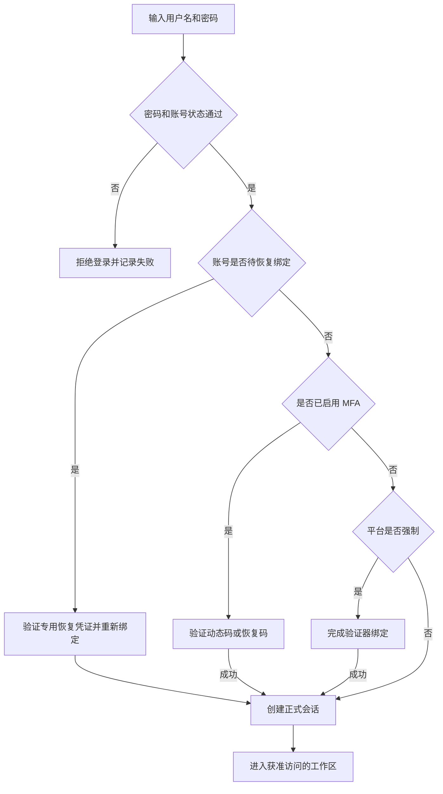

# 平台 MFA 功能方案

范围已确认。状态：In progress（开发规格阶段；尚未编码或功能验收）。

更新日期：2026-11-17。

本方案已按用户确认修订：正式登录后，敏感操作不再要求 TOTP 或恢复码，保留现有密码复验；新验证器绑定时仍需输入新动态码以确认配置有效。完整实施及验收以[平台 MFA 开发规格](mfa-development-spec.md)为准。

在现有账号密码登录上增加验证器动态码认证。平台控制是否强制使用 MFA；未强制时，每个用户自行决定是否启用。策略适用于全部租户、全部平台账号，包括平台管理员、租户管理员和暂未加入租户的账号。同一账号在多个租户共用一次绑定。

本期交付范围包括平台策略、个人绑定与维护、登录验证、已有会话控制、恢复码、管理员重置、应急维护、权限、审计、相关客户端适配和验证材料。本文件保留范围摘要，详细状态、字段、接口、迁移和验收规则见开发规格。

## 目标与行为规则

平台设置名为“强制所有用户使用 MFA”，默认关闭。关闭只解除平台的强制要求，不清除任何人的验证器或恢复码。

| 平台策略 | 账号状态 | 登录要求 | 用户能否关闭 MFA |
| --- | --- | --- | --- |
| 不强制 | 未启用 | 用户名和密码 | 可以自行启用 |
| 不强制 | 已启用 | 用户名和密码，再验证动态码或一次性恢复码 | 可以，经身份复验后关闭 |
| 强制 | 未启用 | 密码通过后进入受限绑定流程；完成绑定前不能访问业务 | 不能 |
| 强制 | 已启用 | 用户名和密码，再验证动态码或一次性恢复码 | 不能 |
| 任一策略 | 被管理员重置，待重新绑定 | 密码加专用恢复凭证，再完成新验证器绑定 | 恢复完成前不能跳过绑定 |

平台设置不接受租户覆盖、个人豁免名单或按角色免验证。停用账号不能登录；恢复账号后重新按当前策略执行。新邀请创建的账号、恢复密码的账号和新增租户的成员自然进入同一规则。

用户主动启用或因强制要求启用后，均形成真实的账号 MFA 配置。平台随后解除强制，用户仍然使用 MFA，直到本人完成关闭操作。

## 认证方式与使用限制

采用密码加 TOTP，即验证器生成的时间动态码。使用兼容 RFC 6238 的验证器即可，通过二维码或手工密钥绑定；动态码的生成与服务端验证不依赖外部短信、邮件或认证云服务。TOTP 的时间步和共享密钥机制见 [RFC 6238](https://www.rfc-editor.org/info/rfc6238/)。

拟定参数为 6 位数字、30 秒更新一次、HMAC-SHA-1、每个账号独立生成至少 160 位随机密钥，允许前后各一个时间步的有限偏差。生产服务器使用可信时间同步；超过窗口时提示核对验证器时间，不自动放宽窗口。

本期每个账号支持一个有效验证器配置，并配套 10 个一次性恢复码。已启用 MFA 的账号每次正常登录需要第二因素，不提供“记住设备免验证”。TOTP 仍可能被实时钓鱼获取；本期不将它表述为抗钓鱼认证。需要硬件密钥、Passkey 或多个独立验证器时，再扩展认证方式。

## 现有实现与接入位置

| 当前实现 | 本次接入方式 |
| --- | --- |
| [identity 登录逻辑](../../packages/go/platform/identity/service.go)和[会话持久化](../../packages/go/platform/identity/repository_sessions.go)在密码通过后创建正式会话 | 拆分密码验证、后续认证挑战、正式会话签发；仅满足完整要求才签发正式会话 |
| [HTTP 身份处理](../../services/api/internal/transport/http/identity/handler.go)和[路由门禁](../../services/api/internal/transport/http/router.go)集中处理 Cookie、认证及操作授权 | 增加有限的挑战路由；所有业务入口继续经过统一认证判断 |
| [账号事务检查](../../packages/go/platform/identity/repository.go)和[业务身份适配](../../packages/go/platform/identity/access.go)检查当前账号、会话、认证版本 | 将 MFA 状态和平台策略加入事务内复验，包括人员大屏的会话检查 |
| [权限目录](../../packages/go/platform/access/catalog.go)、[内置角色](../../packages/go/platform/access/builtins.go)由代码和迁移统一管理 | 增加策略查看、修改及账号 MFA 重置权限，同步目录校验和最后管理账号保护 |
| [登录页](../../apps/console/src/features/auth/login-page.tsx)、[账号安全页](../../apps/console/src/features/account/security-page.tsx)和[身份状态](../../packages/ts/api-client/src/identity.tsx)目前只处理完整登录 | 增加验证、绑定、恢复状态及对应页面；未完成验证不能被前端标记为已登录 |
| [命令行人员登录](../../tools/infrapro/internal/command/derived_client.go)调用同一登录接口 | 识别挑战结果，交互读取动态码或恢复码；需要绑定时引导到控制台完成后重新登录 |
| [审计接入](audit-integration.md)已有事务事实、命令收据与字段白名单 | MFA 事件接入相同机制；不把秘密写入审计或收据 |
| [HTTPS 适配](https-deployment-adaptation.md)已支持配置 Secure Cookie | 正式部署使用 HTTPS，复用已有来源校验、CSRF 和 Cookie 机制 |

所有业务认证规则集中在 identity Module 内。HTTP、控制台和 CLI 使用同一 Interface，不分别实现“是否需要 MFA”的判断。时钟、随机数和密钥解密在内部提供可测试的 Seam；不为未来可能的认证方式先建设插件框架。

独立诊断系统拥有独立维护账号，不属于租户账号体系，本次平台开关不控制其认证。采集转发器、worker 和大屏终端的机器凭证继续按各自机制认证；由人员会话派生的大屏访问、开发授权及业务调用必须受 MFA 约束，不能当作机器凭证豁免。

## 平台管理与权限

新增“平台管理 → 安全策略”页面，展示当前模式、最近修改人和时间，以及按全局账号去重的启用情况。开启前展示活跃账号数、未绑定账号数及可能受影响的仅密码会话上限；跨租户成员关系不重复计数。统计仅作操作预览，保存时重新读取策略与权限。

| 拟新增权限 | 用途 | 授权范围 |
| --- | --- | --- |
| `platform.security_policy.read` | 查看平台安全策略和影响统计 | 平台角色 |
| `platform.security_policy.update` | 修改强制 MFA 开关，同时要求查看权限 | 平台角色 |
| `platform.account.mfa.reset` | 对指定账号执行受控 MFA 重置，同时要求账号查看权限 | 平台角色 |

内置平台管理员获得这些权限；自定义平台角色按现有授权规则分配。租户管理员、项目管理员不会因其管理身份获得平台策略或全局账号重置权。具有账号查看权限的管理员可以看到 MFA 状态，不能查看密钥、二维码、动态码或恢复码。

本人 MFA 管理作为账号自身能力，仅能操作本人，不能通过租户或项目角色取消。强制绑定使用已验证密码的专用挑战资格，不依赖业务角色，避免用户因没有业务权限而无法完成登录。

策略保存采用“修改开关 → 查看影响 → 必要时确认密码 → 确认保存”，沿用最近 5 分钟密码复验，不要求 TOTP，也不要求操作者先绑定 MFA。未绑定管理员开启强制后，其原仅密码会话与其他用户的同类会话一起失效，再通过正常登录流程绑定。关闭强制同样检查权限、密码复验、原因并记录审计。

## 用户流程

### 首次启用

1. 非强制模式下，用户进入“账号安全 → 多因素认证”，选择启用并确认当前密码；强制模式下，用户在密码登录通过后自动进入绑定页。
2. 服务端创建短时绑定挑战，生成临时密钥，返回仅供当前绑定流程使用的二维码和手工密钥。页面展示应用名及账号标识，避免多个环境混淆。
3. 用户用验证器扫码或手工添加，再输入当前动态码。扫码本身不代表已启用；必须由服务端校验动态码成功。
4. 在同一事务中启用 MFA、创建恢复码摘要、撤销旧认证资格并记录安全事件。正式会话在这一步完成后签发或轮换。
5. 页面一次性展示恢复码，支持用户主动复制或下载，确认保存后进入目标页面。若响应丢失或未保存，可在正式登录后通过密码复验重新生成；重建操作不要求 TOTP，也不提供查询旧恢复码明文的入口。

绑定中断或临时密钥过期不会留下半启用的账号。强制模式下重新登录仍进入绑定流程；非强制模式下原先未启用的账号仍可按密码登录。

### 日常登录

密码通过但 MFA 尚未通过时，用户只持有用途受限的短时挑战，不能读取租户、项目、文件、通知等业务数据，也不能执行后台管理。此时不签发 `infrapro_session`。

登录挑战建议有效 5 分钟，绑定挑战建议有效 10 分钟；刷新可恢复尚未过期的当前步骤，过期则重新验证密码。退出或切换账号会撤销挑战并清理临时状态。认证完成后只跳转经过现有 `safeReturn` 校验的站内目标。

### 更换与关闭

更换验证器前只按现有规则确认密码，不要求旧 TOTP 或恢复码。旧验证器在新动态码验证成功前保持有效；新动态码仅确认新配置，成功后一次性切换密钥、作废旧恢复码、生成新恢复码并撤销旧会话。不能先解绑旧验证器，再要求用户单独开始新绑定。

关闭 MFA 只在平台不强制时允许，使用现有密码复验，不要求动态码或恢复码。服务端在提交时再次检查平台开关，防止操作期间策略已变化。关闭会删除有效密钥和恢复码、撤销旧会话，并为完成操作的浏览器轮换新会话。

重新生成恢复码使用现有密码复验，不要求 TOTP；新的一组生成成功后，旧的一组立即全部失效，已建立的正式会话保留。修改或重置密码不自动关闭 MFA。

## 已有会话与策略切换

开启强制后，以策略保存成功为生效点，下一次受保护请求立即检查新规则。未通过 MFA 的旧会话被拒绝，前端返回登录流程：已绑定用户验证第二因素，未绑定用户完成绑定。已通过有效 MFA 的会话可继续使用原有有效期，不要求每次业务操作重新输入动态码。

为避免“开启再关闭”让旧会话重新可用，平台策略维护单调递增的 `enforcement_generation`，每次从不强制切到强制时递增。正式会话记录签发时的代次；没有 MFA 证明且属于较旧代次的会话持续失效，即使之后解除强制也不恢复。解除强制后新建的密码会话使用当前代次。

账号启用、关闭、更换或被重置 MFA 时，递增账号认证版本，作废旧会话和未完成挑战；个人正常维护可在成功后签发新的当前会话。数据库的当前状态是鉴权依据，不能等 Redis 缓存过期后才生效。

策略更新与受保护的敏感业务事务采用一致锁顺序：授权状态、平台安全策略、按固定顺序排列的账号、会话及认证凭证。策略变更提交前已完成的操作不会撤销；提交后不能用此前通过的前端判断或缓存完成新的敏感写入。身份事务、人员大屏会话检查和其他人员凭证复验使用相同判断规则。

长连接、持续下载和人员大屏在后续数据发送或权限复验点检查；需要补齐可测量的复验间隔，上限建议为 30 秒。最终交付使用读取当前状态的短事务复验，不复用长时间数据库快照中的旧策略。已下载到客户端的数据无法收回。后台任务按原有任务授权运行，用户查看结果或控制任务仍须通过人员认证门禁。

## 恢复与管理员重置

### 验证器不可用但保留恢复码

用户正常验证密码，在第二步选择“使用恢复码”，输入一个未使用的恢复码。每个恢复码使用密码学安全随机数生成，至少 128 位随机性，数据库只保存摘要；成功使用通过原子更新将其作废，不能并发重复使用。

恢复码作为第二因素的备用凭证，不跳过密码。登录成功后提示恢复码剩余数量，并提供更换验证器入口；不会因为使用恢复码而自动关闭 MFA。恢复码本身不能用于查看原验证器密钥。

### 验证器与恢复码均丢失

有 `platform.account.mfa.reset` 权限的平台管理员核验目标用户身份，确认目标账号和原因，按现有规则完成自己的密码复验后执行重置；不要求管理员 TOTP 或预先绑定 MFA。

重置在同一事务中使旧密钥、恢复码、会话和挑战失效，将账号设为 `reset_required`，生成一次性的专用恢复凭证。用户通过可信渠道取得该凭证后，仍须验证账号密码，再绑定新验证器。无论平台此时是否强制，恢复完成前均不能获得业务会话。

恢复凭证建议 30 分钟有效、只能用于指定账号的一次恢复、数据库仅保存摘要。生成新的恢复凭证会作废旧凭证；生成本身不替用户完成认证。管理员不能代看或代设用户的 MFA 密钥，也不能直接生成普通业务会话。

管理员重置接口不用于自我绕过；本人优先使用恢复码。当唯一平台管理员也丢失验证器和恢复码时，扩展现有 `infrapro account` 运维命令提供应急 MFA 恢复。它需要受控服务器访问和维护权限，要求目标账号、原因、操作者标识，在受控终端一次性输出恢复凭证，保留审计。应急恢复同样要求用户重新绑定，不通过关闭全局策略解除所有人的保护。

恢复链接如采用 URL 交付，凭证仅放 fragment，页面提取后立即清除并通过受限请求提交；不放查询参数、服务器访问日志或浏览器持久存储。复用现有邀请与密码恢复的凭证处理规则。

## 数据与接口设计

PostgreSQL 保存完整可恢复的认证状态，Redis 继续承担共享短期限流和会话缓存。拟增加下列数据，最终表名随实现保持项目规范。

| 数据 | 主要字段或约束 | 用途 |
| --- | --- | --- |
| `platform_security_policy` | 单例；`require_mfa`、`revision`、`enforcement_generation`、修改人和时间 | 平台策略真相，默认不强制，保存使用版本条件防止覆盖并发修改 |
| `account_mfa` | 账号唯一；`disabled/enabled/reset_required`、密钥密文、密钥版本、凭据版本、最后成功时间步 | 全局账号的 MFA 配置和防重放状态 |
| `account_mfa_recovery_codes` | 账号、码组版本、摘要、使用时间 | 一次性恢复码；不保存明文 |
| `account_auth_challenges` | 随机凭证摘要、账号、用途、状态、账号及 MFA 版本、到期时间、尝试次数；必要的临时密钥加密保存 | 登录、绑定、更换和管理员恢复的有限流程 |
| 扩展现有账号失败计数 | 独立的 MFA 计数范围、连续失败数、冷却时间 | 保留跨挑战、跨进程重启的账号级失败限制 |
| 扩展 `account_sessions` | 认证方式、MFA 完成时间、MFA 凭据版本、签发时强制代次 | 区分仅密码会话和已完成第二因素的会话 |

挑战、恢复码消费和会话创建放在同一 PostgreSQL 事务，避免先消费验证码却重复签发会话。挑战用途、账号、当前状态、版本及期限均由后端验证，客户端不能提交 `mfa_verified=true` 自行提升认证级别。失败计数须持久提交，不能随校验失败事务一起回滚。

现有 `reauthenticated_at` 继续只表达密码复验。新增会话的 MFA 登录证明用于判断会话是否满足当前策略，不新增敏感操作的第二因素复验时间或 step-up 流程。

| Interface | 拟议变化 |
| --- | --- |
| `POST /api/v1/auth/login` | 返回明确状态：`authenticated`、`mfa_required`、`mfa_enrollment_required` 或 `mfa_recovery_required`；只有第一种签发正式 Cookie，其余返回 202 与安全的下一步描述 |
| `/api/v1/auth/mfa/*` | 查询当前挑战步骤、提交动态码或恢复码、完成强制绑定、开始受控恢复、取消挑战；每个入口只接受匹配用途的短时资格 |
| `/api/v1/account/mfa/*` | 查看本人状态、主动绑定、更换、关闭、重建恢复码；只针对当前账号，维护操作使用现有密码复验 |
| `GET/PUT /api/v1/platform/security-policy` | 查看与修改策略；修改校验权限、近期密码复验、预期版本和原因 |
| `GET /api/v1/platform/security-policy/mfa-impact` | 返回有权限管理员可见的影响统计 |
| `POST /api/v1/access/accounts/:id/mfa-reset` | 管理员受控重置与恢复凭证生成；复用管理操作的确认及审计约定 |

登录阶段使用与正式会话不同的 HttpOnly 挑战 Cookie，设置短期到期、SameSite、HTTPS 下 Secure 及适当 Path；它不能用于业务认证。登录成功后清除挑战 Cookie、生成新的随机正式会话凭证，避免会话固定。

OpenAPI 与 TypeScript 客户端同步定义判别状态。控制台只有收到 `authenticated` 才进入 `signedIn`；命令行不得把任意 2xx 都当作登录完成。所有调用登录接口的工具和测试夹具须一起适配，未升级调用端不能绕过服务端认证要求。

## 技术选择与安全实现

| 技术 | 使用位置与理由 |
| --- | --- |
| Go 与现有 Gin | identity Module 实现规则、认证状态转换及事务；HTTP Adapter 处理 Cookie、请求与响应，保持当前技术栈 |
| `github.com/pquerna/otp` | 作为 TOTP 计算及二维码生成候选库；落地时锁定经检查的版本，使用明确参数并包装成内部 Interface，不自行设计认证算法 |
| Go `crypto/rand`、AES-256-GCM、SHA-256 | 生成随机密钥和恢复码；加密可验证所必需的 TOTP 密钥；对高熵恢复码和挑战令牌保存用途区分的摘要 |
| PostgreSQL、pgx、Goose | 保存策略、账号配置、挑战、恢复码及会话；通过迁移、事务和行锁保障一致性与一次性消费 |
| Redis | 复用共享请求限流、会话缓存及失效处理；不能作为 MFA 启用状态或已消费凭证的唯一真相 |
| React、TypeScript、现有 UI、TanStack Query、React Hook Form、Zod | 扩展登录状态、个人安全卡片、绑定向导、平台开关和错误反馈，复用主题与表单交互 |
| OpenAPI、生成客户端、现有权限和审计目录 | 同步后端、控制台及 CLI 的契约与权限说明，避免新增入口脱离统一检查 |
| Go 测试与 Playwright | 验证真实数据库事务、并发认证、浏览器流程、Cookie 与权限阻断 |

候选库提供 TOTP 计算、验证及二维码生成，能力说明见其[官方仓库](https://github.com/pquerna/otp)。一次性消费、账号状态、策略和恢复控制仍由 InfraPro 自己负责。

TOTP 密钥必须可供服务端解密计算，不能像密码一样仅保存单向摘要。密钥使用专用的部署密钥加密，密钥材料与数据库分开保管，多 API 实例配置一致；密文记录密钥版本并绑定账号和用途作为认证附加数据。主密钥不能复用 CSRF 密钥、写入仓库或存入同一配置表。

二维码在系统本地生成，不调用外部二维码网站。绑定密钥、二维码、动态码、恢复码和恢复凭证不进入日志、审计、命令收据、监控上报或持久前端缓存；涉及这些内容的响应使用 `Cache-Control: no-store`。恢复码仅在生成响应中展示，重放管理请求只返回安全状态，不重新泄露秘密。

每个 TOTP 时间步最多成功使用一次；对匹配时间步进行事务内条件更新，多个实例并发提交时也只能有一个成功。不能仅依赖库返回的布尔校验结果。建议每个登录挑战最多失败 5 次，达到限制后重新验证密码；另按账号和 IP 限流并逐步冷却，创建新挑战不能清零账号累计失败。完整阈值在部署配置及测试中固定。

验证最终提交时重新读取账号状态、认证版本、MFA 配置和平台策略。期间发生密码重置、账号停用或管理员 MFA 重置，会使旧挑战失效。Redis、数据库或密钥故障返回不可用，不退回密码单因素放行。

登录后的维护操作统一按用户确认的密码复验规则执行；TOTP 仅用于登录和确认新验证器配置，恢复流程另有用途受限的一次性恢复凭证。

## 页面与审计交付

新增内容集中在三个位置：登录流程提供验证码输入、强制绑定和恢复；账号安全页提供 MFA 状态与个人维护；平台安全策略页提供全局开关、影响预览和变更记录。账号管理详情增加状态展示与受权限控制的重置动作。

动态码输入采用单一可粘贴输入框，保留前导零，支持键盘操作和移动端数字键盘。验证码错误在当前步骤显示，过期、频率限制、策略变化和服务不可用有分别可理解的提示。强制模式明确说明“平台要求所有账号使用 MFA”，提供退出或切换账号，不提供跳过入口。

审计登记策略修改、绑定成功、关闭、更换、恢复码重建与使用、管理员重置、恢复完成、验证失败及频率限制。记录操作者、目标、时间、来源、原因和允许公开的前后状态。只有完成全部要求才记录登录成功；密码通过但还在等待 MFA 不算登录成功。

涉及安全配置的成功变更与审计事实同事务落地。本人安全记录展示相关事件，安全配置变化及管理员重置接入已有站内通知；通知不包含任何秘密，也不作为身份恢复凭证。数据库故障下的失败记录遵循现有有限诊断规则，不能伪造成功审计。

## 实施与发布顺序

1. 补齐迁移、平台策略、MFA 状态及密钥配置，建立密码、挑战、正式会话的内部 Interface；先验证状态不变量。
2. 实现绑定、动态码与恢复码验证、更换、关闭和恢复流程，将一次性消费及会话签发放入真实事务。
3. 接入统一路由门禁、业务事务复验和人员大屏会话检查；实现策略代次与账号版本失效。
4. 扩展平台权限目录，复用密码复验，实现管理员重置和运维恢复，接入审计、通知、命令收据及 OpenAPI。
5. 实现控制台页面、身份状态和命令行适配，更新实际调用方和测试夹具。
6. 完成安全负例、并发、端到端、部署与恢复验证，整理操作手册、检查结果及人工验收入口。

迁移只创建默认不强制的策略及必要结构，不为现有用户自动生成或启用 MFA。旧会话标记为仅密码认证；尚未开启强制时可按现有规则使用。发布前配置并验证专用加密密钥；禁止在密钥准备不完整时开启策略。

前端、后端、CLI、权限目录和迁移作为同一兼容版本发布，部署期间避免旧认证节点继续提供流量。回滚不能直接换回不理解 MFA 的旧程序，否则会绕过已经启用的保护。

数据库备份需配套保存独立加密密钥。恢复时先关闭人员入口，沿用已有凭证撤销流程，并额外作废挑战、恢复凭证及旧恢复码。时间点回滚可能恢复已经更换的验证器或较弱的旧策略，因此重新开放登录前必须依据可信安全记录核对；无法确认的账号进入受控恢复，不能只撤销会话后直接使用历史密钥和开关。恢复码在重新认证后再生成，应急管理员通过受控维护流程恢复。

## 自验与人工验收标准

实施自验需要覆盖以下场景，并按真实请求与数据库状态记录结果，不能只验证按钮是否显示。

| 编号 | 操作或场景 | 预期结果 |
| --- | --- | --- |
| MFA-01 | 默认安装或升级，查看平台开关 | 默认不强制，原有未启用用户仍能密码登录 |
| MFA-02 | 用户自主绑定并退出重登 | 密码通过后必须验证第二因素；扫码未确认不能算已启用 |
| MFA-03 | 有权限管理员开启强制 | 不要求预先绑定或提供 TOTP；按现有密码复验保存后，所有账号及操作者会话统一遵守新策略 |
| MFA-04 | 未绑定用户在强制模式下登录 | 只能完成绑定或退出，不能读取业务数据和调用业务接口 |
| MFA-05 | 无权限用户或租户管理员调用策略修改、账号重置 | 后端拒绝；不依赖按钮隐藏 |
| MFA-06 | 开启强制时，另一浏览器持有仅密码的旧会话 | 下一次请求受阻；跨 API 实例与 Redis 缓存命中结果一致 |
| MFA-07 | 关闭强制、跨租户切换、新用户接受邀请 | 已启用配置保留，旧失效会话不复活，同一账号只需一份绑定 |
| MFA-08 | 同时提交相同动态码或恢复码，或重放已完成挑战 | 最多一次成功，不重复消费或签发正式会话 |
| MFA-09 | 连续输错、过期挑战、错误时间、换挑战继续猜码 | 产生相应拒绝和限流，不能绕过账号累计限制 |
| MFA-10 | 普通模式关闭 MFA；强制模式尝试关闭或竞态提交 | 普通模式完成复验后允许，强制模式由后端拒绝 |
| MFA-11 | 更换验证器中断及成功切换 | 中断时旧配置可用；成功后旧验证器、恢复码和旧会话失效 |
| MFA-12 | 使用恢复码、重新生成恢复码 | 单个码只能用一次；重建后全部旧码失效；页面不能查询旧明文 |
| MFA-13 | 管理员重置账号，包括平台不强制的情况 | 旧凭据与会话失效，用户必须凭专用恢复凭证及密码重新绑定 |
| MFA-14 | 唯一管理员丢失验证器与恢复码 | 可走受控维护恢复；全局策略保持原值，产生可追溯记录 |
| MFA-15 | MFA 验证途中修改密码、停用账号或重置 MFA | 旧挑战被拒绝；密码恢复不会移除 MFA |
| MFA-16 | CLI 登录、人员大屏及持续业务连接 | 遵守人员 MFA 门禁；机器身份仍按自身凭证工作，无人员豁免路径 |
| MFA-17 | 数据库、Redis、解密密钥故障及备份恢复 | 不降级放行；恢复后旧挑战与已失效凭证不能复活 |
| MFA-18 | 查看 Cookie、响应缓存、日志、审计和通知 | 属性及来源校验符合部署要求；秘密不进入持久记录 |
| MFA-19 | 页面刷新、浏览器后退、多标签页、超时、提交响应丢失 | 正确恢复或重启认证步骤，不误标已登录、不自动重复敏感写入 |

自动检查包括 Go 状态与并发测试、真实 PostgreSQL 和 Redis 集成、HTTP 与 HTTPS 认证回归、OpenAPI 和权限及审计目录检查、Playwright 浏览器流程，并运行相关全仓检查。隔离测试环境不得修改现有业务账号或真实安全策略。

实现自验全部通过后，功能状态进入 Awaiting acceptance，交付登录入口、平台安全策略入口、验收账号说明、操作手册、结果和已知限制；用户明确确认后才进入 Accepted。本次仅交付文档，完整验收以开发规格中的 60 项用例为准，不宣称功能已经实现或验收。
