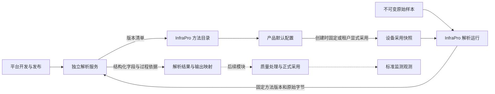

# 解析服务与解析方法配置开发规格

编制日期：2026-11-16。状态：**Awaiting acceptance，完整实现和开发自验已完成，待用户人工验收**。用户已授权全部范围实施；结果与证据见[逐项验收报告](../verification/parsing-service.md)，人工接受单独记录。

本文落实已经确认的方向：解析方法由平台编写代码并随独立解析服务发布；InfraPro 管理目录、采用配置、权限和执行记录；租户只选择使用。已有设备固定采用版本，升级由设备所属租户明确发起。首批以宏电 DDP 为真实协议依据，以明确标注的模拟监测载荷完成无实机条件下的贯通验证。

本文是本功能实施时的完整规格入口。现有业务规则见[需求规格](../requirements.md#parsing-service-direction)，当前实现见[架构](../architecture.md)、[技术选型](../technology-selection.md)和[术语表](../../GLOSSARY.md)。本文标为“新增”的结构、路由和命令已在当前 checkout 落地；实际 OpenAPI、权限目录、迁移及[运行手册](../operations/parsing-service.md)为实现入口，本文不替代这些契约源。

导航：[范围与职责](#scope) · [模型](#model) · [产品与设备](#binding) · [版本发布](#versions) · [服务接口](#contract) · [执行与追溯](#execution) · [DDP 首批能力](#ddp) · [系统接口与页面](#system) · [权限](#permissions) · [工程与运维](#engineering) · [开发顺序](#delivery) · [验收](#acceptance)

<a id="scope"></a>

## 1. 目标、范围与职责

### 1.1 本次开发的闭环

平台开发方法 → 发布解析服务 → InfraPro 同步并启用方法版本 → 产品设置默认配置 → 设备继承或特化并固定配置 → 提交原始样本 → 调用真实服务 → 保存解析结果与过程依据 → 查看字段、设备输出映射和失败原因 → 固定旧版本重放或比较新版本。

“打通”必须经过真实 HTTP 调用、真实持久存储和当前权限检查；不能仅在浏览器生成解析结果，不能用接口 mock 代替服务联调。第一期交付可用的解析服务、配置管理、样本试解析及追溯，不要求用户先提供厂家、实物设备或现场数据。

| 本期必须交付 | 后续独立建设的内容 |
| --- | --- |
| 平台代码实现和发布方法、版本目录同步、版本启停 | 租户提出新厂家需求后的具体协议扩展；继续由平台编码 |
| 公共／私有产品配置、设备采用历史、显式升级和特化 | 长连接采集、网络连接认证、TCP 流分帧与跨包重组、在线状态和设备控制 |
| 原始样本保存、真实服务试解析、输出映射检查、版本对比 | 连续生产报文接入、生产原始数据检索和批量历史重解析 |
| DDP 帧解析和 DDP 模拟监测载荷贯通；运行证据、审计和任务接入 | 标准监测观测正式采用、完整质量规则、告警和现场联调 |

不建设协议描述语言、图形字段编辑器、在线脚本编辑器、租户插件上传或租户解析服务地址。第一期的二进制、HEX、文本上传只是样本输入方式；它们不产生可编辑的解析算法。

### 1.2 两端职责

| 事项 | 独立解析服务 | InfraPro |
| --- | --- | --- |
| 方法实现 | 平台编写、测试、编译和发布；封装、字节序、字段转换均在代码内 | 只登记服务已经提供的方法及固定版本 |
| 方法目录 | 提供实际安装的版本、输入要求、输出约定、执行产物摘要 | 保存目录快照，控制是否允许新采用、是否禁止执行 |
| 产品与设备 | 不读取业务数据库，不查询厂家／租户／产品／设备 | 检查所有权、适用性，保存产品默认和设备采用快照 |
| 原始内容 | 接收一次调用的字节和明确上下文；调用完成后不持久保存 | 保存不可变字节、摘要、输入来源和访问边界 |
| 解析 | 执行指定方法版本，返回字段、记录、诊断和定位依据 | 核验响应、保存结果、匹配现有输出槽位、展示过程 |
| 监测业务 | 不创建监测通道，不判定业务质量，不写标准观测 | 后续接入模块负责通道绑定、质量和正式采用 |
| 权限 | 只接受配置好的系统调用身份 | 校验平台／租户／项目权限及对象范围，不能信任报文自报身份 |
| 运行与追溯 | 报告程序版本、产物摘要、执行标识和有界运行指标 | 记录逻辑运行、尝试、配置、样本、结果、审计和任务 |



### 1.3 数据层次和本期终点

| 层次 | 必须表达的事实 | 本期处理 |
| --- | --- | --- |
| 原始报文 | 原始字节、来源、收到时间、字节数、SHA-256 | 保存试解析样本；模拟样本标记 `synthetic`，不能冒充实采报文 |
| 解析结果 | 用何方法版本从何处读到字段，如何转换，哪些检查成功或失败 | 完整实现保存、查看、重放、对比和设备输出映射检查 |
| 标准监测观测 | 所属业务通道、观测时间、单位、质量状态及正式采用依据 | 本期不新增自动采用路径，不向正式曲线或统计写入试解析数据 |

服务返回成功仅说明声明的解析步骤完成。没有协议校验和的报文不能显示“校验和通过”；缺失时间不能用接收时间静默补齐；控制包没有测量值不能生成零值观测。输出映射通过也不等于物理测量正确。

<a id="model"></a>

## 2. 业务对象与持久模型

### 2.1 六个核心对象

| 对象 | 身份与内容 | 不变量 |
| --- | --- | --- |
| 解析方法 | `method_id`，稳定代码，如 `hongdian.ddp.tcp.frame`；名称、用途、协议依据 | 全平台管理；身份不随显示名称变化 |
| 解析方法版本 | `(method_id, method_version)`；输入约定、输出约定、执行产物摘要、发布说明 | 发布后不可改写；产品、设备和运行都引用确定版本 |
| 产品解析配置 | 所属 `product_version_id`、名称和配置修订；固定方法版本、输出映射 | 属于产品配置，不修改已发布产品定义正文；产品版本之间不共用可变配置 |
| 产品默认指针 | 某个产品版本当前供新设备采用的配置修订 | 可以清空或切换；不改动任何已有设备 |
| 设备解析采用 | `device_id`、模式、固定配置快照、生效区间、操作者与理由 | 单设备当前最多一条；采用后不动态读取产品默认指针 |
| 解析运行 | 原始样本、固定输入快照、执行代次／尝试、响应与映射检查 | 不覆盖历史结果；新方法对比创建新运行并关联原运行 |

产品解析配置可以保存多个命名配置；每个产品版本最多一个默认配置。设备特化直接形成该设备自己的配置快照，可以选择目录中任何已启用且满足适用性校验的方法版本，不要求平台先把该方法设为公共产品默认。

### 2.2 配置快照

每份不可变配置快照至少包含：

- 所属对象类型、对象 ID、租户范围（公共产品为平台范围）、`product_version_id`。
- `method_id`、`method_version`、`artifact_digest`、`manifest_digest`、`output_contract_digest`。
- 固定的 `output_bindings`：方法输出键到产品 `slot_key` 的对应，以及当时确认的测量语义；明确忽略的输出键须单独列出及说明理由。
- 创建人、服务端创建时间、来源配置修订、内容摘要和修改理由。

第一期配置不接受脚本、公式、JSONPath、正则、字节偏移、缩放表达式或自由 JSON 参数。首批方法没有租户可调的解析参数。未来确需时只能增加方法代码明确声明的有限业务参数及固定快照，另行扩展契约，不能把参数发展成另一套协议语言。

配置修订发布后不变；编辑创建新修订，再明确决定是否设为默认。设备升级、恢复继承和回退均产生新的采用记录。所有修订号和代次经 HTTP 使用十进制字符串。

### 2.3 输出语义和映射

解析服务不持有 InfraPro 的指标、单位或通道 UUID。方法清单使用稳定的 `output_key`，声明值形态、物理含义、输出单位、时间含义、统计含义及已知的方向／基准。InfraPro 配置人把这些输出对应到产品已有槽位；界面同时展示双方含义并要求确认，不能依据相似名称自动判定指标等价。

固定槽位必须通过现有指标／单位版本可用性检查，值形态和已声明语义必须相容；单位不同不得靠映射实施换算。可配置槽位只能先确认允许的值形态；设备采用时还须核对该设备实际输出语义，未配置输出时标记 `output_unconfigured`，不伪造一个输出。已知语义矛盾阻止配置采用，未知语义必须明确显示，不能显示完整匹配。

同一配置的一个输出键只能映射一个槽位，多个输出键不得映射同一槽位；批次内同一键的多时刻测量仍是多条记录。所有声明的测量输出必须“映射”或“明确忽略”，控制字段无需映射。产品有未映射槽位是允许的，单个报文不必提供所有测量字段。配置不能创建／更改设备输出，不改变既有业务通道来源绑定。

### 2.4 建议新增表及约束

以下表名为实现命名基线，实施时统一落在 `platform/parsing` 所拥有的迁移中，不向解析服务开放数据库身份。

| 表 | 保存内容与关键约束 |
| --- | --- |
| `parsing_method_versions` | 方法版本和不可变清单；唯一 `(method_id, method_version)`；状态与内容分开 |
| `parsing_catalog_syncs` | 每次服务清单、程序版本、同步时间、结果和差异；失败不清空旧目录 |
| `parsing_configs` / `parsing_config_revisions` | 产品或设备拥有的配置及不可变修订；所有者、产品版本不得跨范围引用；修订唯一 |
| `parsing_product_defaults` | 每个产品版本唯一一行默认指针和 CAS 修订；空指针表示未配置 |
| `parsing_device_adoptions` | 设备、模式、固定配置修订、`[started_at, ended_at)`；当前唯一，区间不重叠 |
| `parsing_samples` | 原始对象引用、SHA-256、字节数、来源类别、输入表示和归属；内容不可覆盖 |
| `parsing_runs` / `parsing_run_executions` / `parsing_run_attempts` | 稳定运行、人工代次、内部尝试；冻结输入、租约、fence、结果引用和错误分类 |
| `parsing_changes` / `parsing_operation_receipts` | 配置变更履历及操作幂等收据，与业务写入和审计同事务 |

对象字节和大结果放入现有 S3 兼容存储，PG 保存索引及权威可见状态。不得把原始报文写进审计正文、任务摘要或日志。第一期不新增 ClickHouse 表。跨对象租户一致性须由组合外键、约束及事务校验共同保证，不能只依赖前端过滤。

<a id="binding"></a>

## 3. 产品配置、设备继承与特化

### 3.1 产品边界

现有设备已经固定引用 `product_version_id`。因此界面入口放在产品下面，实际默认配置归属于**具体已发布产品版本**。仅改解析配置不必发布产品新版本；改产品输出槽位或测量语义仍走既有产品版本流程。产品草稿阶段可使用独立的方法调试，发布产品后才能建立正式产品配置。

| 产品归属 | 谁维护默认配置 | 设备所属租户可做的事 |
| --- | --- | --- |
| 平台公共产品 | 有相应平台产品及解析配置权限的账号 | 查看默认、采用、显式升级、在自己设备上特化 |
| 租户私有产品 | 同租户具有产品及解析配置权限的成员 | 维护私有产品默认，并管理本租户设备采用 |

租户不能修改公共产品默认，也不能配置其他租户的私有产品。平台管理解析方法不产生读取私有产品或修改租户设备的权限。产品复制、新产品版本发布均不隐式复制运行配置；提供“从可读配置复制”动作，重新验证后形成新对象，默认选择须明确提交。

### 3.2 设备采用状态

| 模式 | 含义 | 后续产品默认变化 |
| --- | --- | --- |
| `unconfigured` 未配置 | 尚无解析采用；迁移后的既有设备保持此状态 | 不自动补配，租户显式采用 |
| `inherit_snapshot` 继承产品 | 从该产品版本某个当时默认配置复制并固定采用，保存来源修订 | 已有设备继续使用原快照；显示有新默认可比较 |
| `override` 设备特化 | 租户为该设备选择平台方法版本并配置输出映射 | 不受产品默认变化影响；恢复继承也是一次显式采用 |

“继承”表示配置来源，**不表示运行时跟随最新版**。设备详情必须分别显示“当前采用”和“产品当前默认”，不能用一个“继承中”标签隐藏版本差异。

新建设备请求增加明确的 `parsing_adoption` 意图：`inherit_default` 或 `unconfigured`。控制台有可用默认时预选继承，并在提交前展示准确版本和默认修订；老客户端省略时保持未配置，不能暗中采用。提交继承须带 `expected_default_revision`，与设备创建在同事务固定；默认变了则返回冲突，不静默采用新默认。有默认但不适用或被禁止时说明原因，用户可明确选未配置继续建设台账。

### 3.3 显式变更动作

1. **采用／升级产品默认**：读取差异预览，提交固定目标修订及设备预期修订，写新采用记录。
2. **设备特化**：选择平台已发布且可新采用的方法版本，核对当前产品版本、输出映射和语义，创建设备快照并采用。
3. **恢复继承**：采用操作当时确认的产品默认快照，历史特化保留；没有默认时不能恢复。
4. **回退**：选择历史配置作为来源重新校验并创建新采用，不改旧记录时间。目标停用新采用或禁止执行时不能直接回退，须先由平台按规则恢复可用。
5. **清空采用**：显式变为未配置，关闭当前区间；不删除历史、不清空输出、不解除来源绑定。

所有动作要求理由，生效时间由服务端提交时确定，不接受用户回填任意 `effective_at`。预览展示方法／版本、映射变化、未配置输出和已知语义冲突；它不产生授权或锁定。提交重新核验权限、状态、设备、产品默认和配置修订。

批量采用以同租户、同产品版本、同目标配置的一组明确设备 ID 为单位，单次最多 200 台。提交须携带每台预期修订；本期采用全成全败的一个短事务，任何无权／冲突设备使整批失败并返回获准范围内原因，不能静默跳过。按稳定顺序锁设备；跨产品版本分批，不提供无限“全选全部结果”。

### 3.4 固定版本例子

公共产品 P 的产品版本 3 默认使用方法 M 的 `1.0.0`。租户甲的设备 A、B 已继承此快照。平台将 P/3 的默认改成 `1.1.0`：A、B 仍为 `1.0.0`；之后新建并选择继承的 C 使用 `1.1.0`。租户甲只升级 A，则 A、C 为 `1.1.0`，B 仍为 `1.0.0`。租户乙的任何设备均不受甲操作影响。

### 3.5 生命周期和并发

产品版本停用阻止新配置采用，但已有设备快照与历史读取保留。产品默认清空不清空设备。被采用的配置修订只允许停用新采用，不允许物理删除。修改设备输出、结束输出代次不会反向改写旧配置或旧运行；新的解析运行必须重新检查当前映射，并显示失效项。

设备停用不删除采用和证据；本期允许有权限者为停用设备进行明确标记的诊断试解析，不代表设备恢复在线或恢复生产接入。租户／账号／成员停用则按现有资格规则拒绝访问或执行。配置停止新采用后，当前引用及历史重放仍有效；若它仍是产品默认，新设备继承会被明确拒绝，可选择未配置。

现有厂家、产品、设备删除预览及删除事务须纳入解析配置、采用和运行引用。仍被引用的对象不能硬删除导致历史悬空；可停用但保留可获准查询的历史。公共对象存在租户私有引用时沿用不泄露私有明细的提示规则。

目录状态、产品默认、设备采用和权限变更须使用现有设备协调锁顺序；网络请求和 S3 操作不放在数据库锁内。服务调用使用创建运行时冻结的采用快照；调用过程中设备升级，不改变在途运行的解释版本。新提交的运行读取新采用；历史运行明确显示“与当前配置不同”。

<a id="versions"></a>

## 4. 解析方法版本与服务发布

### 4.1 区分四种版本

| 标识 | 用途 |
| --- | --- |
| 方法版本 `method_version` | 一项确定的解释规则和输出契约；采用 `major.minor.patch`，所有级别都须显式升级 |
| 执行产物 `artifact_digest` | 实际执行代码、依赖及工具链形成的不可变二进制摘要；同一方法版本不可替换产物 |
| 服务发布 `service_release` / `service_build_digest` | 提供 HTTP 接口与调度的服务程序发布；一次发布可以提供多个方法和旧版本 |
| 配置修订 `config_revision_id` | 方法版本和输出映射的一次固定选择；改变映射也要新修订 |

接口契约另用 `contract_version` 表示。本期固定为 `1`，不与上述任何版本混用。厂家的协议版本属于方法说明，如“依据 H7710S-DDP 文档”，不等于本系统方法版本。

所有 SHA-256 摘要使用 64 位小写十六进制字符串。`artifact_digest` 对实际执行文件字节计算；`output_contract_digest` 对发布包内固定输出契约文件计算；`manifest_digest` 对不包含自身摘要字段的版本清单原文件字节计算。发行包保留这些原文件，目录同时返回其 base64 内容和摘要，InfraPro 验证后保存；不对重排键名或改变空白后的 JSON 另算一个“等价摘要”。服务总清单可因新增版本变化，但旧版本清单字节必须保持不变。

### 4.2 方法状态

目录采用状态为 `pending`（待启用）、`enabled`（允许新采用和执行）、`deprecated`（停止新采用但保留已固定执行）、`blocked`（禁止执行）。`pending` 可由平台在方法调试中试解析，但不能配置给产品或设备；`blocked` 包括调试、重试和历史重放都拒绝执行。

服务健康／版本实际可执行性是独立字段，不修改业务启停状态。服务故障或目录同步失败不能把版本自动删除；不可用时明确失败，不回退到别的方法或最新版。紧急阻断必须有原因和审计，已有采用记录仍保留，由设备所属租户选择后续版本。

### 4.3 发布与同步顺序

1. 平台在代码库增加方法或新版本，编写协议依据、清单、期望结果和反例；已有版本产物保留。
2. CI 编译不可变执行产物，生成清单及摘要，运行第 12 节适用的测试。输出单位、错误解释、缺省时间策略和共享依赖改变解释行为都属于新方法版本。
3. 部署前检查新服务是否仍可执行所有已有采用、默认配置、在途运行及保留历史所引用的版本。缺少旧产物阻止正常发布；不能以“旧版本无人新建”作为删除理由。
4. 运维重新发布服务。InfraPro 从固定服务端点拉取完整清单，验证契约、唯一键和摘要。已有同键不同内容／产物为 `version_conflict`，整次同步拒绝，旧目录不变。
5. 新方法版本进入 `pending`。平台完成实际服务试解析并明确启用后，产品和设备选择器可见；同步本身不自动发布产品默认或升级设备。
6. 服务回滚也执行覆盖检查。已有设备已采用的新方法若不在旧发行包内，不允许用该旧包直接覆盖运行；须使用包含这些固定产物的兼容回滚包。

目录只有一个配置好的逻辑服务来源；不提供租户登记任意服务地址的入口。第一期单实例运行；未来扩容须保证候选实例清单一致，不能随机命中缺少旧版本的实例。

<a id="contract"></a>

## 5. 解析服务接口契约

### 5.1 连接和接口

服务提供内部 HTTP API，由 InfraPro 后端调用，浏览器不直接调用。第一期同机／受控容器网络部署，服务端口不暴露公网，使用专用机器令牌；令牌来自运行配置，不由租户输入，不进入日志。跨主机部署须启用并验证 TLS，不能把本机明文模式扩展到不受控网络。机器身份只允许目录、解析和受控健康接口，不拥有平台用户权限。

| 方法与路径 | 请求／返回要求 |
| --- | --- |
| `GET /healthz` | 有界存活状态；不泄露业务清单和环境变量 |
| `GET /readyz` | 契约版本、注册清单与执行产物预检就绪状态；无实际业务数据探测 |
| `GET /v1/catalog` | 完整方法版本清单、服务发布、清单摘要和限制；受机器鉴权 |
| `POST /v1/parse` | 严格 JSON，指定准确方法版本和摘要，原始字节为 base64；一次请求为一个声明的解析单元 |

目录条目必须包含方法标识／版本、名称、类别（测量／封装）、是否示例、协议依据、输入单位（完整帧／单个文档）、允许传输上下文、最大长度、输出键及语义、结果契约摘要、产物摘要、发布说明和样本套件摘要。描述性清单不能包含可执行表达式。

### 5.2 请求字段

| 字段 | 规则 |
| --- | --- |
| `contract_version` | 固定 `1`，不支持则拒绝 |
| `execution_id` | 单次尝试 UUID；重试新建，关联在 InfraPro 保存的同一逻辑运行 |
| `method` | `id`、`version`、`artifact_digest`、`manifest_digest`，必须精确匹配 |
| `input` | `bytes_base64`、`sha256`、`byte_length`；服务重新解码并核验长度与摘要 |
| `context` | 固定 `received_at`（UTC RFC3339 纳秒精度可选）、`transport`；只有清单列明需要的字段可传 |
| `trace_id` | InfraPro 生成的追踪关联值；不是授权依据 |

原始身份、设备数据库 ID、租户 ID、通道 ID、存储 URL 和数据库凭证不作为解析参数传递。设备外部标识由解析结果返回，InfraPro 负责核对；仅凭报文内的 DTU 身份不能决定租户或创建设备。

HEX 输入先在 InfraPro 按明确语法转换为字节：允许 ASCII 空白分隔的完整字节对，不接受奇数位或非十六进制字符；原输入表示单独保留，字节摘要以转换后的实际字节计算。UTF-8 文本按原样编码，不整理换行或 JSON 空白。文件上传按原字节处理。base64 是两端传输编码，不是另一种协议。

### 5.3 响应结构

响应必须回显契约版本、执行 ID、实际方法版本及摘要、输入摘要、服务发布和构建摘要；InfraPro 逐项核验后才接受。公共包络至少为：

| 字段 | 内容 |
| --- | --- |
| `status` | `parsed`、`rejected`、`unsupported`；无隐式部分成功 |
| `message_kind` | `measurement`、`control`、`envelope`；后两者允许测量记录为空 |
| `identities` | 协议读取的外部标识、角色和原始位置；不表示已认证身份 |
| `records` | 稳定记录序号、观测时间／时间来源、测量项、原始状态字段 |
| `fields` | 控制／封装字段及定位；内层载荷以范围引用，不重复无限展开 |
| `steps` | 有顺序的解析步骤、规则标识、输入范围、结果和关联字段 |
| `diagnostics` | 有限错误码、严重程度、字段／字节范围和安全描述 |
| `checks` | 实际执行的结构、长度、协议校验等检查；未定义的检查为 `not_applicable` |

测量项包含 `output_key`、`value_type`、`value`、`unit`、原字段定位、转换步骤引用。整数和十进制值均使用规范十进制字符串，不经 JSON 浮点数传递；禁止 NaN／Infinity、隐式舍入和溢出。空值与零值有区别；未知枚举返回明确诊断，不能按合法数值解释。

观测时间有协议依据才输出；没有时为 null 并给出 `missing_timestamp`。厂商数据没有时区且方法没有明确规定时，不能按服务器本地时区猜测。固定接收时间可作为独立上下文字段显示，不能自动代替观测时间。源设备状态与平台质量状态分开。

字节定位使用原始字节数组的零基半开区间 `[start, end)`；JSON Pointer 是辅助定位，不能取代字节依据。解封装后的字段须能通过步骤引用回溯原报文范围；二进制转整数、比例转换、符号和单位由方法代码给出稳定 `rule_id` 及输入／输出摘要。协议缺省值标明规则来源，不伪造字节位置。过程证据是业务追溯结构，不是堆栈或自由文本调试日志。

结构合法但单个监测字段错误时，本期整次返回 `rejected`、测量 `records` 为空，已识别字段和诊断可作证据保留。不能只输出剩余字段却标全报文成功。不支持的包类型为 `unsupported`；合法注册包返回 `parsed/control`，不是“数据缺失”。

### 5.4 错误、限制与重试

| 情况 | 服务 HTTP／InfraPro 分类 | 自动重试 |
| --- | --- | --- |
| 请求结构、base64 或摘要错误 | 400／`invalid_request`、`input_hash_mismatch` | 否 |
| 方法不存在、摘要不符、契约不支持 | 404 或 409／`method_unavailable`、`version_conflict`、`contract_mismatch` | 否，告知目录／部署问题 |
| 报文非法或包型不支持 | 200，业务状态 `rejected` 或 `unsupported` | 否 |
| 输入／输出／步骤超限 | 413 或 422／`limit_exceeded` | 否，不截断成成功结果 |
| 服务繁忙、连接暂时中断、超时 | 429／503／504 或网络错误 | 最多 2 次内部重试，保持冻结输入，退避 1 秒、3 秒 |
| 执行异常、响应契约／摘要错误 | 500 或本地核验失败／`parser_error`、`invalid_response` | 否，保存安全证据并诊断 |
| 未通过机器鉴权 | 401／403／`service_auth_failed` | 否，不能替换成用户身份 |

第一期上限：原始样本 4 MiB；HTTP JSON 请求 6 MiB；服务单次执行 5 秒，调用端含传输总超时 10 秒；响应 16 MiB；单次最多 10,000 条记录、50,000 个步骤、64 层结构嵌套。方法自身限制可更小，DDP 限制见第 7 节。超限要返回可读错误，不能内存无限增长。平台／租户分别限制队列和并发，默认每范围同时执行 2 次、排队 20 次，服务总并发 4 次；这些是初始运行预算，不是吞吐承诺。

服务执行没有业务写入，因此网络重试可再次计算；服务不承诺跨重启 exactly-once。InfraPro 以运行／代次／尝试和 fence 保证至多一个结果被当前代接受，不能以 HTTP 200 作为数据库已完成的证明。

<a id="execution"></a>

## 6. InfraPro 执行、追溯和质量边界

### 6.1 三种运行上下文

| 运行上下文 | 固定输入 | 允许的检查 |
| --- | --- | --- |
| 平台方法调试 | 平台自有样本和指定版本 | 验证方法，包括待启用版本；不能借此读取租户样本 |
| 产品配置试解析 | 可读产品配置修订和当前范围自有样本 | 检查方法输出与产品槽位，不假定已有设备或业务通道 |
| 租户设备试解析 | 设备当前采用或明确选定的候选配置、设备输出快照和本租户样本 | 检查当前配置或升级候选；试解析候选不改变设备采用 |

平台和租户都可创建本范围自有样本，但租户仅能调试 `enabled` 方法；已固定历史重放可用 `deprecated` 方法。任何上下文都拒绝 `blocked` 方法。公共产品的试解析记录归发起方范围所有，公共产品所有权不使租户提交的报文变成公共数据。

### 6.2 执行顺序与一致性

1. **保存样本**：鉴权并检查预算，创建上传意图；限量流式接收字节，计算摘要，写唯一不可覆盖对象，再短事务确认对象完整。上传失败不生成可运行样本，孤立对象由维护流程回收。
2. **提交运行**：短事务内重验范围、读取权、执行权及对象状态，固定方法、配置、样本、接收时间、传输上下文、设备采用和输出快照；保存幂等收据，登记任务后返回 202。
3. **领取执行**：InfraPro 既有监测 worker 增加 `parsing` 队列适配，模块自有表负责租约、代次和 fence；协议计算仍由解析服务完成。领取时复验本代发起人的有效资格和方法状态；人工重试以本次操作者作为新代发起人，最初发起人留在历史中，不借用 worker 的系统身份扩大资格。
4. **调用服务**：离开数据库事务后读取原对象并验摘要；向固定服务发送请求。调用失败按第 5.4 节处理；自动重试保留同一代输入，新的尝试有新的执行 ID。
5. **接受结果**：验证响应契约、身份、版本、摘要、输出键、值范围与定位范围。原始响应写不可变对象；不可信响应仅限量隔离留证，不渲染任意 HTML、路径或堆栈。
6. **提交终态**：短事务中比较运行代次／fence，复验当前权限与方法阻断状态，写结果索引、映射检查和任务事件。已撤权则终止为 `authorization_revoked`；迟到结果不能覆盖已取消或新代。未被接受的孤立结果对象可回收。
7. **展示／下载**：每次重新核验当前权限及归属，不因曾经创建运行或持有任务链接而永久可读。任务和业务页共享固定运行及代次定位。

取消以事务终态为准，并尽力取消远程调用；取消后收到的响应不变成成功。租约超时由维护流程有界回收，旧 worker fence 失效。外部存储、网络、任务事实和业务终态之间的中断均须可恢复，不能留下“成功但没有结果对象”的可见记录。

### 6.3 状态与证据

运行状态：`queued → running → succeeded / failed / canceled`。其中服务业务状态为 `rejected` 或 `unsupported` 时运行归为 `failed`，但保留实际解析诊断；`parsed/control` 可正常成功且测量数为 0。任务完成与结果可读性独立，结果对象缺失显示 `missing`，不能重新计算后冒充原结果。

每代执行至少可查：原始样本 ID／摘要／字节数、来源类别、固定上下文、方法版本及执行产物、服务程序发布、产品与配置修订、设备采用记录、输出快照、发起人及执行授权范围、开始／结束时间、每次尝试、传输故障、服务响应、步骤／字段依据、映射检查及结果摘要。

业务执行成功、审计成功和任务投影必须按现有[任务接入](task-center-integration.md)与[审计接入](audit-integration.md)规则保持一致。新增任务来源 `parsing:run`、类型 `parsing.test`，提供真实 Source Adapter、可取消／重试能力和固定代次目标，不造另一套任务中心。人工重试同一运行增加代次并封存旧代；换样本、上下文、配置或方法版本必须创建新运行，可用 `compared_to_run_id` 关联。

当前 `taskrecord` 对平台任务还有限定为审计导出的专门校验。实施必须同步扩展有限类型／scope 白名单、数据库约束、目标解析、审计链接和生成契约，使 `parsing.test` 明确支持 platform／tenant，仍拒绝 project；不能只增加一条目录记录或放开所有平台任务。运行结果引用只含本模块 ID／代次，不含任意 URL、存储路径或正文。

### 6.4 解析正确性的四层判断

| 判断 | 依据 | 显示结论 |
| --- | --- | --- |
| 协议结构 | 方法执行的长度、帧标志、类型、格式和协议定义的校验 | 结构有效／拒绝／不支持；列出实际检查 |
| 字段解释 | 原字节、读取范围、转换规则、值类型和输出契约 | 每个字段如何获得；缺失、溢出和未知值有明确错误 |
| 输出映射 | 固定配置、产品槽位、实际设备输出和已知测量语义 | 已映射／明确忽略／输出未配置／语义冲突／历史快照已变化 |
| 业务质量 | 设备状态、测点规则、范围、连续性和人工判定等后续业务 | 本期统一显示“未进行业务质量判定”，不能默认合格 |

方法输出与固定契约不符视为服务缺陷。输出字段位置越界、结果引用不存在的步骤、冒用请求外方法版本、未知输出键，均拒绝接受为成功。设备外部标识只是比对线索；没有接入身份绑定时显示“未核验设备身份”，不能因为序列号同名而跨设备关联。

后续正式采用模块须取得 `sample_id`、`run_id`、代次、记录／输出键、方法与配置摘要、设备输出代次，并执行当时有效的通道来源绑定和质量／采用规则。仅凭观测时间不能倒推设备当时使用哪个解析版本；解析解释规则始终以该次运行快照为准。

### 6.5 保留与重放

已被运行引用的样本、执行输入、结果和采用历史第一期不自动过期、不物理覆盖。未完成上传、未引用临时样本和未提交结果对象在 24 小时后可清理，清理前复验无引用；不能把正常租约外延误判为孤立对象。每个范围初始样本及结果存储预算 10 GiB，超过时阻止新增并说明，不自动删历史腾空间。

重放读取同一原字节、明确上下文和同一产物；不使用当前时间、当前设备配置或当前方法默认替换旧输入。方法代码禁止依赖随机数、未声明的环境变量、外部网络或业务数据库来解释字段。对比只忽略执行 ID、服务耗时等运行元数据，解析内容应一致。若旧产物不可执行，明确显示不能重放，原结果仍可查询；该状态属于运维故障，不能算历史可重放验收通过。

<a id="ddp"></a>

## 7. 首批宏电 DDP 与无实机贯通

### 7.1 资料依据与支持边界

宏电将 DDP 用于 DTU 与数据中心间的传输和管理，用户数据可以透传；因此 DDP 帧可解析不代表其中载荷的监测含义已知。参见[宏电官方 DDP 说明](https://yun.hongdian.com/home/Document/55)。本期采用公开可读的[《宏电 DTU DDP 协议规范 V30》所载 H7710S-DDP 文档](https://www.ziliaoku.com/res/info_da3c4d67c0164a33a5721f0ad92ef27c.html)第 1 节及第 2.1—2.3 节作为帧布局依据；这是第三方保存的协议原文，不能据此声称涵盖当前所有宏电型号和固件。

首批只支持该文档的 **TCP 完整单帧输入**。帧首尾为 `0x7B`，类型 1 字节、网络序长度 2 字节、DTU 身份 11 字节；用户数据不超过 1024 字节。TCP 用户包长度按完整帧计，基本开销 16 字节。UDP 用户包布局有差异，不能复用 TCP 规则自动猜测。[帧布局和传输差异依据](https://www.ziliaoku.com/res/info_da3c4d67c0164a33a5721f0ad92ef27c.html)

当前无实物、厂家交付包和实采报文。实施须为所用资料登记标题、来源、获取日期、章节及已核对内容，测试夹具独立编写；不得把合成报文标为厂家抓包。资料中尚未实现的参数管理、日志、升级、短信及 UDP 等能力标为不支持，不以“支持宏电 DDP”概括为全量兼容。

### 7.2 两个方法

| 方法 | 真实职责 | 首个版本 |
| --- | --- | --- |
| `hongdian.ddp.tcp.frame` | 按上述协议检查完整单帧；解析 DTU 身份、包型和载荷范围，控制包返回控制字段；不解释未知下位机载荷 | `1.0.0`，正式协议解析方法，输出测量键为空 |
| `example.hongdian.ddp.tcp.monitoring-json` | 在代码内复用固定 DDP 解包实现，再解释本项目规定的模拟 JSON 监测载荷 | `1.0.0`，清单和界面始终标记“联调示例，非厂家测量协议” |

第一项首批覆盖终端注册 `0x01`、注销 `0x02`、用户数据应答 `0x05` 和上行用户数据 `0x09`。注册包要求完整长度 22 字节，注销／用户数据应答要求 16 字节；用户数据包为 16 加载荷字节数。其他包型返回 `unsupported`。身份原始 11 字节保留，不当作整数去除前导零；可显示时另给文本，不可显示时给 HEX。未定义校验和的这些帧不补造 CRC 校验。

示例方法对相同控制包返回控制结果；仅对 `0x09` 的载荷读取监测字段。内外层实现依赖固定进产物，升级 DDP 解包库也不能暗中改变旧示例方法。两层组合写在代码内，InfraPro 没有让用户编排解析步骤的功能。

服务不接受随意 TCP 分片，也不维护连接状态。截断、连续两帧、尾随字节、错误首尾标志、声明长度不符均拒绝；不能扫描下一个 `0x7B` 后丢掉前面的异常数据。载荷中的 `0x7B` 是合法数据时，必须按声明长度定位帧尾。未来接入程序负责连接和完整帧组装，不能把一次 socket read 当成完整报文。

### 7.3 模拟监测载荷与固定样本

本项目定义以下 UTF-8 JSON 作为示例方法 `1.0.0` 的唯一测量结构；它不是宏电官方的测量格式：

```json
{"observed_at":"2026-11-16T00:00:00Z","displacement_mm":"12.340"}
```

`observed_at` 必须为带明确 UTC 偏移的 RFC3339 时间；`displacement_mm` 必须为十进制字符串，符合现有 Decimal(38,12) 范围，即整数部分最多 26 位、小数部分最多 12 位。输出键为 `displacement`，类型 decimal，单位 mm，含义为示例位移，瞬时观测；示例输出的方向／基准分别固定为“示例正向”／“模拟零点”。重复 JSON 键、未知字段、缺字段、类型错误和非法数值均拒绝。输出 `12.340` 的规范值为 `12.34`，原始文本及定位另行保留。

用合成 DTU 身份 `00000000001` 构造固定样本：上方 JSON 必须无 BOM、无尾随换行、无额外空白，载荷 65 字节，完整帧 81 字节，头部 15 字节为 `7B 09 00 51 30 30 30 30 30 30 30 30 30 30 31`，随后接上述 UTF-8 字节及一个 `7B`。完整原始帧 SHA-256 为 `87b7f3f0e959ee6881bba0d4d0ddb045cddc2786f947b2f64f5976a2a501c63e`。实施夹具须保存完整字节，不能只保存生成器。

注销控制帧固定样本：`7B 02 00 10 30 30 30 30 30 30 30 30 30 30 31 7B`。预期成功、身份保留前导零、测量记录数为 0；不能把它算作测量丢失。

为验证升级，联调发布包再提供示例方法 `1.1.0`：增加可选 `source_status`，仅接受 `normal`／`suspect`，只输出源状态而不决定平台质量；缺省输入与 `1.0.0` 的测量结果一致。`1.0.0` 仍拒绝该未知字段，旧产物保持原样。两个版本都标示例，不能冒充两个厂家版本。

### 7.4 自带验收环境

开发交付包含可重复运行的样本生成／提交工具与样本清单；只在明确指定的隔离验收范围准备以下业务对象：

- 厂家“InfraPro 协议联调样例”、产品“DDP 监测载荷模拟器”，在名称和描述标注模拟，不借用真实型号声明兼容。
- 公共产品及租户私有产品各一个；一个固定 decimal/mm 位移槽位及匹配的设备输出。
- 至少两个租户、同产品下三台模拟设备、一个仅有设备读取授权的项目；覆盖跨租户、继承、特化和项目边界。
- 两个方法、示例方法两个版本、正例和畸形报文；保留已登记摘要和手写期望结果，不能由待测解析器自动生成“正确答案”。

准备工具不得执行生产全库清空、覆盖现有厂家或替换账号；只能在自己的样例标识范围内幂等准备和清理。配置及试解析验收不依赖真实设备。最终报告分别列“协议文档样本验证”“系统贯通验证”“真实设备联调”，最后一项如实写未执行；它不是本期前两项交付的阻塞条件。

<a id="system"></a>

## 8. InfraPro 接口与控制台

### 8.1 新增业务 API

沿用 `/api/v1`、当前会话、CSRF、严格输入和统一错误格式。下列路径为相对 `/api/v1` 的拟定路径；`D` 代表平台 `/platform/device-definitions` 或租户 `/tenants/:tenant_id/device-definitions`，不能由请求体任意指定作用范围。

| 路由 | 行为 |
| --- | --- |
| `GET /platform/parsing/methods`、`GET /tenants/:tenant_id/parsing/methods` | 按权限列出方法和版本；租户不见待启用版本、产物存储路径或运维凭证 |
| `POST /platform/parsing/catalog-syncs`、`GET /platform/parsing/catalog-syncs/:id` | 同步目录并查差异；不接受任意 URL |
| `POST /platform/parsing/methods/:method_id/versions/:version/state` | 修改启用／停止新采用／阻断状态，保留理由和预期修订 |
| `GET/POST D/products/:product_id/versions/:version_id/parsing-configs` | 读取／新建产品配置；校验 product 与 version 一致 |
| `POST D/products/:product_id/versions/:version_id/parsing-configs/:config_id/revisions` | 创建不可变配置修订 |
| `POST D/products/:product_id/versions/:version_id/parsing-configs/:config_id/state` | 启用或停止配置的新采用；已有引用不随之变化 |
| `GET/PUT D/products/:product_id/versions/:version_id/parsing-default` | 查看／设置或清空默认；CAS 提交 |
| `GET /tenants/:tenant_id/device-catalog/products/:product_id/versions/:version_id/parsing-configs` | 租户读取可采用的公共产品配置，不暴露平台测试样本 |
| `GET /tenants/:tenant_id/devices/:device_id/parsing`、`GET .../parsing/history` | 读取当前采用、产品当前默认、差异和历史 |
| `POST .../parsing/configs`、`POST .../parsing/configs/:config_id/revisions` | 保存设备特化候选快照供试解析；保存本身不改变当前采用 |
| `POST .../parsing/preview`、`POST .../parsing/commands` | 预览／执行采用、升级、特化、恢复继承、回退或清空 |
| `POST /tenants/:tenant_id/parsing/device-adoptions/preview`、`POST .../commands` | 有界批量设备采用，全成全败 |
| `GET /tenants/:tenant_id/projects/:project_id/devices/:device_id/parsing`、`GET .../parsing/history` | 仅获准设备的只读配置／历史；不提供执行或样本入口 |

平台和租户均有本范围的 `/parsing/samples`、`/parsing/runs`：以 `/platform` 或 `/tenants/:tenant_id` 为前缀。样本接口为上传意图、限长内容提交、确认、元数据和鉴权内容下载；运行接口为 `POST /runs`、`GET /runs`、`GET /runs/:id`、`GET /runs/:id/executions/:generation`、相应结果／证据读取，以及 `POST /runs/compare`。取消和人工重试从现有任务命令入口转交来源模块，不能仅在前端改状态。

`POST /runs` 必须选择 `method_test`、`product_test`、`device_test` 之一，并传对应已存在对象引用；服务端解析固定快照。候选试解析引用已保存配置修订；不接受客户端构造任意执行方法、映射或跨租户样本绕过目录。版本对比使用同一样本和上下文生成两个获准运行，按输出键、记录位置、时间、值、单位、诊断及步骤变化比较；不能只显示一行“不同”。

所有写操作要求 `request_id`，相同作用范围／操作者／动作／键和相同载荷返回原收据，不同载荷同键返回 409。重放收据仍检查当前权限。配置写另要求预期对象修订；批量写要求所有设备修订。分页游标绑定范围、操作者、筛选和授权版本；无权条目和计数不能泄露。预览与提交之间的变化通过明确冲突反馈，保留用户输入供核对。

### 8.2 页面入口与必备信息

| 入口 | 内容与操作 |
| --- | --- |
| 平台“解析方法” | 方法、版本、是否示例、支持范围、目录同步状态、执行可用性；版本说明、启停、样本调试和结果 |
| 公共／私有产品版本详情“解析配置” | 配置列表、当前默认、固定方法版本、输出对应；新修订、试解析、设默认、清空默认 |
| 租户设备详情“解析” | 模式、实际采用、产品默认差异、映射检查；升级、特化、恢复继承、回退、清空及采用历史 |
| 产品／设备“试解析” | 粘贴 HEX／UTF-8 或上传文件，明确输入表示和固定上下文；选择自有样本、运行、版本比较 |
| 解析运行详情 | 原始字节／文本、字段、测量项、步骤、检查和错误定位；配置／版本证据、尝试历史和任务链接 |
| 项目设备只读详情 | 获准设备的采用摘要和获准历史；无样本内容、测试按钮或配置写入口 |

列表使用既有紧凑表格和服务端筛选。详情复用当前系统带遮罩的 Drawer，较大的原文／结果对照可用独立详情页；不另建无鉴权调试控制台。数据由 TanStack Query 按账号、范围和授权修订隔离；切账号／租户、撤权或项目授权变化时清理结果和下载缓存。

必须区分空目录、未配置、版本停用、服务离线、等待执行、合法控制包零测量、拒绝报文、映射失败、结果缺失和无权限。报错定位可跳到原始字节范围；原文字节和结果值较长时有分页／有界视图，不整页加载全部结果。页面“解析成功”旁始终显示业务质量未判定和未正式采用状态。

<a id="permissions"></a>

## 9. 权限与范围

### 9.1 新增权限目录

以下权限纳入现有 access 静态目录、路由策略、TS 生成器和权限说明，不靠角色名称判断。新增权限只授予明确需要的系统预置角色；迁移不扩大已有自定义角色。工程部署权限与平台业务权限分别管理，控制台没有发布任意二进制的按钮。

| 权限码 | 允许事项 | 同时必须满足 |
| --- | --- | --- |
| `parsing.method.read` | 平台方法、版本和同步摘要读取 | 平台有效权限 |
| `parsing.method.manage` | 平台目录同步、版本启停和阻断 | `parsing.method.read` |
| `device.product.parsing.manage` | 公共产品解析配置及默认维护 | `device.definition.read`、`device.product.edit` |
| `parsing.test.execute` | 平台自有样本和方法／产品试解析 | 相应方法／公共产品读取权 |
| `parsing.run.read` | 平台范围运行结果与步骤读取 | 当前对象读取权；不含租户数据 |
| `parsing.sample.read` | 平台原始样本及原响应查看／下载 | 当前运行／样本归属和读取权 |
| `tenant.parsing.method.read` | 读取可用平台方法目录 | 对应租户有效成员和权限 |
| `tenant.device.product.parsing.manage` | 本租户私有产品解析配置及默认维护 | `tenant.device.definition.read`、`tenant.device.product.edit` |
| `tenant.device.parsing.manage` | 本租户设备采用、升级、特化和清空 | `tenant.device.read`，新建继承还需 `tenant.device.manage` |
| `tenant.parsing.test.execute` | 本租户样本提交和试解析 | 方法及对应产品／设备读取权 |
| `tenant.parsing.run.read` | 本租户运行结果和步骤读取 | 当前租户资格及对应业务对象读取权 |
| `tenant.parsing.sample.read` | 本租户原始样本及原响应查看／下载 | 当前样本／运行读取权；单独明确授权 |

采用、配置维护和试解析时都要有所在范围的方法读取权。公共产品基础读取仍使用 `tenant.device.catalog.read`，私有产品使用 `tenant.device.definition.read`；设备配置摘要使用 `tenant.device.read`，设备采用历史另需 `tenant.device.history.read`。不以设备资料编辑权限替代解析管理权，也不因有解析管理权而允许编辑设备输出。

设备候选配置的创建／修订使用 `tenant.device.parsing.manage`；方法调试、产品试解析、设备试解析的读取对象及执行权必须同时具备。平台和租户样本上传分别要求 `parsing.test.execute`、`tenant.parsing.test.execute`；样本清理仅由本模块维护流程处理，不另给通用文件权限一个可越权的入口。

### 9.2 关键分权规则

- 平台管理员只能操作获准的平台目录、公共产品和平台自有样本，不能默认查看租户原文、运行、私有产品或替租户升级设备。目录停用阻断是全局方法治理动作，须审计；影响界面只显示有私有引用，不泄露租户、设备 ID 或明细数量。
- 租户只选择平台发布的方法及版本；前端无入口和后端拒绝缺一不可。私有厂家、产品的管理权不扩展为方法创建、服务发布或服务端点修改权。
- 项目仅凭明确设备授权及 `project.device.read` 查看采用摘要；历史另需 `project.device.history.read`。`project.device.output.use` 只关乎获准输出，不授予解析配置写、原始数据读取或执行权。项目范围不提供这些写操作，归档后保持只读。
- 运行发起人不自动拥有永久读取权。撤销成员、角色或设备授权后，列表、详情、任务目标、原文下载、结果下载和旧链接均须重新拒绝；授权失败不回传原文片段。
- 结果和步骤也可能含测量值，必须受运行读取权控制。仅有运行读取权而没有样本读取权时，可查看结构化结果、位置和摘要，不能返回原字节切片、原始字段文本或完整未过滤响应。
- 样本对象私有；不发长期公开对象 URL，不让解析服务主动下载用户 URL。HTTP 下载经过业务服务鉴权，私有响应 `no-store`。敏感输入不进入浏览器持久 store、系统日志和分析埋点。

平台与租户样本在逻辑范围和对象键上隔离；同一个 SHA-256 可以在两个范围各有样本，不能用全局去重接口探测其他租户是否上传了某内容。

<a id="engineering"></a>

## 10. 工程实现、运行与迁移

### 10.1 技术和代码归属

沿用仓库锁定的 Go、TypeScript、React、PostgreSQL、pgx、Goose 及 S3 客户端版本，不因本功能升级全仓依赖。新增服务采用 Go，是为了复用现有构建、诊断、部署与测试能力，并直接编写二进制和文本解析；不引入协议 DSL 或第三方动态插件平台。

| 拟新增／扩展位置 | 技术及用途 |
| --- | --- |
| `services/parser`，加入 `go.work` | 独立 Go module；标准库 `net/http` 提供机器接口，JSON／二进制处理均在方法代码内 |
| `services/parser/cmd/parser` | 唯一解析服务常驻入口：鉴权、限量读取、清单、执行调度、健康与优雅退出 |
| `services/parser/cmd/parser-runner`、`internal/methods`、`internal/protocols` | 编译平台方法执行产物；DDP 解封装代码由方法在编译时复用 |
| `packages/go/foundation/parsingcontract` | 纯数据契约和严格编码／校验；不依赖 platform、业务存储和租户 |
| `packages/go/platform/parsing` | 目录镜像、配置、采用、样本、运行、映射检查、Source Adapter、事务与授权 |
| 既有 `devicecatalog`、`devices`、`runtime` | 通过窄接口在现有事务中创建默认／采用快照并装配解析域；不在设备 handler 内解析协议 |
| `services/api/internal/transport/http/parsing` | Gin 业务 API；使用既有会话、CSRF、scope 和错误处理 |
| 既有 `monitoring-worker` | 新增有界解析调度 lane；只做授权、冻结输入、调用服务与提交结果 |
| `apps/console` 既有设备 feature 及新解析 feature | React／TypeScript、Query、共享表格／Drawer；显示目录、配置、试解析和证据 |
| `contracts/openapi/parsing-service.yaml` | 新增服务 OpenAPI 3.1 契约；公共业务 API 继续扩展 `contracts/openapi/api.yaml`，生成类型而非两端手抄 |
| PG／S3 | PG 管理控制真相和任务；S3 保存原字节与不可变结果；Redis 只作限流，不作运行唯一真相 |

解析服务只依赖通用契约和诊断库，不导入 `platform`，不连接 PG、ClickHouse、Redis 或对象存储。方法可处理 JSON、文本、多层封装等结构，但其输入约定和算法以代码为唯一执行依据。

### 10.2 固定产物与执行隔离

一个服务发行包包含 HTTP 主程序、版本清单及平台编译的固定执行产物。主程序按清单将 `(method_id, version)` 路由到确切二进制摘要；多个方法可以由同一产物提供。发布新方法时保留旧版本指向的旧产物，不把重新编译后的新二进制悄悄替换同一方法版本。发行包可以更新主程序而继续携带旧产物。

第一期每次解析使用可终止的执行子进程，以限长标准输入／输出传递契约；并发由主进程限制。子进程超时须终止并回收，不能仅让 HTTP 超时而在后台无限计算。执行路径仅来自平台发行清单，禁止请求传入路径、命令、动态库或代码。子进程使用受限环境、只读产物目录和资源限额，不继承服务机器令牌、对象存储凭证或数据库配置。发行包原子切换，校验失败不启动，保留回滚包和所有仍被引用的产物。

这仍是一个解析服务的内部执行机制；不为每个租户部署服务。执行产物冻结也意味着修复解释错误必须发新方法版本；存在安全／正确性问题的旧产物可先阻断执行，再由租户显式升级，不能用同名替换破坏追溯。

### 10.3 配置、启停与故障行为

新增运行配置包括：InfraPro 是否启用解析执行、内部服务 URL、机器令牌文件引用、连接超时与队列预算；解析服务的监听地址、发行包目录、机器令牌文件引用、执行并发和内存限制。固定端点由运维设置；业务数据库保存方法身份和清单，不为每个产品重复保存 URL／密钥。

配置缺失时目录和历史可读，执行入口明确显示未启用；不能导致现有 API、台账或监测浏览无法启动。服务离线时已有配置和历史仍可查询，新增运行按失败／重试预算收束；没有静默后备实现。正常退出停止新请求，对在途调用等待有界期限后取消；InfraPro 的租约恢复负责后续状态整理。

新增服务接入[进程报告](diagnostic-process-reports.md)，同步实际运行目录和 coverage 脚本，不能沿用旧的进程总数。报告包含清单校验、请求执行和失败 lane；指标可记录方法版本、结果分类、时延、队列、超时与产物缺失。原文、测量值、设备身份、机器令牌和租户私有明细不得作为指标标签或诊断正文。

### 10.4 迁移与现有对象保护

迁移采用新增表、约束和权限的方式。既有产品定义、产品版本内容摘要、设备产品版本、输出 ID／代次、安装历史、监测通道绑定和观测数据均保持原业务语义；不得用一条 UPDATE 给所有设备自动选择首个解析方法。

没有采用记录的设备读取为 `unconfigured`；首次采用建立历史。显式清空则保存 mode 为 `unconfigured`、配置引用为空的新历史记录；其他两种模式必须有不可变配置引用。切换与设备解析修订更新在同事务完成，当前区间唯一约束覆盖空配置状态。

新功能关闭可停止调用并保留新表及历史；不能以回滚应用为由删除已经产生的证据。数据库、对象存储、目录清单和固定执行产物必须一同纳入备份／恢复清单，恢复后验证样本与产物摘要、采用引用和历史可读性。仅备份数据库不等于可以重放历史解析。

### 10.5 审计事件

在[审计事件目录](audit-event-catalog.md)登记目录同步、方法状态变化、产品配置修订／默认变更、设备采用／特化／恢复／清空／回退、批量采用、样本提交和读取、运行提交／取消／重试。具体使用既有业务操作审计及任务事实机制，不为同一业务成功重复记两条事件。

配置事件保存对象、前后固定版本／修订、操作人、理由及 request/trace 引用；批量操作关联逐设备变更。样本和运行事件保存 ID、摘要、长度及结果分类，禁止原始报文、解析数值、二进制、凭证和未清洗异常。跨租户拒绝事件使用安全目标摘要，不能因审计查询暴露私有数据。

<a id="delivery"></a>

## 11. 开发顺序与交付材料

下表是完整开发范围的内部实施顺序，不是提前结束交付的分期。以下步骤均已实施；自验结果及人工接受状态以[逐项验收报告](../verification/parsing-service.md)为准。

| 步骤 | 工作 | 完成条件 |
| --- | --- | --- |
| 1. 契约与样本 | 服务契约、方法清单、DDP 支持范围、固定正反样本、输出契约 | 独立夹具可以明确判断正确与错误；契约生成与校验可运行 |
| 2. 独立服务 | HTTP、机器鉴权、固定执行产物、两项首批方法、隔离和预算 | 真服务解析固定样本，畸形输入／超时／进程回收可验证 |
| 3. 系统控制模型 | PG 迁移、目录同步、权限、产品默认、设备采用和并发事务 | 继承／特化／升级／回退及跨租户测试通过，旧对象不被自动改写 |
| 4. 执行与界面 | S3 样本、队列、服务调用、结果／步骤、映射检查、任务和页面 | 浏览器走真实链路；能够重放、对比和定位失败 |
| 5. 发布恢复与验收 | 混合版本部署、拒绝不兼容回滚、诊断、备份恢复、人工操作材料 | 第 12 节所有本期条件都有证据，遗留失败已修复 |

开发完成须交付：实际启动／停止命令、配置示例（无密钥）、可访问入口、初始化隔离样例步骤、方法发布与兼容回滚步骤、原始样本和手写期望结果、数据库／对象／产物恢复步骤，以及验收证据索引。`pnpm parser:contracts`、`pnpm test:parsing`、`pnpm parsing:browser` 已落地为真实检查脚本，契约和独立依赖校验已纳入 `pnpm check`；本机初始化入口为 `pnpm parsing:lab`。

验证包括服务单元／模糊测试、真实数据库权限与并发测试、真实 S3 中断恢复、两进程 HTTP 集成和浏览器操作。涉及现有任务、审计、诊断和设备行为的改动须运行相应模块回归，并运行 `pnpm check`、`pnpm build`；针对本功能加入的测试须验证行为和错误边界，不只检查内部函数调用。

实施状态按 **In progress → Awaiting acceptance → Accepted** 记录。只有本期全部自验通过后进入 Awaiting acceptance；用户明确验收后才能 Accepted。文档评审通过、单元测试通过、服务已启动、样本验证通过和真实设备联调是不同事实，分别报告。

<a id="acceptance"></a>

## 12. 验收条件

以下保留完整验收条件。每个编号的实际环境、操作／测试、结果及证据路径在[逐项验收报告](../verification/parsing-service.md)记录；表中期望结果本身不能替代实测记录，失败项须修复后复验。涉及故障注入的项目由开发自验提供记录，用户可通过对应页面／诊断核对。

### 12.1 方法目录和发布

| 编号 | 操作／条件 | 期望结果 |
| --- | --- | --- |
| PAR-001 | 首次启动真实服务并同步清单 | 两个方法及示例版本可追踪到实际产物，新目录版本初始待启用 |
| PAR-002 | 重复同步同一清单 | 无重复方法版本，无配置或设备采用变化 |
| PAR-003 | 同一方法版本返回不同清单或产物摘要 | 整次同步拒绝并保留旧目录，显示版本冲突 |
| PAR-004 | 同步时服务不可用／清单不完整／契约不支持 | 失败有原因，旧目录及历史不被清空 |
| PAR-005 | 平台启用新版本 | 获准租户可选；没有自动更改产品默认和已有设备 |
| PAR-006 | 版本停止新采用 | 新配置采用被拒绝，已有设备固定试解析和历史重放仍可执行 |
| PAR-007 | 平台阻断已使用版本 | 新请求、排队任务及提交终态时均拒绝继续接受结果，不自动换版本 |
| PAR-008 | 发布遗漏在用／历史所需产物的新服务 | 部署覆盖检查拒绝；不能把缺失旧版本当正常发布 |
| PAR-009 | 更新 HTTP 服务但保留旧方法产物 | 旧输入的解析内容一致，服务发布标识可变化且有记录 |
| PAR-010 | 已有设备采用新版本后回滚到缺少该版本的包 | 回滚被拒绝；兼容包包含全部引用版本时才可切换 |

### 12.2 产品配置和设备采用

| 编号 | 操作／条件 | 期望结果 |
| --- | --- | --- |
| PAR-011 | 平台公共产品、租户私有产品分别配置 | 各自在正确所有权下选择平台方法，配置固定到具体产品版本 |
| PAR-012 | 更新配置映射并设默认 | 新建配置修订；既有产品版本正文、旧修订和设备采用不被改写 |
| PAR-013 | 用不可见版本、跨产品修订或未知方法建立配置 | 服务端拒绝；前端隐藏不是唯一防线 |
| PAR-014 | 映射重复输出键／重复槽位／不存在槽位 | 拒绝保存或采用，给出具体冲突位置 |
| PAR-015 | 不兼容单位、值形态或已知时间语义 | 拒绝采用，不静默换算或放宽为匹配 |
| PAR-016 | 有可配置槽位但实际设备输出未配置 | 明确显示未配置；不创建假输出或正式观测 |
| PAR-017 | 有默认的新设备明确选择继承 | 创建设备和固定采用同事务完成；记录来源默认修订 |
| PAR-018 | 无默认或旧客户端未传采用意图 | 设备可建立为未配置，不猜测方法 |
| PAR-019 | 提交创建／采用前产品默认发生变化 | 返回修订冲突，不能默默采用新默认 |
| PAR-020 | 产品默认从 1.0.0 切至 1.1.0 | 老设备仍用 1.0.0；之后明确继承的新设备用 1.1.0 |
| PAR-021 | 租户只升级三台设备中的一台 | 只有选中设备改变，其他设备和租户保持原采用 |
| PAR-022 | 设备特化为非产品默认的可用方法／版本 | 保存租户设备专有快照，公共产品默认不变 |
| PAR-023 | 特化设备恢复继承 | 显式采用已确认的当前默认，原特化和旧区间可查 |
| PAR-024 | 清空采用／删除产品默认 | 前者关闭该设备旧采用并记录未配置；后者不改变任何设备 |
| PAR-025 | 回退到历史可用配置 | 新建采用记录；旧生效时间不改，停用目标不绕过新采用检查 |
| PAR-026 | 同时修改同一设备或批量中混入冲突项 | 单项 CAS 只一个成功；批量全成全败，无部分隐藏成功 |
| PAR-027 | 产品新版本发布／复制产品／删除有解析引用的对象 | 不自动迁移设备或复制默认；显式复制重新校验；硬删除不得破坏历史引用 |
| PAR-028 | 试解析时切换采用／结束设备输出代次 | 在途运行保持原快照；后续运行检查新映射，历史显示差异 |

### 12.3 接口、数值和执行依据

| 编号 | 操作／条件 | 期望结果 |
| --- | --- | --- |
| PAR-029 | 同一字节以 HEX、文件方式提交 | 解析原字节摘要相同；输入表示可追溯，原文不被格式化 |
| PAR-030 | 非法 HEX、base64、长度或摘要 | 在对应边界拒绝，不调用错误版本或保存伪成功 |
| PAR-031 | 大整数、精确小数、零值、空值和溢出夹具 | 无浮点精度损失，空／零有别，非法值拒绝 |
| PAR-032 | 缺少观测时间／无时区时间 | 按方法契约拒绝或明确缺失，不以接收时间静默替换 |
| PAR-033 | 响应方法／输入摘要／执行 ID 与请求不符 | InfraPro 拒绝成功，记录服务契约错误 |
| PAR-034 | 返回未知输出键、越界字节范围或无效步骤引用 | 响应校验失败，不能显示完整解析成功 |
| PAR-035 | 在运行详情选一个监测值 | 可定位原字节、内外层读取、转换规则、方法和配置修订 |
| PAR-036 | 正确解析但映射缺失或已变化 | 解析状态与映射状态分别显示，不写正式观测 |
| PAR-037 | 某个字段非法而其他字段正确 | 整次拒绝，已读字段仅作证据，无静默部分成功 |
| PAR-038 | 同一固定输入和产物多次执行 | 除运行元数据外内容一致；不受服务时区／当前时间变化影响 |
| PAR-039 | 超输入、输出、记录、步骤、嵌套或执行预算 | 有界拒绝／终止，子进程被回收，服务可处理后续请求 |
| PAR-040 | 对同一原始样本运行两个版本 | 新建独立结果，可按字段、值、诊断和步骤比较，旧结果不覆盖 |

### 12.4 DDP 首批样本

| 编号 | 操作／条件 | 期望结果 |
| --- | --- | --- |
| PAR-041 | 提交第 7.3 节的 81 字节固定样本 | 摘要匹配；真实 DDP 方法识别身份及 65 字节载荷，不虚构测量字段 |
| PAR-042 | 用示例方法解析同一帧 | 输出 2026-11-16T00:00:00Z、displacement=12.34、mm 和完整定位依据 |
| PAR-043 | 提交固定注销帧及独立注册／应答夹具 | 控制结果正确、零条测量；身份前导零完整保留 |
| PAR-044 | 错误帧头／帧尾／长度／截断 | 分别拒绝并定位原因，不丢弃错误前缀重新猜帧 |
| PAR-045 | 载荷内出现 0x7B、刚好 1024 字节与超过上限 | 按长度找帧尾；边界按契约处理，超限拒绝 |
| PAR-046 | 一次提交两帧、部分 TCP 流或 UDP 布局 | 明确拒绝／不支持，不伪装已实现分帧或 UDP |
| PAR-047 | DDP 帧合法但包型不在首批范围 | `unsupported`，不是成功且没有结果说明 |
| PAR-048 | 用户载荷为未知二进制 | 封装方法成功保留载荷范围；示例 JSON 方法拒绝，无字段猜测 |
| PAR-049 | JSON 重复键、未知字段、非法 UTF-8 或数值 | 示例方法拒绝并给出相应诊断 |
| PAR-050 | 含 source_status 的样本分别跑两个示例版本 | 1.0.0 拒绝未知字段，1.1.0 返回源状态；均不自动判定业务质量 |
| PAR-051 | 在产品／设备页使用示例方法 | 持续显示联调示例标识，模拟厂家／产品／报文不冒充真实设备 |
| PAR-052 | 浏览器从选方法到查看原文和结果 | 经过真实服务、PG、S3 和任务链路；正式观测数和曲线不增加 |

### 12.5 权限与信息隔离

| 编号 | 操作／条件 | 期望结果 |
| --- | --- | --- |
| PAR-053 | 租户尝试创建方法、上传代码或设置服务 URL | 无对应入口，伪造 API 请求也不能执行 |
| PAR-054 | 租户更改公共产品默认／其他租户配置 | 拒绝且无私有对象详情或数量泄露 |
| PAR-055 | 平台方法管理员访问租户原始样本或升级其设备 | 无租户授权时拒绝，平台身份不越过租户边界 |
| PAR-056 | 项目成员仅有设备读取／输出使用授权 | 只读获准配置，不能改采用、试解析或下载原文 |
| PAR-057 | 有运行读取权但无样本读取权 | 结构化结果可见，原文字节／原始字段文本／原响应不可见 |
| PAR-058 | 排队后或执行期间撤销本代发起人权限 | 领取或终态接受时拒绝，不能借 worker 身份完成新结果 |
| PAR-059 | 撤权后访问旧任务、详情、下载 URL 或浏览器缓存 | 服务端拒绝，客户端清理；历史创建人身份不绕过当前授权 |
| PAR-060 | 相同样本摘要分属两个租户 | 各自独立授权，不可探测、读取或复用另一方对象引用 |
| PAR-061 | 伪造 DTU 身份与其他设备序列号相同 | 不跨租户路由、不创建设备，不显示已认证身份 |
| PAR-062 | 解析服务无机器令牌、错令牌或浏览器直接访问 | 机器接口拒绝；日志与错误不包含凭证和业务原文 |

### 12.6 幂等、恢复与运行交付

| 编号 | 操作／条件 | 期望结果 |
| --- | --- | --- |
| PAR-063 | 写操作丢失响应后用原 request_id 重放 | 当前授权允许时返回原结果，不重复创建配置、采用或运行 |
| PAR-064 | 同键不同载荷重放 | 返回 409，不覆盖第一次操作 |
| PAR-065 | 服务完成后网络中断导致内部重试 | 固定输入不变，尝试历史完整，同一代只接受一个结果 |
| PAR-066 | 取消、租约丢失或新代建立后旧响应迟到 | 旧 fence 不能提交成功或覆盖新代 |
| PAR-067 | 人工重试失败运行／改版本重新解析 | 前者新代、旧代封存；后者新运行，历史均可查 |
| PAR-068 | 原始或结果对象写入与 PG 提交之间中断 | 可恢复或有界清理孤立对象，无缺少证据的成功记录 |
| PAR-069 | 关闭解析服务再恢复 | 目录／配置／历史仍可读，执行有明确失败；恢复后新运行可成功 |
| PAR-070 | 触发队列、范围存储预算和并发限制 | 清楚拒绝或排队，租户不能无限挤占执行；不删历史腾空间 |
| PAR-071 | 平台／租户真实任务登记、伪造项目任务及登记故障 | 合法来源正确投影，项目解析任务拒绝；登记故障按一致性规则回滚或恢复 |
| PAR-072 | 检查审计、日志和诊断快照 | 有版本、状态和追踪依据，无报文、测量值、密钥或私有目标泄露 |
| PAR-073 | 旧数据库执行新增迁移 | 原设备保持未配置，原产品／输出／绑定／观测不被自动修改 |
| PAR-074 | PG、S3、清单与旧执行产物联合恢复 | 采用和运行引用完整、摘要正确，旧版本可重放；缺产物能明确诊断 |
| PAR-075 | 按交付启动说明运行并执行全部相关检查 | 真进程可用、检查通过，新增入口在诊断目录中，故障页可达 |
| PAR-076 | 核对最终验收报告 | 逐项有证据；样本验证、系统贯通、自验、用户接受和实机联调分别记录 |

### 12.7 用户人工验收主路径

1. 在平台解析方法页看到 DDP 方法、示例方法和两个示例版本；查看支持范围并同步、试解析、启用。
2. 给公共样例产品设置示例方法 1.0.0 默认；在租户新建两台模拟设备并继承，查看实际采用和来源修订。
3. 改产品默认为 1.1.0，确认两台设备仍为 1.0.0；只升级一台，另一台版本不变。
4. 对其中一台特化、恢复继承并回退，查看每次生效历史；在私有产品重复配置过程。
5. 提交固定 HEX／文件样本，看到位移值、原字节和解析步骤；用控制包、坏长度和新版本字段观察成功、拒绝、版本差异。
6. 用第二租户和仅有项目授权的账号核对边界；关闭服务后查看历史及清楚的执行错误，恢复后再次试解析。

上述路径通过后，用户可以确认本期解析服务与配置管理的人工验收。真实设备上线前仍须针对确定型号、固件、传输模式和内层测量协议另做实采联调，不用合成样本替代该结论。
