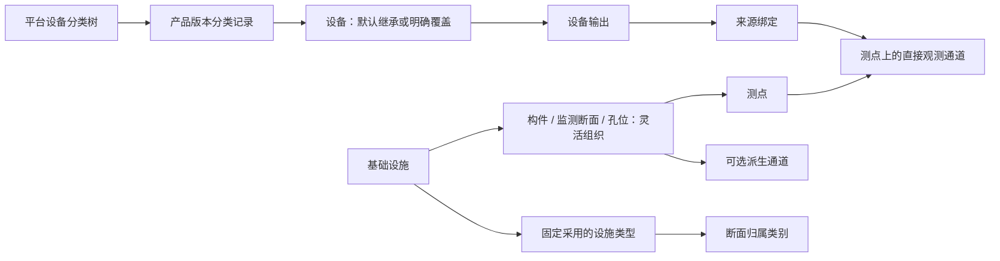

# 设备分类、监测断面与孔位业务模型方案

编制日期：2026-11-17。本方案已由用户指定为完整开发依据。实施状态：**Awaiting acceptance（完整开发及自测完成，待人工验收）**；实现及自验见[实施规格](sensor-classification-and-engineering-structure-implementation.md)和[60 项验收账本](../verification/sensor-classification-and-engineering-structure.md)。人工验收尚未开始。

本方案承接已补充的大屏 SDK 第一、第二类能力，处理第三类缺少的系统业务模型：传感器分类，以及工程资源树中的监测断面、孔位。先明确系统中的业务事实、关系、授权与统计，再由大屏 SDK 读取；不在大屏中另建一套分类或工程结构。

用户已明确：断面只作为有独立身份的工程节点，不再作为位置描述继续维护；新增孔位，但并非所有设施类型都有孔位概念；不强制“构件→子构件→断面→孔位→测点”的固定层序；断面类别按所属基础设施类型区分；必须衔接平台设施类型建模、公共监测模板等定义能力。主分类、分类维护方式、移动规则与兼容策略已随用户指定的完整方案实施；软件实现和自验证据见实施规格与验收账本，人工接受仍待用户确认。

关联：[业务词汇](../../GLOSSARY.md) · [正式需求](../requirements.md) · [当前架构](../architecture.md) · [技术选型](../technology-selection.md) · [已补充 SDK 的规格](display-sdk-monitoring-read-spec.md) · [SDK 实施验收记录](../verification/display-sdk-monitoring-read.md)。

导航：[结论与范围](#scope) · [现状](#baseline) · [业务对象](#concepts) · [设备分类](#classification) · [灵活工程树](#tree) · [类型建模与监测模板](#type-template) · [监测断面](#section) · [孔位与测点](#borehole) · [修改与历史](#lifecycle) · [授权](#authorization) · [统计](#statistics) · [业务流程](#workflows) · [技术与接口](#architecture) · [迁移与兼容](#migration) · [实施顺序](#delivery) · [验收](#acceptance)。

<a id="scope"></a>

## 0. 推荐结论与完整范围

推荐采用以下模型：

1. **平台维护多层级业务字典，首个字典为“设备分类”。** 传感器作为其中一个分类分支，采集仪、通信网关等属于其他分支。分类与厂商、产品型号、监测指标分别维护。
2. **设备通过产品版本的分类记录取得默认主分类，允许租户对具体设备作有原因、有历史的覆盖。** 一台设备同一时刻只有一个主分类；多输出、多指标不重复计算设备台数。
3. **基础设施下采用由类型定义约束的灵活工程资源树。** 类型决定是否支持断面／孔位及其属性，允许的构件、断面、孔位按工程实际组合；不规定统一层序。测点是观测位置，不承担结构容器职责。
4. **监测断面、孔位具有独立身份。** 不把它们伪装成构件，不把位置中的断面文字或一张断面图当作实体。
5. **断面归属类别从基础设施类型派生。** 路基设施中的断面称为路基断面，隧道设施中的断面称为隧道断面；不增加第二套需要人工维护的“断面类别字典”。
6. **既有测点、通道、设备、观测身份保持。** 调整结构不重建测点，不改变设备输出与业务通道的绑定，不移动或重写监测观测。
7. **设施类型、样例建模和公共／租户监测模板同步扩展。** 模板引用明确类型版本和目标种类，不在无孔类型下制造孔位，也不把模板推荐布局变成全系统必经层级。

| 编号 | 本方案必须覆盖的业务结果 |
| --- | --- |
| SBM-01 | 平台能够维护有层级、可追溯的设备分类，租户和项目按统一口径使用 |
| SBM-02 | 产品和实际设备有明确分类依据，既有设备可以补分类，多功能设备台数不重复 |
| SBM-03 | 监测断面、孔位进入正式工程资源模型、目录、详情、授权和生命周期 |
| SBM-04 | 构件／断面／孔位可灵活组合，既有设施直属测点和多层构件继续成立 |
| SBM-05 | 断面按设施类型归类，孔位与孔内不同位置的测点可准确表达 |
| SBM-06 | 新节点接入设备安装、来源查询、监测／派生指标、布设图、模型、文件和历史 |
| SBM-07 | 分类、断面、孔位及其测点／设备／数据量统计有明确去重与归属口径 |
| SBM-08 | 共享资源、项目授权、移动后的权限、旧数据与已交付 SDK 有完整迁移兼容方案 |
| SBM-09 | 平台设施类型定义表达断面／孔位适用性和属性，建模预览、发布与实例采用保持一致 |
| SBM-10 | 公共／租户监测模板支持新目标映射、类型适用性和固定版本校验，不强制结构路径 |
| SBM-11 | 退出断面位置文字录入，旧文本核对迁移为实体引用或保留为历史依据，不再形成第二套断面事实 |

本轮不定义具体行业传感器分类标准，不凭设备名称自动分类，不把采集终端自动变成设备，也不新建地质钻探施工管理、自动三维孔轨迹计算、断面设计软件或通用大屏设计器。分类初始词条以可编辑业务样例表达，正式词条由平台维护者确认。

<a id="baseline"></a>

## 1. 当前代码基线与实际改动范围

本方案依据当前 checkout 的实际代码；第一、第二类的 displayread、设备读取、资源统计和查询生命周期已经存在，本轮不重复设计其基础运行机制。

| 当前事实 | 源码依据 | 本次业务影响 |
| --- | --- | --- |
| 资源固定为 facility/component/point/channel；构件父级是 parent_component_id，测点使用 component_id | [资源模型](../../packages/go/platform/resources/model.go)、[资源修改](../../packages/go/platform/resources/mutations.go) | 不能只在前端树多加两种图标；需要统一组织关系并新增两类实体 |
| 树查询、路径、项目上下文和授权依赖四种资源及固定父链 | [树查询](../../packages/go/platform/resources/tree.go)、[项目资源授权](../../packages/go/platform/resources/authorization.go)、[原授权结构](../../packages/go/platform/migrations/00010_project_resource_access.sql) | 查询、授权、统计、维护委托和共享影响必须一起扩展 |
| 设施类型包含构件类别、属性和父子类别约束，样例节点仅表达构件 | [工程定义模型](../../packages/go/platform/engineering/model.go)、[样例与 schema](../../packages/go/platform/engineering/schema.go) | 新增节点适用性／属性与混合树样例；断面／孔位不能误占构件类别 |
| 公共／私有模板映射明确类型版本的根或构件类别，绑定要求是 observation_channel | [模板校验](../../packages/go/platform/engineering/validation.go)、[模板编辑](../../apps/console/src/features/engineering/template-editor.tsx) | 扩展新对象锚点、适用性与监测目标映射；不等于已有真实资源自动生成流程 |
| 设施采用的 type_version_id 在普通更新中不可改，公共定义不自动跟随最新版 | [资源输入](../../packages/go/platform/resources/input.go)、[资源不变量测试](../../packages/go/platform/resources/invariants_test.go) | 本轮须增加受控的同类型兼容版本采用，不能直接改旧定义或假设已有升级入口 |
| position.sections 只有 kind/code/name/reference_description，没有独立对象身份 | [位置模型](../../packages/go/platform/location/position.go) | 退出正式位置录入；旧内容核对迁移，不能直接 count 为断面或按同名自动合并 |
| 产品有名称、型号、用途、输出槽位；设备固定采用产品版本，输出独立 | [产品模型](../../packages/go/platform/devicecatalog/model.go)、[设备模型](../../packages/go/platform/devices/model.go) | 增加分类记录，不能用产品名称、指标或输出数量替代传感器分类 |
| 设备安装可指向设施／构件／测点，与来源绑定独立 | [安装](../../packages/go/platform/devices/installations.go)、[设备资源适配](../../packages/go/platform/resources/device_seams.go) | 增加断面／孔位安装目标，但不把安装自动当监测来源 |
| 派生通道可以归属设施、构件、测点；直接通道归属测点 | [派生所有者约束](../../packages/go/platform/migrations/00014_derived_channels.sql) | 扩展派生通道所有者到断面／孔位；直接观测仍经测点表达 |
| 空间资料已有测点挂载、构件关联和固定版本 | [空间模型](../../packages/go/platform/spatial/model.go) | 新对象需要正式空间引用；断面实体与断面图、孔位实体与模型元素分别识别 |
| SDK 已有命名读取范围、设备／资源统计、快照和预算 | [读取模型](../../packages/go/platform/displayread/model.go)、[资源统计](../../packages/go/platform/resources/display_statistics.go)、[设备读取](../../packages/go/platform/devices/display_reads.go) | 增加分类与新实体的受控读取，保持既有授权及计数语义 |

当前业务词汇明确将构件定义为物理组成部分，并排除了“监测断面”的含义。因此采用独立节点种类，而不是新增两个特殊构件类别。

<a id="concepts"></a>

## 2. 核心业务对象与关系

| 概念 | 表达什么 | 不承担什么职责 |
| --- | --- | --- |
| 设备分类 | 一种硬件在业务分类体系中的位置，如位移传感器、采集仪 | 不定义单位、输出协议或监测指标 |
| 产品分类记录 | 某个固定产品版本的默认主分类及其变更依据 | 不改写产品的固定输出语义 |
| 设备分类覆盖 | 租户对一台实际设备明确指定的主分类 | 不替代设备型号，不影响其他设备 |
| 基础设施 | 工程资源组织树的根与业务归属边界 | 不因被多个项目使用而产生副本 |
| 构件 | 基础设施的实际组成部分 | 不充当任意分组标签 |
| 监测断面 | 基础设施内有独立名称、编号和位置依据的监测组织对象，可组织孔位、测点等 | 不等于图纸文件，不要求预先存在几何切割面 |
| 孔位 | 基础设施内单独识别的孔或孔道及其位置依据，可在不同部位设置多个测点 | 不等于传感器、采集端口或单个测点 |
| 测点 | 一处具有明确监测含义的位置，可以有多个业务通道 | 不作为工程结构容器，不因装多个传感器而复制 |
| 业务通道 | 某工程对象针对一个指标的观测定义 | 不代替断面、孔位或设备身份 |
| 工程组织关系 | 一个工程对象在主树中的直接归属 | 不等于模型几何相交、设备安装或数据来源 |
| 关联参照 | 对已有独立工程对象的说明性引用 | 不重新创建文字断面，不增加主父级，不传播授权或归属统计 |



所有工程实例继续属于租户，可被多个项目明确授权使用。设备分类是设备轴，设施类型是工程轴；二者可以交叉筛选，但不能相互推导。例如“路基断面上的温度传感器”有路基设施归属、断面身份和温度传感器分类三项独立事实。

<a id="classification"></a>

## 3. 多层级设备分类

### 3.1 采用平台业务字典，先做明确的设备分类

平台增加“业务字典 → 设备分类”管理入口。树层级由数据决定，不固定为一级／二级／三级。可复用树、草稿、发布、停用、历史的基础能力，但本期只注册 device_category 这一明确业务字典，不开放任意表单脚本或让用户随意改变系统字段含义。

示意分类如下，名称仅为讨论样例，不作为外部行业标准：

```text
设备分类
├─ 传感器
│  ├─ 位移监测
│  │  ├─ 拉线位移传感器
│  │  └─ 激光位移传感器
│  ├─ 倾角传感器
│  ├─ 温度传感器
│  └─ 多功能环境传感器
├─ 采集设备
│  └─ 数据采集仪
├─ 通信设备
│  ├─ DTU
│  └─ 网关
└─ 其他设备
```

“传感器分支”通过稳定分类 ID 在字典中声明，不通过名称包含“传感器”来判断。通信设备有温度诊断输出，不因此自动算温度传感器；采集终端关联了若干设备，也不因此多算一台设备。

一期建议平台统一维护，租户与项目选用。暂不再复制租户私有分类树，避免同名类别在不同项目里变成不同统计口径。租户私有产品仍可以使用平台分类；以后确有私有分类需求，再增加有命名空间的扩展，而不是现在混入无治理的自由文本。

### 3.2 分类节点与版本

分类节点至少具有稳定 ID、不可复用的业务编号、名称、父分类、说明、排序、是否可直接归类、状态。单一父分类、无环、不跨字典是结构约束；不按业务固定层数。系统可设置技术深度／数量预算并明确报错，不能以固定三层代替业务模型。

分类可选择到业务认为足够明确的节点，不强制只能选叶子。已有设备归在“位移监测”后，再新增两种子类，原归类仍有效，不自动改成其中一种。

分类树采用草稿→校验→发布；一次发布固定名称、路径、可选状态和稳定 ID 的集合，产生 dictionary_release_id。重命名或移动保留类别身份；实质业务含义改变应新建类别。已发布／已引用类别不物理删除，停用后禁止新选择但保留已有引用与历史解释。合并类别以明确映射和批量改分类处理，不能把一个旧 ID 偷换成另一个含义。

默认列表和新统计使用当前已发布字典版本；查询快照固定所用版本。产品／设备分类记录保留选择时的字典版本和路径依据，历史报告可指定原版本复核。字典改路径会影响后续按祖先分类的归组，发布预览需列出影响；不会改变既有查询快照。

### 3.3 分类挂在产品与设备上

推荐把分类作为**独立的、可追溯的分类元数据**维护，而不要求为了补分类重新发布产品输出定义、升级设备输出或更换解析配置。

| 层次 | 维护与采用规则 |
| --- | --- |
| 固定产品版本的分类记录 | 对 product_version_id 维护一条当前主分类记录，含类别、选择依据、修订、开始／结束时间及原因；历史记录保留 |
| 产品发布／新设备建档 | 确认分类或显式标记未分类；新设备默认继承其采用产品版本的当前分类记录 |
| 实际设备分类覆盖 | 有设备维护资格的租户人员可明确覆盖；必须选有效类别并记录原因；不修改平台产品 |
| 清除覆盖 | 采用清除时该设备固定产品版本的当前分类记录；预览说明变化，不保持一个失效的隐式副本 |

```text
设备有效主分类 = 当前有效的设备覆盖
              否则 = 设备固定采用产品版本的当前分类记录
              否则 = 未分类
```

产品版本分类记录和设备覆盖各有独立历史与修订。修改某产品版本的分类记录，影响当前继承它的设备，覆盖中的设备不随之改变；保存前必须展示可见影响范围，提交后使相应目录、统计及订阅失效。设备详情区分“当前分类”与“分类来源”，可以说明发生了继承变更。

分类记录不参与产品输出语义哈希、设备输出代次、解析配置身份或通道兼容判定。只补分类不能导致重新接入、重绑输出或重算派生数据。这与现有产品固定版本模型相容：固定内容保持原样，分类由单独记录描述。

新产品版本或从公共产品复制形成的租户版本，可用来源分类作为待确认初值；发布／确认后形成自己的分类记录，不与源版本建立隐藏的持续同步。已停用类别上的既有分类仍可解释和计数，不自动退回未分类；无权读取或依赖不可用也不能伪装为未分类。

### 3.4 一台设备一个主分类

默认主分类唯一，以保证“每类多少台”能够对账。设备有温度、湿度两个输出，仍是一台多功能设备；选择其适当主分类，不按输出复制设备。辅助用途可以保留为说明或以后单独增加标签维度，不能混进主分类台数。

旧设备不强迫一次全部填完。未分类是明确的数据完整性状态；非传感器、不可读分类和未分类分开，不能一律装进“其他”。分类未知时不能宣称它一定是非传感器；传感器统计同时报告未分类设备数供业务核对。

补分类优先按固定产品版本批量处理，再处理设备例外；只作用于预览列出的版本／设备及修订。不能根据名称、型号文字、协议或指标自动正式采用分类；可展示候选建议，但需维护者明确采用。

<a id="tree"></a>

## 4. 灵活的工程资源组织树

### 4.1 节点种类与允许关系

主结构种类为 facility、component、monitoring_section、borehole、point；中文分别为基础设施、构件、监测断面、孔位、测点。“子构件”是位于另一构件之下的构件，不是独立节点种类。

| 直接父节点 | 构件 | 监测断面 | 孔位 | 测点 |
| --- | --- | --- | --- | --- |
| 基础设施 | 允许 | 允许 | 允许 | 允许 |
| 构件 | 允许 | 允许 | 允许 | 允许 |
| 监测断面 | 允许 | 允许 | 允许 | 允许 |
| 孔位 | 允许 | 允许 | 允许 | 允许 |
| 测点 | 不作为结构容器 | 不作为结构容器 | 不作为结构容器 | 不作为结构容器 |

这张表是系统可表达的关系上限，须与**设施当前采用类型版本允许的节点种类**求交；不是每种设施都开放所有节点。类型不支持孔位时，整棵树都不能新增孔位，也没有“孔位下新建”的业务场景。

在类型允许的种类之间，不规定断面、孔位、构件的先后顺序，也不强制每条分支出现所有种类。允许“孔位→断面→测点”和嵌套断面／分孔，前提是类型允许且业务上确有这些独立对象；不自动生成占位层。

仅保留必要不变量：同租户、同设施，一项资源只有一个主父级，不能指向自己或后代；基础设施只能作为根；测点不能容纳其他结构对象。空断面、空孔位以及暂未配置通道的测点允许保存，便于逐步建档。

### 4.2 典型结构示例

```text
路基 A
├─ 断面 S01
│  ├─ 孔位 H01
│  │  ├─ 测点 P01（沿孔 2 m）
│  │  └─ 测点 P02（沿孔 5 m）
│  └─ 孔位 H02
│     └─ 测点 P03
├─ 孔位 H03                       ← 不必先有断面
│  └─ 测点 P04
├─ 测点 P05                       ← 可直接在设施下
└─ 构件 C01
   ├─ 构件 C02
   │  └─ 断面 S02
   │     └─ 测点 P06              ← 不必经过孔位
   └─ 孔位 H04
      └─ 断面 S03
         └─ 测点 P07             ← 不限制断面必须先于孔位
```

其他合法结构包括“设施→断面→构件→测点”“设施→断面→子断面→孔位→测点”。节点拖动只改变组织关系，实际可移动性还需检查权限、已有构件约束和定位依据。

### 4.3 构件物理含义与主树的区别

混合树的每条边统一表达“组织在这个对象之下”，不能把“断面→构件”解释为断面本身是物理构件。

现有设施类型中的构件类别及父子数量约束仍只针对构件：从某构件向上寻找最近的构件祖先，没有则为设施；中间的断面／孔位不占构件名额，也不能绕过原有构件父子类别约束。此关系由主树推导，不再另维护一套可编辑的构件父树。

例如 C1→断面 S→C2，C2 的构件上级仍为 C1；把 S 整体移动到 C3 下时，需预览并校验 C2 的构件上级变化。这样可以插入监测组织层，同时保留现有真实构件类别规则。

### 4.4 一个主位置与辅助参照

同一对象在主树中只出现一次。一个断面跨越多个构件时，可将其放在这些构件的共同上级，并通过关联参照说明涉及的构件；不能复制断面以凑树形显示。

关联参照仅允许本设施的已存在结构对象，标明“参照”，不允许冒充第二个主父级，也不允许输入一段文字充当尚未建档的断面。界面可以展示跳转入口，但不把它展开为另一棵可计数的复制子树。参照不进入祖先判定、设备计数、监测归属或授权继承；设备、通道关联仍走各自正式业务关系。

### 4.5 通道如何呈现在树中

通道仍是业务资源，界面可显示在其所有者下，但不作为可随意拖动的结构容器。直接观测通道继续只属于测点；派生通道允许属于设施、构件、监测断面、孔位或测点。

例如断面整体沉降差可建立在断面上，孔位整体最大位移可建立在孔位上；计算规则、输入资格和固定版本沿用现有派生模型。不为展示一个断面指标而虚构测点。已有直接／派生通道的所有者和身份不因引入新种类而自动改变。

<a id="type-template"></a>

### 4.6 平台设施类型决定节点适用性

在设施类型定义的**固定发布版本**中增加结构能力与新节点属性，不在设施页面按“桥梁／路基”等名称硬编码，也不另设一个脱离类型版本的全局孔位开关。

| 定义部分 | 作用 |
| --- | --- |
| 断面支持性 | 是否允许该类型的设施建立 monitoring_section；允许不等于必须创建 |
| 孔位支持性 | 是否允许建立 borehole；不支持时不开放创建、孔深表单或孔位监测项 |
| 断面扩展属性 | 在通用身份、位置、用途之外，定义该设施类型需要的断面属性，复用现有有界字段模型 |
| 孔位扩展属性 | 在通用孔口／孔深资料之外，定义该类型需要的孔位属性；不能重新解释系统固定字段 |
| 原构件定义与关系 | 继续表达真实物理构件类别及约束，不拿它来模拟断面／孔位 |
| 推荐样例 | 展示可用结构与监测布置示例，不约束实际节点必须沿样例路径建立 |

建议元模型版本 2 的类型内容增加如下片段，其他已有字段仍保留：

```json
{
  "metamodel_version": "2",
  "structure": {
    "monitoring_section": { "supported": true, "fields": [] },
    "borehole": { "supported": false, "fields": [] }
  }
}
```

上例表示“可以有监测断面，没有孔位概念”，不是“一定有断面”。另一个用于深层监测的路基类型可以两项都为 true。具体配置由该类型的业务定义决定，不能推断所有桥梁都无孔或所有路基必须有孔。

创建动作最终取交集：**系统关系矩阵 ∩ 当前采用类型支持的种类 ∩ 构件类别合法性 ∩ 当前资源状态 ∩ 项目维护委托与人员权限**。服务端返回可创建项，管理端和 SDK 描述都遵循它；不能只隐藏按钮而允许接口绕过。

类型允许孔位时，某个具体设施仍可以零孔位并直接布设测点；不增加逐租户开通、实例启用或审批流程。类型不允许孔位时，统计显示 not_applicable，区别于“类型允许但当前数量为 0”。

### 4.7 类型建模、校验与预览同步扩展

平台类型编辑器增加新节点支持性与属性；样例节点增加明确 kind、parent_ref，构件才有 component_category_key。样例可演示断面／孔位任意合法穿插，属性表单按类型版本＋节点种类生成。

类型发布校验必须覆盖：已声明种类、属性 schema、同设施无环、最近构件规则、类型不允许的孔位不能出现在样例中、字段不能覆盖系统身份和类别派生含义。现有最小构件数仍按原规则提示，不因新增监测容器被错误满足。

样例没有真实资源 ID，不生成实际断面或孔位；发布定义不等于现场已经建档。公共定义、schema 编译器、批量／单条定义解析、前端编辑器、预览与服务端验证必须共同识别元模型 1/2，不能只更新一处 JSON Schema。

### 4.8 公共和租户监测模板的目标映射

保留“固定类型版本→监测项→指标／单位及资源绑定要求”的现有模型，扩展以下内容：

| 内容 | 衔接方式 |
| --- | --- |
| 适用类型 | 仍引用明确 type_version_id，不自动跟随新版本或按同名判断 |
| 监测对象锚点 | 从原根对象／构件类别，扩展为设施、构件、断面、孔位、测点；构件另指定类别 |
| 实际直接观测位置 | 直接通道始终绑定测点。锚点为断面／孔位时，通过 descendant_points 指定其下监测测点范围，不把原始设备输出直接挂给容器 |
| 孔内等局部条件 | 可明确要求测点有孔位祖先；按真实祖先链匹配，不要求断面、孔位相邻或固定先后 |
| 数量含义 | 明确 per_anchor 或 per_point；监测通道数量、测点数量和结构节点数量分别表述 |
| 多类型映射 | 每项对每个适用类型明确 applicable＋合法目标，或 not_applicable＋原因；不能靠默认不选用掩盖无效映射 |
| 建议设备分类 | 可引用固定字典版本中的类别作选型提示；不能代替输出指标、单位、方向、基准等实际兼容验证 |

例如“孔内水平位移”项只适用于支持孔位的类型，其锚点为孔位，直接观测要求指向该孔范围内的测点通道。无孔类型对应映射必须明确不适用，或不被列入该模板适用范围；不能为了满足模板在树中补一个假孔。

“断面沉降监测”项可把断面作为锚点，在其合法后代测点布设直接通道；既允许“断面→测点”，也允许“断面→孔位→测点”或中间经过构件。模板的监测分组只是监测项展示组织，不产生一个断面实体。

模板草稿、发布、样例预览、公共模板复制为租户模板时都校验类型支持性、目标种类、字段及固定指标／单位依赖。一个保留但默认不选用的监测项仍需有效映射；not_applicable 是显式适用性，不等于无效配置被默认隐藏。复制形成独立版本，公共更新不改写租户副本。

现有模板尚不自动生成工程实例。本轮衔接包含新目标建模、校验、预览和人工建档参考，不另造“项目监测方案”或自动批量实例化流程。断面／孔位可有派生通道，但其计算规则仍由现有派生模块配置；本轮不把公共普通指标引用冒充派生规则引用，也不新增公共派生规则发布系统。

### 4.9 既有设施如何取得新结构能力

旧元模型 1 没有声明断面／孔位能力，兼容解释保持原种类，不自动允许所有设施建孔；适用性标记为 undeclared（尚未建模），不能谎称业务上明确无孔。平台为需要的新能力发布同一类型定义的版本 2；现有设施继续固定原采用版本，直到租户明确采用新版本。

当前代码没有可直接复用的设施类型切换流程，因此本轮需新增**同一类型定义内的兼容版本采用**：预览原／新能力、既有属性与构件规则、模板依据、项目授权和新节点引用，确认兼容后原子更新当前采用，并记录完整采用历史。普通编辑接口仍不得修改 type_version_id，平台发布本身也不触发实例更新。

本轮允许满足既有资料的增量兼容升级；不顺便做跨类型定义转换、重解释原字段／构件类别或破坏性的规则替换。已有孔位或保留的孔位引用时，不允许采用一个会令其失去合法含义的“无孔”版本；需先有明确业务处置，不能通过隐藏节点完成升级。

设施采用版本变化后重新校验模板参考和结构 schema；旧模板版本仍可查看，但不能把它视为自动适用于新类型版本。升级保留设施、测点和通道身份，旧查询保留旧类型／结构依据，当前授权再次复验。

<a id="section"></a>

## 5. 监测断面的业务模型

### 5.1 独立实体与基本资料

断面具有独立 ID、所属租户／设施、编号、名称、主父级、状态、用途说明、位置依据、来源资料、修订及变更历史。可以只有桩号或文字位置，之后补充坐标、断面示意及资料关联；不要求先上传图纸才能建断面。

编号建议在同一设施的断面种类内唯一，改名不改变身份；同一设施的孔位与断面可有相同文字编号，查询始终带种类。已有构件、测点的编号规则不随本次改动强制统一。

### 5.2 类别从所属基础设施类型得出

```text
断面归属类别 ID = 所属基础设施采用类型版本的 type_definition_id
断面归属类别名称 = 该设施类型名称 + “断面”
```

最终显示名称可避免重复词，但类别判断始终基于类型定义身份，不通过名称拼接反推。路基设施里的断面，不论位于构件、孔位还是另一断面之下，都是路基断面。桥梁和隧道同理。

不提供可编辑 section_type_id 来重复保存设施类别，避免出现“路基设施／桥梁断面”的冲突。断面的监测用途、断面位置、资料种类另外记录；“沉降监测”是用途，“横断面图”是资料表达，不是另一套设施归属类别。

同一类型定义的不同版本归为一组；不同类型定义即使同名也不合并。按第 4.9 节明确采用新版本后，断面名称展示／属性依据按设施当前资料变化，新查询采用新依据，历史快照保留原依据；不会自动跟随平台最新版本。本轮不提供跨类型定义转换，也不能在断面页单独改归属类别。

### 5.3 断面位置文字退出正式业务模型

- 监测断面：有独立身份，可授权、计数和关联测点／孔位。
- position.sections：只作为待迁移的旧数据来源，退出当前位置录入和正式断面读取；不继续保留为可编辑的平行断面模型。
- 监测断面图：空间资料的一种表达，可关联一个或多个获准断面；图纸页数、图层数不是断面数量。

工程对象需要引用断面时，选择已经建立并可读的断面节点；主归属由树确定，其他用途用正式实体引用表达，不再输入 kind/code/name 的断面文字数组。断面自身仍可以有桩号、坐标等位置资料，取消的是“用位置文字代替断面身份”，不是取消断面的实际位置。

旧原文保留在变更历史／迁移核对证据中，不作为当前可编辑位置字段继续供业务使用。相同编号可能属于不同设施、不同测量时期或纯外部资料引用，必须核对真实身份后迁移；未解决的条目显式标记待核对，不计为断面，也不能直接置空后宣称迁移成功。

<a id="borehole"></a>

## 6. 孔位与孔内测点

本节适用于设施当前采用类型明确支持孔位的情况；无孔类型不出现孔位建档、孔深或孔内测点定位入口，服务端同样拒绝相应创建请求。

### 6.1 孔位档案

孔位不是设备，也不是设备输出；它描述一处持续可识别的工程监测位置。换装传感器不创建新孔位，一个孔里几个不同深度的测点各有自己的身份。

| 资料 | 约定 |
| --- | --- |
| 身份与归属 | 稳定 ID、设施、主父级、编号、名称、状态与修订 |
| 孔口位置 | 沿用位置模型的地理／投影／桩号／局部坐标和来源，不要求全部填写 |
| 孔口高程 | 数值与高程基准成对解释，未知为缺失，不默认海拔零 |
| 设计／实测孔深 | 分字段保存，可分别缺失；以米表达，不把设计值当实测值 |
| 孔径、方向与倾角 | 可选；角度须声明相对方向与参考依据，不凭正负数猜测 |
| 用途、来源、测量日期 | 说明与证据，支持逐步补齐 |

本期不根据孔深与孔口坐标自动生成精确孔底坐标，也不承诺斜孔／曲孔轨迹反算。已有三维表示可作为空间资料关联。

### 6.2 孔内测点定位

主树中某测点最近的孔位祖先是其当前主孔位。中间可以经过断面或构件，不要求测点直接挂在孔位下；没有孔位祖先则没有主孔位。嵌套孔位时取最近一个，外层孔位作为包含范围保留。

孔内定位是测点自身位置的补充，包含孔位引用、沿孔距离、参考起点、方向／单位、来源及测量时间。此处明确将“沿孔距离”定义为沿孔轴从指定参考起点到测点的位置，不能与垂直埋深、高程混为一个字段。若有垂直埋深，单独记录其基准。

创建孔内测点时，从最近孔位祖先给出定位对象候选；用户填写或确认后，保存明确孔位 ID 和当时依据，而不是只存一个无上下文的“5 m”。沿孔 0 m 是有效值；未知深度为 null，不补零。允许先建测点后补定位资料。

本期主孔位由主树决定，不再维护可与树冲突的第二个“所属孔位”。位于其他位置的孔只能作参照，不贡献本孔测点数。将测点组织到适当孔位祖先下即可表达正式孔内归属。

### 6.3 深度校验与结构移动

负的沿孔距离、非法数值、没有基准的矛盾单位属于输入错误。超出已知实测孔深、设计／实测差异或方向不明，提供数据一致性提示与理由记录；不因孔深资料尚未补齐而阻止测点建档。

移动测点或包含它的子树，使最近孔位改变时，旧孔内定位不能无条件跟到新孔：预览列出受影响定位，执行时明确选择重新定位或将旧定位保留为历史并使当前定位待补。整孔移动且点的最近孔位未变时，孔内距离保持，但孔口／整体空间位置变化仍须单独处理。

修改孔口位置、孔深或坐标基准不会自动重算全部测点的地理位置；相关定位显示依据变化，用户核对后确认新依据。历史孔内定位保留其孔位身份和参考资料。

<a id="lifecycle"></a>

## 7. 新增、移动、退役与历史

### 7.1 身份、编号和结构分别维护

设施、构件、断面、孔位、测点、通道的稳定 ID 不因改名或同设施内移动而变化。资源修订记录自身资料，设施的结构修订记录父子关系变化；分类与字典另有各自修订，不挤进一项含义模糊的版本号。

新断面／孔位可以先建空档案，之后逐步增加下级和资料。主树不新增无业务含义的“文件夹”节点，也不使用断面作为所有临时分组的替代品。必要的临时筛选使用视图，不改变实体身份。

### 7.2 同设施内移动

采用预览→执行的结构变更流程：

1. 校验对象与目标父级属于同一租户和设施，目标可作为结构容器，不构成环。
2. 计算完整受影响子树、最近构件／断面／孔位的前后变化，检查构件类别及数量约束。
3. 校验操作者的结构维护资格、原／新父级资格、子树的维护委托及共享资源影响；不能搬动项目看不见或无权维护的下级。
4. 列出需要重建依据的孔内定位、受影响的分类统计／订阅、空间定位提示；隐藏项目只给出受限影响说明，不暴露其名称或对象数。
5. 提交时复验结构、对象、授权和定位修订，在同一事务中变更父链及受影响的派生索引／定位状态，记录原因和前后路径。

移动不创建新通道，不更换通道指标，不自动重绑设备，也不复制既有观测。按当前工程归属汇总历史观测时，新查询可能落入新断面／孔位组；固定的旧查询仍保留其原归组依据。

本轮不把跨设施移动当普通拖动。跨设施涉及固定类型、编号、授权、安装和历史归属，应走独立的迁移业务；不在本方案中以“无限制”绕过身份边界。

### 7.3 退役、删除和恢复

断面和孔位沿用工程资源 normal/retired 及逻辑删除规则。退役不删除下级、历史观测或设备安装记录；父级退役对下级可操作性的影响与现有工程资源保持一致，明确区分对象自身状态与受祖先影响的当前可操作状态。

有下级或正式业务引用的节点不得直接级联删除。批量退役、迁移下级、解除可解除引用分别预览，不能把删除按钮变成隐含的数据清理。存在保留历史引用时保持身份可追溯；恢复前重新检查父级、类型和授权条件，不恢复早已撤销的项目资格。

### 7.4 历史依据

记录结构变更、分类变更和定位变更的操作者、时间、原因、前后依据及影响摘要。当前结构查询和“截至某时刻的历史结构重建”是不同能力；本轮要求保留历史证据和查询快照，不宣称提供任意历史时点的完整数字孪生回放。

<a id="authorization"></a>

## 8. 共享资源、项目授权与业务权限

### 8.1 继续使用租户资源、项目授权模型

断面和孔位与构件、测点一样由租户拥有。项目只能使用明确授权的资源；同一对象被两个项目使用时仍是一份身份、一份结构、一份业务历史。

新增 resource_kind 及相应创建／维护／生命周期委托。项目角色具备操作权限与该资源被授权，是同时成立的条件。新建断面／孔位不自动获得设备、输出、监测历史或空间资料权限。

项目取得测点授权，可以获得其祖先断面／孔位的最小路径上下文，但上下文不等于完整实体可读，不计入断面／孔位实体总数。与现有 context 规则一致，不能借断面页查看其他项目的测点、孔位和设备数量。

设施类型定义仍由平台维护，租户不能绕过公共类型自建一套“允许孔位”的私有类型。既有设施的兼容类型版本采用由租户的明确维护资格执行，涉及所有共享项目的当前资料，不因某个项目可以创建测点就自动授予类型采用权限。

### 8.2 结构关系不自动传播授权

- 将已授权测点移动到某断面下，不自动授权该断面其他下级。
- 将未授权节点移动进已授权目录，不自动获得资源、通道或设备权限。
- 按 ID 固定的读取集合仍按原身份及当前资格读取；显式动态子树视图在移动后重新求交，并使旧授权证明失效。
- 新节点种类不因旧 grant 的 kinds 为空而自动纳入。旧范围迁移时固定原解释；要读取断面／孔位需明确扩展资格。
- 项目归档后沿用只读与撤权规则，不允许借分类或结构新接口修改共享资源。

### 8.3 分类维护与分类读取

平台分类维护者管理字典及平台产品的分类记录；租户产品维护者管理本租户产品版本分类；设备维护者管理本租户设备覆盖。项目本轮以读取为主，不新增项目随意修改共享设备主分类的能力。

字典公共标签可读取，不表示能查看该类别下所有租户设备。设备分类映射、分类历史、分组计数和设备详情分别受对象及字段资格限制。只给设备输出 context 的大屏不能因为增加分类接口而取得完整设备档案或算入 authorized 设备数量。

提供只统计类别台数的能力时，可以开放获准分组标签与计数，不自动开放分组设备名单；下钻继续检查设备明细能力和相同对象范围。

### 8.4 撤权、缓存与后台读取

资源树修订、产品分类记录、设备分类覆盖、字典发布版本、新对象授权、空间引用等加入现有 source vector。目录、缓存、后台统计、游标、文件块和订阅交付前仍须二次授权。历史快照不能作为撤权后的继续供数许可。

<a id="statistics"></a>

## 9. 统计口径与可对账规则

### 9.1 设备分类统计

继续显式区分现有两种设备 population：authorized 为完整设备授权集合，monitoring_bound 为其中当前有效来源绑定参与监测的设备。统计按 device_id 去重，不按输出数、测点数、采集终端数或绑定行数计算。

| 结果 | 定义 |
| --- | --- |
| 某类直接设备数 | 主分类恰好等于该类别的唯一设备数 |
| 某类包含设备数 | 主分类为该类别或任意后代类别的唯一设备数 |
| 已分类传感器数 | 主分类属于字典所声明传感器分支的唯一设备数 |
| 已使用传感器类别数 | 有设备实际直接归入的不同主分类 ID 数；不同时把其祖先也当作已用类别再加一次 |
| 未分类设备数 | 没有有效主分类的设备数；单独报告，不能假定为非传感器 |
| 非传感器设备数 | 明确归入其他分支的设备数 |

父分类与子分类的包含数不能相加。需要可相加的图表时，按一层分类切片或明确的互斥分类前沿分组；父节点直接归类的设备放入“本类直接归类”，未分类另外列组。类别标签相同但 ID 不同不合并。

分类统计固定 dictionary_release_id、产品／设备分类修订、population 和授权范围，针对当前设备集合。监测时间筛选不将台账变成历史设备分类；不能把当前来源关系倒推为历史采集设备。本轮不增加“按采集当时的传感器分类统计历史数据量”，该能力需要同时选择历史来源和历史分类依据。

### 9.2 断面和孔位实体数量

按当前项目完整可读的独立实体 ID 去重，按设施及设施 type_definition_id 分组；上下文祖先、图纸、位置参照和树中快捷引用不计入实体数量。

默认非删除范围包含 normal/retired，并分项返回；应用若只看在用节点，应显式筛选。孔位没有测点、断面没有孔位都仍是合法实体，可以计数。

统计同时返回类型适用性：支持孔位而未建孔为 applicable＋0；明确不支持孔位为 not_applicable，不误称“缺少孔位”；旧类型未声明为 undeclared，不假定其业务上无孔。项目合计只计算实际获准实体，并说明适用／不适用／尚未建模设施数量，不能用同一个零值掩盖这些状态。

“断面类别数”是当前可读断面涉及的设施类型定义数；“断面总数”是断面实体数。一个路基里有十个断面，为十个路基断面，不是十种类别。

### 9.3 节点自身、直接下级和全部后代

对任一构件／断面／孔位，分别给出 self、direct_children、descendants；不能只用一个含义不明的 count。

嵌套断面／孔位的统计支持两种明确模式：

- `nearest`：每个测点取最近断面／最近孔位祖先作为主归属；没有相应祖先进入 unassigned。用于互斥分组和项目对账。
- `subtree`：计算某节点整棵子树的对象，组内按稳定 ID 去重。嵌套节点之间可能重叠，返回 overlapping，组数不能直接相加。

“某断面全部测点”默认指 subtree，并展示为包含数量；“项目按断面分组”默认 nearest，并在结果中声明 membership。两种结果名称和参数必须区分，不能由不同页面自行决定。

### 9.4 通道、设备与数据量

直接通道继承其测点的主断面／主孔位；派生通道从所有者向上找最近同类对象，所有者本身是断面／孔位时包含自身。设施上的派生指标没有断面归属时进入 unassigned，不分摊到每个断面。

节点下设备数默认按当前来源关系解析再全局去重；物理安装设备数另外提供 relation=installation。派生通道不反向展开输入硬件来虚增设备数。设备同时服务几个断面时可以出现在多个组，项目总数再次去重，返回 overlapping。

监测数据量继续沿用已交付口径：原始 ever_published/active/sample 分开，派生 logical/valid/no_result 分开；时间、质量、正式采用、撤销和计算覆盖不改变。不能直接 count 存储行数。节点及派生通道选择先求授权交集，再调用现有监测引擎。

旧统计下钻固定原结构及类别快照；移动或分类变更后新查询使用新归组，不能将旧总数与新路径下的明细拼在一起。

### 9.5 确定性业务样例

下列路基／隧道分别采用已明确支持断面与孔位的测试类型版本；这不是按名称推断类型能力。另设不支持孔位的类型作为独立反例，不混入本表基础计数。

```text
路基 A
├─ 断面 S1
│  ├─ 孔位 H1 → P1、P2
│  └─ 断面 S1a → P3
├─ 构件 C1 → 断面 S2 → 孔位 H3 → P6
├─ 孔位 H2 → 断面 S3 → P4
└─ P5
隧道 B
└─ 断面 S4 → 孔位 H4 → P7
```

| 核对项 | 预期 |
| --- | --- |
| 实体 | 2 设施、1 构件、5 断面、4 孔位、7 测点 |
| 按设施类型的断面 | 路基 4、隧道 1；两种断面归属类别 |
| 按断面 nearest 的测点 | S1=2、S1a=1、S2=1、S3=1、S4=1、unassigned=1，合计 7 |
| S1 subtree 测点 | 3，已包含 S1a 的 1 个；不能再与 S1a 相加当项目唯一总数 |
| 按孔位 nearest 的测点 | H1=2、H2=1、H3=1、H4=1、unassigned=2，合计 7 |
| 每点一个直接通道、每通道 10 条正式观测 | 项目 raw=70；S1 nearest=20、subtree=30；P5 的 10 条在无断面组，不丢失 |

设备样例 V1/V2 为同类位移传感器，V3 为温度传感器，V4 为多功能环境传感器，V5 为采集仪，V6 未分类，六台均具备完整授权。V1 服务 P1/P2，V2 服务 P3/P7，V3 服务 P6，V5 服务 P4；V4/V6 未绑定，P5 的已有观测可来自人工正式采用。

authorized=6，其中已分类传感器=4、已使用传感器类别=3、非传感器=1、未分类=1。monitoring_bound=4，其中已分类传感器=3、已使用传感器类别=2。V2 跨路基与隧道，两个设施的来源设备数之和可以大于项目唯一设备数。

<a id="workflows"></a>

## 10. 系统业务流程与页面职责

### 10.1 平台分类、设施类型与模板维护

平台维护者编辑分类树、节点说明和可直接归类状态，查看已引用情况与发布影响后发布。停用类别时说明已有设备仍可解释、哪些新选择被禁止；不要求把所有旧设备立即搬类。分类层级是数据配置，不因新增层级要求发版。

设施类型编辑器同步提供断面／孔位支持性、对应属性和混合树样例。公共监测模板编辑器只列出所选固定类型版本允许的监测目标，多个类型分别映射；无孔目标显示不适用原因，不能拿默认不选用替代配置校验。租户模板复制、编辑和预览遵循相同规则。

### 10.2 产品与设备补分类

产品版本详情增加“分类”资料及独立分类变更历史。维护者可对多个已发布版本预览并补分类，不更改这些版本的输出内容。设备详情展示主分类、完整路径、来源为产品继承或设备覆盖、是否未分类和最近变更。

设备目录支持按分类精确／包含下级筛选；提供未分类清单和受控批量分类入口。批量执行按明确对象集合与修订，不能执行时悄悄吸收刚新增的设备。只拥有项目读取权限的人可以筛选与查看，不显示租户分类修改操作。

### 10.3 设施、断面与孔位工作区

沿用现有“左侧工程树、右侧对象详情”的设施工作区，不新增一套平行断面树。选中任一容器，根据服务器返回的类型支持性、结构和授权能力显示允许的新增项；不能由前端按固定层级把合法选项隐藏，无孔类型也不能展示可点击的新建孔位入口。

新增断面显示只读设施归属类别；新增孔位允许先录名称编号，后补孔深和位置；孔内测点显示孔位与定位依据。详情页可访问基本资料、下级、相关测点／通道、设备来源／安装、空间资料、文件和变更记录。没有资格的内容明确受限，不伪造空值。

所有对象的位置编辑器移除断面文字数组。需要引用断面时打开正式节点选择器，并受当前设施与项目资格限制；旧位置文字只在迁移核对或历史资料中可见。设施详情可预览同类型的兼容新版本，采用后才开放新增结构能力；不提供临时绕过类型的“强制建孔”开关。

移动使用选择目标＋影响预览；拖拽可以是快捷入口，最终走同一验证流程。导航支持新种类和稳定 ID，刷新／返回仍定位同一对象；旧链接不因中间新增断面而失效。

### 10.4 空间资料与设备关联

断面可以关联图纸区域、断面示意、模型区域／平面及地图位置；孔位可关联孔口点、已有路径或模型元素。关联是已有资料上的定位信息，不自动推算未提供的几何。

空间对象引用扩展到断面／孔位，同时保留既有 point placement 与 component link 契约。共享图纸可有多个业务对象标记；标记只返回当前可读对象，资料授权不开放完整工程树。

设备安装目标增加断面／孔位，可在孔口安装采集箱、在孔内测点绑定传感器输出。安装目标的选择与业务来源绑定独立；不把“装在孔口”的所有设备自动绑定该孔所有测点。

### 10.5 大屏使用

项目总览可展示传感器分类及台数、各设施类型断面数、孔位数、测点数与监测数据量。下钻沿同一正式组织树和受控目录；数据来自平台领域模块，不允许大屏按名称猜类别、按图纸猜断面或自己维护节点关系。

未分类、缺定位、受限上下文、重叠计数、计算覆盖不足各有明确状态。一个未配置深度的孔内测点仍可查看已有观测；没有地图坐标的孔位仍可在树或布设图中定位。

<a id="architecture"></a>

## 11. 模块、持久化与接口设计方向

### 11.1 职责与技术选择

| 模块／技术 | 具体职责与选择原因 |
| --- | --- |
| 新 classification 领域模块，Go | 拥有设备分类树、发布版本、生命周期和树查询规则；集中校验无环、身份及停用语义，不在设备／大屏分别复制分类逻辑 |
| devicecatalog、devices，Go | 分别拥有产品版本分类记录和设备覆盖／继承计算；既有产品输出和解析语义不受分类修改影响 |
| resources、engineering，Go | resources 拥有统一主结构、新实体、移动和兼容类型采用；engineering 扩展类型能力／属性、公共与租户模板映射、元模型编译和混合树样例；断面类别取设施类型 |
| PostgreSQL、pgx、Goose | 保存实体、结构边、分类版本、授权和历史；同设施锁、乐观修订和事务完成结构修改，不新增图数据库 |
| monitoring、derivedmonitoring、ClickHouse | 保持正式观测、计算结果与精确统计；只扩展对象解析、分组和派生所有者，不复制监测事实 |
| spatial、现有对象存储 | 保存已发布资料和新对象定位；二进制图纸／模型仍用既有文件与展示产物链路 |
| displayread、display、TypeScript SDK | 复用命名范围、快照、查询任务和订阅，在明确能力下增加分类／新节点读取 |
| React、TypeScript、现有路由／查询组件 | 扩展字典、设施树和设备资料页，保持按需分页、项目上下文与服务器动作判定 |

沿用仓库锁定的依赖版本，不为本需求升级语言和存储，不引入另一个业务数据库或独立部署服务。

### 11.2 建议的数据结构

以下为后续实施的数据责任划分，不是本轮已创建的表：

| 数据 | 责任与关键约束 |
| --- | --- |
| classification_categories / releases / release_items | 稳定类别身份与不可变发布树，保存当前状态及历史路径；业务编号不可回收复用 |
| product_category_assignments | 固定产品版本的分类记录；同一版本同一时刻仅一条当前记录，平台／租户归属与产品一致 |
| device_category_overrides | 设备覆盖及结束历史，未覆盖时求产品当前记录；不复制一份永远不会更新的继承字段 |
| engineering_structure_nodes | 统一主父链、kind、tenant/facility、排序和结构修订；节点引用采用 kind＋业务 ID，保留旧资源 ID |
| engineering_monitoring_sections / engineering_boreholes | 新实体的资料、状态和独立历史；不放在 component 表中伪装类别 |
| point_borehole_positions | 与明确孔位身份及参考依据绑定的当前／历史孔内定位；当前记录与最近孔位祖先一致 |
| engineering_resource_references | 有限的同设施说明性参照；不作为第二条主边，不传播资格和统计归属 |
| facility_type_adoptions | 同类型兼容版本采用历史与当前依据；普通资源编辑不能绕过该操作改类型版本 |
| 原 engineering 版本内容／依赖／schema | 元模型 2 的结构支持性、新节点属性、混合树样例与模板适用映射；旧发布版本不可原地改写 |
| 断面旧文本迁移证据与映射 | 只读原文、来源对象／修订、核对结果、新节点引用和未解决状态；不是继续可编辑的 position.sections |
| 原资源授权、安装引用、空间引用、文件对象、审计对象目录 | 增加正式种类和外键／目标校验，不仅扩展一个字符串枚举 |

主结构只有一份可编辑事实。现有 parent_component_id、测点 component_id 在迁移后只能是兼容输入适配或由新结构得到的投影，不能与 parent_ref 两套同时可写。通道自身的 owner_kind/component_id/point_id 是业务所有者字段，不能误当作旧树缓存一起删除。

建议先保持原实体表及其 ID，用统一结构表承接主父链，新增两类实体详情；不一次把所有工程资源合并成无类型的大 JSON 表。主边复合外键保证同租户同设施，事务／数据库约束防环、孤儿和类型错配；按设施协调结构变更，避免两个并发移动各自合法却合起来成环。

祖先路径、最近构件／断面／孔位和子树统计可用递归查询或受控投影。若保存投影，必须可从主边重建、与变更事务一致更新，不形成第二份可人工维护的父链。

### 11.3 管理接口族

具体路径在后续开发规格中与现有操作目录对齐，本方案先固定业务契约：

- 分类：树／版本读取、草稿编辑、发布预览与发布、停用及引用影响查询。
- 工程定义：设施类型能力及新节点属性、混合树样例校验；公共／租户模板新目标与适用映射、固定依赖验证。
- 类型采用：同一类型定义的兼容版本预览／采用及历史，不开放普通字段直接修改。
- 产品／设备分类：当前记录、变更历史、批量预览与采用、清除设备覆盖；都带预期修订和原因。
- 工程：按 parent_ref 分页、搜索及祖先路径、统一 typed ref 详情、新断面／孔位创建修改、移动预览／执行、生命周期。
- 定位与参照：孔内位置采用／历史、受控资源参照、空间对象关联及反向定位。
- 统计：分类、设施类型、断面和孔位分组，明确 population、relation、membership、时间／质量及快照依据。

拒绝无种类的模糊 ID、跨设施父级、自引用／循环、两个来源矛盾的父链、越权目标和过期预览。隐藏与不存在对象保持统一错误外观。合法但尚未完善的数据用未分类／待定位等状态，不用异常冒充业务状态。

### 11.4 SDK 增量契约

建议增加明确能力，而不悄悄改变旧接口枚举的解释：

| 增量能力 | 行为 |
| --- | --- |
| classification.categories | 当前有效范围涉及的分类路径、直接归类状态和字典版本，不返回他人设备名单 |
| resources.hierarchy | 新结构模型的根、子级、路径及完整种类；包含新实体详情或明确的详情读取接口 |
| statistics.deviceCategories | 按设备分类统计，明确直接／包含数、population、未分类和字典版本 |
| statistics.structure | 断面／孔位实体数、nearest/subtree 资源归属和去重信息 |
| 既有监测／设备／空间读取的扩展形态 | 使用新 typed ref 收窄，仍通过现有能力和字段授权，不从结构权限推导数据权限 |

新方法名为设计建议，落契约时须统一 SDK、Bridge、Go、JSON Schema 与开发工具。新读范围显式声明 structure_model=2；新字段和新对象种类单独授权。通道 ID、统计快照、来源绑定和历史数据接口保持现有身份语义。

统计与下钻固定同一结构／字典版本；新旧 kind/owner_kind、分类状态和受限上下文用严格联合类型，不依赖前端把所有对象强转为 component 或 point。

<a id="migration"></a>

## 12. 旧数据迁移、已交付能力兼容与回退

### 12.1 结构迁移

1. 盘点当前设施、构件、测点、通道、项目授权、安装、空间及文件引用，保存数量、身份和关系摘要。
2. 为既有设施／构件／测点建立统一主结构：原构件父构件或设施作为 parent_ref；原测点所属构件或设施作为 parent_ref。保持所有原业务 ID。
3. 校验无跨设施、无环、无孤儿，旧路径与新路径一致；重复业务 ID 按 typed ref 区分，不假设跨种类永不重复。
4. 更新完整读取、授权、维护、统计、引用及客户端后，切换主边写入口；旧父字段由兼容适配维护，禁止双事实写入。
5. 确认设施已采用允许相应种类的类型版本后，通过正式建档或经核对的导入创建新断面／孔位。将现有测点移动进去时保存预览与审计，不重建测点和监测数据。

position.sections 原文先固化为只读迁移证据，再逐条核对，退出当前位置模型：

- 确认为实际监测断面且有明确设施归属：复用或新建正式断面节点，保存旧记录到实体的映射，相关对象采用正式引用。
- 无法确认设施／真实身份：保留待核对状态与原文，不制造虚构设施或占位断面；类型尚未允许断面时先处理类型采用，不能跳过校验建档。
- 确认为纯外部资料编号或无须转实体的历史内容：维护者明确说明后作为来源／历史证据保留，不再作为当前断面位置字段使用。

迁移不能按同名、同编号、不同设施或多次历史记录自动合并。全部原文都有明确去向、映射或未解决状态；未解决项不计为断面，也不能标为迁移完成。已有构件名称恰为“孔位”“断面”也不直接改 kind，须核对真实含义及依赖。

### 12.2 分类补录

不改写既有产品版本内容。先发布设备分类，再按产品版本补分类记录；设备默认从未分类转为继承状态，例外明确覆盖。批量结果提供成功、冲突、受限、仍未分类数量及安全摘要；不能按数据库全表更新跳过权限、预览或修订检查。

### 12.3 旧接口与旧大屏

旧 SDK 的闭合 kind 联合不能直接收到新种类而假定兼容。采用以下明确策略：

- 原有四种资源和原有统计字段继续保持原语义，新断面／孔位数量通过新能力提供；旧范围缺省 kinds 在迁移时固定为原解释。
- 旧结构读取可使用显式 legacy 投影：跳过断面／孔位组织层，将既有对象连接到最近的可表示祖先；不创建假构件。完整结构通过 structure_model=2 读取。
- legacy 投影应由运行能力／可信壳明确说明“结构视图已简化”，不能在标注为完整结构的接口中静默遗漏新节点。调用者明确要求完整结构但没有新能力时，返回版本不支持。
- 新派生通道若归属断面／孔位，旧 owner_kind 无法准确表达；旧调用命中此对象应明确提示升级，不伪装成设施所有者，也不能悄悄丢掉后再声称全量完成。
- 旧编辑接口仅修改名称／属性且未传父级时，保留真实 parent_ref。旧结构修改只能处理可无歧义映射的场景；扩展树中的歧义重挂接要求使用新接口，不能将 null component_id 误写成设施直属。
- 断面文字字段切换后不再接受新的 sections 数组写入；旧客户端相关编辑明确提示升级／核对迁移。当前正式读取只提供实体引用和迁移状态，旧原文仅供历史与核对读取，不继续把文字包装成当前断面事实，也不能静默丢弃后声称完整。
- 已有固定 ID 读取、来源绑定、观测、空间版本、文件和深链接保持；新增结构祖先按当前权限投影，不泄露受限断面／孔位。

这部分必须同时验证旧调用及新调用，不以“前端能显示新图标”作为兼容完成。新能力必须更新 SDK、devtools、真实壳和验收程序，不能只扩展管理端。

### 12.4 升级与恢复

按扩表／回填校验、兼容服务升级、全链路切换、最后启用新对象创建的顺序进行。迁移编号由实施时的实际迁移序列决定，本方案不预占编号。

启用新节点后，不能直接降级到只识别四种资源的旧业务写入程序。回退须先检查是否已有新实体、引用和扩展父链，不能把结构压平后删除原断面／孔位当作自动回退。优先回退功能入口、保留兼容数据；需要数据恢复时使用已验证的备份与明确迁移流程。

联合恢复仍包括 PostgreSQL、正式监测存储及对象资料；推进大屏环境代次，旧主体、快照和后台工作失效。恢复不能把分类旧路径、结构新路径和监测旧快照混成一个看似一致的结果。

### 12.5 设施类型与模板版本兼容

元模型 1 的已发布类型、公共模板和租户模板均保持原内容和哈希。元模型 2 的解析器、依赖闭包、属性 schema、样例校验、模板编辑和真实对象能力校验须同时升级，再允许发布／采用新格式。

旧类型解释为只具有原能力，新种类的适用性为未声明；新类型不自动取得断面／孔位能力，由平台显式建模，元模型 2 发布时两项 supported 必须明确为 true/false。模板 1 的 root/component 映射可以在新编辑器显示；使用新锚点须发布模板 2。多类型 not_applicable 映射必须显式保存，不能靠缺失映射兼容。

现有设施取得新能力须执行第 4.9 节的兼容采用流程并保留原采用历史；不能批量把 type_version_id 指向平台最新版本。升级前后校验构件、属性、模板参考、授权、统计和空间资料。未知元模型版本拒绝新采用，不以缺省配置放开孔位。

<a id="delivery"></a>

## 13. 后续实施顺序与交付边界

用户已要求按本方案完整开发。以下为实际执行的内部步骤，完整实现及验证状态由[实施规格](sensor-classification-and-engineering-structure-implementation.md)和[验收账本](../verification/sensor-classification-and-engineering-structure.md)记录：

| 内部步骤 | 完整工作 | 阶段验证 |
| --- | --- | --- |
| M0 工程定义衔接 | 元模型 2、类型节点支持性／属性、混合树样例、公共／租户模板适用映射、同类型兼容采用设计与接口 | 无孔类型拒绝孔位，类型／模板固定版本，旧定义保持原解释 |
| M1 分类基础 | 分类树与发布、产品分类记录、设备继承／覆盖、未分类清理、权限与历史 | 产品输出／解析不变，分类继承与台数对账 |
| M2 工程主结构 | 统一主边、迁移、断面／孔位档案、类型允许种类内自由组合、退出断面位置文字、最近祖先、移动及生命周期 | 旧 ID／路径不丢，旧文本有去向，组合矩阵、无环与并发验证 |
| M3 业务关联 | 项目授权、孔内定位、设备安装、派生所有者、空间／文件／审计引用 | 共享对象、撤权、移动后的依据与历史正确 |
| M4 统计与 SDK | 分类／结构统计、快照、下钻、失效、SDK／工具／旧模型兼容 | 确定性样例、只汇总授权、旧新程序共同验证 |
| M5 全链路自测与交付 | 管理端、真实大屏、迁移恢复、负载、操作文档和验收账本 | 所有需求均有实现与自验证据，再提交人工验收 |

完整交付覆盖 SBM-01—SBM-11。实施规格已细化 DTO／错误码／表迁移／测试入口和工程预算，实际实现遵循本方案的父子顺序、类型适用性和统计口径。正式需求中的断面文字位置、模板目标和固定类型采用章节已同步更新。

本次已实施平台统一字典、一设备一主分类、产品默认＋设备覆盖、分类独立于输出版本、一项资源一个主父级、测点非结构容器、最近祖先为主归属、同设施内移动及兼容类型版本采用，并落实断面独立实体、退出位置文字、类型决定有无孔位、衔接公共建模／模板、自由层序及按设施类型分断面的要求。这些行为的人工验收仍待用户完成。

<a id="acceptance"></a>

## 14. 验收场景与模型自校

以下是完整实现必须满足的业务验收条件。方案编制时的模型自校与后续软件测试分开，功能自测证据见验收账本；用户人工接受仍须明确确认。

| 编号 | 场景与预期 |
| --- | --- |
| SBM-A01 | 创建两层、四层及更多层分类，节点身份稳定，不要求固定三层 |
| SBM-A02 | 分类自引用、循环、跨字典父级被拒绝，停用不破坏已有设备解释 |
| SBM-A03 | 父分类直接已有设备，再新增子分类，原设备不被自动迁移 |
| SBM-A04 | 重命名／移动发布新字典版本，旧查询仍按旧版本对账；实质改义使用新 ID |
| SBM-A05 | 同一产品版本多台设备默认继承分类；补分类不改变产品内容、输出代次、解析或来源 |
| SBM-A06 | 单设备覆盖、产品默认变化、清除覆盖分别得到明确分类及历史，其他设备不被意外修改 |
| SBM-A07 | 多输出、多指标仍按一台设备计数，主类别唯一；同名不同分类 ID 不合并 |
| SBM-A08 | 未分类、非传感器、受限分类映射分开；不按名称或指标自动采用分类 |
| SBM-A09 | authorized 与 monitoring_bound 按第 9.5 节分别为 6 和 4，传感器分别为 4 和 3 |
| SBM-A10 | 父／子包含数不相加；互斥前沿、父级直接归类和未分类可与总设备数对账 |
| SBM-A11 | 在采用类型允许的前提下，设施可直接建构件、断面、孔位、测点；不生成必经占位层 |
| SBM-A12 | 在支持全部相关种类的测试类型中，三种容器到四种下级的 12 种组合均可表达，包括孔位→断面、断面→构件 |
| SBM-A13 | 嵌套断面、嵌套孔位、多层构件成立，测点没有结构下级，通道不是可拖动容器 |
| SBM-A14 | 循环、跨设施、跨租户主边和第二个主父级被拒绝；并发移动不能绕过校验 |
| SBM-A15 | 构件类别约束按最近构件祖先验证，断面／孔位不占构件数也不绕过限制 |
| SBM-A16 | 断面与孔位有独立编号、资料、状态、详情及历史；空节点可保存 |
| SBM-A17 | 路基的断面在任意层都归路基，隧道同理；不能单独手改为矛盾类别 |
| SBM-A18 | 设施类型定义的不同版本合组，同名不同定义不合组；新旧快照类别依据可解释 |
| SBM-A19 | 多张断面图／多个旧 sections 文本不增加断面实体计数，同名参照不自动合并 |
| SBM-A20 | 一个孔位内多个测点分别有身份和通道，更换设备不复制孔位或测点 |
| SBM-A21 | 沿孔距离、垂直埋深、孔口高程及基准分开；0 有效，未知不补零 |
| SBM-A22 | 孔深未知可建测点，超实测孔深提示依据异常；不推算不存在的孔底坐标 |
| SBM-A23 | 点位最近孔位改变时重新定位或留历史待补；整孔移动不无故改变孔内距离 |
| SBM-A24 | 移动整棵子树保持资源／通道 ID、来源及观测，结构及授权变化被完整预览和复验 |
| SBM-A25 | 含隐藏或无维护委托的后代时，项目不能借移动根节点改动这些资源，也不泄露影响名单 |
| SBM-A26 | 退役保留历史；有子节点／引用不能级联删除；恢复不恢复已撤销授权 |
| SBM-A27 | 同一断面跨项目共享时身份和内容一致，项目仍只见其获准节点及必要上下文 |
| SBM-A28 | context 断面／孔位不计入实体数，不能由获准测点反推出隐藏兄弟数量 |
| SBM-A29 | 新节点／移动节点不自动扩权；旧 kinds 缺省范围不自动包含新种类 |
| SBM-A30 | 设备安装到断面／孔位，与向测点通道供数分别查询，不自动批量绑定 |
| SBM-A31 | 直接通道仍属于测点；断面／孔位派生通道不要求虚构测点，输入权限仍递归检查 |
| SBM-A32 | 新实体可定位到已发布图纸／模型，原测点挂载和构件关联保留，空间授权不扩大工程可见范围 |
| SBM-A33 | 同一对象的关联参照不重复计数、不制造第二主父级、不传播授权 |
| SBM-A34 | 第 9.5 节得到 5 断面、4 孔位、7 测点；路基／隧道断面为 4／1 |
| SBM-A35 | nearest 测点分组合计 7；S1 subtree=3 与 nearest=2，嵌套分组标明重叠 |
| SBM-A36 | 70 条正式观测按节点分组不丢 unassigned；原始／派生及质量／撤销口径保持 |
| SBM-A37 | 分类变更、结构移动、撤权后新统计正确，旧统计下钻不混用新分类或新路径 |
| SBM-A38 | 只给分类汇总不能读取设备名单；输出 context 不计入完整授权设备数量 |
| SBM-A39 | 旧模型迁移后 ID、路径、授权、绑定、安装、空间／文件／历史引用可逐项对账 |
| SBM-A40 | 旧 SDK 可读其合法原资源，完整结构须显式新模型；遇不可表达新所有者明确提示升级 |
| SBM-A41 | 旧编辑不带父级时不改变主边；歧义旧结构写入拒绝，不误把对象提升到设施根 |
| SBM-A42 | 设施工作区、设备目录、分类维护、真实 SDK／终端的完整场景可人工操作，不依赖模拟数据证明授权 |
| SBM-A43 | 项目归档只读、撤权即时生效，缓存／分页／后台结果／空间文件均复验 |
| SBM-A44 | 升级与恢复验证分类、结构、监测依据一致；新结构数据存在时阻止不兼容写程序降级 |
| SBM-A45 | 技术深度／规模预算明确且不静默截断；超过旧 500 个目标仍可完整分页和统计 |
| SBM-A46 | 自测账本覆盖全部条目，功能完成与用户人工接受分别记录 |
| SBM-A47 | 平台类型定义明确支持／不支持断面和孔位，能力随固定版本保存，不能靠类型名称推断 |
| SBM-A48 | 无孔类型在 UI、创建接口、导入、模板预览和 SDK 都不能新增孔位；允许孔位但零孔不算配置错误 |
| SBM-A49 | 明确不支持为 not_applicable，允许但未建为 applicable＋0，旧类型未声明为 undeclared；项目合计说明三种适用范围 |
| SBM-A50 | 平台混合树样例及新节点属性与真实建档使用同一类型校验，推荐样例不成为必经层序 |
| SBM-A51 | 公共／租户模板可以映射断面、孔位、测点；直接通道仍落测点，容器是监测范围锚点 |
| SBM-A52 | 无孔类型的孔位监测项明确不适用或拒绝发布；缺映射、默认不选用不能掩盖不兼容 |
| SBM-A53 | 模板逐类型映射、复制、固定指标／单位和版本预览一致；公共更新不改写租户副本 |
| SBM-A54 | 模板识别真实祖先关系，允许中间穿插构件／断面，不因推荐“断面→孔→点”强制实际层序 |
| SBM-A55 | 模板发布／预览不生成实际实体、不自动绑定设备；建议分类不能绕过输出语义兼容 |
| SBM-A56 | 元模型 1/2 读写、公共依赖解析、schema 和样例全部兼容；未知版本拒绝，旧定义哈希不变 |
| SBM-A57 | 平台发布不自动改变设施类型采用；同类型兼容升级有预览、授权、固定依据和历史，原 ID 不变 |
| SBM-A58 | 有孔位或保留引用时不能采用破坏其合法性的无孔版本；跨类型定义转换不走普通升级 |
| SBM-A59 | 当前位置录入不再出现断面文字数组，正式关联必须选择实体；旧客户端不能继续写入新文字断面 |
| SBM-A60 | 旧断面文字逐条有实体映射、历史依据或待核对状态，不按同名自动合并、不静默丢弃、不虚报迁移完成 |

### 14.1 需求追溯

| 需求 | 主要验收 |
| --- | --- |
| SBM-01 | SBM-A01—04、08、10 |
| SBM-02 | SBM-A05—10、38 |
| SBM-03 | SBM-A11—16、24—29 |
| SBM-04 | SBM-A11—15、23—25、33 |
| SBM-05 | SBM-A17—23、34、35 |
| SBM-06 | SBM-A20、23、26、30—33、36、42 |
| SBM-07 | SBM-A09、10、18、19、34—38、45 |
| SBM-08 | SBM-A24—29、37—46 |
| SBM-09 | SBM-A47—50、56—58 |
| SBM-10 | SBM-A51—56 |
| SBM-11 | SBM-A19、39、59、60 |

### 14.2 建议的人工核对路径

先在平台建立支持孔位和不支持孔位的类型版本，检查混合树建模与公共／租户模板映射；明确采用后，再发布示例分类，为六台设备补产品默认／设备覆盖并核对统计。按第 9.5 节建立两个设施，验证断面直属设施、孔位直属设施、孔位下断面和嵌套断面；另在无孔类型验证孔位能力不适用。

核对旧位置断面文字迁移，确认正式录入只使用断面实体；查看孔内不同深度测点、设备安装与来源、图纸模型及指定派生指标，再移动包含测点的节点，核对定位提醒、权限和新旧统计。

最后用只读项目、上下文祖先和只汇总大屏验证受限情况；检查旧 SDK、旧链接及旧数据迁移。只有相关实现和自验全部完成，才交付功能 Awaiting acceptance；本轮方案的评审与这些功能验收分开。

### 14.3 本轮方案自校记录

2026-11-17 完成文档自校：11 项业务要求均有验收映射，SBM-A01—SBM-A60 连续且唯一；源码引用、章节链接、表格、围栏、JSON 示例和文档索引检查通过。独立复核第 9.5 节的实体数量、最近归属／子树包含、设施类型分组、70 条观测和设备分类去重结果，预期值一致。

已将用户补充的断面实体化、退出位置文字、类型决定孔位适用性、公共建模与模板衔接落实到定义、流程、授权、统计、迁移与验收中。更新了方案评审用业务词汇，未把这些拟议能力写成已实现。

本节记录方案编制时点：当时仅修改方案、相关业务词汇及文档索引，未修改业务代码、接口契约、数据库或运行环境。后续完整开发及自测另见实施规格与验收账本；本文原有样例计算本身不构成软件功能测试通过证据。
