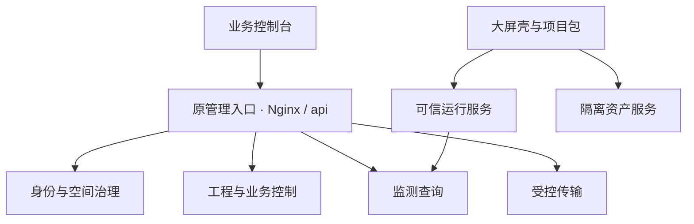
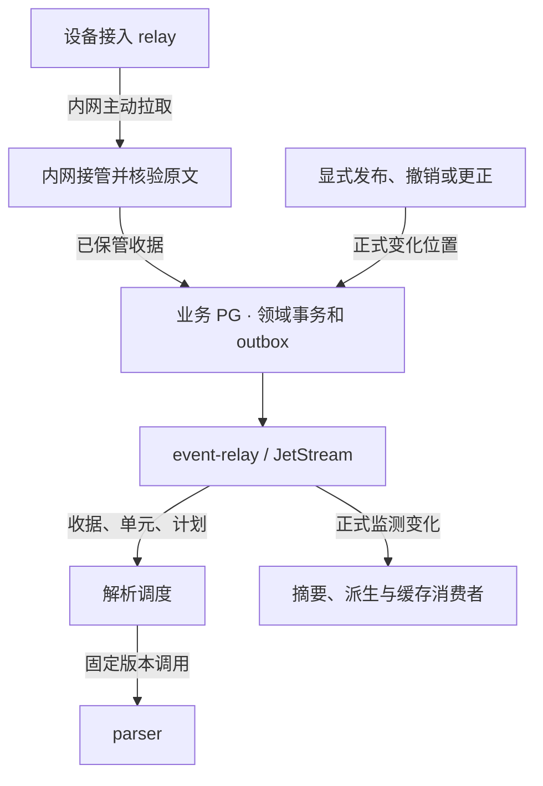

# InfraPro 架构重构实施与验收规格

2026-11-18 · v1.0 评审稿。本文和[逐操作路由归属清单](system-architecture-refactor-routes.json)共同构成实施依据。[整体架构审查](system-architecture-review-2026-11-18.md)记录编制时的系统和划分理由，[软件需求](../requirements.md)及各领域已生效的补充规格决定业务含义。当前实施、自验和人工接受状态见[架构重构验证账本](../verification/system-architecture-refactor.md)。

**2026-11-19 本次收尾决定（当前有效）**　用户要求停止新增排查、测试批次和全量回归，撤下队列中尚未执行的验收。交付范围调整为修复已经确认的具体问题、针对这些修复复验，随后用现有业务数据部署并启动当前版本，实测访问入口和基本登录。尚未执行的项目记为「未验证」，已运行失败或中止的项目保留原结果。用户选定四机生产环境及原有入口，11 月 19 日已完成兼容阶段上线及真实账号登录，待用户人工验收。[本轮结果与已知限制](../verification/system-architecture-refactor-closeout.md) · [四机生产记录](../operations/production-version-2026-11-19.md)

**2026-11-19 早前验收范围调整**　用户此前保留了 ARC-001 至 ARC-036 和 ARC-039 的功能验收，跳过 ARC-037 的采集九轮压测、ARC-038 的监测与大屏负载对照，以及 ARC-039 的 2 小时混合负载、24 小时观察和其他纯性能或压力项。已有量化口径与实测资料保留。本轮剩余工作执行上面的收尾决定。

## 1. 交付目标与等价标准

交付后，人员仍从原地址登录、进入原工作空间，在原位置完成同一操作，得到同一业务判断、数据和依据。接收、解析、正式发布、值班查询、历史分析、文件传输各自拥有可单独重启、限流、扩容的进程。数据库事务决定业务是否生效，内部消息驱动已经持久化的后续工作。实施范围包括仓库代码、迁移、契约、构建、部署模板、诊断、备份和验证工具。生产切换另行执行。

| 必须等价的对象 | 对照标准 |
| --- | --- |
| 业务与权限 | 相同初态、主体、空间、时间和输入得出相同允许／拒绝、错误码、业务状态、有效版本、数据范围、计算值、动作收据、任务、通知、审计和下载资格。现有撤销、重试、重新采用、删除／归档及恢复规则逐域复用。 |
| 公开接口 | HTTP 方法、路径、状态码、响应字段／类型、字段缺省、分页排序、游标有效性、错误隐藏、幂等、Cookie、CSRF、响应头、正文／文件、SSE 事件、SDK 调用协议与旧版一致。原来同步给结果的调用继续给结果，原来能进入后台的调用沿用已约定的状态和入口。 |
| 页面 | 三个 App 的地址、导航层级、菜单名称与顺序、首页、页面排布、控件、表格及分页、图表、空／忙／错状态、响应式断点、弹窗、焦点、快捷操作和返回位置一致。用同一前端发行物连接两套后端对照，按第 8 节冻结和比较。 |
| 可改变的内部行为 | 服务 PID、内部地址、连接池、队列传输、后台作业的领取时间、在既有期限内完成的快慢、诊断中反映真实拓扑的进程数据可以改变。保留对外因果顺序、领域内排序、同步承诺、数据保留及已确认操作的恢复能力。 |

**发现冲突的处理**　冻结版本的表现与书面需求冲突时，对两者留证并单列业务决定。重构提交须有同口径对照结果。任何需要改业务规则、页面交互或布局的修复单独定范围，不能通过更新期望值混入架构交付。

**2026-11-19 租户管理员候选接口兼容决定**　用户确认保留冻结版的实际响应。对 `GET /api/v1/platform/tenant-admin-candidates` 未指定 `tenant_id` 的有效搜索，逐项核对合成账号的 `id`、`username`、`display_name` 和 `replaced_roles`，同时严格要求 `has_avatar` 为 `false`、`avatar_revision` 为空字符串。该场景的候选项恰有这六个字段。候选 SQL 只查询治理所需资料，两个占位来自 Go 字段的默认值。真实头像读取沿用对应作用域的授权。冻结 OpenAPI 的 `TenantAdministratorCandidate` 将四个业务字段列为必需，另列指定租户时适用的 `membership_status`、`transfer_mode`，并设定 `additionalProperties: false`。本决定记录了与该历史声明的两项具名差额。候选搜索原有的授权、搜索限制、跨域拒绝和头像读取权限继续逐项验收。原四字段断言的失败样本和两个发行物的实际响应分别留证。[候选账号需求](../requirements.md#候选账号的可见范围) · [候选查询](../../packages/go/platform/tenancy/queries.go) · [头像权限](account-avatar.md)

**2026-11-19 两项共用控制台修复决定**　用户批准修复项目治理分页在窄容器内宽度归零、以及租户成员暂停和邀请重发弹窗在同一身份重新核验后丢弃操作原因。两种后端使用同一份修正前端测试。项目治理需在 375、768、1024、1440 像素和明暗主题下真实分页，鼠标及键盘均可操作，页面宽度适配视口。租户操作仅在相同成员与权限复核成功、目标仍可操作时恢复草稿；复核期间禁止提交，真实撤权、关系变更或目标失效时清除。保留原静态文件、失败截图和复现记录，并独立记录共用控制台的源码差异、逐文件摘要、实际访问的发行物及两侧的复验结果。

**2026-11-19 监测导入键盘回焦决定**　用户另行批准修复监测导入批次详情的回焦。原列表已就绪时，两版按 Esc 均会回到原文件；刷新详情后，如果游标页稍晚才返回，两版都会让焦点留在搜索框。修正前端需要在原行返回且可见时将焦点恢复到原文件。期间用户已经主动选择其他控件、原行不再可见或已离开该列表时，保留用户当前的焦点。冻结和重构后端均使用包含三项获准修复的同一份控制台发行物，复验早到、晚到和不应自动移焦的路径。保留修复前的两版实测以及前一份控制台发行物。

**2026-11-19 会话活动持久化决定**　用户批准修复冻结版和重构版共有的提前过期问题。数据库时间落后于应用时，曾出现活动已被接收、Redis 待写记录已被清除、数据库最近活动仍为 119 分钟前的情况。待写活动须保留到数据库时钟到达，且会话仍有效时才能入库。写回时重新校验撤销、身份版本、两小时空闲及十二小时绝对上限。并发产生的更新活动需保留。分别用真实的 PostgreSQL、Redis、缓存丢失和服务重启复验，记录冻结版原始失败与修正版结果。[会话架构](../architecture.md#redis-会话缓存与失效)

### 1.1 冻结哪一版

- 审查时生产记录为发行包 `20261117-802a92f81b63`、业务 PG schema 55、四机 36 个常驻单元。审查时开发版是 945 个 OpenAPI 路径、1,067 个操作、schema 57。编制本规格时同一 `develop` HEAD `1f11b5a6cc9f` 的工作区已要求 schema 58，含历史分析删除迁移。此时 OpenAPI 记载 947 个路径、1,069 个操作，实际管理 HTTP 注册为 949 个路径、1,071 个操作。两条差额见 3.1。生产数据和界面以生产发行物为准，开发验收以实施前选定的完整源码为准。[生产版本记录](../operations/production-version-2026-11-17.md) · [数据库版本校验](../../packages/go/platform/migrations/migrations.go) · [API 契约](../../contracts/openapi/api.yaml)
- 实施前建立只读的源码与制品基线。记录 Git 提交、参与构建的已修改及未跟踪源码的文件清单和 SHA-256、依赖锁、迁移文件及版本、五份 OpenAPI、权限目录、三个前端构建目录及各发布形态的静态资产摘要、SDK、解析方法与产物版本、服务配置非秘密部分、时区／字体／浏览器／镜像摘要。未提交的功能以该基线实际包含的文件为准。两套后端从同一份冻结源码派生，前端构建一次复用。同期新增功能须更新冻结基线及两套环境的证据后再比较。
- 将同一份脱敏业务 PG、relay PG、ClickHouse、私有对象和必要会话／运行快照，分别恢复到隔离的旧版 A 与新版 B。分别执行相同的初始化／恢复流程，再创建配对会话、终端和测试凭证。各环境独占消息命名空间、对象桶、外部发送替身和诊断数据。生产升级单独选择与生产功能相同的兼容发行物。MFA、头像、历史成果删除等业务版本的发布须与架构变更分别记账。

## 2. 运行角色和通信

进程名为实施目标。表内的包继续保存各自的业务规则。进程边界按故障影响、数据权威和工作负载划分。租户／项目是授权作用域，跨作用域使用同一套模型。

控制台保留同源入口，大屏继续使用原有隔离的运行和资产地址。诊断台使用单独的诊断服务及各机 observer。设备接管与正式监测发布分别产生自己的领域事实，二者的异步链路见第 5 节。

| 目标进程 | 由哪段代码改出、负责到哪里 | 接口与运行依赖 |
| --- | --- | --- |
| `api` | 改造现有 `services/api/cmd/api`，在拆分模式作为兼容网关。拥有原公开监听、路由选择、健康和就绪聚合。业务规则和事务交给下列四个 API | Nginx／Vite／现有 CLI 指向原地址。网关到 API 为受控内网 HTTP，跨主机 mTLS。连接池、并发及超时按上游隔离。网关自身可在没有数据库连接时启动 |
| `identity-api` | 从现有 identity、access、tenancy、projects 的 HTTP 注册和装配抽出。负责登录、MFA、账号、会话、成员、角色及工作空间治理，运行既有会话活动刷新、过期维护及头像清理 | 业务 PG、会话与限流 Redis、身份密钥，头像清理按需使用专属对象权限。内部校验接口见 3.2。对象和监测值授权归各领域 |
| `control-api` | 承接工程定义、资源、设备、分类、安装、来源及授权、接入／解析管理、监测导入和发布命令、分析配置和成果生命周期、空间、大屏管理、文件元数据、任务／通知／审计管理与查询 | 复用领域 Go 服务和 PG 事务。个别同步预览／验证用到的对象或计算存储按操作装配。命令写入既有事实、任务及必要的待发送记录 |
| `monitoring-query-api` | 承接控制台的测点／通道目录、数值、快照、统计、成果及谱系读取，和大屏有界查询的内部计算接口 | 按 PG 发布清单和已核准范围读 ClickHouse／S3。可以创建原契约允许的查询任务、快照和缓存。后台重查询交给读取 worker |
| `transfer-api` | 从各域现有 handler 分出字节传输与上传完成。领域仍拥有文件、状态、授权与业务动作。包括头像、审计导出、专业空间内容、接入原文和解析样本 | 使用原领域的取流／写流／完成方法和最小对象权限。通过原 HTTP 地址验证主体和版本，保留限额、流控、审计收尾 |
| `ingest-relay` | 继续独立接收设备和厂家上报，固化入口修订、原始字节与协议收据，按原协议应答 | 外部设备协议／HTTPS，relay 专用 PG。仅接受内网机器主动发起的 mTLS 配置、拉取、续交、确认 |
| `ingest-custody-worker` | 从 `ingest-worker` 移出拉取、relay 状态、原文对象维护、接收确认、来源配置下发、关联水位交换 | 访问 relay、业务 PG、接入 S3。按原检查完成保管后写收据、跨网确认意图和内部待发送事实。解析不可用时可继续接管至容量上限 |
| `parsing-dispatch-worker` | 从接入 worker 移出识别、拆帧、方法规划、解析和重处理，从监测 worker 移入人工试解析。分别保留领取规则、租户预算、人工保留槽 | 以收据／计划／试解析作业领权。通过已有机器 HTTP 调用 `parser` 并保存原始依据、返回和代次。业务 PG、专属 S3 |
| `parser`、按次 `parser-runner` | 继续提供识别、测量和方法目录，按指定不可变产物执行，独立限制子进程和资源 | 保持现有机器接口、方法包、请求标识、超时和标准输入输出。业务库访问及结果采用由调度方和监测域承担 |
| `monitoring-publish-worker` | 导入校验、正式采用、存储搬迁和验证，负责周期性载荷核验的排程 | 数据库租约、PG 可见清单、ClickHouse 载荷、监测对象。按原发布／撤销事务记录正式变化 |
| `monitoring-incremental-worker` | 承担正式变化消费、摘要增量、派生自动计算、交互试算、到时触发的调度。保留每租户消费位置 | PG、ClickHouse、相关对象。消息唤醒与定时器共同工作。请求内快速试算的预算见 4.2 |
| `monitoring-history-worker` | 历史回算、重放、历史分析、比较、全量摘要重建和导出。CPU、存储并发与值班查询分开控制 | PG 作业／检查点、ClickHouse、受限导出对象，按原作业代次响应取消和重试 |
| `monitoring-read-worker` | 独立执行控制台后台查询摘要和大屏持久读取作业，保留结果、取消、过期及交付规则 | 读取已发布清单、受限对象和数值，回写各自原有的查询结果／作业表。使用单独的查询连接和并发预算 |
| `spatial-worker`、`files-worker`／`files-checker`、`display-package-worker` | 分别负责空间校验转换、普通附件处理／隔离检查、大屏包验证。保留各自作业入口和受限进程身份 | 空间按需调用 Python 转换器，文件检查经 Unix socket 和检查子进程，大屏包只写原有受限交接记录，各域独立对象前缀 |
| `display-runtime`、`display-assets` | 将原同一二进制内的两个监听拆开。前者拥有可信壳、交接、人员／固定终端、SDK、订阅和最终授权。后者只服务已获准且固定版本的包资产 | 可信服务可访问私有查询接口。资产服务逐请求验证现有 permit、会话与包路径，访问包专用 PG 视图／领域查询和对象。两个原有外部 origin 均保留 |
| `task-index-worker`、`notification-worker`、`audit-worker` | 分别负责公共任务投影与对账、收件箱展开投递与邀请到期、审计交接／导出／到期清理 | 每个进程保有自己的 PG 状态、消费位置及最小权限。成功命令及对应事实由来源事务提交 |
| 新 `event-relay`、内部 NATS JetStream | relay 只负责将 PG 待发送记录交给内部持久消息服务，记录发布确认，重试和报告积压 | 内网连接，按主题授予发布／消费权限。与设备接入的 `ingest-relay` 为两个独立进程 |
| `infrapro-diagnostics server`、每机 `observer`、按需 `infrapro` CLI | 保留独立运维入口、凭证和 bbolt，更新受观测角色。CLI 保留已有命令、恢复守卫及人工动作 | 诊断独立 HTTPS 上报。生产主机放置、角色依赖和联合备份见第 7 节 |

三类跨进程操作分别使用确定的协议。需要立即给用户答案的请求走 HTTP。同一业务决定涉及的写入复用同一 PG 事务。已被接受且允许稍后处理的工作才走持久作业和消息。内部调用带有截止时间、请求／追踪标识、机器身份和取消信号。持有 PG 行锁时不等待新引入的网络请求。各角色先取得候选依据，再按原修订和锁顺序复核。多个进程复用领域代码和同一业务 PG，数据库账号按使用的表、函数、对象前缀分别授权。

## 3. 怎样修改 HTTP、装配及授权代码

### 3.1 按操作拆路由

[规范性路由附表](system-architecture-refactor-routes.json)核对了主业务 OpenAPI、按当前源码装配的 Gin 路由表和 Go 权限目录。实际注册的 **1,071** 项全部归属为网关 **2** 项、身份与空间治理 **158** 项、工程与业务控制 **796** 项、监测查询 **42** 项、受控传输 **73** 项。逐行给出方法、路径、OpenAPI operationId、目标进程、Go 权限操作和权限类别。附表记录 OpenAPI 源文件摘要，以及将注册项规范成 `METHOD 路径`、升序排列、逐行以 LF 结束的清单摘要。其余四份机器／诊断契约、两个大屏运行监听、前端静态回退和 Nginx 根路径另建入口测试。[业务契约](../../contracts/openapi/api.yaml) · [其余契约目录](../../contracts/openapi/)

**已有两项功能仅看 OpenAPI 会遗漏。** 项目大屏的 `GET …/displays/instances/{id}/read-scope-options` 和 `POST …/displays/instances/{id}/read-scope-preview` 已在 Gin 和权限目录注册，控制台范围编辑器经 TypeScript 客户端调用。它们是管理时的配置／授权范围候选和预览，均归 `control-api`。附表的 `operations` 保存契约内 1,069 项，`registered_without_openapi` 保存这两项，其 operationId 为空。原 `scripts/display-contract.mjs` 匹配 Go 源码时只接受单词字符和点号，这两个操作名都含连字符。实施 S1 改为消费 Go 导出的结构化路由，补齐现有输入／返回的描述，重新生成并按 config／grant 目的、项目与对象资格实测。注册、权限和用户访问地址按原功能保留。[契约生成器](../../scripts/display-contract.mjs) · [Go 权限注册](../../packages/go/platform/access/display_catalog.go) · [大屏管理 handler](../../services/api/internal/transport/http/display/handler.go) · [控制台范围编辑器](../../apps/console/src/features/displays/read-scope-editor.tsx)

| 现有位置 | 必须实施的代码修改 |
| --- | --- |
| `services/api/internal/transport/http/router.go` 及相邻各域的 `Register` | 将公共 HTTP 行为、按操作选路与领域注册分开。实施时将附表固化为版本化的路由清单，生成网关匹配器和各 owner 的注册／校验表。逐个复用现有 handler，按所需接口注入依赖。以“方法＋规范路径”连接 OpenAPI、Gin 和 `access.RoutePolicy`，保留 Go operation 原值。重复、缺权限、缺域、漏注册均阻断构建。每个 owner 只挂自己的操作。 |
| `services/api/internal/bootstrap/app.go`、`services/api/cmd/`、`packages/go/platform/runtime/{resources,business}.go` | 将现有 `Open`／`OpenWorker` 和 `Compose(...).Configure(...)` 的装配按第 2 节职责切分。保留领域构造器、对象资格解析器、通知／审计交接与原有注册效果。新增四个 API 的 `main`、专用 worker 和网关启动模式。仅身份进程启动 `Identity.RunJobs` 与退出时刷新。连接创建、探针、优雅停机及配置校验均按角色执行。 |
| `packages/go/platform/{config,runtime}` | 引入角色级的内部监听、上游地址、连接池、worker 配额、私有凭据、消息和降级配置，校验必填项并提供旧配置启动兼容模式。身份不连接分析库，网关不加载身份密钥，后台索引不因解析器故障拒绝启动。原操作确实需要的 ClickHouse／S3 失败时沿用原领域错误和收据语义。 |
| `scripts/nginx-routes.mjs`、`deploy/nginx/default.conf`、`deploy/display/{nginx,https.nginx}.conf`、`apps/console/vite.config.ts` | 继续通过同源原入口和原 API 代理。地址按内部拓扑配置。网关按模板精确选上游，保留 literal／参数优先级、路径编码、原 query、多值头和尾斜杠行为。保留生成的每条大小／代理规则及优先级，转发上传、取消、响应头和流刷新。应用按原可信代理链得到 Host、协议与来源 IP。 |
| 网关公共和异常路径 | `/healthz` 和 `/readyz` 按原状态、正文、响应头返回。后者按原已启用依赖做有界聚合，含原配置下的计算就绪条件。网关内部存活和逐上游摘流用独立探针，计算整体就绪失败时仍可进入健康的登录／台账路由。无匹配路径、错方法、错误来源和缺会话走基线相同的 CSRF／Guard／404／405 顺序。上游异常给出已有可重试／不可用错误格式，网关不得自行重放有副作用请求。 |

按同一前缀切流很容易误分。`/me/workspaces` 归身份，`/me/notifications` 归控制。账号头像 GET／PUT 归传输，删除归身份。审计导出元数据归控制，GET／HEAD 文件归传输。历史成果查询与谱系归查询，归档／删除归控制。监测、空间、附件和大屏的分片与上传完成归传输，正式发布归控制。上传完成依旧执行**原领域完成函数的全部校验、对象处理、状态、任务、审计和响应**。工程“变更预览”的 JSON 与“附件预览”的字节流按附表分别路由。冻结后如契约变化，评审新增／删除操作的归属与业务来源，再更新附表和两个版本的基线。

### 3.2 保留鉴权、事务和文件交付语义

1. 从 `packages/go/platform/identity/{service,access,repository}.go` 提取原会话验证和事务内主体核验所需的窄接口。新增仅受信服务可调的 `POST /internal/v1/sessions/verify`。由身份进程按原路由类别执行既有 `Ready` 和 `Authenticate` 顺序，复用 Redis 会话缓存、有效活动时间与 PG 当前会话核对。原操作的限流点继续使用同一计数和额度。验证成功后返回最小主体依据（账号、会话、认证／因子版本、活跃／重认证时间等实际核验所需字段）。私有请求及响应均禁止记录凭证。网关剥除外部伪造的内部头。正常用户请求只执行一次认证活动处理，内部响应不提供可被浏览器复用的授权票据。
2. 将 `AccessActor` 内的 `lockPrincipal` 核验做成无身份密钥的事务内适配器。控制、查询和传输沿用 `access.Lock`、`AuthorizeScoped`、领域的对象、关系、时间范围、任务执行／结果交付检查及原有锁序。在同一 `pgx.Tx` 内复验账号、会话、MFA 版本、权限修订、预期版本和必要的 recent 条件。退出、禁用或授权撤销与请求竞争时，结果须可由原事务顺序解释。保留当前请求标识、`X-Authorization-Revision`、适用操作的唯一 `X-Command-ID`、拒绝与成功审计。身份密钥仅交给验证、登录和账号维护的必要角色。
3. 统一复用原 Gin／CSRF／错误中间件。在真实公开请求的所有最终 owner 上保持同一 CSRF 配置和 Cookie 语义，只有一层消费／签发该次 CSRF。由网关与 owner 约定唯一可信的请求 ID。保留可追踪的身份核验请求与公开请求之间的关联。保留原 Cookie 的名称、域／路径、Secure、HttpOnly、SameSite、续期／注销，以及原 origin 拒绝、缓存头和现有部署路径。错误分支也须符合此约定。
4. 写操作保持原 `access.Transact`、命令收据、`taskrecord.FlushTx`、成功审计、通知意图、领域版本和相应事务锁。权限／来源两端、版本发布、成果删除等有业务原子性的改动在一处提交。提交结果不明时按原命令 ID 查询权威收据。重试必须返回原结果或既有冲突，不产生第二次业务效果。[授权提交点](../../packages/go/platform/access/authorizer.go) · [来源绑定](../operations/channel-bindings.md)
5. 传输 handler 调用各域完整的授权、流打开和收尾逻辑。头像沿用 `identity/avatar.go` 的图片校验、对象写入、元数据切换和清理意图。审计导出保留代次、传输记录和中断收尾。工程附件按挂接对象复核。空间文件／本地瓦片、大屏包、接入原文、解析结果使用各自的资格与隐藏规则。只在原操作支持时响应 HEAD、Range、条件请求，逐项比对长度、范围、MIME、文件名、缓存、安全头、部分响应和对象摘要。保留代理的头像 5m、解析样本 6m、附件／空间分片 8m、监测分片 32m、大屏分片 4m 及监测／空间完成 1810s／310s 等规则，各域应用层限额另外照旧执行。[上传限额](../operations/upload-limits-and-proxy.md)

### 3.3 哪些领域函数需要一起迁移

| 控制端或存储范围 | 改装配时必须保留的调用关系 |
| --- | --- |
| `platform/{access,tenancy,projects}` | 身份服务注册成员、角色、可用空间与治理的命令。工程／数据服务在原事务读同一权威成员关系和授权版本，保留归档项目的既有只读例外。邀请或管理员变更触发的收据、审计和通知走原来源事务。 |
| `platform/{engineering,classification,resources,devicecatalog,devices,sources}` | 控制服务复装 `runtime.Compose` 中工程使用检查、实际资源外部引用、设备和解析采用、资源附件和来源双端的适配器。发布／修改单位、类型或配置时原有下游引用阻断生效。资源版本、模板采用和分类修订不由各进程自行复制。 |
| `platform/{monitoring,derivedmonitoring,spatial,display,displayread}` | 将目录／命令、计算读取、后台执行的构造分开，保留空间对工程对象、监测摘要和关联成果的适配器。查询端可写原契约要求的快照／查询作业，不能获得正式采用的写权限。跨域结果按原主体再次判权。 |
| `platform/{files,tasks,notifications,audit}` 与 `runtime/{files_hosts,task_index,audit_resolvers,display_notifications}.go` | 分片传输、资格核对、列表／深链解析、审计披露和通知收件人判定各用原 resolver 和 host 回调。接管 owner 时记录依赖的表、事务和凭据，提供相同输入的对照测试。 |

上表中的 `platform/` 相对 `packages/go/`。新增私有 HTTP 契约随源码版本化，验证未持机器身份、过期证明、错误调用方和不同版本的兼容性。四个 API 对外的 JSON、页面地址与下表私有地址分别维护。

| 拟增私有操作 | 输入、返回与失败语义 |
| --- | --- |
| `POST /internal/v1/sessions/verify` | 仅接受获准 HTTP owner 的机器身份、原会话凭证及请求追踪信息。返回构造原事务主体所需的有限字段。当前会话无效返回原身份错误，依赖不可用返回既有不可用错误。请求方不缓存最终许可。 |
| `POST /internal/v1/monitoring/reads/execute` | 可信运行服务提交已固定的会话／终端、命名读取、实例、配置与授权修订、快照引用和时限。查询端再次核验绑定，复用原计划并返回有界候选结果或原机制支持的后台作业引用。超期、过代、撤销和超预算对应原 SDK 状态。禁止传入自由 SQL、任意对象键或通用代查身份。 |
| `POST /internal/v1/monitoring/trials/attempt` | 仅控制服务提交已入库的 tenant、job ID、请求标识和剩余交互预算。增量 worker 从 PG 验证确为符合条件的原试算作业，按原租约尝试一次。返回已执行／已有人领取／转后台，控制服务复读原领域记录生成公开答复。网络结果不明时同样复读，禁止新建第二个试算。 |

私有 HTTP 和事件契约都需有生产者／消费者契约测试。滚动发布先上线能同时理解旧格式与新格式的接收方，再启用发送方。删除字段、改变语义或使既有字段成为必填时递增主版本。未排空的旧版作业、消息和正在运行的大屏会话可继续使用原契约，清理旧版前用消费进度和会话到期记录确认。

## 4. 怎样拆后台代码和数据链路

### 4.1 设备上报、原文、解析

| 修改位置 | 执行约定 |
| --- | --- |
| `services/ingest-relay`、`packages/go/foundation/{ddp,relaycontract,ingestioncontract,parsingcontract}` | 保留外部接收、持久 spool、上游应答和内部机器契约。原文身份使用现有 relay、入口、epoch、来源序号及收据键。相同字节的两次合法报送仍可有两张收据。出口断开时延续原容量、水位、释放／重交和对账处理。 |
| `packages/go/platform/ingestion/{worker,receive}.go` | 将 `RunWorker` 的循环装配按职责拆开。接管进程独占 `pull, relay-status, object-maintenance, confirmation, source-publication, association-watermark`。复用 `Pull`、接收摘要／回读检查、PG 收据和 `ingestion_ack_outbox`、`AckOne`。在接管 PG 事务加入内部收据事件。设备协议应答、内网确认和 MQ ACK 各有独立条件。 |
| `packages/go/platform/ingestion/{identify,planning,parse,recovery}.go`、`packages/go/platform/parsing/worker.go` | 调度进程独占 `identify, planning, parse, recovery` 和原人工试解析循环。将“扫描可领记录”和“按给定收据／计划键尝试领取”收敛到相同的条件更新、执行代次、fence 和结果写入函数。识别结果可拆出多个单元，各自只进入符合设备采用版本的计划。恢复作业仍经原作用域／代次复核。缺关联、隔离、确定性坏报文、可重试机器错误维持原分类。 |
| `services/parser`、`services/api/cmd/{ingest-worker,monitoring-worker}` | 从监测启动器移走人工解析。parser 继续独立、由机器凭证调用，方法和 runner 无公开接口变化。自动解析沿用全局 4、每租户 2 及人工保留执行能力等冻结配额。在多实例之间落实总预算，避免按进程倍增。parser 调用超时或响应已生成而调度进程崩溃时，复用同一执行身份核对并以条件写入唯一可见结果。 |

**业务分界**　原始报文已保管、已确认接管、已识别、已解析和监测正式发布是不同事实。自动／人工解析只产生原有结果、样本和依据。只有既有正式采用操作才能产生正式观测。端口确定入口配置范围，物理设备、子设备、采用版本和来源关系仍按原证据与水位核验。[接入规格](device-ingestion-and-raw-message-spec.md) · [解析规格](parsing-service-and-method-binding-spec.md)

### 4.2 正式监测、派生、历史分析和读取

改 `packages/go/platform/monitoring/{task_host,task_options,jobs,summary_jobs}.go`。将执行器注册、允许入队的种类、可领取的谓词和周期调度四项分开。当前 `claimKinds()` 会无条件加入六个内置种类，仅删去外部执行器注册无法实现互斥。统一以 `kind`、原输入模式、主体和现有队列规则计算 owner，在 SQL 领取和按 ID 的 `RunTask`／CLI／交互入口应用同一判定。各模式复用原执行函数、状态、优先级、心跳、取消、进度、检查点和最终校验。

| 目标 owner | 现有持久作业和额外循环 | 特殊要求 |
| --- | --- | --- |
| `monitoring-publish-worker` | `validate`、`publish`、`relocate`、`verify`，另负责周期排程 `scheduleVerification` | 校验后按既有显式采用／撤销规则生成可见清单。分批载荷、attempt／选择指针、来源证据和发布水位一起对账。存储搬迁及核验设有独立子配额，避免淹没发布。 |
| `monitoring-incremental-worker` | `summary(mode=maintenance)`、`derive(mode=trial/automatic/correction)`、`analysis(trial=true)`，另负责变化消费与按时钟排程 | 保留前台试算份额。`derivedmonitoring/runs.go` 的短区间试算在入队提交后，控制 API 同步调用私有“尝试执行此已有 job”接口，沿用原 `TrialRange`／`TrialDeadline` 与 `RunInteractiveTask`，再读同一结果。超预算按原规则后台继续完整目标，返回已有作业。已重放的命令不再触发快速尝试。 |
| `monitoring-history-worker` | `summary(mode=rebuild)`、`derive` 的合法历史回算、非试算的 `analysis`、`derived_replay`、`analysis_compare`、`export`、`analysis_export`、`derived_evidence_export` | 保留版本固定、依赖、成果归档／删除规则、证据导出和历史排程公平性。后台分析试算与正式成果沿用各自原可见性。 |
| `monitoring-read-worker` | `summary(mode=query)` 及 `displayread/jobs.go` 的 `RunWorker`／`ProcessOne` | 前者沿用请求主体及监测快照，后者沿用大屏人员／终端会话、预算、结果期限及最终授权。两套持久作业标识和取消接口分别保留。 |

冻结时导出全部已有作业的 `kind × mode × 主体` 取值（含历史版本、空字段及错误输入）。以原解码器、`taskQueueSQL` 和执行器行为生成判定样本。每个合法组合有且仅有一个 owner，历史合法默认值沿用原语义。无效组合由固定的相应领域 owner 按原过程失败／隔离并可诊断。对每个定时动作也指定唯一活跃租约，增量角色运行 `ConsumeChanges` 和 `ScheduleTenantAt`，发布角色安排存储验证。过期租约回收按角色谓词或单一维护租约执行。停消息后，时钟触发、续租、回收和修复仍要运行。[任务宿主](../../packages/go/platform/monitoring/task_host.go) · [原调度循环](../../packages/go/platform/monitoring/jobs.go) · [派生调度](../../packages/go/platform/derivedmonitoring/schedules.go)

保留 `monitoring/{publication,revocation,changes}.go` 里的发布事务和 `derivedmonitoring/changes.go` 的按租户持久位置。只有正式变化提交成功才发布变化事件。事务内既有摘要入队仍有效，消息唤醒后以其原键领取。派生消费者按位置补读，缓存／查询按原快照和授权判定是否有效。撤销期间，底层 ClickHouse 能读到的物理行不能提前或继续对用户可见。比较以 PG 选择的发布清单、质量标志、时区、时间精度、单位、缺测、舍入和公式版本为准。

### 4.3 大屏、任务、审计、通知和专业文件

- 拆 `services/api/cmd/display-runtime` 和 `services/api/internal/transport/http/display/runtime.go` 的 `RuntimeHandler`／`AssetHandler`。资产进程只绑定原资产监听，复用 `display.Service.Asset` 的 permit、有效会话、包版本、路由回退、路径和清单核验。工具上传等位于原运行 origin 的接口仍按该 origin 的既有身份处理。控制台、运行壳、包资产这三个 origin 的 URL、代理 Cookie 白名单、Authorization 剥离、CSP、iframe sandbox、MessageChannel 握手、格式 1／2、命名读取、订阅 SSE 与断线恢复保持兼容。[大屏运行 handler](../../services/api/internal/transport/http/display/runtime.go) · [资产授权](../../packages/go/platform/display/terminals.go)
- 调整 `packages/go/platform/runtime/display_reads.go`、`display/read_authority.go`、`displayread`。必须同一 PG 快照的会话、终端、项目、命名授权、位置、资源与发布依据的取证保留在一个事务，提取共享读取函数。需要独立计算时，事务结束再调私有查询 API，用绑定主体、代次、快照和预算的服务间请求，返回候选结果。壳在首次交付、后续页、文件段和 SSE 恢复时按既有规则复验。授权或包版本变化后旧结果不得继续供给。保留当前“人员交接”和“固定终端配对”两种主体。
- 保留 `taskrecord`、`auditrecord`、`notificationevent` 的事务内写入。改 `packages/go/platform/{tasks,notifications,audit}` 对应领取循环，支持按事实 ID 唤醒和原有回填／对账。大屏包的受限写入经三个原有交接翻译器处理，成功审计、任务操作、收件资格、去重键、静默／偏好、失败重试和到期语义沿用领域代码。拆进程不能授予大屏包写通用任务、审计、通知表的权限。[任务接入](task-center-integration.md) · [通知运行](../operations/in-app-notifications.md) · [审计接入](audit-integration.md)
- `spatial-worker` 保留图纸、GIS、BIM、几何版本／挂接及 Python 子进程资源限制。`files-worker`、`files-checker` 保持 socket 协议、子进程沙箱、普通附件预览和清理规则。`display-package-worker` 校验包产物，正式发布仍由控制命令决定。三个域继续拥有原队列表。首版用既有领取／恢复，不引入额外的业务事件。各域无需因 MQ 故障停止原作业。

## 5. 内部消息与可靠性规格

内网接管进程向 relay 确认保管完成的条件见 4.1。两条链共享消息基础设施，各自拥有发布资格、事件类型和消费位置。

### 5.1 选型和消息契约

选用 **NATS JetStream** 作为内网持久消息服务，Go 使用 `github.com/nats-io/nats.go/jetstream`，只在转发器及实际消费者引入。它同时支持按需领取和同一事实被多个持久消费者独立读取，适合本项目的解析分发与正式变化广播。上线构建锁定验证过的 server／client 版本、架构、制品摘要和离线包。开发可单副本，生产目标为三个独立故障域的三副本文件流。校验磁盘容量、延迟和多数派失效的表现后才指定主机。[拉取消费与确认](https://docs.nats.io/learn/jetstream/pull-consumers) · [保留策略](https://docs.nats.io/learn/jetstream/retention-policies) · [集群复制](https://docs.nats.io/learn/topologies/jetstream-in-a-cluster)

| 消息名（逻辑主题 v1） | 谁在何时产生 | 谁领取、做什么、如何补缺 |
| --- | --- | --- |
| `ingestion.receipt.stored` | 内网完成对象复验，在插入有效接管收据的同一事务插入 outbox | 解析调度按收据键领识别。缺包时查待识别收据。重复消息只唤醒同一既有收据。 |
| `ingestion.units.ready`、`ingestion.plan.ready` | 识别／解复用单元和计划分别在各自有效事务持久化时产生，含固定关联／执行代次 | 调度内规划、测量两类持久消费者分别领取。尚未满足关联水位就延迟重试。按来源序和 epoch 判断是否可执行，保留单元级追踪。 |
| `monitoring.changed` | 正式发布、撤销或更正写入原（租户，提交位置，变化区间）后，在同一事务生成 | 摘要、派生、查询缓存及大屏失效各有独立身份、资格和位置。分别读取 `monitoring_changes` 至目标位置。即使先收到较新通知也从本消费者上次已处理位置补齐。 |
| `task.projection.ready`、`notification.intent.ready`、`audit.work.ready` | 来源提交待投影事实、通知意图、审计辅助任务或受限交接后产生。受限来源由原获准桥接方在翻译事务生成通用事件 | 公共任务索引、通知投递、审计辅助各自消费及对账。重放只更新相应投影／交接，保留原收件人去重和审计代次。业务成功审计始终随原动作提交。 |

物理 subject 使用 `infrapro.<环境与恢复代号>.v1.<逻辑主题>`。按接入、监测、辅助三类设置独立文件流、存储／消费者配额和访问策略。每种用途有独立 durable pull consumer，同一用途的实例共享该 consumer。使用明确 ACK、有限在途数、按处理耗时设确认期限、延迟重投和最大尝试。使用 LimitsPolicy、上限和 DiscardNew，达到容量时待发送记录留 PG，按最慢正常消费／允许故障窗设置保留时间。broker 历史过期后以领域事实和消费位置补齐。环境、凭据、证书和恢复代号互相隔离。

新增版本化内部 schema。必填 `event_id, type, version, scope, aggregate_id, generation_or_position, occurred_at, restore_epoch`，可选 `cause_id, trace_id` 和有界的范围／引用。PG 中的不可变事实是载荷解释依据。消息体初始上限 16 KiB，超出时写范围／批次引用并分段读取。禁止把报文正文、观测明细、文件内容、Cookie、凭证或带权限的对象 URL 放进消息。既有手机／浏览器、设备 relay 和 parser 协议均无需直接连接 broker。

### 5.2 PG 迁移和确认顺序

| 拟新增对象或变更 | 必需约束和事务 |
| --- | --- |
| `event_outbox` | UUID 主键，`producer, type, business_effect_key, restore_epoch` 组合唯一。记录领域键、事实代次／位置、有限消息体、状态、可发送时间、发送次数、租约到期、fence、最后错误码、发布确认时间。建待发送／租约的部分索引。写入与领域事实同一事务。提交回滚会一同撤销消息。大批量时一行可引用一个确定的提交区间。 |
| `event_consumptions`、领域消费位置 | 按 `consumer, restore_epoch, event_id` 唯一。按业务键／代次／位置保留领域唯一性。消费成功登记和持久排程／投影效果同一事务。长任务在写入可恢复的持久任务后即可 ACK，实际执行另按原作业租约和 fence 收尾。消费位置只在连续事实和效果已经持久化后递增。 |
| `event_quarantine`、`dispatch_ownership` | 隔离记录保留 consumer、原事件和事实引用、原因类别、尝试、重驱状态。按逻辑角色／分区维护执行模式、代次、租约与冻结水位。领取、续租、提交均必须检查有效代次。管理操作沿用运维授权和审计。可轮替的运行代次与业务结果唯一键分别建模。 |
| 既有领域表及授权 | 保留现有主键、历史记录、接入确认 outbox、命令收据、对象路径、CH 清单、结果和位置。必要时附加索引／可选列，按冻结时实际 PG 版本顺延分配迁移号。执行角色具备最小 SQL／对象权限。审计、包验证和诊断已有的受限账号分别测试。 |

`event-relay` 以短事务领取一批 outbox 记录并增加 fence，释放行锁后用同一 `event_id` 作为 `Nats-Msg-Id` 发布。获得 PubAck 后条件更新为已发送。发布成功而 PG 更新前宕机会再次发布。客户端去重窗口有限，最终幂等以 PG 唯一约束为准。消费者在耐久交接／业务效果提交后 ACK，遇到提交结果不明先回读，ACK 丢失后的重复交付也经过同一检查。数据库错误回滚后重试，版本不认识或确定性坏消息要持久隔离并告警，其他可独立处理的键继续工作。要求连续位置的消费者在缺口上停住，补齐事实或人工解决后推进。

保留低频、有界、带索引并带退避的 PG 对账扫描。正常消息直投走按 ID 领取。代理不可用时使用同一领取谓词、相同业务唯一键和预算扫描。重启后从消费位置与未终结领域作业修复，只回填需要推进的状态。已结束的业务、已送达的通知和既有审计绝不通过全表历史重发来“补齐”。清理 outbox、去重记录与隔离记录前核对消费者水位、恢复窗口和来源可重建性。磁盘与待发送量达软水位时降速，达硬水位时对新工作走既有可重试／背压语义并保管所有已确认事实。登录、现有成果读取及其他未依赖此链路的操作继续服务。

转发器和消费者分别处理重试上限。消费前发布失败保留 outbox 供重试。达到消费重投上限时，由消费者或监督进程将原事件／事实键及最后错误登记在 PG 隔离表，持久登记成功才结束该条交付。以 JetStream 达到投递上限的通知和 PG 缺口扫描补查“最后一次投递后消费者也崩溃”的情形。受影响的连续发布位置保留缺口。退避最小值／上限、MaxAckPending、确认期限、MaxDeliver、最大流容量／保留时间以及 PG 扫描频率均进入版本化部署参数，用 ARC-023 至 ARC-026 的故障结果校准。[JetStream 消费与确认](https://docs.nats.io/learn/jetstream/pull-consumers)

登录、权限判断、工程换源、正式采用的可见性提交、解析器机器调用、实时 HTTP 查询和文件正文保持自身协议。浏览器仍通过原 HTTP／SSE 观察结果。首版 MQ 范围以 5.1 表内主题为限。空间转换、附件检查、大屏打包、历史批处理已有耐久作业调度。后续仅在测得轮询／领取是瓶颈时增加作业唤醒，另记基准及契约。

## 6. 三个前端 App 和统一入口的改动上限

| App／共享代码 | 允许修改的连接和打包位置 | 必须沿用的用户流程 |
| --- | --- | --- |
| `apps/console`、`packages/ts/api-client` | Vite 开发代理、发布配置及测试用目标地址指向兼容网关。保留公开客户端类型与方法。默认直接复用基线静态产物。账号治理、工程设备、监测空间三组是代码归属，原有按路由分包可继续使用。 | 原根入口和 `/console/`、登录后落点、空间切换、菜单顺序、项目上下文、原深链和浏览器前进／后退。任务、审批／邀请、通知、审计中的对象链接仍回到原页面及合适的空间。 |
| `apps/display-runtime`、`packages/ts/{display-sdk,display-devtools}` | 同一可信壳静态产物，运行服务与资产服务的内网上游分别配置。保留公开 SDK、开发工具、打包产物及外部项目示例的调用方式。 | 人员从既有控制台启动，固定终端从既有配对入口打开。预览、正式版本、回退、断线重连、地图／模型／图表和查询呈现按原契约运行。 |
| `apps/diagnostics`、`packages/ts/diagnostics-client`、`services/diagnostics` | 保留同版内嵌前端与独立 API，更新受观测进程目录、清单和能力映射。新增角色／状态作为真实数据进入已有列表和详情组件。 | 原诊断地址、独立账号、控制台已有条件外链、列表／筛选／详情及刷新行为。业务 API 或消息服务故障时可从原诊断入口登录查看。 |
| `packages/ts/{ui,layouts}`、各 App 的路由、页面、样式、文案和静态资源 | 本次拆分使用服务端代理和运行配置即可完成。共享布局、表格、图形、导航、字体及 CSS 作为冻结输入。确需调整非视觉的请求适配时，列出文件、原因和受影响页面，按相同的视觉及交互门槛复验。 | 特别覆盖账号中心、工作空间切换、共享分页、设施类型详情、工程树、历史分析成果工作区、空间浏览、文件预览、任务／通知／审计和大屏。按冻结版本实际可访问路由建表，开发原型和正式入口分别记录。 |

不增设用户要选择的服务地址、门户、子域登录或管理子 App。入口路由、会话与空间判定见[控制台工作空间壳](../../apps/console/src/app/workspace-shell.tsx)、[大屏壳](../../apps/display-runtime/src/main.ts)和[独立诊断手册](../operations/independent-runtime-diagnostics.md)。

## 7. 交付顺序、部署与回退

| 阶段 | 工程动作 | 离开本阶段需要的证据 |
| --- | --- | --- |
| S0 冻结 | 按 1.1 建立基线，导出公开路由、权限、机器契约、数据库版本、worker 领取种类与活动任务、页面状态和现有性能。列出每项现有测试及已有未通过项。 | 两个隔离环境可从同一快照重复构建。原架构自比通过。已有缺陷须有对照记录，涉及本次保证的基线阻塞项在切换前解决。 |
| S1 显式装配 | 在原进程中先抽取路由注册、事务主体、按角色的依赖和作业谓词，保持兼容拓扑。准备与新增 schema 相容的“原拓扑”回退发行物。 | 兼容发行物通过业务／页面对照、原命令和旧作业回归。校验证明新启动器在缺少无关依赖时仍可进入应有状态。 |
| S2 加法迁移 | 由 `tools/infrapro` 原迁移入口单次升级。新增 outbox、去重、归属、隔离及索引，执行含旧数据的升级测试。暂由原拓扑持有执行权。上线新 broker、私有身份、消费者和转发器配置。 | 迁移、数据库角色、磁盘预算、历史合法任务解码、回退发行物在**已升级 schema** 冷启动全部通过。对账基线及各消费起点已记录。 |
| S3 HTTP 和运行壳 | 按附表切一组路由，支持逐组切回。先核对纯读取，再切同一写操作的唯一入口。拆出运行壳和资产监听。身份、网关及客户端请求追踪贯通。 | 每个 owner 均通过对应契约、权限、跨服务并发、三 origin 和前端对照。影子验证仅复制经审定无副作用的读取，其他调用在独立 A／B 环境重放。 |
| S4 worker 与 MQ | 按接管／解析、正式变化、多消费者、辅助事实的顺序启用。每次按指定 owner 停领取、排空或安全转交、提高运行代次并开放新 owner。把解析、人工试解析、增量／历史／后台查询以及周期任务都交给各自角色。 | 旧／新进程重叠或重启时每个有效效果仅一份，原积压和新增任务均有归宿。出现消息丢失、重投、乱序、限流和重启时均通过对账。 |
| S5 发行与接受 | 完成全量 A／B 对照、负载、隔离故障、联合恢复及两方向回退演练，生成目录化证据、制品、操作手册。用户在隔离环境完成第 10 节人工接受后，另行安排生产切换。 | 所有必验项有结果、证据和责任记录。过渡模式清理须在已验证的回退保留期结束后独立评审。回退所需状态、文件及旧接口契约在此之前保留。 |

S2 使用受控写入窗口跨越精确 schema 版本检查。先停止旧业务二进制接收新写入和领取任务，等待在途结束或留下可恢复检查点，核对已受理边界，再运行迁移并启动针对新 schema 构建的原拓扑兼容发行物。恢复检查通过后开放业务，S3 才开始按路由切流。若 relay 自身的 schema 与协议未变，可在原缓冲预算内独立保管外部上报，内网恢复后从双方已确认位置继续交接。发布前实测停写窗口，并给出每项中断的入口、持续时间和原客户端重试结果。

### 7.1 构建、资源、诊断和备份必须一起改

- 新 API、worker、资产和转发器的入口放在 `services/api/cmd/<角色>/main.go`，保持现有 Go workspace 和独立 parser／relay 模块边界。更新 `scripts/go.mjs` 的二进制发现／发行验证、`scripts/{dev,local-runtime,setup-local}.mjs`、`deploy/{compose,docker,display,diagnostics,production}`、现有分域部署与 systemd 模板、配置示例和发行清单。覆盖本机启动、预览、Compose、原生和混合部署，CLI 与探针继续用各自原入口。随包提供 broker 离线制品、最小配置、证书信任链、持久卷和版本摘要。示例不带真实密钥。
- 给每个角色列出监听地址、调用方、外连目的地、PG 用户／对象前缀、CPU／内存／临时盘、数据库连接上限、最大在途数和关停期限。总连接预算是各副本与连接池之和，交互、后台查询、历史批量、传输和 parser 要有可验证的保留份额。PG 加锁或共享槽保证多副本合计配额。外部不暴露内部会话校验、任务执行或 broker 管理口。生产沿用已选单 ClickHouse 形态。broker 三故障域的实际放置以现有节点资源测试为门槛，保留 38 的原有业务与备份余量。
- 更新 `contracts/diagnostics/runtime-catalog.json`、observer 的 native／Docker／mixed bindings、角色清单及 `scripts/diagnostics-coverage.mjs`。加入合法脱敏指标和原因码，覆盖待发送数／最老年龄、发布确认、投递滞后、重投／隔离、消费位置与缺口、PG 回补、被拒旧 fence、各租户排队、parser 耗时、PG／CH／S3 配额、角色心跳。每条链可由请求 ID、命令／收据／作业 ID、代次和消费位置追踪到终态。诊断日志和截图须剔除真实身份资料、凭证及原文。[诊断进程报告](diagnostic-process-reports.md)
- 修正 `deploy/production/production-backup.py` 中固定的写入单元列表及 `backup-node.py` 边缘处理。让备份、停写、恢复和重新放行业务共用版本化角色清单，包含辅助写入、会话维护、后台读取结果写入和转发器。先冻结接收／交接与业务写入，排空或记录在途和外部已确认边界，冻结消息发布／消费，保存两套 PG、各所需对象和 CH 的一致清单、固定方法包、生产配置、受保护的恢复材料、诊断数据及 broker 配置／流和消费水位。记录该批次一致点、摘要和实际停止／恢复的服务。检查已确认边界后按原联合恢复守卫执行。恢复时使用新恢复代号隔离旧消息和旧租约，由 PG 待办／连续位置重建必需工作。新环境核验后才重新放行。[备份入口](../../deploy/production/production-backup.py) · [原联合备份与恢复语义](../operations/monitoring-data.md)

### 7.2 回退条件与做法

任一权限越界、已确认数据缺失、重复业务效果、错误正式可见、业务／布局等价门槛失败，立即停止相应切流。依赖长时间不可用、队列达到硬水位或超过第 9 节性能门槛，同样停止扩大流量。运维先记录受影响 owner、代次、最新命令／接收／发布水位、在途作业、对象封存点和消费者位置。影子实例与旧进程只能校验允许的内容，不得共同拥有同一业务写入。

实施时提供三项独立开关。HTTP 按已登记操作集指向兼容或拆分 owner。每个工作池在 PG 登记 `compat → draining → split` 及单调递增的归属代次，逆向切回也递增。消息消费可在投递唤醒和保底扫描之间切换，两者调用同一有 fence 的领域领取。会更新会话活动、开启查询作业／快照、登记文件传输的 GET 请求也有副作用，线上不得复制到第二个执行者。对这些请求的旧／新对照只在隔离环境执行。

1. 保留新写入的 PG、对象和 CH 载荷。先停止新领取／新命令进入相应角色。让在途完成或按原期限回收。通过原子归属切换提高代次，使旧 lease、晚到回复和发布尝试不能生效。切回同 schema 的兼容进程、原领取和 PG 对账路径，再打开对应 HTTP 路由。已提交的事件／作业可被兼容进程补办，保持原命令、收据和结果身份。
2. 当前 `migrations.Check` 要求数据库版本与二进制常量**精确相等**。直接启动旧低版本二进制无法作为加法迁移后的回退。须预先构建并验证两种拓扑在同一迁移版本运行。如跨 schema 升级，分别演练迁移前放弃和迁移后同版本拓扑回退。回退到旧数据库快照只用于隔离恢复，已有新生产写入时不得用快照覆盖。无法证明所有已确认写入保留时保持受控状态，修复后向前恢复。
3. 复核已接受命令、尚未完成的任务、relay 两侧收据、正式发布／撤销水位和通知／审计事实，数量与逐键摘要相符，再放开写入。保留已隔离消息与诊断证据。出现重复、缺口、跨域泄漏或用户可见差异时，该轮切换和回退验收均记失败。

## 8. 等价验证的方法

**业务对照**　在 A 和 B 运行相同的角色、租户、项目、设备和操作序列。从客户端采集请求、状态、稳定响应头、规范化正文、持久记录、可见观测和文件。相同的幂等键在两个独立环境各执行一次，再在各环境重复。动态 UUID、会话随机值和绝对时间用显式类型映射或受控时钟比较，并检查格式、唯一性、相互引用、顺序和到期规则。保留金额／单位、数值精度、真实业务时间、状态、错误、行序、游标连续性、通知收件人、审计主体和变更差异。只对满足原契约的等价表示做规范化，每个忽略字段有理由和白名单。出现单边结果必须定位到具体输入和领域事实。

**页面对照**　从路由树、菜单及真实可达入口生成“App、路由模板、角色／空间、状态、视口、操作、基线截图”的矩阵。每个已发布路由至少有一组可进入或应拒绝的样本，每一种共享布局、响应式变体和本次涉及功能都覆盖其可达的加载、空、有数据、错误、无权限，以及有弹窗／抽屉／分页／详情的状态。固定 Chromium 版本、操作系统、字体、设备比例、时区、语言、测试数据、网络等待点和动画时间，覆盖 1440×1000、1024×768、375×812。现有平板项目只执行部分展示测试，实施时新增矩阵执行器补齐。比较截图、可访问性树、区域顺序、组件边界、滚动／焦点、URL、键盘及触摸行为。逐步对照“列表 → 详情 → 返回”“切项目 → 继续查看”“任务／通知 → 业务对象”。[当前 Playwright 配置](../../playwright.config.ts)

旧版浏览器可能在切流时仍打开旧页面。先用旧前端分别连接旧／新后端，检查已有会话、在途查询、分片上传、分页游标和断线恢复。若发行包必须重新构建前端，另将真实待发布前端＋新后端与原前端＋旧后端逐步对照，再验证切回兼容后端后仍能继续操作。逐文件比对 HTML、CSS、字体和资源，区分构建元数据、纯请求适配和实际视觉差异。只测一套新静态文件同时连接两边不能证明老用户看到的布局一致。

**视觉门槛**　同一浏览器／机器、同一静态输入的稳定画面像素差为零，受保护的布局框和断点位置差为零 CSS 像素。时间、随机测试头像、地图／模型瓦片使用冻结时钟或相同的离线样本。图形渲染使用相同 GPU／软件渲染器、相同相机和资源。确有抗锯齿噪声，先用 A 对 A 重跑取得噪声上界，只允许**事前登记**的图形局部掩码和该区域的实测容差。界面文字控件、表格、导航、按钮、对话框和结构边界不得遮盖。新增拓扑行用相同的固定列表数据验证旧布局，再用新数据验证真实状态。从图表上读出的值及 SDK 结果另行精确比较。基线图片和公开接口快照不得通过批量更新消除失败。

**数据与故障对照**　除新技术表外，对命令、收据、识别／计划／结果、授权、正式清单与选中载荷、任务、收件箱、审计和文件逐键核对。同一故障用可控暂停点分别注入提交前后／确认前后／流传输中，记录两边的业务终态与已确认边界。故障隔离的新增要求独立验证，例如 CH 故障时登录和台账仍可用。测试使用隔离快照及合成输入。每轮记录恢复代号、资源预算及运行范围。

## 9. 必验清单与通过门槛

每一项都要交付测试输入、实际结果和证据路径。表中“相同”均指第 8 节定义的 A／B 对照。“一次”指同一业务身份的一次可见效果。旧架构没有的新角色与故障隔离能力在 B 单独测量。可以复用既有领域用例，须标明具体用例和本次运行产物。

### 9.1 公开接口、业务和三个 App

| 编号 | 动作 | 可观察的通过条件 |
| --- | --- | --- |
| ARC-001 | 从冻结 OpenAPI、实际 Gin 注册与权限目录导出所有操作，逐项请求兼容网关和指定 owner | 当前实注册 1,071 项，含契约内 1,069 项及另列的两项大屏操作。每个方法＋模板各有一个权限操作和 owner，契约补齐后全部有唯一 operationId。每项覆盖原合法输入、适用的身份／权限拒绝和主要错误。公开路由及受限机器路由没有多出一条未授权入口。 |
| ARC-002 | 经 Nginx、开发代理和原 CLI 访问根、深链、健康／就绪、未知路径、错误方法、CSRF 缺失及错误 origin | 对外 URL、重定向、状态、正文、缓存、Cookie、请求／授权头和有无身份时的隐藏行为一致。HTTPS 和本机受支持模式分别通过。 |
| ARC-003 | 登录、MFA 挑战、恢复码、重认证、刷新活动、重置、注销单会话／全部会话。持有旧 Cookie 访问四个 API | 所需因子、提示、会话闲置／绝对到期、错误码、限流及审计相同，旧会话在原有时点失效，已有操作没有新弹窗。 |
| ARC-004 | 在平台、两个租户、两项目分别测试成员、角色、邀请、管理员转移、停启／归档，再切工作空间 | 可见空间、导航、邀请／收件人、有效角色、冲突／禁止动作及页面落点相同，跨租户／项目标识无法扩大访问。 |
| ARC-005 | 将请求暂停在初次鉴权后，分别撤销成员、会话、对象授权，再提交换源、数值读取、下载和大屏下一页 | 按相同权威事务顺序得到旧版允许或拒绝。撤销已提交后不交付新数据。权限修订、错误隐藏及拒绝证据符合基线。 |
| ARC-006 | 同一命令并发提交、超时重试、使用相同命令 ID 换参数，模拟提交结果不明 | 收据、状态、冲突、任务、成功审计及必要通知与旧版相同。重复请求只产生一个有效业务动作，恢复后可按原身份查回。 |
| ARC-007 | 维护平台／租户字典、单位、分类、设施类型版本和模板，在项目中建设施、构件、断面、孔位、测点与通道 | 继承、版本采用、适用规则、人员可见字段、树顺序、历史证据、旧位置文字的处理和原有拒绝理由相同。 |
| ARC-008 | 新建设备与产品、安装、采用解析方法，尝试冲突绑定、换源、撤授权，同时读项目资料 | 设备／端口／输出与点位两端原子更新，安装史、唯一占用、版本、可见范围和反向定位相同。允许查元数据的用户不能由此获得数值。 |
| ARC-009 | 上传冻结版支持的 CSV／XLSX，映射、纠错／冲突、校验、正式发布、撤销及重新采用。重复提交 | 各阶段状态、统计、错误行、质量、重复判定、任务、来源、正式可见位置和各时点的数据一致。提交前的载荷对用户不可见。 |
| ARC-010 | 查询最新、明细、趋势、统计、快照续期、分页和来源依据，包含空值、质量标记、边界时间和单位换算 | 返回字段、数值精度、时间、范围、稳定排序、总数／游标、快照和撤销后效果一致。冷结果完成后与前台热结果同口径。 |
| ARC-011 | 试算、启停、自动计算、更正、回算、重放、历史分析、成果比较／导出／归档，覆盖冻结基线中生效的成果删除 | 同一输入、公式／方法版、时区和依据产生同一输出、谱系、可见版本和命令记录。短试算仍可在原预算内返回结果，超限仍返回原作业且无截断。 |
| ARC-012 | 按工程对象打开空间成果、图纸、模型、GIS、挂接、底图、摘要与相关成果，执行版本发布／撤回 | 坐标和定位、对象关联、版本、原件／产物访问和项目可见性一致。转换失败按原任务和原因表现。 |
| ARC-013 | 用普通附件、工程挂接、空间文件、监测源文件、原文、解析样本、头像、审计／分析导出分别测试上传与读取 | 按各自契约验证分片、断点、重复分片、完成／取消、超限、HEAD／Range、条件请求、预览和途中断开。逐键比较 HTTP 语义、文件摘要、审计和存储清理，错域始终拒绝。 |
| ARC-014 | 用同一操作去查任务中心、通知、审计、导出和深链。修改偏好／资格，并重试、取消或对账 | 来源状态、任务代次、收件人、已读／未读、成功或拒绝审计及可追溯目标一致。受限包 worker 只能写本域交接。 |
| ARC-015 | 用同一已发布程序包和 SDK，在预览、人员启动、固定终端、发布／回退／撤回、两种格式和重连下运行 | 原 URL、origin、iframe、MessageChannel、命名读取、SSE 顺序与恢复均兼容。配置和授权两个范围编辑入口均能分页查候选并预览，按 purpose 实测对象可见性。资产侧无人员 Cookie／Authorization。旧 permit／撤销会话／跨项目读取按原规则拒绝。 |
| ARC-016 | 对三个 App、所有正式路由模板和三种视口执行截图与布局矩阵，另以新拓扑填充诊断列表 | 同一静态输入通过第 8 节像素、布局框和可访问性比对。新角色按原诊断布局呈现，独立诊断登录可用。 |
| ARC-017 | 手工与 Playwright 重走账号中心、工作空间切换、分页／筛选、工程树、历史成果、通知跳转及浏览器返回 | 每步 URL、选中项、页码／筛选、滚动位置、键盘焦点、按钮及提示一致。页面实测无新增入口选择、二次登录或布局跳动。 |

### 9.2 后台、消息、数据可靠性

| 编号 | 动作 | 可观察的通过条件 |
| --- | --- | --- |
| ARC-018 | 用固定 DDP 和厂家 HTTPS 样本测试断联、重新拉取、重复传送、同内容两次真上报、多帧和未知终端 | 双端收据逐键对账、内容摘要一致。重交不会重复接管，真实重复报送保留独立身份。来源、epoch、关联水位和隔离原因与基线一致。 |
| ARC-019 | 分别在原文写入前、回读失败、PG 提交前、PG 提交后且云端确认前停进程 | 未完成保管的数据不得对 relay 声称已接管。已确认的每个收据都有可读原文和 PG 证据，重启后按原确认意图完成交接。 |
| ARC-020 | 识别／解复用、人工试解析、自动测量、缺方法／关联、授权撤销、按固定代次重新处理 | 测量单元、版本、结果和错误状态相同。多副本负载下执行器合计符合全局／租户预算且人工可运行。这些步骤单独执行时新增正式观测数为零。 |
| ARC-021 | 对全部 12 种监测任务、各既有模式、CLI 按 ID 执行、界面短试算、定时任务和遗留数据造样本 | 每一合法待办都能被指定角色领取，其他角色成功领取数为零。取消、重试、检查点、优先级和终态相同。非法输入可定位且不形成热循环。 |
| ARC-022 | 同一租户产生多次发布、更正和撤销，打乱消息、跳过一条、暂停其中一个消费者后恢复 | 每个消费者独立向前补齐连续位置。摘要与派生输入、查询失效和大屏最终可见内容一致，迟缓订阅不阻塞正式发布和其他消费者。 |
| ARC-023 | 来源事务回滚。随后在 MQ 已确认、outbox 未标记时停转发器。消费者 PG 提交后、ACK 前停消费者 | 回滚事务无可生效消息。其余事件可重复交付，业务、任务、通知、审计、正式清单按各自业务键仅产生应有数量，逐键无缺失。 |
| ARC-024 | 停 broker、让各流到容量上限、丢失投递提示，再恢复。主动用超过消息去重窗口的重复 ID 重放 | outbox 留存，PG 保底路径有界且恢复后追平，不丢已接受事项。硬水位背压可观测。重复处理不新增业务效果。登录和普通台账仍可用。 |
| ARC-025 | 投入不支持版本／坏引用，制造一条连续位置缺口，隔离后修正引用或重驱同一事件 | 失败原因、隔离和重驱可追溯，不越过应连续的位置。独立键和其他消费组继续。修复后从原事实重建，不重发已完成的历史投递。 |
| ARC-026 | 人为使旧 worker 租约过期并延迟返回，令新 worker、旧兼容进程、PG 扫描和 MQ 同时争领 | 权限与 fence 在有效提交点复核，过代次结果不可见。同一代次至多一次选中结果，可以安全继续或重试。 |
| ARC-027 | 分别停 parser、ClickHouse、文件检查器、读取 worker、消息转发器、身份服务和诊断 server | 故障作用域符合第 2 节。parser 停时仍可接管，CH 停时可冷启动身份并查台账，读取 worker 停时发布仍可提交。身份验证不可用时受保护请求按原格式失败，诊断仍有独立入口。诊断停时业务继续。 |
| ARC-028 | 不产生任何新消息，令计划到时、邀请到期、租约过期、头像清理／文件清理和检查期限到达 | 每项维护工作有一个有效调度者，最终状态和原时效符合基线。重启空闲或半完成系统也可完成补扫。 |
| ARC-029 | 使用旧版产生的进行中导入、解析、终端、包、附件、过期作业、旧发布版本及历史成果进行升级冷启动 | 存量数据和原引用可读。所有可恢复待办按旧身份继续，完成项不会重跑。公开 ID、URL、数据保留和历史证据均完整。 |
| ARC-030 | 注入权限错误、过期主体、跨租户 ID、陈旧快照、错误 origin 和不合范围的机器凭证 | 在网关、HTTP owner、私有 RPC、文件交付、SDK 和事件重放上均无跨域能力。凭证、方法包、原文、敏感对象内容不出现在事件和诊断中。 |
| ARC-031 | 分别演练业务 PG、对象或 ClickHouse 在事务外写完／事务内提交失败，以及流中断 | 暂存物可由原清理或检查点处理，旧选中数据可用。无虚假完成、重复采用或孤立的可见结果。每起失败可沿请求／任务／事实追踪。 |

### 9.3 发布、恢复与量化负载

| 编号 | 动作 | 可观察的通过条件 |
| --- | --- | --- |
| ARC-032 | 构建所有二进制和三个 App，启动本机、Compose、原生及混合代表配置，逐角色冷启动与优雅停机 | 发布清单与运行清单吻合，原代理入口和 CLI 可用，新增私有 API、broker 管理端受限。诊断目录对每个新角色有实际探针及故障样本。 |
| ARC-033 | 从冻结基线的实际迁移版本升级，留有旧时间戳／旧作业／已有对象。验证精确版本拒绝与同 schema 兼容发行物 | 升级过程可控，新增表／索引／权限完整，同 schema 两种拓扑均能冷启动，错误版本明确退出。授权与业务数据的迁移前后摘要一致。 |
| ARC-034 | 一次有在途发布、接收确认、文件传输及消息转发的联合备份，恢复到空的隔离目标 | 清单列全写入者，双方确认边界、PG／CH／对象逐项可证，恢复守卫默认关闭业务。旧 epoch／会话／许可符合各域恢复规则。对账通过后按原流程恢复服务。 |
| ARC-035 | 分别在切流前、部分 HTTP 切流、worker 切换后执行回退，保留切流后新接受的实际测试写入 | 回退不覆盖数据库，不漏已接收或已提交的命令。两方向无双写／重复任务，GUI、SDK 和 CLI 仍读到正确新旧数据，逐键核验通过。 |
| ARC-036 | 三副本 broker 停一节点，再在隔离环境模拟失去多数派、恢复后重投 | 单节点失效可取得发布确认。失去多数派时只登记未发布事实，系统按设计背压／回补。恢复后全部已接受业务可追到终态。 |
| ARC-037 | 分别以 A 原架构、B 同拓扑资源下的 PG 保底路径、B 开启 MQ 执行下述接入试验 | 输入／接管／授权／完成／隔离分类逐键相符，已确认丢失、错序生效和额外业务效果均为零。提交原始分位数、完成速率及追平时间，满足下述相对门槛。 |
| ARC-038 | 固定监测与大屏样本，分别空闲、历史满载、同时有发布与冷查询时，测登录、目录、热统计、冷查询 | 在相同预算下满足下述绝对／相对门槛。历史任务持续有进度，后台排队不耗尽值班查询保留份额。报表区分端到端、排队与实际执行。 |
| ARC-039 | 执行全域回归、公开契约和权限门禁、视觉矩阵，汇总每条操作、受保护页面和 ARC 编号的证据 | 路由未归属、无依据权限、未覆盖正式页面、未解释业务差异、未接受视觉差异及未解决必验失败均为零。软件自验与用户接受分别签记。 |

**负载条件和判定。** 以下数字是本规格的隔离环境发布门槛。使用相同机器配额、PG／CH／S3 配置、parser 版本、数据、索引、请求序列和冷热准备，记录所有角色及 broker 的总 CPU、内存、磁盘 I/O 和连接。每种模式独立预热后至少做 3 轮，使用各轮 P95 的中位数作相对比较，同时公布每轮结果。端到端计时从收到请求／帧到正确结果可被有权用户读出。超时、失败和队尾都必须计入统计。

- 接入采用一组**新的**隔离数据，每轮 6,000 个有效测量帧，以 100 帧／秒注入，另附预先计数的真实重复报送、不可解析和跨租户隔离样本，记录帧与收据的一对多关系。中断内网交接 45 秒后恢复。有效样本必须全部接管并进入预期解析终态，恢复至零待办的时间及完整样本的端到端 P95 均不超过 A 的 110%。原历史报告的 180,000 帧中有 97,969 帧按用户要求停止，本次不续跑该积压，也不拿已完成子集的延迟作为全量基线。[既有接入负载记录](../verification/device-ingestion-and-raw-messages.md)
- 明确验证 MQ 的净效益。在 B 保底扫描与 B 开启 MQ 两组之间，记录“耐久就绪至首次有效领取”的 P95、“每千个完成任务的 PG 候选扫描调用数”、PG 锁等待、消息重复率、最老积压和系统总资源。要求前两个指标至少一项改善 **20%**，另一项回退不超过 **10%**，同时通过业务完整性、追平及用户查询门槛。如果只能证明解耦，性能项记未通过，不能宣称性能提升。
- 大屏沿用等价规模（10 实例、2,600 资源、600 通道、100,000 条正式观测），每轮至少 30 次热统计／目录、10 次冷统计。冷测清查询／结果缓存并保留已建正式索引。热统计和目录 P95 各不超过 **2 秒**，每个冷查询在 **120 秒**内得到准确结果。并发历史负载下重复此组并同时测登录、台账、控制台曲线、正式发布及大文件流。各自 P95 相对 A 同场景不超过 110%，每类历史任务能在同等输入和预算下完成。报告列出超时、拒绝、精度、后台进度及公平性。[既有大屏性能口径](../verification/display-sdk-monitoring-read.md)

## 10. 实施交付件与人工验收

1. **代码和发行物。** 交付第 2 至 7 节定义的可执行进程、按角色的装配和授权、迁移、受控内部契约、路由真值表、MQ 策略、兼容模式、本机及生产模板、诊断和备份／恢复脚本。交付部署依赖矩阵、带摘要的离线发行清单、操作手册和实测资源预算。明确本次验收的业务版本、尚未投入生产的角色及生产切换条件。
2. **自动化与证据。** 在实现中新增统一入口 `pnpm test:architecture`，可选运行 `routes`、`parity`、`visual`、`faults`、`load`、`restore` 子套件。默认运行本次必验功能全集，`load` 子套件记录用户要求的跳过状态。继续运行现有 `pnpm check`、`pnpm build`、`pnpm test:e2e:preview`、`pnpm test:http`、`pnpm test:https`，并逐项运行身份／MFA、工程与分页、接入／解析、监测／派生、空间、大屏、文件、任务、通知、审计、诊断及联合恢复的既有相关脚本。将命令、版本、耗时、退出码及失败原因列入账本。检测到依赖缺失或既有回归时，不以“未运行”标为通过。[现有脚本](../../package.json) · [领域验证账本](../verification/)
3. **交付目录。** 在隔离运行生成 `.artifacts/architecture-refactor/<run-id>/`，含 `baseline.json`、路由／权限清单、操作及领域状态差异、文件摘要、各端逐视口截图和差异图、负载原始样本、故障时序、消费水位、回退／恢复报告、制品摘要和 `acceptance.json`。另建 `docs/verification/system-architecture-refactor.md`，逐条关联 ARC 编号、执行命令／样本、预期、实际、通过／失败、证据和人工状态。敏感数据保存在有访问控制的运行目录，入库报告用脱敏引用。
4. **人工走查。** 提供两个可区别环境的入口清单、合成角色及已有数据说明，凭证通过独立受控方式交付。业务人员在两个环境走相同任务，见下表。测试人员提供相应自动证据及录屏／截图编号，用户可在原页面自行核实结果。

| 使用者 | 实际操作 | 应看到的结果 |
| --- | --- | --- |
| 平台／租户管理员 | 原地址登录、切换空间、检查成员与 MFA、查看个人资料和头像，进入原账号中心再返回 | 登录步骤、页面位置、权限按钮、分页和返回状态相同，撤销权限后原深链也受限。 |
| 工程管理者与受限项目成员 | 从设施树定位断面／孔位／测点，查看设备输出、换源和历史，再用项目成员查看同一通道 | 两端关系和历史正确，前后端均按项目数据权限限制曲线。页面控件、图表布局及历史返回点一致。 |
| 接入与监测人员 | 查一条上报的原文、识别、计划和解析结果。再显式导入一份监测文件并发布、查趋势／统计和历史成果 | 原文接管与解析可分别核实，解析本身没有新增正式点值。显式发布后得到相同观测、质量、谱系和任务结果。 |
| 资料管理者与值班人员 | 续传附件、预览图纸／模型，打开任务、通知和审计。由原入口启动大屏并在固定终端查看 | 文件字节、版本、页面布局、来源跳转和当前资格一致。大屏查询和断线恢复按原界面完成。 |
| 运维人员 | 在隔离环境停 parser／MQ／CH，查看独立诊断，再观察恢复、备份与切回原拓扑后的已接受命令 | 各受影响角色、积压、故障原因与水位可定位。健康功能持续可用。恢复及回退后所有已确认事项可对账。 |

**完成判定**　规格的文档自核、实施团队的代码自验、用户人工接受和生产发布分别记录。本次代码自验需上述 37 项功能验收全部通过，证据可回放，并提供可独立操作的验收环境，方进入“待验收”。用户明确确认后才记录“已接受”。本评审稿交付时上述实施结果尚待产生。

**本稿自核记录**　2026-11-18 在本地只装配现有 Gin 路由，枚举 949 个路径、1,071 个操作。与 Go 导出的 1,071 条权限记录按方法和路径核对，漏项、重复归属均为零。另核对取样时的 OpenAPI 摘要、1,069 个 operationId 和源码中额外注册的两项大屏操作。附表覆盖率针对本稿取样的代码，实施 S0 需对所选发行基线重新生成清单和证据。
