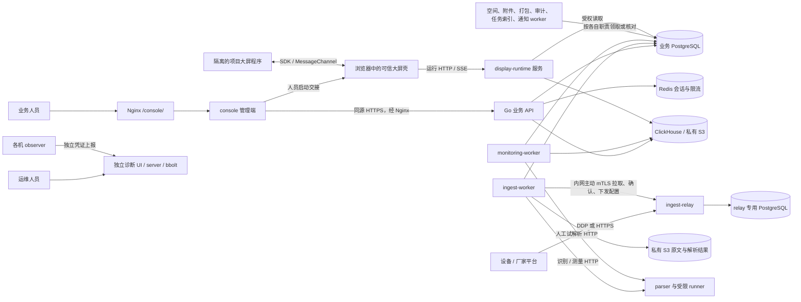

# InfraPro 整体架构审查

2026-11-18 · 审查范围为业务需求、当前开发工作区、四机生产进程，以及适合本项目的服务、前端和消息职责。第 1、2 节记录现状，第 3 至 5 节给出架构判断。判断依据是业务一致性、用户工作流、负载特征和故障影响范围。

## 1. 现在实际运行什么

**业务管理目前是一个模块化 Go API，耗时工作已由多个独立后台进程（worker）承担，前端有三个 App。系统已用 PostgreSQL（PG）实现持久任务、收据交接和领域事件消费。没有发现 InfraPro 接入 Kafka、RabbitMQ、NATS 或 Redis Streams 等通用消息中间件（MQ）。**

本次只读核对四台主机的 `infrapro-*.service`，共 36 个常驻单元处于 `active/running`。另核对 API、relay、诊断 server 的运行二进制，都来自发行目录 `20261117-802a92f81b63`。直接查询业务 PostgreSQL 得到 schema **55**。开发工作区为 `develop`、HEAD `1f11b5a`，包含未提交修改，源码要求 schema **57**，其中 56 是 MFA，57 是账号头像。下文涉及这两项时指开发工作区。旧架构图中“唯一前端”和单 API 的示意只覆盖早期管理入口。[生产基线](../operations/production-version-2026-11-17.md) · [生产服务分配](../operations/production-deployment-2026-11-17.md) · [迁移版本检查](../../packages/go/platform/migrations/migrations.go) · [原架构总览](../architecture.md#overview)

| 生产节点 | 已核实的常驻职责 | 单元数 |
| --- | --- | ---: |
| 37 | 业务 PostgreSQL、Redis、业务 S3 的四个 SeaweedFS 进程、本机 observer | 7 |
| 38 | 备份 S3 的四个进程、独立诊断 server、本机 observer | 6 |
| 151 | 接入 relay 及其专用 PostgreSQL、一个 ClickHouse、一个 Keeper、历史 S3 的四个进程、本机 observer | 9 |
| 152 | 12 个业务进程、Nginx、本机 observer。8 个业务 worker 都在这一台 | 14 |

这里数的是运行中的常驻 systemd 单元。一次性防火墙服务、备份定时任务和按需子进程另计。151 承担架构中的云端接入角色。现场公网或专网、真实厂家载荷和持续生产吞吐仍缺实测。业务 PG 与 relay PG 各有自己的数据职责，四机部署使用单实例 ClickHouse。生产交接记录的整机故障处置是受控重启或备份恢复，自动主备切换尚未交付。[生产核验及边界](../verification/production-deployment-2026-11-17.md) · [生产备份与恢复](../operations/production-deployment-2026-11-17.md)

图中从 worker 指向 relay 的箭头表示连接发起方向，报文字节随响应进入内网。多个 S3 用途分别有命名空间和访问权限。诊断还有直接入口，业务 API 中断时仍可观察其状态。

### 后端进程清单

| 当前进程 | 实际负责 | 交接方式及相邻职责 |
| --- | --- | --- |
| `api` | 登录与会话、平台／租户／项目治理、工程与设备、来源、接入与解析管理、监测与分析接口、空间、大屏管理、文件、任务、通知和审计查询及命令 | Gin 统一鉴权，主要业务模块通过 Go 进程内调用和同一 PG 事务协作。API 还处理获准的文件流和人员会话维护。重计算、投递及转换分别由下列进程执行 |
| `ingest-relay` | 按已下发的入口修订接收设备帧或厂家批次、封装来源、持久保管、返回协议确认 | 外部端口确定项目、厂家及入口协议范围。内网用独立机器身份拉取和确认。设备身份、关联和测量方法由内网核验 |
| `ingest-worker` | 接管原文、S3 写入与摘要回读、PG 收据、云端确认，继而完成识别、关联、规划、测量执行调度、重处理与入口同步 | 内网主动 mTLS 调 relay，调用 parser 后保存依据及结果。原文、解析结果与正式观测分属三个阶段 |
| `parser` | 提供固定版本方法目录，按已发布产物启动有资源限制的子进程，完成识别／解复用和测量解析 | 机器 HTTP 请求／响应，runner 通过标准输入输出处理单次执行。产品默认、设备采用、权限及结果留存由平台负责。parser 无业务库、ClickHouse 或 S3 依赖 |
| `monitoring-worker` | CSV／XLSX 校验与发布、摘要、统计、导出及维护，还承载派生调度／计算／历史分析、人工试解析、大屏后台读取 | 前台和历史任务已有各自并发槽。人工试解析和大屏读取另有持久状态与循环，和正式监测共用进程。设备自动解析由 `ingest-worker` 调度 |
| `spatial-worker` | 图纸、三维／BIM、GIS 版本校验、转换和浏览产物 | 领 PG 作业，访问空间对象存储，按需启动 Python 转换器。资料发布、挂载及项目授权通过业务接口管理 |
| `files-worker`、`files-checker` | 前者处理普通附件修订、准备、检查结果和清理。后者执行有界内容检查 | 两个进程经本机 Unix socket 通信，检查器再隔离子进程。监测源文件、专业空间资产与大屏程序包分别沿用本域的处理和授权 |
| `display-package-worker` | 以受限身份验证上传包、清单和静态资产，记录包处理结果 | PG 作业及专用对象前缀。经域内交接记录向任务、通知、审计传递事实。将一个就绪包正式发布到某项目实例仍是显式管理操作 |
| `display-runtime` | 可信壳、人员／固定终端会话、SDK 命名读取、订阅及资产请求 | **同一 Go 进程有两套监听**，服务可信壳与隔离资源 origin。共享平台领域读取实现，直接按当前范围访问数据。后台重查询由 `monitoring-worker` 协调 |
| `task-index-worker` | 公共任务索引、历史回填、对账及受限来源交接 | 读取有限的 PG 元数据。来源 worker 执行和重试原作业，来源事务也会直接写任务事实，索引器无需探测 ClickHouse／S3 |
| `notification-worker` | 展开收件人、核对资格和偏好、重试并写入站内收件箱，并桥接大屏通知、处理邀请到期 | 消费 PG 事件、收件人与投递状态。产生通知的事实与来源事务绑定，页面通过业务 API 读收件箱 |
| `audit-worker` | 审计导出快照、受控 CSV、交接翻译、传输收尾、到期与清理 | 读受限 PG 数据及审计 S3。原业务操作的成功审计由来源事务提交，worker 故障主要影响后台处理与交接覆盖 |
| `infrapro-diagnostics server`、每机 `observer` | server 提供独立账号、内嵌 UI 和 bbolt 状态。observer 取本机进程报告、运行环境和固定探针的观察结果 | 同一程序的两种常驻角色。observer 主动经 HTTPS 上报。业务进程写有界本地报告，诊断面拥有独立身份、存储和入口 |
| 按需工具 | `infrapro` 负责运维、迁移、检查和恢复。打包工具生成发行物 | CLI、`parser-runner`、检查子进程、Python 转换器以及备份作业各有调用生命周期，常驻拓扑单独计数 |

进程名按实际启动入口核对。项目有 7 个 Go module，其中 `services/api/cmd` 就包含 11 个可执行入口。当前开发版业务 OpenAPI 有 945 个路径、1,067 个 HTTP 操作，含不同空间和兼容入口。接口数量不能直接换算成独立业务能力。[Go workspace](../../go.work) · [业务进程入口](../../services/api/cmd/) · [路由装配](../../services/api/internal/transport/http/router.go) · [业务 OpenAPI](../../contracts/openapi/api.yaml) · [本机编排](../../scripts/local-runtime.mjs) · [诊断体系](../operations/independent-runtime-diagnostics.md)

机器接口也有各自的契约。relay 的控制、拉取、确认和释放使用双向 TLS。parser 的目录、识别和测量使用带机器凭证的 HTTP，请求有确定的响应和超时。内网 worker 连接两端，负责保存依据与驱动流程。observer 上报走另一份诊断契约，人员浏览器通过独立会话读诊断结果。[接入交接契约](../../contracts/openapi/ingestion-relay.yaml) · [识别契约](../../contracts/openapi/ingestion-identification.yaml) · [测量解析契约](../../contracts/openapi/parsing-service.yaml) · [诊断契约](../../contracts/openapi/diagnostics.yaml)

### 前端与主要数据

| 当前 App | 用户看到什么 | 通信与资格 |
| --- | --- | --- |
| `apps/console` | React／TypeScript、TanStack Router 和 Query 构建一个管理端。个人、平台、租户、项目在同一应用中切换。工程台账、设备接入、监测分析、空间图模、附件、任务／通知／审计和大屏管理都在此 | Nginx 把根入口导向 `/console/`，把同源 `/api/` 转给业务 API。页面按服务端授权显示，任务与通知摘要主要通过 HTTP 轮询 |
| `apps/display-runtime` | TypeScript 编写的可信大屏壳，实际的项目程序运行在隔离 iframe 中。人员从控制台交接，固定终端可直接从已配对入口进入 | 壳与项目程序用 MessageChannel。壳与运行服务用 HTTP，并通过服务端推送事件（SSE）接收订阅更新。控制台、壳、上传资产使用三个独立的浏览器来源（origin，由协议、主机、端口确定）。同主机不同端口部署时，代理只转发准许的运行 Cookie，并从资产请求移除 Cookie |
| `apps/diagnostics` | React 运维诊断台，生产静态 UI 内嵌在诊断 server 中。控制台可按配置提供外链，也支持直接访问 | 使用独立诊断 API、账号及会话。业务租户和项目权限与诊断权限分别管理 |

PostgreSQL 管理账号关系、对象授权、业务版本、接收收据、发布清单、任务、通知和审计事实。ClickHouse 保存正式观测和派生数值载荷，读取还要服从 PG 中已发布的清单及授权。S3 保存接入原文与解析响应、上传原件、空间产物、程序包、摘要和导出等对象。Redis 用于会话快照、活动合并及限流。relay 有专用 PG，诊断状态在 bbolt。[控制台工作空间壳](../../apps/console/src/app/workspace-shell.tsx) · [大屏壳](../../apps/display-runtime/src/main.ts) · [HTTPS 代理](../../deploy/display/https.nginx.conf) · [诊断前端打包](../../services/diagnostics/internal/web/assets_release.go) · [会话缓存](../../packages/go/platform/identity/session_cache.go) · [监测存储契约](../operations/monitoring-data.md)

## 2. 现状中影响架构判断的四条链路

1. **工程台账到数据授权。** 租户持有设施、构件、断面、孔位、测点、通道和设备。项目使用明确授予的对象和能力。把某个测点的通道换到另一个设备输出时，后端须同时核对双方的语义、代次、占用和授权，再原子结束旧关系并建立新关系。项目获得通道元数据后，查看数值仍需对应的数据权限和时间范围。平台、租户、项目是权限维度。若分别设立三套台账，同一实体就会出现多个写入权威。[需求与归属](../requirements.md) · [来源绑定](../operations/channel-bindings.md) · [工程结构模型](sensor-classification-and-engineering-structure-implementation.md)
2. **设备到解析结果。** relay 先把外部上报持久化，然后应答设备或厂家。内网主动拉取，在 S3 存妥并回读原文，在业务 PG 记录收据与 `ingestion_ack_outbox`，再异步向云端确认内网已接管。内网按入口修订、终端／子设备和关联水位识别，按设备已采用的固定方法版本解析。**一条报文可以已确认接收、尚待解析。一条已解析的读数也可以始终没有正式采用。** 当前已验证的正式观测入口是文件导入、校验和发布。这里没有“解析成功就写 ClickHouse 正式观测”的通路。[云缓冲与确认](../../services/ingest-relay/internal/spool/store.go) · [内网接管](../../packages/go/platform/ingestion/receive.go) · [解析结果提交](../../packages/go/platform/ingestion/parse.go) · [解析与正式观测的范围](../operations/parsing-service.md)
3. **正式观测到分析和大屏。** 发布 worker 核验 ClickHouse 载荷，在 PG 短事务内提交可见清单、变化位置与影响区间，并排入摘要任务。派生计算按持久消费位置发现受影响范围。控制台或大屏查询已获准的成果，大屏后台查询也有独立的 `display_read_jobs`、租约和结果预算。现有前台／历史槽已隔离一部分负载，但监测写入、历史计算、人工试解析和大屏冷查询仍共用一个进程及其故障生命周期。[发布路径](../../packages/go/platform/monitoring/publication.go) · [变化事实](../../packages/go/platform/monitoring/changes.go) · [派生消费](../../packages/go/platform/derivedmonitoring/changes.go) · [实际 worker 启动](../../services/api/cmd/monitoring-worker/main.go) · [大屏读取作业](../../packages/go/platform/displayread/jobs.go)
4. **一次业务操作到任务、通知与审计。** 适用的命令收据、任务事实、通知意图和成功审计随来源事务持久化。公共任务的事务内刷新发生在提交之前。受限的大屏包进程只写本域交接记录，分别由获准进程翻译。公共列表、通知投递、导出文件可以稍后完成，业务动作是否成功由原命令和来源事实回答。[事务提交](../../packages/go/platform/access/authorizer.go) · [任务记录](../../packages/go/platform/taskrecord/record.go) · [通知生产契约](../../packages/go/platform/notificationevent/event.go) · [审计写入](../../packages/go/platform/auditrecord/writer.go) · [大屏交接](../../packages/go/platform/display/audit_handoff.go)

**两个共享点会扩大故障范围。** 一是许多二进制复用 `runtime.Compose`、同一业务库、授权事务和精确 schema 版本，独立启动并不等于可以任意混合版本发布。二是配置监测存储后，主 API 在监听 HTTP 之前会连接并校验 ClickHouse 和派生存储，运行中的整体 `/readyz` 也检查计算就绪。此配置下，分析存储故障可以阻碍业务 API 冷启动，影响只想登录或查台账的人员。152 的业务进程还共享一台主机的资源与故障域。[装配](../../packages/go/platform/runtime/business.go) · [依赖初始化](../../packages/go/platform/runtime/resources.go) · [监听顺序](../../services/api/internal/bootstrap/app.go) · [就绪检查](../../services/api/internal/transport/http/router.go)

## 3. 哪些后端职责适合独立运行

**业务命令、设备接收、后台计算和用户查询有不同的可用性要求。** 登录和工程维护要在分析存储故障时仍可用。解析积压时，接收仍要安全保管原文。值班人员查最新曲线时，需要有独立于数月历史回算的执行容量。下表给出目标运行角色。独立进程可以部署在同一台主机，主机级冗余需要另有部署证据。

| 适合独立部署的进程 | 本进程拥有的职责 | 接口与交接对象 |
| --- | --- | --- |
| **身份与空间治理 API** | 人员登录、MFA、账号与会话，租户及项目成员、角色、启停和归档，给出账号能进入哪些工作空间。人员认证密钥限于此服务 | 经 Nginx 对控制台提供同源 HTTPS。向业务服务提供受限的人员身份、会话有效性和成员资格校验。作用到哪个设施、输出、文件或时间范围，由对象所属领域最终判定 |
| **工程与业务控制 API** | 工程元模型与模板、实际结构、分类、产品／设备、安装、来源与对象授权，接收导入、资料、大屏配置等管理命令，并提供轻量目录及任务／通知／审计入口 | 在 PG 领域事务中核对权威会话、成员修订、对象和版本并提交变更、收据及必要事实。换源在同一事务中修改两端关系。长作业返回任务标识，数值查询交监测查询 API |
| **监测查询 API** | 为控制台和获准的大屏主体提供最新值、时段曲线、明细、统计、历史成果查询，独立限制并发和扫描量 | 有界查询同步返回。重查询返回查询 ID，交后台读取进程。按 PG 清单与当前资格读 ClickHouse／S3。仅有设备或项目元数据读取权时不可返回监测值 |
| **受控文件传输服务** | 承接上传分片、续传、Range／流式下载和预览交付，把长连接、字节流和带宽限制从管理请求中分离 | 按文件来源调用专属授权与对象读写接口，检查当前主体、修订和读取资格。文件是否正式采用、解析、发布或清理分别由附件、监测、空间、大屏等来源决定 |
| **接收 relay** | 终结外部连接、固定入口修订、保存原始字节和收据，按持久化结果向报送方应答 | 内网主动 mTLS 拉取／确认，relay 只持有有限入口配置和本地缓冲。内网离线时按水位继续保管或向上游施加背压 |
| **内网接管 worker** | 核验跨网交接、原文落库／落对象、去重、云端确认、入口修订及水位同步 | 上游是 relay，下游是已持久化的接收事实。按收据排队识别。解析进程停机时，接管仍可在容量预算内推进 |
| **识别与解析调度 worker**、**独立 parser** | 调度 worker 负责终端识别、关联、固定方法、计划、重试与结果持久化，区分设备自动任务和人工试解析配额。parser 负责执行指定不可变产物 | 调度按收据／计划领任务，按调用 ID 同步请求 parser，复验代次和权限后提交结果。parser 仅需方法包和机器身份，受限 runner 按次启动。正式观测由监测发布职责拥有 |
| **正式观测发布 worker** | 导入映射与全量校验、重复核对、正式采用、撤销后续处理、载荷核验及可见清单 | 接收已授权的发布任务，按批处理，在 PG 提交可见位置后发出变化事实。保留原始依据、授权和质量口径，解析结果不得自行跨越采用关口 |
| **增量计算 worker**、**历史分析 worker** | 前者处理新发布／更正影响的窗口、派生自动调度和及时更新的摘要。后者负责历史回算、回放、成果比较和批量导出 | 依据提交位置、通道与时间范围排队，独立分配并发、内存与临时盘。两者复用规则与精度实现，分别领取和恢复作业，并按所属领域发布成果 |
| **后台查询 worker** | 冷统计、跨资源聚合、大屏命名读取等可取消的重查询 | 来自监测查询或可信大屏的查询 ID，返回绑定主体、依据版本和期限的结果。对交互查询保留容量，历史回算及正式写入各有执行进程 |
| **空间转换 worker**、**普通附件 worker**、**内容检查器** | 分别负责空间格式转换与专用产物、普通附件准备与修订、受限环境中的内容检查 | 数据库任务指向私有对象。空间 worker 按需运行 Python。附件 worker 经本机 socket 调检查器。发布或获取资料仍由来源资格决定 |
| **大屏包 worker**、**可信大屏运行服务**、**受限资产出口** | 分别负责包校验暂存、人员／终端会话与 SDK／SSE、上传程序静态字节。资产出口适合以独立受限服务身份运行 | 项目正式发布由工程与业务控制 API 决定。运行壳向领域读取接口传递受限主体。资产出口按有效发布和资产资格仅服务包文件。程序 iframe 通过壳读取获准业务数据 |
| **任务索引 worker**、**通知投递 worker**、**审计后台 worker** | 分别负责公共任务投影与回填、站内收件箱、审计交接／快照／导出与清理 | 各自消费获准的最小事实、各自重试。业务执行回到来源，审计原始事实与通知意图在来源事务中保留 |
| **诊断 server**、**逐机 observer** | 独立运维身份、故障观察和有限历史。observer 采集所在主机的指定目标 | 独立 HTTPS 上报与本地诊断库。即使业务 API、PG 或未来的消息系统中断，仍有一条观察故障的路径 |
| **事务消息转发进程**、**内网消息代理**（目标角色） | 转发进程搬运已提交的待发送事件并记录确认。代理持久传递消息，分别为作业执行者或独立订阅者保留进度 | 转发进程只读获准发送的最小事件、更新投递状态。消息代理与接入 relay 是两种不同角色。业务资格、发布结果与用户任务状态始终可在所属领域查明 |

Go 领域模块及 PostgreSQL 事务适合处理强一致规则，ClickHouse／S3 处理数值和大型对象，有版本的 HTTP 契约承接同步服务调用。**共享业务库按领域限制写权限。** 身份服务更新会话和成员资格，工程服务更新对象及其授权。需要在同一提交中验证两者的操作，使用同库、受限的资格读取接口与事务锁。撤权与旧命令提交必须有确定先后。经过查询服务、文件网关或大屏缓存交付结果时，再按权威状态判权。浏览器无需持有 worker、数据库或消息代理的访问资格。

与现状相比，职责变化集中在三处。现有 `api` 中的身份治理、工程命令、监测读取和字节传输各有独立接口与可用性要求。现有 `ingest-worker` 中的跨网接管可独立于后续识别与解析。现有 `monitoring-worker` 中的正式发布、增量计算、历史分析和后台读取可以分别扩容，人工试解析回到解析调度职责。空间转换、受限文件检查、独立诊断等既有分工有明确的输入、输出和隔离理由。

## 4. 前端应有几个 App，用户如何统一进入

**建议保留三个独立前端 App。业务控制台内部划出三个功能区。** 同一工程师可能从设施树定位测点，查看设备输出及原文，再打开通道曲线。一路都需要保留同一个租户、项目、对象和返回位置。平台、租户、项目决定用户以什么资格操作，各空间按授权显示对应功能。空间浏览、设备和监测分析可以按路由分包，Three.js、地图、图表及文档预览按需加载。大屏和诊断各有自己的运行主体、故障要求，值得独立部署。

| App／功能区 | 用户在此完成什么 | 相邻职责归属 |
| --- | --- | --- |
| **业务控制台 · 账号与治理** | 登录、MFA、个人资料、选择工作空间、成员／角色、租户与项目治理、对象授权，以及统一查看任务、通知和审计 | 点击某任务、某授权对象或审计目标，回到相应业务详情并重新判权 |
| **同一控制台 · 工程与设备** | 公共定义、分类与模板，设施／构件／断面／孔位／测点／通道台账，设备产品、安装、来源、协议采用、接入管理、原文与解析溯源，图模和工程附件 | 工程对象以稳定 ID 连接到监测工作区。原文、单元和解析结果各按其权限查看 |
| **同一控制台 · 监测与应用** | 正式导入与质量核对、监测趋势与比较、派生规则／运行、历史成果、项目大屏实例和发布管理 | 大屏管理留在控制台，已发布项目程序在可信运行 App 展示。值班人员可从曲线返回设施、测点或获准的设备来源 |
| **项目大屏运行 App** | 人员看屏、固定终端值守、隔离项目程序，通过 SDK 获取被授权的目录、数值和空间资料 | 运行壳处理会话、订阅和清屏。控制台负责管理。上传程序使用受限资源 origin。SDK、开发工具和每个大屏包都无需另建平台管理 App |
| **独立诊断 App** | 运维人员查看进程、依赖、数据新鲜度、故障历史与节点资源 | 使用独立登录和固定直达地址。业务管理、数据补录与监测分析都回到业务系统 |

以项目中的一张设施详情页为例，设施树和设备输出来自工程与业务控制 API，某一测点近七天的曲线来自监测查询 API，下载图纸时由文件传输服务核对具体版本和原件下载权。三次请求携带同一项目上下文，各自核对本次操作所需的权限。用户始终停留在同一设施上，即使历史查询暂时不可用，台账仍可打开。

**普通用户只需记住 `/console/`。** 服务端计算可进入的空间。无业务空间时进入个人首页，唯一空间直达，有多个时按明确深链接或主动选择。工程、数据、附件和任务之间通过带租户／项目及对象 ID 的链接跳转，切换空间时取消旧请求、丢弃失效缓存，并保留合法返回目的地。即使拿到深链接，后端仍验证当前成员、动作及对象权限。控制台共享导航、主题和 API 客户端，各业务模块管理自己的页面状态。[工作空间进入规则](../requirements.md#workspace-3) · [工作空间壳与授权导航](../../apps/console/src/app/workspace-shell.tsx) · [控制台路由](../../apps/console/src/app/router.ts)

**两个特殊入口。** 项目成员从“项目大屏”打开稳定入口，由现有控制台会话确认一次性启动码，再由可信壳凭挑战证明换取受限运行会话。固定终端另走配对。运维人员可点诊断外链，业务站点整体不可用时也可直接打开诊断站点。用户体验中的统一入口可以和独立身份、不同 origin 同时成立。[人员启动交接](../../apps/console/src/features/displays/launch.tsx) · [运行壳协议](../../services/api/internal/transport/http/display/runtime.go) · [诊断链接](../../apps/console/src/app/diagnostics-link.tsx)

## 5. 消息队列用在哪里，能改善什么

**当前已有异步解耦，排队与领取主要由 PostgreSQL 承担。** relay 的 `relay_receipts`／`relay_deliveries`、内网 ACK outbox、`monitoring_jobs`、`display_read_jobs` 和 `notification_deliveries` 都在持久化之后由独立执行者领取或确认。多个领域使用行锁、租约、fence（领取代次）和重试。监测还有带独立消费者进度的 `monitoring_changes`。这种做法能让用户请求或云端接收先完成。积压和订阅方增加时，数据库也要承担更多扫描、任务领取和索引更新，消费者可能等到下一次轮询才发现新工作。浏览器 SSE、页面轮询、Go goroutine 分别用于界面传输或进程内并发。[接入执行循环](../../packages/go/platform/ingestion/worker.go) · [通知领取与投递](../../packages/go/platform/notifications/worker.go) · [监测变化记录](../../packages/go/platform/monitoring/changes.go) · [PostgreSQL 行锁与队列表](https://www.postgresql.org/docs/17/sql-select.html#SQL-FOR-UPDATE-SHARE)

| 用在哪里 | 生产者 → 消费者，消息携带什么 | 可以改善什么 | 必须保留什么 |
| --- | --- | --- | --- |
| **内网接管 → 识别／解析（首选）** | 接管事务发布收据 ID、入口修订、epoch、序号和原文引用。识别完成后发布固定单元／计划 ID，由相应执行池竞争领取 | 接收与解析独立伸缩，突发报送时先安全接管，故障恢复后按租户和来源公平追赶，减少执行者争抢同一批候选记录 | 云端专用缓冲、内网主动拉取和双端对账继续负责跨网交接。大报文留 S3。实际重复报送可能是两个真实接收事实，不能仅用内容摘要去重 |
| **正式观测发布、撤销或更正 → 多个订阅方（首选）** | 监测领域提交后发事件 ID、租户、提交位置、受影响通道／时间段引用。派生计算、摘要维护、查询或大屏失效分别订阅 | 一次变化供多个消费者各自推进、暂停或回放。迟缓的历史分析不阻塞值班曲线或正式提交。可合并同一通道的相邻变化区间 | PG 中发布清单、变化证据和每个消费者的进度。按提交位置补缺，按实际输入版本重新核验。原文到达或解析成功均不足以触发正式数据发布 |
| **任务完成／资料发布 → 通知、任务投影、审计辅助处理** | 来源事务保存最小事实或受限交接，通知、索引、导出等拥有独立订阅，各自按来源 ID 与执行代次处理 | 一方故障时其他方继续。批量完成后可减少各进程反复扫表，也能只补投某个下游 | 成功审计、必要任务事实及通知意图仍与来源同事务。投递时复核收件人、偏好、成员资格。重放投影不重新执行业务 |
| **空间转换、附件检查、大屏打包、历史回算、导出和冷查询（按负载选择）** | 业务命令落任务后按类型投递作业 ID、代次与输入引用。每个作业的一次有效执行归一个消费者 | 大小任务可以分池、限流和背压，优先保证交互时效。数据库轮询确实造成排队时可缩短首次领取等待 | 任务状态、取消、重试、租约与唯一结果由所属领域保存。低频任务已有 PG 持久作业机制。转换 CPU、对象传输带宽和 CH 扫描量仍决定执行耗时 |
| **提示界面和大屏刷新** | 结果已就绪或授权修订变化时，服务端消费小事件，经现有 API／SSE 通知“需要重新获取” | 减少无变化轮询和多实例重复查询，缩短变化出现到界面刷新的时间 | 浏览器只连接获准的服务。结果交付、分页、文件块和订阅仍复核当前资格。持久游标、缺口重取和断线恢复继续有效 |

### 三个不能交给队列裁决的问题

| 问题 | 权威回答来自哪里 |
| --- | --- |
| 现在谁能读哪条通道、改哪个设备、获取哪份文件？ | 当前账号／会话、成员关系、对象和时间范围的权威校验。消息延迟不能延长已撤销权限。登录、MFA 和需要立即判定的命令走同步接口 |
| 一次换源、一次正式发布或一份成功审计是否已生效？ | 所属领域的事务、固定版本、清单与收据。对象写入、ClickHouse 核验和最终 PG 提交按已有顺序完成。事务提交后才广播事实 |
| 报文是否已安全移交，故障后能否释放云缓冲？ | 内网对象校验、业务收据与 relay 的逐项 ACK。设备协议应答、内网接管确认、broker 投递确认、正式观测采用分别表示不同结果 |

### 传递语义与性能判断

- **命令和事件各用其所。** “处理这项计划”由一个有效执行者领取。“这个批次已经发布”由各订阅方独立消费。适合在内网使用能持久投递、分组消费和按位置重放的消息系统。项目现有证据足以定位用途，尚不足以据此确定产品、分区数、服务器数或生产吞吐目标。
- **提交与发送之间允许失败。** 业务记录和待发送事件在同一 PG 事务落地，提交后由可靠转发进程发送，得到 broker 持久确认后标记。消费者将幂等键及结果同事务记录后再确认消费。转发中断、确认丢失都可能引起重复。用事件 ID 加消费者、来源 ID 加代次防重复效果，执行者凭受控引用读取原文和大型模型。已有 ACK outbox 专用于云端交接。[事务发件箱机制](https://docs.aws.amazon.com/prescriptive-guidance/latest/cloud-design-patterns/transactional-outbox.html) · [发布确认、重投递与幂等](https://www.rabbitmq.com/docs/reliability)
- **顺序、失败和恢复按业务处理。** 路由及关联变更按入口、epoch 和来源序号核对。正式监测按租户提交位置及影响区间推进。重试有退避、次数和死信／隔离记录。超时旧 worker 用 fence 拒绝提交。重放沿用原始身份和固定版本，恢复后的旧 epoch 不得重新发布结果、恢复资格或补发历史通知。broker 中断期间由持久待发送记录积压，达到容量上限时要求上游降速或稍后重试，诊断面可独立观察。
- **已有实测限定了结论。** 隔离环境以约 **100 测量帧／秒持续 30 分钟**报送。135,001 条外部接收记录全部接管并确认，对应 180,000 个测量帧及另一次注册。截止时已完成解析 82,031 帧，按用户要求停止，97,969 帧未继续。接管 P95 为 34.751 秒，已完成子集的端到端 P95 为 2,001.555 秒。报告还记录了解析候选 SQL 从约 298 ms 到 5 ms 的局部优化。大屏合成负载中，热统计 P95 约 1.12 秒，冷统计约 14.70 秒。以上数值分别说明接收、排队、执行和缓存需要独立衡量，不能作为生产容量或换用 MQ 后的收益。[接入负载报告](../verification/device-ingestion-and-raw-messages.md) · [大屏冷热查询报告](../verification/display-sdk-monitoring-read.md)
- **判断 MQ 有没有提升，看同口径的端到端结果。** 固定输入、租户分布及计算资源，分别看接收确认速率、解析成功速率、最老待处理年龄、断联后的追平时间、租户公平性、页面 P95、PG 领取与锁等待、parser 饱和度以及 S3／ClickHouse 的耗时。持续流入时，只有有效消费速率高于到达速率才能排空积压。对值班人员有意义的时延，要量到所需数据通过权限核对并可见的那一刻。

## 核验范围

本次审查核对了需求及其后续补充、五份 OpenAPI 契约、实际前后端入口、关键事务／领取源码、生产常驻角色与业务 schema，并复用了既有负载报告。可在已有隔离验收环境复核三条路径。沿“设备上报 → 已接管 → 已解析”区分应答和处理结果。沿“文件导入 → 正式发布 → 派生／大屏”核对可见性。沿“任务终态 → 通知／审计”确认事实归属。采用消息中间件的净收益、现场设备和生产峰值均需相应环境的实测。完整告警执行、自动报告与设备远控属当前需求之外。审查自核完成，待人工审阅。[需求范围](../requirements.md) · [本机验收环境](../operations/local-environment.md) · [项目验证记录](../verification/)
