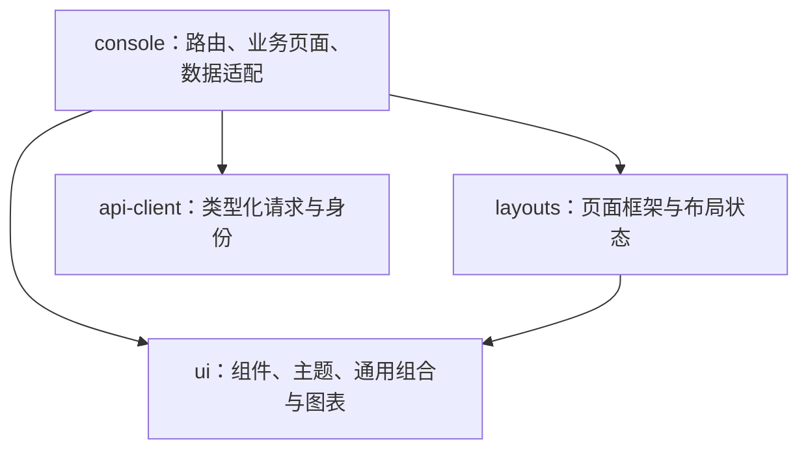

# 前端共享包与开发约定

前端只有 `apps/console`，使用 React 19、TypeScript、Vite 8、TanStack Router/Query/Table、React Hook Form、Zod、shadcn/ui、Tailwind 4、Lucide、Sonner、Zustand 5、Recharts 3。精确版本以各包 manifest 和 `pnpm-lock.yaml` 为准。视觉基准、业务适配和验收范围见[重构方案](requirements/frontend-refactor-plan.md)，上游来源见[来源记录](../third-party/README.md)。

## 依赖和职责



`ui` 不导入应用、layout、Router 或 API；`layouts` 不导入应用、Router 或 API。两者通过 props 接收数据和行为。应用不直接引用 Radix，不深导入共享包的 src。根 ESLint 配置检查这些方向；共享包由 Vite 按源码编译，通过 `workspace:*` 和明确 exports 引用，React/ReactDOM 声明为 peer dependency。

新增页面先使用现有共享能力；通用 UI 或 layout 缺失时先放到 packages，再由 feature 使用。账号摘要、字段规则、菜单定义、请求和数据换算属于应用业务。暂不创建第二个空 app；全屏展示等新场景先使用单独路由和布局，独立部署需求明确后再拆 app。

## 共享 UI

- `@infrapro/ui/components/*`：shadcn 基础组件，保留其组合 API，例如 Button 的 `asChild`、Dialog 的 Trigger/Content。
- `@infrapro/ui/patterns/form-input`：RHF 受控字段、标签、帮助信息、字段错误与密码显示。RHF 和 Zod 规则在 feature 定义。
- `@infrapro/ui/patterns/data-table`：TanStack Table 的列与行渲染、加载/失败/空状态及游标加载更多。页面提供 `ColumnDef<T>[]`、稳定行 ID 和数据；没有总数时不显示虚构页数。
- `@infrapro/ui/patterns/confirm-dialog`：受控确认弹窗，必须传入真实 trigger 以归还焦点；pending 时禁止关闭，错误留在弹窗内。
- `@infrapro/ui/components/sonner`：共享主题的结果通知；资料保存成功使用 Sonner，字段错误仍留在表单。
- `@infrapro/ui/patterns/feedback`：FormNotice、LoadingState、EmptyState、ErrorState。
- `@infrapro/ui/theme` / `theme-init`：ThemeProvider、useTheme 和首帧主题初始化；浅/深/跟随系统，持久化键 `infrapro:theme`。

组件使用示例：

```tsx
import { Button } from '@infrapro/ui/components/button';
import { DataTable } from '@infrapro/ui/patterns/data-table';

<DataTable
  label="我的邀请"
  data={rows}
  columns={columns}
  getRowId={(row) => row.id}
  loading={query.isPending}
  error={query.error?.message}
  onRetry={() => void query.refetch()}
  hasMore={query.hasNextPage}
  loadingMore={query.isFetchingNextPage}
  onLoadMore={() => void query.fetchNextPage()}
/>
```

组件样式使用语义变量及完整 Tailwind class。`apps/console/src/styles/global.css` 是唯一 Tailwind 入口，显式扫描 console、ui、layouts；字体从 ui 包本地托管。三个 workspace 的 `components.json` 统一 new-york、slate、Lucide。新增 shadcn 组件时在 ui 包操作并检查落点，不在应用复制一套基础控件。组件组合时不额外套同功能代理层。

## 布局和导航

`@infrapro/layouts` 导出 AdminLayout、AuthLayout、AuthCard、SettingsLayout、PageContent、PageHeader，以及品牌、用户、导航、LinkRenderer、AdminLayoutMode 和 WorkspaceSwitcherHost / Renderer 类型。

AdminLayout 必填 `mode`：`plain` 用于首页和个人设置，不挂载 SidebarProvider；`workspace` 保留业务侧栏、手机抽屉和偏好。两种模式均提供主题、右上账号菜单和命令搜索，侧栏底部不再展示账号。应用传 `groups`、`userNavigation`、`user`、`brand`、`renderLink`、`onNavigate`、`onLogout`。`renderLink` 返回应用 Router 的 Link，保留正常链接和修饰键行为。layout 不获取当前账号或执行退出 API。PageContent 统一页面宽度和间距，PageHeader 接收标题、说明及可选操作区。

工作空间通过 `renderWorkspaceSwitcher(host)` 插槽呈现：`placement` 决定顶部或侧栏触发器，`nestedInDrawer` 控制嵌套模态，`ready` 表示实际抽屉焦点事件已完成，`onSelected` 只关闭手机导航。应用将 `workspaceSwitcherOpen` 传给布局，布局在始终挂载的协调点先打开手机 Sheet，监听 `mobileContentProps.onOpenAutoFocus` 并在 microtask 确认仍打开后允许选择器出现。未提供插槽时使用品牌链接兜底。

应用层 WorkspacePickerProvider 按账号隔离短暂打开意图；页面按钮调用同一 controller，搜索 / 类型 / 状态 / 分页保留在弹层内部。查询只在打开时启用，按账号、来源和筛选隔离，传 AbortSignal，30 秒及焦点刷新，关闭销毁观察者与游标。`/tenants`、`/projects` 在鉴权后 replace 到首页的一次性 `workspace` 参数；先打开 controller，再 replace 清除参数。页面搜索仅索引当前业务菜单和账号快捷入口。

AuthLayout 提供居中品牌与认证容器，AuthCard 提供标题、说明、内容和页尾；登录、邀请、找回和重置统一使用它。SettingsLayout 接收设置导航及业务内容，在窄屏时切换排列。

TanStack 文件路由在 `src/routes`，`_auth` 和 `_authenticated` 是不进入 URL 的分组。业务组件在 `features`，Vite 插件拆分路由组件。`routeTree.gen.ts` 由 `pnpm --filter @infrapro/console routes:generate` 生成。Vite base 和 Router basepath 一致，生产 `/console/`；合法回跳集中在 `config/navigation.ts` 的白名单中。

## 状态的唯一所有者

| 状态 | 所有者 | 生命周期 |
| --- | --- | --- |
| 当前身份、账号帮助信息、故障阶段 | api-client 的 IdentityProvider | 当前浏览器会话；焦点/可见性与可信活动驱动刷新 |
| 邀请、会话、安全记录 | TanStack Query | key 包含账号 ID；退出/切换身份时取消请求并清缓存 |
| 字段值、校验与表单错误 | React Hook Form + Zod | 业务表单生命周期；网络错误保留输入 |
| 桌面侧栏偏好 | layouts 的 Zustand store | `infrapro:layout`，version 1，只持久化 sidebarOpen |
| 选择器打开意图 | WorkspacePickerProvider | 当前账号与标签页，路由变化关闭，不持久化 |
| 手机抽屉、确认弹窗、生成链接 | 布局或 feature 本地状态 | 不跨身份持久化 |

Zustand 只在业务布局挂载时恢复 `infrapro:layout` version 1；账号页面不读取或改写侧栏偏好。Zustand 控制桌面 SidebarProvider，避免同时在 cookie、Context 和 store 保存展开状态。按 selector 订阅需要的字段，通过 store 的动作更新；`useLayoutStore.getState().reset()` 恢复展开默认值。持久化有明确白名单和类型验证，只保存非敏感界面偏好。

后续跨组件、跨页面的客户端业务状态放 `features/<feature>/state`，应用级状态放 `app`；通用布局偏好才进入 layouts。store 应有明确类型、动作和 reset。账号相关 store 使用按账号创建的 Provider，放在 IdentityProvider 的账号子树内，或在身份切换/退出时显式 reset。不要把 API 数据再拷进 Zustand；不要把密码、会话或一次性凭证写入 persist。

当前 IdentityProvider 用账号 ID 标识消费者子树。账号变化会销毁表单、链接和 QueryClient；同账号重载或短暂依赖故障不销毁草稿。查询读取传递 AbortSignal；写操作不自动重试，useOperation 防止重复网络写入并忽略已卸载页面的完成回调。CSRF 失效只更新验证材料，等待用户再次提交。

所有 Zod 导入经过 `config/validation.ts`，该入口在创建 schema 前设置 `jitless: true`，避免 CSP 下的 Function 探测。密码按 Unicode 码点计数，不 trim。邀请/重置 fragment 由 main 的早期依赖捕获并清空地址，只保留内存，不放进 query key 或存储。

## Recharts 共享图表

`@infrapro/ui/charts` 提供底层 ChartContainer、ChartTooltip/Content、ChartLegend/Content、ChartConfig，以及高层 SeriesChart。简单图形用 SeriesChart，特殊图形组合底层组件；请求、时间聚合、单位换算和指标含义由应用负责。

```tsx
import { SeriesChart } from '@infrapro/ui/charts';

<SeriesChart
  kind="line"
  title="测量趋势"
  data={points}
  categoryKey="time"
  series={[{ key: 'value', label: '测量值' }]}
  formatValue={(value) => `${value.toFixed(2)} mm`}
  loading={query.isPending}
  error={query.error?.message}
  onRetry={() => void query.refetch()}
/>
```

支持 line、area、bar、pie、donut；饼/环形图使用第一个数值系列。默认颜色来自共享 chart 变量，主题切换同步；可传格式化函数。图表响应容器宽度，统一 Tooltip/Legend 和加载/空/错误状态，提供屏幕阅读器数据表；折线附加虚线区别系列，饼图有文字类别和数值。动画默认关闭，减少动效设置贯穿布局。ChartContainer 支持更细的主题配置，配置 key 使用字母、数字、下划线或短横线。

`apps/console/ui-preview.html` 是单独的开发/测试 HTML 入口，固定数据只用于共享图表和布局自验。它不在产品路由和生产构建入口中；无独立应用、服务或部署产物。

## 自验与预览

```bash
pnpm check
pnpm build
pnpm test:ui
pnpm test:identity
pnpm test:e2e
pnpm test:e2e:preview
pnpm test:http
```

本地 `pnpm dev` 启动 API 与 console，产品入口 `http://127.0.0.1:5173/`；共享能力预览为同地址下 `/ui-preview.html`，加 `?view=auth` 看认证布局。只检查共享包时可 `pnpm dev:console`，预览不依赖账号 API。生产与普通 HTTP 下均有自验；结果、截图和人工验收项见[验证记录](verification/frontend-refactor.md)。

Nginx 的动态样式兼容限于 `style-src-elem 'self' 'unsafe-inline'`，用于 Radix 滚动锁和 Sonner 注入的 style 元素；script-src 仍只有 self，不允许 inline/eval，style 属性继承 self 限制。字体与脚本同源，生产不依赖外部 CDN。旧配置和旧地址迁移见[运行手册](operations/account-management.md#旧双应用配置迁移)。
## 授权界面

权限常量由 Go 目录生成，使用 `@infrapro/api-client` 的 `Permissions` 和 `useIdentity().can/canAll`。身份上下文以账号 ID 加失权代次隔离消费者；权限减少时清除查询与敏感草稿，旧响应和完成回调失效。无关修订变化保持草稿。管理提交在服务端确认后刷新，密码复验、冲突均不自动重放。
