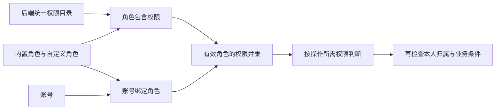
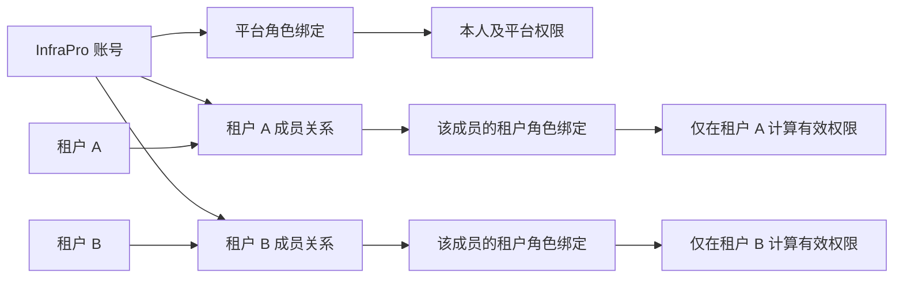
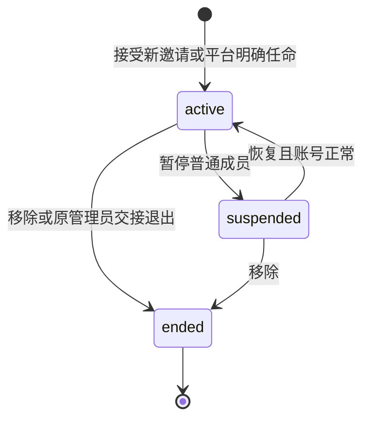
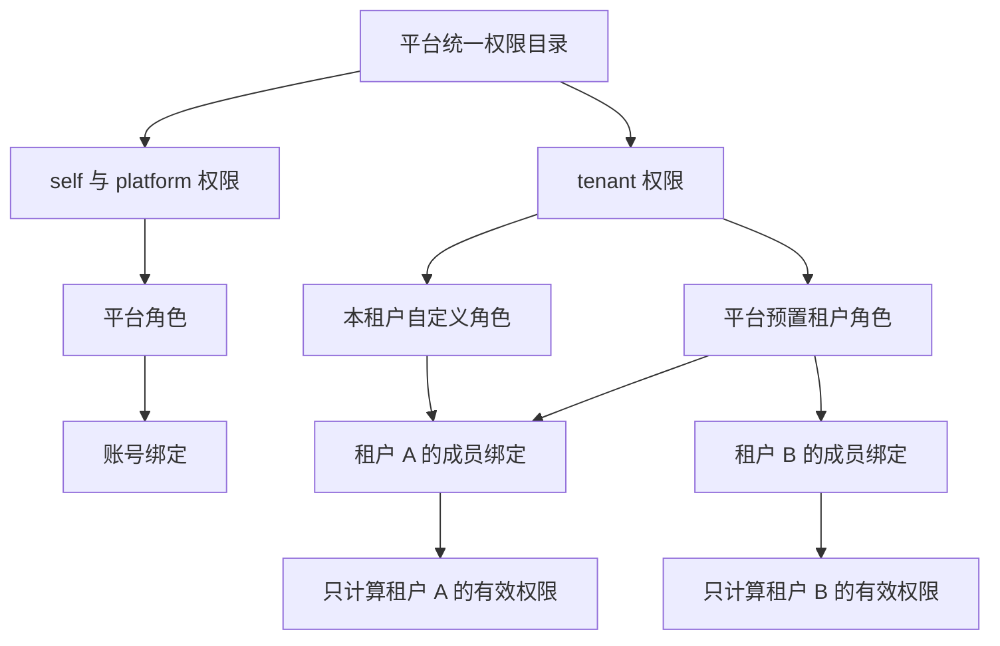
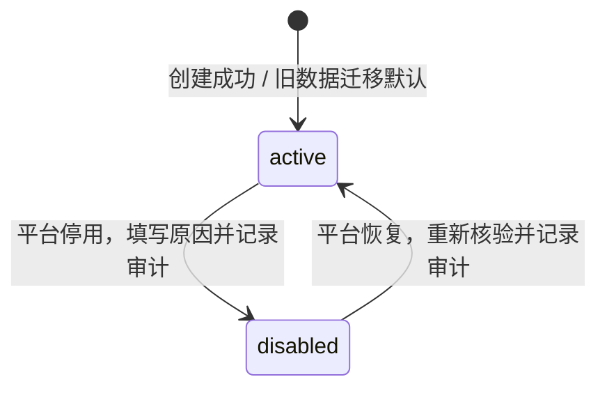
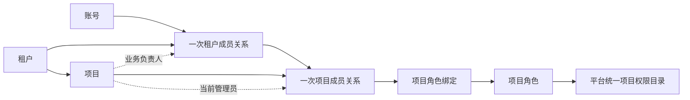
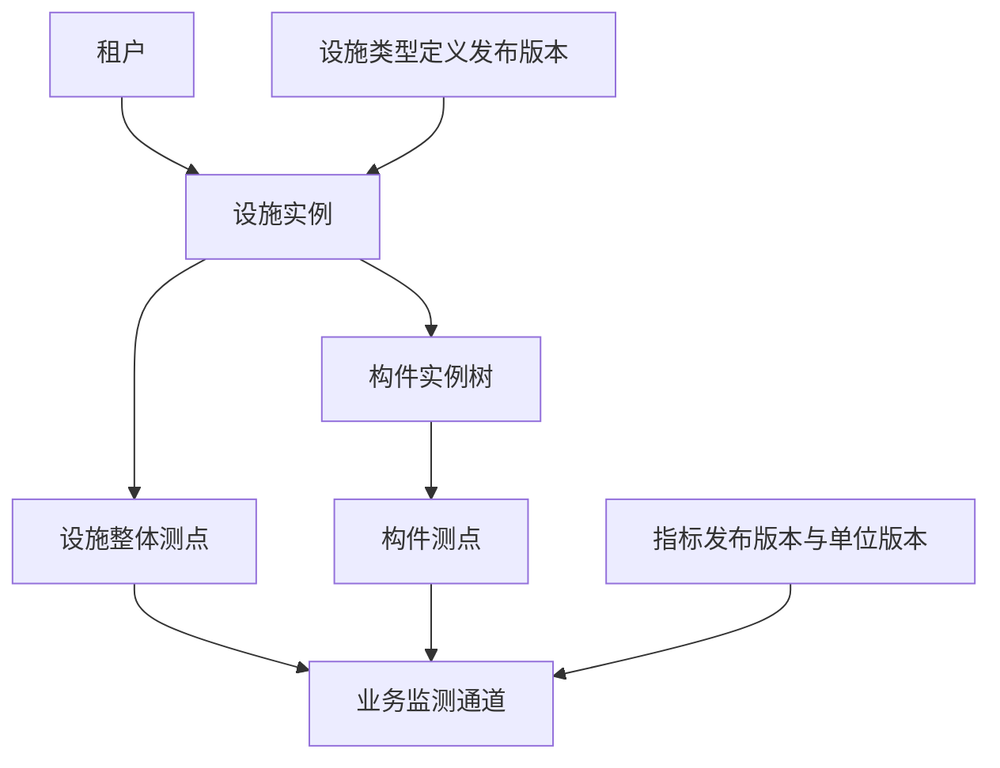
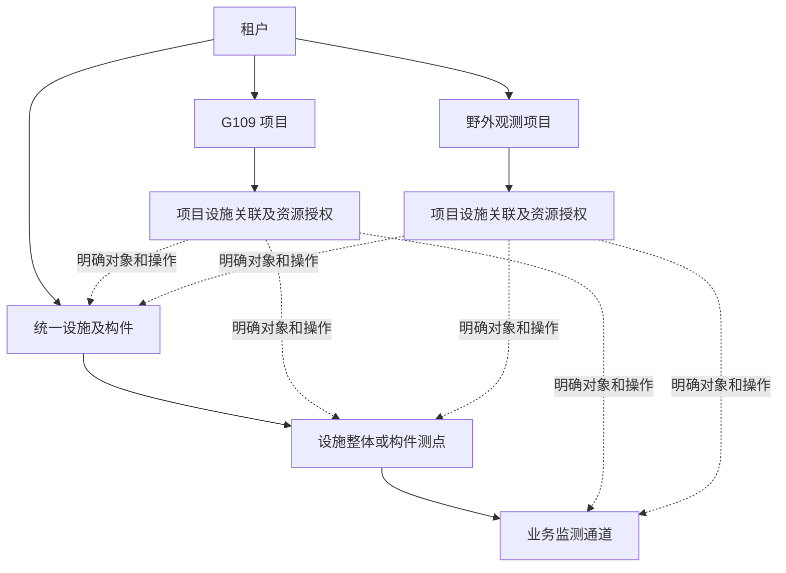
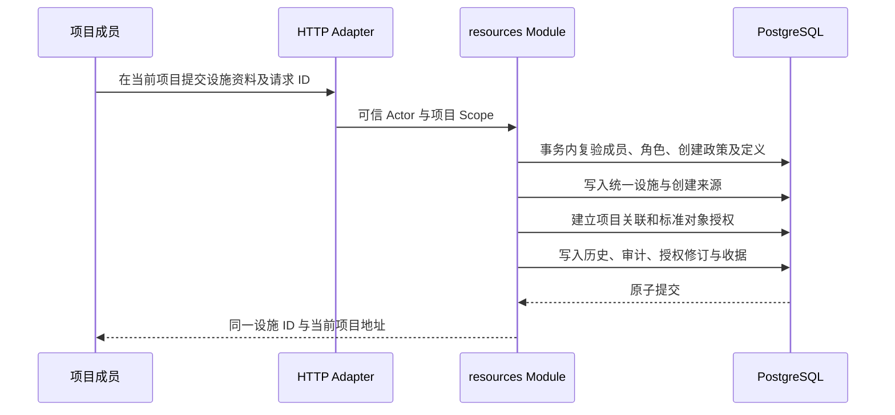

# InfraPro 软件需求规格说明书

文档基线：2026-11-12。整理状态：**Awaiting acceptance（文档自检通过，待用户验收）**。本文统一既有账号、平台治理、租户、项目、工程资源、设备与来源绑定的业务需求；技术决策见[技术选型](technology-selection.md)，系统实现约束见[架构设计](architecture.md)。统一术语见[领域词汇表](../GLOSSARY.md)。
导航：[账号、认证与开户](#accounts) · [权限、平台角色与管理保护](#authorization) · [租户档案与管理员](#tenants) · [租户成员与定向邀请](#tenant-members) · [租户角色与成员授权](#tenant-roles) · [租户启停与恢复](#tenant-lifecycle) · [项目治理、成员、角色及归档](#projects) · [工程类型、指标、单位与监测模板](#definitions) · [租户统一工程资源](#resources) · [项目资源授权与受限维护](#project-resources) · [设备产品、设备、安装与来源](#devices) · [工作空间与页面交互](#interaction) · [数据、安全与质量要求](#quality) · [人工验收与需求追踪](#acceptance) · [状态与验收记录](#status)


本次只整理文档，不实施功能、迁移数据或部署服务。既有功能验收状态见文末，不以文档整理、自检或方案确认替代人工验收。

## 1 文档目的与范围

InfraPro 为交通基础设施监测管理提供组织治理、工程对象、设备和测量来源的统一基础。用户通过账号登录，在获准的平台、租户或项目空间中工作。

| 范围 | 需求边界 |
| --- | --- |
| 账号与平台治理 | 邀请开户、登录、个人资料、密码与会话、角色权限、账号治理、平台审计、维护恢复。 |
| 租户 | 档案、永久编号、管理员、成员邀请与生命周期、多角色授权、启停及审计。 |
| 项目 | 档案、成员、角色、管理员与负责人、归档恢复、资源与设备的明确授权。 |
| 工程定义 | 公共设施类型、构件规则、属性、指标与单位、公共及租户私有监测模板、无审批发布。 |
| 统一工程资源 | 租户持有设施、构件、测点和业务通道；项目按对象能力共用、创建或维护。 |
| 设备与来源 | 公共／私有厂家和产品、设备、输出代次、安装历史、即时来源绑定与项目授权。 |
| 交互与质量 | 唯一 console、授权工作空间入口、响应式列表与表单、可访问性、隔离、并发与可追溯。 |

**监测观测数据尚未开发，独立保留且不纳入本次整合：**[完整需求与总体方案](requirements/monitoring-data-foundation-plan.md)、[详细开发方案](requirements/monitoring-data-development-plan.md)。本文中的“业务通道”“设备输出”和“来源绑定”只定义对象及来源关系，不表示已实现数据采集、导入、存储、查询、趋势或统计。

当前范围不包括跨项目统一认证／OIDC、计费和配额、审批流、跨租户资源共享、设备协议执行及控制、告警执行、报告、大屏、GIS、图纸和三维绑定。监测模板应用到真实资源的独立流程也未纳入；不创建“项目监测方案”或实例发布流程。

## 2 参与者、归属与统一规则

| 参与者／范围 | 职责与授权边界 |
| --- | --- |
| 账号本人 | 管理本人资料、密码、会话及被明确授予的功能；账号不属于唯一租户。 |
| 平台治理人员 | 按平台具体权限管理账号、角色、租户、公共定义和设备产品；平台身份不赋予租户或项目业务访问。 |
| 租户成员 | 通过一次有效成员关系及该租户的角色并集获得能力；租户持有项目与实际资源。 |
| 当前租户管理员 | 每租户唯一的治理职责和固定角色绑定；交接走平台流程，不以角色名称绕过鉴权。 |
| 项目成员 | 绑定具体租户成员关系；项目角色与逐对象授权共同约束业务。 |
| 项目管理员／负责人 | 分别承担系统管理和业务职责；负责人身份不隐含管理能力。 |
| 部署维护人员 | 依靠主机权限使用统一 CLI 初始化、修复、迁移及恢复；不是另一种应用账号。 |

允许业务操作必须同时满足：账号和会话有效、明确空间的上层状态与成员关系有效、动作权限有效、目标对象在范围内、必要对象能力有效、版本及生命周期规则成立。权限只经“目录 → 角色 → 账号／成员绑定”获得，来源项目、名称、管理员头衔和浏览器状态均不产生额外授权。

同一资源只有一份租户身份。项目创建资源是不可变追溯事实，不转移所有权；结束成员关系或项目关联后重新加入建立新关系，不复活旧授权。公共定义采用固定发布版本，名称变化不改变身份，已有引用不追随“最新版”。

<a id="accounts"></a>

## 3 账号、认证与开户

<a id="account-3"></a>

### 首个账号创建

“首次初始化”指全新安装且尚未完成账号初始化；日常服务重启、机器重启、账号被停用均不属于首次初始化。

已提供服务器交互式初始化命令 `infrapro account bootstrap`，流程如下：

1. 部署人员完成应用配置和数据库迁移，在服务器执行初始化命令。
2. 命令检查持久化的初始化标记，输入用户名、显示名称和密码，并再次确认密码。密码采用不回显输入，不放入命令参数、日志或配置文件。
3. 在一个数据库事务中锁定初始化记录，校验尚未初始化，创建首个正常账号，写入初始化完成时间和审计事件。
4. 提示创建成功；用户通过网页使用该用户名和密码正常登录。
5. 后续执行初始化命令均拒绝再次创建账号，服务重启不会清除初始化状态。

不设置默认账号或默认密码，不提供公开网页上的“抢先创建首个账号”入口。并发执行初始化只能有一次成功；事务提交前中断可重试，提交后即使终端未收到结果，也不会再次创建账号。

初始化判断不能只看当前账号数量。数据库连接、迁移或状态读取失败时应报错，不能把失败当作空数据库重新初始化。账号恢复使用独立维护流程，不重开初始化入口。

<a id="account-4"></a>

### 邀请与账号创建

#### 邀请人操作

登录后进入“邀请管理”，输入可选备注，生成并复制邀请链接。默认有效期 24 小时，每条邀请只可创建一个账号。链接明文只在生成时展示，后续列表只显示状态及时间；需要再次交付时重新生成链接，旧链接随即失效。重新生成会保留旧记录并创建新的邀请，不覆盖历史；已使用的邀请不能再次用于开户，需要另建邀请。

复制功能在浏览器支持时调用 Clipboard API；普通 HTTP 地址上该能力可能不可用，页面必须同时提供可选中的只读链接文本与手动复制提示，不能将自动复制成功作为开户前提。该限制来自 [浏览器 Clipboard API 的安全上下文要求](https://developer.mozilla.org/en-US/docs/Web/API/Clipboard/writeText)。

每个人只能查看、撤销、重新生成自己创建的邀请。创建、读取、撤销和重新生成分别要求对应平台权限；资源归属仍限本人。每账号每分钟最多创建或重新生成 5 次，同时最多保留 20 条有效邀请；这是应用限额，部署时可配置。

创建和重新生成邀请需要最近 5 分钟内通过密码验证；超时则弹出密码确认。撤销邀请即时生效，并记入审计。

#### 受邀人操作

1. 打开链接，页面校验邀请是否有效，展示有效期和账号创建表单。
2. 输入用户名、显示名称、密码及确认密码。显示名称可以使用中文，默认使用用户名。
3. 提交时，服务端重新检查邀请状态、有效期、邀请人状态和用户名唯一性。
4. 在一个事务中创建账号、保存密码摘要、消费邀请并记录审计。
5. 创建成功后跳转登录页，由受邀人使用自己设置的密码登录。

用户名为 3 至 32 位英文字母、数字、下划线或短横线，不区分大小写；持久化归一化唯一值，显示名称为 1 至 50 个字符。用户名当前版本不可修改，后续业务用稳定的账号 ID 关联数据，不用用户名作为外键。

#### 必须处理的情况

| 情况 | 处理规则 |
| --- | --- |
| 链接已过期、撤销或使用 | 阻止创建，提示联系邀请人获取新链接，不暴露完整账号信息 |
| 用户名已占用 | 提示换一个用户名；只有持有效邀请时可以进行这项检查 |
| 浏览器重复提交 | 只创建一次，返回明确结果，不重复消费或生成额外账号 |
| 同一链接被多人同时提交 | 数据库事务保证只有一人成功 |
| 两条链接同时使用同一用户名 | 数据库唯一约束保证只有一个账号创建成功；失败方的邀请仍可使用 |
| 表单有误或创建失败 | 不消费邀请；修正后可继续提交 |
| 链接被聊天软件预览或被浏览器刷新 | GET 读取不消费邀请，仅最终提交成功才消费 |
| 已登录用户打开链接 | 提示当前登录身份，需退出当前会话后创建新账号，避免混用身份 |
| 邀请人停用或密码被重置 | 撤销其尚未使用的邀请；已经创建的受邀账号不级联停用 |

手工交付的邀请链接是创建账号的凭证。本功能不验证收件人的邮箱、手机或真实身份，持有链接的人可以认领；邀请备注不构成身份绑定。因此，该机制控制创建入口，但不保证一人一号。页面应明确提示保管链接，疑似泄露时立即撤销。

<a id="account-5"></a>

### 登录与会话

登录成功后，服务端生成新的随机会话凭证，不复用登录前的标识。浏览器通过会话 Cookie 携带凭证，PostgreSQL 保存可撤销的持久化会话记录，Redis 保存共享会话缓存；前端加载时查询当前账号状态。缓存失效和会话失效分别判断，缓存未命中可以从数据库重建有效会话的缓存。

- 所有业务页面和接口默认要求登录，登录、有效邀请相关操作、重置密码及必要健康检查采用明确的公开白名单。
- 后端统一校验登录状态，资料、会话和邀请接口进一步校验资源归属。前端按钮隐藏和路由跳转不能代替后端校验。
- 支持多设备同时登录。页面列出会话的浏览器、设备概况、创建时间、最近活动时间和访问 IP；这些信息用于辨认会话，不宣称能准确识别物理设备或定位。
- 空闲 2 小时或自登录起满 12 小时失效，以先到者为准。后台轮询不延长用户活动时间；当前版本不提供长期“记住我”。
- 登出撤销当前服务端会话并清除浏览器 Cookie；退出全部设备撤销该账号所有会话。
- 密码修改、密码重置、停用账号均撤销所有会话。页面在下一次请求时返回登录页；服务端撤销提交后的新请求必须立即被拒绝。
- 登录后的返回地址仅允许站内有效路径，不能借登录流程跳转到外部地址。
- 应用重启后继续按 Redis 缓存和持久化会话的原到期时间判断，不因进程重启无限延长或恢复已撤销会话。数据库或 Redis 连接故障时，账号 HTTP 接口返回服务不可用；缓存未命中按正常回源处理，不能与连接故障混淆。

当前 HTTP 模式的会话 Cookie 命名为 `infrapro_session`，配置为 `HttpOnly=true`、`SameSite=Lax`、`Path=/`，不设置 `Domain`，并明确使用 `Secure=false`。不使用要求 HTTPS 的 `__Host-` 或 `__Secure-` 前缀，也不依赖 localhost 的特殊豁免；配置依据见 [浏览器 Cookie 属性说明](https://developer.mozilla.org/en-US/docs/Web/HTTP/Reference/Headers/Set-Cookie)。所有修改状态的浏览器请求仍执行 CSRF 和来源校验。

登录错误采用统一提示，避免区分“账号不存在”和“密码错误”。登录、邀请校验、密码验证、重置提交分别按账号或凭证及来源 IP 做限流，避免只靠 IP 误伤多人共用网络的情况。默认连续 5 次密码失败后进入 30 秒冷却，随失败次数指数增加，最长 15 分钟；不永久锁死账号，参数由部署配置确定。

<a id="account-6"></a>

### 密码修改与恢复

#### 密码规则

密码长度按用户确定的规则执行：最少 8 个、最多 128 个字符。允许长口令、空格和 Unicode，禁止常见弱密码；不强制大小写、数字和符号拼凑，不要求无理由定期更换。不得静默截断或删除用户密码中的空格。允许密码管理器自动填充和粘贴，设置页显示规则并提供显示密码开关。

长度按 Unicode 码点计算，后端以 Go 的 `utf8.RuneCountInString` 为准，前端使用 `Array.from(value).length` 做同口径提示；不依赖 JavaScript 字符串的 UTF-16 长度或表单默认 `maxlength` 作为最终判断。8 与 128 的边界都包含在允许范围内；所有设置密码的入口共享同一后端规则。

密码使用成熟库的 Argon2id 加盐摘要，参数以目标部署环境基准测试确定，不低于选定安全基线。数据库、日志、审计、错误上报和接口响应均不包含明文密码；维护人员不能查看原密码。存储方式参考 [OWASP 密码存储指南](https://cheatsheetseries.owasp.org/cheatsheets/Password_Storage_Cheat_Sheet.html)。

#### 已登录时修改密码

在账号安全页填写当前密码、新密码和确认密码。验证成功后更新摘要、撤销所有会话及未使用的密码重置凭证，记录安全事件，再要求使用新密码登录。新密码不能与当前密码相同；日常主动修改密码不影响已发出的有效邀请。

#### 忘记密码

登录页保留“忘记密码”入口，展示部署时配置的维护联系方式和处理说明。由于本功能不绑定邮箱或手机，该页面不承诺自动验证身份或自动发送找回信息。

1. 用户联系部署维护人员，并提供用户名。
2. 维护人员依据组织实际掌握的人员信息核验身份，不能仅凭知道用户名就发放链接；核验方法由部署方明确。
3. 在服务器执行维护命令，指定目标账号并填写操作原因，生成有效期 30 分钟的一次性重置链接，通过可信渠道交给本人。
4. 新生成的链接替换此前未使用的重置链接；生成动作本身不修改密码、不退出设备、不停用账号。
5. 用户打开链接设置新密码。提交成功时，在同一事务中消费凭证、更新密码、撤销全部会话、撤销该账号未使用的邀请并写入审计。
6. 重置成功后返回登录页，不自动登录。

重置链接只能重置所绑定账号的密码，不能创建账号、修改用户名或恢复停用账号。过期、撤销或已消费的链接均不能重复使用；链接被预览不会提前消费。若怀疑账号已被接管，维护人员应先停用，再完成核验和密码重置，最后单独恢复账号。维护人员可为停用账号生成新的重置链接；重置成功后账号仍保持停用，避免在旧密码仍有效时提前恢复访问。

一次性凭证采用加密安全随机值，数据库仅保存摘要，并校验用途、目标账号、时限与消费状态。重置凭证的设计参考 [OWASP 密码找回指南](https://cheatsheetseries.owasp.org/cheatsheets/Forgot_Password_Cheat_Sheet.html)；30 分钟为当前默认值。

<a id="account-7"></a>

### 账号状态与维护

账号状态仅设“正常”和“停用”。邀请尚未接受时只保留邀请记录，不提前创建可登录账号，避免把邀请状态和账号状态混用。

网页按平台权限提供账号查询、角色分配和启停；维护命令提供账号查找、启停和重置链接，要求填写原因。停用后立即拒绝登录和业务请求，撤销会话、未用邀请及重置链接；恢复只恢复登录资格，不修改当前密码，也不恢复旧会话或旧链接。需要重置密码时单独执行恢复凭据流程。

常规停用命令阻止停用最后一个正常账号，检查与状态修改需在事务中完成。若唯一账号已确认失陷，需要维护人员显式选择应急停用，允许系统暂时没有可登录账号；后续通过受控恢复命令处理并完整审计，不能改用初始化重新创建账号。

本功能不物理删除账号，历史邀请和审计继续使用稳定账号 ID 引用。所有账号丢失密码时，仍通过服务器恢复流程处理；服务器访问权限本身丢失属于部署环境恢复，不由公开登录页绕过。

<a id="account-8"></a>

### 页面与入口

| 入口 | 内容 |
| --- | --- |
| 登录页 | 用户名、密码、显示密码、忘记密码、登录状态和错误提示；无开放注册入口 |
| 接受邀请页 | 有效邀请说明、用户名与密码表单、已失效状态和成功结果 |
| 忘记密码说明页 | 人工恢复方式和维护联系方式 |
| 重置密码页 | 重置凭证校验、新密码表单、失效与成功反馈 |
| 个人资料页 | 用户名、显示名称、创建时间、资料保存 |
| 账号安全页 | 修改密码、本人会话列表、退出其他或全部设备、近期安全记录 |
| 邀请管理页 | 创建并复制链接、本人邀请列表、撤销、重新生成及失效提示 |
| 登录后的账号首页 | 显示当前身份及本人入口；默认落点按完整获准工作空间的 0/1/多入口规则解析 |
| 服务器维护命令 | 首次初始化、账号查找、密码恢复、停用与恢复，以及操作结果 |

表单提供提交中、防重复提交、字段级校验、键盘操作和可读错误信息。网络失败时保留非敏感填写内容，密码不写入本地持久化存储。失效链接和未登录页面均有明确的下一步提示。

开户后默认绑定基础成员角色；首次 bootstrap 在同一事务绑定平台管理员。邀请创建、查询、撤销和重新生成分别检查明确权限，受邀人不继承邀请人的角色。账号管理网页按权限提供列表、角色分配和启停；维护 CLI 继续提供同一业务规则下的恢复途径。

<a id="authorization"></a>

## 4 权限、平台角色与管理保护

<a id="access-3"></a>

### 唯一授权模型



对于正常账号 a：

```text
有效权限(a) = 所有已绑定、启用且未删除角色的有效权限并集

允许操作 = 身份/会话有效
         AND 满足该操作明确要求的权限
         AND 满足资源归属与业务约束
```

停用账号不能通过认证；停用角色不贡献权限，但保留绑定关系。被代码目录停用的权限不生效。权限重复时去重，没有角色优先级，也没有用某个角色抵消另一个角色权限的规则。

例如，账号同时绑定“邀请办理”和“安全审计”两个自定义角色，会同时获得邀请和审计能力；解绑“邀请办理”只移除该角色独有的权限。若另一角色也包含同一权限，该权限仍然有效。

严格禁止：

- `account_permissions` 表、账号专属权限字段、对某账号额外放行的配置。
- `is_admin`、`is_superuser`、`account_type=admin` 等操作放行标志。
- 在业务处理、路由、菜单或按钮中使用 `role == platform_admin` 判断操作能力。
- 运行时 `*`、`platform.*`、空权限列表等价于全部允许，或未登记操作默认放行。
- 角色继承和角色等级；一个角色不包含另一个角色。

内置角色标识只用于初始化、维护内置配置和显示“内置/不可修改”；任何业务放行仍展开为具体权限判断。账号的有效权限及来源可以查询，但该查询结果不可编辑、不可作为客户端回传的授权凭据。

#### 认证设施的明确例外

登录、退出当前会话、CSRF 获取、当前身份与权限上下文、会话活动和密码复验属于认证设施，不要求先持有业务权限。邀请/重置链接的检查及提交按一次性凭证校验，健康探针按原有公开策略处理。

这些操作在中央策略中逐项登记为 `public`、`credential` 或 `authenticated`，不是未经标注的默认放行。它们不能读取任意账号、分配角色或修改权限。退出当前会话始终可用；“退出全部设备”及撤销指定会话仍要求对应业务权限。

| 策略类别 | 精确登记的入口 |
| --- | --- |
| `public` | `GET /healthz`、`GET /readyz`、`GET /api/v1/public/account-help`、`GET /api/v1/auth/csrf`、`POST /api/v1/auth/login`、`POST /api/v1/auth/logout` |
| `credential` | `POST /api/v1/public/invitations/inspect`、`POST /api/v1/public/invitations/accept`、`POST /api/v1/public/password-resets/inspect`、`POST /api/v1/public/password-resets/complete` |
| `authenticated` | `GET /api/v1/auth/me`、`POST /api/v1/auth/reauthenticate`、`POST /api/v1/auth/activity` |

不设置 `/auth/*` 或 `/public/*` 的整段放行。公开分类不取消当前写请求的 Origin/CSRF、限流、密码或一次性凭证校验；退出只清理实际 Cookie 对应的会话并保留幂等行为。

<a id="access-5"></a>

### 首版完整权限目录

以下列出账号与平台授权的 **22 项基础权限**；完整目录还包括租户、项目、工程和设备能力。权限之间不隐式继承；界面可提示缺少配套查看权限，但不得偷偷增加授权。

| 权限编码 | 名称及能力 | 范围 |
| --- | --- | --- |
| `account.profile.read` | 查看本人完整资料、本人角色及权限来源 | 本人 |
| `account.profile.update` | 修改本人显示名称 | 本人 |
| `account.password.update` | 验证当前密码后修改本人密码 | 本人 |
| `account.session.read` | 查看本人有效会话 | 本人 |
| `account.session.revoke` | 撤销本人指定会话、退出全部设备 | 本人 |
| `account.security_event.read` | 查看本人安全记录 | 本人 |
| `platform.invitation.read` | 查看本人创建的邀请 | 平台能力，资源限本人 |
| `platform.invitation.create` | 创建只授予基础成员角色的邀请 | 平台能力，资源限本人 |
| `platform.invitation.revoke` | 撤销本人未使用邀请 | 平台能力，资源限本人 |
| `platform.invitation.regenerate` | 重新生成本人邀请，旧链接失效 | 平台能力，资源限本人 |
| `platform.account.read` | 查看账号列表、详情、角色及有效权限来源 | 平台 |
| `platform.account.assign_roles` | 为账号绑定、解绑角色 | 平台 |
| `platform.account.disable` | 常规停用账号 | 平台 |
| `platform.account.enable` | 恢复账号登录资格 | 平台 |
| `platform.role.read` | 查看角色、角色权限及绑定数量 | 平台 |
| `platform.role.create` | 创建空的自定义角色 | 平台 |
| `platform.role.update` | 修改自定义角色名称和说明 | 平台 |
| `platform.role.set_permissions` | 调整自定义角色所包含的权限 | 平台 |
| `platform.role.set_status` | 启用、停用自定义角色 | 平台 |
| `platform.role.delete` | 删除没有账号绑定的自定义角色 | 平台 |
| `platform.permission.read` | 查看完整权限目录及说明 | 平台 |
| `platform.audit.read` | 查看平台级账号和授权审计记录 | 平台 |

“重新生成邀请”同时要求 `platform.invitation.regenerate` 和 `platform.invitation.create`，因为它会产生新的开户凭证。全部要求在中央策略中明确声明为 AND，不由调用方猜测多个权限之间的逻辑关系。

后端对 `platform.account.assign_roles` 只接受角色 ID 列表；附加 `permissions`、`is_admin` 等字段必须报请求校验错误，不能静默接受或忽略。

<a id="access-6"></a>

### 内置角色与账号初始角色

| 内置角色 | 固定标识 | 当前版本权限 | 分配场景 |
| --- | --- | --- | --- |
| 平台管理员 | `platform_admin` | 当前目录中明确列出的本人及平台权限，逐项保存关系 | CLI 初始化创建的账号；由有权人员后续显式分配 |
| 基础成员 | `member` | 上表 6 项本人权限 | 邀请创建的账号 |

内置角色的名称、说明、权限集和启用状态由代码维护；网页不能修改、停用或删除。其账号绑定可正常管理，受权限范围和最后管理账号保护约束。

平台管理员拥有本人操作权限仍只能访问本人的私人资料、会话和邀请。查看全平台账号及审计来自另外的明确权限，不会把所有本人接口扩大到任意账号。

#### CLI 首次初始化

当前已有且本功能接入的开户命令是 `infrapro account bootstrap`。不因本功能设计额外开放任意重复开户命令。

流程调整为：

1. 检查配置、数据库迁移、权限目录与内置角色已同步。
2. 终端输入用户名、显示名称和密码，继续无默认账号、无默认密码、密码不回显。
3. 同一个数据库事务中：锁初始化状态 → 创建账号与密码 → 绑定 `platform_admin` → 记录初始化完成 → 记录审计。
4. 任何一步失败都回滚；禁止留下“初始化成功但没有管理权限”的半成品。
5. 首次登录按正常账号路径登录，后端计算当前有效权限。没有首账号 ID 判断或认证绕过。

以后如新增 CLI 开户命令，默认角色也必须调用同一预置规则并形成真实绑定记录，不能另写“CLI 来源账号全部允许”的判断。

#### 邀请开户

邀请创建继续复用原页面、一次性链接、有效期、限额和密码复验。邀请请求只有用途备注等现有字段，不接受角色或权限字段。

接受邀请的一个事务完成：检查邀请状态及邀请人当前资格 → 创建账号和密码 → 绑定 `member` → 消费邀请 → 写入审计。角色绑定失败不得消费邀请或留下无角色的新账号。

受邀账号开户后只具备本人功能；需要邀请、审计或管理能力时，再由有权人员在账号管理页绑定相应角色。邀请人自身角色不会自动复制，也不会与受邀账号建立后续授权继承关系。

<a id="access-7"></a>

### 角色生命周期、绑定与越权限制

#### 角色管理

- 自定义角色：稳定 UUID、名称、说明、启用/停用状态、版本号、创建/更新时间、删除时间。
- 名称为 1–50 个 Unicode 字符，去除首尾空白后非空；未删除角色名称归一化后唯一。说明最多 500 字符。
- 创建角色只创建空权限集合，默认启用；配置权限是独立动作，防止仅有创建权限就能提交任意权限集合。
- 角色权限采用完整替换并带版本号，一次事务成功或失败，不分多次保存复选框。
- 停用立即使所有绑定账号失去该角色独有的权限；恢复时原绑定重新贡献权限，操作前展示影响人数及权限差异。
- 仅没有任何账号绑定时可以删除，包括停用账号的绑定也必须先解除。删除采用软删除，保留历史引用；不可静默级联解绑。
- 更名不影响权限；角色名称不被业务授权逻辑引用。

#### 账号角色绑定

- 以角色 ID 列表完整替换，附带账号管理版本、操作原因；唯一约束防止重复绑定。
- 可以给停用账号预先配置角色，但配置不恢复登录资格。
- 只允许新增绑定启用且未删除的角色。已经绑定的停用角色在列表中明确显示，可保留或解除。
- 允许角色列表为空，页面明确提示“该账号将没有业务操作权限”。仍可登录看到待授权提示，并退出当前会话。
- 基础成员不是隐含权限：解绑后不再自动补回。其他角色如果包含相同本人权限，相关功能仍然可用。
- 查看有效权限时显示来自哪些角色、哪些绑定停用；没有直接增删权限的按钮。

#### 防止通过授权功能提权

仅持有某项管理动作权限，不意味着可以处置任意权限范围。采用统一的“不能授出自己没有的权限”约束：

| 操作 | 动作权限之外的约束 |
| --- | --- |
| 修改角色权限 | 角色变更前、后所有仍有效的权限，均须属于操作者当前有效权限 |
| 改名、启停、删除角色 | 目标角色配置的有效权限须为操作者有效权限的子集；停用角色也检查完整配置 |
| 给账号绑定/解绑角色 | 本次新增或移除角色的有效配置权限须为操作者有效权限的子集，不因角色停用而跳过检查 |
| 停用/恢复账号 | 目标账号所有未删除绑定角色的有效配置权限并集须为操作者权限的子集，包括当前停用角色 |

这里的“有效配置权限”指目录仍有效的权限，不因目标角色停用而清空。退役权限可以清理，不要求操作者重新持有已经失效的权限。

所有检查用事务中的最新权限执行，自操作也遵循同样规则。操作者不能通过新建角色、编辑自己持有的角色、启用高权限停用角色或给自己绑定管理员角色，获得原本没有的权限。

例如，只持有邀请能力和有限角色管理权限的人可以配置“邀请办理”角色，但不能把 `platform.account.assign_roles` 加进去。判断依据是权限集合，不是操作者是否拥有某个管理角色名称。

<a id="access-8"></a>

### 防止失去平台管理能力与 CLI 恢复

在至少已完成账号初始化的系统中，常规管理操作必须保持：**至少一个正常账号的有效权限包含当前内置平台管理员所定义的完整权限集合**。

该条件不要求账号必须绑定名为“平台管理员”的角色。多个自定义角色合起来具有完整管理权限，也算符合条件。这保证判定仍然基于权限。

以下操作都必须模拟变更后的权限并在同一事务内检查：解绑或替换账号角色、停用账号、停用角色、修改角色权限、删除角色、发布同步内置权限。保留原有“最后一个正常账号不能常规停用”规则，并增加此管理能力规则。

两个管理员互相停用、同时移除彼此管理角色或同时修改承担关键权限的两个角色，必须被同一个数据库串行化规则约束；不能分别先查人数再更新。

常规违规返回 `409 last_platform_manager`。前端提示先给另一个正常账号配置完整管理权限，并重新验证；不提供网页强制绕过。

现有 CLI 的 `account disable --emergency --reason ...` 保留用于已确认失陷的紧急停用，明确允许暂时没有正常或完整管理账号，并记录应急事件。此权能不暴露给 HTTP 请求。

使用 `infrapro access recover-admin --username ... --reason ...`：通过受控维护入口给一个已有账号添加内置管理员角色绑定。它不直接写账号权限，不创建账号，不修改密码，不恢复停用状态，不重新开放 bootstrap。

如果账号仍停用，由维护人员在完成凭据恢复后单独执行现有 `account enable`。所有账号被停用或密码丢失时也沿用这组显式恢复动作。

维护 CLI 的执行者依靠主机运维权限访问数据库，本来就不等同于已登录的应用账号。初始化、目录同步及应急恢复使用专用的维护 Interface；不得做成 HTTP 可传入的 `skip_auth` 或伪造“系统管理员账号”。最终结果仍只是同一组角色关系。

未来发布新增管理权限时，如果系统仅靠自定义角色维持完整管理能力，新增权限可能使其不再完整。同步预检查必须发现并阻止这一情况；维护人员可先明确给一个正常账号绑定内置管理员角色，再完成发布，不能静默扩充全部自定义角色。

以上为账号与平台的基础权限；租户、项目、工程及设备权限按各节范围叠加到集中目录。完整当前集合以 `packages/go/platform/access/` 的目录、内置角色及生成的权限类型为准，不把早期迭代权限数量作为系统总数。授权说明嵌入角色详情与配置，平台及租户不再设置独立权限目录菜单。

<a id="tenants"></a>

## 5 租户档案与管理员

<a id="tenant-4"></a>

### 业务对象与归属

| 对象 | 含义 | 归属与约束 |
| --- | --- | --- |
| 账号 Account | 登录 InfraPro 的身份 | 由本项目 identity 管理，不隶属于某一个租户 |
| 租户 Tenant | 一个独立客户或组织的业务归属单位 | 使用稳定 UUID；名称和编号变化不改变其身份 |
| 租户成员 TenantMembership | 一个账号在某个租户中的一次成员关系 | 每条关系固定关联一个账号和一个租户；结束后保留历史 |
| 平台角色绑定 | 将本人或平台权限集合绑定到账号 | 沿用现有 `account_roles` |
| 租户角色绑定 | 将租户权限集合绑定到租户成员 | 使用独立关系；不写入账号的平台角色集合 |
| 当前管理员关系 | 标识租户当前由哪条成员关系负责治理 | 用于交接和完整性检查；不能代替权限检查 |
| 授权上下文 | 本次操作所采用的账号及平台/具体租户范围 | 由后端核验，不能由浏览器声明“我是管理员” |



示例：甲同时是租户 A、B 的管理员，甲在 A、B 中有两条独立成员关系。将 A 交接给乙，只结束甲在 A 中的关系；甲的账号、平台角色及 B 的成员关系保持原状。

<a id="tenant-5"></a>

### 租户档案与字段

| 字段 | 填写与显示 | 规则 |
| --- | --- | --- |
| `id` | 系统生成，不要求用户输入 | UUID，作为 URL、外键和审计的稳定标识 |
| `name` | 名称，必填 | NFKC 规范化并去首尾空白后 1–100 个 Unicode 码点；允许不同租户重名 |
| `code` | 编号，必填 | 3–32 位 ASCII 字母、数字、短横线或下划线，首位为字母或数字；去首尾空白后转小写 |
| `description` | 说明，可选 | 最多 1,000 个 Unicode 码点；按纯文本保存和展示 |
| 当前管理员 | 创建时选择，详情只读显示 | 显示名称与用户名同时展示；变更走独立交接流程 |
| 管理员可用性 | 系统计算 | 显示“正常”或“管理员不可用，待处理”，不作为租户生命周期状态 |
| `version` | 不要求用户填写 | 十进制字符串；每次有效资料修改和管理员交接递增 |
| 创建/修改时间与操作者 | 系统记录 | 时间存 UTC，页面按明确时区显示；人工验收采用 Asia/Shanghai |
| `reason` | 每次创建、修改、交接填写 | 非空，最多 500 个 Unicode 码点，保存在审计中 |

编号修改后，旧编号继续指向其原租户的保留记录。其他租户不能使用该编号；原租户可以改回自己的旧编号。页面的访问路由使用 UUID，不因改编号而失效。历史审计保留当时的名称、编号和变更值，不批量替换为新值。

名称用于识别，不作为唯一键。说明不接受可执行 HTML。前端校验用于即时提示，Go 校验与 PostgreSQL 唯一约束作为最终保障。长度前端按 Unicode 码点计算，不能使用 JavaScript 字符串长度替代。

租户创建后默认启用；启停与恢复使用独立动作，不提供物理删除。管理员不可用只是治理异常提示，不把该租户从平台列表隐藏。

<a id="tenant-6"></a>

### 平台创建与初始管理员

#### 页面流程

1. 平台人员打开“平台管理 → 租户管理”，选择“创建租户”。
2. 填写名称、编号、说明，搜索并选择已有正常账号，填写创建原因。
3. 页面显示目标账号的显示名称与用户名，说明其将获得该租户的固定管理员权限。
4. 提交前复用已有最近密码复验；复验过期时保留非敏感输入，由用户复验后再次确认提交。
5. 服务端重新校验操作者权限和目标账号状态，在一个事务中完成创建。
6. 成功后显示租户名称、编号及管理员。操作者有查看权限时进入平台租户详情；否则仅显示本次创建成功的结果。

目标账号尚不存在时，由有账号邀请权限者先通过现有邀请流程完成开户。创建表单不生成开户邀请，不接受密码，不分配平台角色。

#### 候选账号的可见范围

创建或交接能力包含“查找可接任账号”这一必需能力，但不包含完整账号管理。提供专用候选查询，只返回正常账号的 ID、用户名和显示名称。

- 仅持有 `platform.tenant.create` 或 `platform.tenant.transfer_admin` 的人员可调用。
- 至少输入 2 个字符才发起搜索；每页最多 20 条，继续查询使用游标。
- 不返回账号的平台角色、其他租户关系、会话、联系方式或安全记录。
- 无结果显示“没有符合条件的正常账号”，不能将数据库故障显示成无结果。
- 前端选择不锁定账号；事务提交前仍重新检查账号是否正常。

候选查询的 OR 权限是中央策略中明确登记的一种组合，不为所有接口新增隐式“任一权限即可”的规则。

#### 原子性与重复提交

创建事务同时写入租户、编号保留记录、初始成员关系、租户管理员角色绑定、当前管理员关系、授权修订号及创建审计。任一步失败全部回滚。

浏览器为一次创建意图生成 `client_request_id`，超时重试沿用该值。数据库按“创建账号 ID + 请求 ID”去重，并保存规范化请求的摘要：

- 相同请求 ID、相同内容：返回原租户 ID 和重复请求标记，不重复创建和记审计。
- 相同请求 ID、不同内容：返回冲突，不能把旧请求改作新建另一租户。
- 不同请求 ID、相同已占用编号：返回编号冲突，页面提供查验已创建结果的引导。
- 每次重试仍检查当前登录与创建权限，不能靠旧请求 ID 绕过撤权。

创建者不会自动成为租户成员。创建时选择本人是一次显式管理员授予，仍按相同规则和审计执行。

<a id="tenant-7"></a>

### 管理员交接与账号停用

#### 常规交接

平台租户详情显示当前管理员。有交接权限者选择新账号，填写原因，页面同时列出当前管理员、接任账号和影响：“原管理员将失去本租户访问与管理能力；其账号及其他租户权限不受影响。”

提交携带当前租户 `expected_version` 和新管理员账号 ID。服务端在同一事务内：

1. 校验平台交接权限、当前会话和最近密码复验。
2. 核对租户版本，锁定相关账号及租户，重新检查接任账号为正常状态。
3. 接任人为 active 普通成员时复用关系、撤销原有角色并绑定管理员；无关系或只有 ended 历史时建立新关系；拒绝 suspended 成员及不可用账号。
4. 更新当前管理员关系，结束原成员关系并撤销其租户角色绑定。
5. 增加租户版本及授权修订号，写入包含原/新管理员与原因的审计。
6. 提交后，新管理员的下一次请求取得权限，原管理员的下一次请求失去该租户权限。

选择当前管理员返回明确的“无需交接”，不产生新关系、版本或成功审计。两个平台人员并发交接同一租户，只有一个版本匹配的请求成功；另一个刷新并重新确认，不能覆盖前者。

#### 成员历史与再次接任

原成员关系状态改为 `ended`，保存结束时间、交接原因和操作者。既有关系不物理删除，结束的角色绑定不重新启用。

原管理员将来再次接任时建立新的成员关系 ID，并显式绑定本功能角色。不能以“这个账号以前管理过该租户”为由恢复旧关系、旧角色或未来可能增加的其他授权。

租户交接不提供管理员自助转交、保留原成员关系或追加第二名管理员入口。交接属于平台独立动作，不使用“编辑资料”接口直接修改管理员字段。

#### 常规账号停用

网页停用与 `account disable` 都检查目标账号是否为任何租户的当前有效管理员。只要仍有一个租户未交接，返回 `409 tenant_admin_transfer_required`，账号状态、会话和角色均不改变。

提示说明需要先交接的数量。有 `platform.tenant.read` 的操作者可查看受影响租户名称与编号；没有该权限时仅提示存在未交接职责，不能借账号停用接口读取租户档案。

停用权限不自动包含交接权限。有停用权限但无交接权限者需由具备交接权限的平台人员完成前置处理。一个账号管理多个租户时可以逐个交接，全部交接完成前停用持续被阻止。

原有最后正常账号、最后完整平台管理账号保护继续执行。任一约束失败都整体回滚。

#### 应急停用与恢复

沿用已有 `account disable --emergency --reason ...`，用于账号失陷时优先停止登录。该入口允许暂时出现管理员不可用的租户，仍撤销该账号的会话及相关凭据；网页没有强制停用选项。

应急停用保留原成员关系和角色绑定，但账号状态使其不能生效。一次事务记录账号应急事件及受影响租户的治理事件。平台列表与详情显示“管理员不可用”，允许有权平台人员将租户交接给另一正常账号。

- 尚未交接时，明确执行现有账号恢复后，保留的成员关系可以恢复生效；旧会话不能复活。
- 已完成交接时，再恢复原账号也不能恢复其已结束的租户关系。
- 平台管理能力也丢失时，沿用 `access recover-admin` 和账号恢复流程，再从平台页面完成租户交接。
- 不重新开放 bootstrap，不提供 HTTP `force`、`skip_auth` 或租户代登录入口。

单个租户管理员不可用不应使整个 API 的 `/readyz` 失败，否则会阻止平台修复。服务就绪检查关注数据库、迁移与目录一致性；租户治理异常通过有权限的业务页面显示。

<a id="tenant-members"></a>

## 6 租户成员与定向邀请

<a id="membership-4"></a>

### 业务对象与状态

#### 账号、邀请与成员

| 对象 | 稳定标识 | 责任 |
| --- | --- | --- |
| Account | account_id | 登录身份与全局账号可用性，由现有 identity 管理 |
| Tenant | tenant_id | 租户档案与当前管理员指向 |
| TenantInvitation | invitation_id | 对特定账号的一次入租户授予意图、有效期和领取结果 |
| TenantMembership | membership_id | 账号在某租户中的一次正式任职关系，结束后保留 |
| TenantMemberRole | binding_id | 某次关系获得的租户角色及授予、撤销历史 |

显示名称和用户名用于核对，关联使用 account_id。一个账号加入 A、B 使用不同 membership_id；在 A 移除后再加入，也使用新的 membership_id。

#### 成员状态



ended 是本条关系的终态。再次加入产生另一条 active 关系，不存在 ended → active 的更新操作。

| 状态 | 页面名称 | 是否保留未撤销角色绑定 | 是否可进入租户 | 允许的管理动作 |
| --- | --- | --- | --- | --- |
| active | 有效 | 是 | 账号正常且有相应权限时可以 | 普通成员可暂停、移除；管理员走交接 |
| suspended | 已暂停 | 是，显示“当前不生效” | 否 | 恢复、移除 |
| ended | 已移除或已交接退出 | 否；历史绑定仍保留 | 否 | 查看历史、发起新的加入邀请 |

成员状态与账号可用性分栏展示。active 成员的账号停用时显示“成员有效 · 账号不可用”，不能伪装成成员已暂停。其账号恢复后，只有仍 active 的关系重新具备访问条件；suspended、ended 不改变。

#### 邀请状态

| 状态 | 含义 | 可执行的后续动作 |
| --- | --- | --- |
| pending | 尚未领取且尚未到期，资格有效 | 目标账号确认加入；管理员撤销或重新生成 |
| accepted | 已成功建立一次成员关系 | 查看结果；不能再领取或重新生成这条邀请 |
| expired | 到期未领取 | 管理员重新生成，或独立创建新邀请 |
| revoked | 管理员主动撤销 | 管理员重新生成，或独立创建新邀请 |
| replaced | 已由重新生成操作替代 | 只读历史，显示替代记录；不从这条历史再派生 |
| invalidated | 发起资格失效、账号停用、平台直接任命或恢复后撤销凭据等导致失效 | 当前管理员重新评估后新发；本条不能恢复 |

到期的 pending 记录即使尚未更新存储状态，也必须立即按 expired 展示并拒绝领取。读取不负责写成功审计；创建或重新生成前可在同事务将有关到期记录结转为 expired，释放待处理唯一约束。写操作先按当前有效状态判断，已经到期的记录不能再被描述为本次主动撤销或失权；重新生成校验用户看到的存储版本后，一次完成必要的到期结转和新建。

accepted 不随成员后来暂停、移除或升级为管理员而改成其他邀请状态；它记录当时已完成的事实。界面单独显示关联关系的当前状态。

<a id="membership-6"></a>

### 成员列表与普通成员访问

#### 有权成员查看成员

租户工作空间增加“成员管理”，默认显示 active 与 suspended，已结束记录在“历史成员”筛选中查看。显示：显示名称、用户名、角色、成员状态、账号可用性、加入时间、最近状态变化时间及可执行操作。

- 支持按本租户用户名/显示名称搜索，按成员状态、管理员/普通成员筛选；默认每页 20 条，最多 100 条。
- 服务端查询始终限定 tenant_id，再做搜索、计数和分页；稳定按 joined_at 与 id 倒序排列，游标包含这两个字段。
- 同一账号多次加入在历史中显示多条关系，并可查看各自加入方式、结束时间和原因。
- 详情包含本次关系的角色授予、状态变化和关联邀请 ID。历史变更从审计读取，固定展示允许字段。
- 只显示全局账号“可用/不可用”；不返回平台角色、其他租户、登录历史、停用原因或联系方式。
- 当前管理员行显示职责标记，暂停和移除不可提交，并说明须先由平台交接。

#### 默认普通成员查看资料

仅绑定默认租户普通成员角色时，可经工作空间入口进入 `/t/$tenantId/profile`，查看租户资料及最小管理员身份。本人权限区显示实际角色和全部有效权限来源；其他角色可增加业务能力。

租户资料读取使用明确 DTO：租户 ID、名称、编号、说明、资料更新时间、管理员最小身份信息及管理员可用性。当前供治理使用的完整 Tenant 结构包含创建/修改账号等字段；本功能将租户资料响应与平台治理详情分开，普通成员不能通过复用完整 DTO 顺带取得额外治理信息。管理员编辑所需 version 保留。

仅有默认只读角色的成员不显示“编辑资料”“成员管理”“租户邀请”“租户操作记录”；手工输入其路由或调用接口仍由后端拒绝。工作空间切换只显示本人当前可访问的租户，暂停和已结束关系不出现在可进入列表。

<a id="membership-7"></a>

### 定向邀请与本人确认

#### 定位账号和创建邀请

1. 有邀请权限的成员在本租户“成员邀请”中点击“邀请成员”，输入完整用户名。
2. 服务端按现有用户名归一规则精确匹配，要求操作者在该租户具备邀请权限；禁止空查询、模糊目录和分页枚举。
3. 只返回可邀请账号的 ID、用户名、显示名称。账号不存在与账号不可用统一提示“未找到可邀请的账号”。
4. 邀请人核对目标，页面固定展示“租户普通成员：可查看本租户基本资料”，填写内部操作原因。
5. 提交目标 account_id、原因及 client_request_id；服务端再次核验目标和操作者，不信任此前查询结果。
6. 创建成功展示目标、租户、准确到期时间和一次性可复制链接；邀请人自行交付。

目标已有 active 关系时提示已是成员；已有 suspended 关系时提示使用恢复流程。只有 ended 历史允许重新邀请。已经存在待处理邀请时返回冲突并引导查看该邀请，不在后台悄悄轮换链接。自己已是当前管理员，不能邀请自己再次加入。

`reason` 规范化后为 1–500 个 Unicode 码点，存审计，不展示给受邀人。无需录入密码、邮箱、角色 ID、权限、成员到期时间或另一个租户 ID。

#### 链接与登录衔接

链接示意为 `<配置的 console 基址>/tenant-invite#token=<随机凭证>`，正式部署包含既有 `/console/` 前缀。实际 host 来自已配置的公开入口，不从请求 Host 拼接。

凭证使用加密安全随机源生成 32 字节随机值，数据库只存 SHA-256 摘要；首次成功响应仅展示一次明文。该凭证与开户、密码重置凭证按用途隔离，不能互换。这里沿用高熵、一次消费、到期失效的设计原则；[OWASP 一次性令牌指南](https://cheatsheetseries.owasp.org/cheatsheets/Forgot_Password_Cheat_Sheet.html)提供的是令牌安全原则，本项目额外要求登录账号与邀请目标匹配。

页面载入时先提取 fragment 并清除地址栏中的 token，之后只保存在当前页面内存，按用途分别保存。不得放入查询参数、localStorage、sessionStorage、持久查询缓存、日志或错误上报；邀请页面及响应使用 no-store，不向第三方资源传递凭证。

未登录时，在同一应用中完成现有登录流程并返回邀请确认页；token 在这一次登录流程中保留于内存。正常登录完成不能被“切换账号清理”误清掉；显式退出、切换已登录账号、取消、成功或确定失效时清除。刷新或关闭页面导致内存丢失时，提示重新打开原邀请链接。错账号场景提示先切换到受邀账号、再重新打开链接，不显示正确账号的名称。

登录过程不消费邀请，登录成功也不自动加入；受邀者必须点击“确认加入”。

#### 加入前预览

只有正常登录、token 匹配且目标 account_id 等于当前账号，才返回最小预览：租户名称和编号、当前账号、发起人显示身份、固定角色说明、到期时间和 invitation version。未匹配前不返回租户档案或目标账号信息。

目标账号匹配时可看到“已过期”“已撤销”“已替换”“邀请资格已失效”等处理提示；错误 token 或其他账号统一返回“邀请不存在、已失效或不属于当前账号”。受邀人没有租户成员关系，因此预览与接受按“本人目标邀请”授权，不要求其先拥有 tenant 权限，也不要求任何平台角色。

#### 原子接受

确认请求进入一个数据库事务，依次完成：

1. 取得授权状态排他锁；锁定受邀账号、发起账号及相关会话、租户、成员和邀请。
2. 复验当前账号、会话、CSRF；确认目标账号匹配，邀请为 pending、version 匹配并未到期。
3. 确认发起时的 inviter_membership_id 仍 active，发起账号正常，当前仍拥有本租户 `tenant.invitation.create`，固定普通成员角色可用。该 create 权限仅允许授予邀请默认角色，不要求邀请人另持有整个默认角色，也不能借此选择任意角色。
4. 确认目标没有 active 或 suspended 关系，且邀请没有被撤销、替换或因其他操作失效。
5. 新建 membership_id，状态 active；绑定固定 tenant_member 角色。
6. 邀请改为 accepted，记录接受账号、时间及新 membership_id；增加邀请版本和授权修订。
7. 同事务写邀请接受、成员加入审计。任一步失败全部回滚，账号及其他租户关系不受影响。

接受人是本次操作 actor；邀请者是授予来源。成员 joined_by 记录接受人，角色 assigned_by 记录邀请发起人，审计同时记录二者及原始邀请和成员关系，避免把接受人误写成“自行授权”。

成功后显示租户和角色，刷新授权工作空间列表及摘要，按实际资格提供进入入口。token 随即清除。预览可成功而提交失败，例如其间撤销、账号停用或发起人交接；必须展示提交时的真实结果。

#### 重复提交与结果未知

- 创建和重新生成使用 client_request_id，唯一范围为租户、操作类型和操作者；同 ID 同内容返回原操作结果，同 ID 异内容返回 `idempotency_conflict`。
- 去重信息保存规范化输入摘要及结果对象，不保存明文 token。重放结果只返回邀请 ID、状态与 `link_unavailable=true`；若首次响应丢失，管理员查验后重新生成链接。
- 接受天然以 invitation_id 仅允许一次消费；并发点击或重复调用不会建立第二条关系，重复返回 `409 invitation_already_accepted`。匹配目标账号的预览可查询原接受结果，供超时后核实。
- 已接受邀请后来关联 suspended 或 ended 成员时，只显示原结果和当前状态；不借重试恢复关系或重复授权。历史结果读取不要求原发起人仍有授予权，但必须匹配原目标账号和 token；已无访问资格时只用接受时的显示快照，不读取租户新资料。
- 所有重试先重新验证当前访问资格。客户端不自动重放管理写请求；用户核实结果后决定重试。

#### 撤销、重新生成与持续资格

撤销需要本租户 revoke 权限、当前邀请版本和原因。重新生成需要 regenerate 与 create 两项权限、原因和请求 ID；可处理 pending、expired、revoked、invalidated，不能处理 accepted 或 replaced。

重新生成在一个事务内终结旧凭据并创建新记录，新记录的发起人和发起成员关系取本次操作者，目标账号与固定角色不变，时限从本次成功创建重新计算。旧 pending 改为 replaced；旧记录已是其他终态时保留原终态并记录 replaced_by_id。一个旧邀请只允许派生一次，历史链可追溯。已存在另一条待处理邀请时提示处理该记录，不能派生并行邀请。

以下情况在原变更事务中使有关 pending 邀请终结为 invalidated，并记录原因：

| 触发事件 | 失效范围 |
| --- | --- |
| 发起人成员结束、暂停或失去邀请权限 | 绑定该发起成员关系的未领取邀请 |
| 发起账号常规或应急停用 | 该账号作为发起人的未领取租户邀请 |
| 目标账号停用 | 发给该账号的未领取租户邀请 |
| 发起人通过受控恢复流程完成密码重置 | 该账号发出的未领取租户邀请，衔接现有开户邀请的恢复语义 |
| 平台将目标账号直接指定为本租户管理员 | 该目标在本租户尚未领取的普通成员邀请 |
| 备份恢复后的统一凭据撤销 | 恢复库中全部未领取租户邀请 |

账号恢复、成员恢复、重新接任、角色权限恢复均不改变这些终态。发起人正常退出登录、会话自然到期或本人常规改密不等于撤销已发邀请；领取只要求发起账号与成员资格仍有效，不要求其原会话仍在线。

<a id="membership-8"></a>

### 暂停、恢复、移除与管理员交接

#### 成员操作

三个动作使用独立入口，均携带 membership_id、expected_version 和原因，并要求有效登录、动作权限、CSRF 与最近密码复验。

| 动作 | 前置状态与条件 | 成功后的结果 |
| --- | --- | --- |
| 暂停 | active 普通成员；即使其账号不可用也可暂停 | 原关系改为 suspended，保留角色绑定，记录操作者/时间/原因，增加成员版本与授权修订 |
| 恢复 | suspended 普通成员且目标账号正常 | 原关系改为 active，原绑定重新具备生效条件；不重发邀请、不生成新关系 |
| 移除 | active 或 suspended 普通成员 | 改为 ended，填写结束信息，撤销全部未撤销租户角色绑定，增加成员版本与授权修订 |

不允许用通用 PATCH 任意改 status，也不允许客户端提交“强制移除管理员”“恢复 ended”“重置角色”等字段。重复执行已经完成的动作返回状态或版本冲突，不重复增加版本、授权修订或成功审计。

暂停和移除不撤销全局登录会话，不修改平台角色，也不修改其他租户关系。恢复没有丢失的历史授权：暂停保留其当前未撤销的预置及自定义角色绑定；移除则明确撤销，后续重新加入只有新邀请规定的普通成员角色。

#### 当前管理员保护

事务内同时检查当前管理员指向与角色完整性。目标是当前管理员时，暂停和移除统一返回 `409 tenant_admin_transfer_required`；不能仅靠隐藏按钮防止失去治理人员。

交接入口继续使用 `platform.tenant.transfer_admin`。租户管理员没有平台交接权限时，页面提供“请联系平台完成交接”的说明；不新增代登录、租户自助交接或强制成员操作。

账号的常规停用继续要求先交接全部当前租户管理员职责；CLI 应急停用仍可暂时使管理员不可用。普通成员应急或常规停用不会使租户进入停用状态，其治理页面仍可由其他有权账号使用。

#### 接任人状态处理

| 接任人在该租户的现状 | 本功能交接处理 |
| --- | --- |
| 已是当前管理员 | 返回 administrator_unchanged，无副作用 |
| active 普通成员，账号正常 | 保留 membership_id 和 joined_at；撤销原有全部租户角色绑定、授予管理员角色，增加成员版本 |
| suspended 普通成员 | 返回 administrator_membership_suspended，要求先由当前租户管理员恢复；平台也可另选正常候选人 |
| 无成员关系，账号正常 | 创建新关系并明确授予管理员角色，保持既有平台指定规则 |
| 只有 ended 历史，账号正常 | 创建新关系；不恢复旧关系和旧角色 |
| 账号不可用 | 拒绝交接，不改变任何对象 |

交接预览必须标明“接任已有成员”还是“新建成员关系”，同时说明原管理员的关系将结束。提交仍携带租户 expected_version；接任对象的状态在事务中重新检查，不能依赖预览结果。

一次交接事务完成：结束原管理员关系及角色 → 失效其发起的待领取邀请 → 处理接任成员及角色 → 失效发给接任人的本租户未领取普通成员邀请 → 更新当前管理员指向和租户版本 → 增加授权修订并写审计。中间状态不能提交。

升级为管理员后，成员加入时间保持原值，管理员任职开始时间从新角色绑定和交接审计读取。未来再被交接出去，结束整个关系；若再接受新邀请，只获得新的普通成员关系。

#### 账号恢复与备份恢复

账号恢复只恢复登录资格，旧会话仍按现有规则失效。active 成员重新具备访问条件，suspended 继续暂停，ended 继续结束；被账号停用终结的邀请继续失效。

备份恢复后的现有统一撤销流程必须覆盖租户邀请，防止恢复库让已经用过或撤销过的旧链接重新可领取。沿用停止 API 写入、统一撤销会话与凭据、确认后重启的运行流程，不另建恢复账号或绕过审批的租户入口。

<a id="tenant-roles"></a>

## 7 租户角色与成员授权

<a id="tenant-role-3"></a>

### 角色分类与统一授权模型

#### 来源与作用范围

| 角色类别 | 谁维护 | 绑定对象 | 允许的权限范围 | 租户中的使用方式 |
| --- | --- | --- | --- | --- |
| 平台内置或自定义角色 | 平台系统或有权平台人员 | Account | self、platform | 不出现在租户成员的角色选择器中 |
| 平台预置租户业务角色 | 平台发布流程 | TenantMembership | tenant 中明确可配置的能力 | 所有租户可直接绑定；可复制后独立修改 |
| 租户管理员内置角色 | 平台发布流程及管理员交接流程 | 唯一当前管理员的成员关系 | 本功能明确列出的 tenant 业务和授权管理能力 | 展示但不能通过一般角色配置授予、撤销或复制 |
| 租户自定义角色 | 本租户有权管理员 | 本租户 TenantMembership | 平台允许租户配置的 tenant 权限 | 只在所属租户创建、维护和绑定 |

平台“基础成员”虽然不含平台管理动作，但它提供本人资料、密码和会话能力，仍绑定账号。它不会转换成租户角色，也不会因成员离开租户而被撤销。这是对“非平台管理角色可供租户使用”的必要范围细化：**能够复用的是适用范围为租户的角色，不是所有不叫平台管理员的角色。**

#### 分配链路



```text
租户有效权限(account, tenant) =
  当账号正常且该租户成员关系 active 时，
  对其未撤销、角色启用且未删除、角色归属合法的绑定，
  取各角色中当前有效的 tenant 权限并集；否则为空。

允许租户操作 = 会话及账号有效
            AND 指定租户成员关系有效
            AND 当前租户有效权限满足该动作
            AND 资源属于该租户
            AND 满足版本、状态和管理员保护等业务条件。
```

没有按角色名称放行、权限通配符、角色等级或“最高角色覆盖其他角色”。平台管理员不因此获得租户成员资格；同时属于 A、B 的账号，其两份租户权限分别计算。

<a id="tenant-role-4"></a>

### 平台统一权限目录

#### 定义、展示与配置边界

`packages/go/platform/access/` 中的集中目录文件是权限唯一定义源；数据库 `permission_catalog` 只是投影，前端权限类型由既有生成流程产生。权限名称、含义、scope、生命周期、风险及租户可配置属性均由平台发布维护。

租户只读目录返回本租户上下文下的 tenant 权限。角色编辑器分为“可配置权限”和只读的“当前管理员保留能力”；不把平台权限或本人账号权限作为可选项。平台底层权限目录查询接口继续返回全部范围；平台角色配置只展示本人及平台范围，租户角色配置只展示当前租户范围。

使用显式属性 `tenant_custom_role_assignable`，默认 false。可配置必须同时满足 scope 为 tenant、生命周期 active、该属性为 true、操作者在当前租户实际持有该权限。后端按属性判断，不用名称前缀推断。

租户不能提交未知权限、别名、通配符、退役权限或保留能力。请求含此类内容时整体拒绝并定位错误，不静默丢弃、不部分保存。没有写权限目录的租户 API；平台网页同样不直接创建权限，新增产品能力通过代码发布登记。

#### 当前允许组合的 11 项业务权限

| 权限编码 | 能力 | 必须说明的业务条件 |
| --- | --- | --- |
| `tenant.profile.read` | 查看本租户资料 | 不附带成员、邀请或审计查看权 |
| `tenant.profile.update` | 修改本租户资料 | 不附带平台创建租户、交接管理员等权限 |
| `tenant.member.read` | 查看成员及成员授权说明 | 只返回本租户人员信息、角色和权限来源 |
| `tenant.member.suspend` | 暂停普通成员 | 当前管理员及自己受保护；目标权限覆盖限制见[成员生命周期与邀请联动](requirements.md#tenant-role-9) |
| `tenant.member.resume` | 恢复暂停成员 | 账号须正常，不恢复已撤销绑定或旧邀请；受目标权限覆盖限制 |
| `tenant.member.remove` | 结束普通成员关系 | 撤销该关系全部绑定；当前管理员及自己受保护 |
| `tenant.invitation.read` | 查看本租户邀请 | 无需是原邀请人，但必须有本租户权限 |
| `tenant.invitation.create` | 邀请已有账号为普通成员 | 不允许在邀请中增加其他角色 |
| `tenant.invitation.revoke` | 撤销本租户待处理邀请 | 不扩大为平台开户邀请管理 |
| `tenant.invitation.regenerate` | 重新生成邀请 | 同时要求 create，不能单独依靠 regenerate |
| `tenant.audit.read` | 查看本租户业务和授权审计 | 不附带平台或其他租户日志访问权 |

查看权限不会隐式由写权限派生。编辑器对缺少配套查看权限的组合给出提示，并允许用户明确选择添加；服务端不暗中补权。预置角色会包含适合使用页面的配套读取权限。

#### 授权管理保留能力

| 权限编码 | 作用 | 本功能分配规则 |
| --- | --- | --- |
| `tenant.permission.read` | 查看本租户可用权限目录及说明 | 当前管理员角色固定提供 |
| `tenant.role.read` | 查看完整角色目录、配置和使用情况 | 当前管理员角色固定提供 |
| `tenant.role.create` | 创建本租户角色或从可复制角色创建副本 | 当前管理员角色固定提供 |
| `tenant.role.update` | 修改本租户角色名称和说明 | 当前管理员角色固定提供 |
| `tenant.role.set_permissions` | 修改本租户角色的权限集合 | 当前管理员角色固定提供 |
| `tenant.role.set_status` | 启用、停用本租户自定义角色 | 当前管理员角色固定提供 |
| `tenant.role.delete` | 删除无未撤销绑定的本租户角色 | 当前管理员角色固定提供 |
| `tenant.member.assign_roles` | 配置本租户普通成员的角色集合 | 当前管理员角色固定提供 |

这 8 项沿用既有权限模式，均设为不能加入租户自定义角色，也不进入普通预置角色。业务接口仍检查具体权限；“只由当前管理员负责”通过固定角色授予规则和数据约束成立，不通过角色名称跳过鉴权。

以下是租户基础与授权管理能力；项目、工程和设备权限继续在同一目录扩展。以后新增权限仍须由平台登记并明确是否允许租户使用，不自动进入自定义角色。

<a id="tenant-role-5"></a>

### 平台预置角色与复制设计

#### 基础预置角色清单

| 名称与稳定标识 | 明确包含的权限 | 直接分配 | 复制 |
| --- | --- | --- | --- |
| 租户管理员 `tenant_admin` | 本节基础能力，以及项目治理、工程、设备章节中明确加入的 tenant 权限；均逐项声明 | 仅创建租户和管理员交接流程 | 不允许 |
| 租户普通成员 `tenant_member` | `tenant.profile.read` | 加入时自动形成明确绑定；之后可手动授予 | 允许 |
| 租户资料维护员 `tenant_profile_maintainer` | `tenant.profile.read`、`tenant.profile.update` | 允许 | 允许 |
| 租户成员管理人员 `tenant_member_manager` | `tenant.profile.read`、`tenant.member.read`、`tenant.member.suspend`、`tenant.member.resume`、`tenant.member.remove` | 允许，目标范围仍受[成员生命周期与邀请联动](requirements.md#tenant-role-9)限制 | 允许 |
| 租户邀请协作员 `tenant_invitation_coordinator` | `tenant.profile.read`、`tenant.invitation.read`、`tenant.invitation.create`、`tenant.invitation.revoke`、`tenant.invitation.regenerate` | 允许 | 允许 |
| 租户审计查看员 `tenant_auditor` | `tenant.profile.read`、`tenant.audit.read` | 允许 | 允许 |

本节列出基础租户预置角色；项目及其他业务预置角色以集中声明为准。所有预置租户角色在各租户共用定义，但绑定关系、成员人数、权限解释和审计按租户独立。

#### 直接使用与复制的差别

| 项目 | 直接使用平台预置角色 | 复制为租户角色 |
| --- | --- | --- |
| 是否立即需要建角色 | 不需要，直接选角色授予成员 | 创建一个属于当前租户的新角色 |
| 能否改名、改权限、启停 | 租户不能修改共享定义 | 本租户管理员可以修改 |
| 平台更新源角色后 | 已绑定成员随发布使用新定义 | 副本不跟随，保持自己的权限清单 |
| 平台新增某项权限后 | 只有发布明确加入该预置角色才获得 | 不自动增加 |
| 平台退役某项权限后 | 该权限不再生效 | 同样不生效；副本不能维持已退役能力 |
| 对其他租户的影响 | 租户授予或撤销只影响本租户绑定 | 所有修改只影响本租户 |
| 来源说明 | “平台预置 · 随平台发布更新” | “本租户自定义 · 复制自某角色某版本” |

复制时预填名称、说明和当前权限，由用户核对新名称；一次事务创建独立角色，来源角色 ID 与版本只用于追溯。复制不复制任何成员绑定，也不在将来把源角色权限合并进来。

普通预置角色及本租户自定义角色可作为复制来源；已删除角色不可复制。复制表单可以调整权限；包含退役权限时须明确移除该项，再通过复制接口提交来源版本及最终权限集合，保留来源追溯。租户管理员角色不提供复制，接口同样拒绝，不能通过复制保留能力制造第二个管理员。

#### 平台维护及发布行为

预置角色在现有 `builtins.go` 中维护，经 `access sync` 投影，租户端只读。平台角色页面增加“预置租户角色”分类，展示权限、分配限制和版本；不把它们列入“给平台账号绑定角色”的选择器。

直接使用意味着平台更新会影响所有正在使用的租户。本功能不做每租户版本锁定或逐租户批准；发布前必须在运维影响报告中列出角色差异、受影响租户和成员、失权邀请数量，经正常发布流程执行。角色版本、目录校验值和授权修订号随实际变更更新，重复同步不制造变更。

新增预置角色不自动绑定现有成员。更新现有预置角色不修改租户副本。预置角色不能被租户停用；不想继续使用时撤销本租户绑定，或改用本地副本。

正在被任何成员关系引用的预置角色不能从目录中直接消失；需要先设计替换、撤销及退役发布。权限退役要保留可解释的历史状态，复制角色的历史引用可删不可重新增加。范围、可配置属性变化必须审查受影响绑定，不能借修改元数据改变原权限语义。

<a id="tenant-role-6"></a>

### 租户自定义角色生命周期

#### 创建与编辑

角色所属租户由已校验的 URL 上下文确定，客户端不能指定拥有者。名称使用现有 NFKC、去首尾空格和大小写归一规则，1–50 字符，说明最多 500 字符；所有写入记录 1–500 字符的操作原因。

同租户未删除角色名称唯一，不同租户可同名。当前预置租户角色的名称保留，禁止本地角色使用同一规范化名称，避免来源混淆。以后平台新增预置名称与存量本地名称冲突时，发布检查须提示并阻止同步，平台调整预置名称，不擅自改租户角色。

创建时可一次提交名称、说明和权限，全部成功或全部失败。创建非空权限角色和复制角色同时要求 create 与 set_permissions。可以创建空权限角色，但界面明确说明“该角色暂不授予操作能力”。新角色默认启用、未绑定成员，不因创建成功自动授权给创建者。

修改名称或说明不改变有效权限；修改权限对所有未撤销绑定立即产生相应影响，包括直接绑定及从前复制后成为当前独立角色的绑定。任何角色均不能包含另一角色。

#### 启停与删除

| 动作 | 绑定如何处理 | 权限效果 | 约束 |
| --- | --- | --- | --- |
| 停用自定义角色 | 保留所有绑定 | 全部绑定者停止获得该角色贡献 | 预览实际失权人员与邀请影响后提交 |
| 恢复自定义角色 | 使用现有绑定 | 正常账号、active 成员重新获得该角色贡献 | 重验当前权限目录、可配置属性和操作者可授予范围 |
| 删除自定义角色 | 无未撤销绑定才可执行 | 软删除，历史可查 | suspended 成员、不可用账号上的绑定也阻止删除 |
| 解绑停用角色 | 撤销该成员的绑定 | 不产生新的失权 | 仍记录差异，避免日后启用又恢复授权 |

不能向成员新增停用角色绑定；已持有的停用角色可以在提交完整角色集合时保留或移除。角色停用、成员暂停、账号停用分别展示，不能合成一个模糊的“不可用”。删除后的历史名称与权限由审计快照解释；名称可被新角色使用，但新 ID 与旧记录不同。

停用角色仍含已退役权限时，启用前须明确移除退役项；不能通过启用操作悄悄补回、替换或恢复已经退役的能力。

<a id="tenant-role-7"></a>

### 成员角色配置与权限解释

#### 授予流程

1. 管理员进入当前租户成员详情，看到成员状态、账号是否正常和当前角色。
2. “配置角色”仅列出可手动分配的预置租户角色及本租户自定义角色；当前管理员角色带保护说明，不能选中。
3. 选择一个或多个角色，查看每个角色的权限与来源，预览提交后的有效权限并集。
4. 系统显示新增和移除的绑定、实际新增和丢失的权限、仍被其他角色保留的权限，以及待领取邀请影响。
5. 填写原因，完成已有密码复验；服务端在同一事务重验身份、成员、角色、版本和预览依据后提交。
6. 保存后展示最终角色和权限解释，刷新该成员、角色人数和授权上下文。

绑定引用 membership_id，而非仅 account_id。把 A 的角色 ID、成员 ID 填入 B 的 URL，均不能跨租户生效。

#### 默认角色、空角色集合与状态

成员接受邀请后，继续获得明确的 `tenant_member` 绑定。之后允许管理员替换完整角色集合，包括撤销普通成员角色；系统不在登录或查询时补回默认角色。

允许普通成员的角色集合为空。此时成员关系仍存在，可以读取最小本人租户上下文和返回个人工作空间，但不能读取受业务权限保护的租户资料或操作业务；界面显示“当前未获业务授权，请联系租户管理员”。成员被移除才结束关系，撤角色不等于移除成员。

| 目标状态 | 本功能角色配置规则 |
| --- | --- |
| active 且账号正常的普通成员 | 可增、可减；新权限提交后生效 |
| suspended 且账号正常的普通成员 | 可配置将来恢复时的角色，当前仍不生效；预览必须显示恢复后的能力 |
| 当前关系存在但账号不可用 | 允许撤销绑定，禁止新增绑定；不因此恢复账号 |
| ended 历史成员 | 只读历史，不能追加绑定；新加入使用新关系 |
| 当前租户管理员 | 一般成员角色配置不可修改，必须保留固定管理员角色；更换职责走平台交接 |

角色定义的后续修改可能改变暂停成员或不可用账号将来恢复时的能力，影响预览单独列出这种“恢复后影响”，不能只统计眼下在线或 active 人员。

#### 可解释结果

成员详情分开显示：已配置角色及其启停状态、角色当前版本与维护方、账号和成员状态、当前有效权限、每项权限的全部提供角色。暂停或账号不可用时显示“已配置，当前不生效”，而不是显示“无角色”。

本人通过已有租户上下文查看自己的授权解释，不要求 member.read；查看其他成员需要 tenant.member.read。不得由详情接口顺带返回平台角色、其他租户成员、全局绑定人数或私人会话。

例如乙同时持有“资料维护员”和“邀请协作员”，两者都提供资料查看。移除资料维护员后，乙丢失资料修改，仍可查看资料并邀请；解释区清楚标记剩余来源。任何时候都不允许在解释区直接编辑某一条成员权限。

<a id="tenant-role-8"></a>

### 授予边界与管理员保护

角色创建、编辑权限、启用和成员绑定，都重新检查操作者在当前租户实际持有的权限，授出的权限不得超过此范围；不能拿平台权限或 B 租户权限补足 A 的授予能力。移除或修改既有授权时也检查被管理配置的当前有效权限覆盖范围，防止低权限操作者改动超出其管理能力的配置。

本功能 8 项授权管理权限只由固定租户管理员角色提供，普通成员无法获得这些权限。管理员职责由 `tenants.administrator_membership_id` 表达，角色绑定则提供实际操作权限；二者须一致，但职责字段不替代动作权限判断。

应保持以下不变量：

- 每个租户恰有一个当前管理员指向，其成员状态必须 active，并且恰有一个未撤销的管理员角色绑定。
- 管理员角色只能出现在该指向对应的成员关系；本功能当前管理员不再叠加其他租户角色。
- 普通成员可以拥有多个普通预置或本租户自定义角色，也可以没有角色，不能拥有受保护管理权限。
- 一般角色接口不能撤销管理员绑定、把普通成员变成管理员、停用或删除内置管理员角色。
- 账号常规停用前仍须交接其负责的全部租户；已有应急停用和管理员不可用流程继续存在。

内置标识用于维护固定绑定及数据完整性，业务操作始终按具体权限校验。平台有权交接管理员的人可以通过既有平台治理入口交接，不因此获得该租户角色配置接口的访问权。

固定普通成员邀请属于明确限定的业务授予：create 权限本身允许邀请目标取得普通成员的基础查看能力，不再要求邀请人另持有整个默认角色；不能借此选择任意角色。该规则沿用既有邀请语义，其资格失效仍以 create 为准。若将来提高邀请默认角色的能力，须单独评审，不能通过预置角色更新静默扩大邀请可授予范围。

<a id="tenant-role-9"></a>

### 成员生命周期与邀请联动

#### 成员管理权限的操作范围

沿用平台授权管理的“不超出本人权限范围”原则：普通成员得到 suspend、resume、remove 后，只能管理其他非管理员成员，且目标配置中所有当前有效目录权限必须被操作者在本租户的有效权限覆盖。计算目标配置时包含停用角色仍配置的有效权限，避免恢复或启用形成绕过；退役权限不再计入能力。

因此仅持有“租户成员管理人员”的甲可以管理普通只读成员；乙另有邀请能力时，甲需要同时具有相应邀请能力，或者由当前管理员操作。这是已确认的业务约束，避免“恢复成员”间接恢复操作者无权授予的能力。

不得通过成员管理接口暂停、移除自己，本功能不借授权开放自助退出。当前管理员无论其角色如何展示，仍受交接保护。上述限制适用于 UI、API 和共享业务服务；不通过隐藏按钮实现。

#### 暂停、恢复、移除与交接

| 事件 | 角色及权限 | 待领取邀请 |
| --- | --- | --- |
| 暂停成员 | 保留绑定，本租户有效权限为空 | 该成员在本租户发起的待领取邀请永久失效 |
| 恢复成员 | 使用此时仍有效的绑定和角色配置；账号须正常 | 不复活失效邀请 |
| 移除成员 | 结束本次关系，撤销全部绑定 | 该关系发起的待领取邀请永久失效 |
| 被移除后重新加入 | 新 membership_id，只明确授予普通成员角色 | 不恢复旧关系、旧角色和旧链接 |
| 账号停用及受控凭据恢复 | 沿用已有全局账号、会话及邀请规则 | 不因之后启用账号而恢复历史链接 |
| 交接给已有 active 普通成员 | 复用成员关系，撤销其原有全部角色，绑定固定管理员角色 | 该目标未领取的普通成员邀请按现有规则失效 |
| 原管理员退出 | 结束原成员关系并撤销全部角色 | 原关系发起的待领取邀请失效 |

交接给 suspended 成员继续拒绝，不隐式恢复。交接后的原管理员要保留为普通成员时，沿用新邀请重新加入。交接预览显示接任人将被替换的全部角色，不能只显示原固定普通角色。

#### 精确处理邀请失权

在角色权限修改、停用、成员解绑、权限退役及预置角色同步时，以 `(tenant_id, membership_id)` 为单位比较变更前后的有效 `tenant.invitation.create`：

- 原来具有、变更后失去：同一事务永久作废该关系发起的、尚未到期的 pending 邀请；已到期的按 expired 结转。
- 另一角色仍提供 create：保留合法待领取邀请，不能因某个角色被解绑而全部撤销。
- 只失去 read、revoke 或 regenerate：不等同于失去 create，不能误作废邀请。
- 已 accepted 的邀请不撤回已建立成员关系；已失效的邀请不会因恢复权限而变回 pending。

接受邀请与撤权争用同一授权变更锁。接受先提交则产生完整合法成员，之后撤权不追溯移除；撤权先提交则领取失败。不得出现只消费邀请、未建立角色绑定的中间结果。

<a id="tenant-role-10"></a>

### 影响预览与审计

#### 预览内容

修改角色权限、启停角色、删除角色、替换成员角色均提供服务端预览。名称说明编辑只显示字段差异，创建未绑定角色显示“当前不影响任何成员”。

| 指标 | 精确含义 |
| --- | --- |
| 绑定成员数 | 本租户所有未撤销绑定，包含暂停成员和不可用账号 |
| 当前有效成员数 | 账号正常且成员 active 的相关人员 |
| 实际增权或失权人数 | 按成员全部有效角色求并集后确实发生权限变化的人数 |
| 恢复后受影响人数 | 当前暂停或账号不可用，但配置将在恢复时产生变化的人数 |
| 将失效邀请数 | 实际失去 create 的关系所发出的、提交时仍待领取且未到期的邀请 |
| 受阻原因 | 管理员保护、角色仍被绑定、目标状态或授予范围不符等 |

成员名单按当前租户分页返回，仅有相应成员查看权限才可查看人员明细。统计按成员关系去重，不能用角色绑定行数或浏览器当前页行数代替。预览中保留“移除某角色，但某权限仍来自另一角色”的解释。

#### 预览不是授权凭据

预览返回目标版本、有关角色版本、目录校验值和 `preview_hash`。指纹覆盖规范化变更、当前操作者与租户、涉及绑定和账号/成员状态、实际权限差异及邀请影响；不依赖客户端计算结果，也不把整个全局修订号作为唯一并发条件。

正式提交在锁内重算：授权与业务条件失效则拒绝；影响依据变化则返回 409 `impact_changed`，要求重新预览。其他租户无关变更不应无故使本租户预览过期。哈希只用于乐观并发比对，不赋予权限，不能替代实时鉴权。

#### 审计记录

记录角色创建、复制、资料和权限修改、启停、删除、成员绑定变化、受影响授权及邀请失效。每条成功记录包含 tenant_id、操作者、actor_scope、对象 ID、请求编号、原因、时间、前后版本和差异；角色名称、权限说明及来源保留当时快照。

共享预置角色发布在平台层记录一条变更及影响汇总，并按受影响租户记录相关授权差异，租户只看到自己的影响。日志不含邀请明文 token、密码或私人会话。被拒绝操作写安全拒绝日志，不写成功业务审计；审计写入失败则整笔业务事务回滚。

<a id="tenant-lifecycle"></a>

## 8 租户启停与恢复

<a id="lifecycle-3"></a>

### 用户场景与领域规则

#### 核心场景

1. 平台需要临时停止 A 的业务使用，先查看影响，填写原因后停用；A 的旧会话和直接 API 请求都受限制。
2. 用户同时属于 A、B；A 停用后仍能进入 B、维护个人资料和处理账号安全事项。
3. 用户已收到 A 的邀请但尚未接受；停用期间得到明确提示，恢复后仅在邀请仍有效且资格满足时加入。
4. 平台在 A 停用期间交接管理员，随后恢复；旧管理员的结束关系和作废邀请不被复活。
5. A 停用期间发生账号停用或平台预置角色发布；恢复后按变更后的事实授权。
6. 两个平台操作人员或两个旧页面同时操作；后提交者需核对新状态，不能覆盖先前结果。

#### 状态模型

| 持久化值 | 界面文案 | 含义 |
| --- | --- | --- |
| `active` | 已启用 | 租户整体允许使用，具体访问仍须满足账号、成员、角色与资源范围条件 |
| `disabled` | 已停用 | 关闭普通租户业务；只保留明确列出的状态说明、平台治理和系统维护入口 |



“启用”和“恢复”对应同一 `disabled → active` 转换；按钮统一使用“恢复租户”。新建租户默认 active，不增加“待启用”状态。重复停用/恢复不是新的业务转换，不能重复写成功审计或刷新状态时间。

#### 四层状态相互独立

| 对象 | 租户停用时 | 租户恢复时 |
| --- | --- | --- |
| 账号及个人会话 | 不停用账号、不撤销全局会话 | 不启用账号、不复活过期或撤销会话 |
| 租户成员关系 | 保留 active/suspended/ended 和成员 ID | active 才参与授权；suspended/ended 保持原样 |
| 角色与成员绑定 | 不批量停用角色、不批量撤销绑定 | 只使用当前启用角色及未撤销绑定；退役权限仍无效 |
| 租户身份和档案 | 保留 UUID、当前及历史编号、资料和管理员任职 | 沿用原身份，不创建替代租户、不重置版本或历史 |
| 成员邀请 | pending 保留；可领取性受限；有效期继续流逝 | 按当前邀请和资格重新判断；终态不回到 pending |

```text
允许普通租户操作 = 有效会话与正常账号
                AND 指定租户的有效成员关系
                AND 租户状态为 active
                AND 当前有效权限满足动作
                AND 资源归属该租户
                AND 业务状态、版本及保护条件满足。
```

平台角色不产生租户成员关系；租户管理员也不能自行恢复被平台停用的租户。成员没有可用权限时显示权限受限，不能把它描述成租户已停用。

<a id="lifecycle-4"></a>

### 停用期间的操作矩阵

| 入口或动作 | active | disabled | 校验与说明 |
| --- | --- | --- | --- |
| 登录、退出、本人资料、密码、会话、安全记录 | 按账号规则 | 按账号规则 | 租户状态不进入全局登录判定 |
| 本人关系／状态查询 | 可读取合法本人关系的最小状态 | 本人可识别关系返回允许的停用说明 | 与工作空间选择器分开；选择器不显示不可进入的租户 |
| 本人租户状态摘要 | 可读 | 可读 | 正常账号且本租户成员 active；不要求业务权限 |
| 完整租户上下文和资料读取 | 按租户权限 | 拒绝 | 不提供停用租户的普通只读模式 |
| 资料修改 | 按租户权限 | 拒绝 | 包括旧表单和直接 PATCH |
| 成员列表/详情/授权解释、成员候选查找 | 按租户权限 | 拒绝 | 候选查找也属于租户邀请业务 |
| 成员暂停/恢复/移除、角色绑定 | 按租户权限 | 拒绝 | 管理员没有停用期内的租户业务例外 |
| 角色与权限目录、角色成员、影响预览 | 按租户权限 | 拒绝 | 覆盖读取及 POST 预览，不只限制写入 |
| 角色创建/复制/修改/配权/启停/删除 | 按租户权限 | 拒绝 | 平台角色接口也不能代替这些租户操作 |
| 租户邀请列表/详情/创建/撤销/重新生成 | 按租户权限 | 拒绝 | 保留后台历史，不开放租户操作 |
| 目标本人检查邀请 | 只展示其被定向邀请允许的信息 | 可展示最小状态及“暂不能加入” | 校验凭据和目标本人后再显示租户状态 |
| 目标本人接受邀请 | 资格满足时允许 | 拒绝 | 非租户 URL 必须显式接入状态校验 |
| 已接受邀请的本人结果查看 | 保留本人原接受结果 | 保留本人原接受结果及当前停用提示 | 历史结果不是访问租户业务的通行证 |
| 租户审计 | 按 tenant.audit.read | 拒绝 | 恢复后按权限查看经过过滤的历史 |
| 平台租户列表/详情、账号任职摘要 | 按平台权限 | 按平台权限 | 只限现有治理档案与最小任职信息 |
| 平台修改租户档案、交接管理员 | 按各自平台权限 | 按各自平台权限 | 状态保持 disabled；不顺带恢复租户 |
| 平台停用/恢复及预览 | 按目标动作权限 | 按目标动作权限 | 状态转换和恢复条件单独检查 |
| 平台审计 | 按 platform.audit.read | 按 platform.audit.read | 可追溯停用、交接、恢复及失败诊断 |
| 权限目录同步、账号应急处理、备份维护 | 按现有运维规则 | 按现有运维规则 | 不视为普通租户业务，保留原审计及恢复规范 |

平台治理入口使用明确的操作策略，不引入任意 `bypass_tenant_status=true` 参数。未知 tenant 操作默认受状态限制；新例外必须有明确用途、权限及测试。

<a id="lifecycle-5"></a>

### 平台权限与操作保护

#### 权限目录

| 权限编码 | 类型 | 用途 |
| --- | --- | --- |
| `platform.tenant.read` | 已有 | 列表、档案、状态及必要的治理摘要 |
| `platform.tenant.disable` | 本功能新增 | 停用指定租户；预览与提交均需此权限 |
| `platform.tenant.enable` | 本功能新增 | 恢复指定租户；预览与提交均需此权限 |
| `platform.tenant.update` | 已有 | 修改治理档案，不授予启停能力 |
| `platform.tenant.transfer_admin` | 已有 | 修复或变更管理员任职，不授予启停能力 |
| `platform.audit.read` | 已有 | 查看完整平台操作记录及内部原因 |

新增权限为 platform 范围、高风险，租户自定义角色不可选择。平台管理员按现有内置角色和目录同步规则获得；已有自定义平台角色不会自动获得，须由有权人员明确配置。

启停预览和提交均要求 `platform.tenant.read` 加对应动作权限，确保操作者能核对对象及影响。停用权与恢复权可分别授予；请求中的目标状态不能替代后端对具体操作权限的判断。

#### 保护规则

- 实际停用/恢复要求现有近期密码复验，沿用现行五分钟窗口；预览不要求近期复验，但仍鉴权并检查 CSRF/Origin。
- 不增加 MFA、审批人或第二套密码弹窗。复验通过后回到原确认界面，重新预览，再由用户确认；不自动重发写操作。
- 租户管理员保护继续按“当前任职及其结构”检查。A 已停用不意味着其管理员可以直接被常规停用账号，仍须先交接其全部管理员任职。
- 停用全部租户也不能导致平台治理人员失去本人的平台授权。平台权限复验始终独立于租户状态。
- 当前仅账号应急维护可能使租户管理员账号不可用；沿用已有受控运维流程，不新设网页绕过入口。

<a id="lifecycle-6"></a>

### 停用流程与影响预览

1. 平台人员打开租户详情，明确看到租户名称、编号、状态和管理员可用性，选择“停用租户”。
2. 后端在同一读取事务中计算预览，返回租户版本、授权修订、影响摘要和预览指纹。
3. 确认框说明普通业务读写将停止、其他租户和个人账号不受影响、已有配置保留、待领取邀请不延期。
4. 用户填写必填的内部操作原因及租户可见说明；可见说明预填明确的默认文案，并注明展示对象。
5. 提交时复验会话、当前平台权限、近期密码、版本、预览和目标状态。
6. 同一事务更新状态、增加租户版本及授权修订、写审计；全部成功后才返回成功。
7. 前端更新平台列表/详情，并触发本人相关状态查询失效；其他客户端按[对应功能规则](requirements.md#tenant-lifecycle)重新核验。

#### 预览字段及统计口径

| 字段/内容 | 口径 |
| --- | --- |
| 当前/目标状态、名称、编号 | 来自当前租户记录，不信任表单旧文案 |
| 当前成员关系数 | 分别统计 active、suspended；ended 为历史，不计入当前关系 |
| 当前可执行业务人数 | 正常账号、active 成员、至少一项当前有效 tenant 权限；不统计“在线人数” |
| 待领取邀请数 | pending 且按服务端当前时刻未过期；说明停用后暂不能领取 |
| 管理员情况 | 当前管理员、账号可用性、任职结构是否有效 |
| 配置和历史保留说明 | 不批量改写成员、角色、绑定、凭据和历史 |
| 阻断原因 | 状态不匹配、目录/结构异常等；不能把未知统计显示为零 |

预览只返回上述治理摘要和计数，不提供跨租户成员明细、完整角色定义、会话或邀请链接。预览失败时不能确认操作。

#### 原因与公开说明

`reason` 为平台内部操作原因，去首尾空白后 1–500 个 Unicode 字符，不接受纯空白。停用时 `tenant_notice` 为租户可见说明，同样为 1–500 字符，默认“该租户已被平台停用，暂时无法使用。请联系维护人员。”。

界面清楚区分两个字段。租户人员和合法邀请目标只能看到公开说明；平台内部原因不会通过租户资料、上下文、邀请预览、错误响应或租户审计原样暴露。说明以纯文本渲染，不执行 HTML。

本功能不增加独立的停用说明编辑流程。停用后如确需纠正说明，作为后续需求设计；不能用重复停用悄悄改写审计事实。恢复原因仍必填，恢复提交不接收 `tenant_notice`，当前停用说明清空，旧说明保留在审计中。

<a id="lifecycle-7"></a>

### 恢复流程与前置检查

#### 恢复检查

| 项目 | 是否阻断恢复 | 处理 |
| --- | --- | --- |
| 操作者当前权限、会话、近期复验不满足 | 是 | 按原身份/授权错误返回，不执行恢复 |
| 租户已是 active，或版本/预览过期 | 是 | 重新读取并核对；不重复执行 |
| 权限目录未同步、数据库或结构异常 | 是 | 先恢复依赖或修复异常，不能降级放行 |
| 当前管理员账号不可用 | 是 | 平台先通过已有账号维护或管理员交接流程解决 |
| 管理员关系非 active、管理员绑定/归属不合法 | 是 | 按既有结构保护处理；不可通过恢复自动修补 |
| 普通成员账号停用、成员暂停或已移除 | 否 | 保留真实状态，恢复后这些人仍不能因此进入 |
| 普通角色停用、权限已退役、绑定已撤销 | 否 | 相应权限保持无效；不自动配权 |
| 待领取邀请过期或已作废 | 否 | 原记录保持终态，需要时恢复后另行邀请 |

管理员可用性检查只针对当前管理员及其保留管理能力，不要求所有成员正常。普通成员“恢复后可以访问”的统计使用当前账号、成员和有效角色条件，不能直接使用忽略账号/成员限制的 `restorable_permissions` 代替。

#### 执行恢复

恢复预览显示管理员检查结果、恢复后具备业务权限的人数、仍受限人数和仍有效的待领取邀请数。受限计数按独立原因展示，允许同一个成员同时命中多项原因，界面不将这些原因计数直接相加为总人数。

检查通过后，用户填写恢复原因并确认。事务只将租户恢复为 active、清除当前停用公开说明、更新版本和状态变更元数据、写恢复审计及授权修订。原成员、角色绑定、邀请、账号和会话不批量改写。

#### 管理员不可用时的治理路径

平台详情一直显示管理员不可用状态和“交接管理员”入口，按 `platform.tenant.transfer_admin` 判断。交接仍执行原规则：正常账号且 active 成员可复用关系；没有当前关系的正常账号可以建立新关系；suspended 候选不能被交接过程隐式恢复。

停用期内不能从租户成员页面恢复 suspended 候选，应选用其他符合条件的候选，或先通过现有账号维护恢复当前管理员的账号。交接结束后租户仍 disabled，用户须另行执行恢复。旧管理员关系结束、角色撤销和其邀请作废按上一轮规则执行，恢复不撤销这些结果。

<a id="lifecycle-8"></a>

### 成员邀请联动

#### 待领取邀请的推荐规则

租户停用是暂时的上层限制，**不因这一次状态转换批量作废 pending 邀请**。保留原 ID、token 哈希、版本及到期时间；当前邀请有效期仍为既有的 24 小时，不暂停计时，不顺延。

| 场景 | 邀请记录 | 可领取性/返回行为 |
| --- | --- | --- |
| 停用 A，已有未到期 pending 邀请 | 保持 pending | 目标本人检查时 `can_accept=false`、`blocked_reason=tenant_disabled` |
| A 停用期间尝试创建、重新生成、撤销 | 不产生变更 | 租户操作返回 tenant_disabled |
| A 停用期间尝试接受 | 不建成员、不绑定角色、不标 accepted | 返回 tenant_disabled；不消耗邀请 |
| 停用期间达到 expires_at | 按原规则成为 expired | 不因恢复再次可用；读取可按时间推导，清理可延后持久化 |
| 停用期间邀请人或目标真实资格失效 | 按原联动永久 invalidated，或已到期则 expired | 恢复租户、账号或权限均不复活该邀请 |
| 恢复时仍 pending、未过期且资格满足 | 保持原邀请 | 原链接可继续由目标本人明确接受 |
| 已 accepted/revoked/replaced/invalidated/expired | 保持原历史/终态 | 恢复不变更，不产生第二个成员关系 |

真正的资格失效包括账号停用、受控凭据恢复、邀请人成员关系结束或暂停、管理员交接导致失权、发布后失去邀请所需权限等，沿用现有规则。本功能不把租户停用追加到永久失效原因列表。

#### 授权计算必须区分两件事

1. **当前能否执行租户业务**：包含租户 active 条件，停用时权限对外为零。
2. **邀请人的基础授权资格是否真实丢失**：在账号、成员、角色、权限目录均按当前状态核验的基础上，仅排除租户整体停用这一临时因素。

领域层提供用途明确的邀请资格计算，供邀请接受与目录/账号/管理员联动复用。不能使用通用的“忽略所有状态”开关，也不能拿配置权限或可恢复权限代替有效资格。

特别检查 `tenant_catalog_sync.go` 和角色影响逻辑：如果直接比较停用租户两边均为空的当前权限，会漏掉真实失权；如果直接把停用视为失权，又会误作废全部邀请。发布前后比较基础资格并按实际失权作废，重复发布不重复作废或生成事件。随后重新授予权限也不能恢复已作废邀请。

#### 邀请检查的展示及判定顺序

先核验登录账号、凭据格式/哈希和定向目标，再判断邀请真实状态、到期时间、基础资格及租户状态。错误账号、未知 token、无关租户均维持统一不可用结果，不能返回租户名称、停用时间、原因或目标身份。

合法 pending 目标在停用期间只得到租户最小标识、状态、公开说明、到期时间与处理提示；隐藏邀请人详细资料和普通业务内容。已经终止的邀请优先显示真实终态，不能统一包装成“稍后恢复即可领取”。已接受结果只展示其原接受快照与当前访问提示，不能复活旧关系。

接受接口在持有授权排他锁的事务内，从邀请记录获取可信 tenant_id，并重新检查 active；不能依赖之前 inspect 的 `can_accept`，也不接受客户端声明租户已恢复。

<a id="projects"></a>

## 9 项目治理、成员、角色及归档

<a id="project-3"></a>

### 领域对象与不变规则

#### 本功能术语

| 术语 | 含义 | 必须区分的概念 |
| --- | --- | --- |
| 项目 Project | 属于一个租户的业务工作空间，拥有稳定身份 | 不等于租户、设施或资源所有权 |
| 项目创建者 | 执行创建操作的账号，是不可改写的历史事实 | 不因此成为成员、负责人或管理员 |
| 项目负责人 | 对项目业务目标负责的人员，引用一次租户成员关系 | 职责字段不授予访问或管理权限 |
| 项目成员关系 | 某次租户成员关系参加某项目的一次关系 | 不能只按账号 ID 绑定或复活历史 |
| 当前项目管理员 | 本功能每个正常项目唯一承担管理职责的项目成员 | 通过受保护角色取得实际能力，不凭称谓放行 |
| 项目角色 | 只能在具体项目成员关系上生效的权限集合 | 平台供给不等于平台范围；不跨项目共享自定义角色 |
| 租户项目治理 | 租户范围的创建、治理摘要查看和失管恢复能力 | 不等于项目业务访问 |
| 项目管理员不可用 | 管理职责存在，但账号或上层资格导致无法履职 | 不是项目第三种生命周期状态 |
| 项目管理空缺 | 受控上层修复结束原关系后，等待重新任命管理员的异常 | 不允许普通创建或日常操作产生 |

本表术语已同步到 `GLOSSARY.md`，分别明确租户交接与项目交接，以及角色绑定和有效权限的作用范围。

#### 关系图



#### 必须始终成立

1. 一个项目永久属于一个租户。本功能不迁移项目所属租户。
2. 项目、成员、角色、绑定和审计均有可校验的租户及项目归属，不能仅信任 URL、请求体或前端上下文。
3. 创建者、负责人、管理员可以是同一人，也可以不同；分别记录，分别授权。
4. 项目成员必须引用同租户的具体 `tenant_membership_id`；新租户成员关系不能继承旧关系的项目权限。
5. 普通项目成员可以持有零个或多个角色；当前管理员由专用流程维护唯一的固定管理员角色。
6. 同一权限的多个有效来源取并集；撤销一个来源不能误删其他来源。
7. 项目状态只有 `active`（运行中）和 `archived`（已归档）。管理员健康、负责人可用性和本人访问资格分别展示。
8. 业务写入、角色/成员变化、授权修订和成功审计在同一事务中完成。
9. 退出或撤权是明确的历史变化；恢复项目、租户或账号不能重新建立已结束关系或已撤销绑定。

<a id="project-4"></a>

### 项目基础管理

#### 项目资料

| 字段 | 规则 | 变更规则 |
| --- | --- | --- |
| 项目 ID | 服务端生成 UUID，稳定标识 | 不可修改 |
| 所属租户 | 来源于经过验证的租户上下文 | 不可迁移 |
| 名称 | 必填，NFKC 规范化并去首尾空白，1–100 字符 | 运行中可改；允许同租户重名，以编号区分 |
| 编号 | 必填，转小写后匹配 `[a-z0-9][a-z0-9_-]{2,31}` | 租户内唯一；改号保留历史归属，其他项目不能复用 |
| 业务目的 | 必填，去首尾空白，1–1000 字符纯文本 | 运行中可改 |
| 说明 | 可选，最多 2000 字符纯文本 | 运行中可改；本功能不含附件和富文本 |
| 业务负责人 | 创建时必选，同租户账号正常且 active 的租户成员 | 独立操作变更；不通过普通资料 PATCH 偷换 |
| 计划开始、结束日期 | 可选，日历日期 `YYYY-MM-DD`；都填写时开始不得晚于结束 | 不自动归档、恢复或触发其他任务 |
| 当前管理员 | 创建时必选有效租户成员 | 只允许交接/失管恢复，不允许普通编辑 |
| 状态及变更记录 | 状态、操作者、原因、时间 | 只允许生命周期操作 |
| 版本和创建/修改信息 | 服务端维护，时间存 UTC，界面按 Asia/Shanghai 显示 | 用于冲突检查和追溯 |

历史编号在同一租户内持续保留给原项目，原项目可以改回自己的旧编号；不同租户可以使用相同编号。归档不释放编号。名称、目的和说明不解释为 HTML。

#### 列表与详情

- 租户项目治理列表可按名称/编号搜索，按状态、负责人、管理员不可用/空缺筛选；默认显示运行中项目，可查看已归档项目。
- 治理摘要只包含身份、名称、编号、状态、负责人/管理员摘要及可用性、计划日期和创建/更新时间；业务目的、说明、成员明细及角色内容须从项目接口按项目权限读取。
- 项目工作空间提供资料详情和编辑。使用稳定游标分页，默认 20 条、最高 100 条；按创建时间和 ID 确定稳定顺序，不显示虚构总页数。
- 编号冲突、候选人失效和版本冲突分别提示；已经输入的合法内容在短暂网络失败时保留。

#### 创建的原子结果

创建请求包含项目资料、负责人租户成员 ID、初始管理员租户成员 ID、原因和 `client_request_id`。

同一事务内完成：复验身份及租户创建权限 → 检查租户 active → 校验两个候选人当前资格 → 校验/保留编号 → 写项目 → 建立管理员项目成员关系 → 授固定项目管理员角色 → 写审计和授权修订。

负责人若与管理员不同，不自动加入项目；创建者亦不自动加入。创建成功页明确显示“项目已创建、指定管理员”，仅实际取得项目访问资格的人看到进入按钮；其他创建者返回治理列表。

任一步失败整体回滚。相同租户、操作者、创建操作和请求 ID 对应相同规范化请求时返回原创建结果；同键不同内容返回冲突。不同请求 ID 并发抢占同一编号最多一个成功。此处没有项目名额检查或计数。

<a id="project-6"></a>

### 统一权限目录与预置角色

#### 租户项目治理权限

以下 3 项为新增 tenant 范围权限，通过租户角色授予。

| 权限编码 | 能力 | 租户自定义角色可选 |
| --- | --- | --- |
| `tenant.project.read` | 查看本租户项目治理摘要 | 是 |
| `tenant.project.create` | 创建项目并指定初始管理员；同时需要 read | 是 |
| `tenant.project.recover_admin` | 修复管理员不可用或空缺的项目；同时需要 read | 否，仅固定租户管理员角色 |

当前租户管理员预置角色在项目基础治理明确包含这 3 项；既有租户自定义角色不自动增加。平台角色不包含这 3 项，也不包含下面的项目权限。

#### 项目普通可配置权限

以下 11 项为新增 project 范围权限，可选入普通项目自定义角色。

| 权限编码 | 能力 | 配套条件 |
| --- | --- | --- |
| `project.profile.read` | 查看完整项目资料 | 项目成员资格有效 |
| `project.profile.update` | 修改名称、编号、目的、说明和日期 | 同时需要 profile.read；项目运行中 |
| `project.member.read` | 查看项目成员、状态及关系历史 | 不自动开放其全部授权明细 |
| `project.member.add` | 从本租户有效成员中添加普通项目成员 | 同时需要 member.read，能覆盖默认角色权限 |
| `project.member.suspend` | 暂停普通项目成员 | 同时需要 member.read，目标权限覆盖及管理员保护 |
| `project.member.resume` | 恢复普通项目成员 | 同时需要 member.read，目标权限覆盖、上层资格有效、项目运行中 |
| `project.member.remove` | 结束普通项目成员关系 | 同时需要 member.read，目标权限覆盖及管理员保护 |
| `project.role.read` | 查看本项目可用角色及定义 | 只查询本项目角色和项目预置角色 |
| `project.permission.read` | 查看统一目录中的项目权限 | 管理保留项可见但不可选 |
| `project.authorization.read` | 查看其他项目成员的授权解释 | 同时需要 member.read |
| `project.audit.read` | 查看本项目操作记录 | 服务端限定 project_id |

#### 项目管理员保留权限

以下 10 项只在固定项目管理员角色中声明，不能通过复制或普通角色配置下放。

| 权限编码 | 能力 | 配套读取权限 |
| --- | --- | --- |
| `project.role.create` | 新建或复制本项目角色 | role.read、permission.read |
| `project.role.update` | 编辑自定义角色名称与说明 | role.read |
| `project.role.set_permissions` | 配置自定义角色权限 | role.read、permission.read |
| `project.role.set_status` | 启用或停用自定义角色 | role.read |
| `project.role.delete` | 软删除没有当前绑定的自定义角色 | role.read |
| `project.member.assign_roles` | 配置普通成员多角色 | member.read、role.read |
| `project.administrator.transfer` | 正常交接当前项目管理员 | profile.read、member.read |
| `project.owner.change` | 变更业务负责人 | profile.read |
| `project.archive` | 归档项目 | profile.read |
| `project.restore` | 恢复项目 | profile.read |

项目基础治理共定义 24 项权限：3 项租户治理、11 项项目普通能力、10 项项目管理员保留能力。目录注明中文名称、说明、适用范围、风险、生命周期及可配置性。当前将授权配置收敛到一个管理责任点，同时允许成员管理和资料维护分工；若后续开放授权管理员角色，应单独评审其委派规则。

角色选择器提示操作所需的配套读取权限；不得悄悄添加权限。服务端按最终多角色并集校验操作，不要求配套权限必须来自同一个角色。仅拥有写权限但缺少配套读取权限时，授权解释应说明该操作仍不可执行。

#### 平台预置项目角色

| 内置 key / 名称 | 明确权限集合 | 分配与复制 |
| --- | --- | --- |
| `project_admin` / 项目管理员 | 本节 21 项基础项目权限及工程资源、设备章节中明确加入的 project 权限；均逐项声明 | 仅创建、交接和失管恢复；不可复制或普通分配 |
| `project_member` / 项目普通成员 | profile.read | 加入时显式绑定，后续可以撤销；可直接分配或复制 |
| `project_profile_maintainer` / 项目资料维护员 | profile.read、profile.update | 可直接分配或复制 |
| `project_member_manager` / 项目成员管理人员 | profile.read、member.read/add/suspend/resume/remove、authorization.read | 可直接分配或复制；仍受目标覆盖约束 |
| `project_auditor` / 项目审计查看员 | profile.read、member.read、role.read、permission.read、authorization.read、audit.read | 可直接分配或复制 |

表内省略前缀的权限均为 `project.*`。预置定义由现有代码目录和发布流程维护，平台角色页面按适用范围提供只读查看；本功能不建设网页共享角色发布中心。

直接绑定的预置角色跟随平台发布后的有效定义；复制生成独立自定义角色，仅记录来源 ID 和版本，不持续同步。预置新增权限须明确列入发布变化及影响预览，不使用通配符自动吸纳未来业务权限。

<a id="project-7"></a>

### 项目成员生命周期与上层关系

#### 添加成员

普通项目成员从本租户现有有效成员中直接添加，本功能不再走邀请领取流程。操作者需要 member.read、member.add，并能授予默认 `project_member` 的权限。

候选人查询必须专门限定为当前租户的正常账号和 active 租户成员；只返回用户名、显示名、成员 ID 及必要资格提示，不给项目操作者完整租户成员治理能力。查询按姓名/用户名搜索，至少 2 字符，每次最多 20 条；禁止搜索平台全体账号或任意其他租户。

服务端在提交时再次校验候选人。新增成员关系并显式绑定普通成员角色；角色进一步分配走独立授权操作。不能把角色 ID 混入添加请求以绕过授权规则。

#### 状态与迁移

| 当前状态 | 操作 | 结果 | 授权处理 |
| --- | --- | --- | --- |
| 不存在当前关系 | 添加 | 新 active 关系 | 显式授普通成员角色 |
| active | 暂停 | suspended | 保留绑定，停止业务访问 |
| suspended | 恢复 | active | 按当前上层状态及角色定义重新生效 |
| active / suspended | 移除 | ended | 撤销全部未撤销绑定，保留历史 |
| ended | 再次添加 | 新关系、新 ID | 仅初始普通成员角色，不恢复旧角色 |

已有 active/suspended 关系时不重复添加；暂停关系须走恢复，不能通过“添加”绕过。移除后不提供原关系恢复接口。成员变化原因 1–500 字符，记录操作者、时间和版本。

普通成员暂停期间可以由项目管理员预配置角色，但只有账号和租户成员仍有效、项目运行中时才允许增加绑定；账号不可用或租户成员暂停时只允许减少原绑定。父租户停用时全部项目业务管理暂停。

#### 成员操作范围

- 操作者不能通过普通接口暂停、移除自己或当前项目管理员；本功能不实现自助退出。
- 除当前管理员外，其他操作者必须覆盖目标全部已配置的有效目录权限，计算包含停用角色配置的权限，防止通过恢复状态间接授予超出本人范围的能力。
- 当前管理员仍检查具体动作权限、项目状态和角色可配置性；固定角色身份用于一致性保护，不是绕过鉴权的分支。
- 负责人可以是普通项目成员，也可以尚未加入项目；负责人身份不妨碍成员暂停/移除，但界面需要同时提示业务责任的当前可用性。

#### 租户与账号联动

| 上层变化 | 项目侧处理 |
| --- | --- |
| 租户停用 | 所有项目业务和租户范围项目治理停止；保留项目真实状态、关系和绑定，不批量改成 archived |
| 租户恢复 | 逐次请求重新校验现状；已归档项目仍归档，已结束关系仍结束 |
| 租户成员暂停 | 本人所有相关项目访问受限；保留项目成员自己的 active/suspended 状态 |
| 租户成员恢复 | 只解除上层限制；项目自身暂停、无角色或归档限制继续生效 |
| 租户成员移除 | 在同一事务结束引用该成员关系的全部当前项目关系，并撤销其项目角色绑定 |
| 租户成员重新加入 | 新租户成员 ID；不取得旧项目关系，需逐项目重新添加 |
| 账号停用 | 立即停止该账号全部访问；普通项目关系保留，管理保护按[管理员交接、负责人变更与失管恢复](requirements.md#project-9)执行 |
| 账号恢复 | 不恢复历史会话、已结束关系或已撤销授权；保留关系按当前状态重新判断 |
| 租户角色增减或清空 | 不隐式增减项目角色；有效租户成员资格仍单独判断 |
| 项目成员或项目角色变化 | 只影响当前项目，不修改租户成员、个人账号或其他项目 |

租户成员结束的级联逻辑须覆盖普通移除、租户管理员交接和既有维护路径，不能只修改一个网页按钮对应的接口。

账号启停和租户成员处置仍使用各自既有上层权限，不要求操作者加入每个受影响项目。其效力来自上层资格变化；项目管理员保护继续生效，影响详情按操作者的实际查看范围脱敏，不把上层处置权限转换为项目业务读取权限。

<a id="project-8"></a>

### 自定义角色、多角色配置与权限解释

#### 角色规则

- 名称规范化后 1–50 字符，说明最多 500 字符；在项目内唯一，保留预置项目角色名称，跨项目同名独立。
- 新建可以为空权限集合；有权限时只能选择当前 active 且允许项目配置的目录项。空角色不授予隐藏权限。
- 来源只能为普通预置项目角色或本项目未删除自定义角色；项目管理员、其他项目自定义角色、租户角色及平台角色均不能复制进本项目。
- 复制携带来源版本和最终权限集合；退役权限必须在确认后移除，不能通过复制新增退役能力。
- 内置角色只读；自定义角色支持改名/说明、权限调整、启停和软删除。
- 停用角色保留已有绑定，但不贡献有效权限，不允许新增绑定；启用前重新预览全部绑定人的影响。
- 删除仅允许没有任何未撤销绑定的角色，包括绑定到暂停成员的情况；历史绑定仍保留，删除后可追溯。
- 已被撤销的绑定不会因角色重新启用而恢复；角色软删除后不提供恢复接口，本功能可新建同名角色但使用新 ID。

#### 多角色配置

成员角色提交使用最终角色 ID 集合，缺失、null、重复 ID 和跨范围 ID 拒绝；空数组明确表示清空。普通成员可以不保留默认角色，系统不在登录、刷新或恢复时补回默认角色。

同一请求中保留既有停用角色绑定是合法的，但不能新增停用角色。当前管理员不参与通用多角色编辑，固定管理员绑定只能由管理流程处理。

操作者可委派集合为“本人本项目有效权限 ∩ 项目允许普通配置的权限”。新角色、复制、增加权限、新增绑定及恢复操作都以提交时的集合复核，不能用已失效预览或其他项目权限扩权。操作权限本身不扩大可委派范围。

#### 授权解释

本人最小上下文及有权管理人员的成员详情展示：

1. 配置的角色、来源、状态及绑定时间；已撤销绑定进入历史区。
2. 当前有效权限及每项权限的全部有效角色来源。
3. 没有生效的配置及原因：角色停用/删除、权限退役、成员暂停、上层资格失效、租户停用。
4. 归档及读取前置条件对可执行操作的限制。
5. 本人当前项目身份与租户成员关系 ID 的对应，页面以姓名和状态为主，不把数据库细节塞入日常操作流程。

#### 变更影响预览

预览包括角色/绑定变化、配置权限增减、实际有效权限增减、涉及成员数量和有权查看的成员列表、当前及恢复后影响、管理员保护、被阻止的原因。成员列表分页，不能只评估第一页。

停用一个角色时，若成员仍通过另一个角色取得相同权限，应显示该权限继续有效；不能把所有绑定人都统计为完全失权。对暂停成员同时展示当前不生效与未来恢复后的变化。

预览返回对象版本、相关角色/成员版本、目录校验标识、影响摘要及 `preview_hash`；提交在事务中重新计算。影响变化后必须重新展示并确认，不自动沿用旧确认。全局授权修订用于通知刷新，其他租户的无关修订不应单独导致本项目草稿丢失。

<a id="project-9"></a>

### 管理员交接、负责人变更与失管恢复

#### 单一当前管理员

每个正常项目恰有一个当前管理员，普通成员可承担可委派职责，不建立多个并列管理员。仅受控失管修复可暂时产生明确记录的管理空缺。

当前管理员必须有 active 项目关系、明确的 `project_admin` 绑定和有效租户成员资格；账号正常时才视为可履职。固定管理员角色不允许停用、删除、复制或由一般接口授予/撤销。

#### 正常项目管理员交接

项目管理员通过专门入口选择同租户有效成员，预览原管理员的退出结果、接任者被替换的角色及影响，填写原因并完成近期密码复验。

同一事务内：验证现任及接任资格 → 若接任者没有当前项目关系则新建 → 若已有 active 普通关系则复用 → 撤销接任者原全部项目角色 → 授固定管理员角色 → 修改当前管理员指向 → 结束原管理员的项目关系并撤销其全部绑定 → 审计及授权修订。

接任者项目关系 suspended 时拒绝，不隐式恢复；ended 时新建关系。不得交接给自己。**原管理员的租户成员关系保持不变**；如需继续作为普通项目成员，应重新添加并取得新关系，避免保留隐蔽授权。负责人字段不随管理员交接自动变化。

归档项目仍允许此专门交接；必要的新管理员成员关系是归档状态下唯一的新增成员例外，不开放普通添加或批量授予。

#### 负责人变更

有 owner.change 权限的项目管理员可从同租户有效成员中选择新负责人；记录原因和前后责任人，不创建成员或授予角色。运行中允许变更，归档后保留原责任记录，需恢复项目后再变更。

负责人账号停用、租户成员暂停/移除时保留原引用和姓名快照，标记负责人不可用；不自动改成管理员，也不阻止对非管理员的正常安全处置。

#### 常规管理保护

下列操作必须检查受影响的全部项目，含已归档项目：账号常规停用，租户成员暂停/移除，租户管理员交接导致原租户关系结束，项目成员暂停/移除，项目管理员角色及绑定调整。

如果将使某项目失去可用的当前管理员，常规操作拒绝，提示先交接或修复项目管理；不自动把负责人、创建者或操作者任命为管理员。已不可用的管理员也必须先经过失管恢复，再通过普通成员接口结束关系。

影响提示按调用者已有查看权限脱敏：租户项目治理人员可看到本租户项目名称和处理入口；平台账号操作者若没有项目治理资格，只得到受影响租户及管理职责提示，不泄漏项目成员、角色和业务内容。

#### 应急停用与失管恢复

既有维护 CLI 的应急停用仍可立即撤销账号访问，不能因项目任职妨碍安全处置。它保留项目关系和当前任职，记录管理员不可用；不静默授予替代账号。

“不可用”依据数据库中明确的账号/关系状态判断，不能把网络失败、依赖超时或权限目录损坏当成失管并允许夺取管理。目录或结构损坏先按运维路径修复，业务接口返回不可用。

租户 active 且操作者具备 `tenant.project.read` 和 `tenant.project.recover_admin` 时，可以对当前管理员不可用或明确空缺的项目指定接任者。此入口不要求操作者已经是项目成员，只开放治理摘要、必要候选人与管理修复；不能修改项目资料或任意成员角色。

恢复使用与正常交接相同的原子初始化/替换规则、影响预览、原因、近期复验和审计。管理员可用时拒绝调用“失管恢复”强制夺取管理；正常交接由当前项目管理员执行。恢复成功不使操作者自动加入项目，除非其被明确选作接任者。

#### 租户管理员不可用时的恢复链

既有租户管理员交接会结束原租户成员关系，必须处理其项目任职，避免出现循环依赖。

- **正常租户管理员交接**：若原租户管理员仍负责项目，先交接这些项目，再执行租户交接。
- **原租户管理员账号已不可用的修复交接**：平台现有受权人员先预览被结束的项目关系及管理空缺，明确确认后允许完成租户管理员修复。事务内结束旧租户关系及对应项目关系、撤销绑定，将其所任项目的当前管理员指向置空，并记录受控空缺原因及审计。
- 新租户管理员获得明确声明的项目治理权限；若租户停用，先按现有平台流程恢复租户，再逐项目修复管理员。租户恢复不要求所有项目先恢复管理，因而不会形成死锁。
- 空缺不新增项目生命周期状态；普通创建、交接或成员删除不得制造空缺。项目处于空缺时已有普通成员继续按其权限及项目状态访问，不能以空缺为由扩权；项目恢复运行前必须有可用管理员。

受控修复须按上述条件单独验收。平台修复租户不直接获得项目业务权限，也不替项目授予任意业务角色。

该修复例外的具体条件为原账号状态已是 disabled、调用者有现有平台租户交接权限、完成近期复验，并提交包含受影响全部项目的最新预览及显式确认。仅租户停用、项目归档或网络故障不能触发此例外；原租户管理员正常时仍执行常规交接保护。

<a id="project-10"></a>

### 项目归档、恢复与状态操作矩阵

#### 状态规则

创建默认运行中。归档和恢复都是明确的人工操作，要求有权项目管理员、1–500 字符原因、影响预览、近期密码复验和版本复核。

归档保存当前身份和全部历史，记录当前归档时间、操作者及原因；每次归档/恢复另记不可改写的生命周期事件。恢复沿用原 ID、编号、成员关系和有效绑定，当前归档字段可清空，但历史事件保留。

计划结束日期不触发归档。已归档项目重复归档、运行中重复恢复返回当前状态冲突，不重复写状态事件；同一已完成请求的合法幂等重放返回原收据。

#### 状态与操作

表中“允许”仍须具备动作权限、有效上层资格及目标保护条件；租户停用列只涉及本功能项目及租户范围项目治理，既有平台租户修复仍按原规则执行。

| 操作 | 项目运行中 | 项目已归档 | 租户停用 |
| --- | --- | --- | --- |
| 完整资料、成员、角色、项目审计读取 | 允许 | 允许 | 拒绝 |
| 本人最小状态摘要 | 允许 | 允许 | 仅本人有权知道的停用摘要 |
| 编辑项目资料/编号、变更负责人 | 允许 | 拒绝 | 拒绝 |
| 添加普通成员、恢复暂停成员 | 允许 | 拒绝 | 拒绝 |
| 暂停或移除普通成员 | 允许 | 允许 | 拒绝 |
| 创建/复制角色、角色改名说明 | 允许 | 拒绝 | 拒绝 |
| 修改自定义角色权限 | 可增减 | 仅原权限集合的真子集，允许清空 | 拒绝 |
| 停用自定义角色 | 允许 | 允许 | 拒绝 |
| 启用自定义角色 | 允许 | 拒绝 | 拒绝 |
| 删除无当前绑定的自定义角色 | 允许 | 允许 | 拒绝 |
| 调整普通成员角色 | 可增减 | 仅减少已有角色绑定，不允许替换成新角色 | 拒绝 |
| 专门的管理员交接/失管恢复 | 允许 | 允许，只有必要管理角色例外 | 拒绝 |
| 项目归档 | 允许 | 状态冲突 | 拒绝 |
| 项目恢复 | 状态冲突 | 检查可用管理员后允许 | 拒绝 |
| 租户项目治理摘要及创建 | 允许 | 摘要可读；创建的是独立新项目 | 拒绝 |

归档期间撤权以配置集合判断，不能只比较此刻有效权限。停用角色虽然当前不生效，也不能通过新增绑定、增加其配置权限或恢复成员为将来埋入扩权。纯相同内容提交不产生变更事件。

#### 归档影响与恢复检查

归档预览显示将被阻止的动作、当前成员和角色概况、仍允许的治理/撤权、管理员和负责人可用性。没有监测任务、资源或导出模块时，不显示或虚构“停止任务/关闭设备”等影响。

恢复检查租户 active、操作者最新资格、当前项目管理员的账号及上下层关系、固定角色结构和版本。普通成员异常、停用角色或负责人不可用作为提示，不自动修复，不阻断其他有效成员重新使用项目。

恢复不会复活移除的成员、已撤销角色绑定、已删除角色、过期会话或旧租户关系。归档期间完成的撤权和管理交接继续有效。

#### 状态竞态

归档与添加成员/扩权并发，以统一授权事务锁确定顺序：添加先提交则纳入归档预览复核；归档先提交则新增被拒绝。恢复与账号停用、成员移除、租户停用同样按锁内最新状态判断。

撤权或状态变更提交后才开始授权的新请求必须受新规则限制；已在提交前取得锁并完成授权的请求可以先完成。前端取消请求不能撤销服务端已提交操作，返回后应重新读取真实状态。

<a id="definitions"></a>

## 10 工程类型、指标、单位与监测模板

工程建模采用“元模型 → 类型定义及发布版本 → 实际资源”。元模型是程序支持的有限表达结构，桥梁、边坡、路基路面等类型及其属性和构件规则是配置数据。元模型版本与业务定义版本分别维护。

平台维护公共类型、指标、单位及模板；租户可以选用公共定义、编制私有模板或复制可用模板，不能编辑公共原件或另建私有类型／指标／单位。项目按自身权限与对象范围读取所需公共选项及已引用版本。无逐租户开通和审批流程。

实际设施、构件、测点与通道按下一节建立；最少构件数是提示，真实资源直接保存，不建立独立监测方案或启用流程。模板的临时样例不生成实际资源，模板应用仍在当前范围之外。

<a id="definition-5"></a>

### 设施类型定义管理

#### 内容结构

| 部分 | 内容 |
| --- | --- |
| 身份 | 系统 ID、稳定编号、创建时间、创建人、复制来源。 |
| 版本资料 | 名称、说明、元模型格式版本、发布说明。 |
| 根对象属性 | 设施自身的字段定义、约束、单位引用及表单组织。 |
| 构件类别 | 各类别的稳定键、名称、说明和属性定义。 |
| 组成关系 | 父级类别、子级类别、最小与最大数量、呈现顺序。 |
| 呈现信息 | 属性分组、字段顺序、说明与已支持的控件选择。 |
| 发布信息 | 版本号、依赖清单、内容摘要、发布时间和发布人。 |

编号在定义所属范围及对象种类内唯一，创建后不修改、不复用；显示名称允许相同但界面同时显示编号。名称、说明等发布内容也随新版本修改，不原地改写历史版本。源对象未发布时可在其草稿中调整显示资料。

#### 操作流程

1. 有权平台人员新建类型定义，填写编号、名称和说明，形成草稿。
2. 配置根对象属性、构件类别、结构规则和表单组织。
3. 保存草稿；允许业务内容暂不完整，明确列出待完善项。
4. 执行完整校验，在预览中建立样例并验证规则。
5. 有发布权限者直接发布，服务端重新验证当前修订、权限和依赖；成功产生 V1。
6. 后续修改从已有版本建立同一对象的新草稿，发布 V2。V1 保持不变。

列表支持名称/编号搜索、可用状态筛选及分页，显示最新发布版本和是否存在草稿。详情可以查看所有有权读取的版本、差异、来源和操作记录。不存在按“桥梁/边坡/路基路面”分别实现的页面。

复制为新类型定义时必须指定新编号，复制内容及引用形成独立草稿，并记录来源对象和来源版本。复制不是给原对象增加版本。

<a id="definition-6"></a>

### 构件类别与结构规则

组成关系先采用有明确父级的树。设施根节点由通用系统约定，每个构件实例只能有一个组成父级；同一父级可以拥有多个同类别子构件。监测分组和物理组成分别表达。

| 规则 | 本功能含义 |
| --- | --- |
| 父子合法性 | 只有类型定义允许的类别对才能建立组成关系。 |
| 数量约束 | 每个父实例下，某个子类别的数量满足 `min_count`、`max_count`；最大值可为空表示不设业务上限。 |
| 可选构件 | 最小数量为零；有实例时仍须满足其自身字段和子结构要求。 |
| 结构完整性 | 所有使用的类别必须可从根到达；基础类别关系图无环，实例组成无环且无重复父级。 |
| 类型内身份 | 构件类别键在本类型定义内稳定；同一键不能在新版本中被重新解释为另一种构件。 |
| 分步编辑 | 预览允许暂时缺少必需构件，显示完整性问题；完整校验不能因此通过。 |

最小数量不得为负，最大数量不得小于最小数量，类别及关系不能重复或悬空。支持无构件、仅有设施根属性的类型。关系规则可以表达不同深度，不为所有设施设定相同的业务层数。

构件类别随所属类型定义一同版本化，当前不建立全局构件类别继承库。对实例树编辑提供新增、修改、删除和改变合法父级的操作；删除样例节点时展示其样例子树影响。

技术性的输入大小、节点数量和执行时间保护应在实现及操作文档中明确，作为系统处理能力限制，不计作租户配额或商业用量控制。

<a id="definition-7"></a>

### 工程属性定义

每个字段包括稳定键、名称、说明、数据形态、是否必填、静态默认值及相应约束；数值字段可关联明确单位版本。呈现分组与顺序不改变数据语义。

| 字段形态 | 值与约束 | 预览控件 |
| --- | --- | --- |
| 文本 | 字符串、最小/最大长度 | 单行或多行输入。 |
| 整数 | JSON 整数、上下界；限定前后端均能精确表达的安全整数范围 | 数值输入。 |
| 小数 | 有限 JSON 数值、上下界；不接受 NaN/Infinity | 数值输入；显示精度不自动改写值。 |
| 布尔 | true/false | 开关或选择；false 是合法值。 |
| 日期 | 明确的年月日日期，不带时区 | 日期选择。 |
| 日期时间 | 带时区偏移的规范日期时间 | 日期时间选择，提交时携带偏移或 UTC。 |
| 单选枚举 | 枚举选项的稳定字符串键 | 单选。 |
| 多选枚举 | 不重复的枚举键数组，可规定选择数量 | 多选。 |

零值、false 与字段缺失必须区分。可选字段未填写时省略，不用空字符串冒充数值或日期；必填文本还需满足最小长度，必填多选至少选一项。当前不支持字段值为 null 的独立业务含义。

文本长度统一按 Unicode 码点计数，包含非 BMP 字符的输入也必须前后端一致；前端不能直接以 UTF-16 的字符串长度代替。数值必须处于前后端共同支持的有限表示范围，超出范围明确拒绝，不通过静默截断或舍入接受。

默认值必须通过同一字段规则验证，只在创建样例的初始输入时明确填入，不在校验时悄悄补值。已有样例不因修改默认值而自动变化。选项键发布后不得换义；删除选项、字段或改变类型在新版本中明确展示差异。

已发布字段键不用于另一种数据形态或量纲；这种变化使用新字段键，历史键保留其含义。系统可以检查结构与形态差异，但不声称能够自动判断所有文字描述的工程含义是否正确，配置人员仍需核对定义内容。

不开放任意正则表达式、脚本、计算字段、动态默认值、文件上传、任意嵌套对象和自定义组件。多选数组属于明确支持的字段形态，不由此开放任意数组结构。

<a id="definition-8"></a>

### 指标与单位目录

#### 指标定义

指标具有稳定编号、名称、含义、数值/枚举状态形态和相关规则。名称相同不能据此自动合并；方向、参考基准等改变观测含义时，应明确区分指标或采用已明确的定义参数。当前不实现任意参数化测量语言。

数值指标明确单位类别、标准单位、允许单位与必要的值形态约束；标准单位必须属于允许单位。枚举状态指标定义选项键及含义，不配置物理单位。定义约束属于数据有效性，不等于工程告警阈值。

指标按公共定义的草稿、发布、停用与恢复流程管理。模板引用指标的明确版本；后续改变名称或说明也形成新版本，改变核心测量含义时建立新指标身份，不能借更名重解释原数据。

#### 单位与单位类别

单位包括稳定编号、名称、符号、单位类别和说明。单位类别是平台维护的目录数据，可新增；已被引用的类别键不允许改变含义。相同量纲不能替代具体指标的业务含义判断。

单位的发布内容版本化，指标和类型字段引用明确单位版本。允许单位必须与指标的单位类别匹配；不允许将长度单位作为压力指标的合法单位。无量纲数值与枚举状态分别处理。

本功能记录和验证单位适用关系，不执行实际采集值的单位转换，不承诺任意单位换算。样例校验中的范围按照该字段或指标明确声明的单位解释，不能更换单位标签而保持原数值含义不变。

#### 基础数据形态

指标支持单值数值及枚举状态。不同方向的位移可以分别定义为含义明确的单值指标；这不代表已经支持波形、频谱、矩阵或向量计算。视频流是功能模块处理的内容，不注册为一个普通数值指标来假装提供视频功能。

<a id="definition-9"></a>

### 公共监测模板

#### 模板结构

| 部分 | 内容 |
| --- | --- |
| 基本资料 | 稳定编号、名称、说明、监测目的、来源。 |
| 适用目标 | 一个或多个明确的设施类型定义版本；禁止运行时自动跟随最新版。 |
| 监测分组 | 名称、说明、显示顺序。 |
| 监测项 | 稳定项键、名称、说明、默认是否选用、所属分组。 |
| 目标映射 | 针对每个适用类型版本，明确根对象或构件类别；不靠同名猜测兼容。 |
| 指标引用 | 该项使用的指标发布版本及相应单位引用。 |
| 绑定要求 | 未来需要绑定的目标类别、指标和最小/最大资源数量；不包含实际设备或测点 ID。 |
| 展示组织 | 分组及排序，用于本功能定义预览；不宣称提供运行中的曲线或告警。 |

同一类型版本可以有多份监测模板。模板支持多个目标版本时，必须分别给出有效映射并逐项校验；不能仅凭它们都叫“桥梁”就认定兼容。

每个保留的监测项至少引用一个有效指标，绑定数量规则自洽，目标类别在适用类型版本中存在。某项默认不选用，不代表启用它时可以跳过完整性校验。

#### 编制与发布

选择可用类型版本 → 编排监测分组与监测项 → 选择目标和指标 → 设置资源绑定要求 → 校验并预览 → 有权者直接发布。

草稿可以保存未完成内容，但不能发布悬空引用、私有跨租户引用、不兼容单位或不存在的构件目标。发布仅证明监测定义完整有效，不意味着现场已有资源、数据或运行模块。

本功能模板不包含真实资源标识、连接凭据、自动生效的工程告警限值、视频播放参数或任意代码。后续接入功能模块时，通过明确的模板版本演进扩展配置。

<a id="definition-10"></a>

### 租户私有模板与复制规则

租户有权成员可以使用可用公共类型、指标和单位新建私有模板，也可复制可用公共模板或本租户模板。副本拥有新的身份、编号和版本序列；内容独立，来源只用于追溯。

公共模板更新不会改变副本；副本更新不会影响公共原件。复制来源属于历史关系，不能被当成自动同步依赖。副本实际使用的类型、指标和单位仍是受可用性约束的明确依赖。

租户 A 的模板不能被租户 B 列表、搜索、详情、复制、预览或引用。公共定义不能依赖租户私有内容。当前不支持私有模板相互嵌套，不提供私有模板一键公开或跨租户分享。

复制必须重新确认源版本可新使用及目标范围权限。租户模板内部编号只在所属租户内唯一，不因另一租户使用相同编号而冲突。平台人员没有相应租户资格和权限时，不能用平台身份读取私有模板。

当前不提供项目模板应用入口，也不建立独立项目监测方案。未来应用流程需另行明确，不能据模板复制设施、测点或观测数据。

<a id="definition-11"></a>

### 无审批的发布与版本生命周期

#### 当前统一规则

系统当前不建设审批内容。发布的前提只有：操作者当前有权、对象属于正确范围、草稿修订匹配、数据与依赖校验通过。满足条件即在一次业务事务中发布。

查看、编辑、发布、停用恢复仍是不同操作权限，一个人可以同时持有。权限判断、配置校验、必要的操作确认和审计不组成审批流程。页面中不出现“待审批”“审批通过”“退回修改”等状态或审批人字段。

#### 状态与操作

草稿与发布版本分开保存。发布版本的内容不可变，其“可新使用/已停用”状态单独管理；类型定义等对象的目录状态由其草稿和版本情况推导，不叠加另一套审批状态。

| 对象状态 | 可做的事 | 限制 |
| --- | --- | --- |
| 草稿 | 编辑、校验、预览、删除、发布 | 不作为其他对象的正式版本依赖。 |
| 已发布且可用 | 查看、预览、选择引用、复制、建立后续草稿、停用 | 不原地修改已发布内容。 |
| 已发布但停用 | 查看历史、预览已有引用、建立同一对象的修订草稿、恢复 | 不允许新采用或复制为新的业务对象；保留维护修订能力。 |
| 依赖不可用 | 查看定义与问题原因、修订本对象 | 本对象即使未被手动停用，也不能绕过不可用依赖供新采用。 |

一个定义最多有一份当前草稿，采用修订号控制多人编辑。已发布版本按对象递增编号；发布成功后消费本次草稿，继续编辑需显式建立下一草稿。发布 V2 不自动停用 V1。

没有发布版本的对象可删除其未被引用草稿并保留必要编号保留和操作历史；已经发布的对象只允许删除后续草稿，不能删除发布历史。删除草稿不会删除任何已发布版本或副本。

#### 固定引用与停用影响

发布时记录所有解释所需的版本依赖及内容摘要。模板到类型、指标、单位的引用全部固定，历史页面不通过当前名称或“最新版”拼接历史含义。

新采用包括：新增定义引用、从源复制新对象、发布带这些依赖的新版本，以及创建实际设施或通道。服务端检查整个依赖链均已发布且允许新使用。

停用单位 V1 后，依赖它的指标或模板仍能按原定义解释和预览，但不得被用于新采用。依赖恢复后重新计算可用性，不自动恢复已删除的关系或用户权限。已有副本不受复制来源状态连带控制，只受其实际依赖影响。

已有租户私有版本读取其历史公共依赖时，采用限定引用路径的解析：可读取解释该有权版本所必需的固定依赖，不因此获得公共草稿或全部已停用目录的浏览权。恢复模板时若其依赖仍不可用，返回明确原因，不显示“可使用”。

当前不提供真实资源的定义版本迁移。后续版本迁移需明确选择、影响预览和执行规则，不自动建立审批流程。

<a id="definition-12"></a>

### 校验与可操作预览

#### 校验分层

| 层次 | 检查内容 | 执行时机 |
| --- | --- | --- |
| 输入和范围 | 请求结构、字段形态、对象归属、当前身份与操作权限 | 每次请求。 |
| 元模型 | 定义格式版本、已支持的字段形态、未知配置项、稳定键和基本格式 | 保存、校验、发布；草稿完整性错误允许带诊断保存。 |
| 结构语义 | 类别存在、关系无环、根可达、数量自洽、字段默认值有效 | 完整校验和发布。 |
| 引用语义 | 类型/指标/单位版本存在、范围合法、目标映射及单位匹配 | 保存显式引用、完整校验和发布。 |
| 可新使用性 | 当前对象和完整依赖链已发布、未停用，当前租户状态允许 | 新选择、复制、发布；不能仅信任前次预览结果。 |
| 样例值与结构 | 按类型字段规则检查样例值和样例构件树 | 预览交互及服务端预览请求。 |

草稿可暂缺名称、构件配置等业务内容，但身份、作用范围、已提供引用的访问资格和请求安全边界必须有效。缺项以结构化问题返回；不能把格式错误或跨租户引用当作“草稿不完整”保存。

每个问题至少包含稳定错误码、中文说明、配置路径及相关对象键。用户能够从问题跳到对应字段、构件关系或监测项。阻断问题与提示分别展示，不把错误吞成一个笼统的“校验失败”。

#### 预览行为

1. 选择草稿或发布版本，生成根属性表单和可用构件列表。
2. 添加、删除、编辑样例构件，选择合法父级，检查重复数量和完整性。
3. 输入合法与非法字段值，显示与后端一致的错误位置；不默默更正用户输入。
4. 对监测模板，选择一个适用类型版本，显示分组、监测项、指标及“待绑定何种资源”的要求。
5. 可用临时样例对象检查目标映射和数量要求，但不伪造真实设备接入、通道在线状态、曲线或视频。

预览统一标注“样例预览，不创建正式设施或监测数据”。样例主要保留在当前页面内存；离开或切换账号/租户时清理，不将样例写入正式资源表。刷新页面不承诺保留未保存的样例，界面说明这一点。

预览 POST 请求仍复用现有身份与 CSRF 保护。验证样例不产生业务写入，也不为每次按键写审计记录；提交发布等真实变更另行审计。样例正文不写入普通请求日志。

#### 发布前验证与发布时验证

前置校验用于定位问题，不能作为长期有效的发布许可。发布请求携带预期草稿修订；服务端在最终事务中复验当前内容、引用状态和权限。校验后有人改过草稿或停用了依赖，发布应失败并显示变化原因。

<a id="resources"></a>

## 11 租户统一工程资源

<a id="resource-4"></a>

### 对象关系、身份与通用约定



- 设施属于且只属于一个租户。构件、测点和通道都能沿外键追溯至同一设施、同一租户。
- 测点只有一个当前归属：设施整体，或该设施中的一个构件；设施整体不是自动生成的假构件。
- 通道只有一个所属测点。多个测点可以采用同一指标，但不会共用同一个通道实例。
- 数据库生成 UUID 作为稳定身份，HTTP、后续图形绑定和外部引用均使用 UUID。名称、树顺序、图片坐标和路线桩号不充当主键。
- 本功能编号创建后固定，名称可修改；编号允许字母、数字、点、下划线和连字符，首位为字母或数字，长度 1–64。去除首尾空白后保存显示形式，以 ASCII 小写形式判重。该规则是实例编号规则，不复用定义键只能小写的限制。
- 编号唯一范围：设施在租户内；构件在设施内；测点在设施内；通道在测点内。删除仍保留编号，避免以后绑定错误对象。不同种类之间可以同号。
- 名称必填，去除首尾空白后 1–200 字符，允许同名；列表同时展示编号。一般说明最多 2,000 字符，来源说明最多 1,000 字符。
- 每个对象有内部 `revision`，从 1 递增，用于并发和历史。界面不把它呈现为用户需要发布的业务版本。
- 每个对象保存创建/更新人及时间；对象与其定义发布者是不同主体。
- 时间由服务端保存为 timestamptz，API 使用带时区 RFC3339，界面按用户时区显示。创建/修改信息由会话确定，不接受表单填写。

<a id="resource-5"></a>

### 设施实例

#### 数据内容

| 字段 | 要求 |
| --- | --- |
| `id`、`tenant_id` | 服务端确定，不接受请求体伪造租户或身份。 |
| `code`、`name` | 按[对象关系、身份与通用约定](requirements.md#resource-4)校验；编号固定，名称可改。 |
| `type_version_id` | 创建时选择可采用的公共设施类型发布版本；创建后固定。 |
| `values` | 类型根属性的实际值，JSON 对象；只允许该版本声明的键。 |
| `position` | [通用工程位置](requirements.md#resource-9)的通用位置对象，允许为空。 |
| `description`、`source_reference` | 可选业务说明及资料来源标识，不用于存放连接口令或访问凭证。 |
| `status` | `normal` 或 `retired`；创建即为 normal，没有 draft、pending、ready。 |
| `revision`、审计元数据 | 系统维护。 |

#### 创建与修改

选择类型后显示其根属性表单。默认值只在创建表单初始化时作为可修改初值，不在每次读取或保存时重新覆盖。服务端始终校验最终提交值，必填属性未填写时定位到该字段。

设施可在没有构件、测点和通道时正常创建、查看和修改；创建不会生成占位构件或默认测点，也不出现完成度。类型名称不是程序分支，不新增桥梁、边坡等专用表或创建接口。

本功能不提供跨类型或跨类型版本迁移。修改类型定义或发布 V2，不改变已有设施引用的 V1。工程属性值与通用位置分开保存；旧定义中恰好叫“起点桩号”的自定义字段不会自动映射到 position，避免按字段中文名称猜测含义。

<a id="resource-6"></a>

### 构件实例与结构规则

构件保存：固定 ID、租户/设施 ID、编号、名称、`category_key`、可空 `parent_component_id`、`values`、`position`、说明、状态和修订。空父级表示直接属于设施，校验时对应类型定义的 root。

1. 创建时从该设施固定类型版本中的构件类别选择；category_key 必须存在，创建后不切换类别。
2. 父级必须在同租户同设施内、未删除且可操作，且父类别→子类别是类型允许的关系。
3. 拒绝自指、环和悬空父级。调整父级只允许在同一设施内，按最终结构检查；其已有子构件、测点、通道 ID 均保持不变。
4. 当前构件的属性遵守自身类别字段定义；不因为别的构件尚未添加而拒绝保存。
5. `min_count` 是实例结构参考，可在类别说明中展示“类型参考数量”；不得生成实例错误、警告徽标、待完善任务、完成度或启用门槛。
6. `max_count` 仍约束同一父级下同类别、未删除且自身状态为 normal 的直接子构件。新增、换父级、恢复操作在事务内计算最终数量；退役构件保留历史但不占用该正常数量。
7. 恢复构件时重新校验允许关系和最大数量；不能通过退役/恢复绕过上限。祖先退役时的操作规则见[直接保存、退役、恢复与删除](requirements.md#resource-10)。
8. 无全树“一次保存成功才可使用”的要求。结构合法性和当前对象必填值在每次操作时验证。

原定义样例预览仍可用于检查完整示例，其最少数量检查不作为实例提交结果。开发中应为真实结构建立单独校验入口，复用已有类别/关系解释；不要修改已发布定义快照或简单调用 ValidateSample 后过滤中文错误消息。

<a id="resource-7"></a>

### 测点

#### 内容与操作

测点保存：ID、租户/设施 ID、可空构件 ID、编号、名称、监测目的、位置、方向说明、参考基准说明、来源说明、状态与修订。

- 主操作是选中构件后“添加测点”，所属设施和构件自动带入。保留原范围中的设施整体测点：选中“设施整体”时添加，component_id 为空。
- 编号、名称、归属必须有效；监测目的、位置和基准信息可按实际需要填写。未知坐标留空，不使用 0、父级坐标或默认桩号代替。
- 一个测点允许暂时没有任何通道，正常显示“暂无业务通道”，没有未完成状态。
- 可在同设施内纠正所属构件，保留测点和通道身份，记录前后归属；新父级必须正常且未删除。所属设施不可修改。
- 资料纠正可以更新位置。实际撤掉旧观测位置、另设新观测位置时，应退役旧测点并创建新测点，避免用旧身份承载另一处实际观测；本功能不提供跨设施搬迁工具。
- 测点不是传感器或设备端口，创建不要求选择设备、数据源、图纸或模型。

#### 与后续布设图及三维模型的边界

本功能为所有测点提供真实 UUID、所属设施/构件和可读取的详情；完成这些内容就满足后续引用的基础要求。

未来布设图标记、模型构件引用和模型内位置，由对应功能持有对 point_id 的引用及展示数据。同一测点可以被不同载体引用，更换图片或模型不能重建测点、改变通道所属测点或用显示名称猜测匹配。

本功能不创建图形绑定表、空绑定接口、占位菜单、`model_node_id`、图片像素坐标或必填绑定状态；也不增加“未绑定模型，所以测点不可用”的限制。未来这些功能必须自行增加引用约束及删除保护，再启用相关入口。

<a id="resource-8"></a>

### 业务监测通道

#### 内容

| 字段 | 规则 |
| --- | --- |
| `point_id` | 同租户、同设施的实际测点，创建后固定。 |
| `code`、`name` | 编号在测点内唯一；名称描述实际观测内容。 |
| `metric_version_id` | 采用可用公共指标发布版本，创建后固定。 |
| `unit_version_id` | 数值指标必须选其允许单位之一；枚举指标为 null。创建后固定。 |
| `value_shape`、枚举选项、量纲 | 从固定指标版本读取，客户端不能覆盖或另行声明。 |
| `observation_direction`、`reference_basis` | 说明方向、零点或参考基准；创建后作为观测语义保留。 |
| `timestamp_meaning` | `observation_time` 或 `interval_end`，创建后固定；界面分别为观测时刻、统计区间结束时刻。 |
| `aggregation_description` | interval_end 时必填，描述实际区间含义；本功能不执行聚合。 |
| `sampling` | 可选的计划采样描述，见下文；不是设备命令。 |
| 说明、状态、修订 | 按通用规则。 |

`sampling.mode` 仅在填写计划时出现：periodic 需要正数 `interval_seconds`；event/manual 不接受周期参数。可选说明解释触发或人工计划。未填写计划直接为空，不显示待完善。

#### 校验与编辑

- 沿用现有指标支持的 integer、decimal、enum；不引入向量、波形、图片、视频或公式通道。
- 数值通道的单位必须属于指标固定允许单位版本，且类别匹配；枚举通道不得设置单位。即便同名或同符号也不替代版本引用。
- 同一测点允许多个通道采用同一指标，例如不同方向或参考基准；按通道编号区分，不错误地设置“一个测点一个指标唯一”。
- 方向和基准可以为空，表示当前没有该项说明，不等于已定义默认方向或零点。指标名称也不能自动变成基准。
- 通道名称、说明和计划采样可编辑。指标、单位、时间含义、统计含义以及改变观测解释的方向/基准变化，创建另一通道并按需退役旧通道；本功能不设计历史数据重解释或自动单位换算。
- 保存成功即为实际通道，无发布/启用步骤。来源区显示未配置、已配置、设备停用、目标退役或详情受限等实际状态；不显示设备在线、数据探测或虚假观测值。
- 通道跟随所属测点定位，本功能没有独立的通道地图坐标或模型位置。

<a id="resource-9"></a>

### 通用工程位置

#### 设计边界

position 是设施、构件、测点各自的一项受校验内容。它不是新业务对象，不提供独立列表、权限、发布或生命周期。不同位置表达可同时存在，各项整体可不填；填写一项时校验该项的基本含义。

用户通过普通表单填写资料。无地图、路线选择目录、断面管理页、测绘计算、坐标转换或自动定位功能。

#### 字段结构

| 部分 | 字段及含义 |
| --- | --- |
| 文字位置 | `description`，可选现场位置说明。 |
| 路线参照数组 | `linear_references[]`：route_code 必填，route_name 可选；reference_name 说明线位/方向/桩号依据；start_station、end_station 记录原始桩号标注；side、direction、offset_m、note 按需填写。 |
| 地理坐标 | `geographic`：crs、longitude、latitude 同时提供，经度范围 [-180,180]、纬度 [-90,90]，角度单位固定为度。 |
| 投影坐标 | `projected`：crs、x、y、axis_description、unit 同时提供；本功能长度单位 m 或 mm，保留来源值，不自动换算。 |
| 高程 | `elevation`：value_m、datum 同时提供；datum 明确高程依据，例如资料注明的高程基准，不从水平坐标系推断。 |
| 局部位置 | `local`：reference_description、axes_description、unit、x、y 同时提供，z 可选；reference_description 说明相对哪一设施/构件或局部原点。 |
| 断面参照数组 | `sections[]`：kind 为 route_cross_section 或 facility_monitoring_section，code、reference_description 必填，name 可选。前者表示沿路线工程断面，后者表示设施内部监测断面。 |
| 来源 | `source_reference`、可选 source_date、可选 accuracy_m；只记录实际已知资料，accuracy_m 不得为负。 |

CRS 使用来源资料的明确标识，如 EPSG:4326 或有说明的自定义工程坐标系。crs 为空时，不允许将数值保存为有确定坐标含义的结构化坐标；原始不明资料可暂记在 description/source_reference 中。标识格式校验不代表已核实精度或支持坐标转换。

#### 规则

1. 所有坐标与偏距必须为有限数值，拒绝 NaN、Infinity、超出安全数值范围的输入。未填写与数值 0 明确区分。
2. end_station 不能脱离 start_station 单独填写；点位只填 start_station，范围填写二者。桩号保留原标注和参照，不只存一个没有路线/基准的数字。
3. 本功能不解析特殊桩号或断链，不据桩号相减得出长度，也不据桩号推导经纬度。偏距方向由 side、direction 或 reference_name 说明；没有说明时不能冒充可计算定位。
4. 一处设施可记录多条路线参照，也可没有路线参照。route_code 是资料中的路线编号，不能当成已建立统一路线实体的外键；后续正式路线管理需明确匹配与迁移，不按设施名称猜测归属。
5. 断面编号只在其 reference_description 对应的工程语境中有意义。工程断面与设施内部断面分开记录；不把断面插入物理构件树。
6. 不自动继承或复制父级精确位置。界面可另列“所属设施的位置参照”，明确来源；测点自身 position 仍可为空。API 区分本对象 position 与 ancestors 中的参照信息。
7. 图纸像素位置和三维模型局部位置属于后续展示绑定，不与这里的工程局部测量坐标混用。更改展示标记不会自动修改工程位置。
8. 本功能各位置数组最多 20 项，position 最多 32 KiB，单个标签最多 200 字符、说明最多 2,000 字符。这是单次输入边界，不是租户资源数量额度。

#### 示例

以下为虚构工程资料，只说明保存形态，不是实际测绘结果：

```json
{
  "description": "主梁跨中测点",
  "linear_references": [
    {
      "route_code": "G109",
      "reference_name": "工程资料所标右幅基准线",
      "start_station": "K123+450",
      "side": "右侧"
    }
  ],
  "sections": [
    {
      "kind": "facility_monitoring_section",
      "code": "DM-01",
      "name": "跨中监测断面",
      "reference_description": "本设施主梁布置资料中的断面编号"
    }
  ],
  "source_reference": "现场测点布置记录 A-01"
}
```

没有坐标字段是合法结果，不产生位置待完善状态。

<a id="resource-10"></a>

### 直接保存、退役、恢复与删除

#### 正常编辑

创建对象时只校验当前对象必要输入、已提供引用及结构关系。保存成功立即可读可用，无服务端实例草稿，也无“提交”“完成建档”“发布”“启用配置”接口。

未提交的表单输入仅保留在当前页面内存，离开时可提示放弃；这不构成业务草稿。真正必填值错误仍应阻止当前保存，不能以取消进度流程为由接受非法父子关系或无效单位。

#### 实际状态

四类资源统一保留 normal、retired 两种实际状态。退役表示该对象当前不再投入使用，保留身份、子对象和历史；不是配置完成度。

| 当前情况 | 允许的操作 |
| --- | --- |
| 对象与全部祖先正常 | 查看、编辑、建立合法子项、退役、受保护删除。 |
| 对象自身退役、全部祖先正常 | 查看、恢复、符合依赖规则时删除；禁止普通资料编辑和新增子项。 |
| 任一祖先退役 | 只读；先恢复祖先，才能继续修改、恢复或删除当前对象。 |
| 对象已软删除 | 普通详情不可访问，只能通过有权历史入口查看身份及变更；本功能不提供恢复删除。 |

- 退役需要确认和原因，默认列表可只显示正常对象，提供查看退役对象的筛选。
- 父对象退役后，后代本身的状态不被批量改写；其有效可操作性受祖先约束。只读仍可访问，常规编辑、新增、迁移、删除与恢复后代均被阻止。
- 先恢复祖先，再操作后代。恢复只把当前对象恢复为 normal，不恢复原本已自行退役的后代；恢复时校验关系及最大数量。
- 定义版本停用不等于资源退役，租户停用也不改资源状态；租户恢复后按真实资格和资源状态判断访问。
- 状态字段、修订字段、创建者不能通过普通资料修改请求越权覆盖。

#### 删除

提供有依赖保护的删除，适合误建对象；采用软删除并保留编号、身份和历史，不提供级联清空或永久删除。

删除设施要求没有未删除构件和测点；删除构件要求没有未删除子构件或测点；删除测点要求没有未删除通道。退役子对象仍是引用，不能绕过保护。叶子通道可在本功能没有其他真实引用时删除。

删除前展示对象名称和编号并要求原因；并发新增子项和删除在同一设施锁内协调，最终提交再检查依赖。返回依赖种类与数量，不返回越权数据。删除成功后普通详情 404；有权用户仍能从设施变更记录查看删除事件，已删除设施从“已删除记录”只读入口查看身份与历史。

现有项目引用、安装、安装纠错旧目标及来源历史已纳入删除保护；未来数据、图纸和模型功能接入时须增加自身引用约束，不预建空绑定表。

<a id="resource-11"></a>

### 定义版本、停用和历史读取

| 情形 | 行为 |
| --- | --- |
| 新建设施 | 必须选可采用公共类型版本，其固定依赖也可用。 |
| 新建通道 | 指标与单位必须可采用，单位属于该指标固定允许列表。 |
| 类型发布 V2 | 已有设施仍采用 V1；用户不被要求升级。 |
| 指标/单位发布 V2 | 原通道含义保持不变；不会自动改单位标签或数值含义。 |
| 类型版本被停用 | 禁止新设施采用；已有设施可查看和维护，并按既已采用的类型结构增删构件及测点。 |
| 已采用指标/单位被停用 | 原通道可查看及修改名称、说明、计划采样等非语义内容；新通道不能采用不可用版本。 |
| 仅持资源查看权限 | 可以获得解释自己有权资源所需的固定定义及依赖，不因此取得公共草稿、无关历史版本或租户私有模板访问权。 |

历史解释必须从已经授权且实际存在的资源记录取得版本 ID。禁止提供“给任意 version_id 即可历史读取”的资源接口。新增采用额外需要公共工程目录读取权限；已有引用的解释不依赖用户仍有选择新版本的权限。

定义管理保留原发布历史。资源不复制一份可随意修改的类型定义；历史记录固定相关版本 ID 和关键展示快照。类型中的业务字段与结构规则继续由定义数据驱动。

<a id="project-resources"></a>

## 12 项目资源授权与受限维护

<a id="project-resource-3"></a>

### 目标领域模型

#### 对象关系



平台仍负责公共工程定义及系统治理。项目使用同一设施类型版本，不获得修改公共定义的能力。路线名称和项目名称不参与授权推导。

#### 业务概念

| 概念 | 含义 |
| --- | --- |
| 租户统一资源 | 在租户中持有唯一身份的设施、构件、测点和通道。 |
| 项目设施关联 | 某项目使用某设施的一次关系，作为该设施资源授权的容器；结束后保留历史，重新关联建立新关系。 |
| 项目资源授权 | 租户向某项目授予指定资源的读取与可选维护能力；项目成员角色进一步限定个人可做的动作。 |
| 资源维护委托 | 项目资源授权中允许修改或新增等维护行为的部分，不改变资源归属。 |
| 上下文节点 | 为定位已授权对象而显示的最小祖先摘要；不等于获得祖先完整档案或操作能力。 |
| 创建来源项目 | 记录资源从哪个项目工作空间建档的历史事实；不授予访问权，不决定资源存续或当前主责。 |

项目关联和授权不是新的“监测方案”，没有方案编制、发布和启用流程。

#### G109 示例

| 资源 | G109 项目 | 野外观测项目 |
| --- | --- | --- |
| 桥梁 F109 及选定构件 | 可读；部分构件获准维护 | 可读 |
| 长期测点 P1 的位移通道 C1 | 可读、获准编辑 | 可读 |
| P1 的试验通道 C2 | 可读、获准编辑 | 未授权，不返回其存在性或数量 |
| 专项测点 P2 | 可读、获准维护 | 未授权 |
| G214 边坡 F214 及选定测点 | 未授权 | 可读、获准维护 |

同名、同坐标或同一指标不自动合并测点和通道。实际观测位置或不可变观测语义改变时，继续按现有规则创建新对象并处理旧对象状态。

<a id="project-resource-5"></a>

### 授权计算与作用范围

#### 项目操作的必要条件

```text
项目读取 = 有效账号与会话
        ∧ 有效租户及本次租户成员关系
        ∧ 有效项目成员关系和项目角色操作权限
        ∧ 当前项目设施关联有效
        ∧ 目标对象具有当前明确授权
        ∧ 对象属于同一租户、设施且符合读取状态规则

项目维护 = 上述资格和对象范围
        ∧ 项目运行中
        ∧ 目标授权包含本次维护能力
        ∧ 对象及祖先状态允许
        ∧ 修订、共享影响、依赖与业务校验通过
```

角色之间依旧取有效权限并集；不同项目、租户与平台的权限不相加。资源授权是项目范围的上限，项目管理员不能通过给成员配置角色扩大这个上限。

本功能项目内具有相同读取权限的成员使用同一份项目资源范围；成员角色区分操作能力，不另增加成员级对象清单或个人资源 ACL。

租户入口继续使用租户角色。一个账号即使同时持有租户全域维护权和项目角色，从项目入口操作时也必须满足项目范围。需要使用租户能力时，主动切换工作空间并重新发起操作，不能由服务端静默回退。

#### 没有既有目标的新设施创建

新设施创建没有可提前授权的对象，使用两个条件：租户为该项目开启“允许新建设施并维护新建资源”，且当前成员拥有项目新建设施及公共目录读取权限。该项目开关默认关闭，与已有设施的维护授权分开。

创建成功后同时建立资源、项目设施关联及标准创建授权。创建者没有额外个人所有者权限；后续访问仍由项目成员关系、角色和当前资源授权决定。关闭创建开关只禁止继续新建设施，不撤销已创建对象的现有授权。

#### 默认拒绝及信息投影

- 跨租户、跨项目、未授权对象的直接请求统一返回不可访问；不先读取名称再判断范围。
- 搜索、分页、计数、树节点、定义依赖、历史、错误依赖和收据使用相同范围。
- 权限解释只返回当前项目的角色及资源授权来源；不能列出其他项目名称、人员或规则。
- 后端按数据库当前状态判断权限；Redis、浏览器状态和按钮是否可见均不能代替检查。

<a id="project-resource-6"></a>

### 资源选择与授权规则

#### 明确对象授权

每条有效对象授权必含读取能力，可附加[维护能力及对象生命周期](requirements.md#project-resource-7)允许的维护能力。选择设施时建立设施基本档案的读取授权；构件、测点、通道分别选择，不向下自动继承。

“选择当前全部下级”是授权编辑器中的批量选取操作，服务端在预览时展开为当前明确对象 ID 集合。它不保存通配符、不订阅未来新增对象，也不把当前页勾选错误地解释为全部数据。

新增测点和通道的规则：

1. 租户入口新增：默认不加入任何项目；后续明确授权。
2. 项目入口新增：原子加入当前项目，并授予[项目内创建与资源复用流程](requirements.md#project-resource-8)规定的标准创建能力。
3. 其他项目：不因共享父设施、构件或测点而自动得到新对象。
4. 追加到其他项目：租户授权人员明确选中并提交；不需要复制对象。

#### 祖先摘要及结构树

授权一个通道后，界面需要知道其测点、构件路径和设施。未被直接授权的祖先只返回上下文摘要：ID、名称、编号、类别键、父级关系和状态；不返回工程属性、精确位置、自由说明、历史、其他下级数量或操作按钮。

上下文节点使用 `visibility=context`，明确标注“仅用于定位已授权资源”。直接授权节点使用 `visibility=full`。上下文节点详情地址不能返回完整 Resource。根设施基本档案已随关联显式授权；中间构件或测点的摘要不隐式变为完整授权。

构件树只展开直接授权节点及通向获准后代的路径。相同祖先去重，未授权兄弟节点不出现。`has_visible_children` 只依据可见集合计算；不返回全库的 `HasChildren` 或隐藏对象数量。

#### 关联与授权的生命周期

- 同一项目和设施最多一条有效关联；关联有 `active/revoked` 两态。
- 结束关联同时结束其全部当前对象授权，保留变更记录。
- 重新关联建立新 link_id，必须重新选择范围，不恢复原授权。
- 取消某对象的完整读取同时取消其维护能力；若仍是其他获准对象的祖先，可保留最小上下文摘要，预览必须说明。
- 取消设施根读取意味着结束整条关联，不能保留无根的对象授权。
- 更新能力或结束授权记录变更历史；已结束的对象授权再次授予使用新 grant_id。
- 资源授权授予项目，不绑在某个项目管理员身上。管理员交接不自动撤销合法项目资源范围；旧管理员结束成员关系后不能继续访问。

#### 批量范围与提交边界

授权写操作以一个项目的一座设施为事务边界，每次最多处理 1,000 个明确对象；超过时要求分批选择和确认，不静默截断。批次内全部成功或全部失败。不同设施的提交分别有独立结果和收据，不承诺跨设施原子性。

预览与提交均验证同租户同设施、对象存在、状态可授权、能力适用、当前关联及项目状态。对“选择当前全部”的再次展开集合发生变化时返回预览失效，不把并发新增对象悄悄纳入授权。

<a id="project-resource-7"></a>

### 维护能力及对象生命周期

#### 能力矩阵

下表是资源授权可以包含的能力，不代替成员角色权限。`read` 由有效授权记录表达，其余能力使用明确字段保存。

| 目标 | read | update | create_component | create_point | create_channel | lifecycle |
| --- | --- | --- | --- | --- | --- | --- |
| 设施 | 完整设施基本档案 | 名称、属性、位置、说明 | 新增设施根构件 | 新增设施整体测点 | 不适用 | 项目不提供 |
| 构件 | 该构件完整档案 | 名称、属性、位置、说明 | 新增直接子构件 | 在该构件新增测点 | 不适用 | 受限退役、恢复 |
| 测点 | 该测点完整档案 | 现有可编辑资料及受控归属纠正 | 不适用 | 不适用 | 为该测点新增通道 | 受限退役、恢复 |
| 通道 | 该通道完整档案 | 名称、说明、计划采样描述 | 不适用 | 不适用 | 不适用 | 受限退役、恢复 |

通道另有独立 `source_manage` 能力，默认关闭，由租户明确授予，不由 update 推导。通道的指标、单位、方向、参考基准、时间及统计含义继续按现有不可变语义处理。当前计划采样字段只描述计划，不产生设备控制。项目中的表单不改变这条约定。

#### 结构修改

- 构件创建沿用类型版本、类别、允许父子关系、最大数量及无环校验；最少构件数量继续只作参考。
- 项目允许在明确获准的父对象下创建构件。创建根构件检查设施的 create_component；创建子构件检查直接父构件的该能力。
- 已有构件调整父级涉及整棵下级结构，本次保留在租户入口；项目 PATCH 中出现 parent_component_id 变更时明确拒绝，不忽略字段。
- 项目纠正测点所属构件，除测点 update 外，还要求目标构件完整读取及 create_point；改到设施整体则检查设施的 create_point。仍限同设施，并执行共享影响预览。
- 租户调整构件结构或测点归属后，明确对象授权仍跟随原 ID；各项目的祖先摘要重新计算，不根据新父级继承新权限。

#### 退役与恢复

项目可以对明确授予 lifecycle 的构件、测点、通道执行受限退役和恢复，必须同时满足：项目运行中；所有实际受影响的下级对象都在本项目完整读取及 lifecycle 范围内；不存在其他未撤销项目关联对目标及受影响下级的直接或上下文依赖。已归档项目的有效引用也计入保护。

是否存在其他使用方依据未撤销关联和当前授权判断，不依据其他项目当前是否有人在线、成员是否暂时暂停或是否刚读取过数据。

上述条件不满足时返回需要租户统一处理的说明，不返回其他项目名称或未授权子项数量。恢复同样检查共享及下级范围，不能利用恢复操作改变其他项目依赖的资源状态。

设施整体退役、恢复，及所有种类的软删除，保留在租户入口。项目页面的“移出项目”表达资源授权撤销，不调用资源删除或退役接口。

租户可以按实际工程情况退役共享资源，但必须预览影响并填写原因；保留关联、授权及历史，其他项目显示实际退役状态并禁用不允许的写入。资源恢复不恢复已撤销的授权或已结束成员关系。

#### 删除保护

在现有未删除子项保护之外，租户软删除还检查有效项目引用，包括已归档项目和上下文路径依赖。存在引用时拒绝，要求先明确解除相应授权；不得由删除动作自动撤销其他项目资源范围。

仅已撤销的项目资源关联、授权历史和快照不单独阻止资源软删除，身份和编号仍保留；安装、纠错引用及来源历史继续按设备规则阻止相关资源删除。删除后不增加恢复或彻底清除入口。生命周期操作不包含未来采集任务停止、告警任务取消等未实现行为。

<a id="project-resource-8"></a>

### 项目内创建与资源复用流程

#### 已有设施进入项目

1. 租户有权人员从“项目资源授权”选择目标项目及已有设施。
2. 选择当前构件、测点和通道，以及允许的维护能力。
3. 预览实际新增、撤销及能力变化，确认后一次提交。
4. 项目有权成员在“项目设施”立即看到获准资源；不需要额外接受流程或再次复制设施。

项目工作台默认直接展示全部已授予设施，不增加第二层“已授权但还未加入项目”的开关。项目人员也不能查询租户全设施目录后自行关联；复用尚未授权的资源由租户授权人员完成。本功能不增加申请单或审批模块。

#### 项目新建设施



标准创建授权为该对象在[维护能力及对象生命周期](requirements.md#project-resource-7)的全部适用能力。设施不包括 lifecycle；构件、测点和通道的 lifecycle 仍受[维护能力及对象生命周期](requirements.md#project-resource-7)限制。授权授予当前项目，实际成员操作继续与角色权限取交集。

开启项目新建政策、授予 create_component/create_point/create_channel 时，界面明确说明“项目可新增，并维护其新建对象及获准继续创建的下级”。不能将此解释为仅一次创建权，也不能因此维护已有兄弟对象。

#### 在已有设施中创建下级

1. 项目成员选中完整授权的设施、构件或测点。
2. 服务端检查目标的对应 create 能力和成员角色权限。
3. 保存新对象，并在同一条有效项目设施关联中建立标准创建授权。
4. 增加项目资源授权修订，写入资源历史、授权历史、项目操作摘要和收据。
5. 其他项目的对象授权集合保持原值；当前项目创建来源不会向其暴露。

资源插入、关联或授权任一步失败，整个事务回滚。不得出现“保存成功，但项目人员无法读取刚创建对象”或“已授权一个不存在对象”的中间状态。

#### 编号和重复建档

沿用现有编号唯一范围和删除后保留规则。项目新建设施的编号仍须在租户内唯一。与未授权资源编号冲突时只提示“编号已占用或保留”，不返回目标 ID、名称、项目或可访问链接。

不能仅凭名称、坐标、路线桩号自动去重或自动关联。界面提醒优先复用已获准的既有设施；无权访问的已有设施由租户授权人员核对。资源维护人后续变动不改写 created_by 或创建来源项目。

<a id="project-resource-9"></a>

### 共享修改与影响预览

#### 哪些操作必须预览

| 操作 | 预览规则 |
| --- | --- |
| 项目创建政策、关联和对象授权的设置或撤销 | 始终预览，列出实际范围及变化。 |
| 修改存在其他项目直接或上下文依赖的公共资源 | 预览实际修改字段及共享影响；填写原因。 |
| 测点归属纠正、租户构件父级调整 | 始终预览结构及引用影响；填写原因。 |
| 退役、恢复、删除 | 始终预览，包括不可执行原因。 |
| 单项目独用资源的一般资料编辑、新增对象 | 按普通保存处理，不增加确认弹窗；仍验证修订和权限。 |

字段没有实际变化时不生成资源变更历史，不借此绕过授权或收据校验。普通 PATCH 若在提交时发现对象已变为共享且未带有效预览，返回 preview_required，保留输入并引导完成预览。

#### 展示内容

租户授权查看者可看到获准治理范围内的关联项目名称、对象和能力；同时要求租户项目治理读取权限。只有资源维护权而无授权查看能力时，仍可按既有职责维护，但影响提示只显示存在其他使用方，不暴露其项目列表。

项目视图显示当前项目的影响，以及“此修改会影响其他使用该资源的项目”。不显示其他项目数量、名称、成员、规则或未授权下级详情。服务端内部照常检查完整依赖，不能因投影受限而漏判。

#### 预览一致性

沿用现有项目变更的“预览摘要—提交复验”方式。preview_hash 由规范化指令、Actor/操作范围、项目状态及版本、项目资源授权修订、关联和授权版本、目标资源修订、相关结构及实际影响集合计算。

提交在同一锁序下重新计算，摘要不一致返回 409 preview_changed。摘要用于一致性检查，不作为权限凭据；无论摘要是否匹配都重新执行授权与业务校验。预览本身不持久化业务变化，不新增审批状态或常驻任务。

<a id="project-resource-10"></a>

### 项目及上层生命周期联动

| 变化 | 当前读取 | 新增和修改 | 关联及历史 |
| --- | --- | --- | --- |
| 项目运行中 | 满足角色和资源范围后允许 | 满足委托及对象规则后允许 | 正常维护 |
| 项目归档 | 保留当前合法读取 | 禁止项目资源写入、新建政策扩权、关联及授权扩张 | 租户可缩减或撤销范围；不删除统一资源 |
| 项目恢复 | 按当前成员、角色及授权重新判断 | 当前仍有效的授权可恢复执行 | 不恢复 revoked 关联、结束授权和已结束成员 |
| 租户停用 | 依照现有租户业务访问规则停止 | 停止 | 保留关系及历史；恢复后按当前真实资格计算 |
| 账号或租户成员暂停 | 该人失去访问 | 该人失去操作 | 项目资源关系仍属于项目，不因个人暂停消失 |
| 租户成员结束 | 旧项目成员资格结束 | 旧资格不能再写入 | 再加入使用新成员 ID；不继承旧成员角色或收据上下文 |
| 项目成员暂停、移除或角色撤权 | 按既有规则失去相应访问 | 即时拒绝不再获准操作 | 不改变其他成员及其他项目的资源范围 |
| 撤销一个对象授权 | 对象完整内容及历史不可再读取 | 停止全部对象维护 | 若为其他授权对象祖先，只保留必要摘要 |
| 撤销项目设施关联 | 关闭该关联下全部当前资源访问 | 停止 | 资源及其他项目关联保持有效；重新关联使用新 ID |

归档期间只允许严格缩减资源授权：after 的对象及能力集合必须为 before 的子集；关闭新建政策允许，开启禁止。不能通过“修改已有关系”伪装扩权。新建关联、新授予对象及恢复已结束关系均禁止。

项目归档保留读取的共享资源是当前档案，不是归档时整库快照。其他获准维护方仍可更新统一资源，页面标明“共享资源当前资料”，历史保留变更。需要固定交付时点的报告或资源快照属于后续成果功能，不在本次隐式建立。

撤权成功返回后，新请求必须使用新权限。已在撤权事务前取得授权锁并提交的合法写入不追溯撤销；测试通过控制事务顺序验证两种情况。浏览器通过授权修订、操作返回、聚焦和轮询感知变化，不承诺不存在的推送能力。

<a id="project-resource-11"></a>

### 权限目录与角色接入

#### 租户权限

保留 tenant.engineering.resource.read/manage。新增：

| 权限编码 | 用途 | 租户自定义角色可选 |
| --- | --- | --- |
| tenant.engineering.resource.authorization.read | 查看项目资源关联、授予能力及授权历史 | 是 |
| tenant.engineering.resource.authorization.manage | 配置新建政策、授予、缩减或撤销项目资源范围 | 是 |

授权读取同时要求资源 read 和 tenant.project.read；授权写入同时要求上述 read、authorization.read、authorization.manage 及 resource.manage。授权治理接口不要求操作者是目标项目成员，只返回资源治理需要的项目摘要，不开放项目私有业务内容。

#### 项目权限

以下为工程资源的九项权限，均可分配给项目自定义角色；自定义角色及普通成员角色不因升级自动取得它们，内置管理员的明确调整见[权限目录与角色接入](requirements.md#project-resource-11)。

| 权限编码 | 行为与配套要求 |
| --- | --- |
| project.engineering.resource.read | 读取当前项目获准对象及自身授权解释。 |
| project.engineering.resource.update | 更新获准对象；还需 resource.read、对象 update 及项目可写。 |
| project.engineering.resource.history.read | 读取获准对象的经过投影的资源历史；还需 resource.read。 |
| project.engineering.resource.lifecycle | 对允许的构件、测点、通道退役或恢复；还需 read、目标 lifecycle 及[维护能力及对象生命周期](requirements.md#project-resource-7)保护。 |
| project.engineering.facility.create | 新建设施；还需 read、catalog.read、项目新建政策及项目可写。 |
| project.engineering.component.create | 在获准父对象下新建构件；还需 read 和目标 create_component。 |
| project.engineering.point.create | 在获准设施或构件下新建测点；还需 read 和目标 create_point。 |
| project.engineering.channel.create | 在获准测点下新建通道；还需 read、catalog.read 和目标 create_channel。 |
| project.engineering.catalog.read | 为项目建档读取当前可采用的公共类型、指标与单位目录；不含平台草稿或租户私有模板。 |

读取现有资源携带的固定定义不另要求 catalog.read，且不因定义当前停用而失去历史解释。新增对象选择定义仍遵守现有可采用性和依赖检查。

#### 内置角色及解释

- tenant_admin 增加两项租户资源授权能力；平台角色保持原有范围，不增加租户或项目旁路。
- project_admin 增加上述九项项目资源权限，能力仍受租户授予项目的对象范围及新建政策约束。
- 新增可手动分配的 project_resource_reader、project_resource_maintainer 预置角色，分别含 read/history 与九项项目资源权限，并配套 project.profile.read。维护角色不授予租户授权治理能力。
- project_member、其他既有预置角色及所有自定义角色不自动扩权；目录同步不自动向普通成员绑定新角色。
- 项目角色编辑器展示依赖要求和实际效果，复用既有角色授予覆盖检查；直接调用接口不能绕过配套权限。

策略注册、目录生成、内置角色及授权解释须保持一致。ExplainProject 应遍历统一的 project 类策略集合，包含项目治理、工程资源和设备策略。ProjectActiveOnly 与服务端 RequireProjectTx 必须一致禁止归档资源写入；不能只依靠 AllowedOperations、页面禁用或某个 HTTP handler 的局部校验。

<a id="devices"></a>

## 13 设备产品、设备、安装与来源

<a id="device-3"></a>

### 领域模型与不变量

```mermaid
flowchart TB
    MF[厂家：公共或租户私有] --> PR[产品：归属独立判断]
    PR --> PV[不可变产品版本]
    PV --> SLOT[版本输出模板／槽位]
    PV --> DEV[租户设备]
    DEV --> OUT[设备输出定义及代次]
    SLOT --> OUT
    DEV --> INS[安装期间]
    INS --> TARGET[设施／构件／测点／独立位置]
    POINT[测点] --> CH[业务监测通道]
    OUT --> BIND[直接来源绑定期间]
    BIND --> CH
    PROJECT[项目] --> GRANT[明确设备／输出授权]
    GRANT -.指定身份.-> DEV
    GRANT -.指定身份.-> OUT
```



| 不变量 | 实现必须保证 |
| --- | --- |
| I-01 归属稳定 | 厂家／产品 owner 与设备 tenant 创建后不可变；不提供公开切换或跨租户移动 |
| I-02 合法父引用 | 公共产品只能用公共厂家；私有产品可用公共或同租户厂家；设备只采用公共或本租户产品 |
| I-03 版本固定 | 设备引用一个固定产品版本；发布 V2、版本停用、厂家归档都不改写旧设备 |
| I-04 身份分离 | 设备、槽位、输出、安装、业务通道及来源绑定各有独立身份／键 |
| I-05 单一安装 | 同一设备的有效安装期间不能重叠；同一目标可有多台设备 |
| I-06 单一直接来源 | 任一时刻同一通道最多一个来源，同一输出最多被一个通道采用 |
| I-07 状态不删关系 | 停用／退役／归档保留已合法建立的安装、来源与授权；恢复不复活已结束关系 |
| I-08 无隐式授权 | 目录引用、安装目标、设备父节点、通道读取均不能派生整台设备或所有输出权限 |
| I-09 原子变化 | 对象、影响校验、历史、最小审计及收据同事务提交；换源没有半完成状态 |
| I-10 历史可解释 | 已采用定义、输出语义和关联身份保留；所有历史读取仍受当前资格限制 |

“输出代次”仅是持久化上区分同槽位历次测量含义的方式，不是要求用户发布设备版本的新流程。用户动作是“配置输出”或“更改测量含义”。

<a id="device-4"></a>

### 通用字段与输入规范

| 字段／输入 | 规则 |
| --- | --- |
| 身份 | 数据库生成 UUID；名称、型号、序列号、树顺序不作主键 |
| 业务编号 | 厂家／产品／设备使用既有资源编号规则：1–64 位 `[A-Za-z0-9][A-Za-z0-9._-]*`；trim 后保留显示形式，ASCII 小写判重；创建后固定 |
| 输出键 | 产品内稳定，1–64 位小写字母起始，后续小写字母、数字、下划线；同一产品的后续版本不复用旧键表示不同模式／核心含义 |
| 名称／型号 | 名称 1–200 Unicode 码点；型号／规格 1–200；允许同名，编号用于区分 |
| 说明／原因 | 最多 2,000 码点；变更原因要求时 trim 后非空；序列号可空，最多 200 |
| 修订 | 数据库存 bigint，HTTP 用十进制字符串 `revision`，不以 JS number 承载；独立于产品发布版本号 |
| 时间 | timestamptz；HTTP 接受带时区 RFC3339，返回 UTC；界面按用户时区显示并标出时区，不能发送无时区本地字符串 |
| 空值 | PATCH 省略表示不改，null 仅允许明确可空字段；数组替换语义在 DTO 中声明；禁止未知字段和多段 JSON |
| 关系输入 | tenant、owner、project、操作者、版本号和系统时间由路径及会话／服务端确定，不能通过请求体改写 |
| 安全边界 | 写请求 256 KiB；列表默认 25、最大 100；搜索最多 200 码点；单产品版本最多 256 个输出槽位；单次授权最多 1,000 个明确对象 |

上述数量是可见的输入及请求边界，不是设备数量配额。超过限制返回具体错误，不静默截断，不因产品支持 256 个槽位而限制租户设备数。产品发布前按完整请求大小校验，不能出现可保存却永远无法发布的内容。

编号唯一范围：厂家在 owner 内；产品在 owner + manufacturer 内；设备在 tenant 内；槽位键在 product 内并跨版本保留含义。软删除不释放编号。序列号只做筛选与同租户提示，不做全平台唯一约束，不暴露别的租户是否登记过该序列号。

<a id="device-5"></a>

### 厂家与目录归属

厂家字段：`id, owner_tenant_id?, code, code_normalized, name, description, status(active/archived), revision, created_at/by, updated_at/by, deleted_at?`。owner 为 null 表示平台公共。

- 平台请求只管理 owner=null；租户私有写入 owner 固定为当前租户。租户公共目录仅只读，不接受写动作。
- 厂家可新增、编辑名称／说明、归档、恢复；公共厂家可作为私有产品的父对象，父对象不会因此公开私有产品。
- 归档只禁止新建产品／复制产品以其为父对象；已有产品可继续保存草稿、发布新版本、启停版本和被设备采用。不能把厂家归档作为对私有子产品的远程停用。
- 误建厂家只有从未被任何产品身份引用时才能软删除；被已删除产品或历史引用也阻止删除。平台只得通用“存在引用”，不返回私有引用的名称、ID、租户或数量。
- 列表、详情、树下级及统计先按 owner 和读取资格过滤，再分页。相同名称不合并；公共目录补齐不改变私有厂家身份。

租户目录读取分两部分：公共发布目录需 `tenant.device.catalog.read`，自己的厂家与产品需 `tenant.device.definition.read`。合并树只合并当前具备资格的部分，不要求必须同时具有两个权限才能查看其中之一。

<a id="device-6"></a>

### 产品草稿、发布版本与引用

#### 内容和生命周期

产品身份固定 `owner_tenant_id, manufacturer_id, code`，普通编辑不能移动厂家。身份拥有零或一个草稿及多个发布版本。产品基本名称、型号、用途说明随版本发布；树展示最新可见版本／草稿摘要，设备展示采用版本的名称，不能被新版本解释覆盖。

发布正文 `schema_version=1`：`name, model, description, purpose, output_slots[], release_notes`。用途为不带流程的文本说明，当前不建设设备类别字典或自定义字段引擎。

| 操作 | 前置与结果 |
| --- | --- |
| 新建产品 | 父厂家可读且未归档，owner 合法；原子建立身份和空输出草稿 |
| 保存草稿 | 严格结构与字段校验，允许引用暂不可用定义以便继续修改，但展示校验问题；检查 draft_revision |
| 校验草稿 | 完整检查依赖、输出键及版本语义差异，返回字段路径，不产生发布版本或真实设备 |
| 发布 | 草稿完整且所采用指标／单位当前可用；生成顺序版本号、不可变正文及输出模板，默认版本可新采用，关闭当前草稿 |
| 从版本新建草稿 | 同产品版本作为起点，后续独立编辑；最多一个草稿 |
| 删除草稿 | 保留产品身份、编号及历史；不删除发布版本 |
| 复制产品 | 当前可读的可采用版本 → 独立产品草稿；明确目标编号／厂家；来源快照用于追溯，不持续同步 |
| 版本停用／恢复 | 独立状态记录，预览并填原因；不改正文，不改变既有设备或已有输出 |
| 删除产品身份 | 只允许从未发布、无引用的误建身份软删除；已发布产品通过版本停用停止新采用 |

公共版本可复制为公共或本租户私有产品；私有版本只可在同租户复制。公共内容不得引用私有厂家或私有版本。租户采用公共产品无需复制，无产品订阅／开通表。

保存草稿中的依赖 ID 不授予目录读取权；内容解释只能使用当前可读定义，或该对象已经合法引用的固定依赖。新提交的不可访问 ID 仍返回字段错误，不能以“保存草稿”接口探测目录中不可见内容。发布版本号在产品行锁内生成，发布、槽位键登记、版本状态、固定依赖及历史必须原子保存。

#### 输出模板

每个槽位包含 `key, name, mode(fixed/configurable), description, order`。固定模式包含 `metric_version_id, unit_version_id?, timestamp_meaning, aggregation_description`；可配置模式包含非空去重的 `allowed_shapes`，取 `integer/decimal/enum`，不填写虚构指标和单位。`order` 只影响排列，输出身份不随排序变化。

固定模式的值形态由指标版本推导，枚举代码及含义同样取该版本，不允许在产品里再定义不同的一套。数值单位必须属于该指标版本允许的单位集合且量纲相符；枚举的单位必须为 null。时间含义为现有两值；`interval_end` 必须说明统计区间含义。

同产品新版本允许新增／移除槽位、改名称说明和顺序；保留的 fixed 键不得换指标、单位、值形态或统计核心语义，configurable 键不得改成 fixed，反之亦然。需要改变时使用新键，旧键保留已用含义。产品新版本不迁移旧设备。

#### 新采用与既有解释

发布和登记新设备属于新采用：产品版本必须启用，所有固定输出的指标／单位依赖必须可新采用。厂家归档不使既有产品失效。依赖可用性在提交事务内复验，不能只相信打开表单时的候选项。

既有设备、输出、绑定的解释使用固定版本及 `newUse=false`；产品或指标版本停用不清除旧关系。可配置槽位首次选择或更换指标／单位属于新采用，需当前有效；只修正既有输出的现场方向／参考描述且不改变依赖时沿用既有依赖。新绑定两个已经存在且合法的输出和通道不重复采用目录版本，因此不被目录停用连带冻结。

工程定义的 UsageReader 扩展为有限聚合：resources 引用、产品已发布输出模板引用、设备各代输出引用均参与。只向公共定义管理返回存在性；不返回私有引用细节。草稿引用不阻止依赖停用，但发布时必须重新校验。

<a id="device-7"></a>

### 设备、槽位与输出代次

#### 设备主档案

设备字段：`id, tenant_id, code, name, product_id, product_version_id, serial_number, description, status(enabled/disabled), revision, output_revision, created_at/by, updated_at/by, deleted_at?`。

新增必填编号、名称和产品版本；status 默认 enabled。固定产品／版本和 tenant 不可 PATCH。序列号可做档案纠错，变更要写历史；更换真实硬件建立新设备，不以修改序列号替代。

设备创建和固定输出生成同事务完成。固定槽位产生一代输出；可配置槽位只显示产品模板，不建立无测量含义的假输出。设备无输出合法，产品无槽位也合法。

只有从未有安装、来源绑定或项目设备／输出授权履历的误建设备可软删除；自动产生的未被使用固定输出不算外部引用，可随设备逻辑关闭，记录全部受影响身份。存在任何上述履历时只允许停用保留。设备编号及原产品引用继续保留，不物理删除。

#### 测量定义与现场含义

设备输出字段：`id, tenant_id, device_id, product_version_id, slot_key, generation, name, description, metric_version_id, unit_version_id?, value_shape, timestamp_meaning, aggregation_description, observation_direction, reference_basis, semantic_hash, started_at, ended_at?, revision`。

- 固定输出的指标、单位、值形态和时间／统计含义取产品版本。现场 `observation_direction/reference_basis` 初始为空，可明确记录实际方向和参考基准；例如“传感器 X 轴”不自动代表“桥梁横向”。
- 可配置槽位由用户选择合法的指标和单位，值形态必须在 allowed_shapes 中；补充时间、方向和参考含义。不能把电压任意标成位移以代替计算。
- 字符串比较统一 trim、CRLF 转 LF，不做近义词、大小写或方向换算。业务同义但文本不同须在绑定前人工明确；界面解释不一致字段，不擅自替换设备含义。
- 一旦已有绑定履历，输出的指标、单位、值形态、时间／统计、方向／参考不可原地改义。输出名称和普通说明仍可修改并保留修订。

为统一实现，“更改测量含义”一律使用新代次，即使旧代次尚无绑定也不原地改义；新代次获得新 ID，旧代次保留结束时间。固定槽位仍不能更换产品规定的核心含义，只能重述实际现场含义。没有独立的设备发布／审核流程。

#### 输出操作

| 操作 | 条件与影响 |
| --- | --- |
| 配置空槽位 | 设备未删除，槽位当前无输出；校验新采用依赖；创建 generation=上一最大值+1 |
| 编辑名称／说明 | 设备未删除，检查输出修订；核心语义禁止出现在 PATCH 中 |
| 更改测量含义 | 旧输出没有未结束来源；预览当前项目授权，结束旧代次并创建新 ID；新 ID 不继承旧项目授权 |
| 清空可配置槽位 | 当前输出无未结束来源；结束该代次，不删除历史或旧授权；固定槽位不提供清空 |

同一设备同一槽位最多一个未结束输出；同设备各槽位独立。设备停用时允许整理输出定义、资料和安装记录，但不能建立新来源。旧输出仍有当前来源时必须先明确解除或换源，不能借输出替换绕过来源权限。

新代次的输出授权由租户重新明确授予。旧授权可继续用于历史读取，但旧输出 `ended_at` 非空后永远不可作为新来源；重新配置同槽位不会恢复旧输出身份。设备产品版本升级不在本功能。

<a id="device-8"></a>

### 安装、拆除与历史纠错

安装字段：`id, tenant_id, device_id, target_kind(facility/component/point/location), facility_id?, component_id?, point_id?, location_description, position?, installed_at, uninstalled_at?, revision, recorded_at/by, updated_at/by`。

目标判别：facility 必须只有 facility_id；component 由所选构件确定 facility_id；point 由所选测点确定 facility_id，当前构件路径按资源关系解析；location 无任何资源 ID，location_description 非空。结构化目标可附说明及既有 Position 字段，不自动把目标坐标复制成设备的实测坐标。

客户端只提交目标类型及目标 ID，设施等冗余外键由服务端推导。数据库核对复合引用，拒绝同租户但跨设施的错误组合。

| 操作 | 具体规则 |
| --- | --- |
| 安装 | 可显式传实际 installed_at，否则取提交时刻；不晚于服务端当前时间；开放期间不与已有记录重叠 |
| 拆除 | 关闭指定当前安装，显式传实际时间或默认当前；须晚于 installed_at，不影响来源 |
| 变更安装位置 | 单命令关闭旧安装并创建新安装，共用一个实际迁移时刻；不能以两次普通请求拼接 |
| 补录历史 | installed_at 与 uninstalled_at 都必填，时间不晚于当前；可以早于数字档案创建日期，不据此推断来源历史 |
| 纠错 | 指定 expected_revision、修正目标／日期／说明和原因；重新检查全设备期间，不删除旧值；保留安装 ID 和完整修订历史 |

当前安装及新安装的结构化目标必须未删除且目标／祖先未退役。补录已结束历史可选择本租户仍保留的退役资源，因为记录过去事实；不允许通过补录创建未来或新的开放安装。当前目标后来退役，既有安装继续显示并提示目标状态。

纠错若把已结束记录改成开放记录，按当前安装的状态及重叠规则检查。纠错不能直接将当前记录搬去新地点而伪装成最初位置；真实搬迁必须用“变更安装位置”，纠错用于事实录入错误并必须给出原因。

默认时间在取得写锁后采样。所有已结束期间要求 `end > start`，使用 `[start,end)`；相接期间合法，空期间、未来日期、重叠记录均拒绝。当前安装以唯一 `uninstalled_at IS NULL` 记录为准，不在设备表另存第二份 current_installation_id。

拆除／搬迁先显示仍保留的来源配置及其影响，来源不自动解除。只具备设备维护权但不具备完整资源读取权时，影响页面只显示受限提示，不泄露具体设施或测点。

安装、补录、拆除和纠错均需安装权限，不要求设备启用。有关联资源时还需该租户的工程资源读取权；只记录独立位置时不需要工程资源读取权。位置资料修改不改变设备服务范围。

<a id="device-9"></a>

### 来源兼容性、绑定与换源

#### 绑定判定

来源的唯一目标是业务监测通道，不绑定在测点、设施或项目上。设备输出与通道同租户；通道、测点、构件路径、设施未删除且正常，设备未删除且启用，输出为槽位当前代次。

兼容向量固定为：`metric_version_id, unit_version_id, value_shape, timestamp_meaning, aggregation_description, observation_direction, reference_basis`。按规范化后的精确值逐项比较；enum 单位均为 null，代码集取同一指标版本。不同指标版本即使名称相同也不自动等价；整数不当作小数自动转换；同量纲不同单位也拒绝。

观测方向和参考基准两边都为空时允许，两边仅一方填写或文字不同则明确报告不一致。绑定操作不能顺便修改通道或输出语义。既有通道的计划采样字段只是计划描述，不参与控制，也不表示设备具备所述采样能力。

未记录当前安装不是绑定障碍；返回安装提示。安装目标与通道不在同一设施也不自动判错，采集仪跨设施服务属于合法情况。

#### 三个独立命令

| 命令 | 前置 | 原子结果 |
| --- | --- | --- |
| Bind | 通道无未结束来源，新输出无未结束来源且兼容 | 新建来源记录，channel_source_revision+1 |
| Switch | 明确当前 binding ID 和修订；旧、新输出均有操作资格；新输出可用且兼容 | 在同一 T 关闭旧绑定并建立新绑定；旧输出释放，新输出占用 |
| Unbind | 明确当前 binding ID 和修订；具有通道及旧输出资格 | 在 T 关闭来源，通道可暂时无来源 |

新建到已配置来源的通道不能隐式覆盖，必须 Switch。重复绑定同一对对象返回无变化仅限原请求幂等重放；使用新 request_id 再 Bind 已有来源返回 409，Switch 新旧输出相同返回字段错误。新输出被别的通道占用时拒绝，不在本功能自动解绑另一个通道或交换两个通道来源。

解绑不要求旧设备启用、输出未结束或目标资源正常；在保留引用及授权合法时允许清理已经停用／退役的来源。项目仍须运行中，归档项目的解绑由租户统一处理。换源只放宽旧端状态，新端与目标仍须满足新绑定规则。

T 为取得全部相关锁后的数据库当前时刻；不接受客户端 effective_at。T 必须严格晚于将结束记录的 start，时钟回退或同精度时间冲突时返回 `effective_time_conflict`，不写负期间，也不借 transaction start time 导致等待后回溯生效。

#### 绑定记录与展示

记录 `id, tenant_id, device_id, output_id, facility_id, point_id, channel_id, started_at, ended_at?, revision, semantic_hash, output_snapshot, channel_snapshot, created_actor_scope, created_project_id?, created_by, ended_by?, created_reason, ended_reason?`。结束关系不覆盖创建原因；结束时的入口及成员身份保存在独立变更历史。同一个来源从设备端或通道端操作，最终调用同一来源命令。

通道的来源摘要区分：未配置、已配置、设备停用、目标已退役、详情受限；安装仅作“已记录安装／未记录当前安装”的补充信息。原始状态独立返回，不能将停用后的当前绑定当作“无来源”。不显示在线、采集正常、最后上报或数据完整率。

设备停用后，未结束绑定仍占用原输出与通道；恢复启用只恢复尚未结束且其他条件允许的配置状态。项目撤权、归档或成员结束不改写已合法建立的来源记录。

<a id="device-10"></a>

### 产品与资源生命周期联动

| 触发动作 | 新操作限制 | 原对象／关系 |
| --- | --- | --- |
| 厂家归档 | 禁止以此厂家新建／复制产品 | 既有产品版本与设备不变 |
| 产品版本停用 | 禁止登记采用该版本的新设备 | 既有设备、输出、绑定可继续管理 |
| 指标／单位停用 | 禁止产品发布或新输出定义的新采用 | 旧输出／通道含义及旧关系保留 |
| 设备停用 | 禁止以其输出 Bind／Switch 新端 | 保留安装、输出代次、绑定和授权 |
| 输出代次结束 | 禁止新绑定，禁止自动继承授权给新代次 | 历史输出及旧授权可按资格读取 |
| 设施／构件／测点退役 | 禁止以受影响通道建立新来源及新开放安装 | 不停用跨设施设备；原安装和来源保留并显示受限状态 |
| 通道退役 | 禁止新来源 | 允许获准租户清理来源，不自动解绑 |
| 项目归档 | 项目业务只读，禁止来源修改和授权扩张 | 不变更共享设备、绑定；允许租户撤销授权 |
| 成员／角色／对象撤权 | 下次服务端判定立即约束；前端复验后清内容 | 不结束业务安装与来源；重新加入不恢复旧成员身份 |
| 删除资源／设备 | 检查安装、纠错引用、来源及相应授权／版本约束 | 有安装或来源履历阻止相关身份删除；设备还受全部设备／输出授权履历保护，资源的项目授权按项目资源章节区分当前与已撤销。 |

资源删除保护不仅检查当前 active 关系：已结束来源仍引用通道、输出和设备，安装纠错前的资源引用也保留保护。设施／构件存在下级时沿用现有保护，跨资源历史引用额外纳入。普通资料编辑不要求解除来源。

本功能不引入“设备退役”第三种状态；设备停止使用用停用表达。工程资源既有“退役／恢复”名称保持不变。

<a id="device-11"></a>

### 权限目录与操作矩阵

#### 新增权限

以下为固定代码目录；平台权限 scope=platform，tenant/project 权限仅可加入对应范围角色。高风险写权限不隐含读权限，路由同时要求相关 read。

| 范围 | 权限编码 | 能力 |
| --- | --- | --- |
| 平台 | `device.definition.read` | 公共厂家、产品、草稿、版本和目录历史 |
| 平台 | `device.manufacturer.manage` | 公共厂家新增、编辑、归档、恢复、误建删除 |
| 平台 | `device.product.edit` | 公共产品身份、草稿、复制及误建删除 |
| 平台 | `device.product.publish` | 发布公共产品版本 |
| 平台 | `device.product.state` | 公共版本停用／恢复 |
| 租户 | `tenant.device.catalog.read` | 可采用公共厂家／产品版本目录 |
| 租户 | `tenant.device.definition.read` | 本租户私有厂家／产品、草稿、版本及目录历史 |
| 租户 | `tenant.device.manufacturer.manage` | 本租户私有厂家维护 |
| 租户 | `tenant.device.product.edit` | 本租户私有产品编制、复制 |
| 租户 | `tenant.device.product.publish` | 发布本租户私有产品 |
| 租户 | `tenant.device.product.state` | 本租户私有版本停用／恢复 |
| 租户 | `tenant.device.read` | 本租户设备及输出当前定义 |
| 租户 | `tenant.device.manage` | 登记设备、编辑基础资料、删除无履历误建档案 |
| 租户 | `tenant.device.install` | 安装、拆除、位置迁移、补录和纠错 |
| 租户 | `tenant.device.state` | 设备启用／停用 |
| 租户 | `tenant.device.output.manage` | 槽位配置、输出名称编辑、含义替换与清空 |
| 租户 | `tenant.device.history.read` | 设备、输出、安装及相关变更历史 |
| 租户 | `tenant.monitoring.source.manage` | 在本租户合法通道与输出间绑定／换源／解除 |
| 租户 | `tenant.device.authorization.read` | 项目设备／输出授权、候选和授权历史 |
| 租户 | `tenant.device.authorization.manage` | 管理项目设备／输出授权 |
| 项目 | `project.device.read` | 读取项目获准设备、输出与允许的摘要 |
| 项目 | `project.device.history.read` | 当前获准设备／输出的受限历史 |
| 项目 | `project.device.output.use` | 使用具有 use_source 对象能力的输出 |
| 项目 | `project.monitoring.source.manage` | 维护具有 source_manage 对象能力的业务通道来源 |

新权限精确数量由上表及最终目录生成检查确定，不把旧文档中的 90 项权限计数沿用为本功能验收目标。

#### 现有权限的交集

| 操作 | 额外资格，不可省略 |
| --- | --- |
| 选择／发布固定输出的指标单位 | 平台需 `engineering.metric.read`；租户需 `tenant.engineering.catalog.read`；发布复验依赖状态 |
| 登记采用公共产品的设备 | device.read + device.manage + tenant.device.catalog.read；私有产品改为 definition.read |
| 设备页面解释采用版本 | device.read 即可返回被该设备引用的最小固定内容；不因此开放整个目录或其他草稿 |
| 配置新指标的输出 | device.read + output.manage + tenant.engineering.catalog.read |
| 安装到工程资源 | device.read + device.install + tenant.engineering.resource.read；独立位置不要求最后一项 |
| 租户来源修改 | tenant.monitoring.source.manage + tenant.device.read + tenant.engineering.resource.read；不要求普通资源资料 manage |
| 项目来源修改 | project.monitoring.source.manage + project.device.read + project.device.output.use + project.engineering.resource.read，并满足[项目对象授权、信息投影与失权](requirements.md#device-12)全部对象能力 |
| 管理设备授权 | tenant.device.authorization.manage + authorization.read + tenant.device.read + tenant.project.read；不要求成为目标项目成员 |
| 管理通道 source_manage | 现有资源授权治理权限组合，并增加 tenant.monitoring.source.manage；修改其他能力不附加此条件 |
| 设备来源反查 | 先有设备／输出读取；具体通道与设施仅返回当前可读范围，其他关系不给名称、ID 或隐藏数量 |

当前通道来源摘要随已有通道 read 提供；无输出读取资格时只返回 `configured=true, visibility=restricted`，不返回输出／设备 ID、名称、状态或可用于侧信道推断的细节。来源历史需既有资源历史读取资格；设备／输出的历史快照还需相应设备历史资格，否则按同样方式遮蔽来源部分。

#### 内置角色和目录发布

- 平台管理员按现有平台目录规则取得新增平台权限，不获得租户业务权限。
- 租户管理员内置角色增加全部新增 tenant 权限；仅在已持有当前管理员角色的本租户生效，不自动扩充普通成员或自定义角色。
- 项目管理员增加四项 project 权限，但对象授权默认空，所有通道 source_manage 初始 false，故角色权限不自动扩大业务范围。
- 既有 `project_resource_reader/maintainer` 等普通预置角色保持原权限集合；需要设备能力时通过明确角色配置授予，不把“资源维护”静默变成“来源维护”。
- 新增 `projectDeviceCodes()`，不把新权限塞进已有 `projectResourceCodes()`，避免修改 v10 首次发布特例的含义。
- 目录同步增加独立 `initialProjectDevicePublication`：仅接受全部为首次出现的本功能四项权限、目标为有效 project_admin、迁移后的设备授权为空且该项目全部 can_source_manage=false。只有这组精确发布允许通过；后续追加权限或已有对象范围时不满足例外。
- 若实施环境不满足首次发布条件，sync 明确报告冲突并停止，不能部分发布或忽略既有治理保护。迁移／同步／check 和旧权限回归均纳入测试。

<a id="device-12"></a>

### 项目对象授权、信息投影与失权

#### 设备与输出分别授权

新增项目设备授权，不使用 project_facility_links 作为设备父关系。每条授权属于 tenant + project，指向一个 device 或一个具体 output ID，保留授予／结束历史。

| 目标 | 基础读取 | 可追加能力 | 不产生的权力 |
| --- | --- | --- | --- |
| device | 该设备完整基础档案及允许展示的当前安装资料 | 本功能没有项目设备写能力 | 不自动开放其输出、通道、安装目标完整资料 |
| output | 该输出定义及最小设备／产品上下文 | `use_source` | 不自动获得整台设备档案、其他输出或其他通道 |
| 既有 channel grant | 沿用当前完整读取 | 新增 `source_manage` | 不自动获得任何输出权限，不由 update 推导 |

授权输出不要求先授权 device；树中设备可作为 `visibility=context` 的定位节点。摘要只含 ID、编号、名称和固定产品名称／型号，不含序列号、说明、精确位置、其他输出数量、设备操作和设备历史链接。

项目嵌入的产品内容也按对象资格裁剪：device 完整档案只含采用产品基本身份与型号，不返回 output_slots 全集；获准 output 仅附其槽位模板和固定指标／单位解释，不借产品版本暴露兄弟输出数量。该输出是否可新采用及设备停用导致的受限原因可返回，用于正确选择来源；这不等同于设备完整读取权。

device 完整读取也不自动读取安装目标：项目还须拥有该设施／构件／测点的完整资源读取资格。目标未授权时仅显示“安装位置详情受限”，不返回 ID、坐标、路径、自由说明；独立位置属于设备资料，可随 device 完整读取显示。output-only 授权不显示安装位置。

#### 来源操作的两端授权

项目 Bind 检查当前通道有效资源授权 + can_source_manage、新输出有效授权 + use_source；Switch 还检查旧输出的 read + use_source；Unbind 也检查旧输出资格。旧输出资格撤销后由租户统一解除，不能只用新输出权限替换未知来源。

通道完整读取资格是必要条件，祖先摘要不算。项目新建通道时仍按现有标准能力建档，但 `can_source_manage=false`；后续由租户明确授予。此规则适用于迁移前后所有通道，不把创建者或项目管理员当作绕过条件。

共享来源可由获准项目维护，影响保存在租户统一通道上；所有未撤销的使用项目，包括已归档项目，参与共享影响计算。项目只看到“该修改影响共享配置”，不展示其他项目名称、成员、隐藏资源数量。租户只有同时具备项目治理读取权时才显示具体项目清单。

#### 授权操作与修订

设备授权采用 `add/update/end` 增量提交，最多 1,000 个明确对象／事务；preview 后提交，当前授权与候选独立分页。清除当前页不是清空全部授权。批量选择仅展开当前明确 ID，不保存“整台设备所有当前和未来输出”的通配规则。

一个项目保存 `device_access_revision`。每次授权变更递增，与现有 resource_access_revision 分开；新增／替换输出没有项目授权时无需虚增所有项目修订。旧 output grant 不转给新输出。结束后重授使用新 grant ID，不复活旧记录。

归档项目允许合法读取及租户撤权，禁止新增授权或扩大 use_source/source_manage；恢复项目后按当前仍有效授权判断，不复活已结束授权。项目成员暂停／结束不删除项目层面的合法设备授权。

前端项目上下文增加 device_access_revision。设备视图按它划分缓存和失权代次；来源面板同时依赖两类授权修订。读请求携带 AbortSignal，30 秒及窗口聚焦复验；后端每次请求及提交以数据库为准。明确失权清除敏感内容，网络故障保留表单并禁止写入，不声称前端毫秒级推送。

设备产品与未来解析协议保持独立身份。当前只保留将来按明确产品版本映射协议版本的接入方向，不建立协议表、协议发布／执行入口、上传通道、接线管理、在线状态或设备控制。一个产品可有零个输出槽位，设备可无输出；不以占位观测补齐目录。

<a id="interaction"></a>

## 14 工作空间与页面交互

<a id="workspace-1"></a>

### 本轮范围

选择器采用居中弹窗和背景模糊。点击顶部或业务侧栏的工作空间入口，打开同一个居中 Dialog；桌面左侧浏览租户、右侧进入租户或其项目；小屏使用顶部租户选择框和全宽项目列表。底部在获准时显示平台入口。布局按下文的入口数量与授权规则适配。

搜索、类型过滤、项目归档状态、当前空间标记、加载/重试/分页与旧入口兼容继续提供。选择器中移除不可进入的租户、项目及其状态动作，搜索与计数也只针对获准入口。管理员治理列表及直接访问失效链接时的安全错误处理仍按各自授权规则执行。

<a id="workspace-2"></a>

### 进入资格与数据范围

工作空间进入资格由服务端统一计算，满足：账号和必要成员资格有效、目标状态允许访问、权限在该租户或项目范围内实际生效，并具有可用业务能力。只具有本人状态查询能力不构成业务入口；不依据角色名称或单纯的成员关系推导资格。

- 租户：有效租户成员资格与该租户的有效业务权限同时成立。只有项目权限时，即使底层需要租户成员关系，也不产生租户工作空间入口。
- 项目：项目及上层成员资格有效，具备在该项目生效的业务权限。租户管理员或平台管理员身份不隐式授予项目访问权；项目权限不向父租户或其他项目扩散。
- 平台：具有实际可访问的平台功能才显示平台入口；个人资料、账号安全等账号权限不计为平台业务入口。
- 已归档项目：仍有获准读取或归档状态下允许的管理能力时保留；归档本身不等于无权进入。停用租户、暂停成员、全部业务权限被收回等导致不可进入的目标不返回。

区分两层范围：工作空间授权限定能进入哪个租户/项目；设施、构件、测点等对象授权进一步限定空间内可读写的数据与操作。进入项目不会扩大对象范围。不能用“当前有多少条业务数据”判断进入资格，例如有项目成员管理权限或合法新建能力的项目即使暂无设施，仍可进入。


<a id="workspace-3"></a>

### 数量与落点

以当前账号完整、未搜索且未按类型/状态筛选的获准业务入口集合决定交互；平台入口计为一个，账号个人功能不计入。

| 获准入口 | 默认进入行为 | 左上角行为 |
| --- | --- | --- |
| 无 | 账号首页说明暂无工作空间授权，保留个人功能 | 不展示可选择的空间或空弹窗 |
| 唯一项目 | 直接进入该项目的合法默认页 | 显示项目名称，取消切换箭头与选择弹窗 |
| 唯一租户或平台 | 同样直接进入唯一业务入口 | 显示当前空间名称 |
| 两个及以上（含一个租户加一个项目） | 无明确目标时保留账号首页，不替用户任选 | 点击打开居中选择器 |

自动进入用于普通登录落点与默认进入系统。已明确访问且仍获准的业务深链接优先；个人资料、安全、主动返回账号首页及邀请流程不被自动进入打断。非法或失权链接显示通用受限信息与重新进入入口，不因默认落点逻辑反复跳转。目标默认页按实际可用业务功能选择，避免跳到用户无权查看的页面。

搜索后仅剩一条、某一页仅有一条、归档过滤后仅剩一条均不触发自动进入。授权摘要加载失败时显示重试，不把失败当作“没有入口”或“唯一入口”。

<a id="workspace-4"></a>

### B 方案按授权适配

- 有可进入租户时，左侧仅列这些租户；右侧仅列用户本人可进入且属于所选租户的项目。进入租户按钮只出现在租户本身获准时。
- 同时存在“可进入项目但不可进入父租户”的项目时，通过“我的项目”集合呈现，不能为了维持层级而补出无权进入的租户选项。
- 只有多个项目入口、没有租户入口时，使用单栏项目列表，取消租户导航列。项目所属租户可仅以服务端已授权返回的项目摘要作辅助说明，不提供租户浏览、计数或跳转。
- 所有项目标题、搜索结果、分页数据和数量均只来自授权结果；不展示无权空间的置灰占位或“查看状态”行。视觉仍沿用已确认的居中 Dialog、圆角面板与背景模糊。

<a id="workspace-5"></a>

### 权限变更

统一入口摘要、选择器结果与路由守卫使用同一授权规则。授权修订、接口拒绝、窗口重新聚焦和已有轮询触发复核，账号切换清除前一账号缓存。权限变化后清除失效选项与相关业务数据；已打开的合法页面不因入口数变化而被强行切换。

当前空间失权时停止呈现其业务内容，显示通用失权反馈；重新进入时使用最新的 0/1/多入口规则。每次业务请求仍由服务端校验目标范围和操作权限，选择器条目与自动进入结果都不是授权凭据。

### 开户邀请页面

将 `/invitations` 改为记录列表为主、右上角创建入口。新增状态页签与数量、用途备注搜索、行操作菜单、详情抽屉、创建/重新生成弹窗、撤销确认和首次使用引导。保留既有权限、账号隔离、最近密码确认、单次邀请、链接仅生成后展示、重新生成保留旧记录等规则。

### 账号管理页面

- 紧凑表格显示名称、用户名、真实账号状态、绑定角色、创建时间及行操作。状态标签、搜索、角色筛选、列显隐、10／20／50 条游标分页统一使用现有组件；不从显示名称推断租户成员状态。
- 详情使用桌面右侧／手机底部响应式抽屉，包含绑定角色、有效权限和有权查看的租户任职。关闭保留条件、页码和触发焦点。
- 有效权限按组显示名称、用途及来源，编码按需显示；无目录读取权限仍能查看接口允许的编码及来源。
- 配置角色及启停在抽屉内展示变更内容和原因，沿用密码复核、版本冲突、最后管理员及租户管理员保护。编辑保留打开时的版本，后台刷新不覆盖草稿和提交版本。
- 各查询具有加载、空态、错误和重试；候选角色可以继续加载，不丢失未加载的已有绑定。

### 角色管理页面

- 平台角色页以“平台角色／预置租户角色／预置项目角色”标签切换，统一为紧凑表格，消除纵向堆叠卡片。
- 租户角色页采用相同表格、搜索、来源和状态筛选。每行显示角色名称与说明、来源、状态、权限数、绑定人数及操作菜单。
- 桌面详情和编辑使用右侧 Drawer，带圆角、边缘留白与背景模糊；手机使用底部 Drawer。详情分开权限、基本资料，以及有权查看的成员和操作记录。保留可分享的租户角色详情 URL。
- 新建、编辑、配置权限、启停和删除沿用真实 API、变更原因、版本校验、权限范围与影响预览。预置角色只读，普通租户预置角色可在租户内复制。
- 权限详情与配置页采用相同分组，显示组名、数量及用途；租户管理员保留能力单独分组。权限编码用 Switch 按需展示，Toggle 提供“仅看已选”；角色状态操作仍须确认。
- 本功能修改平台与租户角色界面，以及平台内预置项目角色的展示；项目工作空间自身的角色流程不在功能范围。

### 平台审计页面

平台审计回答“谁在什么时候，对什么做了什么、结果如何”。只调整平台审计页面及其读取接口；租户／项目工作空间的审计界面保持现有范围。

- 主表：发生时间、操作（中文名称及变化摘要）、操作者（显示名称及用户名）、影响对象（对象类型及名称）、真实结果、查看详情。原因作为可选列；内部 ID、英文事件码及原始 JSON 不占据主表。
- 分类：全部记录、管理变更、登录与安全、系统维护。搜索名称／用户名／原因，提供结果、具体操作、时间及高级精确 ID 筛选；服务端筛选全部记录。
- 与角色页一致的 Table、Dropdown Menu、Tabs、Select、Pagination、Switch 和 ResponsivePanel。桌面右侧 Drawer，手机底部 Drawer；保留筛选与页码，关闭恢复焦点。
- 详情先说明操作、结果、原因及有业务意义的前后变化。技术信息集中提供记录／请求／对象 ID、来源地址、客户端信息和原始内容，供排查问题使用。
- 名称优先取历史快照；无快照时用当前对象名称并在详情标明，无法解析的历史记录明确标注。失败登录不冒充已认证的操作者；无差异的登录事件不显示空 JSON 作为“变更”。

### 租户列表页面

参照现有角色管理和平台审计的列表规范，优化 `/platform/tenants` 的信息层级、筛选、分页和详情交互。交付租户列表、详情／创建／编辑／交接抽屉及验证记录。完整档案页继续承载启停与操作记录；沿用现有业务权限、校验、并发处理和密码复验。

- 页头统一标题、说明和带加号的创建按钮；状态页签为全部租户、已启用、已停用。
- 紧凑工具栏支持名称及当前／历史编号搜索、管理员不可用筛选、重置、显示列。
- 主表按租户、状态、当前管理员、管理员可用性、更新时间排列，末列为操作菜单；名称／编号和姓名／用户名分层，异常同时使用图标和文字。
- 复用游标分页与每页 10／20／50 条控件。筛选或页容量变化回到第一页；详情开关保留列表条件、页码和键盘焦点。
- 桌面从右侧打开详情及表单，手机从底部打开；窄屏将管理员摘要并入租户列，完整内容可在详情查看。
- React、TypeScript 实现组件；shadcn/ui 与已有主题变量统一表格、菜单、Tabs、Drawer；TanStack Table 管理列显示，TanStack Query 和现有 `useCursorList` 管理服务端查询与缓存。表单继续复用 React Hook Form、Zod 及既有租户写入流程。Go API、PostgreSQL 数据模型和 Redis 会话保持现有实现，无新增依赖或迁移。

### 工程目录与资源详情页面

沿用左侧菜单和现有工作空间切换。各目录采用列表进入独立详情，详情按内容分标签。列表的搜索、筛选、分页、显示列及行操作沿用角色管理页的组件和视觉规范。页面不增加流程图、关系图、任务导览或步骤条。

平台维护设施类型、指标、单位和公共监测模板。租户保留设施管理、项目资源授权、本租户监测模板，移除四个重复公共目录。公共设施类型、指标、单位在新建资源和编制模板时选择；本租户模板目录提供“从公共模板复制”的选择面板。项目继续按项目权限读取可用公共选项，不新增公共目录。

| 范围 | 页面 | 内容组织 |
| --- | --- | --- |
| 平台 | 四个定义目录 | 搜索、状态筛选、分页、名称链接、行操作；新建抽屉；类别管理按需打开 |
| 平台 / 租户模板 | 定义详情 | 基本资料；类型的属性字段与构件规则、指标取值规则、模板适用范围与监测项；样例预览；版本记录；操作记录 |
| 租户 / 项目 | 设施目录 | 搜索、类型和状态筛选、分页；新建抽屉；进入设施详情 |
| 租户 / 项目 | 设施详情 | 基本资料、构件、测点、业务通道、变更记录；租户可查看项目使用；下级对象单独显示详情并返回来源列表 |
| 租户 | 项目资源授权 | 项目列表；项目详情按设施范围、新建政策、操作记录分标签；通过设施选择面板添加范围 |

已发布定义以资料与表格展示，不以禁用表单或原始 JSON 作为主要内容。编辑仍针对草稿；保留校验、直接发布、版本停用恢复、复制、版本比较和审计能力。输入变更原因后执行写入，保留已有影响确认、请求回执、并发修订、权限及范围隔离机制。

设施、构件、测点、通道保持现有所有权和授权边界。通道接口按测点读取，因此业务通道标签提供测点选择，再显示对应通道列表，不伪造设施级聚合结果。项目仅有下级对象权限时保留最小定位信息。

### 通用交互要求

- 账号首页及个人设置无业务侧栏；业务空间使用自身菜单。右上角统一账号菜单；旧 `/tenants`、`/projects` 仅在鉴权后打开同一工作空间选择器。个人页面、邀请流程和合法深链接优先保留用户访问意图。
- 查询显示加载、空态、失败和重试。搜索、状态与角色筛选在服务端完整集合上执行；修改条件或页容量回到第一页。没有总数时不伪造总页数，不以单页排序冒充全局排序。
- 桌面详情使用右侧面板，窄屏使用底部面板；关闭恢复筛选、分页与触发焦点。工程详情使用独立路由与内容标签，显示已发布资料而非禁用表单或原始 JSON。
- 表单保留打开时的修订，后台刷新不覆盖输入。保存和危险操作说明原因与影响；密码复验后再次明确提交，任何写请求不自动重放。
- 键盘可以到达全部操作；弹层管理焦点、Esc 和关闭后的恢复。长名称、中文、明暗主题及 375px 手机不出现整页横向溢出；不能只依赖颜色表达状态。
- 共享图表提供主题、响应尺寸、图例、可读数据表和加载／空／错误状态；此基础组件不表示监测趋势功能已经交付。

<a id="quality"></a>

## 15 数据、安全与质量要求

| 编号 | 要求 | 可观察结果 |
| --- | --- | --- |
| NFR-01 | 服务端统一认证、范围与对象校验 | 修改 URL、对象 ID、隐藏字段或跨空间重放均不能绕过。 |
| NFR-02 | 真实状态与即时撤权 | 提交撤权后新请求立即受限；客户端复验后清理失权数据和迟到响应。 |
| NFR-03 | 原子提交和并发保护 | 业务、授权、历史与收据整体成功；冲突返回明确错误，保留输入。 |
| NFR-04 | 固定版本与历史可解释 | 已引用版本、旧输出和旧关系保留，停用不改写历史含义。 |
| NFR-05 | 时间一致 | 存 UTC，显示明确时区；安装和来源使用半开期间，拒绝重叠和非正期间。 |
| NFR-06 | 隐私与审计隔离 | 平台、租户、项目各见允许的投影，历史和计数不泄露隐藏身份。 |
| NFR-07 | 密钥与凭证 | 密码仅存摘要；一次性凭证仅生成时展示，不进入持久前端存储、日志或审计。 |
| NFR-08 | 故障闭合 | PostgreSQL、Redis 或目录故障返回不可用；不降级放行、不把故障当成无数据。 |
| NFR-09 | 恢复与升级 | 保留原身份、编号及历史，完整备份可恢复；无默认账号、自动清库或隐式增权。 |
| NFR-10 | 可用性和无障碍 | 桌面／窄屏、明暗主题、键盘、焦点和错误反馈可使用。 |

账号审计保留期不替代工程资源、项目授权、安装和来源等独立业务历史的保留规则。未来监测数据的容量、时效和精确统计要求仍以两份独立监测文档为准，不在本次整理中修改或宣称通过。

<a id="acceptance"></a>

## 16 人工验收与需求追踪

准备具有不同平台、租户和项目权限的测试账号，两个租户、两个共享资源项目以及公共定义；采用独立测试环境。首次启动、已有环境升级及访问地址见[架构设计的运行维护](architecture.md#operations)。下表是统一验收路径；各功能章节中的输入、状态、权限、边界和异常规则同属验收条件。

| 编号 | 操作场景 | 预期结果 |
| --- | --- | --- |
| AC-01 | 空环境初始化并再次执行 bootstrap | 首次原子创建带明确角色的账号；重复初始化拒绝，密码不回显。 |
| AC-02 | 邀请开户、失效与并发领取 | 单次消费；新账号只有基础角色；失败不消费，旧链接不复活。 |
| AC-03 | 登录、修改密码、撤会话和维护重置 | 原会话及时失效；重置不恢复停用状态；失败与限流反馈一致。 |
| AC-04 | 多角色授予、停用、撤销及越权提交 | 权限取并集；不授出本人没有的能力；管理保护生效。 |
| AC-05 | 新建／改编号／交接租户 | 永久编号保留，创建者不自动入租户；原管理员关系结束，接任合法。 |
| AC-06 | 定向租户邀请、暂停、恢复、移除再加入 | 本人确认；状态分离；移除终结旧关系，再加入不继承旧授权。 |
| AC-07 | 预置角色复制、自定义权限及重叠来源 | 副本独立，平台更新不扩充副本；只在真正失去 create 时作废待领邀请。 |
| AC-08 | 停用／恢复租户及管理异常修复 | 业务停止，既有资源保留；恢复按当前资格，旧邀请与 ended 关系不复活。 |
| AC-09 | 创建项目、直接加入成员、多角色与职责交接 | 治理和业务范围分离，租户／平台身份不隐式进入项目。 |
| AC-10 | 归档项目、收回授权、恢复及上层关系结束 | 归档仅保留允许读取／治理；禁止扩权；上层结束原子结束相关关系。 |
| AC-11 | 配置路基路面类型、属性、构件与指标单位 | 不增加类型专属代码即可校验、预览、发布；无审批步骤。 |
| AC-12 | 发布、复制、停用定义并读取旧资源 | 发布正文不可变，复制独立；停用阻止新采用，既有版本仍可解释。 |
| AC-13 | 创建设施、构件、测点及通道 | 固定类型／指标版本；最少数量只提示；跨设施引用、循环及超最大数量拒绝。 |
| AC-14 | 编辑位置、移动归属、退役恢复和误建删除 | 位置不冒充 GIS；语义改变新建对象；生命周期与历史引用保护成立。 |
| AC-15 | 两个项目按不同对象能力共用设施 | 相同 UUID；仅有下级权限时只见最小祖先摘要，搜索／计数也不泄露。 |
| AC-16 | 项目新建、共享修改、撤授权及并发预览 | 资源与授权原子保存；未来对象不自动继承；过期预览拒绝并可核对。 |
| AC-17 | 公共／私有厂家和产品、草稿发布复制 | 归属正确、发布依赖有效、槽位键语义固定；厂家归档不冻结既有产品。 |
| AC-18 | 创建设备、配置空槽位和更换输出代次 | 设备固定产品版本；新输出获得新 ID，旧输出授权不自动继承。 |
| AC-19 | 安装、拆除、搬迁、历史补录及纠错 | 半开期间不重叠；搬迁原子发生；纠错保留旧目标引用，不推断来源历史。 |
| AC-20 | 七项语义匹配、Bind／Switch／Unbind | 逐项精确相等；Switch 共用一个时刻，拒绝隐式覆盖及占用冲突。 |
| AC-21 | 设备／输出分别授权及项目来源操作 | 输出不暴露完整设备；通道 source_manage 与输出 use_source 分别校验。 |
| AC-22 | 停用设备、退役资源和结束项目关系 | 安装、来源与历史保留；不能通过失权或停用偷偷解除关系。 |
| AC-23 | 无、唯一和多个工作空间入口 | 无入口保留个人功能；唯一入口直接进入；多入口选择，只返回获准空间。 |
| AC-24 | 工作空间搜索、分页、失权及深链接 | 搜索结果数量不改变全量唯一判断；失权条目消失，合法深链接优先。 |
| AC-25 | 列表过滤、游标翻页、详情与编辑 | 条件覆盖完整集合；关闭回到原位置；刷新不覆盖草稿或提交版本。 |
| AC-26 | 平台审计、租户历史、项目投影 | 操作者／对象／结果可读；技术字段按需展开，隐藏侧资料不泄露。 |
| AC-27 | 超时、503、409、迟到响应及回执查询 | 不重复写入；临时故障保留输入，真实失权清理内容，回执只核对原命令。 |
| AC-28 | 桌面／375px、明暗主题、键盘和手机侧栏 | 页面无整页溢出，弹层与菜单可操作，关闭／切换后的焦点正确。 |
| AC-29 | 在隔离库升级并实际恢复备份 | 原身份、授权、版本、资源、期间和历史一致；恢复前统一撤销旧访问凭证。 |

文档整理本身的验收：从 [docs 入口](README.md) 可进入三份主文档；既有业务规则、技术及运维内容归入对应章节；旧功能方案不再分散维护；两份监测文档内容及路径不变，其内部链接仍可用。

<a id="status"></a>

## 17 状态与验收记录

状态流转为 **In progress → Awaiting acceptance → Accepted**。开发自验、方案确认、用户功能验收和部署是不同记录。

| 对象 | 整理时能够保留的原记录 | 本次处理 |
| --- | --- | --- |
| 账号、权限、租户、项目、工程定义／资源、项目资源授权及相关页面 | 原文记录实现及开发自验完成，人工验收待确认。 | 保留 Awaiting acceptance；不因合并文档提升状态。 |
| 工程配置与资源页面改造 | 原文记录用户于 2026-11-11 明确确认“没问题”，功能状态 Accepted。 | 保留该次页面改造已验收，不将确认扩大到全部系统。 |
| 设备产品、设备资源与来源 | 总体方案已确认；当前仓库具有实现及操作说明。 | 方案确认与功能验收分离，不推断人工验收或生产部署完成。 |
| 工作空间居中选择器及授权入口 | 居中方案获确认；授权过滤／自动进入实现自验后 Awaiting acceptance。 | 保留后续功能待验收状态。 |
| 监测数据 | 尚未实现；完整需求及开发方案独立保留。 | 两份原文不修改。 |
| 本次文档整理 | Awaiting acceptance，文档自检通过。 | 文档检查结果记录在 [docs 入口](README.md#verification)，人工验收另记。 |

本次未重新执行功能测试，原迭代的通过记录不构成本次运行证据。部署目标及业务数据库版本应在实际发布时核对；文档版本与迁移文件存在不证明某环境已升级。
