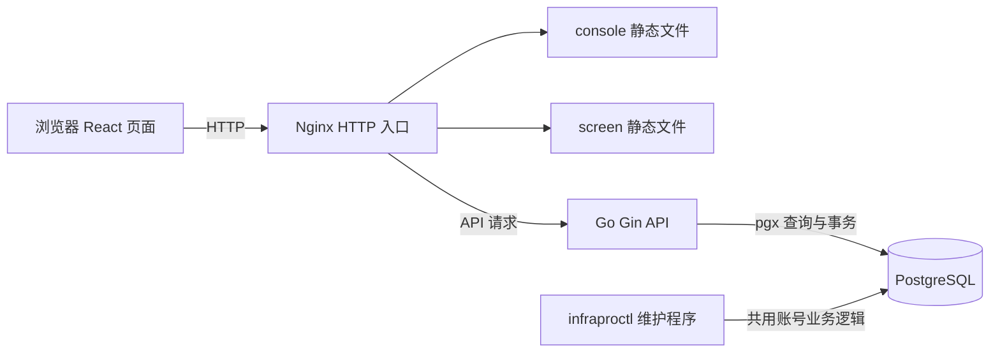

# 账号管理与登录认证方案

状态：方案待评审。日期：2026-11-09。

本功能建立从首次部署、邀请加入到日常登录、密码维护和账号恢复的完整流程，为后续业务提供统一的登录身份。本轮先完成需求和方案，评审后再开发；开发自验与用户手动验收分别记录。

## 已确认的业务边界

- 系统按单一组织设计。
- 用户名和密码登录，不开放自助注册。
- 后续账号必须通过邀请链接创建；所有已登录且状态正常的账号都能生成并复制邀请链接，由邀请人自行交付。
- 本轮所有账号具备相同的功能权限，不设置管理员、普通用户、超级管理员或角色配置。角色权限在后续需求中设计。
- 首个账号与后续受邀账号完全相同，只是创建途径不同。
- 忘记密码时，由部署维护人员核验身份后，通过服务器维护命令生成一次性密码重置链接，再交给本人设置新密码。
- 当前使用 HTTP，前端、API 和生成的邀请及重置链接均按 HTTP 配置；HTTPS 和证书配置不属于本轮交付。
- 密码长度最少 8 个、最多 128 个字符，首次初始化、邀请开户、修改密码和重置密码统一执行。

部署维护人员依靠服务器访问权限执行维护操作，不对应系统内的特殊账号角色。所有账号功能相同，但资料、密码、会话和邀请仍按所属账号隔离；不能借此修改其他人的资料或密码。

以下时限、格式、限额及账号停用方式属于建议设计，可在评审时调整。

## 功能清单

| 编号 | 功能 | 本轮行为 |
| --- | --- | --- |
| ACC-01 | 首个账号创建 | 新安装通过服务器交互式命令创建；完成后关闭初始化能力 |
| ACC-02 | 邀请创建 | 登录后生成单次有效链接，支持用途备注和复制 |
| ACC-03 | 邀请管理 | 查看自己的邀请，区分待使用、已使用、已过期和已撤销；支持撤销、重新生成 |
| ACC-04 | 接受邀请 | 校验链接，填写用户名、显示名称和密码，成功后进入登录页 |
| ACC-05 | 登录 | 用户名和密码验证、失败提示、尝试限流、登录后回到有效的站内目标页 |
| ACC-06 | 登录保护 | 受保护页面和接口统一检查身份；过期或失效后要求重新登录 |
| ACC-07 | 退出登录 | 退出当前会话；服务端立即撤销凭证，客户端清理个人状态 |
| ACC-08 | 个人资料 | 查看用户名、创建时间；修改显示名称；用户名首版创建后固定 |
| ACC-09 | 修改密码 | 验证当前密码后设置新密码，所有设备退出登录 |
| ACC-10 | 忘记密码 | 展示联系部署维护人员的途径；本人通过维护人员交付的链接重置密码 |
| ACC-11 | 会话管理 | 查看自己的有效会话、撤销某个会话、退出全部设备 |
| ACC-12 | 安全记录 | 查看自己的近期登录和安全变更记录；维护端可排查全量审计事件 |
| ACC-13 | 账号状态 | 支持正常、停用；停用与恢复暂由服务器维护命令操作 |
| ACC-14 | 异常恢复 | 处理重置链接失效、全部登录凭据丢失、服务重启和初始化中断 |
| ACC-15 | 运行保障 | HTTP 部署、持久化存储、配置校验、过期数据清理、操作审计和维护说明 |

本轮不提供管理其他账号的网页、角色权限配置、组织管理或业务数据授权规则。邮箱和短信登录、第三方登录、企业单点登录、通行密钥及多因素认证留待后续需求；账号永久删除、自助注销、头像上传和批量邀请也不纳入首版。停用保留账号与历史引用。

## 首个账号创建

“首次初始化”指全新安装且尚未完成账号初始化；日常服务重启、机器重启、账号被停用均不属于首次初始化。

计划提供服务器交互式初始化命令 `infraproctl account bootstrap`，流程如下：

1. 部署人员完成应用配置和数据库迁移，在服务器执行初始化命令。
2. 命令检查持久化的初始化标记，输入用户名、显示名称和密码，并再次确认密码。密码采用不回显输入，不放入命令参数、日志或配置文件。
3. 在一个数据库事务中锁定初始化记录，校验尚未初始化，创建首个正常账号，写入初始化完成时间和审计事件。
4. 提示创建成功；用户通过网页使用该用户名和密码正常登录。
5. 后续执行初始化命令均拒绝再次创建账号，服务重启不会清除初始化状态。

不设置默认账号或默认密码，不提供公开网页上的“抢先创建首个账号”入口。并发执行初始化只能有一次成功；事务提交前中断可重试，提交后即使终端未收到结果，也不会再次创建账号。

初始化判断不能只看当前账号数量。数据库连接、迁移或状态读取失败时应报错，不能把失败当作空数据库重新初始化。账号恢复使用独立维护流程，不重开初始化入口。

## 邀请与账号创建

### 邀请人操作

登录后进入“邀请管理”，输入可选备注，生成并复制邀请链接。建议默认有效期 24 小时，每条邀请只可创建一个账号。链接明文只在生成时展示，后续列表只显示状态及时间；需要再次交付时重新生成链接，旧链接随即失效。重新生成会保留旧记录并创建新的邀请，不覆盖历史；已使用的邀请不能再次用于开户，需要另建邀请。

复制功能在浏览器支持时调用 Clipboard API；普通 HTTP 地址上该能力可能不可用，页面必须同时提供可选中的只读链接文本与手动复制提示，不能将自动复制成功作为开户前提。该限制来自 [浏览器 Clipboard API 的安全上下文要求](https://developer.mozilla.org/en-US/docs/Web/API/Clipboard/writeText)。

每个人只能查看、撤销、重新生成自己创建的邀请。所有账号都具有这组能力，不设置邀请专员或管理员。建议每账号每分钟最多创建或重新生成 5 次，同时最多保留 20 条有效邀请；这是应用限额，部署时可配置。

创建和重新生成邀请需要最近 5 分钟内通过密码验证；超时则弹出密码确认。撤销邀请即时生效，并记入审计。

### 受邀人操作

1. 打开链接，页面校验邀请是否有效，展示有效期和账号创建表单。
2. 输入用户名、显示名称、密码及确认密码。显示名称可以使用中文，默认使用用户名。
3. 提交时，服务端重新检查邀请状态、有效期、邀请人状态和用户名唯一性。
4. 在一个事务中创建账号、保存密码摘要、消费邀请并记录审计。
5. 创建成功后跳转登录页，由受邀人使用自己设置的密码登录。

建议用户名为 3 至 32 位英文字母、数字、下划线或短横线，不区分大小写；持久化归一化唯一值，显示名称为 1 至 50 个字符。用户名首版不可修改，后续业务用稳定的账号 ID 关联数据，不用用户名作为外键。

### 必须处理的情况

| 情况 | 处理规则 |
| --- | --- |
| 链接已过期、撤销或使用 | 阻止创建，提示联系邀请人获取新链接，不暴露完整账号信息 |
| 用户名已占用 | 提示换一个用户名；只有持有效邀请时可以进行这项检查 |
| 浏览器重复提交 | 只创建一次，返回明确结果，不重复消费或生成额外账号 |
| 同一链接被多人同时提交 | 数据库事务保证只有一人成功 |
| 两条链接同时使用同一用户名 | 数据库唯一约束保证只有一个账号创建成功；失败方的邀请仍可使用 |
| 表单有误或创建失败 | 不消费邀请；修正后可继续提交 |
| 链接被聊天软件预览或被浏览器刷新 | GET 读取不消费邀请，仅最终提交成功才消费 |
| 已登录用户打开链接 | 提示当前登录身份，需退出当前会话后创建新账号，避免混用身份 |
| 邀请人停用或密码被重置 | 撤销其尚未使用的邀请；已经创建的受邀账号不级联停用 |

手工交付的邀请链接是创建账号的凭证。本轮不验证收件人的邮箱、手机或真实身份，持有链接的人可以认领；邀请备注不构成身份绑定。因此，该机制控制创建入口，但不保证一人一号。页面应明确提示保管链接，疑似泄露时立即撤销。

## 登录与会话

登录成功后，服务端生成新的随机会话凭证，不复用登录前的标识。浏览器通过会话 Cookie 携带凭证，服务端保存可撤销的会话记录；前端加载时查询当前账号状态。

- 所有业务页面和接口默认要求登录，登录、有效邀请相关操作、重置密码及必要健康检查采用明确的公开白名单。
- 后端统一校验登录状态，资料、会话和邀请接口进一步校验资源归属。前端按钮隐藏和路由跳转不能代替后端校验。
- 支持多设备同时登录。页面列出会话的浏览器、设备概况、创建时间、最近活动时间和访问 IP；这些信息用于辨认会话，不宣称能准确识别物理设备或定位。
- 建议空闲 2 小时或自登录起满 12 小时失效，以先到者为准。后台轮询不延长用户活动时间；首版不提供长期“记住我”。
- 登出撤销当前服务端会话并清除浏览器 Cookie；退出全部设备撤销该账号所有会话。
- 密码修改、密码重置、停用账号均撤销所有会话。页面在下一次请求时返回登录页；服务端撤销提交后的新请求必须立即被拒绝。
- 登录后的返回地址仅允许站内有效路径，不能借登录流程跳转到外部地址。
- 应用重启后继续按持久化会话及原到期时间判断，不因进程重启无限延长或恢复已撤销会话。数据库不可用时受保护接口失败关闭。

当前 HTTP 模式的会话 Cookie 命名为 `infrapro_session`，配置为 `HttpOnly=true`、`SameSite=Lax`、`Path=/`，不设置 `Domain`，并明确使用 `Secure=false`。不使用要求 HTTPS 的 `__Host-` 或 `__Secure-` 前缀，也不依赖 localhost 的特殊豁免；配置依据见 [浏览器 Cookie 属性说明](https://developer.mozilla.org/en-US/docs/Web/HTTP/Reference/Headers/Set-Cookie)。所有修改状态的浏览器请求仍执行 CSRF 和来源校验。

登录错误采用统一提示，避免区分“账号不存在”和“密码错误”。登录、邀请校验、密码验证、重置提交分别按账号或凭证及来源 IP 做限流，避免只靠 IP 误伤多人共用网络的情况。建议连续 5 次密码失败后短暂冷却，并随连续失败递增至最多 15 分钟；不永久锁死账号，限制参数在实施时结合测试确定。

## 密码修改与恢复

### 密码规则

密码长度按用户确定的规则执行：最少 8 个、最多 128 个字符。允许长口令、空格和 Unicode，禁止常见弱密码；不强制大小写、数字和符号拼凑，不要求无理由定期更换。不得静默截断或删除用户密码中的空格。允许密码管理器自动填充和粘贴，设置页显示规则并提供显示密码开关。

长度按 Unicode 码点计算，后端以 Go 的 `utf8.RuneCountInString` 为准，前端使用 `Array.from(value).length` 做同口径提示；不依赖 JavaScript 字符串的 UTF-16 长度或表单默认 `maxlength` 作为最终判断。8 与 128 的边界都包含在允许范围内；所有设置密码的入口共享同一后端规则。

密码使用成熟库的 Argon2id 加盐摘要，参数以目标部署环境基准测试确定，不低于选定安全基线。数据库、日志、审计、错误上报和接口响应均不包含明文密码；维护人员不能查看原密码。存储方式参考 [OWASP 密码存储指南](https://cheatsheetseries.owasp.org/cheatsheets/Password_Storage_Cheat_Sheet.html)。

### 已登录时修改密码

在账号安全页填写当前密码、新密码和确认密码。验证成功后更新摘要、撤销所有会话及未使用的密码重置凭证，记录安全事件，再要求使用新密码登录。新密码不能与当前密码相同；日常主动修改密码不影响已发出的有效邀请。

### 忘记密码

登录页保留“忘记密码”入口，展示部署时配置的维护联系方式和处理说明。由于本轮不绑定邮箱或手机，该页面不承诺自动验证身份或自动发送找回信息。

1. 用户联系部署维护人员，并提供用户名。
2. 维护人员依据组织实际掌握的人员信息核验身份，不能仅凭知道用户名就发放链接；核验方法由部署方明确。
3. 在服务器执行维护命令，指定目标账号并填写操作原因，生成有效期 30 分钟的一次性重置链接，通过可信渠道交给本人。
4. 新生成的链接替换此前未使用的重置链接；生成动作本身不修改密码、不退出设备、不停用账号。
5. 用户打开链接设置新密码。提交成功时，在同一事务中消费凭证、更新密码、撤销全部会话、撤销该账号未使用的邀请并写入审计。
6. 重置成功后返回登录页，不自动登录。

重置链接只能重置所绑定账号的密码，不能创建账号、修改用户名或恢复停用账号。过期、撤销或已消费的链接均不能重复使用；链接被预览不会提前消费。若怀疑账号已被接管，维护人员应先停用，再完成核验和密码重置，最后单独恢复账号。维护人员可为停用账号生成新的重置链接；重置成功后账号仍保持停用，避免在旧密码仍有效时提前恢复访问。

一次性凭证采用加密安全随机值，数据库仅保存摘要，并校验用途、目标账号、时限与消费状态。重置凭证的设计参考 [OWASP 密码找回指南](https://cheatsheetseries.owasp.org/cheatsheets/Forgot_Password_Cheat_Sheet.html)；30 分钟为本项目建议值。

## 账号状态与维护

账号状态仅设“正常”和“停用”。邀请尚未接受时只保留邀请记录，不提前创建可登录账号，避免把邀请状态和账号状态混用。

本轮建议由维护命令提供账号查找、停用、恢复和密码重置链接生成能力，且要求填写原因。停用后立即拒绝登录和业务请求，撤销会话、未用邀请及重置链接；恢复只恢复登录资格，不修改当前密码，也不恢复旧会话或旧链接。需要重置密码时单独执行恢复凭据流程。

常规停用命令阻止停用最后一个正常账号，检查与状态修改需在事务中完成。若唯一账号已确认失陷，需要维护人员显式选择应急停用，允许系统暂时没有可登录账号；后续通过受控恢复命令处理并完整审计，不能改用初始化重新创建账号。

本轮不物理删除账号，历史邀请和审计继续使用稳定账号 ID 引用。所有账号丢失密码时，仍通过服务器恢复流程处理；服务器访问权限本身丢失属于部署环境恢复，不由公开登录页绕过。

## 页面与入口

| 入口 | 内容 |
| --- | --- |
| 登录页 | 用户名、密码、显示密码、忘记密码、登录状态和错误提示；无开放注册入口 |
| 接受邀请页 | 有效邀请说明、用户名与密码表单、已失效状态和成功结果 |
| 忘记密码说明页 | 人工恢复方式和维护联系方式 |
| 重置密码页 | 重置凭证校验、新密码表单、失效与成功反馈 |
| 个人资料页 | 用户名、显示名称、创建时间、资料保存 |
| 账号安全页 | 修改密码、本人会话列表、退出其他或全部设备、近期安全记录 |
| 邀请管理页 | 创建并复制链接、本人邀请列表、撤销、重新生成及失效提示 |
| 登录后的基础首页 | 显示当前身份和以上入口，作为业务开发前的可验收页面 |
| 服务器维护命令 | 首次初始化、账号查找、密码恢复、停用与恢复，以及操作结果 |

表单提供提交中、防重复提交、字段级校验、键盘操作和可读错误信息。网络失败时保留非敏感填写内容，密码不写入本地持久化存储。失效链接和未登录页面均有明确的下一步提示。

## 实现结构

### 技术栈和具体用途

沿用现有 Go/Gin API 服务和 React、TypeScript、Vite 前端，在同一个 API 服务内实现账号业务。以下区分仓库已有能力与本方案拟新增能力；版本号来自当前工程声明，新增依赖在实施时检查兼容性并锁定到锁文件中。

| 层次 | 技术选择 | 当前情况 | 在账号功能中的具体用途与选择原因 |
| --- | --- | --- | --- |
| 前端页面 | React 19.3.1、TypeScript 5.9.3 | 已有 | 实现登录、邀请、个人资料及安全页面；使用类型约束表单、账号和会话数据，延续现有应用结构 |
| 前端构建 | Vite 8.3.6、Node.js 26.10.0、pnpm 12.18.0 | 已有 | 独立开发和构建 console、screen；开发代理把浏览器的同源 API 请求转到 Go 服务 |
| 页面路由 | React Router 声明式模式 | 拟新增 | 用 BrowserRouter、Routes 和受保护页面容器组织登录前后的页面；配置应用基础路径，支持刷新和站内回跳 |
| 页面状态与样式 | React Context、Hooks、现有共享 UI 和 CSS | 沿用并扩展 | Context 保存当前身份与加载状态；表单状态由 Hooks 管理；共享表单控件负责显示，不直接访问 API |
| 接口客户端 | 原生 Fetch、OpenAPI 3.1、openapi-typescript | 已有 | 在共享客户端增加账号方法、CSRF 请求头、统一错误处理；从同一份 OpenAPI 生成 TS 类型，检查前后端契约同步 |
| 后端服务 | Go 1.27.0、Gin 1.12.0 | 已有 | Gin 处理路由、请求校验和认证中间件；Go 业务层处理初始化、邀请、密码、会话和审计 |
| 数据库 | PostgreSQL | 拟新增 | 持久化账号、凭据、会话、邀请和审计；通过唯一约束、事务和行锁处理重复提交与并发 |
| 数据访问 | github.com/jackc/pgx/v5、pgxpool | 拟新增 | 建立连接池，执行参数化 SQL 和事务；SQL 集中放在账号模块的数据访问层，便于检查查询范围和锁定顺序 |
| 表结构迁移 | github.com/pressly/goose/v3、Go embed、pgx stdlib 适配 | 拟新增 | 编号 SQL 管理表结构版本；迁移文件随维护程序构建，使用单独维护命令执行迁移 |
| 密码处理 | golang.org/x/crypto/argon2、crypto/rand、crypto/subtle | x/crypto 当前为间接依赖，拟直接使用 | 使用 Argon2id 计算密码摘要，随机生成每个密码的盐，并进行恒定时间摘要比较；算法版本和参数随摘要保存 |
| 会话和一次性链接 | Go crypto/rand、crypto/sha256、encoding/base64，配合 PostgreSQL | 拟实现 | 生成 32 字节随机凭证，编码后交给浏览器或用户；数据库只保存摘要，支持立即撤销与单次消费 |
| CSRF 防护 | github.com/gorilla/csrf，加完整 Origin 白名单校验 | 拟新增 | 包裹 Gin 的 HTTP Handler；给前端发放 CSRF token，验证有副作用的请求，按当前 HTTP 模式配置 |
| 维护程序 | Go flag、golang.org/x/term、同一账号业务包 | 拟新增 | 构建 infraproctl 命令；无回显读取初始化密码，执行迁移、初始化、重置链接生成和账号状态维护 |
| 配置与日志 | YAML、环境变量、Go log/slog、现有 foundation 包 | 沿用并扩展 | 统一加载进程和账号配置，输出结构化日志及请求 ID；账号审计另存数据库，日志过滤敏感字段 |
| HTTP 部署 | Nginx；Docker Compose 提供可复现的服务编排 | 拟新增 | Nginx 提供两个前端的静态文件并代理 API；Compose 编排数据库及完整 HTTP 验收环境，持久化数据库数据 |
| 验证工具 | Go testing、httptest、race 检查、Playwright、ESLint、TypeScript | 已有，扩展用例 | 验证业务规则、真实数据库事务、Cookie/CSRF、浏览器完整流程、HTTP 部署和接口契约 |

React Router 的接入采用其 [声明式路由方式](https://reactrouter.com/start/declarative/installation)，保持现有 Vite 应用结构。[pgxpool](https://pkg.go.dev/github.com/jackc/pgx/v5/pgxpool) 提供连接池和事务；[Goose Provider](https://pressly.github.io/goose/documentation/provider/) 通过 `database/sql` 连接运行迁移，因此迁移命令使用 pgx 的 stdlib 适配，日常业务使用 pgxpool。

### HTTP 部署和浏览器行为

计划部署链路如下，浏览器与入口之间以及入口到 API 均使用 HTTP：

部署时使用同一个主机的 `/console/`、`/screen/`、`/api/v1/` 路径。两个前端设置匹配的 Vite base 和 BrowserRouter basename；Nginx 为各自前端配置页面路由回退，API 的 401、404 或 503 保持 JSON 响应，不回退为前端 HTML。Nginx 的 HTTP 转发使用其 [proxy_pass 能力](https://nginx.org/en/docs/http/ngx_http_proxy_module.html#proxy_pass)。

开发时保留 console 5173、screen 5174 和 API 8080 端口，两端通过已有 `/api` 代理访问后端。两个浏览器入口统一使用相同主机名，避免混用 localhost 和 127.0.0.1。Cookie 按主机及路径生效，不按端口隔离；这两个应用在此方案中属于同一可信系统，使用同一会话，退出当前会话会同时影响该浏览器里的两个入口。

HTTP 配置明确关闭 Cookie 的 Secure 属性，不添加 HSTS、强制 HTTPS 重定向或要求升级协议的 CSP 指令。保留 HttpOnly、SameSite、CSRF 校验、凭证撤销和日志脱敏。HTTP 不提供传输加密，数据库密码摘要与这些应用层控制不能保护传输中的密码和 Cookie；这是本轮按 HTTP 交付的已知限制。

登录页、账号页和涉及凭证的响应使用禁止缓存策略。邀请和重置链接以可信的控制台 HTTP 地址生成，随机凭证放在 URL fragment；前端读取后立即清除地址栏中的凭证，仅在内存中保留，并通过 POST 请求体提交。页面刷新导致内存凭证丢失时，提示重新打开原链接；刷新本身不消费凭证。涉及凭证的页面禁止 Referer 外传，不加载第三方分析脚本，API 及代理不记录含凭证的请求体。

### 代码组织和调用边界

具体落点遵循现有 [工程目录和依赖边界](../architecture.md)。以下为计划新增或扩展的位置，不表示这些功能已经存在：

| 位置 | 实现内容 |
| --- | --- |
| `services/api/internal/modules/identity/` | 账号业务模块；包含 handler、service、repository，以及密码、会话、邀请、恢复和审计实现 |
| `services/api/internal/transport/http/` | 绑定 API 路由；统一请求 ID、Origin/CSRF 校验、身份读取和错误映射 |
| `services/api/internal/bootstrap/` | 装配配置、数据库连接池、账号业务和 HTTP 服务；关闭时释放连接与后台清理任务 |
| `services/api/internal/config/` | 服务私有的数据库、账号、站点及维护配置，组合现有基础配置；账号规则不放入通用 foundation 包 |
| `services/api/cmd/infraproctl/` | 命令行入口；直接调用同一业务层，避免与 HTTP 接口形成两套密码或状态规则 |
| `services/api/migrations/` | 账号表及索引 SQL、Go embed 入口、迁移版本 |
| `apps/console/src/features/account/` 和 `pages/` | 登录、邀请、个人资料、安全中心及对应页面装配 |
| `apps/screen/src/app/` 和认证入口 | 接入共享账号状态、登录页和退出逻辑，资料及邀请管理导航至 console |
| `packages/ts/api-client/` | 账号 API 方法、生成类型及可选 React 身份状态适配；业务请求与页面样式分离 |
| `packages/ts/ui/` | 复用输入框、密码框、提交状态和错误提示等展示组件 |
| `contracts/openapi/api.yaml` | 所有账号接口、请求响应、Cookie 认证方式和错误结构的契约源 |
| `deploy/nginx/`、`deploy/compose/` | HTTP 路由、静态文件托管、数据库持久化和验收编排 |
| `tests/e2e/` 和模块内 Go 测试 | 浏览器流程、数据库一致性、接口归属和异常场景 |

HTTP Handler 负责读取与验证请求并映射响应；Service 负责业务规则和事务边界；Repository 负责参数化 SQL、行锁与数据转换。前端与维护程序复用同一业务规则。密码摘要、随机凭证与数据库细节封装在账号模块中，后续业务只获取当前账号 ID 和正常/停用状态。

### 数据表和一致性规则

建议采用以下表。账号使用稳定 UUID，时间统一保存为 UTC `timestamptz`；表中不增加角色、管理员或组织隔离字段。

| 表 | 主要数据 | 必须保证的约束 |
| --- | --- | --- |
| `accounts` | ID、用户名、归一化用户名、显示名称、状态、认证版本、创建和更新时间 | 归一化用户名唯一；状态限定正常或停用；账号 ID 不随资料改变 |
| `account_passwords` | 账号 ID、带参数及盐的密码摘要、修改时间 | 每个账号一条密码凭据；不保存明文密码 |
| `account_sessions` | 会话摘要、账号 ID、认证版本、创建时间、最近用户活动、绝对到期时间、撤销时间、最近密码复验时间、设备概况 | 会话摘要唯一；每次鉴权检查到期、撤销、账号状态和认证版本 |
| `account_invitations` | 邀请 ID、邀请人、凭证摘要、备注、到期时间、使用时间、撤销时间、受邀账号 ID | 每条邀请最多关联一个成功创建的账号；已过期由到期时间判定 |
| `account_password_resets` | 重置凭证摘要、目标账号、发放原因、到期、消费和撤销时间 | 同一账号最多一条未消费且未撤销的重置记录，发新链接前撤销旧记录 |
| `system_initialization` | 固定单行 ID、初始化完成时间、首个账号 ID | 迁移时建立单行记录；初始化事务锁定该行，完成状态不可由常规业务清除 |
| `account_security_events` | 事件 ID、类型、执行主体、目标对象、时间、结果、来源和请求 ID | 业务界面只追加与读取；用户查询必须限定本人可见范围 |
| `account_rate_limits` | 限流范围、键摘要、窗口、尝试次数、冷却截止时间 | 使用数据库原子更新；多进程和重启共享计数，到期记录可清理 |

创建首个账号、消费邀请、改密/重置、停用账号均在 PostgreSQL 事务中完成对应写入及审计。用户名竞争交给唯一约束处理，同一邀请竞争使用行锁和条件更新保证只成功一次。事务失败必须回滚，并发锁定顺序保持一致，避免邀请与账号停用相互死锁。

密码修改、密码重置或停用时递增账号认证版本，撤销旧会话；鉴权查询关联账号当前版本，避免只依赖旧 Cookie 或进程内缓存。登录验证密码后，在发放会话前重新核对账号状态和凭据版本，防止密码刚被重置却仍发出基于旧密码的会话。到期校验在请求时执行，定时清理只负责回收空间。

账号、IP、邀请凭证等不同限流范围分别保存计数。不存在账号的登录尝试也进入限流，并采用等价的摘要验证路径，避免快速返回暴露账号是否存在。数据库不可用时，认证及账号修改接口返回不可用，不能绕过身份检查。

### 登录与密码的实现步骤

1. 页面加载时由共享客户端获取公开密码规则与 CSRF token，再调用当前账号接口。React 身份状态区分加载中、已登录、未登录和服务暂不可用；网络错误或 503 不直接解释成退出登录。
2. 登录表单通过 Fetch 提交用户名、密码和 `X-CSRF-Token`。请求使用当前应用的同源 `/api/v1` 地址和 `credentials: same-origin`。
3. Gin 入口先检查来源、CSRF 和限流；业务层查询归一化用户名，使用 `argon2.IDKey` 验证密码并检查账号状态。
4. 验证成功后生成 32 字节随机会话凭证，计算 SHA-256 摘要存入会话表；事务提交后，通过 HttpOnly Cookie 返回随机凭证，并返回账号基本资料。
5. 后续请求由认证中间件计算 Cookie 摘要，查询会话和账号；有效时将账号 ID 放入请求上下文，资料、会话和邀请操作再检查对象所属账号。
6. 浏览器检测实际用户操作并限频发送活动请求，后端仅对仍有效的会话更新最近用户活动时间；后台健康检查与轮询不刷新空闲时限，绝对到期时间不延长。
7. 修改密码、重置密码和登出按上文规则撤销会话。前端收到身份失效响应后清除当前用户状态，重新进入登录流程。

密码摘要使用 Go 官方扩展包的 [Argon2id 实现](https://pkg.go.dev/golang.org/x/crypto/argon2)，保存算法标识、参数、随机盐和摘要，支持后续参数升级。短而可猜的密码采用慢摘要；32 字节高熵随机凭证使用 SHA-256 摘要，两者用途不同。弱密码校验使用随服务提供的本地规则或列表，不把用户密码发送到外部服务。

### CSRF 与 HTTP 的接入方式

`gorilla/csrf` 作为 `net/http` 中间件包裹 Gin Handler，设置固定的服务器认证密钥、Cookie 路径与 `Secure(false)`。按 [gorilla/csrf 的 HTTP 模式接口](https://pkg.go.dev/github.com/gorilla/csrf#PlaintextHTTPRequest) 在进入该中间件前标记明文 HTTP 请求，避免把 HTTP 的 Referer 当作 HTTPS 请求处理；该标记由服务配置设置，不接受客户端自行指定。

公开的 GET CSRF 接口返回页面可用的 token；登录、邀请接受、密码重置以及已登录写操作都通过 `X-CSRF-Token` 提交。服务端另外核对完整 Origin 的协议、主机和端口，只接受配置中的应用地址，拒绝缺失或不匹配的来源；同一配置按库要求映射到 `csrf.TrustedOrigins`，确保开发代理改变后端 Host 后合法请求仍可通过库内检查。登录前的表单同样受校验，不能通过跳过来源检查来解决代理问题。

CSRF 认证密钥通过服务器配置持久化，多个 API 进程保持一致；CSRF Cookie 同样按 HTTP 模式关闭 Secure。客户端遇到 CSRF 过期时刷新 token 并提示重新提交，不自动重复可能已经成功的开户或改密操作。

### 接口设计

以下为计划契约，前缀统一为 `/api/v1`。所有 POST、PATCH、DELETE 浏览器请求均经过来源和 CSRF 校验；“公开”仅表示无需登录，并不表示可绕过一次性凭证验证。

| 方法与路径 | 调用条件 | 用途 |
| --- | --- | --- |
| `GET /public/account-help` | 公开 | 返回维护联系方式和用户名、密码公开规则 |
| `GET /auth/csrf` | 公开 | 获取 CSRF token |
| `POST /auth/login` | 公开，需限流 | 验证用户名和密码，发放会话 Cookie |
| `GET /auth/me` | 已登录 | 获取当前账号基本资料 |
| `POST /auth/reauthenticate` | 已登录 | 验证当前密码，更新近期复验时间 |
| `POST /auth/logout` | 当前会话，允许幂等清理已失效 Cookie | 撤销当前会话并清除 Cookie |
| `POST /auth/logout-all` | 已登录 | 撤销本人所有会话 |
| `POST /auth/activity` | 已登录且会话未过期，需限频 | 记录用户活动，不延长绝对期限 |
| `PATCH /account/profile` | 已登录 | 修改自己的显示名称 |
| `POST /account/password` | 已登录，需当前密码 | 修改密码并退出全部设备 |
| `GET /account/sessions` | 已登录 | 列出本人会话 |
| `DELETE /account/sessions/{id}` | 已登录且拥有目标会话 | 撤销指定会话 |
| `GET /account/security-events` | 已登录 | 分页查看本人安全记录 |
| `GET /invitations` | 已登录 | 分页查看本人创建的邀请 |
| `POST /invitations` | 已登录且近期密码复验通过 | 生成一次性邀请链接 |
| `POST /invitations/{id}/revoke` | 已登录且拥有邀请 | 撤销邀请 |
| `POST /invitations/{id}/regenerate` | 已登录、拥有邀请且近期复验通过 | 撤销旧邀请并创建新邀请 |
| `POST /public/invitations/inspect` | 有邀请凭证，需限流 | 只校验状态，不消费邀请 |
| `POST /public/invitations/accept` | 有效邀请、未登录 | 创建账号并消费邀请 |
| `POST /public/password-resets/inspect` | 有重置凭证，需限流 | 只校验状态，不消费凭证 |
| `POST /public/password-resets/complete` | 有效重置凭证 | 设置新密码、消费凭证并撤销旧访问能力 |

首个账号创建、重置链接发放和其他账号停用只在维护程序提供。用户输入不能指定当前操作账号 ID 或额外权限；需要本人身份的接口从会话读取账号 ID。错误响应统一包含稳定业务错误码、可读信息和请求 ID，必要时附字段错误；客户端分别处理未登录、校验失败、链接失效、用户名冲突、限流和服务不可用。

### 维护命令和迁移

计划构建 `infraproctl`，以下是将要实现的命令界面，当前方案阶段尚不可执行：

| 命令 | 使用的技术与行为 |
| --- | --- |
| `infraproctl database migrate` | Goose Provider 读取嵌入的 SQL，使用 pgx stdlib 连接数据库，应用未执行的迁移并记录版本 |
| `infraproctl account bootstrap` | 使用 x/term 无回显读取密码；锁定初始化记录，原子创建首个账号 |
| `infraproctl account find` | 按用户名查找账号状态，输出必要维护信息 |
| `infraproctl account reset-link` | 指定账号与原因，撤销旧凭证，生成 HTTP 重置链接并仅在受控终端展示 |
| `infraproctl account disable` | 填写原因，停用目标账号并撤销访问能力；显式应急选项处理最后账号失陷 |
| `infraproctl account enable` | 填写原因，恢复登录资格，不恢复已撤销的凭证 |

迁移 Provider 显式配置 PostgreSQL session locker，保证并发执行只由一个迁移进程推进；正常 API 启动只检查数据库和迁移版本，不自动执行破坏性回退。维护程序与 API 使用相同配置和业务包，密码通过 [x/term.ReadPassword](https://pkg.go.dev/golang.org/x/term#ReadPassword) 输入，避免进入命令参数或 Shell 历史。

## 运行配置与审计

配置沿用默认值、YAML、环境变量依次覆盖的规则。通用日志与进程配置复用 foundation，账号服务私有配置在 API 服务中组合加载。计划补充以下关键配置：

| 配置 | 用途 |
| --- | --- |
| `INFRAPRO_DATABASE_URL` | PostgreSQL 连接；API、迁移和维护程序使用同一目标数据库 |
| `INFRAPRO_PUBLIC_CONSOLE_URL` | 完整的控制台 HTTP 基础地址，用于生成邀请和重置链接，包含部署路径 |
| `INFRAPRO_PUBLIC_SCREEN_URL` | 展示端 HTTP 基础地址，用于受控的跨应用导航 |
| `INFRAPRO_TRUSTED_ORIGINS` | 允许的浏览器 Origin 完整列表，包含协议与端口；开发与部署分别配置 |
| `INFRAPRO_CSRF_AUTH_KEY` | 服务器端持久化的 CSRF 认证密钥，不进入 VITE 配置或前端构建产物 |
| `INFRAPRO_COOKIE_SECURE` | 当前明确为 false；会话与 CSRF Cookie 保持相同 HTTP 配置 |
| `INFRAPRO_SESSION_IDLE_TIMEOUT` | 会话空闲时限，建议 2 小时 |
| `INFRAPRO_SESSION_ABSOLUTE_TIMEOUT` | 会话绝对时限，建议 12 小时 |
| `INFRAPRO_INVITATION_TTL` | 邀请有效期，建议 24 小时 |
| `INFRAPRO_PASSWORD_RESET_TTL` | 重置有效期，建议 30 分钟 |
| `INFRAPRO_SUPPORT_CONTACT` | 忘记密码页面展示的实际维护联系方式 |

密码 8 至 128 字符作为本轮统一产品规则在账号模块定义，公开规则接口供前端读取。限流参数和审计保留期也纳入服务配置。关键配置缺失、迁移版本不匹配或数据库不可用时，服务明确报告不可用，不能跳过身份检查。

保留现有进程存活检查，新增数据库与迁移状态的就绪检查。Compose 为 PostgreSQL 配置持久化卷，并提供独立的测试数据库连接；开发或测试脚本不能通过删除正式数据来重置环境。过期会话、凭证与限流记录由可取消的 Go 定时任务分批清理，退出时随进程优雅停止，多个进程重复清理也不改变业务结果。

审计记录登录成功与失败、退出、密码修改与重置、邀请创建与消费、邀请撤销、账号停用与恢复、首次初始化。记录事件类型、执行主体、目标账号或对象、时间、结果及必要来源信息，避免记录秘密。用户只看自己的安全记录，维护人员通过受控工具排查全局记录。

建议安全事件保留 90 天并定期清理过期会话和凭证；具体保留期由部署需求调整。备份与恢复说明需覆盖账号、初始化状态和审计。恢复旧备份后应统一撤销会话与未使用的一次性凭证，避免恢复出曾经有效但已经失效的访问能力。

## 实施顺序

| 迭代 | 可独立验收的结果 | 主要工作 |
| --- | --- | --- |
| 第一小步 | 全新环境可创建首个账号并通过 HTTP 登录退出 | 接入 PostgreSQL、pgx 和 Goose；建立表结构；实现维护程序初始化、Argon2id、Cookie/CSRF、接口保护、基础审计与限流；接入两个前端的路由和身份状态 |
| 第二小步 | 现有账号可邀请他人加入，双方维护各自账号 | 在同一业务模块实现邀请原子消费、本人邀请管理、资料修改和密码修改；完善 OpenAPI 与客户端；验证 8 至 128 字符规则及 HTTP 手动复制 |
| 第三小步 | 账号可恢复、会话可管理，HTTP 部署可验收 | 实现重置凭证、会话列表、安全记录、停用恢复命令、过期清理；交付 Nginx/Compose、配置与维护说明；完成数据库并发和浏览器验收 |

安全约束随所属功能一起实现。每个小步开发后完成相关自验，再标为“待用户验收”；只有用户明确验收通过，才能标为“已验收”。这一整项功能在三个小步和完整验收均通过后完成。

每个小步先更新 OpenAPI 和需要的迁移，再实现 Go 业务与接口，随后接入共享客户端及 React 页面。Go 单元测试验证密码、到期和状态规则；httptest 验证来源、CSRF、身份和对象归属；独立 PostgreSQL 测试环境验证真实事务及竞争；Playwright 覆盖页面完整流程和两个应用的共享会话。测试数据库使用明确的专用连接和独立测试数据，不能仅用 mock 证明单次消费或唯一性。

交付时执行现有检查、构建、Go 测试、OpenAPI 同步检查及相关浏览器测试，并增加 HTTP 部署验收。这里只修改方案，不将这些计划检查记录为已经通过。

## 手动验收标准

实际开发交付时提供可运行的启动命令、访问地址和维护命令。本方案阶段不提供尚不存在的可执行命令。

| 编号 | 操作 | 预期结果 |
| --- | --- | --- |
| AT-01 | 全新环境运行初始化并创建账号 A | A 可正常登录，具备与受邀账号一致的功能 |
| AT-02 | 重启系统并再次初始化 | 保留账号和初始化状态，拒绝重复创建 |
| AT-03 | 不登录直接访问业务页面和接口 | 页面要求登录，接口拒绝访问；无开放注册入口 |
| AT-04 | A 创建邀请，由未登录浏览器使用链接创建 B | B 可设置自己的密码并登录，A 无法查看该密码 |
| AT-05 | B 创建邀请并创建 C | B 与 A 一样具备邀请能力，没有首个账号特权 |
| AT-06 | A 与 B 分别查看个人资料、会话和邀请 | 只显示并允许操作各自的数据；修改请求中的账号或对象 ID 也不能越权 |
| AT-07 | 预览邀请、刷新页面，再正常提交 | 读取不消费凭证，仅成功创建时消费 |
| AT-08 | 重复使用、撤销后使用、过期后使用邀请 | 均无法创建额外账号，并展示下一步处理提示 |
| AT-09 | 重新生成邀请链接 | 旧链接立即失效，新链接可用 |
| AT-10 | 使用已占用用户名或弱密码创建账号 | 提示错误且不消费邀请，修正后可重试 |
| AT-11 | 输入错误密码、连续尝试登录 | 提示不泄露账号是否存在；达到阈值后限制尝试，可在冷却后重试 |
| AT-12 | 登录、刷新页面并访问站内目标页 | 身份正确恢复，返回地址不能跳到外部站点 |
| AT-13 | 在两种浏览器登录后退出其中一个 | 当前会话立即失效，另一会话仍可正常使用 |
| AT-14 | 查看本人会话，撤销指定会话并退出全部设备 | 被撤销会话后续请求被拒绝，全部退出后需重新登录 |
| AT-15 | 修改显示名称和密码 | 显示名称更新；旧密码失效，所有设备退出，新密码可登录 |
| AT-16 | 打开忘记密码入口 | 展示实际配置的维护联系方式，不伪装成自动找回 |
| AT-17 | 维护人员生成重置链接，由本人设置新密码 | 原密码、原会话和未用邀请失效；新密码正常登录 |
| AT-18 | 重复使用、过期使用或生成新链接后使用旧重置链接 | 全部被拒绝；正常生成链接本身不影响当前登录 |
| AT-19 | 停用 B，再尝试登录、使用旧会话或其未用邀请 | 全部被拒绝；恢复后不复活旧会话和链接 |
| AT-20 | 常规停用最后一个正常账号 | 操作被拒绝并说明需要应急流程 |
| AT-21 | 验证会话空闲与绝对时限 | 到期后要求登录，后台轮询不能无限保活 |
| AT-22 | 查看本人的安全记录并由维护端检查审计 | 关键事件可追踪；本人不能读取他人的安全记录 |
| AT-23 | 为停用账号生成新重置链接并完成重置 | 密码更新但账号仍不能登录，单独恢复后才可用新密码登录 |
| AT-24 | 在初始化、开户、修改与重置入口分别输入 7、8、128、129 个字符的密码 | 满足其他规则的 8 与 128 字符密码可用，7 与 129 字符被拒绝；中英文和补充平面字符计数一致，密码不被截断 |
| AT-25 | 通过实际的普通 HTTP 地址完成登录、邀请和重置，检查浏览器 Cookie | 不依赖证书或 HTTPS 跳转；会话 Cookie 无 Secure 属性，HttpOnly、SameSite 和作用域符合方案；普通 HTTP 主机也可用 |
| AT-26 | 在 Clipboard API 不可用的 HTTP 页面生成邀请 | 可以选中并手动复制完整链接，未自动复制时不错误提示复制成功 |
| AT-27 | 同一浏览器分别打开控制台与展示端，登录后再退出当前会话 | 两端读取同一账号；退出后另一入口后续请求被拒绝；其他浏览器会话不受当前退出影响 |
| AT-28 | 在 HTTP 部署中直接打开并刷新登录、个人资料和邀请页面 | 前端深层路径正常加载，静态资源路径正确；API 错误不会返回前端 HTML |

并发初始化、并发消费同一邀请、同名账号竞争、重置重复提交、数据库故障、凭证摘要存储、日志脱敏、CSRF 和接口归属校验主要通过自动化或维护侧专项检查验证。开发交付时列明实际通过项与未验证项，并说明目标部署环境是否已验证。

## 方案评审重点

已确认的业务边界包括账号平等、用户名登录、全员可邀请、维护人员处理找回，以及当前使用 HTTP、密码长度 8 至 128 字符。需要评审的具体建议是：服务器交互式创建首个账号；首版用户名固定；24 小时单次邀请；30 分钟重置链接；2 小时空闲与 12 小时绝对会话时限；账号停用和恢复由服务器维护入口处理。

本版技术提案明确为现有 React/Vite 与 Go/Gin，加 React Router、PostgreSQL、pgx、Goose、Argon2id、gorilla/csrf、维护 CLI 和 Nginx HTTP 部署。进入开发时按表中用途补充并锁定依赖；部署到实际环境前配置 HTTP 站点地址、数据库连接和维护联系方式，并明确人工核验身份的办法。
