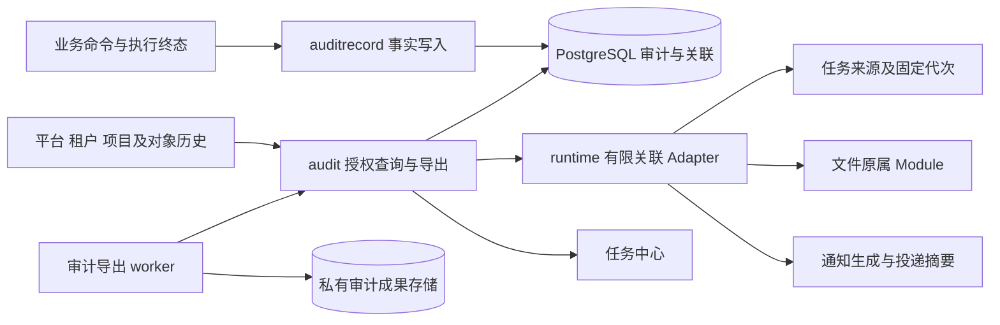

# 审计与操作追踪详细开发方案

日期：2026-11-14。版本：V1.0。状态：**Awaiting acceptance（全部开发及 70/70 项软件自验通过，待人工验收）**。实际执行证据见[70 项自验账本](../verification/audit-and-operation-tracing.md)，人工接受单独记录。

本轮将已有审计记录深化为跨模块的操作追踪能力：有权人员可以查清谁在什么空间对什么对象做了什么、改变了什么、结果如何，并定位关联任务的执行代次、结果文件和通知投递状态。业务 Module 继续拥有业务事实、授权和执行；审计负责记录事实、提供获准的历史投影与关联入口。

本方案以当前 checkout/main 的代码为衔接基线。任务中心和文件与附件的[任务自验记录](../verification/task-center.md)、[文件自验记录](../verification/files-and-attachments.md)均标记为自验通过、待人工验收；文件的实际接入契约见[文件接入约定](../development/files-and-attachments-integration.md)。下文保留实施前的改造要求，当前实现契约见[审计接入指南](../development/audit-integration.md)与[事件目录](../development/audit-event-catalog.md)，运行及人工核对见[验收手册](../operations/audit-and-operation-tracing-acceptance.md)。实施未创建分支或 worktree，其他在途改动保留。

## 1 交付范围

| 编号 | 必须交付 | 完成后的可见行为 |
| --- | --- | --- |
| AU-01 | 统一审计事实规范与来源登记 | 操作者、发起人、代办人员、后台身份、空间、对象、动作、原因、结果和时间含义一致。 |
| AU-02 | 关键业务操作完整接入 | 账号授权、租户项目、资源授权、已有数据处理与成果、空间、大屏、任务控制、文件变更和敏感下载均有覆盖清单。 |
| AU-03 | 操作及跨模块关联追踪 | 原始操作、任务固定代次、输入输出文件、通知生成与当前投递状态可以按权限关联查看。 |
| AU-04 | 查询、变更展示和对象历史 | 平台、租户、项目复用查询与详情；按人员、对象、动作、结果、时间、关联标识筛选，业务详情有历史入口。 |
| AU-05 | 失败、拒绝和冲突解释 | 区分已接受、执行成功、失败、拒绝、冲突、取消和重试；给出可确定的原因及排障编号。 |
| AU-06 | 受控 CSV 导出 | 按固定筛选和当前权限生成有期限的文件，进入任务中心；字段脱敏、下载复核、导出自身留痕。 |
| AU-07 | 事实可靠性与生命周期 | 关键变更和审计原子提交，事实幂等；保留、清理、恢复可核对，历史缺失不补造。 |
| AU-08 | 迁移、契约、运行和验收材料 | 增量迁移、权限升级、真实页面、合成样本、接入规范、运行恢复及逐项验收证据齐备。 |

沿用[平台基础能力方向](platform-foundation-deepening-proposal.md)。本轮不增加设备接入、数据解析、监测告警、正式报告或专业算法；不建设全文日志平台、APM、性能追踪、运维告警、新权限引擎、风险评分、异常行为检测、审批待办或工单。审计页不回滚或重放业务，不允许任意编辑、删除历史。不接第三方审计平台，不交付电子签章、司法存证、WORM 或合规认证。

不保存密码、令牌、访问凭证、原始文件正文、原始监测数据；不逐条记录采样、轮询、心跳、普通页面浏览。只补齐已有业务的记录和衔接，不借接入审计扩展其业务范围。

## 2 当前代码基线与必须改造的缺口

| 当前入口 | 已有事实 | 本轮改造 |
| --- | --- | --- |
| [access/catalog_sync.go](../../packages/go/platform/access/catalog_sync.go) 的 `Audit` | 向 `account_security_events` 写入 before/after，结果固定 success；部分任务命令经事务设置附加关联。 | 转接类型化事实写入，显式结果及阶段；移除对 monitoring/spatial/display 元数据表的联合查询和不安全类型断言。 |
| [identity/repository.go](../../packages/go/platform/identity/repository.go) 的 `audit` | 身份事件独立写同一表，可记录登录失败和限流。 | 共用低依赖写入契约，保留本人安全摘要的独立权限。 |
| [access/audit.go](../../packages/go/platform/access/audit.go) | 平台按时间分页，已有名称快照／当前名称来源与筛选；范围依赖对象排除表。 | 采用有限可见性登记，补齐详情、关联、授权后筛选和导出；新模块不得遗漏于排除表而泄漏。 |
| [tenancy/queries.go](../../packages/go/platform/tenancy/queries.go)、[projects/queries.go](../../packages/go/platform/projects/queries.go) | 租户事件白名单、项目限定空间，各自分页与 DTO；租户对平台启停提供有限公开投影。 | 使用统一 Reader 和授权投影，保留平台内部原因与租户公开说明的隔离。 |
| [identity/repository_maintenance.go](../../packages/go/platform/identity/repository_maintenance.go) | `Cleanup` 按 `audit_retention` 删除 `project_id IS NULL` 的记录；默认配置 2160h，项目记录不在该删除条件内。 | 停止旧路径直接删除审计；由专用候选计划执行保留策略，禁止无意将 90 天规则扩大到项目。 |
| [tasks/commands.go](../../packages/go/platform/tasks/commands.go) | cancel/retry、命令 ID、预期代次与修订；`SetCommandTx` 保存 task_audit 上下文。 | 显式传递事实关联，保持原业务记录唯一性；区分控制命令和实际执行终态。 |
| [taskrecord/contract.go](../../packages/go/platform/taskrecord/contract.go)、[00037_task_records.sql](../../packages/go/platform/migrations/00037_task_records.sql) | 有来源三元组、generation、attempt、fence；当前任务范围只有 tenant/project，tenant_id 非空。 | 注册 audit.export，并有限扩展 platform 范围；保留旧任务协议、指纹和固定代次语义。 |
| [files/reads.go](../../packages/go/platform/files/reads.go)、[files/service.go](../../packages/go/platform/files/service.go) | 普通附件具备逐块授权和读取租约，文件变更写审计；读取关闭持久化错误目前不能当作已可靠记录。 | 补充开始／结束事实和中断核对；普通附件仍仅属于两个已登记宿主。 |
| [公共文件类型](../../packages/ts/ui/src/patterns/files/model.ts)、[DomainFiles](../../apps/console/src/features/files/domain-files.tsx) | 专业文件 descriptor 与动作由原 Module 提供；公共 UI 无下载授权，现有 Scope 没有 platform。 | 添加有限 audit.export 引用及平台范围分支；不把平台范围加入普通附件类型。 |
| [notificationevent/event.go](../../packages/go/platform/notificationevent/event.go)、[runtime/notifications.go](../../packages/go/platform/runtime/notifications.go) | `AppendTx` 返回事件 ID；通知有来源键、固定任务引用，查询按当前资格裁剪。 | 同事务关联通知事件 ID；增加审计导出目标和受控投递摘要读取，不复制私人通知正文。 |
| [display/task_handoff.go](../../packages/go/platform/display/task_handoff.go) | 受限包处理进程通过域内交接接入公共任务。 | 审计同样走受限交接，不扩大包处理进程的公共表或业务正文读取权限。 |
| [access/authorizer.go](../../packages/go/platform/access/authorizer.go) | `Transact` 在提交前 `taskrecord.FlushTx`，授权锁和事务有界。 | 关键业务事实、审计与关联同事务；长 IO 不进入事务；失败记录在原事务结束后单独处理。 |

平台、租户、项目现有审计页面分别位于 `features/access/audit-*`、`features/tenancy/audit-*`、`features/projects/pages.tsx`。项目页目前直接展示 details JSON，需要改为统一的获准字段展示。当前 `infrapro account audit` 是本地维护入口，不能当作人员平台审计授权的替代品。

## 3 Module 划分与技术

新增两个 Module：`auditrecord` 管理持久事实写入及有限来源规范；`audit` 管理人员查询、授权投影、关联解释与审计导出。它们的 Interface 是调用者与测试共同使用的入口，具体业务 Module 无需知道审计 SQL、CSV 编码、投影裁剪和分页实现。



依赖方向为 `auditrecord → pgx/标准库`、`access/identity/业务 → auditrecord`、`audit → access/auditrecord/taskrecord/notificationevent`。`auditrecord` 不导入 access、tasks、通知收件箱或业务 Module。`runtime` 安装来源 Adapter，防止 access 与 audit 相互导入。审计查询仅用元数据；停止对象存储、ClickHouse、文件 checker 或通知 worker 不应使审计列表无法启动。

runtime 先组装现有业务元数据 Module，再安装 audit 的 Disclosure/Trace Adapter，最后注册任务与通知目标。审计 Adapter 只调用来源只读 Interface；通知投递摘要使用独立的事务读取方法，不在 audit 组装时调用 ComposeNotifications 或 ComposeTasks，避免它们再次 Compose 造成递归初始化。

| 技术 | 使用位置与理由 |
| --- | --- |
| Go、pgx、Gin | 沿用后端与事务方式，事实与业务写入可以原子提交；HTTP 只处理人员身份、参数和响应。 |
| PostgreSQL、现有增量迁移 | 保存事实、结构化关联、命令收据、导出快照、运行租约和清理计划；优先使用范围及时间索引。 |
| 现有 blobstore 私有 S3 Adapter | 保存不可变 CSV 成果，限定 `audit-exports/v1/` 前缀；元数据与对象分阶段提交及对账。 |
| Go `encoding/csv`、SHA-256 | 生成确定列序、可核对大小和摘要的 CSV，统一处理引用、换行和公式注入。 |
| React、TypeScript、TanStack Query/Router、既有 UI | 三个空间复用查询、详情、差异、关联和文件展示；缓存与当前账号／空间／权限版本绑定。 |
| 既有 OpenAPI、权限生成与浏览器测试工具 | 契约从后端生成，真实服务验证多账号查询、导出和衔接。 |

依赖版本沿用当前 lockfile、go.work 和各 module，不顺带升级技术栈；不引入 Elasticsearch、Kafka、图数据库或新的工作流引擎。关联是有限类型的业务引用，不是通用图查询语言。

## 4 术语与不可破坏的规则

| 对象 | 含义与约束 |
| --- | --- |
| AuditFact | 一次已经确定的命令结果、业务变化、执行终态或敏感传输观察；写入后不可由人员修改。 |
| Operation | 一次明确的操作意图，用服务端 UUID 标识；可能产生多个不同效果，例如接受邀请与加入成员。不是业务状态机。 |
| Request | 一次 HTTP/CLI 调用；现有 `X-Request-ID` 用于排障，不等于幂等键或操作链授权。 |
| Command | 可重试的修改意图；使用现有业务 `request_id`，没有原生幂等协议的覆盖入口新增 `X-Command-ID`。 |
| SourceKey | 来源中该项不可变事实的稳定键；不因 worker 重启、投影重建或 HTTP 响应丢失而变化。 |
| TaskExecution | 来源三元组加 generation；自动尝试另用 attempt/fence，人工重试建立新代次。 |
| Link | 事实到任务、业务对象、文件修订或通知事件的定位信息；不是下载权、保留引用或存储地址。 |
| Projection | 按当前人员和查询空间生成的安全展示；事实保留当时信息，展示可能因撤权缩减。 |

必须遵守以下规则：

1. `actor_scope` 表示操作入口身份；记录归属、查询可见范围和目标对象所属空间另行判定，不能用 actor_scope 直接决定谁能看。
2. 发起人、当前命令操作者、后台执行身份分别保存。管理员代取消不会变成原任务发起人，worker 进程不会伪装成人员账号。
3. 已接受取消不等于已经取消；任务成功不等于文件现在仍可下载；通知投递不等于用户已读或业务已处理。
4. 审计事实与业务变化原子提交；只重建查询投影不能产生新的业务成功事实或重新发送通知。
5. 审计读取权不授予业务正文、附件、跨项目记录和其他人的通知内容。每一条关联都独立验证当前资格。
6. 历史不存在的操作者、before/after、任务代次和关联必须标为未记录。当前名称可以辅助识别，但必须注明来源为 current。
7. 所有 bigint、字节数和修订号在 JSON 中使用十进制字符串；所有时间使用 UTC RFC3339，页面按现有 Asia/Shanghai 约定显示。

## 5 事件规范与来源目录

### 5.1 类型化事实

沿用现有 `event_type` 名称，新增事件采用 `<module>.<object>.<action>`，不全量重命名历史事件。`auditrecord/catalog.go` 新增有限登记，每项至少包含：来源 Module、版本、允许的事件类型、对象类型、可见性类别、阶段、结果、可保存字段、可展示字段、关联类型及保留类别。字符串规则不是授权白名单；新增事件必须新增登记与真实调用测试。

| 字段 | 规定 |
| --- | --- |
| `category` | security、management、business、task、file、maintenance；依据来源登记，不从事件名猜测。 |
| `phase` | command、execution、transfer、maintenance；另由 action 表明 accepted、published、finished 等具体事实。 |
| `outcome` | success、failure、denied、conflict、cancelled、rate_limited、unknown；success 必须结合 phase/action 解读。 |
| `actor_type/actor_id` | 人员 account，或 worker/system/maintenance/release；机器不填虚构人员账号。 |
| `initiator_id`、`requested_by`、`executor_kind/ref` | 原发起人、该代请求人和执行委托，来源没有证据时为空；进程身份是有限名称，不保存凭据或完整启动参数。 |
| `reason`、`error_code` | 人员原因与安全错误码分开；原因最多 500 字，错误码最多 120 个 ASCII 字符。错误堆栈、SQL 和请求正文不写入 facts。 |
| `occurred_at/created_at` | 事实发生时间与数据库记录时间；旧记录仅有 created_at 时注明时间来源 legacy_recorded。 |
| `object_revision` | 操作涉及的固定业务修订，字符串；缺失不推断为对象当前修订。 |
| `changes` | 由来源字段白名单构造，最多 128 项，合计最多 32 KiB；每项有字段键、类型、前后值及值状态。 |
| `evidence_quality` | native、legacy_partial、source_handoff；同时返回 missing_fields，不能只给一个笼统“完整”标记。 |

字段值状态固定为 `recorded`、`not_recorded`、`redacted`、`truncated`。已记录的 null/空数组与未记录分开；超限字符串按规则摘要化并显示截断，禁止静默舍弃变化字段。大集合保存数量、有限样本与稳定摘要，不将整个成员表、权限目录或测点数据写入审计。

例如角色权限变更记录权限代码及当时名称；文件替换只记录附件／修订 ID、获准元数据和摘要，不记录文档内容；资源变更的坐标、配置等按当前业务元数据权限裁剪。未知字段默认不存、不展示，不能依赖前端过滤原始 JSON。

### 5.2 可见性类别

| `visibility_class` | 归属与可见范围 |
| --- | --- |
| `platform` | 平台身份、平台授权或平台维护；关联租户治理对象时，平台查询还需 `platform.tenant.read`。 |
| `platform_tenant_notice` | 平台对特定租户启停等治理；平台可看获准内部信息，目标租户只能看既有公开投影。 |
| `tenant` | 租户范围业务；tenant_id 必填、project_id 为空，不进入平台审计。 |
| `tenant_project_governance` | 租户对项目创建、管理员恢复等有限治理摘要；需要 tenant.audit.read 和 tenant.project.read，不含项目完整内部记录。 |
| `project` | tenant_id/project_id 都必填，只在对应项目审计资格下可见。 |
| `legacy_unclassified` | 历史未能通过有限映射归类；仅计入维护诊断的未归类数量，不默认开放给任何人员列表。 |

同一操作对两个空间形成不同治理事实时，保留各自有限事件，以相同 operation_id 和不同 effect_key 关联；不得通过复制完整 details 来生成“公开摘要”。平台租户启停投影继续在服务端裁剪顶层原因、操作者身份、request_id、嵌套 before/after 和内部影响列表。

### 5.3 脱敏分层

基本审计摘要包含动作、时间、结果、必要的操作者历史名称、对象类型和允许的标识。组织治理的角色／权限变化按本空间审计规则展示；文件名、资源内容、坐标、专业配置和业务差异还须通过对应 Module 的当前元数据授权。失去业务读取权后，仍可在获准审计范围内看到最小动作和结果，但不能恢复完整历史内容。

技术详情增加独立权限，仍只展示白名单诊断信息。IP/UA 仅在原有平台安全／治理可见范围内提供；新增租户、项目技术详情权限不扩大原有 IP/UA 禁止披露规则。密码、令牌、签名 URL、Cookie、密钥、文件正文始终排除。导出只能取得当前投影中的相同或更少字段。

## 6 数据结构与数据库约束

所有新结构为实施目标；使用实际下一个迁移编号，不预占或覆盖已有 00040_files 及其他在途迁移。保留 `account_security_events` 表名、原 ID 与旧列，不另建第二份成功事实库。

### 6.1 扩展事实表

| 新增列 | 类型与约束 |
| --- | --- |
| `schema_version` | smallint；旧记录为 0，新事实为 1。 |
| `source_module/source_key/effect_key` | text；新事实非空，分别限 64/240/80 字符；唯一索引 `(source_module,source_key,effect_key)`，旧空键不进入该索引。 |
| `fingerprint` | char(64)；服务端对不可变规范化事实计算摘要，不包含数据库 ID 和记录时间。 |
| `operation_id/parent_operation_id` | uuid 可空；新人员命令有 operation_id，parent 仅来自可信内部引用。 |
| `request_id_kind` | http、cli、worker、command_legacy、legacy_unknown；旧 request_id 在不同来源中曾混用传输号和命令号，保留原值并标来源，不假定全是 HTTP 请求。 |
| `visibility_class/category/phase` | text 检查枚举；新事实同时校验租户／项目形状和事件目录。 |
| `occurred_at`、`time_source` | timestamptz、text；区分真实发生时间和历史记录时间替代。 |
| `initiator_id/requested_by` | uuid 可空；沿用账号软删除生命周期，不对业务对象建立删除级联。 |
| `executor_kind/executor_ref` | 有限 text；长度上限 40/160。 |
| `object_revision/error_code` | text，缺失为空；不能放入底层异常全文。 |
| `changes/safe_context` | jsonb，限 32 KiB/8 KiB；只接受登记字段。 |
| `evidence_quality/missing_fields` | text、text[]；历史缺失明确保留。 |
| `retention_class/retention_policy_version/retain_until` | text、正 bigint、可空 timestamptz；旧未知记录策略版本可空。期限为空表示未设置自动到期，创建时固化策略版本，不随默认配置变化追溯缩短。 |

原 `details` 继续供兼容投影使用，新生产者只写同样脱敏后的必要字段。原 outcome 不强行重写历史值，新目录将旧值映射为受控展示。新事实更新触发器拒绝修改；迁移仅允许填充新增派生列，禁止改旧 reason、details、actor、created_at。

索引至少包括：`(visibility_class,tenant_id,project_id,created_at DESC,id DESC)`、空间加 actor_id、空间加 object_type/object_id、`operation_id`、非空 `request_id` 和非空 `retain_until`。事件类型／结果筛选按实际查询计划补充组合索引，不对整份 details 建通用全文检索。

### 6.2 关联、命令与传输

| 表 | 字段、约束与用途 |
| --- | --- |
| `audit_operations` | `id uuid PK`、source_module、scope/tenant/project、actor_id、原始成员关系 ID、command_id、payload_hash、action、created_at、parent_operation_id；保存意图标识，不保存业务执行状态。 |
| `audit_command_receipts` | operation_id PK/FK、有限安全响应、result_code、result_ref、completed_at；对没有原生收据的覆盖命令使用，与业务成功原子提交。唯一键为账号＋原始成员关系＋空间＋action＋command_id。 |
| `audit_event_links` | `id uuid PK`、event_id FK、link_kind、source_module、target_kind、target_id、可空 generation/revision、relation、created_at、来源键；对规范化完整引用生成 link_key 并 UNIQUE(event_id,link_key)。 |
| `audit_transfer_receipts` | `id uuid PK`、operation_id、固定文件引用、scope、actor及成员快照、request_id、started_at、last_seen_at、closed_at、观察结果、已确认发送字节、epoch；记录一次敏感传输观察，不拥有文件状态或内容。 |
| `audit_source_states` | 来源 Module/类型、回填游标、完成状态、交接延迟、最近核对时间、安全错误码；跟踪有限来源的投影覆盖度。受限来源的 payload 留在域内 handoff，不复制第二条待处理队列。 |

link_kind 限 `business`、`task_execution`、`file_revision`、`domain_file`、`notification_event`、`caused_by`；task_execution 必须固定 generation，普通附件必须固定 attachment/revision，专业文件必须带其域内固定版本。notification_event 指向 `notification_events.id`，不指向他人的 `account_notifications.id`。不接受 URL、SQL 表名、对象键或任意客户端类型。

关系不对任务、业务对象、文件正文建立强制保留 FK；其删除／到期不应删除审计。`event_id` 为审计内部 FK，清理时按计划处理。审计引用不调用 files.ProtectTx，也不延长专业成果期限。无权查询关联时不返回目标名称、地址、跨空间 ID、隐藏数量或原始错误。

### 6.3 导出数据

| 表 | 关键字段与约束 |
| --- | --- |
| `audit_exports` | id UUID、scope/tenant/project、originator_id、精确成员关系、固定 filter JSON/hash、field_profile、created_at、current_generation、source_revision、control_revision；平台空间无 tenant/project。 |
| `audit_export_runs` | PK(export_id,generation)、requested_by、execution_principal、成员快照、authorization_vector、projection_version、state/phase、attempt/fence、lease_until、restore_epoch、snapshot_at、row_count、error_code、started_at/finished_at、result_object_id、expires_at；终态不可改写。 |
| `audit_export_rows` | PK(export_id,generation,ordinal)、event_id、projection JSON；仅保存这一代已经获准的固定列数据，不保存原始 details。写入快照完成前不能生成可下载结果。 |
| `audit_export_objects` | id UUID、export/generation/attempt/fence、私有对象键、expected/actual size 与 SHA-256、state、created_at、verified_at、delete_after；对象键唯一且正文不可覆盖。 |
| `audit_export_read_leases` | id UUID、object_id、owner及成员、epoch、expires_at、closed_at；与结果回收共用对象行锁。 |
| `audit_export_task_metadata` | source_ref、source_revision、snapshot、fingerprint；有限任务源快照，用于同步登记、对账和重建。 |

运行状态使用 queued、running、retry_wait、cancelling、succeeded、failed、cancelled；不把文件 expired/missing/invalidated 写回历史运行终态。对象状态使用 intended、available、delete_pending、deleted、missing、corrupt。每一代最多一个已发布结果对象，失败尝试对象可以留待受控清理。

### 6.4 协议与维护数据

新增 `audit_protocol(id=1,version,mode,restore_epoch,cursor_secret,projection_version,cleanup_revision)`；mode 为 migrating、ready、read_only、reconciling。read_only 禁止新审计导出和清理，仍允许普通业务关键事实追加；维护期间不能通过关闭审计写入而让业务静默无记录。

新增 `audit_cleanup_plans` 和 `audit_cleanup_items`，保存范围、策略版本、固定截止时间、候选事件／对象 ID、保护说明、状态和执行摘要；新增 `audit_retention_holds` 保存有限维护保护理由、对象、到期及释放记录；新增 `audit_maintenance_receipts` 保存迁移、清理、恢复的数量和摘要，不保存被清理的正文。运行租约、来源进度、worker 心跳放入 `audit_worker_states`，不逐次进入人员审计列表。

新增 `audit_retention_policies(class,version,keep_seconds,effective_at,source)`，以 `(class,version)` 为主键；class 为 platform/tenant/project，keep_seconds 为空表示没有自动到期。writer 同事务取得已经初始化的策略版本，固化到事实；各 worker 不凭自己的临时配置决定同一类事实的期限。历史未知分类不生成到期候选。

维护计划的 apply 与清理批次都有稳定 request_id。维护收据不随同一批清理递归删除，也不能被用来无限保留全部业务对象。

### 6.5 共用约束和状态索引

新表的 ID／账号／成员／epoch 使用 uuid，generation/revision/fence/ordinal/字节与行数使用非负 bigint；generation 从 1 开始，非空时间均为 timestamptz。枚举使用 CHECK，JSON 使用对象／数组形状及字节上限检查，不使用任意 string-map 代替状态约束。export filter 最多 8 KiB，物化行最多 64 KiB，命令安全响应最多 16 KiB。

audit_operations 的来源归属、操作者及父操作不可修改；audit_command_receipts 只允许从完整安全响应转换为保留原键／摘要的过期 tombstone。audit_transfer_receipts 只允许未关闭记录追加观察进度并关闭，关闭后不可覆盖；对应开始与结束事实仍各自不可变。策略表只追加版本，不回写已引用版本。

导出和 operation 的空间 CHECK 为：platform 时 tenant/project 都空；tenant 时只有 tenant；project 时两者都有且匹配 projects 复合外键。任务／文件／通知引用的 scope 必须由来源事实验证，客户端不能通过更换空间字符串重挂。文件引用至少有固定修订，任务引用至少有正 generation，notification 引用只能为已存在的事件 UUID。

operation.parent 和 caused_by 必须指向已经存在的可信操作／事实，拒绝自指和环；有界检查最多 32 层，超过上限要求减少追踪层级而非无限递归。跨空间治理关系只有登记的投影来源能够产生，查询仍逐项授权，不建立自动的跨空间访问继承。

除事实索引外，必须建立：operations 的规范化命令唯一索引；links 的 `(source_module,target_kind,target_id,generation)` 反查索引；transfers 的未关闭到期索引；exports 的 owner/空间/created_at 索引；runs 的活动队列 available_at/lease_until 部分索引；objects 的待核对／待删除索引；read_leases 的对象＋有效期索引；cleanup_items 的 plan/state 索引。所有可空唯一维度规范化后进入键，不能把 NULL 当成相等。

自动尝试的可重试时间记录为 runs.available_at，运行阶段进度另存 completed/total/unit；同代新尝试递增 attempt/fence，终态只能由未结束且租约匹配的 run 通过 CAS 提交。源根记录保留可变当前指针，终态 run、事实和固定物化行不可被后续重试覆盖。

## 7 写入、幂等与失败处理

### 7.1 成功事实与业务事务

一次有副作用的操作按以下顺序执行：验证参数和人员 → 获取既有授权锁及业务锁 → 检查原生收据或命令收据 → 读取必要的 before → 执行业务修改 → 构造脱敏 after/changes → 写审计事实及有限关联 → 写原有任务与通知事实 → 保存命令收据 → 由事务拥有者提交。通知 ID 由 `notificationevent.AppendTx` 返回，任务以来源三元组和 generation 关联，不要求公共任务索引先于业务事实存在。

所有事实写入错误必须向事务拥有者返回。`access.Transact` 的 `taskrecord.FlushTx` 失败同样回滚业务和审计。禁止 `go audit(...)`、忽略审计错误或先提交业务再写“成功”记录。文件和导出对象 IO 使用预登记 intent，在事务外执行，复验当前授权／fence 后才提交业务采用与成功事实。

审计写入不取得全局顺序锁；仍遵守各 Module 已有 protocol → authorization → budget/account → 业务行的锁顺序，审计追加及命令收据在业务锁之后。仅增加去重唯一键，不把全部业务串行化到一行 audit 状态上。

### 7.2 两种幂等不能混为一谈

- **事实幂等**：同一 source_module/source_key/effect_key 与相同 fingerprint 返回原 event_id，不再次 INSERT；键相同但事实不同返回 `audit_fact_conflict`，回滚并进入诊断，不能覆盖旧记录。
- **命令幂等**：优先使用各业务现有请求收据。没有原生收据的 AU-02 修改入口增加 `X-Command-ID: UUID` 和上节收据，同一载荷返回原安全结果，改变载荷返回 409。新前端必须稳定复用该 ID，收到明确冲突后按新意图生成新 ID。

需要新命令头的入口在契约和能力响应中逐一列出；切换后遗漏命令头返回 428 `command_id_required`，不得暗中生成新键使网络重试变成第二次修改。身份登录、会话读取等不套用通用修改收据；退出和重复停用等原生幂等动作只在实际变化时记录成功事实。既有带业务 request_id 的接口维持原字段与语义，不强制再加第二个键。

密码、邀请秘密和重置凭据等敏感身份动作沿用原生安全协议，不进入通用请求正文收据。payload_hash/fingerprint 只覆盖登记的非秘密业务事实，不能把密码或令牌做普通摘要后保存；通用中间件禁止缓存原始 body。新操作上下文分开传递服务端 transport request ID、业务 command ID 和 operation ID，旧混用字段只作兼容显示。

命令唯一索引使用服务端规范化 `scope_key`（platform、tenant:UUID、project:UUID）与成员关系键，不能依赖含 NULL 的普通唯一约束。旧成员移除再加入后是新的资格；重放旧收据前仍复核原资格和结果当前可见性。命令收据不是下载凭证，安全响应不能缓存签名地址、令牌或业务正文。

最小去重键与载荷摘要不随普通审计清理删除；详细响应可到期转为 tombstone，重复旧命令返回 `command_receipt_expired`，不得再次执行。业务已有更严格收据规则时沿用原规则。一个邀请接受操作形成“邀请接受”和“成员加入”两项不同效果是合法多事实，不得按 request_id 把其中一项去掉。

### 7.3 失败与拒绝

验证失败、权限拒绝、并发冲突和执行失败必须分别表达。只有身份、空间和对象已可信解析的字段才能写入事实；被拒绝的客户端参数不能成为“真实目标名”或使平台看到其他租户正文。

已知无副作用的拒绝可在专门事务中提交失败事实；需要回滚业务修改时，先完整回滚并释放锁，再以最长 2 秒的独立事务记录最小失败事实。HTTP 和 CLI 必须使用同一错误分类器，不能由每个页面自行猜测。失败事实键使用服务端 request ID＋登记动作＋阶段，不能让客户端重用命令键压制不同攻击请求的记录。

跨空间无资格的请求只能形成平台安全最小事件，不形成目标租户可以查看的伪造业务记录；不存在的对象统一按不可访问处理。未认证失败沿用身份 Module 的限流和有限安全记录，不新增任意 URL/body 日志。

数据库故障导致失败事实也无法持久化时，保留原操作拒绝／失败结果与排障号，输出脱敏结构化错误和 `audit_persist_failure` 诊断计数；不声称该次已经留痕，不无限重试。关键业务成功仍必须有同事务事实。数据库提交响应不确定时，按原命令收据查询，返回 `operation_status_unknown`，不得直接记为业务失败后重做。

### 7.4 敏感下载

覆盖普通附件正文与预览、监测原件和导出、分析／计算依据导出、空间源文件，以及本轮审计 CSV。不新增大屏包正文下载能力；大屏运行静态资源不逐次写下载审计。

授权通过后、输出正文前持久化 transfer receipt 和 `download.authorized`，该事件只表示允许开始。传输终止追加 `download.finished`，明确已发送字节、完整／中断／撤权／错误；服务器输出完整不代表客户端已经保存文件。每次 HTTP Range 请求是一项传输，可关联同一客户端下载意图，但该意图 ID 不是授权凭证。

逐块授权沿用来源 Module；不逐块写审计。HEAD、304 不记录为完成正文下载。进程崩溃后，仅对到期未关闭 receipt 追加 `download.interrupted_unknown`，缺失字节数为空，不能假设 0 或成功。files 的 Close 持久化失败必须可诊断，恢复扫描补记未知中断；不能继续忽略错误后显示“下载成功已记录”。

## 8 权限模型

### 8.1 权限目录

保留 `platform.audit.read`、`tenant.audit.read`、`project.audit.read`。新增下表 9 个权限，分别在三个空间登记；不是一组能跨空间复用的全局权限。

| 权限后缀 | 依赖与授权行为 |
| --- | --- |
| `audit.export` | 同空间 audit.read＋当前人员资格；创建本人导出、读取本人导出结果元数据及下载。无 export 的审计查看员仍可查询获准记录。 |
| `audit.technical.read` | 同空间 audit.read；查看有限来源码、请求号、执行引用和诊断字段。业务字段与平台 IP/UA 仍受原范围限制。 |
| `audit.exports.manage` | 同空间 audit.read；查看有限他人导出任务元数据并取消活动导出。不能下载他人 CSV，不能冒用他人资格重试。 |

按现有目录升级机制，将新增权限明确写入本空间预置管理员的升级清单；租户／项目管理员不获得平台权限。既有 auditor、自定义角色、普通成员不自动获得导出和技术详情能力。权限生成器、角色预览与影响解释、预置角色升级测试同步修改。

### 8.2 范围与字段授权

| 场景 | 判定 |
| --- | --- |
| 平台审计 | 有效人员＋platform.audit.read；只查 platform/platform_tenant_notice。与租户治理有关的记录额外需 platform.tenant.read。 |
| 租户审计 | 有效租户成员＋tenant.audit.read；固定 tenant_id、project_id 为空；平台启停只给公开投影。 |
| 项目审计 | 有效项目资格＋project.audit.read；固定 tenant_id/project_id；不因租户成员或租户管理员身份自动允许。 |
| 项目治理摘要 | tenant.audit.read＋tenant.project.read；仅登记摘要，不展开项目内部角色、任务和文件。 |
| 业务差异与链接 | 按当前来源 Module 的元数据权限裁剪；进入业务、任务、文件和通知时再分别授权。 |
| 已删除对象 | 保留仍获准的最小历史；链接不可用；缺少当前业务授权依据时不开放完整 before/after。 |
| 归档项目 | 允许既有获准审计读取及生成其读取成果；不修改项目业务对象。已禁用租户和失效成员沿用现有访问门禁。 |
| ReadSubject／设备终端 | 拒绝进入人员审计与 CSV 导出入口；不把大屏数据读取主体当作审计员。 |
| 本人安全页 | 维持 identity 的本人摘要规则，不扩展为本人参与的全部业务审计。 |

技术权限与导出权限都不赋予字段原本没有的业务权限。关联跳转使用有限 target 描述，由前端登记路由映射；不返回可任意打开的 URL。拒绝时不得通过计数、搜索命中、选项、导出行数或错误差异泄漏被隐藏事件。

### 8.3 当前权限与导出绑定

统一 `AuthorizationVectorTx` 包含账号状态与授权修订、精确租户／项目成员关系及其修订、相关资源／监测／空间授权版本、投影目录版本、恢复 epoch。普通查询游标绑定该向量；导出每代保存生成时向量。

导出下载必须同时满足当前会话、原始导出所有人、同一成员关系、read＋export 权限和相同授权向量。任一相关版本变化都将旧文件视为 invalidated，要求重新导出；首版允许保守地使受全局授权修订影响的成果失效，不能为了提高可用性在撤权后放行旧正文。权限恢复或重新加入不会自动恢复旧下载权。

## 9 查询、差异与关联

### 9.1 查询语义

三个空间使用同一 Filter：`from/to`、actor_id、object_type/object_id、event_type、outcome、category、operation_id、request_id、有限 task_ref、cursor、limit。时间区间为 `[from,to)`；默认最近 7 天，单次最大 366 天，可切换窗口检索更早历史。默认 50 条、最大 100 条，不开放任意 sort/SQL/JSONPath。

查询先限定当前可见空间与登记事件，再构造允许的投影，再执行筛选／分页。`q` 最多 100 字，只查获准的安全摘要和治理名称，不对隐藏 details、文件名、平台内部原因作模糊搜索。技术字段筛选需要技术详情权限；默认不提供全局人员／对象搜索器。人员选项只来自当前允许目录，提交 actor_id 仍复验范围。

按 `(created_at,id)` 倒序稳定分页，单页响应包含 observed_at、coverage、missing_fields 和 next_cursor。游标带账号、成员、空间、筛选摘要、授权向量、epoch、投影版本、分页位置和初始查询上界，经 HMAC 签名；令牌不包含业务正文。权限变化返回 409 `audit_cursor_stale`。首版不承诺跨多页的数据库一致快照，期间新提交记录通过刷新展示；精确固定集合由导出快照提供。

来源 Adapter 批量解析，每批最多 100 个引用，元数据超时 3 秒。单次候选检查最多 2000 条；不足以确定完整结果时返回明确 `audit_query_budget_exceeded`，要求缩小范围，不能静默返回部分记录并标为完整。没有权限、没有记录、来源故障和历史不完整分别展示。

### 9.2 变更展示

详情展示动作与结果、操作者／发起人、空间和对象、操作原因、发生时间、记录时间，以及可读 changes。变化项根据字段类型显示布尔、枚举、时间、数值、集合增减和引用名称，不把所有数据交给浏览器做递归 diff。使用登记字段的中文标签；值中 HTML、控制字符和恶意名称一律作为文本处理。

历史原始 details 只由 Legacy Adapter 读取和白名单投影，不提供原始 JSON 下载或“全部字段”开关。技术信息页也使用明确 DTO。无业务权限的字段显示“当前权限不可查看”，缺失快照显示“当时未记录”，不能都显示为空。

### 9.3 关联操作视图

从获准 event_id 进入操作视图，列出同一 operation_id 的获准事实和显式 caused_by 后继。默认只展开本次操作与一层因果，最多 100 条节点／200 条边，更多结果分页；不按相同名称或邻近时间猜链路。

服务端先授权入口事件，再逐条授权关联。无资格的目标从响应中移除；当前空间内已获准的源记录仅显示通用“部分关联不可用”，不返回隐藏目标的存在数量、名称或空间。来源暂不可用显示 unavailable 和 observed_at，与明确不存在区分；只有已经授权的固定引用才可提供更具体状态。

任务链固定 generation，显示 original initiator、该代 requested_by、事件操作者和 executor；人工重试产生新代，保留与旧代的因果关系。通知状态明确为查询时的当前投递结果，不伪装为当时审计快照。后台恢复或投影重建不修改已经记录的操作时间。

## 10 Go Interface 与 Adapter

下面为新增契约轮廓；字段完整定义按第 5–9 节生成 DTO。调用者不得绕过 Interface 直接查询另一 Module 的私有表。

```go
// auditrecord：事务属于调用者；不自行 Commit，不做对象存储 IO。
type Writer interface {
    AppendTx(context.Context, pgx.Tx, Fact) (EventRef, error)
    LinkTx(context.Context, pgx.Tx, EventRef, []Link) error
}

// audit：人员读取及导出；Scope 由路由生成，不信任正文中的空间。
type Reader interface {
    Capabilities(context.Context, access.Actor, Scope) (Capabilities, error)
    Events(context.Context, access.Actor, Scope, Filter) (EventPage, error)
    Event(context.Context, access.Actor, Scope, string) (EventDetail, error)
    Trace(context.Context, access.Actor, Scope, string, TraceFilter) (TracePage, error)
    Target(context.Context, access.Actor, Scope, string, string) (Target, error)
}
type Exporter interface {
    Create(context.Context, access.Actor, Scope, ExportInput) (Export, error)
    Exports(context.Context, access.Actor, Scope, ExportFilter) (ExportPage, error)
    Export(context.Context, access.Actor, Scope, string, string) (ExportDetail, error)
    OpenRead(context.Context, access.Actor, Scope, string, string) (GuardedRead, error)
}

// runtime 安装有限 Adapter；一次查询同时返回披露许可和安全字段。
type DisclosureResolver interface {
    ResolveTx(context.Context, pgx.Tx, access.Actor, Scope, []SubjectRef) (map[string]Disclosure, error)
}
type TraceResolver interface {
    ResolveTx(context.Context, pgx.Tx, access.Actor, []Link) (map[string]ResolvedLink, error)
}
```

Fact 必含 source、effect、可信操作上下文、可见性、对象、阶段／结果、changes；EventRef 为十进制 event_id。LinkTx 对同一规范化 link 幂等；只能在已登记的来源事实事务或持久交接翻译事务追加，不开放人员修改关联接口。来源后续发现结果时追加新的终态事实及其链接，不改写旧事实。

读取 Adapter 有真实差异：组织治理、工程／设备、监测／派生、空间、大屏、普通文件分别使用其已有授权方法。Resolver 返回 `allowed=false` 与基础设施错误必须可区分。audit 不复制其授权 SQL，不初始化其文件正文、计算器或转换器。

审计导出实现既有 tasks.Source 与可选 ExecutionResultSource；具体五个方法沿用当前签名，不为审计重写通用任务接口。敏感文件下载包装提供 Authorize/Respond/Write/Close 语义，复用文件读取的有界授权方式；来源仍负责真实正文和租约。

## 11 HTTP 与前端数据契约

### 11.1 路由

平台前缀 P 为 `/api/v1/audit`，租户 T 为 `/api/v1/tenants/:tenant_id/audit`，项目 J 为 `/api/v1/tenants/:tenant_id/projects/:project_id/audit`。下表每条路由分别登记 P/T/J 三个策略，不通过正文传入 scope。

| 方法与相对路径 | 请求／响应及权限 |
| --- | --- |
| GET `/capabilities` | 返回当前 read/export/technical/manage 能力、支持的字段档和限制、epoch、授权版本；未获准空间返回 403。 |
| GET `/events` | Filter → EventPage；audit.read，授权后筛选分页。 |
| GET `/events/:event_id` | EventDetail；不可访问与不存在均为 404。 |
| GET `/events/:event_id/trace` | `cursor/limit` → TracePage；入口事件和每个关联分别授权。 |
| GET `/events/:event_id/targets/:link_id` | 当前获准有限 Target；校验 link 属于该事件且空间匹配。 |
| POST `/exports` | ExportInput → 202 Export，含 task_ref；read＋export、当前 epoch、CSRF 和现有身份规则。 |
| GET `/exports` | 默认本人；`mode=managed` 额外需 exports.manage；支持 state/from/to/cursor/limit。 |
| GET `/exports/:export_id` | 可选 generation，返回固定代次及文件 descriptor；所有人／管理者分别投影。 |
| GET 或 HEAD `/exports/:export_id/generations/:generation/download` | 当前所有人＋read＋export＋相同授权向量；统一处理完整下载、单 Range、条件响应。 |

取消／重试继续使用现有 `POST /api/v1/tasks/:id/commands`，带 request_id、action、expected_generation、expected_control_revision、reason。不增加绕过原来源授权的审计控制路径，也不提供任意写审计的 HTTP 接口。

旧平台 `GET /api/v1/access/audit-events`、租户 `GET .../audit-events`、项目 `GET .../audit` 保留兼容 Adapter：使用同一 Reader 和裁剪规则，转换原 DTO 和游标；不能留下旧接口可读原始 details 的旁路。兼容层接受旧分页格式并在有界窗口内转换，非法／过期游标明确要求刷新。新 UI 统一走新接口；旧接口收紧后的字段缺失必须可解释。

### 11.2 DTO 示例

下列 ID 为合成值；真实接口从当前授权投影生成。event_id 为 bigint 字符串，operation_id 为 UUID，二者不混用。

```json
{
  "id": "1042",
  "scope": {"kind": "project", "tenant_id": "11111111-1111-4111-8111-111111111111", "project_id": "22222222-2222-4222-8222-222222222222"},
  "event_type": "files.attachment.bound",
  "category": "file",
  "phase": "execution",
  "outcome": "success",
  "actor": {"type": "worker", "ref": "files-worker", "name": "文件处理进程", "name_source": "snapshot"},
  "initiator": {"id": "33333333-3333-4333-8333-333333333333", "name": "验收管理员", "name_source": "snapshot"},
  "object": {"type": "file_attachment", "id": "44444444-4444-4444-8444-444444444444", "label": "项目说明", "label_state": "recorded"},
  "operation_id": "55555555-5555-4555-8555-555555555555",
  "occurred_at": "2026-11-14T02:00:00Z",
  "recorded_at": "2026-11-14T02:00:01Z",
  "changes": [{"key": "current_revision", "label": "正文修订", "type": "revision", "before": "1", "after": "2", "before_state": "recorded", "after_state": "recorded"}],
  "evidence_quality": "native",
  "missing_fields": [],
  "actions": {"trace": true, "technical": false}
}
```

导出输入不接受字段名数组、SQL、对象键、文件名模板或接收人列表：

```json
{
  "request_id": "66666666-6666-4666-8666-666666666666",
  "reason": "核对本月项目权限调整",
  "filter": {"from": "2026-11-01T00:00:00Z", "to": "2026-12-01T00:00:00Z", "category": "management"},
  "field_profile": "standard"
}
```

支持 standard 和 technical 两种字段档；technical 额外检查技术详情权限，两者均经过业务字段裁剪。POST 带 `X-Audit-Epoch`，来自 capabilities；恢复后的旧页面不能创建新导出。任务控制沿用既有协议，恢复时通过新的控制修订与来源 epoch 拒绝旧控制请求。

响应页统一字段为 items、next_cursor、observed_at、coverage、authorization_revision。关联项只包含有限 kind、固定引用、安全 label、state、available、reason_code；不包含存储路径和他人 inbox ID。源 Adapter 故障时可以返回已授权的最小事件和明确局部故障；不得将未经解析的字段当作兜底内容。

### 11.3 错误与传输

| 状态 | 安全错误码 | 页面处理 |
| --- | --- | --- |
| 400 | audit_filter_invalid / audit_reference_invalid | 定位合法筛选字段，不反射完整输入。 |
| 403/404 | permission_denied / audit_not_found | 空间权限不足为 403，对象不可访问统一 404。 |
| 409 | audit_cursor_stale / audit_epoch_changed / request_conflict | 刷新首页或重新核对意图，不自动改键重放。 |
| 409 | audit_export_invalidated / task_revision_changed | 原结果失效或控制状态变化，按当前权限重新生成。 |
| 410 | audit_export_expired / command_receipt_expired | 到期的已获准结果／收据；先授权再返回，不泄漏对象存在。 |
| 428 | command_id_required | 需要升级调用端并携带该入口登记的命令键。 |
| 429 | audit_export_limit / rate_limited | 显示实际限额和重试时间；不无限自动提交。 |
| 503 | audit_source_unavailable / audit_storage_unavailable / audit_query_budget_exceeded | 区分依赖故障与范围过大；已知元数据可读。 |

沿用当前错误 envelope 的 code/message/request_id，增加有限 retryable/next_action。HTTP 严格校验重复查询参数、未知字段、JSON 尾随内容和 16 KiB 请求上限。列表、详情、导出描述及正文统一 `Cache-Control: private, no-store`；正文 `Content-Disposition: attachment`、安全文件名、`X-Content-Type-Options: nosniff`，不允许公共缓存或存储直链。

## 12 CSV 导出与成果文件

### 12.1 数据集合与内容

一次导出固定一个平台／租户／项目空间，不支持跨租户汇总。输入必须明确 from/to，最长 366 天；最多 50000 条事件、100 MiB CSV，超限整代失败并提示缩小范围，不能静默截断。零条合法结果生成仅含列名的 CSV，并标明 0 条。

标准列固定为 event_id、occurred_at、recorded_at、scope_kind、tenant_id、project_id、event_type、action_label、phase、outcome、actor_name、actor_name_source、object_type、object_id、object_label、reason、changes、evidence_quality、missing_fields。technical 在此基础上增加已获准的 operation_id、request_id、error_code、task_reference；IP/UA 仅限第 5 节允许的事件和范围。CSV 不导出隐藏引用数量、通知接收人明细、原始 details 或业务正文。

CSV 使用 UTF-8 BOM、CRLF、标准引用；所有用户可控文本在去除前置控制／空白后的首字符为 `= + - @` 时加文本前缀，避免公式执行，同时在导出说明中声明文本转义规则。正常结构化数字和日期由类型化编码输出。包含换行、引号、中文、超长文本、空值和缺失值均有固定示例与回归；CSV 内的 changes 是经裁剪的紧凑 JSON 字符串，仍走 CSV 转义。

### 12.2 冻结快照与执行

1. Create 同事务验证当前资格、限额和幂等键，固定筛选与字段档，建立 export/run、任务源快照和 `audit.export.requested`，返回 202。接受不等于已有结果。
2. worker 领取有界租约后，按账号与原成员关系复核持久执行资格；退出浏览器会话不终止已接受工作，账号停用／撤权／成员更换会阻止继续生成。
3. 在有明确超时的 PostgreSQL REPEATABLE READ 事务中完成一次授权投影及 `audit_export_rows` 物化。可在 access.Transact 回调的首个数据查询之前设置该隔离级别，随后持授权锁并使用有限批量 Adapter；不能改变其他业务事务的默认隔离级别。整个快照使用同一数据库视图，最多 limit+1 检测超限，不得仅取 MAX(id) 后在多个 READ COMMITTED 事务中伪装为同一快照。
4. 快照事务不读 S3、不执行 CSV 网络传输；15 秒内不能完成或物化投影合计超过 128 MiB 则回滚并要求缩小范围，不能直到编码阶段才限制数据库暂存。完成时记录 snapshot_at、授权向量、投影版本、事件集合、行数和 snapshot_bytes；同时校验声明的起止时段与实际查询一致。
5. 在事务外流式编码固定快照，计算字节与 SHA-256。先登记 attempt 对象 intent，再用唯一对象键写私有 S3，实际读回或由既有可靠校验路径验证正文长度和摘要。
6. 发布事务重新检查账号、成员、权限向量、epoch、租约 fence 和取消标记。全部成立才发布唯一结果，写执行成功审计、taskrecord 终态、notificationevent 及关联。任何一项失败均不开放对象。

默认 worker 并发 2，每账号最多 2 个活动导出、每空间最多 10 个、实例最多 100 个；计数与接受请求同事务，不能仅靠前端按钮。每代自动执行最多 3 次尝试（含首次），只处理可恢复的依赖故障且复用本代已冻结快照；权限变化、超限和投影版本变化不可自动绕过。

本人手工 retry 建立新 generation，以同一筛选和当前权限产生新的快照时间，页面明确告知。旧代终态、结果和审计保留原事实。管理他人导出的人只能取消；如需同样内容，自己按获准范围新建导出。

### 12.3 与文件公共能力的具体复用

审计 CSV 是有期限的专业成果，不是租户／项目资料附件。当前 files 只登记 tenant.profile、project.profile，没有可用于平台成果的通用后台文件创建接口；本轮不伪造普通附件宿主、不扩大 ManagedFileRef、不把审计 CSV 交给普通附件回收站。

具体复用以下已有能力：

- blobstore 的私有对象读写、不覆盖和命名空间检查；审计 Module 自己拥有 export 元数据、有效期、引用与清理。
- 公共 `FileDescriptor`、`DomainFiles`、文件状态与错误展示；新增独立 `AuditExportFileRef`，其 scope 是 platform 或现有 DomainFileScope。只扩展 descriptor 的引用联合类型，不改变 ManagedFileRef 的空间规则。
- 普通文件逐块授权的读取模式与共有 HTTP Range／安全响应逻辑。可把确实共用的传输实现提取到 `internal/guardedstream`，分别由 files 与 audit 提供授权、租约和正文 Adapter；提取时保留 files 原有限额、完整性检查、64 KiB 块及 2 秒写截止，不强迫专业文件共享附件权限。

新引用形状为 `{kind:'audit.export',scope,exportId,generation}`。调用端从 audit 服务获取获准 descriptor 后，通过 audit 客户端下载原生路径。descriptor 不能提交到普通附件接口，不能作为授权或保留凭证；不得因此提供“保存为永久附件”操作。

### 12.4 有效期、读取和清理

成果自发布起 24 小时到期。HTTP 每次 GET/HEAD/Range 和每个有界输出块检查当前权限及授权向量，失权立即阻止后续未放行块。后台生成主体与下载会话分开；不发布带 bearer 能力的地址。

每次读取持有有限 read lease；清理同对象行锁检查到期、活跃读取、写入 intent、恢复／备份 hold 后，将对象置 delete_pending，再在事务外 Delete，成功后记 deleted。超时重试保持 delete_pending，不恢复为 available。未知 S3 键只报告，不自动删除。

导出到期后清理其 CSV 和物化行；保留最小任务、过滤摘要、行数、哈希、状态、审计与命令去重事实。旧任务仍显示当时成功和当前“结果过期”。摘要和哈希用于完整性核对，不构成第三方可信存证。

### 12.5 执行状态转换

| 起点 | 允许转移 | 提交条件 |
| --- | --- | --- |
| queued | running、cancelled | 领取租约并增加 fence，或执行前的有效取消。 |
| running | retry_wait、cancelling、succeeded、failed | 分别对应可恢复故障、取消请求、完整结果原子发布、不可恢复失败。 |
| retry_wait | running、cancelled、failed | 到重试时刻且仍有委托；取消；尝试耗尽或资格失效。 |
| cancelling | cancelled | worker 已停止并完成本代清理标记；不能仅收到请求就当执行终态。 |
| succeeded/failed/cancelled | 本代无出边 | 人工 retry 只能从可重试失败／取消的来源根创建新代；成功但成果失效时使用 recreate 新导出。 |

发布与取消在同一 export/run 行上竞争，先提交者决定结果；成功提交后取消返回冲突，取消已提交后旧 worker 不得发布。任何最终结果状态变化只改变成果当前可用投影，不改运行终态。等待状态只持队列租约，不持业务锁或网络连接。

## 13 与任务中心衔接

### 13.1 普通业务任务的追踪

任务创建、人工取消／重试、关键采用／发布和执行终态记录审计；每次进度更新、心跳及内部块处理不新增审计。自动重试次数及中间错误沿用来源的 attempt 历史，审计关联它，不复制一个审计执行状态机。

统一任务控制入口和原业务控制入口必须最终进入同一个来源事务。来源写一条控制事实，明确控制者、原发起人、控制前代次／修订、接受结果；执行达到终态再追加终态事实。取消已完成任务等冲突写冲突事实，不伪造新的取消终态。

当前 `SetCommandTx` 的临时关联改为类型化上下文，由来源显式填写控制前后引用；移除 access.Audit 中对三个 task_metadata 的联合查询。files、audit 等新增来源不再依赖修改 access 的 SQL UNION。过渡期只允许同一事实 writer 写入，不同时启用旧任务附加写入和新独立“成功”写入。

### 13.2 审计导出来源

| taskrecord 字段 | audit.export 映射 |
| --- | --- |
| SourceRef | module=`audit`、kind=`export`、root_id=export_id；公共 ID 沿用 SourceRef.ID。 |
| Type / Scope | type=`audit.export`；platform、tenant 或 project，必须与 export 固定空间一致。 |
| Originator / RequestedBy | 原始创建人／本代重试人；本轮只允许本人重试，管理员取消记 EventActor。 |
| Executor | 持久人员委托与原成员关系，不是当前登录 session，也不是 worker 账号。 |
| Generation / Revision | 手工 retry 新代次；source_revision 每次真实源快照递增；control_revision 只用于控制并发。 |
| InputRef / ResultRef | export_id、筛选摘要、字段档、固定 generation、结果对象逻辑 ID；不含筛选敏感正文或 S3 键。 |
| Progress | 快照行数／写出行数，未知 total 为 null；不以预估数量冒充实际值。 |
| Actions | 本人当前有权时 cancel/retry；有 exports.manage 的管理者可 cancel 他人活动任务。 |
| ResultState | preparing、available、expired、invalidated、missing、restricted；由当前代或被查询历史代真实结果计算。 |

实现 `TaskResolveTx`、`TaskControl`、`TaskTargetTx`、`TaskOperationsTx` 和 `ExistsTx`，以及可选 `ResultForExecutionTx`。Exists 只判断源事实是否保留，不能把无权当作不存在。ResultReadable 表示可进入获准结果页面，下载动作仍独立检查。

任务业务目标为 `audit_export`，结果目标固定 export_id/generation，recreate 目标只预填允许的空间与筛选；前端不得将来源提供的字符串当任意路由执行。审计追踪入口可从 task/source_ref/generation 查询关联事件，但仍要求当前审计读取资格。

### 13.3 平台任务扩展必须完整实施

1. `taskrecord.Change.Validate` 对 platform 分支允许 tenant/project 为空，仅允许目录声明的 `audit.export`；对原 tenant/project 保持现有 UUID 和空间检查。
2. 增量迁移调整 task_records 的 tenant_id 非空和 scope CHECK：platform 必须 source_module=audit、source_kind=export、task_type=audit.export 且 tenant/project 均空。其他来源不能使用 platform。
3. `tasks.New`、来源筛选、目录、`ScopeTx`、`scopesTx`、`CanUse/CanManage`、授权向量、摘要和运行概况补齐 audit 与 platform 分支。仅有平台审计资格的人员即使没有任何租户成员关系，也能看到本人的平台导出。
4. 新增可选 `scope_kind` 任务筛选：空为当前获准范围集合；platform 与 tenant_id/project_id 互斥；原客户端不传时行为保持。前端空间标签明确显示“平台”。
5. runtime 注册 audit Source、任务源状态、索引 backfill/reconcile 和保留来源；更新 TypeScript 类型、OpenAPI、目标路由及通知任务引用校验。
6. 既有任务 JSON、来源键和指纹不能因新增字段默认值变化。新相关字段使用独立审计关联或 omitempty；用真实旧快照回放校验兼容。

## 14 与站内通知衔接

### 14.1 既有通知的关联

在真正提交业务终态的路径取得 `notificationevent.AppendTx` 返回的 ID，并同事务写 `audit_event_links(notification_event)`。`access.NotificationReceiptTx`、identity.securityReceipt 等现有包装增加返回引用的内部变体或显式上下文参数；旧调用签名可保留 Adapter，但不能靠“查询最近一条通知”猜关联。

当前 access.NotificationReceiptTx 使用 PostgreSQL transaction ID、类型、空间、目标、结果及单收件人组合来源键。返回引用的变体必须在同一事务沿用完全相同的键和 payload，只将 EmitTx 内部转为可返回 ID 的 AppendTx；命令收据重放直接返回既有引用，不另开事务重新发通知。域内已有固定 source_key 的通知继续使用自己的键。

不修改已有通知 source_key、fingerprint、接收人快照、已读／归档事实和 v1/v2 任务引用含义。为旧审计补关联时，只使用已持久化且唯一匹配的来源键和代次；存在多个可能对象则标未记录。回填关联不会重新 Append 通知。

通知系统提供只读 `AuditDeliverySummaryTx` Adapter：按已授权的业务事件引用批量查询生成事实、pending/processing/retry/delivered/suppressed/failed 概况及 observed_at。普通审计只返回聚合状态；技术详情可返回聚合数量与安全错误类别。其他人的账号、通知正文、个人偏好、已读和归档状态不返回。本人通知可以通过原通知接口查看自己的投递和阅读状态。

来源关联只证明通知事件已经持久化；尚未展开接收人、通知偏好抑制、投递重试和最终失败分别解释，不能都显示“通知已发送”。没有通知事实与通知元数据服务不可用必须区分。

### 14.2 审计导出通知

沿用 event_type=`task.result`、tasks 类别和已有用户偏好，新增 target.kind=`audit_export`、target.id=export_id，携带来源任务固定 generation。唯一 source_key 使用 `export:<id>:generation:<n>:terminal`，同代至多一项终态通知事实。

成功、不可恢复失败和服务端取消达到终态时生成通知；自动重试的中间错误不通知。接收人只为原始导出所有人，租户／项目使用原成员关系快照；平台使用 platform scope、personal recipient，再由 audit 目标解析当前平台权限。管理员代取消不广播管理员或新增接收人。

通知安全标题统一为“审计导出结果”，不带敏感筛选词、目标人员或文件名。目标解析器只查审计元数据和当前资格，不打开 CSV/S3。通知 worker 停止或用户关闭偏好不阻断业务提交；无法持久化通知事件则回滚对应终态事务，遵循现有生产契约。

不为每条审计产生通知；读取、导出和下载的审计不触发递归通知。投递状态查询沿用通知自身事实，不把每次投递 attempt 复制成新的业务审计。

## 15 逐 Module 改造与事件覆盖

实施必须提交 `docs/development/audit-event-catalog.md`，列出每个实际事件的生产函数、可见性、结果、字段、关联、事务拥有者及测试。下表是全部覆盖组；每组必须落实到代码路径，不能只新增一个示例 producer。

| 编号 | Module 与现有位置 | 必须接入的动作与改造 |
| --- | --- | --- |
| AM-01 | identity repository、sessions、invitations、maintenance | 登录成功／失败／限流，退出与撤销访问、密码与账号状态、开户邀请、维护变更；写统一事件，不记录凭据；本人摘要与平台查询分别投影。 |
| AM-02 | access 的角色、绑定、目录升级与 Audit | 角色权限修改、账号授权、预置升级；保存实际差异及当前操作者，升级幂等；审计写入下沉 auditrecord，旧平台读取接统一 Reader。 |
| AM-03 | tenancy service/members/invitations/lifecycle/queries | 资料、管理员交接、成员状态与角色、邀请各终态、启停公开投影；明确平台内部与租户公开原因，保留同操作的独立效果。 |
| AM-04 | projects service/changes/queries | 创建、资料、成员／角色、归档恢复、管理员／拥有者变化；项目事实与租户治理摘要保持分别授权。 |
| AM-05 | engineering、devicecatalog、resources、devices、sources 及 internal/devicekit | 已有定义发布、资源／设备台账与来源绑定、项目资源／设备授权；统一实际变更与 before/after，撤权后只留最小审计摘要；不扩展采集接入。 |
| AM-06 | monitoring imports/jobs/publication/grants/exports/result_exports/maintenance | 导入接受、校验、采用、取消、导出生成与敏感下载、数据授权、现有维护；记录批次／任务／固定结果，不逐行写监测数据。 |
| AM-07 | derivedmonitoring 配置、runs、control、publication、analysis_execution 及成果读取 | 配置发布／启停、试算／回算／回放、分析与比较、成果采用／发布／导出；准确区分人工请求、委托执行和系统发布，关联固定代次。 |
| AM-08 | spatial service/uploads/jobs/files/maintenance | 来源接受、转换终态、发布／撤销、绑定与授权、源文件下载、完整性维护；保留查看图模和下载原件的分权。 |
| AM-09 | display management、发布流程、worker 域内事件与交接 | 包接受／检查终态、配置／授权／发布／回退／停用和现有终端管理；受限处理进程不读公共审计、不新增包下载。 |
| AM-10 | files uploads/attachments/prepare/reads/maintenance/backup | 接受／取消上传、准备终态、待绑定处理、添加／替换／还原／回收／恢复、敏感读取、清理和恢复；关联 job/generation/attachment/revision，分片不逐条审计。 |
| AM-11 | tasks commands/details、各 Source、taskrecord | 控制命令只在来源写一次；终态另记；审计入口与平台导出来源、固定代次结果、索引对账全接入。 |
| AM-12 | notificationevent、notifications、runtime receipt/target Adapter | 保存通知事件 ID 关联，读取受控投递摘要，新增 audit_export 目标；保留原始接收人与去重规则。 |
| AM-13 | 新 audit/auditrecord 及 HTTP/client/console | 统一事实、Reader、投影、导出、下载和运行；审计自身导出、控制、清理留痕，普通审计浏览不递归留痕。 |
| AM-14 | runtime/config/migrations/CLI/部署与脚本 | 装配有限 Adapter、权限和协议升级、维护角色、worker、恢复、真实样本和检查入口；补齐所有现有受限 worker 的新写入授权。 |

已有重复 producer 应合并到实际副作用的事务出口。覆盖评审同时扫描 `access.Audit`、identity `audit`、devicekit.Audit、直接 INSERT、域内 events/changes 和手写下载路径；仅搜一种调用会遗漏事实。每项必须标记保持／深化／新增／不记录，并给出原因。

### 15.1 受限大屏处理进程

新增域内 `display_audit_handoffs`，以不可变 display_event/job/generation/fence 为唯一来源，保存受限安全字段；工作状态提交时必须同时产生持久交接，写入失败回滚该状态。可信审计桥接读取原业务归属、上传人和执行代次核对 handoff，幂等写公共事实并标记已翻译。

这类来源在公共投影完成前已有同事务的来源审计事实，符合“不丢事实”；查询必须标出交接覆盖度和延迟。不能将无持久依据的内存消息称为已审计。翻译失败可重试，但不能重跑包检查／发布，也不能给包处理角色授予账号、全局审计、收件箱或其他业务文件读取权。

### 15.2 业务详情入口清单

以下已存在的详情／工作区提供“操作历史”，以固定对象类型和 ID 打开当前空间审计或嵌入相同列表：账号与角色，租户资料／成员／角色／邀请，项目资料／成员／角色，工程定义／设施／构件／测点／通道，厂商／产品／设备及授权集合，监测批次／任务，派生通道／执行／分析成果，空间资料／版本，大屏实例／包，普通附件／修订。

没有独立详情页的对象使用现有面板或带固定筛选的审计页，不新增空详情页。task、file、notification 入口显示关联审计动作时仍按当前 scope.audit.read 判定；无权人员继续使用原功能，不因审计缺权而阻断正常业务。

## 16 前端页面与交互

沿用已有控制台视觉体系，不重建主题或组件库。保留 `/access/audit`、`/t/$tenantId/audit`、`/t/$tenantId/p/$projectId/audit` 三个入口，内部统一到 `features/audit/`；原页面保留薄路由 Adapter。

| 新增或改造位置 | 职责 |
| --- | --- |
| `features/audit/workspace.tsx`、`filters.tsx`、`event-table.tsx` | 统一事件列表、已选筛选、分页和范围提示；平台不出现“全部租户业务”开关。 |
| `event-detail.tsx`、`change-list.tsx`、`technical-detail.tsx` | 动作说明、字段前后值、历史来源、权限裁剪、有限技术信息；不渲染未经服务端裁剪的 details。 |
| `operation-trace.tsx`、`targets.ts` | 时间顺序显示显式关联和当前来源状态；目标白名单映射，未知目标不可点击。 |
| `object-history.tsx` | 接受登记的 scope/objectRef，供第 15.2 节入口复用；不能让 UI 传任意表名。 |
| `export-dialog.tsx`、`export-list.tsx`、`export-detail.tsx` | 固定当前筛选、字段档、原因与限额；展示任务、快照时刻、有效期和 DomainFiles。 |
| `packages/ts/api-client/src/audit.ts` | 只调用真实审计 HTTP；通过现有 OpenAPI 生成类型，禁止手写另一套后端模型。 |
| 三个空间路由、任务及通知 targets | 新增可深链接的事件／导出详情；打开、返回、刷新保留空间及固定代次。 |

列表默认展示时间、动作、对象、操作者、结果和详情入口。技术字段放详情内，普通用户不需要先理解 request_id/generation 才能排障。筛选在 URL 中保存有限参数；业务敏感名称不拼入任意外链，查询缓存不得跨账号共享。

导出前显示空间、时间范围、筛选、字段档、行数／体积上限和 24 小时有效期；提交后立即显示已接受任务及可返回入口，不让用户保持页面等待文件。失败根据 next_action 提示缩小范围、刷新权限、等待依赖或重新生成；不自动创建重复任务。

缓存键至少包含账号、精确成员关系、空间、筛选、授权向量和投影版本。账号／空间切换、成员变化和撤权时终止请求并清空列表、详情及下载对象 URL；不能短暂显示旧空间数据再刷新。保存筛选不保存未脱敏结果或 CSV 到 localStorage。

表格保留语义表头，筛选有可见 label，状态同时提供文字与图标。详情弹层可通过键盘进入和退出、关闭后焦点回到原记录；焦点不被固定工具栏遮挡。375px 下使用摘要与详情布局，200% 缩放仍可操作；长名称折行，操作目标至少 44px，不依赖 hover 或颜色区别成功／失败。空结果、权限不足、查询故障和来源部分不可用分别呈现。

## 17 保留 清理与恢复

### 17.1 保留策略与旧维护入口

平台／租户记录默认沿用现有 `audit_retention=2160h` 的 90 天，部署已有覆盖值必须迁移保留。项目记录保持当前不自动清理的行为，默认 retain_until 为空；不能因为统一查询就给项目历史新增 90 天删除规则。本轮不承诺永久保管，也不替业务确定法规保留年限。

迁移将老配置映射为明确的 audit 保留策略；原 `AuditRetention` 用于会话、开户邀请、密码重置清理的行为保持，单独标注其用途。移除 `identity.Repository.Cleanup` 中直接删除 account_security_events 的 SQL，不能停掉其他身份维护。

升级初始化通过 `audit policy plan/apply` 读取实际部署配置并一次性登记策略版本；缺少原配置时仅生成无删除能力的待核对计划，不猜测生产期限。以后配置变更同样通过明确计划追加策略版本，不在 API 启动或每次请求时自动改写数据库策略。本轮提供有限保留策略维护，不建设通用实例配置中心。

新审计清理默认 `plan_only`。维护人员先核对候选范围、时间和保护项，再通过明确 plan_id 和原因执行；控制台无“永久删除历史”按钮。保留策略变更只作用于新记录，缩短已有保留期必须生成新的显式迁移／清理计划。扩大期限可增加 hold，不改写历史事实内容。

这意味着升级保留了既有到期候选规则，但把事实删除执行方式从旧自动 SQL 改为有计划的维护操作；达到 90 天不会由新默认配置立即删除。旧记录候选期限按原 created_at 和原部署保留值计算，不能按升级时间重写发生时间。运行手册必须明确该变化及存储观察要求。

### 17.2 清理算法

plan 每批最多 500 条事实或 100 个成果对象，保存固定 ID 与策略版本。apply 重新验证到期、计划修订、未释放 hold、正在冻结的导出、来源交接、恢复状态和引用完整性；不只相信候选生成时的计数。导出快照物化后已独立固定安全数据，无需无限延长源事件保留期。

事实清理先处理本事件内部 links，再删除到期事件；其他保留事件引用已清理事实时显示“关联历史已超出保留范围”，不补回内容。清理不删除业务对象、任务来源、文件历史或通知收件箱，也不重新生成它们。批次失败保留明确部分结果与可重试项，禁止将未执行项标为已清理。

数据库权限与触发器共同限制历史修改。API/普通 worker 不具备任意 UPDATE/DELETE 审计权限；专用维护角色只能执行校验 plan 的清理过程。不能仅凭可由任意连接设置的 session flag 放行 DELETE。维护过程固定 search_path、对象名与参数类型，无 force 模式。

### 17.3 恢复顺序

审计与业务、任务、通知元数据必须来自一致的 PostgreSQL 备份点，不允许在业务继续向前运行时单独覆盖旧审计表。审计导出正文按清单在私有前缀备份；已过期成果可以只保留“正文未随备份保留”的事实。

恢复步骤固定为：停止新命令和执行 → 进入恢复维护状态 → 恢复一致元数据与允许保留的对象 → 轮换 audit/task/file/相关执行协议的 epoch 与游标秘密，撤销旧租约 → 核对来源键、幂等收据、事件关联、对象大小／摘要 → 标记被中断代次 → 恢复只读验证 → 开放新执行。

进行中的审计导出在恢复后追加恢复中断事实并终结原代，获准人员可新代重试；旧 fence/临时对象/页面 epoch 不得继续发布。已终态任务保持原事实，成果根据是否实际恢复以及当前授权显示 available/missing/expired/invalidated。通知事实和去重键保留，不补发已经投递的历史通知；恢复未完成前不运行物理清理。

维护收据记录备份点、协议版本、核对数量和缺失／冲突摘要。CSV 摘要不等于数据库全实例恢复证明；交付包含本模块与必要业务链的小规模真实恢复演练，不宣称已完成全平台灾备或高可用建设。

## 18 运行配置与 CLI

### 18.1 配置基线

新增 config.Audit 与明确命名的 audit 配置段。下表是首版实现默认值和必要资源保护，不是性能或吞吐承诺。

| 配置 | 默认值／规则 |
| --- | --- |
| 查询 page_size / max_page_size | 50 / 100。 |
| query_default_window / max_window | 7 天 / 366 天。 |
| metadata_timeout / candidate_budget | 每批 3 秒 / 单次 2000 个候选。 |
| trace_max_nodes / max_edges | 每页最多 100 / 200，更多显式分页。 |
| export_max_rows / max_bytes | 50000 / 100 MiB，超限整代失败。 |
| export_snapshot_max_bytes | 128 MiB，物化时累计限制，超限回滚快照。 |
| export_snapshot_timeout | 15 秒总截止，既有单语句与锁等待上限继续生效。 |
| export_worker_concurrency | 2；账号／空间／实例活动导出限额 2 / 10 / 100。 |
| export_lease / heartbeat | 60 秒 / 10 秒；claim 后递增 fence。 |
| export_max_attempts | 每代最多 3 次尝试，含首次；指数退避 1–60 秒，人工重试为新代。 |
| export_result_ttl | 发布后 24 小时，固定到具体代次。 |
| export_temp_budget | 每节点 512 MiB，单次上限 100 MiB，原子预留；耗尽可解释拒绝。 |
| download_concurrency | 每账号 2、每节点 8；64 KiB 授权块，网络写截止 2 秒，单次读取最多 15 分钟。 |
| read_lease / heartbeat | 30 秒 / 10 秒；到期后旧读取不能继续输出。 |
| cleanup_mode / fact_batch / object_batch | plan_only / 500 / 100。 |
| platform_retention / tenant_retention / project_retention | 继承既有配置，默认 90 天 / 90 天 / 不自动清理。 |
| failed_fact_timeout / transfer_stale_after | 2 秒 / 20 分钟；超过期限补记未知中断。 |

导出存储使用单独 audit-exports 前缀凭据，不能复用可读取全部文件正文的宽权限凭据。配置、CLI 输出、日志和页面不显示凭据。缺少导出存储时，审计查询继续工作，创建／下载返回明确依赖不可用。

### 18.2 进程和命令

新增 `infrapro audit worker`，执行导出、受限来源桥接、到期租约核对和已登记成果清理；不自动执行普通审计事实保留期的破坏性 apply。新增独立二进制、Compose/systemd 样例与最小数据库角色；本地 scripts/dev.mjs 显式启动并报告状态。

| 新增 CLI | 行为 |
| --- | --- |
| `infrapro audit status` | 协议、来源覆盖、队列、worker、存储依赖的安全概况；不返回业务名称或原始数据。 |
| `infrapro audit verify --mode metadata` | 核对分类、来源唯一性、关联、命令收据、执行代次与投影版本。 |
| `infrapro audit verify --mode content` | 明确内容读取凭据下检查审计 CSV 的长度与摘要；不读其他 Module 正文。 |
| `infrapro audit policy plan/apply` | 导入实际旧配置或登记新的保留策略版本；apply 需计划 ID 与原因，默认不追溯缩短历史期限。 |
| `infrapro audit backfill plan/apply` | 有界历史归类／可证实关联回填；幂等，apply 需计划 ID 与原因，不伪造缺失字段。 |
| `infrapro audit cleanup plan/apply` | 固定候选、再次核验后执行；apply 需计划 ID、预期修订和原因。 |
| `infrapro audit backup manifest/hold/release` | 生成成果清单、建立和释放有期限维护保护；不是全实例备份调度。 |
| `infrapro audit restore reconcile` | 在恢复门禁下核对并轮换协议，记录中断；不补发通知或重新执行业务。 |

维护观察、清理 apply、原文校验分别使用最小数据库／存储角色。现有 `infrapro account audit` 标记为本地维护兼容入口，输出改为有限安全 DTO；不能以平台人员身份调用它绕过租户隔离。运行手册列出成功／拒绝示例、返回码、只读与修改状态的区别。

## 19 迁移与兼容发布

1. 先冻结来源覆盖清单和旧事件样本，记录迁移前表结构、权限目录、任务／通知指纹和原保留配置。文件模块新增表及受限角色必须纳入实际基线。
2. 增量新增审计列／表、索引、协议和权限；旧事实 schema_version=0，新旧字段都可读。新增 NOT NULL/枚举约束按历史兼容条件实施，禁止先把未知旧记录硬填成 platform/success/native。
3. 采用有限 Legacy Adapter 映射已有已知事件，保留原 ID、文本、时间和 details。明确可证明的关联才回填，已缺失的记录不能恢复。回填可重启、可核对数量和摘要，完成前 coverage 标为 partial。
4. 统一 Reader 先提供新旧安全投影，旧 HTTP Adapter 同步裁剪；再切换来源 writer、任务控制上下文与通知引用。兼容 writer 只委托新 writer，不双写相同成功事实。
5. 新增任务平台空间、audit Source、通知 audit_export 目标、文件 descriptor 类型和前端路由；相应 API/worker/消费者协议检查通过后才开放审计导出。
6. 升级预置管理员权限及所有受限 SQL 角色，包括 files worker、维护角色和任务索引读取 audit metadata 的最小权限。大屏包角色继续只写域内 handoff。
7. 旧身份审计删除 SQL 退出，迁移保留参数；新清理先 plan_only。验证真实旧数据可查、旧本人安全页可用、旧通知／任务没有重新生成，之后再开放新功能入口。

`auditrecord.AppendTx` 在 schema/protocol 不兼容或 reconciling 状态返回明确错误，使依赖审计的业务修改回滚；read_only 仅禁止新导出与清理，不关闭事实记录。混合旧新程序不能长期运行，新版本应提供 writer 版本／来源覆盖诊断；未升级完的来源不得标为覆盖完成。

回退前停止接受新导出、排空或 fence 旧执行、保留支持新契约的读取层；旧版本不能消费 audit.export 或新增 platform 任务。不得只切旧二进制而让其旧 Cleanup 删除新事实。新增事实表及字段不做破坏性 down migration，需回到旧数据版本时走一致备份恢复。

## 20 实施账本与顺序

| 编号 | 实施位置 | 必须完成的结果 |
| --- | --- | --- |
| AD-01 | auditrecord、migrations | 事实规范、单表扩展、来源唯一键、显式关联、收据、不可变及清理保护。 |
| AD-02 | access、identity、internal/devicekit | 成功／失败写入、幂等及事务兼容；移除旧硬编码任务查询和旧审计清理。 |
| AD-03 | audit Reader、runtime Disclosure/Trace Adapter | 三空间查询、字段裁剪、差异、分页、目标和有限追踪。 |
| AD-04 | AM-01–AM-10 的全部业务来源 | 每项真实变更、终态、下载与对象历史接入；受限来源有持久交接。 |
| AD-05 | audit export/worker、blobstore、共有传输逻辑 | 固定快照、CSV、存储 intent、fence、取消／重试、逐块授权和成果清理。 |
| AD-06 | taskrecord/tasks/runtime/任务页 | audit.export、平台空间、历史代次结果、授权目录、索引恢复及任务控制。 |
| AD-07 | notificationevent/notifications/runtime | 确定通知引用、投递摘要、导出通知、收件人隔离和旧指纹兼容。 |
| AD-08 | files 与公共文件展示 | 敏感读取事实、审计专业成果 descriptor、可复用传输 Adapter，保持普通附件权限与规则。 |
| AD-09 | HTTP、OpenAPI、api-client、权限生成 | 全路由、DTO、限制、错误、政策覆盖、旧接口安全兼容，无手改生成类型。 |
| AD-10 | console features/audit、现有详情及路由 | 三空间同一查询体验、可读差异、追踪、对象历史、导出与真实任务／通知跳转。 |
| AD-11 | config/CLI/runtime/dev/部署 | worker 与最小角色、健康诊断、保留清理、备份恢复、升级回退材料。 |
| AD-12 | fixtures/tests/verification/operations/development | 合成数据、多角色与失败场景、真实浏览器、恢复演练、覆盖账本和人工验收。 |

内部依赖顺序为 AD-01/02 → AD-03 与来源接入 → AD-05/06/07/08 → AD-09/10 联调 → AD-11/12 完整验证。内部步骤可分别检查，AU-01–AU-08、AM-01–AM-14 和验收矩阵未全部完成前不得宣布整轮交付。

稳定业务规则在实施完成时并入 `docs/requirements.md`、`docs/architecture.md`、`docs/technology-selection.md`，统一替换旧保留／审计读取说明；本详细方案保留改造依据。软件自验另存 `docs/verification/audit-and-operation-tracing.md`，运行与人工验收另存 operations，接入契约及事件目录另存 development。

## 21 必须贯通的端到端流程

### 21.1 附件替换与撤权

项目成员确认替换 → files 固定上传意图和操作 ID → 后台检查 → 在当前资格和附件修订仍有效时绑定新修订 → 同事务写文件审计、任务终态和通知引用。审计详情可追到该次文件任务、旧／新修订及通知生成事实。之后文件下载权被收回，获准审计员仍可看到替换动作，正文入口按当前权限关闭；文件名和具体差异按当前元数据权裁剪。

如果检查期间附件被其他人替换，原任务进入需要处理，不显示替换成功。管理员重新确认属于新的操作与代次，旧冲突事实保留。两次操作不能因关联同一个 upload/job 而被混成一条记录。

### 21.2 管理员代取消与通知停机

原发起人提交监测导出 → 管理员在任务中心取消 → 来源事务记录“取消请求已接受”、当前管理员及原发起人 → worker 实际停止后形成取消终态 → 通知事件同事务入库。通知 worker 停止时，审计显示“已生成，待投递”，任务仍为已取消；投递恢复后状态更新，不新增第二条业务取消事实。

### 21.3 平台审计导出与权限变化

只有平台成员资格的账号进入平台审计 → 按固定时段提交导出 → 在“我的任务”看到 platform/audit.export → 收到本人结果通知 → 下载 CSV。生成后收回 platform.audit.export，即使保留平台审计读取权，也只能看到允许的任务摘要，旧 CSV 下载拒绝；恢复权限后旧授权向量不匹配，需新建／重试生成新代结果。

### 21.4 历史缺失与恢复

迁移前事件没有 before、task generation 或历史名称 → 列表注明未记录／当前名称辅助 → 只有存在唯一持久关联的部分可展开。隔离恢复后，旧分页游标、旧下载租约和未完成 worker fence 失效；既有事实 ID 与已投递通知不变，正在运行的导出留有恢复中断记录。

## 22 自验与人工验收条件

### 22.1 数据和验证方法

提供隔离 PostgreSQL schema、独立 audit-exports S3 前缀、两租户且各有两个项目，覆盖 active/archived/disabled；另设没有任何租户成员资格的纯平台账号。人员至少包括平台审计员、带平台租户查看权的管理员、租户审计员、项目审计员、具有导出权的审计员、只有导出管理权的管理员、具有业务内容权但无审计权的人员、被移除后重新加入的成员。

合成记录包含同名异对象、同对象多修订、中文／恶意名称、空值／缺失／脱敏、500 字原因、超长集合、同一操作多个效果、旧未知事件、并发更新、取消竞争、手工重试、受限大屏 handoff 和通知偏好关闭。所有样本由开发提供，不要求用户提供真实资料、设备、厂家协议或密钥。

数据库测试必须通过公共 Interface 和真实事务，故障注入覆盖提交响应丢失、来源查询故障、worker 被杀、S3 写后失败、通知停机、审计写入失败、快照期间新事务提交和下载途中撤权。时钟通过依赖控制，不改正式环境系统时间。fake Adapter 只用于局部状态测试，完整链路必须使用真实业务来源。

### 22.2 验收矩阵

每项记录命令／用例、输入账号与空间、实际结果及证据位置。软件通过与人工接受分开；“有对应测试函数”不等于已通过。

| 编号 | 范围 | 必须观察到的结果 |
| --- | --- | --- |
| AT-01 | AU-01/07 | 相同来源事实重放返回同一 event_id，相同键不同内容回滚报冲突，不覆盖原事实。 |
| AT-02 | AU-01/07 | 接受邀请产生邀请接受与成员加入两个真实效果，共享 operation_id，重复提交不再增加成功事实。 |
| AT-03 | AU-01 | 原发起人、管理员代办、本代请求人与 worker 身份分别正确，不能都显示为最后操作者。 |
| AT-04 | AU-01/02 | 注入密码、令牌、URL 凭据及文件正文样本后，存储的新事实、列表、详情、导出及日志均不含禁存内容。 |
| AT-05 | AU-01/04 | null、空集合、未记录、脱敏、截断可区分；历史名称和当前辅助名称有明确来源。 |
| AT-06 | AU-07 | 注入审计／任务事实／通知事实持久化失败时，关键业务变化和其成功记录全部回滚。 |
| AT-07 | AU-05/07 | 拒绝、冲突和真实执行失败有不同结果；业务回滚后可留下最小失败事实，原业务没有半提交。 |
| AT-08 | AU-07 | 同一命令和载荷只执行一次；换载荷冲突；缺少必需命令键返回 428；过期 tombstone 不重新执行。 |
| AT-09 | AU-05/07 | 提交响应丢失后根据收据确定结果；无法核实时显示未知，不误记失败并重复修改。 |
| AT-10 | AU-05 | 两人并发修改同一修订时成功者与冲突者分别留痕，冲突 before/after 不冒充已生效变化。 |
| AT-11 | AU-04/07 | 完全无目标空间资格的请求无法读取事件、名字、计数或目标；平台安全记录不伪造租户业务事实。 |
| AT-12 | AU-04 | 平台启停租户：平台有权者可看内部原因，租户只看公开说明；顶层和嵌套字段均已裁剪。 |
| AT-13 | AU-04 | 租户管理员／审计员不自动进入项目完整审计，项目治理摘要要求配套 tenant.project.read。 |
| AT-14 | AU-03/04 | 收回业务元数据权后仍获准最小审计摘要，完整资源／文件名称、坐标和 before/after 不通过审计恢复。 |
| AT-15 | AU-03/06 | 成员移除后重新加入，旧游标、导出委托、下载资格和通知可见性均按新的成员关系核对。 |
| AT-16 | AU-04/06 | read、technical.read、export、exports.manage 分权；只有管理权不能下载他人 CSV，技术权不扩展业务权。 |
| AT-17 | AU-04 | 搜索隐藏内容、筛选其他空间 ID、枚举人员和使用错误差异均不能推断未授权记录。 |
| AT-18 | AU-04 | 游标篡改、跨账号／空间复用、权限及 epoch 变化均拒绝；合法分页顺序稳定且无重复。 |
| AT-19 | AU-04 | 0 条、无权限、来源故障、候选预算超限分别展示；不能把局部结果或旧缓存显示为完整查询。 |
| AT-20 | AU-04/07 | 旧事件缺字段如实展示；未知事件不默认落入平台可见范围；当前名称不伪装为历史快照。 |
| AT-21 | AU-03 | 显式操作链只关联有依据的事件；相同文件名、相邻时间和相同客户端 request_id 不能误连跨空间记录。 |
| AT-22 | AU-02/03 | 在来源页和任务中心执行同一控制，只产生同一来源控制事实，不出现两条成功记录。 |
| AT-23 | AU-03/05 | 自动尝试留在同代，人工 retry 为新代；查看旧代不套用当前结果、错误或操作者。 |
| AT-24 | AU-05 | cancel 请求接受、正在取消、实际取消及已完成冲突文案准确，各自事实与来源状态一致。 |
| AT-25 | AU-03/05 | 关联来源停机时显示暂不可核实，恢复后可继续解析；不把无权或停机判断为已删除。 |
| AT-26 | AU-02/07 | 受限大屏进程只写域内交接；桥接重试无重复事实、不重执行业务，待翻译状态可诊断。 |
| AT-27 | AU-02 | AM-01/02 的身份、角色和权限动作逐项有真实事实，登录失败与本人安全页行为保持。 |
| AT-28 | AU-02 | AM-03/04 的租户项目、成员邀请、管理员变更和归档恢复逐项有覆盖及正确公开投影。 |
| AT-29 | AU-02 | AM-05 的工程／设备台账、来源绑定、资源和设备授权逐项覆盖，未新增采集或解析行为。 |
| AT-30 | AU-02/03 | AM-06 的导入校验、采用、导出、授权和维护可沿批次／任务／成果追踪，不逐行记录监测值。 |
| AT-31 | AU-02/03 | AM-07 的试算、回算、回放、分析比较与成果发布／导出有固定代次和结果引用。 |
| AT-32 | AU-02/03 | AM-08/09 的空间与大屏版本、授权、发布／回退和处理终态可查；大屏包仍无新增下载入口。 |
| AT-33 | AU-02/03 | AM-10 的附件添加、替换、还原、回收恢复、待绑定及维护记录对上实际文件修订。 |
| AT-34 | AU-02/05 | 各类敏感读取有开始与结束记录；Range 是独立传输；HEAD/304 不显示为已完整下载。 |
| AT-35 | AU-05/07 | 下载进程崩溃／关闭记录失败后可核对未完成 receipt；补记未知中断，不补造成功和字节数。 |
| AT-36 | AU-06 | 导出固定快照期间插入／迟提交新事件，结果严格对应同一数据库视图，记录集合和 snapshot_at 可核对。 |
| AT-37 | AU-06 | CSV 中文、引号、换行、公式前缀、空值及变化 JSON 正确，隐藏字段不因 technical 档或导出旁路泄漏。 |
| AT-38 | AU-06 | 0、50000、50001 条及 100 MiB 边界处理明确，超限无部分成功文件，0 条为合法仅表头成果。 |
| AT-39 | AU-06/07 | 并发提交受账号／空间／实例限额约束；重复提交同一命令不重复占用名额，资源耗尽有明确错误。 |
| AT-40 | AU-06/07 | worker 重启、租约过期、旧 fence 返回均不会重复发布；自动恢复使用本代快照，手工重试新建代次。 |
| AT-41 | AU-06 | 快照／写 S3／发布期间撤权、账号停用或投影版本变化，结果不被发布为可下载。 |
| AT-42 | AU-06 | 已成功成果在权限变更后失效；恢复权限不直接恢复旧下载，重新生成有新快照和授权向量。 |
| AT-43 | AU-06 | 下载途中撤权阻止后续未放行块；GET/HEAD/Range/条件响应都不能绕过当前所有人和权限检查。 |
| AT-44 | AU-06 | 管理者能取消他人活动导出，不能下载或冒名重试；本人 retry 创建新代且旧事实保持。 |
| AT-45 | AU-06/07 | 24 小时成果过期后拒绝正文，任务历史仍为成功／结果过期；活动 read lease 阻止物理删除。 |
| AT-46 | AU-06/07 | 对象写成功数据库发布失败、删除超时、正文缺失／损坏均可核对；不误删未知键，不返回伪造空 CSV。 |
| AT-47 | AU-03/06 | 无任何租户成员关系的纯平台账号能完整提交、查看任务和下载平台导出；其他来源不能伪造 platform 任务。 |
| AT-48 | AU-03/08 | 原有各类任务和 files.prepare 的序列化、旧指纹、固定代次、命令收据、索引恢复和路由回归通过。 |
| AT-49 | AU-03/06 | 审计导出同代只产生一次规定终态通知；人工新代有自己的事实与链接，无全员管理员广播。 |
| AT-50 | AU-03 | 偏好关闭、通知 worker 停止不影响审计导出提交与任务状态；恢复投递不重复生成业务事实。 |
| AT-51 | AU-03/04 | 审计投递摘要区分待投递／抑制／失败；不得返回别人的通知正文、身份、个人偏好或已读归档信息。 |
| AT-52 | AU-03 | 通知进入固定代次，成果已到期或撤权时显示原因；通过任务、文件和通知均不能绕过授权。 |
| AT-53 | AU-07/08 | 升级保留实际旧 audit_retention；旧身份清理不再删除审计，其他会话／邀请清理正常，项目不新增 90 天自动删除。 |
| AT-54 | AU-07 | 清理 plan/apply 之间新增 hold 或状态变化，apply 按当前事实拒绝；没有任意 event_id 删除或 force 入口。 |
| AT-55 | AU-07/08 | 小规模真实恢复后旧 epoch、游标、fence 和读取租约失效，未完成导出有中断事实，旧通知不补发。 |
| AT-56 | AU-07/08 | 历史回填重复运行不改原 ID、原因、时间和 details；缺失关联不猜测，未归类有维护统计。 |
| AT-57 | AU-04/08 | 新旧三空间 API 同一授权裁剪，旧原始 details 读取无旁路；本人安全页只保留本人摘要。 |
| AT-58 | AU-07/08 | 维护 CLI 的观察／apply／内容读取分别受凭据约束；普通人员权限不变成本地数据库运维权限。 |
| AT-59 | AU-04 | 三空间真实页面的筛选、可读差异、历史来源、导出和返回行为一致，空状态与错误可区分。 |
| AT-60 | AU-03/04 | 第 15.2 节对象历史入口逐项可达，能到原对象／任务／修订；无审计权不阻断原业务功能。 |
| AT-61 | AU-04 | 375px、200% 缩放、纯键盘操作、弹层焦点返回和长名称可用；状态不依赖颜色或 hover。 |
| AT-62 | AU-04/06 | S3/checker/ClickHouse 或通知 worker 不可用时，审计元数据仍可启动和查询；需要依赖的动作明确不可用。 |
| AT-63 | AU-02/08 | 事件目录覆盖 AM-01–AM-14，每个生产路径有规则与实际证据；未登记新事件导致检查失败。 |
| AT-64 | AU-07/08 | SQL 角色最小权限和历史 UPDATE/DELETE 拒绝有效；受限 worker 新契约能运行而无跨域正文读取权。 |
| AT-65 | AU-01/07 | 事实字段／关联超限、非法类型、恶意请求号和循环因果被拒绝或按明确截断规则处理，无任意图遍历。 |
| AT-66 | AU-05/07 | 整体数据库不可用时业务不虚报成功；失败审计落库失败有有限诊断与排障号，无无限重试／凭据泄漏。 |
| AT-67 | AU-04/06 | 归档项目仍按原资格读取并导出审计；禁用租户、失效人员和 ReadSubject 不获得新的入口。 |
| AT-68 | AU-03/08 | 改造通知包装后原 source_key、指纹、接收人、已读／归档和历史跳转保持；回填不补发。 |
| AT-69 | AU-04/08 | 账号／空间切换和撤权终止请求、清空旧详情与 blob URL；浏览器缓存不残留其他空间记录或 CSV。 |
| AT-70 | AU-08 | OpenAPI／客户端／权限目录一致；配置边界、启动命令、演示数据、恢复与人工手册齐备，无占位页面或模拟完整链路。 |

### 22.3 检查命令与证据

本轮文档编写只进行方案检查。下面是后续实现必须提供并运行的命令；带 audit 名称的脚本目前属于新增交付，不应把命令尚未存在解释为测试通过。

| 检查入口 | 覆盖 |
| --- | --- |
| `pnpm check`、`pnpm build` | 仓库 Go/TS/页面、契约、权限与发布构建。 |
| 新增 `pnpm audit:contracts`、`pnpm test:audit` | 路由／DTO、真实 PG 事务、授权投影、幂等、并发、导出及故障链路。 |
| 新增 `pnpm test:audit:restore` | 真实隔离数据库和私有成果恢复、epoch、历史及去重核对。 |
| 新增 `pnpm audit:browser`、`pnpm audit:demo` | 真实服务多账号浏览器旅程和持续可用的人工验收环境。 |
| 既有 identity、tasks、files、notifications 与受影响领域回归 | 各实际改造路径的既有行为；包括平台任务扩展、文件读取和通知旧指纹。 |

测试命令必须将失败或跳过关键依赖作为非通过结果，不用另一 Module 的通过报告替代本轮验证。故障、事务、权限、格式、限额、功能恢复是必要自验；专项压力、容量、长时观察和生产部署不在本轮文档交付中，也不得用其后置为理由省略功能自验。

### 22.4 人工验收路线

1. 登录纯平台审计账号，查看平台事件，验证无法打开租户业务；增加平台租户治理读取权后只增加规定的治理记录。
2. 进入租户与项目审计，用同一人员／对象／时间条件查询，查看公开说明、字段差异及“未记录”；切换账号检验裁剪。
3. 替换项目附件并制造一次并发冲突，从对象历史进入操作链，核对任务代次、附件修订和通知投递状态。
4. 由管理员代取消现有任务，观察控制接受与实际终态；停止再恢复通知投递，任务不随通知状态改变。
5. 在三个空间分别生成 CSV，离开页面后从任务和通知返回，核对快照、行数、中文内容、有效期和下载摘要。
6. 收回下载／导出／业务元数据权限，验证列表投影、详情、旧链接、Range 和在途输出同步受限；重新加入不复用旧资格。
7. 使用提供的合成到期记录演示清理预览、保护阻止、执行收据及恢复核对；不对现存业务数据演示破坏性操作。
8. 检查覆盖账本、未验证项、运行手册与各对象历史入口，逐项确认 AT 条件。只有用户明确接受才把软件状态改为 Accepted。

## 23 最终交付与状态判定

完整软件交付同时满足 AU-01–AU-08、AM-01–AM-14、AD-01–AD-12、AT-01–AT-70；材料包含代码、增量迁移、事件目录、OpenAPI／生成客户端、三空间页面和业务历史入口、审计 worker、部署及维护配置、合成演示、真实恢复与自验记录。

本次交付为详细开发方案。方案自检完成后状态记 **Awaiting acceptance**，表示待用户核对设计；不等于软件实现、自验或人工接受。后续软件完成并通过必要自验才进入软件的 Awaiting acceptance，用户明确确认后再记 Accepted。

2026-11-14 方案自检：23 个主章节、22 张表格、21 个本地引用、2 段 JSON 示例检查通过；AU-01–AU-08、AM-01–AM-14、AD-01–AD-12、AT-01–AT-70 编号连续，验收矩阵覆盖全部 8 项交付。任务 platform 范围、文件专业成果类型、通知原来源键、旧审计清理及恢复约束已与当前代码对照；文档入口和空白检查通过。上述结果是方案检查，不代表第 22.3 节软件测试已经执行。
