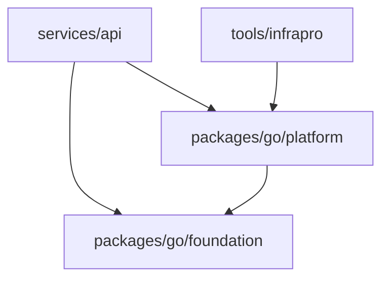

# 后端工程与统一运维 CLI 调整

日期：2026-11-09。状态：**Awaiting acceptance（待用户验收）**。实现和开发自验已完成，尚未获得用户手工验收确认。

用户要求 API 与 CLI 分开组织，利用现有 Go workspace；CLI 名称统一为 **`infrapro`**，面向整个项目运维，账号管理只是其命令组之一。本调整接续工程示例清理，保留已实现账号行为、数据库数据和前端流程。

## 交付内容

- `services/api`：独立 Go module，只包含 HTTP 服务入口、HTTP 适配与服务生命周期。
- `tools/infrapro`：独立 Go module，提供项目唯一运维命令入口 `infrapro`。根命令负责帮助、命令分发与退出状态；`database` 和 `account` 分别组织当前迁移及账号维护命令。
- `packages/go/platform`：独立项目共享 Go module，承载项目配置、数据库迁移、账号业务和依赖装配。API 与 CLI 都调用它；它不依赖 Gin、API 程序或 CLI 程序。
- `packages/go/foundation`：保留通用配置及日志能力，不迁入账号业务。
- 独立 API/CLI 容器构建；Compose 的迁移及维护通过 CLI 镜像执行，API 镜像只包含 API 可执行程序。

## 实现与技术

继续使用 Go 1.27、`go.work` 和各自的 `go.mod/go.sum` 管理四个模块。跨模块复用通过 platform 的公开 Go 包，禁止从 API 的 `internal` 导入 CLI。Gin 与 gorilla/csrf 留在 HTTP 适配；账号业务中的事务、密码与会话规则保持同一实现。

项目配置移至 `platform/config`，共用示例放在 `configs/infrapro.example.yaml`。Goose 和嵌入 SQL 移至 `platform/migrations`，迁移版本与 SQL 内容保持不变。数据库迁移命令只要求数据库配置；帮助和未知命令校验不需要数据库或账号配置。

CLI 使用现有 Go `flag` 组织命令参数，使用 `x/term` 保留密码无回显与重置链接仅终端展示的规则。不新增命令框架，不提供尚未实现功能的占位命令。以后新增项目运维能力应添加命令组或子命令并复用对应共享业务包，不再在各服务中另建 CLI。

更新本地启动脚本、workspace 构建、独立模块校验、Docker/Compose、维护文档及测试。数据库和 Redis 的访问与撤销规则保持不变，不重建已有数据、不重开账号初始化。

## 自验与手工验收

1. `go.work` 列出四个模块；`services/api/cmd` 只保留 `api`，统一 CLI 位于 `tools/infrapro/cmd/infrapro`。
2. API 和 CLI 在 `GOWORK=off` 下均可独立构建；CLI 依赖图不包含 API 或 Gin，platform 不包含 HTTP 框架依赖。
3. 未配置数据库时 `infrapro --help`、`account --help`、`database --help` 正常显示命令；无效命令明确失败。
4. 原有 `pnpm infrapro database migrate`、`pnpm infrapro account ...` 调用方式可用。交互初始化、重置和账号状态维护通过独立 CLI 镜像验证。
5. 代码检查、账号业务及迁移测试、浏览器测试和普通 HTTP 部署检查通过；登录、邀请、密码、会话行为与调整前一致。

## 已执行的开发自验

- 四个 workspace module 的格式、vet、编译、Go race 测试，以及前端检查和 OpenAPI 同步均通过。
- platform、API、CLI 均通过 `GOWORK=off` 独立构建；CLI 和 platform 的实际依赖图不包含 API、Gin 或 gorilla/csrf，API 不依赖 CLI。
- 统一名称后重新构建 `build/bin/infrapro`，验证 `pnpm infrapro --help`、CLI 帮助/无效参数测试和数据库专用配置测试。
- 在专用测试数据库的独立 schema 中，仅提供数据库连接运行 `infrapro database migrate` 成功；检查迁移版本后已清理该 schema。
- 桌面/手机视口共 12 项账号浏览器测试通过；工程示例清理后的 12 项构建产物测试也通过。
- 三个独立镜像构建与普通 LAN HTTP 流程通过。最终名称的 CLI 容器完成初始化、重置与停用，API 重启、缓存回源、数据库/Redis 故障恢复和共享退出正常；测试栈与专用卷已清理。

以上均为本机开发自验；尚未部署到外部正式服务器或由用户完成手工验收。用户明确确认后才标记 Accepted。运行方式见 [维护手册](../operations/account-management.md)。
