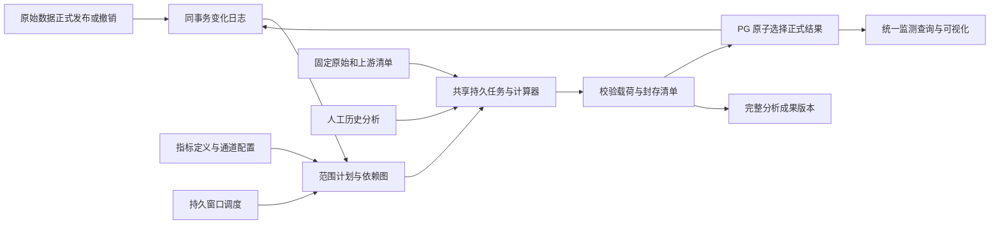

# 派生监测指标与分析成果详细开发方案（V1.0）

日期：2026-11-12。文档状态：**Awaiting acceptance（正式开发方案文档自检通过，已交付审阅）**。需求基线：用户已确认[交付范围与验收方案](derived-monitoring-and-analysis-plan.md)。功能状态：**尚未开始实现**；本文不表示已经执行功能测试、迁移、部署或性能验证。

## 1. 执行依据与完成边界

### 1.1 文档关系

本文将已确认的 C-01–C-10、DM-01–DM-09 和 MA-01–MA-20 展开为可以拆分开发、定义契约、验证和验收的执行方案。业务范围以已确认基线为准；本文负责固定实现约定。本次不修改两份[基础监测总体方案](monitoring-data-foundation-plan.md)和[基础监测详细方案](monitoring-data-development-plan.md)，它们仍由基础监测工作独立维护。

本文中的表名、权限键、状态、数值协议及接口是本轮开发约定，不是现有实现清单。基础监测实现若采用了不同的内部命名，开发前建立一对一映射并更新本文，不重复实现第二套观测、授权、任务或导出体系。前置验证只验证技术条件，不能据此默默删除已确认功能。

本次用户指令为生成正式方案文档，尚未授权开始功能实现。后续实施仍在当时当前分支与 checkout 工作；不因本文的阶段划分创建分支或 worktree。

### 1.2 不可弱化的交付范围

| 范围 | 本文落实 | 完成要求 |
| --- | --- | --- |
| DM-01 定义与模板 | 第 4–7、17 节 | 租户派生指标、版本、常用模板、校验、复制、发布和停用。 |
| DM-02 正式派生通道 | 第 3、8、16–19 节 | 设施／构件／测点归属，绑定、试算、启停、回算、项目授权及资源兼容。 |
| DM-03 可组合计算 | 第 5–7 节 | 受限公式、基准、差分、速率、完整首批统计、多通道与多步组合。 |
| DM-04 自动更新 | 第 9–12 节 | 发布续算、迟到／补录／撤销重算、窗口调度、无环多级依赖及恢复。 |
| DM-05 结果与追溯 | 第 7、10、13、20 节 | 原始／派生分离，完整当前结果与历史修订、来源可回放、永久保留。 |
| DM-06 持续监测 | 第 13、19 节 | 最新值、长期趋势、明细、统计、实际新鲜度、版本和来源下钻。 |
| DM-07 历史分析 | 第 14、17–19 节 | 人工运行、多输出成果、受影响标记、比较、取消／重试及重算新版本。 |
| DM-08 权限与导出 | 第 15–18、20 节 | 递归输入权限、真实时段、归档与撤权、后台导出及审计。 |
| DM-09 工程交付 | 第 21–26 节 | 增量迁移、契约、运维、恢复、故障和规模验证、人工验收材料。 |

不设计或实现告警阈值、条件、事件、恢复、通知与处置。协议解析、真实设备连接、波形／频谱、回归预测、积分／时间加权、科研脚本、算法市场、报告／大屏编辑器、业务额度和计费不在本轮。源数据发布事件属于计算调度机制，不是告警事件。

## 2. 工程现状、技术路线与 Module

### 2.1 当前代码需要衔接的事实

核对位置为 2026-11-12 当前 `main` 工作树，其中已有其他任务修改。当前迁移文件到 v12，基础监测已有实际代码；其[验证记录](../verification/monitoring-data.md)报告本机功能自验通过、人工验收待确认，目标规模另行验证。本文未重新执行这些测试，也不把它们作为派生功能的通过证据。下一迁移编号必须在实施时按实际落地顺序分配，本文不预占编号。

| 当前源码 | 当前约束 | 本轮改动方向 |
| --- | --- | --- |
| `migrations/00009_engineering_resources.sql` | channel 强制 point_id、公共 metric_version_id；触发器固定指标、单位和归属。 | 第 3 节扩展来源类型和归属，保留直接观测分支的约束。 |
| `migrations/00010_project_resource_access.sql` | 资源节点视图中 channel 的父级固定 point；设施／构件不能创建 channel。 | 扩展父边、专用派生创建／维护委托，旧授予不自动扩权。 |
| `migrations/00011_device_product_resources.sql` | 设备来源使用含 point_id 的通道外键及语义匹配。 | 继续仅支持 direct 通道，显式拒绝 derived；不改变既有绑定历史。 |
| `resources/service.go`、`queries.go`、`tree.go` | 目标校验、过滤、展示依赖 point 和公共指标 JOIN。 | 统一读模型按来源分支投影；派生通道不因 INNER JOIN 丢失。 |
| `engineering/model.go` | 公共指标／单位版本；没有完整物理量代数或单位换算。 | 派生定义单独归租户；只提供受限单位表达式和显式输入语义。 |
| `migrations/00012_monitoring_metadata.sql` | 已有原始发布、采用清单、纳秒数据授权、任务、快照、摘要头和 dirty ranges。 | 增量扩展；dirty 会被摘要维护消费，不能直接当派生消费者的永久事件日志。 |
| `monitoring/queries.go`、`jobs.go`、`export_writer.go` | 查询以原始观测为中心；任务领取／分派和导出列有固定类型。 | 抽出公开读取契约、显式注册新任务及结果类型；不能假定现成插件接口已经存在。 |
| `runtime/business.go` | Compose 已聚合设备和监测引用，并注入监测存储。 | 在原聚合上增加派生引用及 Provider，保留设备和原始监测保护。 |
| 基础监测开发与验证记录 | 本机已有 CSV/XLSX、原始查询、后台导出、worker、恢复路径。 | 复用已落地能力并做针对性回归；生产拓扑和大规模结果仍需独立证据。 |

源码路径均相对 `packages/go/platform`，除特别说明外。正式开发前重新核对实际接口，不根据本表覆盖其他任务的新代码。

### 2.2 技术及准确职责

| 技术 | 用法与选择理由 |
| --- | --- |
| Go，当前工程 1.27 工具链 | 同一数值与规则实现供试算、持续计算和分析运行使用；API 与独立 worker 复用领域逻辑。 |
| PostgreSQL 17、pgx、Goose | 配置、版本、依赖、授权、持久变化记录、调度、任务、清单根和审计；短事务决定结果可见性。 |
| ClickHouse，沿用基础监测冻结的自托管版本 | 原始读取、派生结果及摘要的批量列式存储；不把数据库后台去重当作业务唯一性。 |
| S3 兼容存储 | 不可变输入／结果清单、追溯材料、导出、临时排序和备份；正式依据与临时产物分生命周期。 |
| Go `math/big`、内部版本化计算器 | 精确整数／有理运算、受控高精度开方、确定性舍入；不使用浏览器浮点数作为正式值。[标准库说明](https://pkg.go.dev/math/big) |
| React、TypeScript、TanStack、共享 UI | 定义、通道、运行、成果和监测工作台；复用现有表单、权限、查询取消和主题。 |
| 基础方案的 ECharts／视窗控制器 | 有界绘图、版本边界和计算状态；不承担正式计算。 |
| OpenAPI、现有权限生成、Go test、Playwright | 单一契约与权限目录，规则测试、真实存储／事务测试和页面验收。 |

不新增 Kafka／Flink／Spark、表达式脚本运行时或通用数据库插件平台。具体依赖、镜像 digest 和驱动版本继承基础监测冻结清单；如确需新依赖，记录用途、版本和兼容验证。

本机前置验证可以复用基础监测的已锁定候选：ClickHouse/Keeper 26.8.36.3、SeaweedFS 4.53、PostgreSQL 17 系列，以及当前 Go/Node/pnpm 工具链；精确镜像和驱动以 [versions.json](../../deploy/monitoring-contract/versions.json)、go.mod 和 pnpm-lock.yaml 为准。它们不是已确定的生产拓扑；如升级依赖，先完成相关契约回归再更新锁文件。

### 2.3 Module 与 Interface

新建 `packages/go/platform/derivedmonitoring` Module，统一隐藏配置解释、依赖展开、当前结果选择及发布协议。外部 Interface 分为定义／通道命令、运行与成果命令、结果读取三组，不把数据库表逐一暴露为通用 CRUD。

| 拟落点 | Implementation 职责 |
| --- | --- |
| `derivedmonitoring/service.go`、`model.go` | 明确的业务命令、Scope、DTO、状态与错误；所有入口使用同一授权判断。 |
| `derivedmonitoring/internal/compute` | 规则编译、单位推导、算子、窗口、数值及确定性输出；输入不含 HTTP／数据库连接。 |
| `derivedmonitoring/internal/planning` | 输入范围、权限范围、依赖快照、影响传播、任务切块。 |
| `derivedmonitoring/internal/execution` | 持久运行、窗口状态、恢复、封存、发布及失效清理。 |
| `derivedmonitoring/internal/store` | PG、CH、对象存储的具体读写和清单 Adapter。 |
| `monitoring` 的公开读取与任务 Interface | 原始快照／读取、任务执行器注册、统一查询的派生结果 Provider；不向外导出内部 SQL。 |
| `runtime` | 注入 RawReader、派生 Provider、存储及引用聚合。 |
| `services/api/internal/transport/http/derivedmonitoring` | 严格 DTO、operation 注册、业务错误映射、取消。 |
| `services/api/cmd/monitoring-worker` | 注册新增执行器及窗口调度循环；复用独立进程，不增加新的 Go module。 |
| `apps/console/src/features/derived-monitoring`、`analysis` | 定义／通道配置与历史分析；复用 monitoring 工作台。 |

`monitoring` 不导入 `derivedmonitoring`。它声明派生 Provider 的窄 Interface，由后者实现；后者只依赖公开 RawReader 与任务契约，不能导入 `monitoring/internal`。派生读取内部按固定上游清单读取，不再次从公开统一查询入口递归回调自己。数值 Module 的测试跨同一 Interface，不为测试复制计算逻辑。

### 2.4 与现有基础监测的具体接缝

| 接缝 | 本轮必须完成的改造 |
| --- | --- |
| 原始读取 | 将 `queryPlan`、原始清单及有序扫描封装成公开 RawReader：建立固定快照、规划依赖范围、分页／流式读取、复验相关修订。当前身份入口和系统委托入口分开，后者不接受客户端自报资格。 |
| 数值复用 | 现有 `monitoring/internal/observation` 不能被兄弟包导入。将双方确需的数值／时间契约移到有限的共享包，或由公开 Reader 返回规范系数；保持原始接口与数值夹具不变，不复制第二份有差异的统计实现。 |
| 变化日志 | 在发布、撤销、重新采用、派生发布和配置控制事务中写入统一持久日志及通道／范围索引；复用 `monitoring_tenant_states.commit_sequence` 的提交锁分配位置。摘要 dirty 和各消费者游标独立，不能由任一消费者删除其他消费者尚需的事实。 |
| 任务宿主 | 扩展 `monitoring_jobs.kind` 约束、领取条件、action 映射、资格检查、取消／重试和 worker 注册，增加 `derive`、`analysis`、`derived_replay`、`analysis_compare`；试算作为 derive/analysis 的 trial 模式。复用 `monitoring_job_steps`、租约和收据，不再维护第二套任务真相。 |
| 查询与导出 | selections 增加所属对象；结果 DTO 按 source_kind 区分 observation/result，原始字段兼容。摘要／分页／导出通过 Provider 读取派生结果；派生行的 point_id、公共 metric_version_id 可空，不能再强制用旧原始导出 schema。 |
| 版本与授权 | 扩展快照向量、操作目录、只读 POST 分类和项目数据授权校验。发布位置出现派生事件导致的原始序号间隔是合法情况，原始查询不能假定原始 publication 连号。 |

新增系统计算执行器必须依据第 15 节的受限委托判定资格，不能只因 job.actor_id 为空就获准执行。基础 worker 的现有 30 秒租约、5 秒心跳与其他任务共用；本轮将它们配置化并沿用默认值，避免同一领取表存在两套不一致的失效判断。



## 3. 工程通道模型与兼容改造

### 3.1 通道身份

**R-01**：沿用 `engineering_channels` 的稳定 ID 和 resource_kind=`channel`，新增 `source_kind=direct|derived`，不另造无法授权的“虚拟通道”资源类型。旧行迁移为 direct。

新增字段及约束：

| 字段／约束 | direct | derived |
| --- | --- | --- |
| `owner_kind` | 固定 point | facility／component／point |
| `facility_id` | 非空，既有值 | 非空，等于所属对象的设施 |
| `component_id` | null；测点所属构件通过 point 查询 | owner=component 时非空，其他为 null |
| `point_id` | 非空 | owner=point 时非空，其他为 null |
| `metric_version_id` | 非空，沿用公共指标校验 | null |
| `derived_metric_version_id` | null | 非空，指向同租户派生定义初始输出契约版本 |
| `unit_version_id` | 原有规则 | null；输出单位从固定 `quantity_spec` 表达，不伪造公共单位版本 |
| `quantity_spec`、`output_contract_hash` | 读取时由公共定义生成，不重复回写旧行 | 非空、不可变的输出含义与单位快照 |

添加同租户组合 FK、owner CHECK 和 partial unique indexes：point 通道沿用 `(tenant_id,point_id,code_normalized)`，component 用 `(tenant_id,component_id,code_normalized)`，facility 用 `(tenant_id,facility_id,code_normalized)` 且条件 owner_kind=facility。编号删除后仍保留；direct 与 derived 在同一个测点下共享编号命名空间。

保留设备绑定依赖的旧组合唯一键。`monitoring_source_heads`／bindings 的 point FK 不扩展到派生通道；新增数据库与业务双重 `source_kind=direct` 校验。导入映射同样拒绝派生通道。设备输出不能冒充计算输入来源绑定；计算输入保存在第 4 节配置表中。

### 3.2 触发器、树和操作

资源 guard 分来源执行：direct 完整保留原有约束；derived 校验所属对象、租户、派生输出契约及计算扩展行。存在互相引用的主行／扩展行时，用同一事务和延迟约束验证，不以暂时关闭触发器保存不完整资源。

`engineering_resource_nodes` 的 channel 父边根据 owner_kind 生成。更新祖先投影、树搜索、详情、数量、关联预览、引用保护和生命周期检查；只能展示当前可见路径。设施／构件删除检查必须包含直接挂载的派生通道。所有历史引用继续保护所属对象，不因通道退役而允许删除依据。

旧 point 路由保留，可读取该点 direct／derived 通道；direct 写接口不得修改派生配置。新通道的规范操作入口见第 17 节，资源列表／树统一引用。API 的通道语义新增判别联合 `metric_ref.kind=engineering|derived`；旧 direct 字段保留，前端不得假定所有 channel 都有公共 metric_version_id 或 point_id。

## 4. PostgreSQL 数据设计

### 4.1 公共约定

身份使用 UUID；修订号、计数、时间纳秒通过 JSON 十进制字符串传输。观测和生效边界使用 UTC ns `bigint`、`int8range`；创建／审计时间可用 timestamptz。范围统一存成规范半开表示，永久上界显式无界；到最大可表示纳秒的闭区间使用域上界裁剪，禁止计算溢出的 max+1。[PostgreSQL 范围类型](https://www.postgresql.org/docs/17/rangetypes.html)

跨表 FK 包含 tenant_id；拥有项目的表再包含 project_id。代码、名称、说明沿用工程资源规范，JSON 体最大 256 KiB。发布正文、运行输入快照、结果清单及审计不可原地覆盖。schema_version、compiler_version、engine_version 与内容 hash 分开保存。

### 4.2 定义、配置和依赖表

| 逻辑表 | 关键字段与约束 |
| --- | --- |
| `derived_metric_definitions` | id、tenant、code、name、status、draft_revision、created/updated；tenant+code 唯一且不释放编号。 |
| `derived_metric_drafts` | definition_id 唯一、base_version_id、revision、完整 DSL；仅草稿可编辑。 |
| `derived_metric_versions` | id、tenant、definition_id、version_no、DSL、compiled_plan、各版本号、content_hash、output_contract_hash、enabled／state_revision；definition+version_no 唯一。发布正文不可变，停用状态另行更新留审计。 |
| `derived_channels` | tenant+channel PK，当前控制状态、control_revision、mandate_revision、execution_scope_root、auto_start_ns、计算覆盖根／状态；同租户 FK 至工程 channel。 |
| `derived_channel_configs` | id、tenant、channel、definition_version_id、input_bindings、完整参数、quality/window/alignment、numeric_contract、semantic_hash、config_hash、created_by／reason；不可变。 |
| `derived_config_assignments` | id、tenant、channel、config_id、生效 int8range、created_revision、superseded_revision；当前分配不能区间重叠，历史分配永久保留。 |
| `derived_graph_states` | tenant PK、graph_revision；图结构变更锁，初始化随租户创建／升级补齐。 |
| `derived_dependencies` | tenant、config_id、slot_key、input_channel_id、input_kind、影响传播描述；config+slot 唯一，倒排索引 input_channel→引用配置。无每观测一行关系。 |
| `derived_channel_heads` | tenant+channel、head_revision、当前范围清单根、history_root、checked_source_position、summary_root、coverage_root；与结果发布短事务更新。 |

新配置可引用同一指标定义的兼容新版本，但必须与通道固定输出契约一致；初始 `derived_metric_version_id` 不改写。配置生效表采用“关闭旧当前分配的记录可见区间＋新增分配”的审计协议，不修改旧配置正文。修订历史须可恢复任一时点的分配图。

新增项目维护委托列采用默认 false：设施／构件／测点的 `can_create_derived_channel`，派生通道的 `can_manage_calculation`。旧 can_create_channel 仍表示直接通道创建，can_source_manage 仍表示设备来源维护，均不隐式授予新能力。维护委托只改变操作能力，不授予监测数据读取权。

### 4.3 变化、任务和结果控制表

| 逻辑表 | 关键字段与约束 |
| --- | --- |
| `monitoring_change_events`、`monitoring_change_ranges` | 新增统一变化日志：event_id、tenant、已提交 source_position、source_kind、channel 范围索引、变更前后根／修订、change_type、不可变影响清单；与源发布／撤销同事务。tenant+position+event_id 唯一，channel+position/range 索引支持新鲜度检查；不复用可清理的摘要 dirty 作为日志。 |
| `derived_change_consumers` | tenant+consumer、durable_cursor、lease/fence；事务确认到已写入影响记录的位置，不能先推进游标再写任务。 |
| `derived_dirty_ranges` | tenant、channel、range／外部范围清单根、required_position、reason、config/graph revision；合并有界区间，不为每分钟或每样本建 PG 行。 |
| `derived_schedules` | channel+config、clock_kind、anchor、next_due_ns、wait_duration、revision；定时窗口到期及停机补调度。 |
| `derived_runs` | id、tenant、scope/project、kind、actor 或 system、target_hash、config/graph/engine 版本、snapshot_root、output_range、state、reason、progress、started/completed；挂接基础 monitoring_jobs。 |
| `monitoring_job_steps` 的派生扩展 | run、step_key、input/halo、输出范围、检查点引用、selected_attempt；复用既有 job+step_key 唯一约束及 state，不另建并行的 derived_run_steps 状态表。 |
| `derived_generations` | generation_id、run、tenant、channel／artifact output、range、manifest_root、row/status counts、hash、publish_position；正式发布后不可变。 |
| `derived_write_attempts` | chunk、attempt_id、lease fence、封存和验证摘要、完整副本信息；复用基础块尝试协议。 |

运行表的业务状态是对基础任务状态和发布收据的投影；不允许一个表 succeeded、另一个仍未发布而前端认为完成。结果代次和当前清单是发布事实，任务进度不是发布事实。

### 4.4 历史分析表

`analysis_configs` 保存 owner_scope=tenant|project、tenant、可空 project、code/name、草稿修订及生命周期；CHECK 保证 project 范围才有 project_id。`analysis_config_versions` 保存不可变规则／输入绑定／参数，配置发布是保存执行版本，不增加审批。

`analysis_runs` 关联配置版本和基础任务／derived_run，固定输入快照、源范围、输出项和当前执行资格；`analysis_artifacts` 保存成果身份与所属空间；`analysis_artifact_versions` 保存一次成功运行、结果根、解释及 stale 状态依据；artifact+version_no 唯一。变化标记与正文分离，重算不覆盖正文。已发布成果只能归档，删除仅允许无运行／成果引用的草稿。

索引至少覆盖 tenant+status+updated/id、owner_scope+project+created/id、channel+time range、input_channel、definition_version、run state/priority。大清单与历史节点放不可变存储，PG 只存粗范围和根，禁止一行无限增长 JSON 或逐结果元数据。

## 5. 规则语言、编译与单位契约

### 5.1 DSL 结构

DSL schema_version 固定为 `derived-rule/1`，使用严格 JSON：未知字段、重复 JSON key、超长数字／字符串拒绝。数值常数用十进制字符串，禁止 JSON 浮点数、NaN、Infinity 和科学计数法常数。原始输入类型仍由已发布通道语义确定。

| 字段 | 规则 |
| --- | --- |
| `inputs[]` | 稳定 slot key、名称、允许来源／数值类型、公共或派生指标约束、单位／方向／基准约束、数值语义声明；不含具体 channel ID。 |
| `parameters[]` | key、type、单位／取值约束、default、identity_affecting；duration 用正整数字符串 ns，count 用正整数，percentile 用 0–100 十进制字符串。 |
| `clock` | primary_input 或 fixed_grid/calendar；明确输出时间轴，历史 whole_range 使用独立模式。 |
| `nodes[]` | id、op、inputs 引用、params；节点只引用 inputs 或前序 nodes，不隐式注入通道／时间。 |
| `outputs[]` | 指标定义恰好一个；历史分析可多个。包含 node、semantic_key、名称模式、quantity_spec 和数值契约。 |
| `policies` | 质量、缺失、配置边界、窗口与对齐的显式默认值；编译时展开，执行不读取未来变化的系统默认。 |

节点引用使用 `input:A`、`node:delta`、`param:baseline` 三种命名空间。语法错误定位 JSON Pointer；前端可生成文本说明，但服务端规范 AST／编译计划才是执行依据。

### 5.2 公式与资源限制

公式表达式仅允许已声明变量、常数、`+ - * /`、括号、一元正负号和 `abs/min/max`。min/max 参数 2–16 个且类型一致。表达式长度≤4,096 字符，AST 深度≤16；禁止属性访问、下标、赋值、比较、条件、循环、递归、用户函数、SQL、文件和网络访问。

单定义≤16 输入槽、32 算子节点、32 参数，内容≤256 KiB；历史分析≤16 输出。跨通道依赖≤8 层。上述是默认部署保护参数，调整须经过同负载验证；超限明确 `plan_limit_exceeded`，不截断配置。表达式子节点也计入编译复杂度预算，不能将巨大公式藏进一个节点绕过限制。

服务端顺序：严格解码 → 版本支持检查 → 引用与 DAG → 参数完整展开 → 输入／单位推导 → 时间与因果性 → 权限／来源兼容 → 预算估计 → 规范编码与 hash。定义校验不读取真实数据；绑定试算再次校验具体通道。禁止 Go `eval` 类动态执行；采用有限语法解析器和类型化 AST。

### 5.3 输入语义与单位

现有单位目录仅有类别／符号，没有绝对温标及比例尺度的机器语义，不能按名称猜测。每个输入槽显式声明 `quantity_mode=level|difference|ratio|count`、`level_scale=unknown|ratio|affine`、方向／基准的 `must_match|not_applicable`，并约束来源指标版本。绑定时保存完整源语义及声明，来源改动必须重新验证。unknown 允许差分与统计，禁止直接比值／绝对值缩放；声明不改变原始指标或单位定义。

对物理含义的声明由有定义发布权限者负责，并在发布预览列出；它不是系统已经验证某种工程公式科学正确的保证。常用模板不按中文指标名称自动选择温度或位移。源语义未充分声明时错误明确指向缺失内容，不能默认空方向／空基准就是兼容。

`quantity_spec` 保存 base_unit_version_id、base_power、time_unit、time_power、quantity_mode、level_scale、dimensionless_kind。只允许从输入、专用算子和声明参数推导：

- 加减和逐项 min/max 要求单位表达式及业务语义兼容；level−level 得 difference，level±difference 得 level；不允许任意相加两种绝对温标层级值作为新物理量。
- 普通比例尺度量可按无量纲常数缩放；affine level 允许位置统计（最小／最大、均值、中位数、分位数）、加差量和求差，禁止直接乘除、求和和比例。加权均值是独立算子，可对 affine level 使用非负权重且总权重大于零。
- difference／ratio／count 或已声明 ratio-scale level 的同单位比值产生无量纲结果；不同量纲任意乘除拒绝。
- 方差将单位指数乘二，标准差保持输入单位，速率增加时间分母；同类比值消去相同单位表达式。
- 秒／分／小时／固定日换算由速率算子明确处理，1 日=86400 秒；这不开放任意单位转换。其他不同公共单位版本，即使类别相同也不隐式转换。
- 单位字符串只是显示，不可覆盖推导结构。输出时区不属于单位。

类型推导还须固定：count 为无量纲 count；min/max/mean/median/quantile 保留输入 quantity_mode；level 的差分、极差和标准差产生同单位 difference，方差产生平方单位 difference，速率再增加时间分母。sum 只接受可加的 difference/count 或明确 ratio-scale 的量；unknown/affine level 不能以求和绕过语义限制。baseline_ratio 还受比例尺度检查约束。这些限制拒绝不成立的输入组合，不从算子目录删除相应方法。

### 5.4 规范版本与 hash

服务端规范编码包含类型标签、长度、规范 decimal、已展开参数、规则顺序、窗口、质量、输入语义和算子／编译版本，再计算 SHA-256。禁止简单拼接字符串或对用户未排序 JSON 直接当业务同一性。

`output_contract_hash` 表达指标身份语义；`config_hash` 表达执行配置；`compiled_plan_hash` 包含引擎支持版本；三者用途不同。当前版本升级不重解释历史计划。旧版本引擎无法执行时返回 `engine_version_unavailable`，不能静默按新版本重算。

### 5.5 可直接落契约的示例

以下为“差异位移的 30 分钟均值”的规范结构示意，省略的通用字段必须由模板展开后保存；不是可绕过校验的简写导入格式。

```json
{
  "schema_version": "derived-rule/1",
  "inputs": [
    {"key": "A", "shape": "numeric", "quantity_mode": "level", "level_scale": "ratio"},
    {"key": "B", "shape": "numeric", "quantity_mode": "level", "level_scale": "ratio"}
  ],
  "clock": {"kind": "primary_input", "input": "A"},
  "nodes": [
    {"id": "difference", "op": "subtract", "inputs": ["input:A", "input:B"], "params": {"alignment": "exact"}},
    {"id": "average", "op": "window_mean", "inputs": ["node:difference"], "params": {
      "window": {"kind": "trailing_duration", "duration_ns": "1800000000000"},
      "min_samples": "2", "max_gap_ns": "1800000000000", "max_age_ns": "1800000000000"
    }}
  ],
  "outputs": [{"key": "value", "node": "average", "semantic_key": "mean-differential-displacement", "numeric_contract": {"scale": 18, "rounding": "half_even"}}]
}
```

定义版本不包含 A、B 的具体 channel ID。具体 ID、输入语义、权限范围和运行起点属于通道配置；分析配置同样绑定具体输入，不能运行时按名称重新搜索通道。

## 6. 算子、时间和质量执行语义

### 6.1 算子目录

| op 族 | 参数 | 数学与无结果规则 |
| --- | --- | --- |
| `add/subtract/multiply/divide/abs/min/max/formula` | 前述有限表达式／显式节点 | 单点运算；必需输入为空则无结果，divide 分母精确为零则 division_by_zero。 |
| `baseline_delta/baseline_ratio` | constant／observation／reference_window | 固定基准 b，分别 x−b、(x−b)/b；比值 b=0 无结果；参考窗算法及输入快照固定。 |
| `difference/rate` | adjacent／lag，max_gap，invalid_policy，rate_time_unit | 差分和按实际 Δt 的速率；lag 另需 lag_ns、match_tolerance_ns。前驱缺失、Δt≤0 或超过 max_gap 无结果。 |
| `window_count/sum/min/max/range/mean/variance/stddev/median/quantile` | window、min_samples、max_gap、max_age；quantile 的 P | 样本等权，variance/stddev 分母 N，quantile 用 R7；枚举不参与。 |
| `weighted_mean` | 输入列表、非负权重 | 权重总和>0，必需输入全部匹配；不因缺少输入重分配权重。 |

基准 constant 保存带单位数值；observation 固定 observation/result ID、当时采用身份和输入版本；reference_window 固定原始时段、统计方法、质量与快照。普通新数据不改变固定参考值，参考输入被撤销时标记 baseline_invalid，需要明确重新选择／修正，不自动换基准。历史基准修正依第 8 节执行。

模板包括基线变化、相邻变化、速率、两通道差值、滚动均值、滚动标准差、滚动极差、加权均值；中位数和分位数可从统计算子选择。模板不强迫创建多余中间通道。

### 6.2 输出时间轴与窗口

**R-02**：primary_input 时间轴来自主输入在目标范围内的全部当前采用样本／派生结果时刻，先形成时刻再做质量准入。主样本质量差仍应在该时刻显示无结果原因，不悄悄回退到更早有效值。主输入被撤销而时刻不再存在时，当前输出时刻随范围替换移除。

fixed_grid 使用 anchor_ns + k×step_ns，step>0；calendar 使用明确 IANA timezone 的日／月／年边界。不得以 worker 时钟决定输出标签。固定时长的默认最小 step 为 1 秒，是部署保护参数；持续计算输出时刻必须不晚于实际当前时刻减等待时长。导入的未来观测先保留，不提前输出未来当前值。

| 窗口 kind | 精确集合及限制 |
| --- | --- |
| `trailing_duration` | 输出 t 取 `(t-W,t]`；max_age 检查 t−最后合格样本，max_gap 检查相邻合格样本；左边界不是虚构样本。 |
| `trailing_count` | 截至 t 的最近 N 个合格样本，须恰好 N 个，另检查 max_span、max_gap、max_age；不以更少样本假装 N 窗。 |
| `fixed_duration` | `[anchor+kW,anchor+(k+1)W)`，输出在 end；与 step 不同参数时必须明确采用滚动窗口，不能混用定义。 |
| `calendar` | 指定时区完整自然日／月／年 `[start,end)`，输出在 end；DST 23／25 小时日及闰年按日历处理。 |
| `whole_range` | 仅历史分析，使用明确 source_range `[from,to)`，输出为一个区间统计项，end 可以等于源范围 to。 |

时间窗 min_samples 默认：mean/min/max/range/sum/median/quantile=1，variance/stddev=2，可明确改为1；count 固定允许0。N=0 时 count=0，其他值 null；N=1 且通过样本门槛时总体方差／标准差为0。最近 N 样本窗不接受小于 N 的门槛。所有默认展开进配置。

持续统计必须配置有限 max_gap/max_age；样本窗另需有限 max_span。模板初值可随 W/N 设置，但绑定预览必须展示实际值。样本门槛不等于采样完整率；没有明确历史采样计划不输出推测的“100%完整”。结果同时给 count、排除数、输入起止和覆盖说明。

固定／自然窗口的 end 同时是正式输出时刻，必须处于约定的纳秒存储域；超出域的窗口不可发布，不用截断 end 改变窗口含义。whole_range 的源上界与输出标签分别校验。无样本时 count=0 不执行不存在的末样本年龄判断，保留 empty_window；有样本但违反间隔／年龄门槛时仍为无结果。

### 6.3 时间匹配与因果性

| 匹配 | 选择规则 |
| --- | --- |
| exact | 规范 UTC ns 相等。 |
| previous | `[t-tolerance,t]` 中最新合格值；输出实际 source_time 和 age，可复用同一样本，但不得无限延续。 |
| same_interval | 完整区间起止和机器可读聚合语义一致；不会把结束时刻相同的不同窗口视为相同输入。 |
| nearest | 历史分析专用，闭区间 `[t-tolerance,t+tolerance]` 最近值，等距取较早；标识非因果，不可启用为持续通道。 |

lag 差分在参考时刻 t−lag 向前按容差寻找旧值，分母仍取真实 t−source_time；max_gap 与 lag/tolerance 的关系须通过配置校验。默认 invalid_policy=break，不跨被排除的无效样本求相邻速率；显式 skip_excluded 可跳过，仍受实际 max_gap 约束。match 质量准入、候选范围及排除计数记录在依据中。

**R-03**：持续输出 t 的所有递归输入及基准不得使用 t 之后的数据。参考窗口须 end≤t；不满足时为 noncausal_baseline。使用后来的基准解释更早数据只允许明确的历史分析，不能发布成持续当前值。

原始 interval_end 输入只有在实际区间相同、聚合含义被显式结构化声明且兼容时可直接组合。自由文本 aggregation_description 不由程序猜成 mean/sum。首版不对这种原始区间结果再做时间统计；新派生窗口有明确机器语义，可计算“窗口结果序列的统计／速率”，名称和依据必须表达这一层次。

### 6.4 多步、配置边界和质量

规则内每个节点保留自己的时刻／区间，连接节点必须校验时间语义。不能把节点数组下标当作配对关系。默认 `config_boundary=break`：差分或统计跨上游计算配置生效边界时返回 configuration_boundary，直到所需样本属于兼容的同一配置段；普通计算 generation 更换不构成配置边界。

输出时刻 t 选择 t 对应的自身配置；其内部 halo 可按该配置计算此前的临时中间节点，仅用于当前输出，不改写生效前正式结果。跨正式上游通道只读取上游当时实际生效的版本，不用下游新配置重解释它。

输入质量默认准入 good + unmarked，完整集合保存到配置。质量顺序为 bad > suspect > unmarked > good，对被采用输入取最差质量；无样本的 count=0 使用 unmarked 加 empty_window 标志，不能伪造 good。被排除输入不直接改变质量等级，但排除数和 coverage 标志保留；明确包含 suspect/bad 时结果不得升级成 good。

结果 `calculation_status` 固定枚举：valid、missing_input、insufficient_samples、gap_exceeded、age_exceeded、baseline_invalid、noncausal_baseline、invalid_input、configuration_boundary、division_by_zero、numeric_out_of_range、numeric_underflow、precision_unresolved。主原因优先顺序为 baseline_invalid → noncausal_baseline → configuration_boundary → invalid_input → missing_input → insufficient_samples → gap_exceeded → age_exceeded → division_by_zero → numeric_out_of_range → numeric_underflow → precision_unresolved；全部已判定原因保留在 reason_flags。只有必要条件均通过才执行后续运算，不为未执行节点虚构错误。服务失败／任务排队不写成这些数值行状态。

## 7. 数值、结果存储与精度

### 7.1 计算契约

**R-04**：原始值沿用基础方案 Int64／Decimal128(12) 与纳秒时间，计算输入不得经过 Float64、UI 格式化或图表降采样。正负零规范成0；舍入为 half-even。

加减乘除及统计和、平方和使用 `big.Int`／`big.Rat`，不在每个节点按展示精度舍入。均值 S1/N、总体方差 `(N*S2-S1²)/N²` 使用精确有理数，不能以两个浮点大数相减。开方用高精度区间夹逼／误差界，至少96位十进制有效精度，并增加精度直至目标位舍入唯一；达到内部计算预算仍不唯一时返回 precision_unresolved，不猜舍入方向。

规则内中间值保留精度；开方等非有理节点以有界区间继续传递并传播误差，在最终输出舍入唯一前增加精度。若除数区间包含零，先细化证明为零或非零，预算内不能确定则 precision_unresolved，不能转 Float64 猜测。跨正式派生通道只使用已发布规范数值，不能偷偷重新算出另一种未发布精度。算法版本固定精度／舍入方式。内部整数／有理分子分母设 16,384 bit 默认预算，超出以 numeric_budget_exceeded 将任务置 needs_action，不发布部分计算成有效完整块，不能无限膨胀。

### 7.2 输出编码

将讨论稿“默认18位小数、具体存储类型待验证”落实为 **76位十进制系数＋版本化 scale**：`value = coefficient × 10^(-scale)`，`abs(coefficient) < 10^76`，scale 为0–60整数。默认 scale=18，方差模板默认36；发布配置前可明确选择精度，不能运行时无提示改变。count 为 scale=0。配置精度改变属于普通版本变更，显示其边界。

CH 使用 `Nullable(Int256) coefficient` 与 `UInt8 scale`；客户端只接收规范十进制字符串及 scale／rounding／rounded，不接收大整数 JSON number。固定 scale 列无法同时表达不同派生精度，故不机械复用原始 Decimal128(12) 列。统计和排序比较将 coefficient/scale 精确对齐；不得直接比较不同 scale 的 coefficient。

非零精确结果舍入到0时返回 numeric_underflow，并保留高精度解释，不把它当作真实零。超出76位系数返回 numeric_out_of_range；舍入后仍需重新检查系数范围。例：原始差值10^-12的方差可能达到10^-24，scale=36能表达；默认18不足时须在试算提示更高精度。显示6位小数不改变正式值。

ClickHouse Decimal 运算自身的除法及溢出行为不能替代本契约；数据库只存储规范值或读取已经验证的摘要，正式数值运算由统一计算器负责。[官方 Decimal 精度及限制](https://clickhouse.com/docs/reference/data-types/decimal)

### 7.3 精确分位数和可合并状态

排序样本 x[1..N]，p=P/100，h=1+(N−1)p，k=floor(h)，使用 x[k]+(h−k)(x[k+1]−x[k])；P=0/100 返回端点，N=1 返回该值。P50为中位数。固定R7避免数据库默认方法差异。[NIST 分位数说明](https://www.itl.nist.gov/div898/handbook/prc/section2/prc262.htm)

count/sum/mean/variance/stddev 保存可合并的 N/S1/S2；min/max 保留确定性最早时刻与并列数；range=max−min。中位数／分位数不能合并各块分位数。

时间／样本滚动统计单次有序扫描，用有界环形样本集、滑动 N/S1/S2 和支持重复值计数的有序统计结构；精确分位数用值排序及秩选择。默认单个活动窗口最多1,000,000样本且受任务字节预算约束，超出明确 budget_exceeded，启用预览尽量先发现。完整历史／固定大窗口允许落盘外部排序：封存排序段、记录总N、归并定位所需序位，内存不随总N增长；临时盘不足明确失败。不能自动改成近似分位数。[ClickHouse 精确分位数的内存说明](https://clickhouse.com/docs/reference/functions/aggregate-functions/quantileExact)

### 7.4 ClickHouse 与对象布局

`derived_results_local` 使用与基础观测相同的复制／分片策略，按输出UTC月份分区，排序 `(tenant_id,series_id,output_at,result_id,generation_id,chunk_id,attempt_id,row_ordinal)`。series_id 对正式通道等于 channel_id；分析多输出使用稳定 artifact-output 身份。不得每通道建表／分区。

列组：tenant/series/channel-or-artifact、result_id、generation/run/config、output_at DateTime64(9,UTC)、区间起止、coefficient/scale、quality、calculation_status、reason_flags、count/excluded_count、input time bounds、lineage_ref、chunk/attempt/ordinal、payload_hash。null 值仅用于非 valid 状态；count=0是明确例外的有效数值。

`result_id` 由通道／成果输出身份＋输出时刻＋输出项稳定生成；同一时刻更正保留逻辑身份，generation 不同。一次结果取样的具体输入只通过版本清单解释，不能用同一个结果 ID 假装数值从未变化。

另存 `derived_summary_versions`、结果块索引及粗区间状态；共享原始趋势和统计算法的实现，但按派生数值 scale 处理。对象前缀区分 definitions/lineage/manifests/checkpoints/exports/temp/backup。永久保留正式定义、配置、输入快照依据、当前和历史代次；无人引用的试算、临时排序、未采用 attempt 和导出按受控TTL清理。

DateTime64(9) 和PG纳秒域沿用基础方案，所有转换用明确 UTC 纳秒参数，不能利用字符串／整数隐式转换猜精度；在冻结版本实测两端边界及驱动往返。[官方 DateTime64 说明](https://clickhouse.com/docs/reference/data-types/datetime64)

## 8. 定义、配置、通道和运行状态机

### 8.1 定义生命周期

草稿可多次保存，用 expected_revision 防止覆盖并发修改。发布必须通过编译、完整引用检查及发布权限，分配新 version_no；既有版本不可改正文。停用定义版本禁止新采用，已有固定配置继续按原版本解释和执行；需要停算时明确暂停相关通道。删除仅允许没有发布版本和引用的草稿定义。

定义模板是代码中版本化的起始 DSL，复制为租户草稿后独立维护。模板更新不改写已发布定义；不自动创建样例派生指标或真实通道。

### 8.2 语义变更和生效分配

**R-05**：必须新建通道的变更包括输出业务含义、所属对象、单位／方向／参考基准、窗口种类或长度、所描述的输入对象组合、identity_affecting 参数。变换公式使业务量发生改变也必须新建。系统不能仅凭名称相同判定兼容。

普通版本变更白名单：质量集合、对齐容差、允许间隔、样本准入、输出步长、等待时间、数值精度，以及同一业务位置／语义的输入替换。输入替换必须证明 owner、指标／单位及方向／基准语义符合固定槽位；改变代表对象的替换不是普通变更。表达式结构变更默认视为语义变更；同一意图的算法修正使用明确 correction 操作和原因，不伪装成普通改名。

普通变更设未来或当前 effective_from，生成新配置及不重叠生效区间。输出时刻恰等于 effective_from 使用新配置；旧结果与历史配置不改写。历史修正指定已有区间、修正配置及理由，预览所有下游影响后建立新的历史分配修订，触发自动重算；原分配在历史修订中仍可读取。

### 8.3 通道控制状态

工程资源 normal／retired 与计算控制状态分开。派生资源建档后控制状态为 draft，尚无正式输出；不为已有 direct 通道增加计算启用步骤。

| 当前状态／操作 | 条件与结果 |
| --- | --- |
| draft → enable | 绑定有效、无环、输出契约匹配、权限与执行范围完整、试算收据有效；记录 auto_start，转 enabled。 |
| enabled → pause | 控制修订和运行 fence 增加；停止新领取，旧任务不可继续发布；保留影响记录和已有历史。 |
| paused → resume | 预览暂停期间输入及配置变化，默认补算至当前；也可明确选择新起点，未覆盖段如实保留。 |
| draft/paused/enabled → retire | 预览；若仍有启用下游，须先处理其依赖。记录输出停止边界，工程资源转 retired，控制态 retired。 |
| retired → restore | 复用资源恢复资格与引用检查，计算回到 paused；不因恢复资源就自动大范围回算。 |
| draft → delete | 无正式结果、无其他通道配置／分析引用，走资源软删除及编号保留；本通道自有草稿／初始配置可以一并停用并保留审计，不阻止从未启用的草稿退出。 |

计算的 blocked 是健康状态，如基准失效、上游不可用、预算不足；不会替代 enabled／paused。界面说明阻塞原因及可恢复操作。资源退役停止新增输出，已存在历史因输入撤销仍必须失效；获准历史修正可以修复退役前结果。上游退役不能把其历史全部当作被撤销，但不得无限延用最后值生成未来输出。

首次启用明确 auto_start；历史回算范围须主动选择，可以与启用同一命令提交独立任务。自动任务和历史任务按输出区间去重／拆分。所需输入 halo 可以早于输出起点，但必须满足执行范围；上游派生未覆盖时，预览列出需回算的依赖并由同一次明确提交发起，不能静默把全历史全部展开。

### 8.4 运行状态及取消

复用基础任务 canonical state：queued、running、retry_wait、needs_action、succeeded、failed、cancelled。phase 细分 planning、waiting_dependency、reading、calculating、writing、verifying、publishing；依赖未就绪保持 queued，不持有 worker 租约。

数据层面的除零／样本不足属于成功计算得到的无结果记录；已确定基准被撤销时，也可以成功发布 baseline_invalid，并将通道健康标为 blocked。缺少追溯清单而无法证明基准状态属于故障，不能冒充 baseline_invalid。存储不可用、清单错误或不完整输入属于任务失败／重试；预算超限、输入权限丢失等无法完成计划的原因进入 needs_action。旧目标被更高配置取代使用 cancelled+reason=superseded，不将其报告成功。

取消只影响尚未发布部分；已发布范围保留。自动运行被取消仍保留未完成 dirty，通道 enabled 时后续会重调度，若要停止自动更新应暂停通道。分析未完整发布前取消不能产生半份正式成果。技术重试继续同一业务运行，人工“重新分析”则建立新的运行及成果版本。

## 9. 依赖图、变化日志和影响范围

### 9.1 无环图

**R-06**：图边属于配置，历史边不可删除。启用与编辑时对当前及计划生效配置的保守并集做拓扑检测，禁止直接／间接循环；不同生效时段的循环也不允许用时间错位绕过。先按 tenant graph_state 行加写锁，再复核所有引用配置和 graph_revision，并发两次修改不能各自检查通过后形成环。

倒排 input→dependent 的索引用于展开影响，深度最多8层。一个输出依赖同一上游多个槽位允许，但需去重读取；权限与影响按并集判断，不能重复计数样本。统计窗口不自动把不同通道样本混为一个集合，多通道必须先形成明确组合序列。

### 9.2 事件协议

源数据发布／撤销事务同时保存不可丢失的变化记录。事件类型固定为 raw_publish、raw_revoke、raw_readopt、derived_publish、config_assignment_change、channel_control_change；业务可新增引用可用性事件，但不使用任意外部脚本触发器。

```json
{
  "schema_version": "monitoring-change/1",
  "event_id": "00000000-0000-4000-8000-000000000101",
  "tenant_id": "00000000-0000-4000-8000-000000000001",
  "source_position": "1042",
  "change_type": "raw_revoke",
  "source_kind": "direct",
  "impact_manifest_id": "00000000-0000-4000-8000-000000000201",
  "before_manifest_id": "00000000-0000-4000-8000-000000000202",
  "after_manifest_id": "00000000-0000-4000-8000-000000000203"
}
```

大批次影响通道／时段清单存对象，事件只引用已封存根。source_position 由已提交顺序定义，不能取存在事务空洞的预分配最大序号。consumer 至少一次处理，事务写入 dirty/任务后才推进 durable_cursor；重复投递以事件身份和目标版本幂等。

### 9.3 传播计算

| 形式 | 影响展开算法 |
| --- | --- |
| exact 单点组合 | 变更前后主时间轴时刻并集；主时刻删除须替换旧输出范围为无该点。 |
| previous 匹配 | 比较变更前后的后继可用样本，展开至被替代匹配的终点，最多受 tolerance/max_age 限制。 |
| adjacent 差分／速率 | 改变点及变更前、后继关系的并集；不能只重算输入同一时刻。 |
| lag 差分／速率 | 参考搜索范围包含改变点的输出时刻，加实际主时刻选择和容差影响。 |
| trailing_duration W | 单个输入 s 对 `(t-W,t]` 的影响满足 s≤t<s+W；范围变化按端点语义合并，再投影输出时间轴。 |
| trailing_count N | 从变化处分别在旧／新有效序列中查找后续 N 个样本并取范围并集；同时检查被排除样本／跨度条件影响。 |
| fixed/calendar | 输入所属完整窗口，以及该窗口结果影响到的下游范围。 |
| 固定基准 | 所有引用该基准的输出；撤销产生 baseline_invalid，不能直接换基准后继续。 |

规则内多步按算子反向取输入 halo、正向传播影响；跨通道继续拓扑传播。计算搜索范围所需的旧清单由系统追溯 Reader 读取，不把被撤销值混入新结果。若预算内无法精确确定范围，扩大到保守覆盖范围并说明原因；不能为了少算而漏标。

PG 中区间合并有上限；大量碎片通过分层影响清单记录，或保守扩大到有界输出分片。整租户变化不会逐条更新每个结果行；依赖图、源修订和查询时有效性检查共同保证正确性。

### 9.4 调度滞后期间的立即失效

**R-07**：源撤销可见后，旧派生值不能因为 consumer 尚未处理而仍显示 current。

每个结果清单保存其依赖根／范围及 checked_source_position。当前读取在同一控制快照取得源位置和结果头，核对之后变化是否与递归依赖范围相交。无关变化可推进证明位置；有关变化或尚不能在预算内证明无关，返回 pending／202，而非旧 current 值。缓存键和授权检查之外还必须检查这一新鲜度证明。

读取完成前再检查相关更正／撤销修订及权限；发生冲突返回 snapshot_stale。普通后续追加不混进原快照，未影响所读输出的追加不使整次请求作废。大面积判断使用通道／范围索引，不每次扫描所有历史事件。

## 10. 运行计划、分块计算和原子发布

### 10.1 固定运行输入

运行快照至少固定：scope、相关配置分配修订、graph revision、编译／引擎版本、原始发布根与更正修订、上游结果根、输出范围、各叶子输入范围、绑定语义、数值契约。长期分析与追溯使用持久引用，不依靠15分钟交互快照TTL保留载荷。

同一范围内所有上游必须对应目标叶子数据快照。未受影响的旧上游块可以复用，但须证明依赖范围仍等价；不能为了“同版本”强迫所有通道重新算一遍，也不能直接选各上游当前最新值拼出不一致结果。

逻辑任务目标键包括 tenant、channel/artifact-output、config、output_range、source_snapshot_digest、mode。用户 request_id 幂等与系统目标去重分别维护；相同 request_id 不同正文409，相同目标的重复自动事件不重复创建业务结果。

### 10.2 计划与切块

1. 校验当前操作资格／系统计算委托，确定目标范围和配置分段。
2. 递归展开依赖与所需 halo，验证输入完整覆盖及来源语义；上游缺失先创建／等待必要子任务。
3. 固定输入根、输出时间轴和执行预算，生成规范计划及摘要。
4. 按配置段、输出时间片、逻辑分片、月份及字节预算切块；块身份生成后不因重试改变。
5. 逐块读取有序输入，计算并封存；原始／上游缺少所需分片则整个块失败，不当作样本不足。

halo 必须包含窗口前缀、前驱、容差候选、基准及配置边界上下文。每块只发布自己 `[out_from,out_to)` 内的结果；halo计算不重复发布。样本窗必须取得足够前驱或给出真实不足状态，不能根据块大小截断 N。

检查点保存输入游标、窗口状态及状态hash、输出进度、版本、engine、lease fence。仅同一目标计划恢复可复用；计划不同重读必要 halo。无法验证检查点完整性时重算该逻辑块，而非继续混用部分状态。

### 10.3 封存与发布协议

**R-08**：PG 清单选择决定正式可见集合，CH 物理行存在不等于正式结果。

1. 每次物理写尝试生成新 attempt_id；关闭驱动隐式重试，写入超时且结果不确定时放弃该 attempt，不能对相同 attempt 盲重放。
2. 校验 row_count、ordinal 唯一数、身份／载荷摘要、输出范围、值／状态约束及读取副本完整性；明确没有在途写入后 sealed。
3. 封存输入追溯根、结果根及空范围说明；分析多输出必须全部准备完成。
4. 开启 PG 短事务，按第 12 节锁序复核 control/assignment revision、lease fence、系统委托或用户资格、相关输入变化及当前发布头。
5. 如果旧结果已被更新代次替代，拒绝倒退覆盖；如果只是无关追加，允许发布已完整计算的范围。
6. 原子写入 generation、当前范围根／成果版本、覆盖／摘要状态、审计、收据及 derived_publish 事件；只清除本次已覆盖且所需位置不晚于本次目标的 dirty。
7. 提交后结果可查；PG响应丢失按收据查询，不再次发布。PG失败则物理attempt继续不可见。

当前范围根是持久区间映射／分层索引。替换一个范围时完整替换该范围的结果集合，包含“现在为空”的删除效果；未受影响范围复用旧根。不依赖对CH旧行逐条UPDATE、ReplacingMergeTree合并或FINAL。

**R-09**：发布单元不能含半个新块和半个已失效旧块。正式通道可按独立完整范围逐步发布；历史分析成果则所有指定输出和范围一并发布，不能将半份成果标为成功。

### 10.4 持续写入下的推进

自动任务只处理固定 source_position 和有界范围。发布时按实际依赖区间检查新变更：无关追加不作废已有工作；与新变更重叠的部分继续 pending，保留更高 required_position。可把本次完成内容作为有来源的历史代次保存，但不将仍失效范围标 current。

两个任务更新不相交范围时允许在短事务重新合并当前根后提交，不需要重算数值；相交范围只能向更新目标推进。禁止只比较全租户一个 revision 并不断丢弃所有运行，否则持续写入时无法完成。

## 11. 定时窗口、背压和故障恢复

### 11.1 时间推进

持久调度器计算 `due_at = output_time + allowed_lateness`，到期后为配置有效范围创建任务；next_due 在同一事务随任务收据推进。时间源用UTC服务器时钟，测试可注入；时钟回拨不重复产生同一窗口目标。

allowed_lateness 默认0，可配置有限持续时间。它不是数据最终完整的承诺；迟到数据仍按第9节更正。停机恢复从持久next_due补任务，以有界批量追赶；不能只从当前时刻开始而漏掉停机窗口。

primary_input 收到未来观测时，将相应目标记录为待时钟到期，available_at 为观测时刻加等待时长；到期重新核对采用状态与配置后执行。不能只忽略未来事件并等待下一次导入，否则没有后续导入时会永久漏算。未来观测在到期前撤销，应取消相应目标并保留必要修正依据。

无数据的固定窗口对count形成0，对其他统计形成无结果。大量相同无结果区间允许存储成可逆的状态段，由查询按固定时间网格展开；必须保留逻辑输出数量和精确时刻，不能把物理压缩行数当作输出数。首次版本可按普通结果行存储，容量验证应揭示代价。

### 11.2 默认运行预算

| 参数 | 初始值及行为 |
| --- | --- |
| 交互试算 | 最多24小时、16输入、100,000实际读取样本（含halo）、2,000展示结果；超过转后台完整试算，不截断输入算一个假结果。 |
| 重任务并发 | 每worker 2个，单任务1 GiB，写入块≤128 MiB且≤100万行；同时受实际编码字节限制。 |
| 滑动窗口 | 单活动窗口≤100万样本并受内存上限；超限停该目标并提示配置，不能OOM后无限重试。 |
| 临时磁盘 | 每重任务默认20 GiB，部署可调；不足时 needs_action，已封存检查点保留。 |
| 租约 | 沿用共享任务默认30秒、5秒心跳，配置统一作用于领取与失效判断；每次接管递增fence，检查点／封存／提交都检查fence。 |
| 技术重试 | 默认最多5次，1/2/4/8/16秒退避加抖动；不确定写使用新attempt。 |
| 交互查询 | 继承基础10秒／冷明细30秒超时；取消目标2秒内传播至查询与计算循环。 |
| 调度领取 | 每次最多100目标，公平轮转租户；不同任务类设独立并发和队列。 |

优先保障监测读取和短试算，其次自动续算／历史更正，再历史回算、分析和导出。保留历史类执行份额避免饿死；大回算不能占满自动队列。预算是运行保护，不建设用户额度计费。自动任务积压、最早dirty、已算截至与失败原因均在界面和运维指标可见。

### 11.3 故障矩阵

| 故障 | 规定恢复 |
| --- | --- |
| 事件重复／consumer重启 | event+target幂等，游标与dirty事务一致；允许重读不允许漏读。 |
| worker崩溃／租约过期 | 新fence接管，验证检查点后继续；旧worker不能封存／发布。 |
| CH写入成功但响应丢失 | 放弃不确定attempt，另建attempt；原attempt保留诊断后回收。 |
| 部分副本／分片不可用 | 等待或切完整就绪副本；不得静默少样本后生成有效结果。 |
| 对象写入／读取失败 | 无封存manifest不发布；重试与校验，不靠文件名存在判断完整。 |
| PG提交成功但响应丢失 | 收据／generation确认结果，不能再次分配业务版本。 |
| 计算期间再次撤销或改配置 | 相关范围保留dirty，旧目标不覆盖新配置；下游继续等待。 |
| 权限变化／租户停用 | 用户任务停止发布／下载，系统任务按租户与委托状态停止；不继续使用旧会话授权。 |
| 引擎版本不支持／数值预算超限 | 明确needs_action或错误，不替换算法、不无限重试。 |

## 12. 事务、锁与并发约定

遵循现有 access/resources/devicecoord 的共同锁序，新增路径不能另造相反顺序。统一协调顺序为：授权修订及账号／成员资格 → 工程目录状态 → 设备目录／租户协调 → 派生graph_state（涉及图变更时）→ 相关设施ID排序 → 资源／监测通道ID排序 → 派生控制／结果头 → 租户发布位置。源发布无须获取不涉及的图锁，但不得持有后段锁后再回取前段锁。

资源删除／退役调用新增引用检查时，宿主事务须已按相同前缀完成协调；引用Adapter不在持有设施锁后临时取相反顺序的图写锁。涉及多个设施的输入绑定按所有设施ID排序锁定。自动发布只获取相关控制／资格和头锁，不模拟某个已离职用户操作。

图修改、配置生效、控制命令、用户资格变化和最终发布各使用短事务；事务内不得做CH全量扫描、对象下载或外部排序。长时间校验在外部完成，提交按版本向量和封存hash复核。

定义草稿、配置提交、控制命令、授权、成果归档均要求 expected_revision。影响预览hash覆盖操作主体／scope、目标修订、配置及graph、输入语义／范围、授权修订、影响根；提交变化返回 preview_changed，不沿用旧影响确认。preview只服务业务操作一致性，不创建审批状态。

## 13. 当前查询、历史、摘要和追溯

### 13.1 统一查询入口

扩展基础 monitoring selections/queries，增加 source_kind 及 owner_kind/owner_id 选择。设施／构件自己的派生通道作为直接可选项；不将选择一个设施解释成自动选中所有后代。旧测点入口保持可用。

选择集合固定通道身份和授权范围。请求仍使用 scope、半开时间范围、quality、timezone、snapshot和游标；派生快照额外绑定配置分配、结果根、源有效性证明和数值契约。当前查询只使用当前已采用结果清单；历史查询显式指定generation或成果版本。

### 13.2 最新值与状态

返回独立字段：`latest_output`（可能值为空）、`last_valid_output`、`computed_through`、`input_through`、`pending_ranges`、`control_state`、`health`、`snapshot`。last_valid 不等于最新输出；输入更新但尚未计算时，即使存在旧值，也必须标记 pending。

数值行的 calculation_status、data_quality 与范围级 freshness 分开。freshness 为 current、pending、recomputing、historical；服务失败是请求错误／job错误，不编码为missing_input。未回算的历史范围返回 not_computed coverage，不画成真实缺测。

示例结果（系数留在存储层，API返回规范字符串）：

```json
{
  "source_kind": "derived",
  "channel_id": "00000000-0000-4000-8000-000000000301",
  "output_at": "2026-11-12T00:30:00+08:00",
  "value": "0.300000000000000000",
  "scale": 18,
  "rounding": "half_even",
  "rounded": false,
  "calculation_status": "valid",
  "data_quality": "good",
  "freshness": "current",
  "quantity": {"display_unit": "mm/min", "quantity_mode": "difference"},
  "sample_count": "2",
  "generation_id": "00000000-0000-4000-8000-000000000401",
  "config_id": "00000000-0000-4000-8000-000000000501",
  "lineage_id": "00000000-0000-4000-8000-000000000601"
}
```

### 13.3 明细、趋势和统计

明细按 `(output_at,series_id,result_id,generation_id)` 完整键分页，默认200／上限1000，游标绑定完整快照。历史版本不得与当前行混为重复样本。原始累计唯一数、派生逻辑输出数、有效结果数、无结果数、物理修订行数分别命名；最后一项仅诊断可见。

趋势继承基础全图20,000点、50曲线等预算与摘要保极值／缺口规则；不同单位分图。配置边界、无结果段和未计算段不能跨段连线；缩放不改变基准和计算窗口。派生统计对正式规范值按同一数值契约计算，count/min/max/mean/stddev等不能使用图表抽样数组。

摘要必须绑定结果根和相关源修订。重算时摘要同步dirty；新count不能与旧mean拼接。未就绪时受控精确计算或202任务；可展示明确标为历史的上一完整版本，不将其标current。

### 13.4 来源与回放

追溯清单包括规则／编译／引擎版本、具体输入绑定、原始采用／上游结果根、候选搜索范围、质量过滤及排除、实际匹配时刻、基准、节点计划、数值契约和结果hash。点式计算保存必要观测身份；大窗口保存可枚举的不可变范围清单，不逐结果复制全部输入。

来源预览按当前权限返回有界样本和步骤解释，可后台导出完整获准依据。回放有两种明确模式：historical_replay 使用原清单验证当时结果，不发布为当前；recompute 使用当前输入生成新结果。普通查询快照撤销失效不意味着永久追溯依据被删除；专用追溯Reader只能在历史权限或系统维护委托下访问原清单。

## 14. 历史分析与成果版本

分析配置支持原始和正式派生输入、同一数值算子、多输出、whole_range及历史nearest。不自动创建租户派生通道；项目配置／成果属于该项目，其他项目共享输入不自动获得成果。

运行选择已保存配置版本、output_range／whole_range source_range和质量，固定快照。普通追加／补录不进入执行中的快照；完成时复核相关变化，必要时发布为“截至原快照、已受影响”的成果。撤销令基础当前快照失效时停止该运行并要求新运行；未完成成果不能冒充撤销前的完整产物。

规则发布新版本或保存配置新版本不重解释已启动运行。重新分析／重新采用新版本由明确命令发起。已有成果的stale标记记录受影响输入范围、变更原因和检查位置，不更改原数值；用户重算建立新artifact_version。

比较至少列出配置／输入版本、范围、样本／质量变化、结果新增／删除／数值差异和状态差异。大范围比较后台分块执行，比较视图也要有当前权限。数值差以规范高精度值计算，不比较显示后字符串。

成果可归档但不删除其正式版本；归档配置停止新运行，获准历史查看和导出保留。项目归档停止新建／修改／分析运行，读取与导出按当前资格保留；租户统一通道不因某项目归档停止自动计算。

## 15. 权限、执行委托和防止间接泄漏

### 15.1 结果权限

**R-10**：读取派生结果必须同时满足输出通道／成果读取资格、当前工程资源授权、输出时段数据授权，以及全部递归输入及依赖时段读取资格。所需范围包括窗口、前驱／容差候选、未命中依据和基准，不只检查最终命中行。统计count和无结果状态也遵守此规则。

同一结果缺输入授权时不可重新用剩余输入算另一个值后沿用原身份。查询可以返回明确的受限区段，但不披露隐藏名称、数量、输入时刻或数值；整个请求无法形成合法范围时拒绝。旧快照、缓存、任务拥有者身份和保存成果均不能绕过当前撤权。

历史派生值若依赖已撤销原始观测，除结果history权限外还需相应输入history资格；导出需输出export及全部输入export覆盖。完整原文件仍需要独立source权限。

### 15.2 用户任务与系统持续计算

用户试算、回算、分析及导出在请求、分块、发布和下载时复核当前身份与scope。项目入口不回退到租户身份。project失权后其用户任务停止继续发布和下载。

正式通道启用时，在有租户维护权限或明确项目维护委托的事务中建立**租户计算执行委托**：记录输出通道、配置、允许的输入通道／时间范围、基准及创建依据。它是该租户通道的运行授权，不是创建者长期会话。项目发起只能将当时获准且被维护委托覆盖的输入范围纳入；不能用有限历史授权启用无限未来计算。

自动任务检查租户有效、通道control及mandate revision、配置生效范围与受委托输入范围。成员离开、项目归档或某项目撤权不自动撤销租户统一计算，其他有权项目仍可使用；租户可暂停／缩减／撤销通道执行委托。项目当前读取仍按15.1节独立计算。新增输入或扩大持续范围必须重新验证并更新委托，不能靠旧委托扩权。

执行委托是通道控制字段与审计依据，不建设通用服务账号或另一个审批系统。资源删除／不可用、租户停用和通道暂停仍阻止不合法的新发布。

### 15.3 权限实现与缓存

范围检查批量解析叶子通道及规范区间并集；不得每结果一条权限SQL。大范围依赖用可验证区间根和授权覆盖证明，不能因成本大而只查直接输入。授权缓存与数据缓存分离，每次操作复核当前修订；无法证明有效时拒绝或返回明确待处理，不能默认允许。

前端query key包含actor、scope、selection、配置／结果快照及权限修订。撤权、退出、切换空间清理数据和下载资格，丢弃迟到响应。长下载经受控服务端流式分块复验，不能发长效对象直链绕过撤权。

## 16. 权限目录与操作矩阵

新增前缀 `tenant.derived`／`project.derived`，通过 `platform/access` 集中目录生成TS常量和OpenAPI；不能前端手写另一套权限。下表“读取”不隐式由写权限派生，预置角色可以明确同时包含。

| 后缀 | 租户／项目 | 必要条件与能力 |
| --- | --- | --- |
| `metrics.read` | T/P | 读取可用定义、模板及版本；定义无具体通道绑定。 |
| `metrics.manage` | 仅T | 创建／编辑／复制草稿、停用／恢复版本，需metrics.read。 |
| `metrics.publish` | 仅T | 发布已校验版本，需metrics.read和manage，无审批。 |
| `channels.read` | T/P | 查看派生配置与控制状态，另需工程资源可见；不自动返回监测值。 |
| `channels.manage` | T/P | 建档及配置变更，需channels.read、metrics.read、既有资源维护资格；P另需目标创建或通道计算维护委托。 |
| `channels.control` | T/P | 启用／暂停／恢复，需channels.read及计算维护资格。退役／恢复资源另需既有lifecycle能力。 |
| `channels.backfill` | T/P | 人工历史回算／修正，需channels.read、输入data.read和计算维护资格；历史修正另需channels.manage。 |
| `runs.read` | T/P | 查看当前范围内运行，详情仍检查对应配置／结果权限。 |
| `runs.manage` | T/P | 取消／重试获准用户任务；系统任务还需channels.control，不能取消无权共享任务。 |
| `results.history` | T/P | 查看正式派生历史代次与回放依据，另需数据读取及叶子history资格。 |
| `analysis.read` | T/P | 读取本空间分析配置及目录，输入详情按权限裁剪。 |
| `analysis.manage` | T/P | 保存／复制／归档分析配置，需analysis.read。 |
| `analysis.run` | T/P | 试算及执行本空间配置，需analysis.read和全部输入read。 |
| `analysis.results.read` | T/P | 查看本空间成果／比较，另需全部输入读取；涉及撤销来源或旧派生代次时再检查相应history资格。 |
| `analysis.export` | T/P | 导出本空间成果，需results.read及全部输入export资格。 |

正式派生当前值复用 `tenant/project.monitoring.data.read`，正式结果导出复用 `.data.export`，并检查对应新通道的明确数据授权。创建派生通道不自动授予项目全历史read/export；原有项目建档自动资源授权不得扩展成数据授权。

上表 history 对原始输入对应现有 `tenant/project.monitoring.data.history.read` 及数据授权的 history 能力，对派生输入对应新增 `tenant/project.derived.results.history`；叶子展开后分别检查，不能把不同资源的历史资格互相替代。

预置租户／项目管理角色按其既定职责明确加入新权限；普通成员不自动获得管理、发布和回算。已有自定义角色一律不自动扩权。平台管理员不因此获得租户数据访问资格。权限目录升级、内置角色同步与相关数据库约束一起验证。

归档项目允许当前有权读取、历史查看和导出；所有配置修改、启用、回算、重试计算和新分析禁止。读取型POST、导出POST按操作性质判断，不能单凭HTTP方法拒绝归档读取。

## 17. HTTP 契约

### 17.1 路径与通用规范

T=`/api/v1/tenants/:tenant_id/monitoring/derived`；P=`/api/v1/tenants/:tenant_id/projects/:project_id/monitoring/derived`。以下路径相对T/P；定义写操作仅T。scope及actor来自路由／会话，正文不得指定另一个租户或项目归属。

统一变更请求包含 request_id UUID、expected_revision（十进制字符串）、必要reason；带影响的变更再包含preview_hash。首次创建不需要旧修订。草稿保存仅并发版本校验；发布、配置生效、控制、修正和跨范围回算采用校验／影响收据。所有操作注册中央operation；Cookie写请求沿用CSRF和Origin保护。

| 方法／路径 | 输入和返回 | 权限／注意 |
| --- | --- | --- |
| GET `/templates` | 内置模板与版本，cursor | metrics.read；返回可展开DSL。 |
| GET `/metric-definitions`、`/:id` | filters/cursor、定义与草稿状态 | metrics.read；P只显示可用定义及获准版本信息。 |
| POST `/metric-definitions` | code/name/DSL，返回草稿 | T metrics.manage。 |
| PATCH `/metric-definitions/:id/draft` | 完整草稿、expected_revision | T metrics.manage；不patch已发布版本。 |
| POST `/metric-definitions/:id/copy` | 源版本、新编号／名称 | T metrics.manage；复制独立身份。 |
| POST `/metric-definitions/:id/validate` | draft_revision | issues、compiled/output hash、预算；T manage。 |
| POST `/metric-definitions/:id/publish` | draft_revision、validation_hash | 不可变version和收据；T publish。 |
| GET `/metric-definitions/:id/versions`、`/metric-versions/:id` | 固定版本和使用摘要 | metrics.read；隐藏无权使用对象。 |
| POST `/metric-versions/:id/state` | enabled、revision、reason | T manage；不自动升级通道。 |
| DELETE `/metric-definitions/:id/draft` | revision/request_id | T manage；仅无发布／引用草稿。 |
| GET `/channels`、`/channels/:id` | owner/kind/status/query/cursor | channels.read＋资源可见；值仍需data.read。 |
| POST `/channels` | owner、定义版本、完整身份参数和绑定 | channels.manage；事务建立工程资源＋draft计算配置。 |
| POST `/channels/:id/config-preview` | 候选绑定／参数／effective_from或correction范围 | 兼容性、影响根、权限和preview_hash；manage。 |
| POST `/channels/:id/configs` | 预览正文、hash、revision | 新配置与分配；manage；语义变化返回new_channel_required。 |
| GET `/channels/:id/configs`、`/dependencies` | cursor、depth≤8 | channels.read；依赖名称／数据按当前资格裁剪。 |
| POST `/channels/:id/trials` | config/draft hash、试算范围、request_id | 同步小结果或202 run；manage或control，另需输入read。 |
| POST `/channels/:id/control-preview` | action、start/backfill/resume范围 | control；返回完整具体操作影响。 |
| POST `/channels/:id/control` | action、trial_receipt?、preview_hash、revision | control；启用、暂停、恢复；202任务不等于回算完成。 |
| POST `/channels/:id/backfill-preview`、`/backfills` | output_range、依赖回算选择、hash／request_id | backfill；范围、输入和计算委托完整。 |
| POST `/channels/:id/correction-preview`、`/corrections` | 历史范围、新配置、reason、hash | backfill＋manage；创建修正版本，不改旧正文。 |
| GET `/runs`、`/runs/:id` | scope/target/kind/state/cursor | runs.read＋原操作当前资格。 |
| POST `/runs/:id/cancel`、`/retry` | revision、request_id、reason | runs.manage＋原操作资格；遵守已发布部分规则。 |
| GET `/channels/:id/generations` | range/cursor | results.history＋依赖历史权限。 |
| POST `/lineage/preview` | result/artifact version、range、cursor | 当前或历史结果权限；有界依据。 |
| POST `/replays` | generation/run、compare_only | results.history＋输入history；只验证，不发布当前结果。 |
| GET `/analysis/configs`、`/analysis/configs/:id` | 本空间列表／详情 | analysis.read。 |
| POST `/analysis/configs`、`/:id/copy` | 配置／复制参数 | analysis.manage。 |
| PATCH `/analysis/configs/:id/draft` | draft、revision | analysis.manage。 |
| POST `/analysis/configs/:id/validate` | draft_revision、候选范围 | analysis.manage；返回编译／配置hash、字段问题和估算，数据预览另需输入read。 |
| POST `/analysis/configs/:id/versions` | revision、校验hash | 保存不可变执行版本；analysis.manage。 |
| POST `/analysis/trials`、`/analysis/runs` | config_version、range、outputs | analysis.run＋输入read；202后台执行。 |
| GET `/analysis/artifacts`、`/analysis/artifacts/:id`、`/:id/versions` | 本空间成果和版本 | analysis.results.read＋输入范围。 |
| POST `/analysis/comparisons` | 两成果版本、输出映射、范围 | results.read；同步摘要或后台比较。 |
| POST `/analysis/configs/:id/archive`、`/analysis/artifacts/:id/archive` | revision、reason | analysis.manage；保留正式版本。 |
| POST `/analysis/artifacts/:id/exports` | version、format、range、request_id | analysis.export，复用后台导出。 |

工程资源 retire/restore/delete 仍走统一资源命令及影响预览，由派生Adapter加入校验；不提供互相冲突的第二套生命周期。正式监测值仍使用基础 monitoring `/selections`、`/queries/latest|details|trends|statistics|overview` 和 `/exports`，本表不另建一套曲线查询API。

### 17.2 代表性创建与试算契约

```json
{
  "request_id": "00000000-0000-4000-8000-000000000701",
  "code": "DELTA_MEAN_30M",
  "name": "构件差异位移30分钟均值",
  "owner": {"kind": "component", "facility_id": "00000000-0000-4000-8000-000000000801", "id": "00000000-0000-4000-8000-000000000802"},
  "definition_version_id": "00000000-0000-4000-8000-000000000901",
  "input_bindings": {
    "A": {"channel_id": "00000000-0000-4000-8000-000000000011"},
    "B": {"channel_id": "00000000-0000-4000-8000-000000000012"}
  },
  "parameters": {},
  "quality": ["good", "unmarked"],
  "numeric_contract": {"scale": 18, "rounding": "half_even"}
}
```

创建时必须具有完整身份参数、可绑定输入及固定输出契约；未完成表单留前端草稿，不能先保存一个虚假归属／单位的正式资源再修改身份字段。

trial返回 compiled_plan_hash、input_snapshot、实际读取／输出范围、输入数、各节点样本／状态计数、有界示例、issues、trial_receipt_id。receipt默认30分钟，绑定actor/scope、配置、源语义和试算范围修订。无关新追加不使收据失效；试算范围被更正或配置改变须重新试算。全程没有样本但配置合法时，可以显式 `allow_waiting_for_input=true` 启用等待；权限错误、循环、错误单位或超预算不能用该选项跳过。

### 17.3 错误和状态码

| HTTP | code 示例 | 行为 |
| --- | --- | --- |
| 400 | malformed_request、unknown_field | 请求格式错误，字段路径明确。 |
| 403/404 | forbidden／not_found | 按既有不可见对象策略，不披露隐藏输入详情。 |
| 409 | revision_conflict、preview_changed、snapshot_stale、idempotency_conflict、new_channel_required、dependency_cycle | 保留草稿，明确刷新／修正规则，不静默覆盖。 |
| 422 | invalid_rule、unit_mismatch、noncausal_rule、invalid_window、unsupported_input_semantics、plan_limit_exceeded | 绑定输入／节点JSON Pointer，拒绝保存或启用。 |
| 202 | 无错误；run_id／job_id | 完整计算转后台，不能解释为已有结果。 |
| 429/503 | busy、dependency_unavailable、storage_unavailable | 可重试时间或任务状态；不返回伪装为空的数据。 |

行级division_by_zero等属于200完整结果中的calculation_status；中断／存储失败不能用200加空数组掩盖。来源／规则非法时先阻止运行，不能每个样本反复报相同配置错误。

## 18. 审计、导出与用户可见解释

审计至少包含 actor_kind=user|system|operator、actor/scope、tenant/project、目标、操作、request/run、旧新修订、原因、影响范围根、配置hash、结果发布收据。系统任务记录服务身份和触发来源，不伪造创建者当前成员资格；用户字段按既有审计权限裁剪。

正式结果CSV列包括通道／输出项、所属对象摘要、输出时刻／区间、value/scale/unit、quality、calculation_status、freshness、config/generation、样本数和lineage引用。结果数据不与原始导入记录混成一个“累计入库”统计。

Parquet首版统一使用规范十进制字符串 value 和独立 scale／rounding 列，明确 schema 为 computed_decimal_text，沿用现有计算统计导出的无损表示；禁止降为Float64，也不能声称它是 Parquet DECIMAL 逻辑列。原始数据原有的 Int64／Decimal(38,12) 列保持原样。输出时刻保留ns，每个文件的schema、行数、校验和及版本写入清单。若后续增加76位 DECIMAL 逻辑列，须另行完成读写工具往返验证，不能根据文件扩展名推定支持。

成果导出选择固定artifact_version；当前派生导出固定结果根且在生成／下载时检查失效及权限。导出过程中发生相关撤销则取消当前导出并提示重新发起；明确历史模式可按历史权限导出旧代次。下载文件默认7天到期，正式数据与依据永久保留。

敏感原值不进入通用任务日志；完整来源文件权限不由派生来源预览推导。算法步骤解释返回可理解的运算、实际输入时间、窗口样本及单位，不直接暴露数据库路径、内部SQL或对象凭据。

## 19. 页面、路由与交互设计

### 19.1 路由及导航

在现有租户／项目工作空间下增加 `/monitoring/derived`、`/monitoring/derived/$channelId`、`/monitoring/analysis`、`/monitoring/analysis/$artifactId`；租户另有派生指标定义管理路由。准确目录按TanStack Router现有树生成，不手写routeTree.gen.ts。入口随服务端有效能力显示，缺权限隐藏不影响深链后端鉴权。

工程设施／构件／测点详情显示自己直接挂载的派生通道和“新建派生通道”能力；新建携带owner上下文。监测工作台通道选择显示直接／派生来源和完整所属对象路径。项目授权编辑器支持设施／构件通道和新维护委托，不向已有授予默认勾选。

### 19.2 定义编辑

步骤为业务含义与输出 → 输入槽位 → 计算步骤 → 参数／时间／质量 → 校验与发布。常用模板先填好结构，用户可展开；采用可键盘操作的步骤列表和公式输入，不把拖拽画布作为唯一入口。节点显示输入类型、输出单位和前后依赖，错误摘要链接到字段。

发布预览列出身份参数、普通配置参数、默认窗口／质量、输出单位与数值精度。新版本说明“已有通道继续使用旧版本”，用户可查看有权的使用情况。未完成草稿保留；切换工作空间前按既有草稿保护交互处理。

### 19.3 通道创建和配置

选择owner和定义版本 → 绑定输入 → 配置窗口／对齐／质量／基准 → 确定自动起点与可选历史回算 → 试算 → 启用。输入选择器显示指标、单位、方向、基准及来源；不兼容项说明原因。默认不选择全历史回算。

试算呈现原输入、每个节点、输出与无结果原因，支持逐点展开实际时间差。小预览超预算转后台，并显示其完整目标范围。至少一个可手算示例可供核对；无数据状态与试算失败分开。

普通配置修改与改变含义的操作分别提示；后者提供复制为新通道并保留原通道，不自动改变其身份。历史修正页面要求明确范围及理由，显示有权下游影响与预计工作量。

### 19.4 持续监测与任务

通道列表显示owner、指标、控制状态、最新输出时刻、上一有效值、已计算范围、更新状态和当前配置。缺输入权限不显示值、样本数量或隐藏输入名称。筛选按服务端分页，搜索不一次载入所有通道。

通道详情包含趋势／明细／统计、配置与输入、运行、版本历史、来源。原始与派生可同工作台比较；只有语义／单位兼容才同轴，其余时间对齐分图。状态有文字和图标，不能只靠颜色。当前值、历史值、待更新、无结果、未计算和服务失败分别显示。

长任务允许离开后回来，进度区分读取、计算、写入、验证、发布；估算值标明估算，不在总量未知时伪造100%。暂停通道与取消单次任务是两个明确操作；有新输入时不强制把历史视窗拉回最新。

### 19.5 历史分析与可访问性

分析配置列表与成果列表分开，运行详情可跳到成果固定版本；受影响成果展示具体原因、原截至位置和“重新运行”。比较页先列配置／输入变化，再看数值差异，不把数据修订和公式修改混成一个结论。

复用共享Dialog/Sheet/Table/Form。验证失败保留输入、焦点到错误摘要并可跳字段；时间范围、步骤顺序和图表历史定位均有键盘替代操作。窄屏上下分区，不挤压为不可操作的多列配置；暗色、缩放、长名称、加载和取消都纳入浏览器验收。

## 20. 永久保留、对账与恢复

**R-11**：正式原始数据、派生历史及其修正依据长期保留。永久逻辑保留不等于禁止CH正常合并回收被替代物理part；必须保持逻辑载荷、采用清单及可回放来源完整。不能将数据库活跃磁盘对象与不可变证据对象共用会阻止合并的保留策略。

对账核对：PG generation与清单根存在、清单引用attempt封存、CH数量／ordinal／hash一致、来源与规则版本可读、当前范围不重叠、empty范围有证明、dirty与消费者游标合理、上游依赖无失联、摘要根与结果根对应。发现缺失块使相关范围不可用，不用空结果代替；修复通过新尝试与新发布代次。

备份沿用基础跨PG/CH/S3一致性协议，新增定义、配置分配、图历史、执行委托、结果头／代次、检查点、artifact、清单及引擎版本记录。副本不等于独立备份。恢复先还原控制与依据，再校验载荷／清单，重建可重建摘要，最后恢复调度游标和开启自动任务，防止空控制库误作无任务。

实际恢复演练至少抽查：当前与旧代次、撤销来源、暂停／退役通道、跨项目权限、带基准与多级依赖的回放。以约定数值契约比较hash和结果，不只检查对象存在。保留可获得的源码版本／构建摘要及算法夹具；无法执行旧引擎时明确报告，不能悄悄按新引擎重算旧证据。

## 21. 数据迁移、发布与回退

### 21.1 前置验证G-01–G-08

| 门槛 | 实施前必须取得的证据 |
| --- | --- |
| G-01 基础接口 | 核对 v12 及实施时最新源码，完成第2.4节映射；区分复用能力和本轮须新增的持久事件、公开Reader、任务注册与派生Provider。 |
| G-02 语义样本 | 直接数值、绝对温标／差量、方向／基准、区间来源、多通道和采样不齐样本能通过本文规则表达。 |
| G-03 数值往返 | Int256系数／scale、ns时间、JSON、CH驱动、PG范围及Parquet无损往返；10^-24方差等边界通过。 |
| G-04 组件版本 | 与基础监测一致的精确版本／镜像digest，支持的引擎、编译器和布局版本；无latest。 |
| G-05 运行资源 | 参考硬件、对象存储、worker并发、临时盘及预算清单，任务无法满足预算时的明确行为。 |
| G-06 旧数据恢复样本 | 含设备绑定、项目授权、退休／删除资源及原始历史的备份可在隔离环境恢复。 |
| G-07 规模基线 | 第24节负载／目标和基础监测已通过证据或尚未完成范围。 |
| G-08 兼容切换 | 新旧API/worker对布局与契约的就绪检查，旧实例不会误写派生通道。 |

这些是技术验证门槛，不再重复询问已确认业务范围；若验证揭示必须改变业务行为，先记录影响再修订方案，不能在代码中临时改变。

### 21.2 增量迁移顺序

1. 在隔离恢复环境记录迁移前行数、身份、语义hash、授权与设备绑定，确定当前已占用迁移编号。
2. 新建定义／控制／配置／图／运行／成果表及同租户FK；旧租户补齐graph/control状态，不创建样例业务定义。
3. 扩展engineering_channels字段，旧行回填direct/point；保留旧ID、时间、公共指标、单位、code和全部来源绑定。新增条件索引及延迟约束后验证。
4. 更新resource_guard、节点视图、项目授权CHECK与新能力默认false、来源guard和引用保护；保留旧direct分支。验证所有已有行后再启用新约束。
5. 建立CH结果表、索引／摘要布局和对象前缀策略；登记独立layout_version。权限目录／内置角色按发布流程同步，自定义角色不扩权。
6. 发布兼容读模型、关闭旧写实例，启动新API／worker并检查就绪，最后开放新功能入口。基础数据继续保留，不重新bootstrap账号或清库。

大表索引、约束验证与回填按实测锁时长拆迁移步骤；不得把长扫描塞进API启动。PG与CH没有跨库迁移事务，CLI记录每个阶段收据，失败可安全重试且不开放半就绪功能。

### 21.3 回退

尚未创建派生业务数据时，可停新功能并回到兼容版本，保留新增表。已经产生派生通道／配置／结果后，不能直接运行只认识point/public metric的旧程序；先停相关写入并部署兼容读取版本，或依据已验证备份恢复计划执行恢复。禁止自动down迁移删除永久结果和历史，也不宣称存在无数据损失的一键降级。

本轮操作手册必须分别提供全新环境启动、既有环境升级、worker单独重启和恢复步骤；命令以实际交付CLI为准，不能把本文拟定入口当作当前已存在功能。

## 22. 运维、配置与可观测性

配置使用既有runtime配置来源，新增 `derived.*` 配置组：规则／图预算、trial限制、各队列并发、内存／临时盘、调度批量、输出／写入块预算、快照／导出TTL。共享任务租约／重试配置归 monitoring 宿主统一管理，不另设会与同表领取冲突的派生租约值。数值算法默认和绑定参数属于不可变业务配置，不能借环境变量改变历史解释。

就绪检查涵盖PG迁移和权限目录、CH/S3布局、支持的DSL/engine版本、变化日志消费能力；依赖未就绪不接受启用或发布。诊断提供task、source position、graph/config revision、generation和trace ID，不输出凭据／访问URL。

指标包括 input→result 延迟、各队列积压／最早任务年龄、dirty范围及年龄、consumer lag、窗口补调度位置、运行阶段耗时、行／字节吞吐、试算拒绝／数值无结果分类、内存／临时盘、过期lease、放弃attempt、当前／历史结果字节、来源缺失及对账异常。标签基数有界，禁止每观测一个时序标签。

统一 `infrapro monitoring derived` 命令组拟提供 `check`、`status`、`reconcile`、`replay --compare`、`backfill`、`pause/resume` 和恢复诊断；这些是本轮待交付命令。只读检查默认不修改数据；写命令复用同一业务服务、资格和审计，不能以CLI绕过项目授权。运维日志明确区分系统维护与用户任务。

## 23. 分步实施与每步退出条件

| 阶段 | 实施内容 | 必须通过的退出检查 |
| --- | --- | --- |
| S-01 前置与契约 | G-01–G-08、锁序／基础接口映射、数值往返、API/DSL/状态定义、参考负载。 | 前置报告完整；不得以无法验证为由宣称功能可交付。 |
| S-02 计算核心 | 类型／单位、AST、全部算子、窗口／对齐／质量、精度和错误；同一执行器。 | DSV-01–06，规则内多步与分块结果等价。 |
| S-03 定义和资源 | 租户定义、版本、channel模型、归属／树、权限委托、引用和迁移。 | DSV-07/08/18；旧资源／设备／项目授权不变。 |
| S-04 单通道正式闭环 | 试算、启用、快照、结果块、发布、查询和自动追加。 | DSV-09/10/13；界面可核对真实输出与运行状态。 |
| S-05 多通道与重算 | 依赖图、基准、容差、补录／撤销、配置修正、定时与恢复。 | DSV-11/12/14/15；并发无环、失效及时、持续推进。 |
| S-06 历史分析 | 保存配置、多输出运行、成果版本／比较、导出和受影响标记。 | DSV-16/17；未完成成果不发布，旧成果不覆盖。 |
| S-07 全界面与授权 | 完整页面、项目工作空间、失权、归档、缓存及无障碍。 | DSV-13/17/19，MA全流程可执行。 |
| S-08 故障／规模／恢复 | 故障矩阵、混合负载、在线历史、独立备份恢复、迁移回归。 | DSV-14/18/20–22，规模不足明确未完成。 |
| S-09 交付 | 操作手册、真实启动／访问地址、CLI说明、证据、人工验收数据。 | DM-01–09追踪闭合，进入功能Awaiting acceptance。 |

每步保持可独立验证的小迭代，但不把阶段完成解释为用户已经接受全轮。scope变化单独记录；修复既定验收缺陷仍属于本轮。

## 24. 自验、性能与证据要求

### 24.1 自验矩阵

| 编号 | 自验内容 | 关联范围 |
| --- | --- | --- |
| DSV-01 | 语法白名单、严格JSON、类型／单位、变量、DAG和预算，非法配置无执行副作用。 | DM-01/03 |
| DSV-02 | 所有算子、R7、N=0/1、并列极值、负基准、零权重、除零及精确手算样本。 | DM-03 |
| DSV-03 | 大整数／细小差值、10^-24方差、不同scale、half-even边界、溢出／下溢／开方误差。 | DM-03/05 |
| DSV-04 | 纳秒、滚动／固定／样本／自然窗、DST、闰日、存储域端点和whole_range。 | DM-03 |
| DSV-05 | exact/previous/nearest、等距、容差边界、样本复用、真实Δt、无效段和非因果基准。 | DM-03 |
| DSV-06 | 单块／多块／重启等价、halo完整、内外节点精度、配置段边界、样本窗前驱。 | DM-03/04 |
| DSV-07 | 定义版本／停用／复制、身份参数与普通参数、新通道要求、明确历史修正。 | DM-01/02 |
| DSV-08 | 三种owner、同租户FK／编号、直接通道兼容、设备来源／原始导入拒绝derived。 | DM-02 |
| DSV-09 | 稳定result ID、attempt封存／完整性、空范围替换、PG收据及当前根唯一选择。 | DM-05 |
| DSV-10 | 追加、时钟调度、未来输入、停机补窗口、暂停／恢复、系统委托范围。 | DM-04 |
| DSV-11 | 旧／新邻接、迟到、撤销／重新采用、固定基准及精确／保守影响展开。 | DM-04/05 |
| DSV-12 | 并发成环、八层依赖、上游不同代次等价证明、下游等待、图修订传播。 | DM-04 |
| DSV-13 | current/pending/history、最新无结果与上一有效值、摘要失效、分页／曲线预算、计数分离。 | DM-05/06 |
| DSV-14 | outbox重复、各阶段崩溃、租约接管、迟到旧worker、CH/S3/PG故障及半成品不可见。 | DM-04/09 |
| DSV-15 | 计算时再次改配置／撤销、持续追加不饥饿、不相交范围发布合并、更高dirty不被清除。 | DM-04 |
| DSV-16 | 项目／租户分析归属、固定配置、多输出原子成果、重算／比较、运行中输入变化。 | DM-07 |
| DSV-17 | 输入及候选范围递归授权、history/export、撤权／归档／停租户、缓存／下载停止、无隐式共享。 | DM-08 |
| DSV-18 | 真实旧库迁移、direct语义／绑定／授权保留、自定义角色不扩权、引用聚合和兼容回退。 | DM-02/09 |
| DSV-19 | 桌面／窄屏／键盘／暗色／长名、错误定位、真实API试算与启用、任务离开返回及成果比较。 | DM-06/07 |
| DSV-20 | CSV/Parquet无损、分卷清单、冷热查询、正式历史无TTL误删、对账。 | DM-05/08/09 |
| DSV-21 | 独立备份实际恢复，旧规则／来源／当前与历史结果可重放及权限仍正确。 | DM-09 |
| DSV-22 | 下述分级规模、混合／稳定性及目标延迟，记录全资源成本和未通过边界。 | DM-09 |

纯数值与状态用单元／性质测试，事务、权限、跨存储发布和恢复使用真实PG/CH/S3。界面使用真实API与少量可核对数据，不能只mock一个理想成功结果。每个缺陷对应能捕获该业务错误的测试，不写只复述Implementation的机械测试。

### 24.2 参考负载与性能目标

先冻结参考环境清单：API/PG/worker/CH每节点CPU、内存、磁盘、分片副本、网络及对象存储；并记录版本digest、缓存冷热、并发、规则分布、事件批次大小和发布时间。基础监测当前按其用户确认范围完成本机功能，P-1–P-3及目标环境仍待专项验证。本轮不能拿基础本机结果代替计算压测，也不把未完成的大规模环境当作已具备。

DP-0 为功能、故障和实际恢复的最低验证层。DP-1–DP-3 是扩展验证参考阶梯，具体纳入本轮验收的规模、硬件及吞吐／恢复阈值在 S-01 实施记录中冻结；尚未约定的参考规模不自动升级为本轮阻塞条件。未执行级别明确列作未验证，对应规模能力不得宣称通过；若实施要求改变已确认功能或性能目标，则记录变更并由用户决定。

| 级别 | 数据／工作负载 | 必须验证 |
| --- | --- | --- |
| DP-0 | 可手算样本至100万输入；覆盖所有数值与故障边界 | 正确性、实际来源、任务／权限／页面。 |
| DP-1 | 至少1亿原始输入、1000万派生输出，含真实多列依据和修订 | 每条字节数、清单／摘要膨胀、排序盘、批次和内存。 |
| DP-2 | 至少10亿原始输入、1亿派生输出，多分片／副本 | 跨分片／冷热读取、回算与自动并行、局部故障。 |
| DP-3 | 使用基础百亿级存量验证环境，跨多年和几万通道名录 | 深历史回算取数、授权碎片、依赖倒排、查询与恢复的规模路径；报告实际派生规模。 |

自动更新参考包络：1000个活跃原始通道合计1000样本/秒，经正式导入发布；1000个启用派生通道，40%差分／速率、40%一小时滚动统计（其中含中位数／分位数）、10%四输入组合、10%三层依赖。同时10个交互用户各10曲线，一个历史回算、两个导出。另测16输入、8层依赖、最大活动窗口、集中补录／撤销和高比例分位数。这个包络是验证负载，不是用户实际日均量。

| 场景 | 目标与判定 |
| --- | --- |
| 小试算 | 在11.2节预算内且输入就绪，P95≤3秒；超预算明确202或拒绝，不截断计算。 |
| 自动续算 | 参考包络下，从源正式发布到派生可见P95≤10秒；固定窗口从due_at起计，另报告完整端到端延迟。 |
| 已就绪派生10曲线／概况 | P95≤2秒；冷历史首次读取P95≤10秒，沿用基础点数及完整性条件。 |
| 任务提交／取消 | 提交目标≤1秒；取消目标2秒内传递到查询／计算循环，已发布部分明确返回。 |
| 局部更正 | 正确展开全部影响，无关范围不全量重写；在同硬件上给出范围／行数／深度与完成时间曲线。 |
| 历史回算 | S-01基准确定各代表性算子的最低吞吐及最大恢复时间，S-08同负载回归不得低于冻结目标。不得仅报一个全算法平均速度。 |
| 稳定性 | 至少2小时混合负载＋24小时持续观察；积压可收敛、内存和临时盘有界，无无声漏算／重复当前结果。 |

以上是待实测的开发目标，不是已达到的承诺。历史吞吐／恢复目标及纳入验收的负载随参考硬件在S-01报告中冻结；未冻结不得以“已测耗时”替代验收门槛。环境不足时明确DP级别未验证；报告分别列出功能／故障／恢复、约定负载和扩展规模结果，不能把本机功能通过写成所有规模通过，也不能在实施结束时悄悄删除已经冻结的验收负载。

### 24.3 证据目录与执行检查

实施时建立独立验证报告，记录提交／工作树基线、命令、版本、环境、夹具种子、预期／实际、通过／失败及未验证。大型产物放运行目录，报告引用清单和hash，避免提交海量数据。

基础检查使用当前工程实际命令 `pnpm check`、`pnpm contracts:check`、`pnpm permissions:check`、相关Go测试、`pnpm test:http` 和相关 `pnpm test:e2e`。新增存储／故障／负载命令在S-01交付并写清环境要求，不塞入每次普通本地检查要求百亿装载。只运行与变更相适应的检查，失败修复后复验。

## 25. 人工验收步骤及需求追踪

### 25.1 固定数据

独立验收环境使用同单位、同方向／基准的A、B位移通道：00:00为10/6，00:10为14/9，00:30为20/11 mm，quality=good。输入值保持十进制原值。以00:00的A=10为固定基准；滚动窗为30分钟、min_samples=2；速率单位mm/min，max_gap=30分钟。

必须得到：基准变化0/4/10；相邻变化首点无前驱、4/6；速率首点无前驱、0.4/0.3；A−B=4/5/9；00:30滚动A样本14/20，N=2、均值17、方差9、标准差3、极差6、中位数17、P95=19.7。均值的速率0.25，速率的均值0.35；C=A−B再滚动均值为7。

增补夹具：A=10和10.000000000001，总体方差0.00000000000000000000000025，标准差0.0000000000005；方差scale=36可表示。再包含空／单样本、无效质量、容差等距、零分母、纳秒、DST、未来基准和原始区间输入。所有夹具使用稳定ID及公开测试值，不依赖生产机密数据。

### 25.2 操作与期望

| 编号 | 人工操作 | 预期与主要证据 |
| --- | --- | --- |
| MA-01 | 模板创建指标、发布版本，绑定测点试算并启用 | 定义／配置／通道身份清楚；数值符合25.1；有持续序列。 |
| MA-02 | 在设施、构件下建立跨测点指标并授权项目 | 真实归属、树与项目入口一致，无虚构测点／数据副本。 |
| MA-03 | 编辑多步规则，尝试非法变量、单位及循环 | 错误定位到字段，保存／启用前拒绝；合法组合可试算。 |
| MA-04 | 核对全部统计、差分、基准和精度夹具 | 精确期望正确；越界／下溢／除零为明确原因，非错误零值。 |
| MA-05 | 错开输入时刻、设置容差及缺值 | 真实配对及偏差可见，超容差无结果，不按行号／补零。 |
| MA-06 | 持续通道使用双向nearest或未来基准，再在历史分析使用 | 持续配置拒绝或相应时刻无结果；分析明确标非因果依据。 |
| MA-07 | 发布新的原始导入批次 | 自动更新派生，不再手动点击运行；未发布批次无影响。 |
| MA-08 | 固定窗口到期、重启调度器 | 输出时刻正确，补齐停机窗口；空窗口状态明确。 |
| MA-09 | 在旧窗口补录样本 | 本窗、相邻关系与下游正确重算，其他无关范围不重写。 |
| MA-10 | 撤销输入批次／基准 | 旧结果立即不再current；自动修正或baseline_invalid，历史可追溯。 |
| MA-11 | 创建多级派生并并发尝试成环 | 合法依赖顺序正确；直接／间接／并发循环均拒绝。 |
| MA-12 | 发布新定义、普通改配置和历史修正；将1小时改24小时 | 旧引用固定、配置边界明确、历史修正有原因及旧版本；含义变化须新通道。 |
| MA-13 | 暂停／恢复／退役／删除被引用通道 | 任务、覆盖、依赖及历史保留符合状态机，不伪装为完整历史。 |
| MA-14 | 授予输出但缺输入或候选／基准历史时段 | 读取、统计、来源和导出受限；补齐授权后才可读取。 |
| MA-15 | 撤权、成员离开、项目归档／租户停用 | 访问及用户任务及时变化，其他有权项目仍可用租户通道；系统委托边界正确。 |
| MA-16 | 运行分析，改变输入后再运行并比较 | 原成果不覆盖、受影响原因明确，新版本可比较配置与数值差异。 |
| MA-17 | 长历史缩放／翻页／统计／导出 | 同快照、有界读取、原始／派生计数分离，导出可复核。 |
| MA-18 | 中断worker、重复事件、模拟存储失败后恢复 | 无重复当前结果／半份成果，明确进度、失败和恢复。 |
| MA-19 | 重算中持续追加并再次撤销／改配置 | 不因无关追加永久停滞，旧任务不能覆盖新目标或提前清dirty。 |
| MA-20 | 从独立备份恢复并回放当前／历史样本 | 配置、来源、结果、权限对应，重放达到同版本数值契约。 |

### 25.3 追踪与完成门槛

| 范围 | 主要人工验收 | 主要自验 |
| --- | --- | --- |
| DM-01 | MA-01/03/12 | DSV-01/07 |
| DM-02 | MA-01/02/12/13/15 | DSV-07/08/18 |
| DM-03 | MA-03/04/05/06 | DSV-01–06 |
| DM-04 | MA-07/08/09/10/11/18/19 | DSV-06/10/11/12/14/15 |
| DM-05 | MA-10/12/17/20 | DSV-03/09/13/20/21 |
| DM-06 | MA-01/02/05/17 | DSV-13/19 |
| DM-07 | MA-06/16/17/18 | DSV-16/17/19 |
| DM-08 | MA-14/15/16/17 | DSV-17/18/20 |
| DM-09 | MA-18/19/20 | DSV-14/18/20/21/22 |

仅当九项交付、相关自验及约定规模验证、操作手册与真实启动／访问说明完整，功能才进入Awaiting acceptance。用户明确人工验收后才能Accepted；文档通过检查、代码能编译、任务显示成功和功能验收是四件不同的事。

## 26. 文档状态与交付记录

本次仅将已确认需求展开为正式开发约定。业务基线已获用户确认；新细化内容由Codex完成文档自检后交付。没有运行功能测试、写入业务数据、迁移数据库或部署服务。

| 检查项 | 本次结果 |
| --- | --- |
| 需求与状态 | C-01–C-10及完整讨论稿按用户回复记为已确认需求；正式开发细化文档已完成自检，功能尚未实现。没有将文档状态写成软件已验收。 |
| 开发与验收追踪 | 26节、9项DM交付、11条核心规则、8项前置验证、9个实施阶段、22项DSV自验、20项MA人工验收编号完整；DM与自验／人工验收映射已核对。 |
| 格式与引用 | 本文、需求基线及索引的本地链接／锚点、表格列数、围栏配对、末尾换行和行尾空白检查通过；4个JSON示例可解析；相关已跟踪文档的git diff --check通过。 |
| 数值期望 | 用独立有理数／高精度十进制运算复核基准、差分、真实Δt速率、窗口统计、R7分位数、0.25／0.35算子顺序差异及10^-24量级方差。这里只验证验收期望，不是已实现算法的测试。 |
| 源码衔接 | 核对资源v9、项目授权v10、来源v11、基础监测v12及当前Compose、任务、查询、导出和权限目录；明确需新增的变化日志、共享读取／任务接缝和派生结果类型。 |
| 一致性复核 | 核对自动／人工边界、三类资源归属、递归授权、基准失效与故障、未来输入调度、无环依赖、并发撤销、完整发布、修订保留、精度与导出一致性。 |
| 修改边界 | 本次仅新增正式开发方案、更新原讨论稿确认状态及文档索引；不修改基础监测方案和业务实现。工作区其他任务的既有修改保留。 |
| 未验证项 | 未运行应用／接口／浏览器／迁移／故障恢复或性能测试。组件无损往返、真实旧库兼容、S-01环境与负载冻结、功能自验和人工验收仍是后续实施工作。 |

文档交付完成不触发实现。后续获得实施指令后，按S-01开始核对实际基线和前置契约，再逐步完成全部约定交付。
