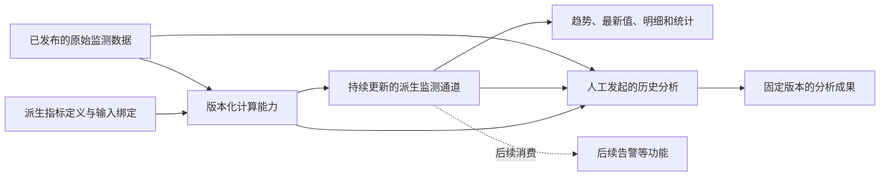

# 派生监测指标与分析成果：交付范围及验收方案（V1.0 需求基线）

日期：2026-11-12。方案状态：**Accepted（用户已确认原讨论稿，作为正式需求基线）**。功能状态：**Awaiting acceptance（2026-11-13 全部功能与必要自验完成，待用户人工验收）**。开发契约见[详细开发方案](derived-monitoring-and-analysis-development-plan.md)，实际实现与验证见[实施记录](../verification/derived-monitoring-and-analysis.md)；人工验收尚未开始。

2026-11-13用户明确调整本轮验证范围：“当前把功能需求完成了就行了，性能测试、压力测试这种先不要做了”。全部功能需求与必要功能自检保留；性能、压力、百万负载复测和2小时混合＋24小时观察暂缓，明确列为未验证，不再阻塞本轮功能交付。下文原性能目标保留作后续专项依据，不将暂缓写为通过。

## 1. 依据、已确认决定与本稿性质

起点为[规划账号权限后的下一步](codex://threads/01a1c07e-e171-7f02-bde7-b5c66f3adfb7)最后一轮建议，保留配置管理、试算、后台执行、独立分析成果、查看导出、版本追溯和权限联动。基础数据能力承接[监测数据总体方案](monitoring-data-foundation-plan.md)和[详细开发方案](monitoring-data-development-plan.md)。本稿不修改这两份方案，也不把其中规划的能力当作已经实现、验收或部署的事实。

本会话进一步确认了下列决定，覆盖原建议中不再适用的边界：

| 编号 | 已确认决定 | 对本轮的影响 |
| --- | --- | --- |
| C-01 | 本轮不设计告警。 | 不定义阈值、告警条件、等级、事件、恢复、通知或处置；交付可供后续告警使用的监测结果及计算依据。 |
| C-02 | 采用常用模板、算子组合和受限公式。 | 从四种固定方法扩展为可组合的计算能力；不提供任意脚本执行。 |
| C-03 | 持续观测的业务对象是派生监测指标。 | 计算规则是其计算依据；不能把长期指标仅实现成一次分析任务的附件。 |
| C-04 | 派生指标随输入发布自动续算，补录、撤销后自动重算；历史分析人工运行。 | 替代前一轮“全部人工计算与重算”的选择。首次历史回算由用户明确选择范围并发起。 |
| C-05 | 派生通道属于租户，可归属设施、构件或测点；项目按授权使用。 | 扩展现有仅测点下有通道的资源关系。项目分析配置和成果仍由项目管理，不因共享输入而自动共享成果。 |
| C-06 | 读取派生结果仍须具有全部输入及所用时段的数据读取权。 | 不建立仅授权结果即可绕过输入限制的路径。原会话的成果权限原则继续适用。 |
| C-07 | 首批统计包含样本数、和、最小／最大、极差、均值、总体方差／标准差、中位数、分位数，支持滚动与固定窗口。 | 趋势回归、积分、时间加权均值等暂不纳入。 |
| C-08 | 支持无环的多级派生和自动重算。 | 交付完整依赖校验、上游失效传播和按依赖顺序更新。 |
| C-09 | 指标含义改变新建通道，普通计算配置变更按版本管理。 | 明确生效边界和历史修正，不把不同含义的序列直接拼接。 |
| C-10 | 正式派生历史及修正依据长期保留，不设自动删除期限。 | 试算缓存、临时文件和到期下载文件可以清理。 |

**C-01–C-10 及下文完整交付范围、页面和验收已由用户整体确认。** 本文保留需求及验收基线；实现细节在详细开发方案中展开，不将本稿写入当前已实现功能清单。方案确认也不自动构成本会话的实施授权。

## 2. 用户最终得到什么

用户可以为一个测点建立“位移变化速率”，为一个构件建立“两个测点的差异位移”，或为设施建立“多个测点组合后的近一小时平均值”。它们有稳定身份、明确含义、单位、输入、计算方法和历史序列，可以长期选入监测工作台。

原始数据导入成功后，相关派生通道自动更新。补录或撤销输入后，受影响结果先显示“待更新／重算中”，随后切换到新的完整结果；旧版本及其依据仍可追溯。页面能区别“数据截至哪个时刻”和“计算什么时候完成”，不能用任务完成时间伪装观测时间。

用户也可以针对一个固定历史时段保存分析配置、试算、运行和导出，得到独立分析成果。之后输入变化只标记这份成果受影响；原成果不被自动改写，用户重算产生新版本。

自动更新由已发布数据变化和明确的计算时间窗口驱动。本轮继续使用导入数据验证全链路，不增加协议解析、设备连接或真实设备接入。

## 3. 领域对象与归属

| 对象 | 表达什么 | 本轮约定 |
| --- | --- | --- |
| 派生监测指标定义 | 要持续观测的业务量，例如位移变化速率、温差、窗口平均值。 | 租户内管理，版本化；定义输入槽位、输出含义、单位约束、参数及计算规则，不绑定具体观测对象。平台提供内置方法和起始模板，不建设公共算法市场。 |
| 派生计算规则 | 从输入得到输出的确定性计算约定。 | 包括算子顺序、公式、窗口、时间对齐、质量、基准及无结果条件；作为指标定义版本的一部分管理，也可复制到分析配置。无需单独建立一套规则审批系统。 |
| 派生监测通道 | 某个工程对象针对该指标的具体持续观测。 | 租户资源；引用指标定义版本，绑定明确输入通道和参数，保存启停、计算配置版本、覆盖范围和结果序列。一个通道只表达一个数值结果项。 |
| 计算运行 | 一次针对固定配置和输入版本的执行。 | 可由自动调度或人工发起；记录目标范围、输入快照、进度、重试、错误及发布结果。重试不等于建立一个新的业务指标。 |
| 分析配置 | 可反复用于历史分析的一套选取和计算约定。 | 保存规则版本、具体输入、参数、质量条件；运行时明确时间范围。允许多个输出，不自动创建正式派生通道。 |
| 分析成果 | 某次历史分析形成的结果和依据。 | 不可变版本，包含序列／统计表、配置及输入版本、运行说明、数据质量和导出信息。不是报告编辑器。 |

### 3.1 工程资源关系

- 现有直接观测通道仍属于测点，不改变其身份、设备来源或既有数据。
- 新派生通道明确选择一个所属对象：设施、构件或测点。所属设施由对象关系确定，归属对象不能靠输入列表自动猜测。
- 输入可来自同租户的多个设施／构件／测点，但必须能解释所描述的输出对象，并满足全部权限。跨租户输入不在本轮范围。
- 设施或构件的直接派生通道在该对象下展示，不建立虚假测点，不复制到每个输入测点下。
- 派生通道是业务监测通道的一种来源类型。设备来源绑定和人工原始数据导入不可写入派生通道；它只能由已配置的计算链发布结果。
- 租户统一工程资源、项目资源授权、对象详情、导航、删除引用检查和监测查询均须识别新归属。仅在计算页面另建一张私有列表不算完成。
- 项目可在明确维护委托范围内创建／维护租户派生通道；目标对象创建能力、输入数据读取、定义使用和相应计算管理权限分别检查。创建者离开项目不改变通道的租户归属。

### 3.2 指标定义与通道版本

指标定义采用草稿、校验、发布、停用及固定版本引用。发布需要明确权限和校验，无审批流。编辑已发布定义形成新版本，不自动升级已有通道。

通道的输出含义、单位、方向、参考基准和描述的工程对象属于身份语义。例如“1 小时平均位移”改成“24 小时平均位移”、位移改成速率、改变所描述的对象，须新建通道；不能更名后把两种含义的曲线直接连成一条。

未改变输出业务含义的计算配置调整仍形成新配置版本，并设置生效时刻；历史按原版本解释。常规变更只对生效时刻之后的输出生效。历史算法修正是另一个显式操作，先预览重算范围和下游影响，再发布新的历史结果版本，保留修正原因。该预览用于确认具体修改范围，不是审批流程。

基准观测、单位及指标引用必须固定版本。基准被撤销后，依赖它的结果失效；不能自动改选另一条基准。选择替代基准须明确保存新的配置及影响范围；若改变零点等业务含义则建立新通道。

## 4. 本轮完整交付范围

| 编号 | 必须交付的能力 | 完成边界 |
| --- | --- | --- |
| DM-01 | 派生指标定义与模板 | 创建、编辑草稿、校验、发布版本、复制和停用；输入槽位、参数、规则、输出含义、单位完整。 |
| DM-02 | 正式派生通道 | 设施／构件／测点归属、输入绑定、试算、启用、暂停、恢复、退役、历史回算及项目授权。 |
| DM-03 | 可组合计算能力 | 第 5 节的明确算子与受限公式；规则内多步组合；类型、单位、时间、质量、缺失和数值边界校验。 |
| DM-04 | 自动更新与依赖管理 | 输入发布、补录、撤销及上游派生变化驱动续算／局部重算；固定窗口到期计算；无环依赖、失效传播、进度、失败恢复和幂等。 |
| DM-05 | 结果、版本与追溯 | 独立派生序列、当前有效版本、历史修正、输入清单、算子／规则版本、实际取样与无结果原因；原始观测及其计数不变。 |
| DM-06 | 持续监测界面 | 原始与派生共同选择、最新值、长期趋势、分辨率切换、明细、统计、计算状态和依据下钻。 |
| DM-07 | 历史分析与独立成果 | 保存／复制配置、指定时段试算和后台运行、取消与恢复、成果比较、受影响标记、人工重算形成新版本。 |
| DM-08 | 权限、审计与导出 | 输入依赖权限递归核验、项目及历史时段限制、各操作独立授权、CSV／Parquet 后台导出、当前权限复验。 |
| DM-09 | 工程及运行交付 | 接口、迁移、worker 和调度配置、资源引用保护、监控诊断、恢复说明、正确性／故障／性能证据、人工验收材料。 |

不包含：告警业务设计或实现、协议解析和设备接入、任意用户脚本／SQL、算法市场、机器学习及自动异常判定、频谱／波形、空间剖面、报告／大屏编辑器、额度与计费。数值计算可作为后续告警的输入，但本轮不产生“正常／告警”等业务判断。

## 5. 首批计算能力与具体口径

### 5.1 明确算子清单

首版以 integer／decimal 数值序列为主。枚举值不能以编码直接参与算术；枚举状态持续时间、条件计数及事件逻辑不在本轮范围。

| 类别 | 首批交付 | 关键口径 |
| --- | --- | --- |
| 基本组合 | 加、减、乘、除、括号、正负号、绝对值、同类数值最小／最大；通道变量、节点变量、明确单位的常数参数。 | 只允许第 5.2 节规定的单位组合；除零和越界返回明确无结果状态。 |
| 基准变化 | 相对固定常数、指定观测或固定参考窗口统计值的变化量；相对变化比例。 | 保存实际基准与来源。比例为 `(x-b)/b`，显示百分比时乘 100；b=0 无结果。基准不随图表视窗或任务分块改变。 |
| 时间差分 | 相邻观测变化量、指定时间跨度变化量。 | 使用明确前驱／历史匹配规则、实际时间差与最大间隔；首个样本或匹配失败不填零。 |
| 变化速率 | 相邻或指定跨度的 `Δx/Δt`。 | 按真实时间间隔计算，可明确显示为每秒／分／小时／日；固定一日单位指 86400 秒，不混同自然日长度。 |
| 统计 | 样本数、求和、最小、最大、极差、算术平均、总体方差、总体标准差、中位数、分位数。 | 样本等权；总体方差／标准差分母 N；分位数固定 R7 口径。求和不宣称时间积分或工程累计量。 |
| 多通道组合 | 差值、同类比值、指定非负权重的加权平均、受限线性组合。 | 先按明确规则对齐，再逐个输出时刻计算；默认全部必需输入就绪，不因某通道缺失而自动改权重。 |
| 多步组合 | 组合值后滚动统计、统计序列后求速率、相对于参考统计的无量纲偏差等。 | 算子顺序有实际意义。例如“平均值的速率”和“速率的平均值”是两个不同指标。 |

常用模板至少包括：相对基准变化、相邻变化量、变化速率、两通道差值、滚动均值、滚动标准差、滚动极差、多通道加权平均。模板展开成同一套规则配置，不另建一套结果语义。

首版不提供趋势回归斜率、积分、时间加权均值、相关性／拟合、预测、任意数学函数及自定义代码。变化速率不会被标为回归趋势；样本等权均值不会被标为时间平均。若需要这些能力，应在方案确认前扩充具体清单和验收数据。

### 5.2 受限公式及单位

- 公式只引用已声明输入、前序节点及常数，使用上述白名单运算。统计、窗口、差分通过带结构化参数的算子配置，不让用户在一段自由文本里隐含时间逻辑。
- 禁止循环、递归、赋值、任意函数调用、数据库查询、网络／文件访问、动态代码和条件告警表达式。服务端解析并检查结构；不执行 JavaScript／Python，也不直接拼接 SQL。
- 加减与逐项 min/max 要求兼容的业务量、方向／基准和同一单位版本。相同单位类别不自动证明可换算或可直接比较。
- 乘除首版支持无量纲系数缩放、兼容同类量的比值；跨不同量纲的任意乘除不开放。速率的每时间单位、方差的平方单位由专用算子推导。
- 温差标明“温度差”，速率标明“温度差／时间”；不允许仅把单位标签改成另一个单位而不改变数值。涉及绝对温标的乘除、比例须先显式形成允许的差量，不能将摄氏绝对读数比值当作物理比例。
- 没有既有单位自动转换能力时，不凭名称或类别执行转换。首版不建设通用单位换算引擎；不兼容输入在绑定阶段拒绝并说明具体差异。
- 输出单位由规则推导并固定，用户填写名称和业务说明，不能用自由单位字符串覆盖校验结果。派生单位描述与已有单位版本关联，不要求用户为每一个“毫米／小时”创建虚假的原始通道。
- 同一规则内支持有序、无环的多步组合。正式通道只有一个输出；多个需要长期观察的输出分别建立通道，并可复用上游派生通道。

### 5.3 窗口与样本

支持按时间长度的滚动窗口、最近 N 个样本窗口、固定时长不重叠窗口，以及按指定时区自然日／月／年的窗口。历史分析还可对整个选定范围计算一次统计。

| 参数 | 必须明确的内容 |
| --- | --- |
| 窗口 | 类型、长度或样本数、输出步长、时间锚点、自然日历时区。 |
| 样本准入 | 质量集合、最少有效样本数、允许最大间隔、末个样本最大年龄；最近 N 样本窗另设最大时间跨度。 |
| 输出时刻 | 以主输入观测时刻输出，或在明确的固定网格／自然窗口结束时输出。不能由 worker 执行时间代替。 |
| 不足处理 | 样本不足、缺必需输入、超间隔时返回带原因的空值；不自动缩短窗口、补零、插值或沿用上次结果。 |
| 完整性 | 样本数、排除数、实际最早／最新输入、跨度、时间匹配偏差、窗口范围及覆盖说明。 |

查询范围沿用 `[from,to)`；基于观测时刻 t 的滚动时间窗明确为 `(t-W,t]`，包含当前样本。固定／自然分组窗口使用 `[start,end)`，结果定位在 end，保存完整区间。两种边界写入算法版本和测试，不以 SQL 默认 frame 决定业务行为。

没有明确历史采样计划时，不推断“应有多少样本”或宣称 100% 完整；最少样本数达标只表示满足该计算的样本门槛。N=0 时计数可为 0，其他统计为无结果；N=1 时总体方差和标准差数学值为 0，但仍须通过配置的最少样本条件。

既有 `interval_end` 来源含真实区间但可能只有自由文本聚合说明。首版只允许在完整区间一致、聚合含义明确兼容时直接组合这类输入；不把已聚合结果当成瞬时原始样本再次平均。新派生窗口序列具有机器可读语义，可明确计算“窗口均值序列的统计／速率”，必须如实命名，不能冒充对底层全部原始样本的统计。

### 5.4 数值精度与分位数

原始输入保留基础方案的整数／十进制和纳秒时间契约。计算不从降采样图表或显示舍入值取数。加减乘除、和、均值、方差优先保留整数系数及有理状态；开方使用高精度计算，标准输出精度和 half-even 舍入随算法版本固定。正式数值通过十进制字符串传输，绘图坐标近似值不能回流参与计算。

派生结果建议固定 18 位小数的输出规范，写入适合派生结果范围的类型；输入仍不改变基础方案的 Decimal128(12) 边界。高精度中间态不在每一步按 UI 小数位舍入；跨正式派生通道的输入采用该通道已发布规范值，回放也采用同一规范值。精度损失和溢出必须显式说明，超出能力返回 `numeric_out_of_range`，不能饱和截断或转成无穷大。具体物理类型在开发设计阶段按数值样本验证，不能先假定沿用原始列类型一定足够。

对排序值 `x[1..N]`，P 分位数令 `p=P/100`、`h=1+(N-1)p`，在相邻序位间线性插值；P=0/100 分别返回最小／最大值，N=1 返回该样本。中位数为 P50。选择这一口径是本项目的建议，统计软件存在多种分位数定义，必须将算法写明。[NIST 分位数说明](https://www.itl.nist.gov/div898/handbook/prc/section2/prc262.htm)

分位数不能通过平均各块分位数合并。首版返回精确样本分位数，不隐式切换近似算法。大窗口采用有界内存、落盘／分块排序或有证据的等价实现；超出运行预算明确拒绝或转后台，不截断样本。ClickHouse 的精确分位数实现可能需要随样本量增长的状态，不能仅因函数名称含 exact 就承诺任意窗口的内存和吞吐。[ClickHouse 官方说明](https://clickhouse.com/docs/reference/functions/aggregate-functions/quantileExact)

## 6. 时间对齐、质量及计算状态

### 6.1 多通道时间对齐

先明确输出时间轴，再决定每个输入怎样匹配：

1. **同一时刻匹配**：同一 UTC 纳秒时间匹配；不能按数组行号配对。
2. **向前取最近已知值**：选择不晚于输出时刻、在容差内的最近样本；显示实际输入时刻、年龄和复用情况。持续派生可使用，容差必填，不能无限延续。
3. **相同统计窗口**：各输入先按相同起止及语义统计，再组合结果；不能把两个不同范围的均值直接当成同一窗口。
4. **双向最近匹配**：保留给明确选择的历史分析，等距取较早者，显示实际偏移和复用情况。因为可能使用输出时刻之后的样本，该配置标记为历史分析专用，不能直接启用为持续派生指标。

速率使用实际配对时间差。零时间差、跨度超限或没有前驱时无有效结果。默认不跨越被排除质量形成的无效段求相邻速率；首版允许显式选择“跳过排除样本”，必须记录该选择并仍检查实际跨度。滚动统计可按所选质量筛除样本，但须显示排除数量和覆盖限制。

持续派生在输出时刻 t 只能依赖时刻不晚于 t 的输入；基准观测或基准窗口也受此限制。基准时刻／窗口结束之前的输出不能回算成持续指标的有效值；需要用后来的基准解释更早历史时，使用明确标记的历史分析。未来时刻的数据不会提前成为当前持续观测值。

在任务切块、查询起点、首次回算和重算边界，计算所需的前驱、窗口前缀及基准仍要完整读取并检查权限。不能把每个任务块第一条都当成序列第一条，也不能随分页改变结果。

### 6.2 质量与状态分开

输入默认使用 good + unmarked。允许的质量筛选沿用基础观测语义；若主动包含 suspect／bad，结果保留相应质量及原因，不转成 good。unmarked 不表示系统已经验证有效。

| 维度 | 表达什么 | 例子 |
| --- | --- | --- |
| 计算状态 | 是否按当前版本得到了可用数值。 | 有结果、样本不足、缺少输入、超间隔、除零、数值越界、等待计算、计算失败。 |
| 数据质量 | 所用数据的质量和派生质量依据。 | good／unmarked／suspect／bad、排除数、质量规则版本。 |
| 新鲜度 | 是否仍对应当前有效输入。 | 当前、受影响待更新、重算中、历史版本。 |

三个维度都要保留。执行成功但样本不足可以产生完整的“无结果说明”，不能因此标记为服务故障；任务执行失败也不能伪装成数据缺测。最新时刻无结果时，可另列上一条有效值及其时间，但不能把它当作本时刻结果。

## 7. 自动更新、派生依赖与生命周期

### 7.1 触发和执行

- 监听基础数据正式发布、补录、撤销、重新采用及派生结果发布的持久变化记录。上传文件但未正式发布不触发正式计算。
- 以观测时刻处理乱序和历史输入；事件携带通道、受影响时间范围和数据修订。合并重复影响范围，按有界任务处理。
- 固定网格和自然窗口由持久调度器在窗口关闭及配置等待时间后触发；重启补齐已到期窗口。等待时间只容纳迟到数据，不代表此后永远不会更正。
- 发布前固定输入快照、计算配置和算法版本，按输入依赖取数。结果块准备完、完整性核对成功后才切换当前版本。
- 分块租约、重试、取消及恢复复用基础任务机制；失败重试幂等，半成品不进入正式曲线。worker 水平扩展时同一逻辑结果只能有一个当前采用版本。
- 调度器运行于租户有效配置，不能长期冒用创建者会话。成员离开或项目归档不使其他获准项目使用的租户派生通道停算；创建／修改配置时的项目维护授权仍必须检查。租户停用和通道暂停按生命周期停止新计算。

### 7.2 派生通道作为输入

允许使用其他派生通道作为输入，例如先建立“温差”，再建立“温差的小时平均”和“小时平均变化速率”。这属于持续派生指标的依赖管理，不是外部脚本执行平台。

保存和启用时检查整个依赖图，禁止直接／间接循环、跨租户引用和不可用定义；并发修改也不能构成环。按拓扑顺序执行；上游受影响时下游立即失去“当前”资格，待所需上游新版本就绪后再算。一个输出使用的所有上游版本必须与目标源数据快照在所依赖范围内一致，不能把一部分重算后的值与另一部分已失效旧值混用。经确认未受影响的上游块可以继续复用，不因全租户发布序号增加而全部重算。

默认保护值建议为：单规则最多 32 个算子节点、单通道最多 16 个直接输入、跨通道依赖最多 8 层。它们是可配置的工程预算建议，待样本验证，不是已确认的业务额度；超过时在配置校验阶段明确反馈，不能保存后静默丢弃依赖。

### 7.3 影响范围与失效

| 计算形式 | 需要覆盖的受影响输出 |
| --- | --- |
| 逐时刻组合／容差匹配 | 直接时刻及可能因新增、删除样本而改选匹配对象的全部时间范围。 |
| 前后差分／变化速率 | 改变处及相邻关系被改变的后继点；同时比较变更前、后的邻接关系。 |
| 时间滚动窗口 | 输入变化点落入的全部输出窗口，通常向后扩展窗口长度；再按输出步长取范围。 |
| 最近 N 样本窗口 | 变更前后可能包含该样本的后续 N 样本范围，不能只修改输入同一时刻。 |
| 固定／自然窗口 | 所属窗口及依赖该窗口的下游范围。 |
| 固定基准 | 所有使用该基准的输出；基准被撤销则先阻止这些结果作为当前值使用。 |

影响标记必须与输入变化可见性衔接：正式查询不能在输入已撤销但后台尚未扫描到依赖时继续把旧值返回为当前值。查询结合源数据修订和依赖状态验证；尚未判定的范围返回“待核对／更新”，旧值只能显式作为历史版本查看。

重算生成新版本，按完整发布单元切换；同一发布单元不能混用部分新块与已失效旧块，未受影响的其他范围可继续引用原块。任务发布前复核目标配置和相关输入变化，过时 worker 不能覆盖新结果或清除更晚的影响标记。被影响的旧成果导出也必须带历史状态并复核权限。

每次自动运行处理有界目标快照和范围。后续新数据不混进正在执行的输入集合，也不因无关追加而使整次运行作废；已完成且未受影响的范围可以发布并推进计算截至位置。与新变更重叠的范围保留待更新标记，继续处理下一代任务。这样持续追加时仍能稳步推进，不要求全租户数据暂时停止变化才能发布。

### 7.4 启用、暂停、恢复和退役

| 操作 | 可观察行为 |
| --- | --- |
| 保存草稿／试算 | 不写入正式派生序列，不影响已发布原始数据。 |
| 首次启用 | 明确自动计算起点；同时可勾选历史回算范围，预估输入／输出量。未回算的早期历史显示未覆盖，不解释成缺测。 |
| 暂停 | 停止新增执行，保留历史；输入变化仍记录影响，不能让暂停期间旧结果一直显示为当前。 |
| 恢复 | 明确从暂停点补算或从指定时刻继续，展示未覆盖区间；默认建议补齐暂停期间。 |
| 退役 | 停止新增输出，历史保留；若仍被启用下游引用，须明确处理下游依赖后才能退役。 |
| 删除 | 只允许无正式结果、无被引用关系的草稿删除；正式数据通过退役及版本记录管理。 |

改变公式、参数或输入绑定不覆盖原配置。下游依赖、工程对象退役、指标停用及项目授权变化均有影响说明；停用定义不抹去历史解释。

首次启用和回算会读取所需的历史前缀，但不会擅自扩大正式输出范围。若上游派生尚未覆盖所需前缀，预览须说明依赖的回算范围；用户可一并发起获准的依赖回算，否则按真实不足状态处理，不能把缺少前缀当成零值。

## 8. 正式结果与历史分析成果

### 8.1 正式派生结果

每个结果至少保存：派生通道、输出时刻／区间、结果项、值或无结果原因、质量、配置与算法版本、源数据快照、上游结果版本、计算运行、实际取样范围、样本数量及时间对齐依据。

输入追溯不能只保存“当前公式”。差分／配对／基准可以保存具体观测身份；大窗口通过不可变输入清单、通道范围和快照定位，可按需枚举实际样本，不为每个滚动结果复制一整份巨大输入列表。回放必须能得到与当时一致的输入和算法。

原始观测与派生结果分开存放和计数。界面分别说明原始当前在用数、派生输出数、有效结果数及无结果数；重算、重试和修订不增加原始累计唯一入库数。原始批次撤销不删除派生历史，但会使相关当前结果失效。

正式派生历史与版本依据不设置自动删除期限；试算、临时块和到期下载文件可以清理。中间缓存可重建，不要求全部中间节点永久物化。容量验收必须计算结果密度、滚动步长、修订次数、依赖层数和副本，不能只计算原始数据条数。

### 8.2 历史分析

租户和项目各自拥有本空间的分析配置及成果。项目共享输入不意味着共享配置或成果；不自动把项目分析成果提升为租户正式派生通道。

流程为保存／复制配置 → 指定时段与数据条件 → 小范围试算 → 人工运行 → 查看成果 → 比较或导出。可直接选已有派生通道，也可使用同一计算能力建立本次分析步骤；双向最近匹配只在此明确启用。

分析运行固定输入快照和配置版本。普通追加／补录不混入运行中的固定快照；完成时核对所依赖范围是否已变化，变化则明确标记该成果基于旧快照。输入撤销使基础查询快照失效时，运行停止并要求刷新输入重新发起；已经完成的成果保留并标记受影响。发布新的指标版本或编辑保存的分析配置不重解释已经启动的运行，新运行可明确采用新版本。成果提供原始与派生曲线比较、结果明细、统计及依据；不生成告警事件。

重算创建新成果版本，可与原版本比较参数、样本数、质量及结果差异；系统不得覆盖旧成果。固定成果既不随实时通道自动刷新，也不因创建者离开就失去组织归属；访问仍受当前权限约束。

## 9. 权限与组织生命周期

操作权限建议区分：定义读取／管理／发布，派生通道读取／创建维护／启停／历史回算，计算运行读取／取消重试，结果历史读取，结果导出，分析配置管理／执行／成果读取导出。正式键名由既有权限目录流程确定，不能在前端另造权限解释。

对于每一段派生结果，项目有效读取条件为：当前成员与生命周期允许读取 ∩ 派生通道及数据范围授权 ∩ 全部递归输入通道的资源授权 ∩ 实际依赖时段的数据读取授权。拥有输出时刻的权限不表示可以使用窗口之前或基准时刻的数据。

依赖时段包括窗口、前驱搜索、容差候选范围和基准范围，不仅是最终命中的几条样本。无结果、被排除样本数及匹配选择同样可能依赖这些范围，不能通过只检查命中行绕过授权。

- 仅检查直接输入不够；派生再派生要一直验证到原始输入。原始数据快照固定不代表访问资格被固定。
- 授权裁剪按结果依赖进行。不能拿少授权的一半输入重新计算另一个值后继续使用同一正式结果身份；应说明该结果不可访问。
- 对被撤销原始输入形成的历史结果，还需符合原始历史读取授权；不能从派生历史反向泄露已无权读取的原值。
- 导出需要输出导出权限，以及全部所用输入的相应数据导出范围；完整原文件下载仍走基础方案的独立权限。
- 读取、试算、运行、发布、下载和长任务分块都校验相应资格。自动维护属于租户配置的计算任务，与用户发起的分析／导出任务分开鉴权。
- 项目失去输入授权后，其派生结果、统计、缓存、来源预览和下载立即受限；通道仍可为其他有权项目继续计算。项目入口不回退使用租户权限。
- 项目归档保留获准读取和导出，停止新建／修改分析及项目维护操作；租户统一派生通道是否继续计算由通道和租户状态决定。
- 审计记录定义／配置发布、输入变更、启停、历史修正、回算、取消、授权及成果操作；不记录含有隐藏输入值的无权错误信息。

## 10. 做成什么样：页面和操作流程

沿用现有 React／TypeScript、共享 UI、表格、表单和监测工作台，不重新引入独立视觉体系。高级配置使用逐步展开的表单和步骤列表；本轮不以可拖拽画布作为唯一操作方式。

| 页面／区域 | 用户能完成的事情 |
| --- | --- |
| 派生指标定义 | 看业务含义、输出类型／单位、输入要求、发布版本及使用情况；从模板创建，编辑规则，校验并发布。 |
| 派生通道列表 | 按工程对象、指标、启停与计算状态筛选；查看最新结果时刻、已计算范围、积压／失败、当前配置版本。 |
| 通道配置 | 选择所属设施／构件／测点 → 选择指标定义 → 绑定输入 → 设置窗口／对齐／质量／基准 → 设置起点和回算范围 → 试算 → 启用。 |
| 规则编辑与试算 | 每一步显示输入、方法、参数、输出单位及错误；试算可逐点展开实际输入、时间差、样本数、计算步骤及无结果原因。 |
| 监测工作台 | 原始／派生类型筛选；选择设施或构件时可选其直接派生通道，测点选择仍保留；最新值、曲线、明细、统计和导出统一使用。 |
| 派生通道详情 | 业务说明、依赖关系、配置历史、覆盖／计算状态、最近运行、重算原因、历史版本及依据下钻。 |
| 历史分析 | 保存配置、选时段运行，查看任务、成果版本、受影响原因和版本比较。 |
| 运行记录 | 区别自动续算、自动重算、人工回算、试算、历史分析；展示阶段、处理范围、失败原因和可执行恢复操作。 |

展示要求：

1. 同语义兼容单位才同轴；其他分图。派生曲线标识类型、计算口径及版本边界，不能混同原始观测。
2. “观测截至”“计算完成于”“输入数据版本”“更新中”分开展示。旧值、未计算范围、缺测、计算失败分别表达；不只用颜色区分。
3. 试算不截取前 N 行冒充整个指定范围。超预算明确缩小时段或后台试算；正式发布只使用真实完整输入。
4. 图表仍按视窗加载、点数有界，统计使用正式结果及对应快照，不从图表降采样点计算。
5. 配置较多时保留草稿和校验摘要。错误定位到输入或算子字段，提交失败后可用键盘定位；错误摘要不替代字段错误。窗口／步长／容差显示业务单位，内部任务或存储细节放在诊断区。
6. 输入失权时清除缓存和迟到响应，不暴露隐藏通道名称或数据。来源详情无权与输入缺测使用不同状态，但错误信息不披露隐藏内容。

## 11. 技术方案及与基础闭环的衔接

本轮在基础闭环的已验证实现上增量开发。它所需的发布变更记录、输入快照、历史查询、任务和摘要一致性若尚未交付，列为前置条件，不通过复制一套新数据链路绕过。

| 技术 | 准确职责及选择理由 |
| --- | --- |
| Go 及现有 API 模块 | 领域规则、权限、公式结构校验、依赖图、运行计划和版本发布；通过现有 HTTP 契约对前端开放。与设备接入和告警业务保持清晰职责。 |
| 独立 Go worker | 自动续算、局部重算、历史回算、试算与分析；同一计算实现按运行模式使用，避免预览、分析和持续指标三套算法。 |
| PostgreSQL、pgx、Goose | 指标与配置版本、资源归属、依赖关系、持久变化记录、调度游标、任务、当前结果清单、授权及审计。增量迁移保留旧通道和原始数据。 |
| ClickHouse | 派生序列、当前／历史结果块与摘要，复用通道时间裁剪和分片能力；不靠后台去重保证业务结果唯一。按输入读取合并、分块计算，再显式发布。 |
| S3 兼容对象存储 | 大输入／结果清单、回放依据、导出、临时排序及恢复材料；生命周期区分正式依据和临时产物。 |
| Go math/big 与版本化数值实现 | 复用高精度整数／有理数和开方能力，避免原始大整数及细小变化在 Float64 中丢失。具体算法和舍入由项目测试固定。[标准库文档](https://pkg.go.dev/math/big) |
| React／TypeScript、TanStack 和共享 UI | 配置、运行、授权与成果页面；复用请求取消、工作空间切换、表单校验和服务端状态。 |
| 基础方案确定的 ECharts 与视窗控制器 | 原始／派生趋势及版本边界展示；不在浏览器执行正式计算。 |
| OpenAPI、Go test、Playwright | 契约生成、数值／跨存储／权限／故障验证，以及关键页面的可操作验收。 |

初版不因自动派生就新增 Kafka、Flink、Spark 或另一个分析数据库。先使用基础方案的持久变化记录、任务及 worker；自动更新的实际吞吐和延迟必须测量，不能把持续观测表述成已经实现的毫秒级流处理。

对后续消费者提供的是有明确语义的结果契约：稳定派生通道身份、输出时刻／区间、值、质量、计算状态、新鲜度、配置版本、结果修订及来源依据。告警可在后续按当时需求读取或订阅这些数据变化，本轮不创建告警接口、阈值配置或事件空实现。

## 12. 后续实施拆分与交付物

这里是实施顺序建议，不代表现在开始实施：

1. **规则及数值契约**：冻结代表性样本、算子、窗口、单位和无结果语义，完成独立计算用例。
2. **定义与资源模型**：指标版本、设施／构件派生通道、输入绑定、权限和引用保护，完成试算。
3. **持续序列闭环**：单通道自动续算、正式发布、工作台查看，再加入多通道组合和固定窗口。
4. **重算与依赖**：补录／撤销、无环派生依赖、下游失效、并发发布及故障恢复。
5. **历史分析成果**：人工运行、固定版本、比较、受影响标记与导出。
6. **整体交付**：迁移兼容、授权回归、混合负载、恢复演练、操作手册和人工验收。

最终交付：已确认需求与详细开发约定、迁移和接口、指标／通道／分析页面、计算与调度能力、数值夹具和测试、运行诊断及恢复说明、性能证据、启动访问说明、人工验收清单。完成其中一部分不能把整个迭代改为 Awaiting acceptance。

## 13. 可手算的验收样本

在独立验收环境创建位移通道 A、B，单位相同、方向和基准兼容，质量均为 good，时区为 Asia/Shanghai。样本日期可任选同一天，时刻如下：

| 时刻 | A（mm） | B（mm） |
| --- | ---: | ---: |
| 00:00 | 10 | 6 |
| 00:10 | 14 | 9 |
| 00:30 | 20 | 11 |

| 验收项 | 配置／操作 | 预期结果 |
| --- | --- | --- |
| 基准变化 | A，以 00:00 的 10 为固定基准。 | 0、4、10 mm；能定位该基准原始观测。 |
| 相邻变化 | A，最大间隔 30 分钟。 | 首点无前驱；后两点 4、6 mm。 |
| 相邻速率 | A，以 mm/min 显示。 | 首点无前驱；00:10 为 0.4，00:30 为 0.3；不能把 20 分钟按 10 分钟计算。 |
| 通道差值 | A-B，完全同刻匹配。 | 4、5、9 mm。 |
| 滚动统计 | A，30 分钟滚动窗 `(t-30min,t]`，最少 2 样本。 | 00:30 用 14、20，N=2、均值 17、总体方差 9、标准差 3、极差 6、中位数 17、P95=19.7。 |
| 多步顺序 | 先求 A 的 30 分钟均值，再求相邻均值速率。 | 00:10 均值 12，00:30 均值 17，后者速率为 0.25 mm/min。 |
| 顺序不能混同 | 先求 A 的相邻速率，再求其 30 分钟均值。 | 00:30 对 0.4、0.3 求均值得 0.35 mm/min，与上一项不同。 |
| 派生依赖 | C=A-B；D 为 C 的 30 分钟滚动均值，最少 2 样本。 | 00:30 为 (5+9)/2=7 mm，能追溯至 A、B 的对应输入。 |

数值为手算期望，尚不是已经执行通过的测试结果。后续以这些用例及边界夹具分别验证服务端计算、任务分块和页面展示。

## 14. 完整人工验收矩阵

| 编号 | 用户操作／场景 | 必须观察到的结果 |
| --- | --- | --- |
| MA-01 | 从模板发布“变化速率”指标，绑定一个测点通道。 | 定义版本、输入、单位、参数明确；试算符合第 13 节，启用后出现稳定派生通道。 |
| MA-02 | 为构件／设施建立跨测点差值或加权指标。 | 挂在真实所属对象下，可授权项目使用；没有虚构测点和项目数据副本。 |
| MA-03 | 编辑多步规则及受限公式。 | 表达式、输入和节点顺序可见；未声明变量、非法函数、错误单位、循环引用在保存／启用前拒绝。 |
| MA-04 | 验证统计、基准、差分和速率。 | 第 13 节结果正确；N=0、N=1、除零、大整数、微小差值及负值有明确结果或原因。 |
| MA-05 | 输入时间不齐、缺值、超过容差。 | 使用真实时间匹配并显示偏差；超过容差为空且有原因，不补零、不按行号配对。 |
| MA-06 | 比较连续派生与历史分析的时间匹配，并设置晚于输出时刻的基准。 | 连续派生及其基准不使用未来输入；双向最近或回顾性基准配置只可用于明确的历史分析。 |
| MA-07 | 导入一批新数据并正式发布。 | 无须再点击计算，相关指标自动更新；未发布文件和失败导入不影响正式结果；显示数据时刻与完成时刻。 |
| MA-08 | 等待固定窗口结束及重启调度进程。 | 窗口按配置边界输出；重启补齐到期任务；没样本不伪造零测量值。 |
| MA-09 | 在历史窗口中补录一个值。 | 统计窗口、匹配关系、差分及下游影响范围正确重算；其他范围的结果不被重写。 |
| MA-10 | 撤销输入批次或基准观测。 | 旧当前结果立即标记受影响，不再冒充当前；自动重算或显示基准失效，历史版本可按权限追溯。 |
| MA-11 | C 引用 D，尝试再让 D 依赖 C；并发修改依赖。 | 直接及间接循环均被拒绝；合法多层依赖按上游完整版本顺序更新。 |
| MA-12 | 更新定义、切换配置和历史修正。 | 已有通道不会自动采用新定义；新配置有生效边界；改变指标含义需新通道；历史修正保留旧结果和原因。 |
| MA-13 | 暂停、恢复、退役或删除被引用通道。 | 状态与覆盖范围真实；恢复按选择补算；引用保护生效；历史结果不因退役丢失。 |
| MA-14 | 只授予派生通道，缺一个输入或窗口之前的时段。 | 无法读取该结果，也不能通过统计、缓存、试算、来源或导出绕过；补齐必要授权后才能访问。 |
| MA-15 | 撤回项目输入授权，或成员离开／项目归档。 | 本项目访问与任务依当前资格变化；其他有权项目仍可使用租户通道；归档阅读与导出按既定规则保留。 |
| MA-16 | 保存分析配置，运行两次并改变输入。 | 成果有固定依据和版本；旧成果标记受影响，人工重算生成新成果；不悄悄修改原成果。 |
| MA-17 | 查看多年派生历史、明细、统计并导出。 | 按视窗与游标加载、同快照统计、单位和质量明确，导出可复核；原始累计入库数不因派生增加。 |
| MA-18 | 在任务中断、重复投递、节点不可用时恢复。 | 重试不产生重复当前结果，未完成块不发布；进度、失败、恢复和数据缺测可区分。 |
| MA-19 | 重算期间再次补录或切换规则，并持续追加新数据。 | 旧任务不能覆盖较新目标；下游不混用不一致上游版本；影响标记不被提前清除；无关追加不会使计算永久无法推进。 |
| MA-20 | 从独立备份恢复后抽查规则、依赖、当前及历史结果。 | 原始依据、派生配置、清单和结果对应；可重放得到约定精度的一致结果，权限仍生效。 |

## 15. 性能、恢复与完成判据

正确性测试覆盖：单块／多块等价、窗口及分块边界、纳秒和时区／夏令时、迟到及撤销、规则版本、精度、质量、权限递归、跨存储发布和依赖并发。测试使用真实基础存储组件，不用内存替身证明持久任务及权限效果。

性能分开测量：

- 小窗口试算交互延迟。
- 从输入正式发布到派生结果可见的排队、执行和发布耗时。
- 事件密度、窗口长度、步长、输入数和依赖层数下的持续处理能力。
- 历史回算吞吐、补录／撤销影响展开、分位数内存与临时磁盘使用。
- 自动续算与历史回算、浏览及导出混合时的延迟、取消和资源占用。
- 长历史派生数据查询、备份恢复及原始数据链路回归。

建议把小窗口试算 P95≤3 秒、规定参考负载下自动更新 P95≤10 秒作为初始验收目标，固定窗口另加配置等待时间；这些是**待参考硬件和样本规模冻结的目标，不是现有性能承诺**。历史回算必须记录输入／输出规模、硬件、窗口与依赖复杂度后确定最低吞吐及恢复时间；不能用少量数据通过冒充百亿级能力。精确分位数超预算的拒绝行为也需可验收，不能使前台查询失控。

在实施前冻结参考场景、资源预算、最大窗口与步长组合、输出精度／范围和性能阈值；若达不到，明确调整能力范围或资源并重新确认，不静默替换近似算法。此项属于实施前验证输入，本稿未执行压测。

只有 DM-01–DM-09 功能均交付、必要功能自验通过、操作及人工验收材料完整，功能才进入 **Awaiting acceptance**；性能、压力及长时观察按2026-11-13用户决定暂缓，保持未验证。用户明确验收后才标记 **Accepted**。方案自检、软件自验和用户验收分别记录。

## 16. 方案检查与确认记录

当前已完成：核对原会话最后建议、现有业务词汇、资源／单位／授权规则、基础监测两份方案，并记录本会话 C-01–C-10 的决定。尚未开始代码、迁移、运行测试或部署。

本稿整体审阅时的重点如下，现已按用户“没问题，按照上面的方案讨论稿”确认收敛：

1. 第 5–7 节的具体计算口径、单位限制、时间匹配和持续运行行为是否满足实际场景。
2. 第 10 节页面流程以及 MA-01–MA-20 是否足以验证用户期望的完整交付。
3. 性能参考环境、负载和运行预算在后续实施前验证中冻结，当前未执行性能或容量验证。

C-01–C-10、DM-01–DM-09 和 MA-01–MA-20 作为已确认需求基线；不再重复询问同一业务决定。后续完整技术约定见详细开发方案，环境与性能阈值仍按实施前验证规则冻结。本会话当前仍只做规划。

### 原讨论稿文档自检记录（2026-11-12）

| 检查项 | 本次结果 |
| --- | --- |
| 需求来源与决定 | 已核对引用会话最后交付建议，并逐项记录本会话的范围修正及 C-01–C-10。 |
| 范围和验收编号 | C-01–C-10、DM-01–DM-09、MA-01–MA-20 完整、无重号。 |
| 文档结构及引用 | 本稿、GLOSSARY 和文档索引的围栏、表格列数、行尾空白及 47 个本地链接目标检查通过；相关已跟踪文档的 git diff --check 通过。 |
| 数值样例 | 第 13 节全部数值以独立有理数运算复核通过，包含 0.25／0.35 的算子顺序差异和 P95=19.7。只是验收期望校验，不是应用算法测试。 |
| 基础方案保护 | 两份基础监测方案没有本次修改，git diff 核对一致。 |
| 未验证项 | 未实现功能，未运行应用／接口／浏览器／迁移／恢复或性能测试；方案自检不能替代后续功能自验。 |
| 用户验收 | 原自检时为十项业务决定确认、讨论稿待审阅；用户随后确认整稿并要求正式开发文档。此处更新为需求方案 Accepted，功能仍未开始实现。 |
