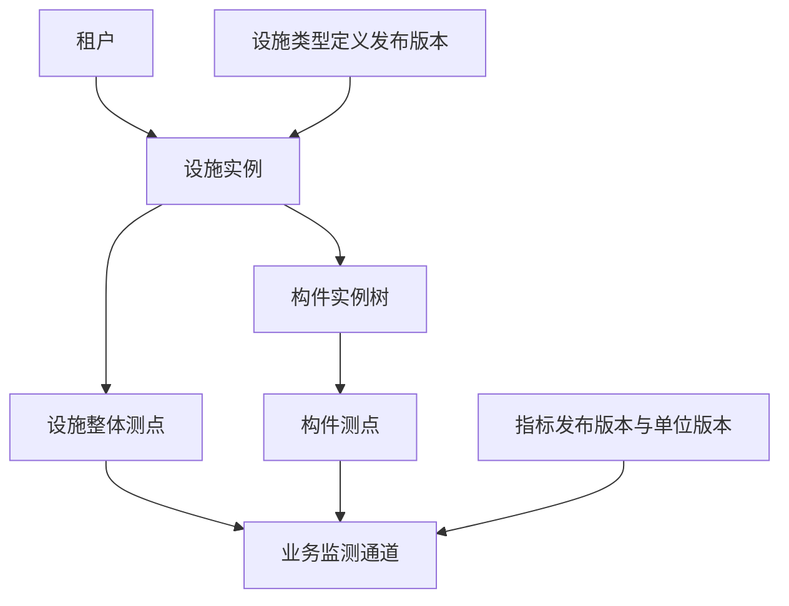

# 设施实例、构件、测点与业务监测通道管理详细方案

日期：2026-11-10。版本：V1.0。迭代状态：**Awaiting acceptance（本轮全部实现及自验完成，待人工验收）**。

后续方案：2026-11-11 的[租户统一资源与项目授权管理重构详细方案](project-resource-management-refactor-plan.md)在保留本文统一资源模型的基础上，设计项目资源授权和项目内受限建档。该重构当前仅完成方案，不改变本文记录的既有实现及验收状态。

用户已确认本轮总体方案，并要求形成用于指导代码开发的详细方案。本文将已确认原则落实为开发约定；不把方案确认、文档检查或既有模块的验证当作本轮功能自验与人工验收。

## 1. 依据与最新决定

本轮源于[《规划账号权限后的下一步》](codex://threads/01a1c07e-e171-7f02-bde7-b5c66f3adfb7)最后提出的七项真实资源交付，结合当前会话的调整，以本文为实例管理的实施依据。

| 编号 | 已确认原则 | 开发含义 |
| --- | --- | --- |
| ER-01 | 本轮保持原七项资源管理范围 | 路线地图场景只用于位置设计，不增加项目、路线管理或地图功能。 |
| ER-02 | 不单独建模项目监测方案 | 无监测方案实体、表、接口、身份、发布或运行流程；实际配置归属设施、构件、测点与通道。 |
| ER-03 | 直接创建和维护实际对象 | 无建档向导、完成度、草稿、待完善、完成配置或发布后启用步骤。 |
| ER-04 | 本轮选中构件添加测点 | 图上布点和三维模型布点留到后续；本轮没有上传图纸、加载模型、点击图形取点功能。 |
| ER-05 | 后续展示绑定已有测点 | 测点具有独立稳定身份；布设图与三维模型绑定不重建测点和通道。 |
| ER-06 | 位置考虑路线、桩号、坐标及两类断面 | 在已有对象的位置内容中表达，断面区分工程断面与设施内部监测断面。 |
| ER-07 | 最少构件数量只作实例结构参考 | 用户于本次详细设计讨论明确：少于类型定义的最少数量，仍可正常保存和使用，不设置待完善状态。 |
| ER-08 | 工程资源由租户统一管理 | 本轮在租户工作空间维护，不要求先创建或关联项目；项目管理员身份不自动获得资源访问权。 |

此前文档中“项目各自创建监测方案”“实例草稿”“完成建档后检查完整性”等描述，对本轮及后续实例设计不再适用。类型、指标、单位和模板等**定义内容**原有的草稿、发布与不可变版本机制仍属于定义管理，不套用到实际资源。

本文中的字段、权限编码、操作细节为 Codex 在上述原则下提出的具体开发约定。用户的总体确认不等同于功能实现、自验通过或人工验收。

## 2. 目标、范围与交付映射

目标：有权租户成员在一个设施内管理实际构件，选中设施整体或构件添加测点，再为测点配置业务监测通道；所有操作直接保存并可追溯。

| 原交付项 | 本轮落地内容 |
| --- | --- |
| 真实设施建档 | 产品统一使用“设施”“新增设施”“编辑设施”；选择类型版本，维护名称、编号、工程属性、位置与来源说明，提供列表、搜索、详情。 |
| 实际构件管理 | 创建、编辑、调整同设施内父级，维护构件树、位置与属性；校验实际节点和允许关系。 |
| 测点管理 | 对设施整体或选中的构件新增、查看、编辑测点，维护位置、监测目的、方向与参考说明。 |
| 业务通道管理 | 在测点下配置指标、单位、观测含义与计划采样信息，支持查看和编辑允许变更的内容。 |
| 分步配置与生命周期 | 调整为直接操作、实际退役/恢复和依赖保护；取消进度状态及启用门槛。 |
| 版本与变更历史 | 固定定义版本，保存对象修订及关键变更；无实例发布版本流程。 |
| 权限、隔离与工程交付 | 租户查看/维护权限、审计、并发、迁移、真实页面和接口、自验及人工验收说明。 |

本轮不建设：项目资源使用授权或维护委托、项目地图及路线筛选、独立路线/区段/断面目录、GIS 查询与坐标转换、图纸或模型上传及绑定、独立监测方案、模板应用或批量生成实例、设备及数据来源绑定、采集、观测数据存储、曲线、告警、视频、巡检、审批、额度与用量控制。

已有监测模板管理保持其所属迭代范围。本轮创建设施、测点和通道不依赖模板，不添加 template_id 或 plan_id 作为资源必填项，也不自动删除既有模板。后续模板若用于配置复用，直接作用于具体对象，不生成独立方案实例。

## 3. 现有代码基线与需要衔接的部分

本稿核对了当前工作区源码；存在实现文件不表示该模块已经完成人工验收。

| 现有内容 | 实际情况 | 本轮处理 |
| --- | --- | --- |
| `packages/go/platform/engineering` | 管理设施类型定义、指标、单位、监测模板；具有不可变发布版本及依赖状态解析 | 继续拥有定义，不混入真实对象 CRUD。 |
| `engineering.ValidateValues`、`FieldsSchema` | 已能校验定义驱动的属性值 | 复用字段校验，统一错误路径和字段含义。 |
| `engineering.ValidateSample` | 面向样例，包含最少数量和最多 500 节点限制 | 不直接作为真实实例保存器；实例校验单独实现，明确最少数量不阻断。 |
| `engineering` 的 `resolver` | 当前是包内实现，能够解析发布版本及依赖，但不提供实例业务接口 | 提取有限的事务内公共读取接口，保持授权责任明确；不得在新包复制整套解析 SQL。 |
| `00008_engineering.sql` | 定义、发布版本、状态、依赖和收据已存在于工作区 | 后续追加资源迁移；实施时重新核对实际迁移号，不改旧迁移。 |
| console 工程配置功能 | 有动态字段控件、前端校验、样例编辑及引用选择 | 抽取字段控件和纯校验；样例临时节点不能直接当正式资源。 |
| access | 已有租户范围策略、目录同步、内置角色与事务复验 | 增加真实资源权限和策略，保持默认拒绝。 |
| 平台审计 | 目前排除项目事件及租户私有 engineering_definition 事件 | 补充排除租户真实资源事件，包括搜索、游标和详情路径。 |
| 账号历史清理 | 普通安全事件可能按保留策略清理 | 资源变更历史独立保存，不依靠安全事件永久存在。 |

实例开发依赖类型定义、指标、单位的发布和读取契约稳定。设计阶段未以源码存在代替前置验证；本轮已完成相关工程定义回归，结果见[功能自验记录](../verification/engineering-resources.md)。

## 4. 对象关系、身份与通用约定



- 设施属于且只属于一个租户。构件、测点和通道都能沿外键追溯至同一设施、同一租户。
- 测点只有一个当前归属：设施整体，或该设施中的一个构件；设施整体不是自动生成的假构件。
- 通道只有一个所属测点。多个测点可以采用同一指标，但不会共用同一个通道实例。
- 数据库生成 UUID 作为稳定身份，HTTP、后续图形绑定和外部引用均使用 UUID。名称、树顺序、图片坐标和路线桩号不充当主键。
- 本轮编号创建后固定，名称可修改；编号允许字母、数字、点、下划线和连字符，首位为字母或数字，长度 1–64。去除首尾空白后保存显示形式，以 ASCII 小写形式判重。该规则是实例编号规则，不复用定义键只能小写的限制。
- 编号唯一范围：设施在租户内；构件在设施内；测点在设施内；通道在测点内。删除仍保留编号，避免以后绑定错误对象。不同种类之间可以同号。
- 名称必填，去除首尾空白后 1–200 字符，允许同名；列表同时展示编号。一般说明最多 2,000 字符，来源说明最多 1,000 字符。
- 每个对象有内部 `revision`，从 1 递增，用于并发和历史。界面不把它呈现为用户需要发布的业务版本。
- 每个对象保存创建/更新人及时间；对象与其定义发布者是不同主体。
- 时间由服务端保存为 timestamptz，API 使用带时区 RFC3339，界面按用户时区显示。创建/修改信息由会话确定，不接受表单填写。

## 5. 设施实例

### 5.1 数据内容

| 字段 | 要求 |
| --- | --- |
| `id`、`tenant_id` | 服务端确定，不接受请求体伪造租户或身份。 |
| `code`、`name` | 按第 4 节校验；编号固定，名称可改。 |
| `type_version_id` | 创建时选择可采用的公共设施类型发布版本；创建后固定。 |
| `values` | 类型根属性的实际值，JSON 对象；只允许该版本声明的键。 |
| `position` | 第 9 节的通用位置对象，允许为空。 |
| `description`、`source_reference` | 可选业务说明及资料来源标识，不用于存放连接口令或访问凭证。 |
| `status` | `normal` 或 `retired`；创建即为 normal，没有 draft、pending、ready。 |
| `revision`、审计元数据 | 系统维护。 |

### 5.2 创建与修改

选择类型后显示其根属性表单。默认值只在创建表单初始化时作为可修改初值，不在每次读取或保存时重新覆盖。服务端始终校验最终提交值，必填属性未填写时定位到该字段。

设施可在没有构件、测点和通道时正常创建、查看和修改；创建不会生成占位构件或默认测点，也不出现完成度。类型名称不是程序分支，不新增桥梁、边坡等专用表或创建接口。

本轮不提供跨类型或跨类型版本迁移。修改类型定义或发布 V2，不改变已有设施引用的 V1。工程属性值与通用位置分开保存；旧定义中恰好叫“起点桩号”的自定义字段不会自动映射到 position，避免按字段中文名称猜测含义。

## 6. 构件实例与结构规则

构件保存：固定 ID、租户/设施 ID、编号、名称、`category_key`、可空 `parent_component_id`、`values`、`position`、说明、状态和修订。空父级表示直接属于设施，校验时对应类型定义的 root。

1. 创建时从该设施固定类型版本中的构件类别选择；category_key 必须存在，创建后不切换类别。
2. 父级必须在同租户同设施内、未删除且可操作，且父类别→子类别是类型允许的关系。
3. 拒绝自指、环和悬空父级。调整父级只允许在同一设施内，按最终结构检查；其已有子构件、测点、通道 ID 均保持不变。
4. 当前构件的属性遵守自身类别字段定义；不因为别的构件尚未添加而拒绝保存。
5. `min_count` 是实例结构参考，可在类别说明中展示“类型参考数量”；不得生成实例错误、警告徽标、待完善任务、完成度或启用门槛。
6. `max_count` 仍约束同一父级下同类别、未删除且自身状态为 normal 的直接子构件。新增、换父级、恢复操作在事务内计算最终数量；退役构件保留历史但不占用该正常数量。
7. 恢复构件时重新校验允许关系和最大数量；不能通过退役/恢复绕过上限。祖先退役时的操作规则见第 10 节。
8. 无全树“一次保存成功才可使用”的要求。结构合法性和当前对象必填值在每次操作时验证。

原定义样例预览仍可用于检查完整示例，其最少数量检查不作为实例提交结果。开发中应为真实结构建立单独校验入口，复用已有类别/关系解释；不要修改已发布定义快照或简单调用 ValidateSample 后过滤中文错误消息。

## 7. 测点

### 7.1 内容与操作

测点保存：ID、租户/设施 ID、可空构件 ID、编号、名称、监测目的、位置、方向说明、参考基准说明、来源说明、状态与修订。

- 主操作是选中构件后“添加测点”，所属设施和构件自动带入。保留原范围中的设施整体测点：选中“设施整体”时添加，component_id 为空。
- 编号、名称、归属必须有效；监测目的、位置和基准信息可按实际需要填写。未知坐标留空，不使用 0、父级坐标或默认桩号代替。
- 一个测点允许暂时没有任何通道，正常显示“暂无业务通道”，没有未完成状态。
- 可在同设施内纠正所属构件，保留测点和通道身份，记录前后归属；新父级必须正常且未删除。所属设施不可修改。
- 资料纠正可以更新位置。实际撤掉旧观测位置、另设新观测位置时，应退役旧测点并创建新测点，避免用旧身份承载另一处实际观测；本轮不提供跨设施搬迁工具。
- 测点不是传感器或设备端口，创建不要求选择设备、数据源、图纸或模型。

### 7.2 与后续布设图及三维模型的边界

本轮为所有测点提供真实 UUID、所属设施/构件和可读取的详情；完成这些内容就满足后续引用的基础要求。

未来布设图标记、模型构件引用和模型内位置，由对应功能持有对 point_id 的引用及展示数据。同一测点可以被不同载体引用，更换图片或模型不能重建测点、改变通道所属测点或用显示名称猜测匹配。

本轮不创建图形绑定表、空绑定接口、占位菜单、`model_node_id`、图片像素坐标或必填绑定状态；也不增加“未绑定模型，所以测点不可用”的限制。未来这些功能必须自行增加引用约束及删除保护，再启用相关入口。

## 8. 业务监测通道

### 8.1 内容

| 字段 | 规则 |
| --- | --- |
| `point_id` | 同租户、同设施的实际测点，创建后固定。 |
| `code`、`name` | 编号在测点内唯一；名称描述实际观测内容。 |
| `metric_version_id` | 采用可用公共指标发布版本，创建后固定。 |
| `unit_version_id` | 数值指标必须选其允许单位之一；枚举指标为 null。创建后固定。 |
| `value_shape`、枚举选项、量纲 | 从固定指标版本读取，客户端不能覆盖或另行声明。 |
| `observation_direction`、`reference_basis` | 说明方向、零点或参考基准；创建后作为观测语义保留。 |
| `timestamp_meaning` | `observation_time` 或 `interval_end`，创建后固定；界面分别为观测时刻、统计区间结束时刻。 |
| `aggregation_description` | interval_end 时必填，描述实际区间含义；本轮不执行聚合。 |
| `sampling` | 可选的计划采样描述，见下文；不是设备命令。 |
| 说明、状态、修订 | 按通用规则。 |

`sampling.mode` 仅在填写计划时出现：periodic 需要正数 `interval_seconds`；event/manual 不接受周期参数。可选说明解释触发或人工计划。未填写计划直接为空，不显示待完善。

### 8.2 校验与编辑

- 沿用现有指标支持的 integer、decimal、enum；不引入向量、波形、图片、视频或公式通道。
- 数值通道的单位必须属于指标固定允许单位版本，且类别匹配；枚举通道不得设置单位。即便同名或同符号也不替代版本引用。
- 同一测点允许多个通道采用同一指标，例如不同方向或参考基准；按通道编号区分，不错误地设置“一个测点一个指标唯一”。
- 方向和基准可以为空，表示当前没有该项说明，不等于已定义默认方向或零点。指标名称也不能自动变成基准。
- 通道名称、说明和计划采样可编辑。指标、单位、时间含义、统计含义以及改变观测解释的方向/基准变化，创建另一通道并按需退役旧通道；本轮不设计历史数据重解释或自动单位换算。
- 保存成功即为实际通道，无发布/启用步骤。界面如需说明来源，使用普通空态“尚无数据来源”；不实现设备在线状态、数据探测或虚假观测值。
- 通道跟随所属测点定位，本轮没有独立的通道地图坐标或模型位置。

## 9. 通用工程位置

### 9.1 设计边界

position 是设施、构件、测点各自的一项受校验内容。它不是新业务对象，不提供独立列表、权限、发布或生命周期。不同位置表达可同时存在，各项整体可不填；填写一项时校验该项的基本含义。

用户通过普通表单填写资料。无地图、路线选择目录、断面管理页、测绘计算、坐标转换或自动定位功能。

### 9.2 字段结构

| 部分 | 字段及含义 |
| --- | --- |
| 文字位置 | `description`，可选现场位置说明。 |
| 路线参照数组 | `linear_references[]`：route_code 必填，route_name 可选；reference_name 说明线位/方向/桩号依据；start_station、end_station 记录原始桩号标注；side、direction、offset_m、note 按需填写。 |
| 地理坐标 | `geographic`：crs、longitude、latitude 同时提供，经度范围 [-180,180]、纬度 [-90,90]，角度单位固定为度。 |
| 投影坐标 | `projected`：crs、x、y、axis_description、unit 同时提供；本轮长度单位 m 或 mm，保留来源值，不自动换算。 |
| 高程 | `elevation`：value_m、datum 同时提供；datum 明确高程依据，例如资料注明的高程基准，不从水平坐标系推断。 |
| 局部位置 | `local`：reference_description、axes_description、unit、x、y 同时提供，z 可选；reference_description 说明相对哪一设施/构件或局部原点。 |
| 断面参照数组 | `sections[]`：kind 为 route_cross_section 或 facility_monitoring_section，code、reference_description 必填，name 可选。前者表示沿路线工程断面，后者表示设施内部监测断面。 |
| 来源 | `source_reference`、可选 source_date、可选 accuracy_m；只记录实际已知资料，accuracy_m 不得为负。 |

CRS 使用来源资料的明确标识，如 EPSG:4326 或有说明的自定义工程坐标系。crs 为空时，不允许将数值保存为有确定坐标含义的结构化坐标；原始不明资料可暂记在 description/source_reference 中。标识格式校验不代表已核实精度或支持坐标转换。

### 9.3 规则

1. 所有坐标与偏距必须为有限数值，拒绝 NaN、Infinity、超出安全数值范围的输入。未填写与数值 0 明确区分。
2. end_station 不能脱离 start_station 单独填写；点位只填 start_station，范围填写二者。桩号保留原标注和参照，不只存一个没有路线/基准的数字。
3. 本轮不解析特殊桩号或断链，不据桩号相减得出长度，也不据桩号推导经纬度。偏距方向由 side、direction 或 reference_name 说明；没有说明时不能冒充可计算定位。
4. 一处设施可记录多条路线参照，也可没有路线参照。route_code 是资料中的路线编号，不能当成已建立统一路线实体的外键；后续正式路线管理需明确匹配与迁移，不按设施名称猜测归属。
5. 断面编号只在其 reference_description 对应的工程语境中有意义。工程断面与设施内部断面分开记录；不把断面插入物理构件树。
6. 不自动继承或复制父级精确位置。界面可另列“所属设施的位置参照”，明确来源；测点自身 position 仍可为空。API 区分本对象 position 与 ancestors 中的参照信息。
7. 图纸像素位置和三维模型局部位置属于后续展示绑定，不与这里的工程局部测量坐标混用。更改展示标记不会自动修改工程位置。
8. 本轮各位置数组最多 20 项，position 最多 32 KiB，单个标签最多 200 字符、说明最多 2,000 字符。这是单次输入边界，不是租户资源数量额度。

### 9.4 示例

以下为虚构工程资料，只说明保存形态，不是实际测绘结果：

```json
{
  "description": "主梁跨中测点",
  "linear_references": [
    {
      "route_code": "G109",
      "reference_name": "工程资料所标右幅基准线",
      "start_station": "K123+450",
      "side": "右侧"
    }
  ],
  "sections": [
    {
      "kind": "facility_monitoring_section",
      "code": "DM-01",
      "name": "跨中监测断面",
      "reference_description": "本设施主梁布置资料中的断面编号"
    }
  ],
  "source_reference": "现场测点布置记录 A-01"
}
```

没有坐标字段是合法结果，不产生位置待完善状态。

## 10. 直接保存、退役、恢复与删除

### 10.1 正常编辑

创建对象时只校验当前对象必要输入、已提供引用及结构关系。保存成功立即可读可用，无服务端实例草稿，也无“提交”“完成建档”“发布”“启用配置”接口。

未提交的表单输入仅保留在当前页面内存，离开时可提示放弃；这不构成业务草稿。真正必填值错误仍应阻止当前保存，不能以取消进度流程为由接受非法父子关系或无效单位。

### 10.2 实际状态

四类资源统一保留 normal、retired 两种实际状态。退役表示该对象当前不再投入使用，保留身份、子对象和历史；不是配置完成度。

| 当前情况 | 允许的操作 |
| --- | --- |
| 对象与全部祖先正常 | 查看、编辑、建立合法子项、退役、受保护删除。 |
| 对象自身退役、全部祖先正常 | 查看、恢复、符合依赖规则时删除；禁止普通资料编辑和新增子项。 |
| 任一祖先退役 | 只读；先恢复祖先，才能继续修改、恢复或删除当前对象。 |
| 对象已软删除 | 普通详情不可访问，只能通过有权历史入口查看身份及变更；本轮不提供恢复删除。 |

- 退役需要确认和原因，默认列表可只显示正常对象，提供查看退役对象的筛选。
- 父对象退役后，后代本身的状态不被批量改写；其有效可操作性受祖先约束。只读仍可访问，常规编辑、新增、迁移、删除与恢复后代均被阻止。
- 先恢复祖先，再操作后代。恢复只把当前对象恢复为 normal，不恢复原本已自行退役的后代；恢复时校验关系及最大数量。
- 定义版本停用不等于资源退役，租户停用也不改资源状态；租户恢复后按真实资格和资源状态判断访问。
- 状态字段、修订字段、创建者不能通过普通资料修改请求越权覆盖。

### 10.3 删除

提供有依赖保护的删除，适合误建对象；采用软删除并保留编号、身份和历史，不提供级联清空或永久删除。

删除设施要求没有未删除构件和测点；删除构件要求没有未删除子构件或测点；删除测点要求没有未删除通道。退役子对象仍是引用，不能绕过保护。叶子通道可在本轮没有其他真实引用时删除。

删除前展示对象名称和编号并要求原因；并发新增子项和删除在同一设施锁内协调，最终提交再检查依赖。返回依赖种类与数量，不返回越权数据。删除成功后普通详情 404；有权用户仍能从设施变更记录查看删除事件，已删除设施从“已删除记录”只读入口查看身份与历史。

未来项目、数据接入、图纸和模型功能上线前，必须增加相应删除检查与数据库引用约束；本轮不预建空绑定表或假依赖注册器。

## 11. 定义版本、停用和历史读取

| 情形 | 行为 |
| --- | --- |
| 新建设施 | 必须选可采用公共类型版本，其固定依赖也可用。 |
| 新建通道 | 指标与单位必须可采用，单位属于该指标固定允许列表。 |
| 类型发布 V2 | 已有设施仍采用 V1；用户不被要求升级。 |
| 指标/单位发布 V2 | 原通道含义保持不变；不会自动改单位标签或数值含义。 |
| 类型版本被停用 | 禁止新设施采用；已有设施可查看和维护，并按既已采用的类型结构增删构件及测点。 |
| 已采用指标/单位被停用 | 原通道可查看及修改名称、说明、计划采样等非语义内容；新通道不能采用不可用版本。 |
| 仅持资源查看权限 | 可以获得解释自己有权资源所需的固定定义及依赖，不因此取得公共草稿、无关历史版本或租户私有模板访问权。 |

历史解释必须从已经授权且实际存在的资源记录取得版本 ID。禁止提供“给任意 version_id 即可历史读取”的资源接口。新增采用额外需要公共工程目录读取权限；已有引用的解释不依赖用户仍有选择新版本的权限。

定义管理保留原发布历史。资源不复制一份可随意修改的类型定义；历史记录固定相关版本 ID 和关键展示快照。类型中的业务字段与结构规则继续由定义数据驱动。

## 12. 后端模块与调用边界

新增 `packages/go/platform/resources`，拥有设施、构件、测点、通道的完整业务操作、位置校验、结构规则、查询、变更历史和收据。使用现有 platform module，不另开 Go module 或服务。

依赖方向：`HTTP resources → platform/resources → engineering、access`；engineering 不反向依赖 resources。HTTP 只负责严格解码、建立可信 Actor/Meta 和调用单个完整业务命令。

建议文件划分：model、service、repository/queries、facilities、components、points、channels、position、history；按实际文件长度拆分，避免为了目录预建空接口。

engineering 新增有限的事务内接口：

- 解析公共发布版本及其固定依赖、返回明确 kind/schema_version/内容/可采用状态。
- 区分“新采用检查”与“解释已有引用”。接口只供可信业务层调用，不直接暴露为 HTTP 任意版本查询。
- 复用已导出的 ValidateValues 等纯校验；构件实例校验使用不阻断 min_count 的规则。
- 上层业务拥有事务与授权上下文，解析接口接受当前 pgx.Tx，不另开事务或调用自己的 HTTP API。

真实资源只接受定义模块支持的 schema_version。不兼容时明确返回错误，不把未知定义当普通 JSON 放行。

## 13. PostgreSQL 存储与约束

使用关系表保存身份、归属、状态、版本引用和父子关系；values、position、历史快照使用受校验 JSONB。不把整个设施树只存为一份 JSON 文档。

| 新增表（建议名称） | 核心字段 |
| --- | --- |
| `engineering_facilities` | id、tenant_id、code/code_normalized、name、type_version_id、values、position、description、source_reference、status、revision、structure_revision、创建/更新元数据、deleted_at。 |
| `engineering_components` | id、tenant_id、facility_id、parent_component_id、category_key、code/code_normalized、name、values、position、description、status、revision、创建/更新元数据、deleted_at。 |
| `engineering_points` | id、tenant_id、facility_id、component_id、code/code_normalized、name、purpose、position、direction_description、reference_description、source_reference、status、revision、创建/更新元数据、deleted_at。 |
| `engineering_channels` | id、tenant_id、facility_id、point_id、code/code_normalized、name、metric_version_id、unit_version_id、观测语义字段、sampling、description、status、revision、创建/更新元数据、deleted_at。 |
| `engineering_resource_changes` | tenant_id、facility_id、resource_kind/resource_id、resource_revision、operation、actor_id、操作者显示快照、request_id、changed_at、before/after、changed_fields、相关定义版本。 |
| `engineering_resource_receipts` | tenant_id、actor_id、request_id、operation、payload_hash、最小结果、created_at。 |

`structure_revision` 只随构件创建、删除、换父级及状态变化递增，用于树结构相关并发；新增测点、修改说明不会无谓改变它。设施本身普通资料 revision 不因每个后代操作而递增。

必须落实的数据库约束：

1. 各表 UUID 主键，tenant_id 非空；设施 `(tenant_id,id)` 唯一。构件、测点提供 `(tenant_id,facility_id,id)` 唯一键。
2. 所有后代通过组合外键引用同租户同设施父项；可空 parent/component 表示设施根，不允许只靠应用传入的 tenant_id 推断隔离。
3. 采用的发布版本 FK 指向 engineering_versions，服务校验种类、公共归属及兼容性；数据库触发器补足 version kind、构件 category 属于设施采用类型的核心约束。
4. 状态 CHECK、revision 正数、values/position 为对象；枚举通道无单位、数值通道有单位的规则在服务和必要约束触发器中落实。
5. 唯一编号索引覆盖包括软删除在内的记录；不因退役或删除释放编号。
6. 禁止修改租户/设施归属、类型/指标/单位身份、编号等固定字段。父构件调整和测点归属纠正走指定服务校验，不提供跨设施移动。
7. 无环与删除引用保护使用递归校验和约束触发器，配合设施行锁；FK 本身不能证明没有环或父记录未被软删除。
8. 变更历史只追加；其目标必须属于同租户同设施，资源种类与目标表一致，由触发器验证，不接受客户端写入历史。
9. 收据唯一 `(tenant_id,actor_id,request_id)`；同号不同命令或内容报冲突。

索引覆盖设施列表 `(tenant_id,status,created_at,id)`、构件直接子项 `(tenant_id,facility_id,parent_component_id,id)`、测点归属 `(tenant_id,facility_id,component_id,created_at,id)`、通道 `(tenant_id,point_id,created_at,id)`、定义版本引用、资源历史时间游标。暂不为未来地图增加空间索引或安装 PostGIS。

关系和唯一约束的用法依据 [PostgreSQL 官方约束文档](https://www.postgresql.org/docs/current/ddl-constraints.html)；具体租户归属与业务规则由本项目决定。

## 14. 事务、锁、并发与幂等

### 14.1 写入顺序

一次业务命令在一个事务中执行：

1. 获取共享 authorization_state 锁，校验目录一致性。
2. 按既有约定锁定操作者账号，Actor.Check 复验会话；复验当前租户、成员和所需权限。
3. 检查当前操作者的收据。已提交的同内容请求返回最小原结果，不重复写历史；当前授权已失效则不能借收据重放访问。
4. 需要解析定义时，取得 engineering_catalog_state 共享锁，与发布/停用排他锁协调。
5. 按 tenant_id 和 facility_id 取得设施 FOR UPDATE 锁。新建设施尚无该行，依靠编号唯一约束、收据唯一约束完成并发裁决。
6. 在设施锁下读取当前对象及父项，检查 expected_revision；涉及构件结构时额外检查 expected_structure_revision。验证最新关系、最大数量、状态与引用。
7. 写资源、对象修订、必要的结构修订、资源变更记录、租户审计摘要和收据，然后提交；任何一步失败整体回滚。

资源操作不修改权限图，不升级为全局排他授权锁。与定义状态变化竞争时始终先授权锁、账号/会话，再目录锁，再设施锁；不能在拿到设施锁后倒过来申请目录锁。不得在事务中调用外部网络。

读取也必须在可信授权事务内进行。多语句资源详情/树摘要需要设施共享锁或一致性快照，避免把不同提交的父子关系拼成一次响应。列表可使用单次查询，后续修改仍复验。

### 14.2 冲突与不确定结果

- 所有修改、状态、删除携带当前 expected_revision；构件创建/调整/状态/删除还携带设施 expected_structure_revision。
- 两人改同一对象，后提交者收到 409；保留本地输入，用户重新读取并核对，不静默覆盖或自动合并。
- 客户端每次意图生成 UUID request_id；相同请求因结果不确定而人工重试时复用，内容变化生成新号。无自动重放写请求。载荷指纹包含命令名、路径中的租户/设施/目标 ID、规范化业务内容、expected 修订和原因，不能只对请求体计算哈希而漏掉写入目标。
- 同号同内容并发只能提交一次；处理唯一冲突后以新的授权只读事务取得已提交收据，不在失败事务内继续查询。
- 收据只保存对象 ID、修订、命令和必要结构修订，不携带整份业务历史或跨租户详情。查询需当前授权、同租户、同操作者及原操作权限。
- 超时先查询收据；没有收据只表示未查到已提交结果，不能据此伪造成功。锁超时/临时故障返回可识别的 503，界面保留未提交输入。
- 已有收据对应的对象后来被修改或删除时，收据仍只说明原命令曾提交；界面重新读取当前状态，不再次创建对象。实际内容无变化的有效请求返回 changed=false、原修订，保存收据但不制造一条资源变更或重复安全审计。

## 15. 权限、范围隔离与审计

### 15.1 权限

| 权限 | 用途 |
| --- | --- |
| `tenant.engineering.resource.read` | 设施、构件、测点、通道与业务变更历史读取；解释已有资源所需的固定定义。 |
| `tenant.engineering.resource.manage` | 创建、编辑、退役、恢复及删除，必须同时具有 read。 |
| 既有 `tenant.engineering.catalog.read` | 选择新的类型/指标/单位版本；新建设施和通道时额外校验。 |
| 既有 `tenant.audit.read` | 租户安全/操作审计入口，不自动授予全部资源详情读取。 |

两项新资源权限可用于租户自定义角色。租户管理员固定角色显式加入 read/manage；普通成员不自动加入。平台角色、项目角色、资源创建者身份都不是隐含放行条件。本轮不增加逐设施 ACL、项目资源权限或维护委托。

所有接口进入服务后复验，不能只在菜单或 HTTP 路由鉴权。跨租户路径、父子对象不属于同一范围、其他租户的资源 ID 均按不可访问/不存在处理，不返回对象名称或是否真实存在。

账号停用、租户停用、成员暂停/结束、角色移除或停用都影响当前请求；缓存不能延迟恢复写权。租户状态变化不修改资源身份及内容。

### 15.2 审计与业务历史

业务历史用于回答“这个对象曾怎样变化”，由 resource.read 控制，记录完整必要的业务前后值、操作者和时间，不暴露 IP、会话等安全信息。事件按对象修订追加，创建、编辑、换父级/归属、退役、恢复、删除都覆盖；不提供历史回滚功能。

租户审计写资源操作摘要，object_type 固定为 engineering_facility / engineering_component / engineering_point / engineering_channel，actor_scope 为 tenant、tenant_id 必填、project_id 为空；只记录必要标识、变更字段与结果。普通编辑原因可以由操作生成，避免每次改名称都强迫填写原因；退役、恢复和删除由用户填写原因。

平台审计过滤应在搜索、名称关联、分页、计数、游标解析之前排除以上租户业务事件。平台工程定义现有“影响查看”需纳入真实资源引用提示，只返回“存在租户资源引用”布尔值，不返回租户名称、资源名、ID 或跨租户计数。检查包括资源直接引用及经已采用定义到单位的间接引用，保留历史引用也计入存在性。

该判断通过 engineering 定义的有限 UsageReader 接口、由装配层注入 resources 的查询实现完成，接受当前事务；保持 Go 包依赖为 resources→engineering，不出现 engineering→resources。接口不返回资源列表，不授予平台调用者租户业务访问权。

资源历史保存在独立表并纳入备份，不受账号安全事件按天清理的影响。清理和审计查询的回归测试必须验证这些边界。

## 16. HTTP 契约

基础前缀为 `/api/v1/tenants/{tenant_id}/engineering/resources`。OpenAPI 是传输契约源；以下路径均必须登记真实 access policy。

| 方法与路径 | 操作 |
| --- | --- |
| GET /facilities | 分页搜索设施。 |
| POST /facilities | 创建设施。 |
| GET /facilities/{facility_id} | 设施详情及已采用类型摘要。 |
| PATCH /facilities/{facility_id} | 修改名称、属性、位置、说明和来源。 |
| GET /facilities/{facility_id}/components | 查询直接子构件，parent_id=root 或具体构件 ID。 |
| POST /facilities/{facility_id}/components | 添加构件。 |
| GET /facilities/{facility_id}/components/{component_id} | 构件详情和祖先路径。 |
| PATCH /facilities/{facility_id}/components/{component_id} | 编辑构件，必要时同设施内调整父级。 |
| GET /facilities/{facility_id}/points | 测点列表，按 owner=root/构件 ID 或全部查询。 |
| POST /facilities/{facility_id}/points | 在设施整体或构件上添加测点。 |
| GET /facilities/{facility_id}/points/{point_id} | 测点详情及归属。 |
| PATCH /facilities/{facility_id}/points/{point_id} | 编辑资料、位置或纠正同设施内归属。 |
| GET /facilities/{facility_id}/points/{point_id}/channels | 查询测点通道。 |
| POST /facilities/{facility_id}/points/{point_id}/channels | 创建业务监测通道。 |
| GET /facilities/{facility_id}/points/{point_id}/channels/{channel_id} | 通道详情。 |
| PATCH /facilities/{facility_id}/points/{point_id}/channels/{channel_id} | 修改允许编辑的非语义内容。 |
| POST {对象详情路径}/retire | 退役。 |
| POST {对象详情路径}/restore | 恢复。 |
| POST {对象详情路径}/delete | 受引用保护的软删除。 |
| GET /facilities/{facility_id}/changes | 设施及后代变更记录，可按 kind/id 过滤。 |
| GET /requests/{request_id} | 查询本人已提交操作的最小结果。 |

不增加 /plans、/draft、/publish、/complete、/activate、/bindings 或地图接口。

### 16.1 请求与响应约定

- 请求严格拒绝未知字段；禁止客户端提交 tenant_id、created_by、status、revision 等服务器拥有字段。PATCH 对未提交字段不改动；values/position/sampling 若提交则按整体替换解释，null 仅用于明确允许清空的可选部分，不使用递归 merge 猜测删除含义。
- 写请求含 request_id；既有对象写请求含 expected_revision；结构操作增加 expected_structure_revision；原因要求见第 15 节。
- 创建返回 201 及 `{id, revision, facility_id, structure_revision?, changed, replayed}`，其余写入返回 200；收据重放保持已约定响应形态。客户端按返回 ID 获取详情。
- 详情提供只读的定义摘要、可执行动作及阻止原因；这些用于 UI，服务端仍独立判断。状态、版本和来源信息不能由客户端声明。
- 分页 limit 默认 25、最大 100；使用 `(created_at,id)` 稳定游标，游标绑定租户、父对象、过滤条件。q 只搜索当前范围的名称/编号；设施可按类型定义及实际状态筛选，不添加本轮之外的项目路线筛选。
- 直接子构件可分页加载，含 has_children；定位深层节点由详情返回完整祖先路径。不截取 500 节点后把截断树当作全量。
- 普通列表不含软删除对象；设施列表支持 `deleted=only` 返回只读身份和历史入口，不能从该入口恢复已删除对象或读出其他租户数据。
- 已删除设施的 changes 接口依据保留记录校验租户权限；普通设施详情仍 404。删除后的子项历史也通过此接口读取。

### 16.2 错误语义

| HTTP/错误码 | 含义及界面处理 |
| --- | --- |
| 400 invalid_request | 非法形态、未知字段、非法游标或服务端字段伪造。 |
| 401 / 403 | 沿用认证、租户停用或权限不足语义，清理确已失权内容。 |
| 404 resource_not_found | 对象不在当前可访问范围、已删除或嵌套父项不匹配。 |
| 409 resource_revision_conflict | 当前对象已变化，保留输入并提供重新读取。 |
| 409 structure_revision_conflict | 构件结构已变化，重新取得父级和数量后重试。 |
| 409 resource_code_taken | 同范围编号已占用或保留。 |
| 409 resource_referenced | 有子项或真实引用，列出可见依赖种类/数量。 |
| 409 resource_retired / ancestor_retired | 当前对象或祖先已退役，不可进行该操作。 |
| 409 definition_unavailable | 保存时拟新采用版本已停用或依赖不可用。 |
| 409 request_payload_conflict | request_id 已用于不同操作或内容。 |
| 422 resource_invalid | 属性、父子关系、最大数量、坐标结构或指标单位不合法。 |
| 503 unavailable | 数据库、锁或依赖临时故障；不声称成功，不丢输入。 |

字段错误使用稳定 code、JSON Pointer path、message；前端映射到中文字段与对应控件，不能只给出一串内部 JSON 路径。错误和 SQL 日志不打印完整请求、凭证或业务位置明细。

### 16.3 请求示例与输入边界

为当前构件添加测点的示意请求如下，UUID 仅作格式示例。tenant_id、facility_id 来自路径，创建时没有 expected_revision，也不提交绑定状态：

```json
{
  "request_id": "61a5f3b0-6b98-4a0f-a5f8-53aa4b81a073",
  "code": "MP-01",
  "name": "主梁跨中测点",
  "component_id": "109e2b92-2522-4e84-a70f-0a0d5c43acd0",
  "purpose": "观测主梁跨中位移",
  "position": {},
  "direction_description": "",
  "reference_description": "",
  "source_reference": ""
}
```

普通测点编辑只修改提交字段，以下操作保留归属、位置与其他说明：

```json
{
  "request_id": "af5bf2c3-0ee7-46c2-a613-c48c56d630b3",
  "expected_revision": 2,
  "name": "主梁跨中竖向观测位置"
}
```

通道创建除 code/name 外，提交 metric_version_id、数值通道的 unit_version_id、timestamp_meaning、必要的 aggregation_description、可选 observation_direction/reference_basis/sampling/description。枚举通道单位只能缺省或 null。服务端读取指标形态，拒绝请求体额外的 value_shape、单位类别或枚举选项。

非必填字符串缺省归一为空字符串；可选 position 缺省归一为空对象，显式 null 清空整个位置；sampling 和 projected/geographic/elevation/local 可空；可选数组缺省归一为空数组。values 缺省为空对象，仍须通过所采用字段的 required 校验。未知键拒绝，显式 null 不能代替必填属性。

单对象写请求体上限 256 KiB，values 上限 128 KiB，position 按第 9 节限制；超限返回 413。采样周期必须为有限正数，文本与数组边界同时在 OpenAPI、前端和 Go 中声明。分页大小和请求体限制属于技术输入保护，不限制租户拥有多少设施或测点。

## 17. 前端页面与交互

### 17.1 入口与路径

在租户工作空间新增“工程资源 → 设施管理”，与既有“工程配置”区分：前者维护真实对象，后者定义类型/指标。路径建议：

- `/t/$tenantId/resources/facilities`：设施列表。
- `/t/$tenantId/resources/facilities/$facilityId`：设施工作页面。
- 同页面 search 参数保存选中的 component、point 和 tab，支持刷新与返回；不将临时表单或敏感业务内容放入 URL。

项目工作空间和平台工作空间不增加资源维护入口。

### 17.2 设施工作页面

页面展示设施名称、编号、采用类型和实际状态。桌面端左侧为设施整体/构件树，右侧为当前对象资料及测点；选择测点后查看其通道。主要操作为新增构件、编辑构件、添加测点、编辑测点、添加通道、编辑通道。

使用现有 DataTable、ResponsivePanel、Dialog/Drawer 和动态字段控件。新增/编辑在单个表单中完成，类型和指标选择是当前操作的输入，不做横跨多个对象的步骤条或向导。

测点详情清楚展示所属设施、构件路径、位置和通道；编号稳定身份不必展示为技术 UUID。无测点/通道时给普通空态及有权操作按钮，不出现“完善后使用”“配置进度”或“提交方案”。

实际退役、恢复、删除放在对象菜单中，显示作用对象与原因输入，不在主页面制造流程任务。删除有依赖时提示先处理具体可见依赖。

### 17.3 表单与自适应

- 创建表单只要求当前对象必需字段。位置和资料说明用可展开分组，空白可直接略过，不显示缺项清单。
- 当前选中构件的归属自动带入，并显示明确路径；切换选中对象不悄悄改变已经打开表单的写入目标。
- 字段有可见标签，错误紧邻字段；保存失败后聚焦错误摘要/首个错误，可键盘返回对应控件。Dialog/Drawer 打开与关闭使用现有焦点管理。
- 构件树支持展开/折叠、键盘导航、选择状态及当前路径；如果采用 aria-tree，实现对应按键语义，不能只给不可键盘操作的 div 加 role。
- 窄屏切换为构件选择面板与内容单列，保留返回路径。长编号、名称、坐标系说明可换行或查看完整内容，不撑破页面。
- 使用现有主题 token 和图标，不引入新的字体、地图 SDK、3D 引擎或第二套视觉系统。
- 图纸、模型、拖拽布点及其绑定功能没有占位按钮。

### 17.4 状态与请求

TanStack Query 的 key 包含账号、租户成员关系、租户和对象身份；请求传递 AbortSignal，切换租户/账号时卸载旧范围并取消请求。收到明确失权立即清理业务内容；网络故障保留当前未提交输入并禁用写入。

读数据取消不会触发旧结果回填；写成功回调须检查原作用域仍有效。写请求不自动重试，保存按钮防止重复触发，重试沿用收据。局部成功后只刷新相关对象、列表及必要的结构修订，不把所有输入重置。

复用前端 `fieldRule/validateFields` 及现有 jitless Zod 配置，客户端和服务端使用共同样例验证一致性。动态表单不引入浏览器运行时 eval；所有最终规则以服务端为准。

## 18. 技术选择与用途

| 技术 | 在本轮的具体用途与选择理由 |
| --- | --- |
| Go、Gin | resources 业务包实现实例规则与事务，Gin 适配严格 HTTP；延续单 API 服务和共享业务层。 |
| PostgreSQL、pgx | 关系身份、组合外键、软删除、锁、唯一性与历史；JSONB 保存受校验属性/位置，事务保证操作和历史原子提交。 |
| 既有 JSON Schema/Go 校验库 | 复用类型字段解释和服务端属性校验；实例结构规则单独表达，不照搬样例完整性条件。 |
| React、TypeScript | 实现设施页面、构件选择、测点与通道表单，复用单 console。 |
| shadcn/ui、现有共享 UI | 表格、抽屉、对话框、标签和错误反馈，保持已有交互与可访问性。 |
| TanStack Router/Query/Table | 深链接与选择状态、按租户隔离查询、列表交互；不把敏感业务数据持久化在全局布局 store。 |
| React Hook Form、既有 Zod 配置 | 静态字段和动态字段输入校验，复用项目 CSP 约束。 |
| OpenAPI、生成的 TS 客户端 | 固定资源操作契约，新增设施类型仍使用相同接口。 |
| Goose、统一 infrapro CLI | 追加数据库迁移、同步权限和检查；不在 API 启动时偷偷迁移。 |
| Redis | 延续既有会话、限流等职责；不作为资源、授权或幂等收据真相。 |
| Go tests、HTTP tests、Playwright | 验证事务隔离、契约与真实用户操作。 |

本轮不需要新建服务、单独运维程序、时序库、对象存储、PostGIS、地图 SDK 或三维引擎。具体工具版本遵循仓库锁定配置，实施时不为本方案主动升级。

## 19. 变更文件与集成清单

| 位置 | 预期变更 |
| --- | --- |
| `packages/go/platform/resources/` | 新增真实资源业务实现与测试。 |
| `packages/go/platform/engineering/` | 提取有限版本解析接口和可复用字段规则，保留定义管理职责。 |
| `packages/go/platform/access/` | resources catalog/policy、内置角色、平台审计排除、目录一致性测试。 |
| `packages/go/platform/migrations/` | 下一号资源增量迁移及升级验证。 |
| `services/api/internal/transport/http/resources/`、router 装配 | 严格解码、路由、错误转换与注入。 |
| `contracts/openapi/api.yaml` | 资源请求、响应、分页、错误与权限契约。 |
| `packages/ts/api-client/src/resources.ts`、生成类型与权限 | 公共客户端方法，更新导出及生成文件。 |
| `apps/console/src/features/resources/` | 列表、设施工作页面、四类表单、位置字段与历史展示。 |
| 现有 engineering 前端字段组件 | 抽取双方需要的控件和纯校验，资源不引用样例编辑流程。 |
| console routes/navigation | 增加租户资源入口和深链接；路由生成文件由工具生成。 |
| `tests/http/resources.spec.ts`、`tests/e2e/resources.spec.ts` | HTTP 与浏览器验收。 |
| `docs/operations/engineering-resources.md` | 实施后启动、迁移、使用及人工验收准备。 |
| `docs/verification/engineering-resources.md` | 实施后逐项记录自验结果、证据、未验证项与人工验收状态。 |
| README、架构、词汇表 | 按真实实现更新入口和边界，不能提前宣称功能完成。 |

本轮没有要删除的真实监测方案模块；当前检查未发现实际 plan 实体实现。旧设计中的独立方案描述由本文覆盖，不通过添加一个名为“监测配置”的新聚合对象重新引入同一层。

## 20. 数据库迁移与运行交付

实施时使用当时最新迁移号之后的新编号，例如当前工作区 00008 之后可使用 00009；并行工作占用该编号时顺延。迁移建立空资源表和约束，不把定义预览样例转成真实设施，不自动插入 G109/G214 或示例工程。

升级保留现有账号、密码摘要、会话、租户、成员、角色、项目与工程定义。资源权限通过既有 access sync 流程投影；普通成员不因此自动获得资源权限。迁移和目录投影检查失败时 API readiness 不得声称正常。

已有环境的交付操作顺序：

1. 核对环境、实际迁移版本、在运行进程和备份方式，记录备份；先在隔离库做增量升级和恢复核对。
2. 按既有运维约定停止旧 API，执行 `pnpm infrapro database migrate`。
3. 执行 `pnpm infrapro access sync` 与 `pnpm infrapro access check`。
4. 启动对应构建；本地开发使用 `make dev`，确认 /healthz 与 /readyz。
5. 使用已有账号，进入租户工作空间“设施管理”。默认开发地址为 http://127.0.0.1:5173/，部署路径遵循现有 /console/ 基础路径。

不对现有环境重复 account bootstrap；不把运行服务、迁移和部署作为本次编写方案的动作。实施交付时提供当时实际地址与迁移证据，不依赖本文示例地址推断服务已启动。

回退按既有备份恢复手册执行，不用 Down 清空已创建资源。备份恢复验证必须覆盖四类资源、版本引用、历史与收据，不能只验证 dump 文件存在。

## 21. 实施顺序与每步完成条件

| 步骤 | 交付 | 自验重点 |
| --- | --- | --- |
| 1. 契约与规则基础 | 资源 DTO、权限、位置和结构校验、定义解析边界 | 最少数量不阻断，字段/关系/版本规则一致，无方案及进度状态。 |
| 2. 持久化与服务 | 迁移、组合外键、CRUD、状态、软删除、历史和幂等 | 新旧库、跨租户约束、并发、原子回滚、锁序。 |
| 3. HTTP 与客户端 | 路由、严格输入、OpenAPI、生成客户端与权限 | 越权、嵌套对象不匹配、版本停用竞争、字段错误与重放。 |
| 4. 设施与构件页面 | 设施列表、详情、构件树、动态属性及位置 | 多类型、数量差异、直接保存、深链接、普通空态。 |
| 5. 测点与通道页面 | 构件添加测点、测点通道管理、编辑与历史 | 零通道合法、指标单位、稳定身份、切换租户/账号。 |
| 6. 集成与交付 | 审计隔离、运维文档、验证记录 | 完整验收路径、迁移恢复、无范围外入口。 |

这些是开发拆分，不作为最终用户的步骤条或配置流程。相关子步骤通过后继续集成，不以单个页面能打开替代全轮完成。

## 22. 自验矩阵

| 编号 | 场景 | 预期 |
| --- | --- | --- |
| SV-01 | 空库及已有 v8 数据库升级 | 资源表与约束建立，原账号及工程数据不变。 |
| SV-02 | 任意新配置设施类型创建实例 | 无设施类型代码分支或新增表，根属性按固定版本校验。 |
| SV-03 | 无构件、无测点设施 | 创建即正常可读，没有进度或完成状态。 |
| SV-04 | min_count=2，仅建一个构件 | 保存成功，可继续添加测点及通道，无待完善标记。 |
| SV-05 | 超出 max_count / 同时新增 | 最终数量不超限，失败无残留历史或对象。 |
| SV-06 | 非法类别/父级/环/跨设施换父级 | 服务和数据库保护，不产生错误结构。 |
| SV-07 | 同设施合法换父级 | 子项和测点 ID 不变，结构修订和历史正确。 |
| SV-08 | 根测点与构件测点 | 归属准确；未添加通道仍正常。 |
| SV-09 | 纠正测点归属或位置 | 身份与通道不变，前后值可追溯。 |
| SV-10 | 同指标多个通道 | 不同编号合法；单位不兼容和重复编号拒绝。 |
| SV-11 | 数值/枚举及时间含义 | 只允许已支持形态，枚举无单位，interval_end 说明必填。 |
| SV-12 | 禁止改通道固定语义 | 普通 PATCH 无法改指标、单位或时间含义。 |
| SV-13 | 计划采样 | periodic 正周期合法，event/manual 不接受周期；不下发设备操作。 |
| SV-14 | 位置空值与零值 | 空位置合法，真实 0 保留，不复制父级精确坐标。 |
| SV-15 | 路线、桩号及两类断面 | 原始资料保留语境，无新路线/断面实体或地图查询。 |
| SV-16 | 坐标缺基准/非有限值 | 结构化保存被拒绝，字段错误定位准确。 |
| SV-17 | 发布定义 V2 | V1 设施和通道解释不变。 |
| SV-18 | 依赖停用与同时创建 | 新采用被阻止；既有实例维护及历史解释符合第 11 节。 |
| SV-19 | 仅资源读取、无目录读取 | 已有资源可解释，不能借此任意读取或新采用定义。 |
| SV-20 | 普通成员、平台身份、项目管理员 | 无租户资源权限均不能读取或修改。 |
| SV-21 | 跨租户 ID/嵌套路径 | 不泄露对象存在性、名称、位置和历史。 |
| SV-22 | 撤权、成员结束、租户停用并发写 | 提交时复验，有效授权锁保证边界，无失权后提交。 |
| SV-23 | 两窗口改同对象/结构 | 过期请求 409，前一修改不丢失。 |
| SV-24 | 同请求重放与并发创建 | 一次对象、一条历史；同号异内容冲突。 |
| SV-25 | 写后网络中断与收据查询 | 能确认最小提交结果，不自动重复创建。 |
| SV-26 | 历史/审计写入故障 | 资源变化整体回滚。 |
| SV-27 | 退役祖先与恢复 | 后代只读、原状态不被改写，恢复不复活自行退役子项。 |
| SV-28 | 有子项删除与并发添加 | 不级联删除、不绕过引用；软删除编号不释放。 |
| SV-29 | 删除后历史与安全事件清理 | 历史仍可在授权范围读取，普通详情 404。 |
| SV-30 | 平台审计搜索/游标/影响查询 | 不泄露租户资源详情、名称、ID 或计数。 |
| SV-31 | 切换账号/租户与迟到响应 | 旧数据与写回调不能进入新作用域。 |
| SV-32 | 键盘、窄屏、长文本、深链接 | 正常选择构件、编辑、看错、返回；对话框焦点正确。 |
| SV-33 | 超过样例 500 节点的读取策略 | 真实资源不受样例限制或静默截断，树按直接子项分页。 |
| SV-34 | 备份恢复 | 四类资源、版本引用、历史与编号占用可核对。 |
| SV-35 | 范围检查 | 无方案、建档进度、模板应用、项目地图、图纸/模型绑定和运行演示入口。 |

实施时运行相关 Go 规则/事务测试、HTTP 与浏览器测试，再执行 `make check`、`make build`、`make test-go`、`pnpm test:http`、`pnpm test:e2e`。契约及权限生成后需通过对应 check。不能仅用 mock 验证租户隔离、数据库约束和并发提交。

测试数据使用隔离数据库/schema 与测试租户，不在正式环境导入示例工程。测试命令、环境、结果、失败修复与剩余限制写入独立验证文档。

## 23. 用户人工验收

实施完成后准备两个测试租户、一个资源维护角色、一个只读角色和一个无资源权限成员；准备至少两种已发布设施类型，其中一种 min_count=2，及数值/枚举指标和相应单位。

| 编号 | 人工操作 | 预期结果 |
| --- | --- | --- |
| MA-01 | 在租户中新增设施，填写当前必填属性 | 保存后直接进入真实设施，无建档任务、发布或启用步骤。 |
| MA-02 | 暂不添加任何构件或测点 | 设施正常可查看、编辑，不显示待完善。 |
| MA-03 | 对参考最少两个构件的类型只添加一个 | 保存成功，仍能继续添加测点。 |
| MA-04 | 尝试不允许的父子类别或超过最多数量 | 当前操作得到明确错误，已有对象不丢失。 |
| MA-05 | 选中构件添加测点 | 归属路径准确，不要求图纸、模型、设备或方案。 |
| MA-06 | 暂不添加通道，再进入测点 | 正常显示测点和普通空态，无未完成标签。 |
| MA-07 | 给同一测点添加多个通道 | 指标与单位清楚；同指标不同通道可保存，不兼容单位拒绝。 |
| MA-08 | 填写路线、桩号、两种断面及有明确基准的坐标 | 保存后信息及参照含义保持一致，没有地图或自动定位步骤。 |
| MA-09 | 留空测点坐标，而设施有坐标 | 测点坐标保持空白，设施位置仅作为明确标注的参照。 |
| MA-10 | 修改名称/位置，再查看变更记录 | 对象身份和通道关系不变，能看到修改前后值。 |
| MA-11 | 发布类型新版本，再查看原设施 | 原设施继续显示采用的旧版本。 |
| MA-12 | 两窗口修改同一对象 | 后提交者收到冲突且输入保留，不覆盖别人。 |
| MA-13 | 退役设施后查看后代，再恢复设施 | 后代保留可读；恢复后仍尊重后代自己的退役状态。 |
| MA-14 | 删除有测点的构件，再删除无引用误建叶子对象 | 前者被阻止，后者可删除；历史和编号占用保留。 |
| MA-15 | 切换只读、无权、其他租户和平台身份 | 查看/维护及范围隔离符合权限，平台审计不泄露资源。 |
| MA-16 | 检查入口与主要操作 | 本轮只包含实际资源管理，没有独立方案、完成度、图形绑定或项目地图。 |

用户明确确认后才将功能状态改为 Accepted；总体方案认可不代替上述功能验收。

## 24. 交付状态、限制与开发完成判定

| 项目 | 本轮实施交付状态 |
| --- | --- |
| 总体业务方案 | 用户已确认；最少构件数量处理也已明确。 |
| 详细开发方案 | 用户已确认本文 V1.0，本轮按其范围实施。 |
| 文档检查 | 已完成，结果见[独立文档检查记录](../verification/engineering-resources-plan.md)；不代表功能测试通过。 |
| 本轮功能代码 | 七项资源交付均已实施，包含真实页面、服务、契约和迁移。 |
| 数据库迁移/运行部署 | 本机 v8→v9、权限 90 项、备份恢复核对及开发服务重启完成；未部署生产。 |
| 功能自验 | 已通过；第 22 节逐项证据及完整检查结果见[自验记录](../verification/engineering-resources.md)。 |
| 人工验收 | 待用户执行；隔离测试租户、角色和定义已准备，步骤见[操作手册](../operations/engineering-resources.md)。 |
| 迭代状态 | Awaiting acceptance；仅在用户明确验收后改为 Accepted。 |

完成条件是七项资源交付全部具备实际页面和服务实现，相关验证通过，运行及验收文档齐备，未验证事项如实列出。不能用方案文件、截图、临时样例或部分接口通过替代交付。

当前有意保留的范围限制：无项目使用授权、无数据来源、无观测值、无图纸/模型绑定、无坐标转换、无类型版本迁移、无模板应用、无历史回滚。位置资料只是按来源记录；测点身份和归属为后续绑定提供引用基础，不宣称已完成数字孪生定位。

## 25. 依据与参考

- [业务词汇](../../GLOSSARY.md)、[现有架构](../architecture.md)、[前端约定](../frontend-development.md)：对象用语、依赖方向和交互基础。
- [类型定义、指标和模板详细方案](infrastructure-type-definition-plan.md)：既有定义能力；其未来实例描述以本文最新决定覆盖。
- [工程定义服务](../../packages/go/platform/engineering/service.go)、[属性与样例校验](../../packages/go/platform/engineering/schema.go)、[依赖解析](../../packages/go/platform/engineering/dependencies.go)：复用边界及 min_count 差异。
- [平台审计](../../packages/go/platform/access/audit.go)、[账号历史清理](../../packages/go/platform/identity/repository_maintenance.go)：隔离和独立资源历史设计的实际依据。
- [统一 CLI](../../tools/infrapro/README.md)、[迁移约定](../../packages/go/platform/migrations/README.md)：运行与增量升级方式。
- [JSON Schema 对象约束](https://json-schema.org/understanding-json-schema/reference/object)：属性、必填与额外属性校验的技术参考；具体实例规则由本项目确定。
- [PostGIS 线性定位说明](https://postgis.net/docs/ST_LocateAlong.html)：沿线定位需要带度量的线几何，不能将一个桩号标注视为已完成坐标定位。这里只用于界定能力边界，本轮不引入 PostGIS。

外部资料支持具体技术事实，不替代用户已确认的业务范围。后续实现若需改变已确认的对象关系或交付范围，应先更新方案；实现细节在本稿约定内由 Codex 完成。
