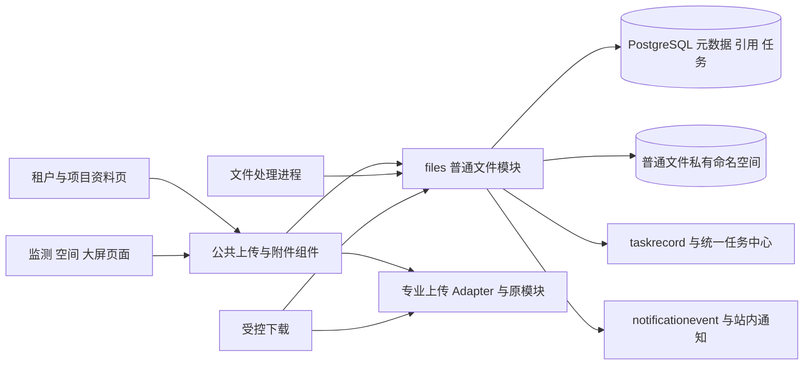

# 文件与附件公共能力详细开发方案

2026-11-15 的[文档预览扩展](document-preview-proposal.md)覆盖本文首版“Office／PDF 仅下载”的限制；授权网关、完整性校验、原件 attachment 响应及服务器图片产物协议继续沿用。

日期：2026-11-13。版本：V1.0。状态：**实施依据已获授权；软件 Awaiting acceptance（2026-11-14 自验通过）**。当前实施与自验证据见[自验矩阵](../verification/files-and-attachments.md)。

本方案落实用户已确认的[迭代范围与约束](files-and-attachments-proposal.md)，规定数据结构、模块 Interface、HTTP 契约、权限、现有功能改造、任务／通知联动、恢复和验收。下述新增名称是实施目标；现有入口以第 2 节的当前代码为依据。本文保留设计基线；用户已于后续 /goal 指令授权按本方案完整实现和自验。

## 1 已确认范围和交付原则

| 范围编号 | 本轮必须完成的内容 |
| --- | --- |
| FA-01 | 普通文件登记、不可变正文、真实状态、准确大小及摘要、私有存储生命周期。 |
| FA-02 | 分片与续传、取消、幂等、完整校验、异常及暂存回收。 |
| FA-03 | 附件绑定、名称／说明、替换历史、历史还原、回收站及恢复。 |
| FA-04 | 公共组件、租户资料、项目资料、当前空间普通附件管理页。 |
| FA-05 | 监测、空间、大屏三类上传及既有监测／派生／分析导出真实适配。 |
| FA-06 | 独立查看／下载／管理权限、实时撤权、租户与项目隔离、审计。 |
| FA-07 | 文件处理接入任务中心和通知；清理、完整性核对及运行诊断。 |
| FA-08 | 增量迁移、权限升级、小规模真实恢复、样本、接入和验收材料。 |

普通附件只支持 PNG、JPEG、PDF、TXT、CSV、DOCX、XLSX、PPTX，单文件最大 100 MiB；图片预览、24 小时待绑定期限、30 天回收站按原范围落实。正式附件及替换历史没有自动删除期限。所有期限由服务端时间计算。

首批宿主固定为 `tenant.profile` 和 `project.profile`。不增加设备、监测业务、报告或反馈模块；不增加公开分享、个人网盘、在线文档编辑、Office／PDF 预览、跨空间复制、商业额度或专业存储迁移。任务中心和通知作为已有公共能力接入，不能重新实现一套。

实施在当前 checkout 和分支进行，不创建分支／worktree，不覆盖正在实施的任务中心等未提交内容。范围确认、详细方案核对、软件自验和人工接受分别记录。

## 2 当前代码及必须保持的契约

| 当前代码 | 当前事实 | 本轮衔接要求 |
| --- | --- | --- |
| [blobstore/store.go](../../packages/go/platform/blobstore/store.go) | `Open/Put/Get/Delete` 限定私有前缀，`Put` 禁止覆盖，`Get` 将缺失映射为 `fs.ErrNotExist`。 | 新文件复用此 Adapter；文件状态、引用与权限放入 `files`，不放入 S3 Adapter。 |
| [access/authorizer.go](../../packages/go/platform/access/authorizer.go) | `Transact` 拥有事务及超时，提交前调用 `taskrecord.FlushTx`；`Lock` 保护授权图及目录校验。 | 普通文件业务写入使用该事务入口；对象 IO、解码及长等待放在事务外。 |
| [access/service.go](../../packages/go/platform/access/service.go)、[project_authorization.go](../../packages/go/platform/access/project_authorization.go) | `Actor.Check` 同事务复验会话，项目资格显式检查成员、状态与权限。 | 使用原人员授权；拒绝 `ReadSubject`；不复用设备模块附带工程目录锁的整个事务封装。 |
| [runtime/business.go](../../packages/go/platform/runtime/business.go) | `Compose` 组装只依赖元数据的业务对象，`Configure` 注入存储及执行依赖。 | 增加 `Business.Files`；元数据查询可以不初始化 S3、ClickHouse 或图片处理器。 |
| [taskrecord/contract.go](../../packages/go/platform/taskrecord/contract.go)、[record.go](../../packages/go/platform/taskrecord/record.go) | 来源三元组生成稳定任务 ID；`generation`、来源修订、操作修订、尝试和 fence 分开；终态代次不可重新打开。 | 文件任务使用 `ApplyTx`，手工重试／重新确认建立新代次；不绕过终态约束。 |
| [tasks/service.go](../../packages/go/platform/tasks/service.go)、[commands.go](../../packages/go/platform/tasks/commands.go)、[details.go](../../packages/go/platform/tasks/details.go) | 来源白名单；命令只有 `cancel/retry`；目标种类为 `business/result/recreate`；来源负责最终授权与执行。 | 扩展 `files` 来源；绑定冲突的重新确认放回文件页面，不给通用任务命令增加任意参数。 |
| [notificationevent/event.go](../../packages/go/platform/notificationevent/event.go) | `AppendTx` 提交有限事件／目标，协议支持 v2 任务引用；源事件不能自行声明公共 TaskID。 | 复用 `task.result`，新增 `file_job` 目标白名单；使用来源引用和固定代次。 |
| [runtime/notifications.go](../../packages/go/platform/runtime/notifications.go) | 按当前空间资格、成员关系及业务 Adapter 裁剪，解析任务引用；独立通知 worker 不需要对象存储。 | 文件通知只查询元数据与授权；不得初始化文件解码器或读取正文。 |
| [监测上传](../../apps/console/src/features/monitoring/upload-form.tsx) | 当前分片 32 MiB，CSV 最大 32 GiB、XLSX 最大 512 MiB，并非普通附件限制。 | 公共 UI 必须支持来源自己的分片、大小、状态、原因字段及完成方式。 |
| [空间上传](../../packages/go/platform/spatial/uploads.go)、[大屏上传](../../packages/go/platform/display/uploads.go) | 空间来源最大 256 MiB，大屏 ZIP 最大 128 MiB，各有独立版本及处理机制。 | 不套用普通附件 100 MiB 或格式白名单；不改变专业封存、发布和隔离。 |

任务中心当前处于实施中，代码已有来源、前端及协议变更；本轮接入前核对其最终提交。不能把“代码存在”视为任务中心已经人工验收，也不能为等待文件模块而阻断任务中心自身交付。

## 3 模块组织和数据流



新增 `packages/go/platform/files` Module，按 `model/service/authorization/uploads/prepare/attachments/reads/references/maintenance/task_center/notification_targets` 分文件。内部解码检查集中到 `internal/contentcheck`，不开放脚本扩展。公开 Interface 见第 11 节；只有 HTTP、runtime、CLI 及已注册宿主穿过该 Interface。

`runtime/files_hosts.go` 提供两个 Host Adapter，调用 `tenancy/projects/access` 的元数据及资格检查；不得将这两个业务模块反向依赖 `files`。需要增加原模块的 `...Tx` 元数据读取方法时，只提供有限字段，不另开事务。首版宿主枚举写在代码注册表中。

前端公共视觉组件放在 `packages/ts/ui/src/patterns/files/`，不得依赖业务 API；上传控制器、摘要工作线程及四个领域 Adapter 放在 `apps/console/src/features/files/`。`packages/ts/api-client/src/files.ts` 只实现普通文件 HTTP 契约。专业 Adapter 继续调用 `monitoring/spatial/display/derived-monitoring` 客户端。

| 技术 | 本轮使用位置与原因 |
| --- | --- |
| Go、pgx、Gin | 沿用现有后端、事务及 HTTP 栈，普通文件命令可与授权、审计、任务、通知同事务提交；不增加第二个业务后端。 |
| PostgreSQL | 权威元数据、状态、引用、幂等收据、队列和有限运行预算；使用现有迁移及备份方式。 |
| 私有 S3、现有 MinIO Go Adapter | 保存不可变正文／预览，复用 blobstore；元数据与文件内容分别备份并核对。 |
| Go 标准图片、ZIP、XML 库 | 有界格式检查及图片重编码，放入独立 checker；没有 Office 应用、第三方转换服务或用户可执行代码。 |
| React、TypeScript、TanStack Query／Router、现有 UI | 公共上传及文件展示、缓存失效、作用域路由、真实资料页接入，复用已有视觉与交互约定。 |
| 现有契约生成和浏览器工具 | OpenAPI 生成类型、权限常量和契约一致性检查；真实浏览器验证上传、授权、下载和多空间行为。 |

依赖版本沿用仓库 go.work、Go module、package.json 和 lockfile，本轮不顺带升级技术栈；不引入新消息队列、全文检索、ClickHouse 文件存储或外部 CDN。

新增可信 `files-worker` 进程执行普通文件处理和维护，不执行监测任务。任务中心只提供公共查询及控制入口；通知 worker 只投递。图片／容器解析在无数据库与 S3 凭据、无网络入口的受限子进程中进行，可信父进程负责持久状态与对象 IO。

## 4 标识、归属与不变量

1. 全部主键为 UUID；文件名、摘要、对象键均不是业务主键。HTTP 的 `bigint`、字节数、修订、代次均为十进制字符串，时间为 UTC RFC3339。
2. `file_spaces` 将唯一租户空间或项目空间映射到内部 `space_id`。项目空间同时保存租户 ID；租户空间查询使用 `project_id IS NULL`，不是“该租户全部项目”。
3. 每个上传、普通文件和附件固定一个宿主。宿主必须与空间一致；第一次创建普通文件记录后，宿主、原始名称、正文摘要及正文对象不可修改。
4. 附件 `revision` 是并发控制号，任何元数据、正文指向、回收／恢复变更均递增；`revision_no` 是正文历史序号，仅上传替换／历史还原递增。两个字段不混用。
5. 正文替换建立新的普通文件和附件修订。历史还原使用原历史文件建立新附件修订，不改写历史。不同附件不共享普通文件；本附件的历史还原可复用自身文件。
6. 任务执行状态、文件完整性、附件是否有效、预览是否可用分别保存。旧任务成功后附件被替换或回收，不改写当时成功事实。
7. `DomainFileRef` 不进入普通文件表，不受本模块清理。任务／通知／搜索索引里的定位信息不是保护引用，也不是读取凭据。
8. 增加保护引用和进入物理回收共用文件行锁；正文存在、保留期限未到或计数为零，都不能单独决定是否可清理。

### 4.1 事务顺序

需要多个锁的业务事务按以下顺序取得：文件协议读锁 → 授权图及所需人员锁 → 运行预算行 → 真实宿主行 → 文件空间行 → 附件 → 上传／任务 → 按 ID 排序的文件 → 按 ID 排序的对象 → 引用／收据 → 审计、任务事实、通知事实。只读场景只取得需要的子集。宿主、成员和协议版本都在同一事务验证，禁止先鉴权再另开无鉴权事务写附件。

worker 的抢任务事务只锁队列行并提交；在最后绑定时重新按完整顺序锁定，复验原抢占 fence、代次及 restore epoch。清理遵循相同文件／对象锁顺序。保护引用接口的调用者必须满足这一顺序，不能在已经持有文件锁时回头取得授权或宿主锁。

不得持有数据库事务等待上传、S3 请求、完整哈希或图片解码。下载的每块输出是例外的短授权事务，必须有写入截止时间，见第 10 节。

## 5 数据结构与数据库约束

### 5.1 通用规则

以下为迁移必须实现的逻辑结构；通用 `id uuid PK`、`created_at/updated_at timestamptz` 在表中省略重复说明，表中显式声明复合主键的关系表除外。所有业务子表有 `space_id`，使用 `(space_id,id)` 唯一键及复合外键，防止关联其他空间同类型对象。同宿主关联再以 `(space_id,host_id,id)` 唯一键／复合外键或有限约束触发器校验，不能只检查 space 相同。历史和墓碑禁止级联物理删除。`jsonb` 只存有 schema version 的有限快照，核心归属、状态、摘要、引用与时间不用任意 JSON 替代。

空项目采用两条部分唯一索引，不能依赖普通 `UNIQUE(tenant_id,project_id)` 的 NULL 语义。项目复合外键引用现有 `projects(tenant_id,id)`；人员及成员关系引用现有 accounts／tenant_memberships／project_memberships。

### 5.2 协议、空间和宿主

| 表 | 必需字段 | 约束与用途 |
| --- | --- | --- |
| `file_protocol` | `id=1, schema_version=1, restore_epoch uuid, mode, updated_at` | `mode=online/read_only/reconciling`。恢复推进 epoch；维护屏障使用该行。不是通用实例能力配置系统。 |
| `file_spaces` | `tenant_id, project_id nullable, scope_kind, content_revision bigint default 1` | `scope_kind=tenant/project` 与项目空值一致；租户空间 `(tenant_id) WHERE project_id IS NULL` 唯一，项目空间 `(tenant_id,project_id) WHERE project_id IS NOT NULL` 唯一。内容变更推进 revision，供列表游标失效。 |
| `file_hosts` | `space_id, kind, object_id, schema_version=1` | `UNIQUE(space_id,kind,object_id)`；首版只允许两个 kind。登记事务检查 tenant.profile 的对象就是空间租户，project.profile 的对象就是空间项目；触发器再次按空间行检查归属，禁止修改三元组。 |

宿主记录在首次获准上传时懒创建；无附件的资料页返回空列表，不要求创建业务对象时同步建文件行。未来宿主须新增代码注册、真实外键／归属验证、权限和生命周期测试，不能只在数据库填一个新的 kind。

online 允许当前获准用例；read_only 禁止新增业务变更但允许内容读取、现有 IO 结果核对和必要 lease 维护；reconciling 仅开放获准元数据及诊断，不开放正文、新执行或物理删除。协议屏障是本模块的维护状态，不改变原专业模块状态。

### 5.3 上传和物理对象

| 表 | 必需字段 | 约束与索引 |
| --- | --- | --- |
| `file_uploads` | `space_id, host_id, actor_id, tenant_membership_id, project_membership_id nullable, intent(add/replace), attachment_id nullable, expected_attachment_revision nullable, filename, display_name, description, expected_size bigint, expected_sha256, declared_media_type, detected_format nullable, part_size, part_count, state, revision, policy_snapshot jsonb, restore_epoch, reason, last_part_at, idle_expires_at, hard_expires_at, submitted_at nullable, request_id` | `state=receiving/submitted/closed/cancelled/expired`；add 无 attachment_id，replace 必须有附件及预期修订且同宿主。大小和分片数按策略快照检查。索引 `(space_id,actor_id,state,created_at,id)`、到期状态索引。 |
| `file_upload_parts` | `space_id, upload_id, part_no, expected_size, sha256, object_id, state(receiving/received), fence, lease_owner, lease_until, received_at nullable` | `PK(upload_id,part_no)`；part 从 1 开始；对象同空间。分片提交仅改变上传进度，不推进用户操作 revision；并发分片不会互相制造修订冲突。 |
| `file_objects` | `space_id, kind(part/source/preview), object_key, storage_version nullable, content_type, expected_size, expected_sha256 nullable, actual_size nullable, actual_sha256 nullable, state, writer_kind, writer_id, writer_generation, writer_fence, writer_epoch, io_deadline, lease_until, last_verified_at, delete_after nullable, delete_attempts, last_error_code` | 写前登记，`object_key` 全实例唯一且不可改；`state=writing/available/delete_pending/deleted/missing/corrupt`。写入意图和对象登记合一，不另建未关联的临时键。按 writer、state／deadline、delete_after 建索引。 |

对象键固定 `files/v1/{space_id}/{object_id}`，不用租户名、文件名、摘要或用户输入拼路径。原件和预览分别拥有独立对象 ID；同键永不覆盖。metadata 中的 storage version 可为空，不要求对象存储必须启用版本化。

### 5.4 普通文件、附件和修订

| 表 | 必需字段 | 约束与索引 |
| --- | --- | --- |
| `file_records` | `space_id, host_id, upload_id, original_name, format, media_type, size_bytes, sha256, source_object_id, preview_object_id nullable, preview_state, preview_reason, lifecycle, integrity, verified_at, ready_at, unbound_until nullable, reclaimed_at nullable` | `UNIQUE(upload_id)`；`lifecycle=ready/reclaiming/deleted`，`integrity=ok/missing/corrupt/unknown`，`preview_state=none/pending/available/unavailable`。只有校验通过后才创建 ready 记录。正文描述字段不可更新；源对象必须同空间且 available。 |
| `file_attachments` | `space_id, host_id, display_name, description, status, revision, current_revision_id, next_revision_no, created_by, updated_by, trashed_by nullable, trashed_at nullable, purge_after nullable, retention_policy_version` | `status=active/trashed/purged`；current_revision_id 用可延迟复合外键指向本附件修订。trashed 必须有回收信息；purged 保留身份和历史元数据。索引 `(space_id,status,created_at DESC,id DESC)`、宿主索引、`purge_after` 部分索引。 |
| `file_attachment_revisions` | `space_id, attachment_id, revision_no, file_id, operation(upload/replace/revert), previous_revision_id nullable, reverted_from_revision_id nullable, display_name_snapshot, reason, actor_id, job_id nullable, job_generation nullable, created_at` | `UNIQUE(attachment_id,revision_no)`；附件、文件、历史修订均同空间及同宿主。禁止 UPDATE/DELETE 已提交修订；名称／说明单独变更仅写附件控制修订和审计。 |
| `file_protection_refs` | `space_id, file_id, owner_module, owner_kind, owner_id uuid, owner_revision text, kind, expires_at nullable, released_at nullable, release_reason` | `UNIQUE(file_id,owner_module,owner_kind,owner_id,owner_revision,kind)`；kind 白名单 `attachment_revision/prepared_input/consumer`。同请求加引用幂等，不能悄悄缩短期限。索引 `(file_id) WHERE released_at IS NULL`。 |

附件每个正文修订持有一条无期限引用，包括被替换的旧修订。回收站期间这些引用继续生效；回收到期时在附件及文件锁内一次释放该附件的全部修订引用，再检查其他引用。job／任务中心仅保存结果定位，不自动永久保护结果；需要固定输入的真实消费者通过 `consumer` 引用保护，首版只允许代码登记的调用者。

`file_records`、附件修订、job 结果中的外键是历史关联，不能直接当作“必须保留正文”的保护引用；元数据墓碑保留可避免为了删正文而破坏历史外键。

### 5.5 文件处理、读取及幂等

| 表 | 必需字段 | 约束与用途 |
| --- | --- | --- |
| `file_jobs` | `space_id, upload_id UNIQUE, host_id, originator_id, origin_tenant_membership_id, origin_project_membership_id nullable, generation, source_revision, control_revision, state, phase, progress_completed, progress_total nullable, progress_unit, error_code, task_snapshot jsonb, created_at, observed_at` | 稳定来源根 ID；只有接收 complete 后创建。state 与任务中心状态表一致，不存 unknown 作为执行状态。originator 不变。task_snapshot 保存该来源修订实际提交的 Change，最多 32 KiB，供精确重放。排队及租约查询使用 runs 表。 |
| `file_job_runs` | `space_id, job_id, generation, requested_by, executor_account_id, tenant_membership_id, project_membership_id nullable, input_snapshot jsonb, input_hash, expected_attachment_revision nullable, state, attempt_no, fence, lease_owner, lease_until, available_at, deadline_at, cancel_requested_at nullable, result_file_id nullable, result_attachment_id nullable, result_revision_id nullable, terminal_code, safe_report jsonb, started_at, finished_at, input_retain_until nullable, restore_epoch` | `PK(job_id,generation)`；输入及终态不可重写。记录每代实际委托人与原成员关系；手工新代次不覆盖上一代报告。 |
| `file_job_attempts` | `space_id, job_id, generation, attempt_no, fence, started_at, finished_at, outcome, error_code, diagnostic_id` | `UNIQUE(job_id,generation,attempt_no)`；源模块保留尝试依据，再投影到 taskrecord，日志正文不进入公共任务。 |
| `file_read_leases` | `space_id, file_id, object_id, actor_id, tenant_membership_id, project_membership_id nullable, variant(source/preview), restore_epoch, expires_at, closed_at, outcome, bytes_sent` | 服务端内部使用，每个下载请求一条；不是客户端 bearer token。存活租约保护对象，不能替代每块人员授权。 |
| `file_command_receipts` | `space_id, actor_id, request_id, operation, target_id nullable, payload_hash, result jsonb, created_at` | `UNIQUE(space_id,actor_id,request_id)`；同 ID 不同操作／内容 409；完整审计与对象墓碑仍在时保留收据，首版不自动清空。结果只含 ID／修订／状态，不保存正文或下载地址。 |

`file_job_runs.input_snapshot` 明确包含：上传 ID、固定宿主、完整大小／摘要、按序分片的 ID／摘要／长度、添加或替换、预期附件修订、名称／说明、检查策略版本，以及如已准备好则使用的固定 file_id。自动重试复用该快照；重新确认建立新代次和新快照。

### 5.6 运行预算、清理与备份

| 表 | 必需字段 | 约束与用途 |
| --- | --- | --- |
| `file_budget_reservations` | `owner_kind, owner_id, space_id nullable, account_id nullable, tenant_id nullable, kind, reserved_bytes, actual_bytes, slots, state, expires_at, reconciled_at` | 唯一 owner/kind；会话、执行、在途对象和读取暂存分别登记。过期只进入核对，不能忽略仍存在对象直接释放。预算锁按 instance→tenant→account 固定顺序。 |
| `file_budget_states` | `key text PK, reserved_bytes, slots, revision` | 运行计数缓存及事务串行点，定期从 reservations 重算；不作为商业额度账本。 |
| `file_rate_windows` | `account_id, kind, window_start, requests` | 以账号、有限请求种类和分钟窗口为主键；跨 API 节点事务计数，保留最近一小时窗口，定期清理；不能存任意用户提供的限流键。 |
| `file_worker_heartbeats` | `worker_id text PK, node_id, build_version, protocol_version, started_at, last_seen_at, checker_last_seen_at nullable, capabilities jsonb` | worker 空闲时也更新心跳；checker 无 DB 凭据，其状态由 worker 本地探测后记录。仅保存有限运行能力，不存路径或凭据。 |
| `file_cleanup_runs` | `id, mode(plan/apply), operator, reason, policy_version, restore_epoch, state, planned_at, finished_at, counts jsonb` | CLI 计划与执行关联，plan 没有删除副作用。 |
| `file_cleanup_items` | `run_id, space_id, object_id, file_id nullable, candidate_revision, reason_code, not_before, state, attempt_no, last_error_code` | `UNIQUE(run_id,object_id)`；apply 必须重新核验，不信任旧候选。名称和正文不进入运维输出。 |
| `file_backup_manifests` | `id, restore_epoch, state(preparing/sealed/failed/released), database_snapshot_ref, policy_version, manifest_hash, hold_until, created_at` | 冻结点、清单及保留要求明确；过期失败先诊断，不擅自当作复制成功。 |
| `file_backup_items` | `manifest_id, space_id, object_id, size_bytes, sha256, storage_version nullable, copy_status` | 活跃备份及其对象复制完成前提供对象级保护，覆盖分片、原件和预览；内容清单只对备份身份开放。 |

审计复用现有 `access.Audit`，不新建另一套审计中心。表中状态／枚举必须有 CHECK，长度、非负数、SHA-256 小写 64 位格式及所有者关系必须有数据库约束；涉及跨表状态的约束由有限触发器和同事务命令共同保证。保护引用释放后保留收据，不能用同一 owner revision 悄悄重新激活；新一次正式使用须明确新版本／新引用意图。

## 6 状态机与操作规则

| 对象 | 正常变化 | 终态和恢复规则 |
| --- | --- | --- |
| 上传 | `receiving → submitted → closed` | receiving 可取消／到期；submitted 后由任务控制，不能再次写分片。过期会话不复活。 |
| 文件任务一代 | `queued → running → succeeded/needs_action/failed/cancelled` | 暂时错误经 `retry_wait → running`，仍是同代；取消经 cancelling。任何终态不回到 running。 |
| 普通文件 | `ready → reclaiming → deleted` | integrity 独立变为 missing/corrupt/unknown；进入 reclaiming 后禁止新引用、读取及恢复。完整性修复须核验与原摘要相同的内容，不能上传别的内容替代。 |
| 附件 | `active → trashed → active` 或 `trashed → purged` | purge 是不可恢复的业务墓碑；物理正文可能因其他引用继续保留。 |
| 图片预览 | `pending → available/unavailable` | 预览失败不把已通过正文检查的普通文件误报损坏；本轮没有单独的预览重试 UI。 |

文件后台处理阶段使用现有任务阶段枚举：`preparing` 拼装、`validating` 完整性与格式检查、`writing` 写私有正文／预览、`sealing` 提交附件；终态用 completed/failed/cancelled，needs_action 使用 waiting。阶段进度只代表当前阶段，不伪造整体百分比。

| 用户动作 | 前置状态 | 行为 |
| --- | --- | --- |
| 取消浏览器传输 | receiving | 前端暂停仅 Abort 当前传输并保留会话；明确“取消上传”才提交取消命令。 |
| 取消后台处理 | queued/running/retry_wait | 锁任务增加控制修订及 fence，阻止后续绑定；worker 确认失去发布资格后终态 cancelled，实际垃圾回收状态独立显示。 |
| 任务重试 | failed，且错误为可恢复、输入未到期且完整 | 当前有管理权者发起新代次，记录其实际委托；摘要／格式错误、正文丢失及目标冲突不开放通用 retry。 |
| 重新确认绑定 | needs_action，已准备文件仍在 24 小时期限内 | 原宿主内重新选择有效预期附件修订，建立下一代；不能改成另一宿主或把 replace 变成 add。 |
| 历史还原 | active，目标历史同附件且正文完整 | 原子新增 revert 修订；保留原当前文件和所有旧历史。 |
| 取消已经成功任务 | succeeded | 返回状态已变化，不改写成功、不删除附件；需要移除时走附件回收。 |

自动尝试最多 5 次，代次不变，attempt 与 fence 递增。人工 retry/reconfirm 仅允许在原代已终结后增加 generation；控制修订不随心跳和每次进度更新递增，来源修订随对外状态事实递增。

## 7 权限与业务宿主契约

### 7.1 六个新权限

新增 `tenant.attachments.read/download/manage` 和 `project.attachments.read/download/manage`。两个作用域分别登记到目录；read、download、manage 均可由本作用域自定义角色分配。默认只给受保护的 tenant_admin/project_admin 相应权限，不为普通成员、自定义角色、平台管理员或项目治理角色自动补正文权限。

定义本空间能力：`R = 当前人员与成员资格有效 + 宿主 profile.read + attachments.read`；`D = R + attachments.download`；`M = R + attachments.manage + 宿主 profile.update + 宿主允许业务写入`。manage 不蕴含 download；预览必须 D。权限选择器显示依赖但不静默增权，授权结果以服务端组合判定为准。

| 操作 | 所需能力 | 补充条件 |
| --- | --- | --- |
| 活跃附件及历史元数据、文件页 | R | 当前空间／宿主；文件不存在或不可见统一 404。 |
| 预览、原文、历史原文、HEAD／Range | D | 附件 active、指定修订属于它、正文完整；回收站内容不直接下载，须先恢复。 |
| 添加、改名、替换、历史还原、回收、恢复 | M | 预期附件修订；敏感变更有 reason；恢复须在保留期内且正文未进入回收。 |
| 本人上传会话摘要／详情 | R 且 actor=会话创建者 | 显示仍有权看到的状态；不因已创建会话而永久授予后续写入资格。 |
| 暂停后续传、提交 complete | M 且 actor=会话创建者 | 只有原人员可写分片；换成员关系后不能续用旧会话。 |
| 他人上传／任务管理视图 | R + attachments.manage | 可以查看最小摘要；归档时保留允许的只读管理视图。 |
| 取消处理、重试／重新确认他人冲突 | M | 记录实际操作者，不得冒用原上传者继续传输字节。 |
| 文件任务 mine／detail | R 且本人发起，或 R 且有附件管理权限 | managed 模式必须本地管理权限；归档时只读任务历史，控制动作仍要求 M。 |
| 回收站列表／详情 | R + attachments.manage | 允许归档项目查看保留信息；恢复仍需 M。 |
| 专业文件 | 原模块权限 | 上述六个权限不替代任何原件、数据、成果、大屏或图模权限。 |

租户 disabled、成员 suspended/ended、账号非 active 时按现有资格拒绝。项目 archived 可以保留已获准历史读取，不允许新附件写入；文件接口必须纳入当前项目归档门禁，而不是只给前端按钮置灰。

后台委托固定执行账号和 tenant/project membership ID；worker 每次尝试及最终绑定复核账号状态、同一成员关系、当前权限及宿主状态。退出浏览器会话不取消已接受的委托；撤权、账号停用、成员移除后重新加入不能复活旧委托。管理员重新确认须显式建立自己的新代次。

### 7.2 事务中的授权

普通 HTTP 使用 `identity.AccessActor`，调用 `access.Lock` 与 `Actor.Check`，按路由用 `RequireScopedTx` 或 `RequireActorProjectTx` 及 Host Adapter；人员读写入口一律拒绝 `ReadSubject`。宿主检查必须包含真实项目归属，不能只比较文件表中的 tenant/project。

批量列表、统计与搜索先筛选当前空间及宿主资格，再计算计数和分页；无权文件名、历史数量、上传人及异常原因不进入响应。没有权限返回 403 或隐藏对象 404；数据库、原模块或授权服务不可用返回 503，不能伪装成空列表或无引用。

诊断与维护通过部署运维身份执行有限 CLI；状态／候选输出只包含匿名标识、数量、字节、错误码及关联号。备份身份另需原始对象读取能力。它们不赋予控制台用户任何正文下载权限。

## 8 上传和后台提交算法

### 8.1 创建、分片和 complete

1. `POST uploads` 取得当前 M、固定宿主和意图；replace 验证 active 附件及预期 revision。检查同账号／租户活动会话和暂存预算，在同事务建立会话、预算预留、幂等收据及上传接受审计。策略快照固定大小、分片、格式和期限。
2. 片号为 1..ceil(size/part_size)，最后一片严格按剩余长度。请求携带 `X-Content-SHA256`；响应收据以服务端实际读到的有限长度和 SHA-256 为准。鉴权后才接受正文，使用 MaxBytesReader 和流式临时文件，不整文件进内存。
3. 片段首次写前，在短事务登记 receiving 行、writer fence 和对象写入意图，提交后向 S3 Put。再开事务检查会话仍 receiving、委托及 fence 未变，记录 received；否则对象保留为待核对孤立意图，不计为收到。相同片号／摘要／长度重传返回同收据，不同内容返回 409。
4. 同片并发只允许一个有效 writer，其他请求可返回 `part_in_progress` 和 Retry-After；租约过期的新 writer 使用新对象键及更高 fence。旧 writer 返回晚了也不能覆盖新收据。
5. `complete` 复核已收片集合、实际总长和全部摘要，冻结分片清单、输入 hash、人员委托及策略；创建 job/run 和 taskrecord，上传变为 submitted。完整正文复核由 worker 完成，HTTP 返回 202 和 task_ref。没有全部分片则返回缺失片号，保持 receiving。
6. 用户刷新后查询会话获取已确认片段，重新选择本地文件，计算完整及分片摘要再续传；不根据同名或同大小直接跳过。存到浏览器的仅可为账号／空间限定的会话 ID，不保存文件内容、路径、凭据或服务器对象键。

### 8.2 文件准备与附件原子绑定

worker 用 `FOR UPDATE SKIP LOCKED` 抢一代任务，记录 attempt/fence/lease 和恢复 epoch。事务外按冻结顺序读取分片到受限暂存，复算全文件长度／摘要，再进行格式及图片处理；每阶段检查取消和 lease，heartbeat 不代表延长业务授权。

每个输出先建 object intent，再 Put 并核验实际内容。原件写入成功后创建 ready 文件记录；预览成功则附加独立对象，失败记录有限原因。最终事务重新取得 M，检查原成员关系、宿主仍允许写、目标 revision、job generation/fence、所有正文状态及 restore epoch，随后一次完成：

```text
创建附件或新增正文修订并切换 current_revision_id
增加修订保护引用，释放待绑定保护
记录 job 本代不可变结果和终态 succeeded，关闭上传
推进附件 revision 与空间 content_revision
写 access.Audit
写 taskrecord.ApplyTx
写 notificationevent.AppendTx
提交
```

若重试发现同 upload_id 已有 file_records，先核对宿主、长度、摘要、对象及期限，复用同一 file_id，不重新插入或刷新 ready_at/unbound_until；原件缺失或已回收不能用普通重试改换正文对象。输入快照在一代内保持不变，新生成的 file_id 只写结果字段；只有重新确认的新代次才把它作为 prepared 输入。

源事务失败则附件、审计、任务和通知事实一起回滚；已写入 S3 的对象由 intent 核对，不能视为用户附件已成功。进程在提交成功但响应丢失时，用 receipt／本代结果返回原结果，禁止再次新增修订。

目标 revision、项目状态或授权变化时，已经验证的正文进入待绑定，`unbound_until=ready_at+24h`，本代终结为 needs_action；不能自动改目标或重新授权。若失去资格，只保留受保护的技术状态，用户查询照常裁剪。若根本未产生有效正文则失败并给出重传或重试动作。

`reconfirm` 在原宿主与原意图内，以新操作人和新 expected revision 建立下一代，固定原 file_id/hash；不能把 unbound_until 向后滚动。deadline 到期先禁止 reconfirm，再由引用和租约规则回收，原任务显示结果 expired。

### 8.3 中断、拒绝与重试输入

会话 receiving 以 24 小时无新分片、最多 7 天为期限。已提交处理不再受浏览器传输空闲时间控制；排队等待最多 24 小时，单次执行最多 120 秒。失败或取消后的可重试输入最多保留 24 小时；needs_action 正文按 ready_at 起算 24 小时。成功后分片进入可清理状态，正式文件按附件历史保留。

这些期限写入记录，不因 worker 重启、自动尝试、反复访问或重复命令延长。涉及未知对象写入时，租约到期先停止提交资格并核对，不能直接释放全部字节预算。暂停浏览器、取消上传、取消后台任务和移除附件是四个不同动作。

## 9 附件变更、历史与回收

元数据 PATCH 只允许 display_name、description，检查 expected_revision，写变更前后安全摘要；不得修改 original_name、format、size、sha256、file_id、host_id。display_name 1–200 字符，description 0–1000 字符，纯文本。文件原始名称按上传时固定保留。

替换沿用第 8 节上传链路，直到新文件检查并原子绑定成功，旧附件保持可读。替换失败不隐藏旧文件、不提前移除旧引用。当前附件已被回收、目标变更或项目归档时进入冲突处理；不自动创建另一个附件。

历史还原要求指定 `revision_id` 属于同附件，检查其文件 lifecycle=ready、integrity=ok 且不在物理回收；新增一条 revert 修订、独立保护引用及审计。它不产生文件检查任务，不发送“文件上传完成”通知。

回收将整个附件置 trashed，保存 `purge_after=trashed_at+30d` 和策略版本；current 与所有历史引用仍保留。普通列表及下载不可用，管理人员能看回收站元数据。恢复时检查期限、全部待恢复正文及引用，原子恢复 active 并清空回收信息。已回收 30 天即使物理文件还没删，也不开放普通恢复入口。

到期清理先锁附件和全部文件，确认没有并发恢复，再置 purged、释放该附件所有修订引用。其他保护引用、读取及备份租约继续阻止物理删除；它们解除后再回收正文。清理保留附件、修订、文件和操作墓碑，历史详情显示已回收，不提供内容链接。

## 10 内容检查、预览和受控下载

### 10.1 格式检查的固定实现

| 格式 | 首版检查 | 不做的处理 |
| --- | --- | --- |
| PNG/JPEG | 头部与扩展名一致，读取尺寸；可预览图片在资源限额内实际解码、缩放后重新编码。 | 不执行外部工具命令、不保留 EXIF 等原始元信息到预览、不加载远程资源。 |
| PDF | 检查受限长度的签名／结束结构及实际大小；作为受控二进制文档保存。 | 不执行脚本、解析嵌入对象、浏览器内联显示或保证文档可打印。 |
| DOCX/XLSX/PPTX | `archive/zip` 有界读取中心目录和必要类型标识；拒绝越界路径、加密、宏部件和不支持压缩；验证主文档类型与扩展名一致。 | 不执行公式、宏、外链、自动修复或转换；不调用监测 XLSX 解析器。 |
| TXT/CSV | 检查大小、排除已识别的二进制／可执行签名，保存原字节；编码不被自动重写。 | 不执行文本／脚本，不把 CSV 导入观测，不宣称文本内容已通过业务或恶意软件检测。 |

Office 容器默认最多 4096 条目、单条展开 64 MiB、合计展开 256 MiB，控制 XML 最多 2 MiB；路径长度最多 512 字符，检查过程最多 15 秒。重复条目、绝对路径、`..`、反斜杠绕过、符号链接式条目及宏部件均拒绝。按实际有界读取累计展开长度，不能只信任 ZIP 目录声明。

预览只生成最长边 1600 像素、最终不超过 2 MiB 的 PNG 或 JPEG。先用尺寸头避免超大分配，超过 2500 万像素不解码预览；解码报错或预算耗尽标 preview unavailable。扩展名与头部一致但不能生成预览的图片可作为原件保存，页面准确说明原因；头部不一致或正文摘要失败则整个文件不能绑定。

解码子进程只读一个本地输入和写一个受限输出目录，不持有 DB／S3／人员凭据，不访问网络。父进程校验输出格式、字节和尺寸后才写入 S3；超时终止子进程并核对暂存。Docker 与 systemd 都落实用户、目录、内存和进程限制，不以“启动了另一个 Go 函数”声称隔离。

### 10.2 下载流程

1. 请求通过 `attachment_id + revision_id` 指定内容；先校验 D、active 附件、指定修订归属、正文状态及 restore epoch。没有 `/files/{file_id}/raw` 这类脱离宿主的旁路。
2. 同事务建立短读取租约及必要本机暂存预算，取得私有对象。事务外流式读入受限本机临时文件，完整核对长度／摘要；即使请求 Range，也在放行第一字节前确认完整源内容。缺失或损坏更新可核对状态并返回 503，不输出部分伪成功文件。
3. 输出前再次鉴权；每块最大 64 KiB，在有界短事务中持有授权图读锁，复核人员会话、当前 D、附件状态、租约和 epoch，放行该块后结束事务。每块网络写入截止最多 2 秒，超时停止输出并清理。撤权提交后不再放行新块；此前已发送或进入网络缓冲的字节不承诺追回。
4. GET 与 HEAD、完整下载与 Range 使用相同资格检查。支持单段 `bytes` Range；拒绝多段、溢出、重复或非法范围。ETag 固定正文摘要，条件请求也先鉴权；不能从 304 或 416 泄漏无权正文长度。
5. 正常完成、客户端断开或权限终止均关闭租约、释放本机暂存并记录有限下载结束信息；进程退出后租约到期清理。租约不能自助恢复已撤销资格。

所有普通原件使用安全编码的 `Content-Disposition: attachment`，预览使用固定安全图片 MIME；设置 `X-Content-Type-Options: nosniff` 和 `Cache-Control: private, no-store`。不发 S3 签名地址、不允许 CDN 公共缓存，不在下载响应或诊断中透露 bucket/key。预览接口走相同 D 和租约机制。

当前专业下载继续用原模块的快照、授权重查及传输机制。公共 FileList 不把它们下载成普通文件缓存，也不强制所有大导出以浏览器 Blob 整体缓冲。

## 11 Go Module Interface

以下是需要固定的调用形状；具体 DTO 按第 5、12 节生成，不允许实现时合并掉 scope、expected revision 或人员上下文。

```go
type Scope struct { Kind, TenantID, ProjectID string }
type HostRef struct { Kind, ID string }
type WriteMeta struct { RequestID, Reason string }

// Auth 在调用者已持有的事务中解析；Adapter 不提交事务、不读 S3。
type HostAdapter interface {
    ResolveTx(context.Context, pgx.Tx, access.Actor, Scope, HostRef, HostAction) (HostAuthorization, error)
}

// 普通业务用例，Service 自己负责授权、幂等、状态与数据库事务。
func (s *Service) StartUpload(ctx context.Context, a access.Actor, scope Scope, in StartUploadInput) (CommandResult, error)
func (s *Service) PutPart(ctx context.Context, a access.Actor, scope Scope, uploadID string, in PartInput, body io.Reader) (PartReceipt, error)
func (s *Service) CompleteUpload(ctx context.Context, a access.Actor, scope Scope, uploadID string, in RevisionCommand) (CommandResult, error)
func (s *Service) CancelUpload(ctx context.Context, a access.Actor, scope Scope, uploadID string, in RevisionCommand) (CommandResult, error)
func (s *Service) Reconfirm(ctx context.Context, a access.Actor, scope Scope, uploadID string, in ReconfirmInput) (CommandResult, error)
func (s *Service) Attachments(ctx context.Context, a access.Actor, scope Scope, in AttachmentFilter) (AttachmentPage, error)
func (s *Service) Attachment(ctx context.Context, a access.Actor, scope Scope, id string) (AttachmentDetail, error)
func (s *Service) ChangeAttachment(ctx context.Context, a access.Actor, scope Scope, id string, in AttachmentCommand) (CommandResult, error)
func (s *Service) OpenRead(ctx context.Context, a access.Actor, scope Scope, attachmentID, revisionID, variant string) (*GuardedRead, error)

// 有限内部 Seam；调用者持有第 4 节所需事务及当前业务授权。
func (s *Service) ProtectTx(ctx context.Context, tx pgx.Tx, in Protection) error
func (s *Service) ReleaseTx(ctx context.Context, tx pgx.Tx, in Release) error
```

HostAuthorization 返回当前 host、scope、宿主状态／版本、账号及成员 ID、`CanRead/CanDownload/CanManage` 和不可执行原因；检查动作只接受 metadata/content/mutate 等枚举。只读元数据上下文允许任务／通知 Adapter 使用已由外层核验的账号；不得伪造一个空 Check 的 HTTP Actor 调用写方法。

`Protection` 包含固定 file_id、同空间宿主、登记过的 consumer module/kind/ID/version、用途及期限；接口检查文件未回收、使用范围及唯一键。它不能自行赋权或发 URL。没有真实需要的未来消费者不登记。普通业务不获得 BlobStore 或原始 object_key。

`GuardedRead` 封装完整性检查、lease、按块复核及 Close，不把裸 `io.ReadCloser` 和对象键交给 HTTP 直接复制。HTTP 只负责解析 Range、安全响应头及调用受控传输；所有退出路径必须 Close。

查询会话、历史、命令收据、任务元数据及内部维护方法按同一 Service 提供有限用例，不开放通用 SQL／任意字段更新方法。files Module 可以依赖 access/taskrecord/notificationevent；不依赖通知箱服务的投递 Implementation。

## 12 HTTP 契约及错误

### 12.1 路由和通用约定

普通文件根路径 `B` 有且仅有两种：`/api/v1/tenants/:tenant_id/files` 与 `/api/v1/tenants/:tenant_id/projects/:project_id/files`。在 access 中登记 `Files:{tenant|project}:{action}` policy，并在 HTTP router 注册；未知 operation 默认拒绝，不能仅给 Gin 增加路由。

JSON 请求最大 64 KiB，拒绝重复键、未知字段、重复 query 和尾随内容。UUID、修订、哈希、文件名及文本长度服务端独立验证。JSON 写命令包含 `request_id` UUID；涉及已有对象包含 `expected_revision`；重试、替换、回收、恢复等包含 1–500 字符 reason。身份和 scope 从已验证上下文及路径取得，不相信 JSON 的 actor／tenant 声明。

capabilities 返回当前 restore_epoch；普通文件全部写请求及 PUT 分片带 `X-Files-Epoch`，与协议、会话保存代次不一致返回 409 `file_epoch_changed`，只允许重新读取当前状态，不自动重放旧意图。客户端方法显式携带此值。任务通用命令没有该头时，由 files 来源比较已恢复后的 generation/control_revision 与源 run 代次，旧命令不能继续执行。专业上传协议不添加此头。

| 方法与 B 后路径 | 请求／筛选关键字段 | 返回与权限 |
| --- | --- | --- |
| GET `/capabilities` | 无 | 当前宿主范围、允许格式、大小／分片策略、R/D/M 和状态原因；需要 R。 |
| GET `/attachments` | `host_kind,host_id,state,q,created_from,created_to,cursor,limit` | `AttachmentPage`；默认 active，trash 需管理权限；R。 |
| GET `/attachments/:id` | 无 | `AttachmentDetail` 和 allowed_actions；R。 |
| GET `/attachments/:id/revisions` | `cursor,limit` | 只含有权元数据的修订页；R。 |
| PATCH `/attachments/:id` | meta、expected_revision、display_name、description | `CommandResult`；M。 |
| POST `/attachments/:id/revert` | meta、expected_revision、revision_id | 新正文修订；M，不要求 D。 |
| POST `/attachments/:id/trash` | meta、expected_revision | 附件 trashed 和 purge_after；M。 |
| POST `/attachments/:id/restore` | meta、expected_revision | active 或冲突；M。 |
| GET/HEAD `/attachments/:id/revisions/:revision_id/content` | 单段 Range／条件请求头 | 受控原文；D。 |
| GET/HEAD `/attachments/:id/revisions/:revision_id/preview` | 同上 | 受控图片；D，预览不存在为可解释错误。 |
| GET `/uploads` | `view=mine/managed,state,cursor,limit` | 本人或本空间获准管理的会话摘要；R 且满足第 7 节人员条件。 |
| POST `/uploads` | StartUploadInput | 201，上传 ID、操作 revision、冻结策略；M。 |
| GET `/uploads/:id` | 无 | 会话及已收片段、job／附件定位、下一步；受人员条件保护。 |
| PUT `/uploads/:id/parts/:part` | 二进制正文、`X-Content-SHA256` | 200 PartReceipt；M 且原上传者；无成功收据不得推进前端已传字节。 |
| POST `/uploads/:id/complete` | meta、expected_revision | 202，upload_id/job_id/task_ref；M 且原上传者。 |
| POST `/uploads/:id/cancel` | meta、expected_revision | receiving 会话取消；已提交任务返回 task_control_required；M。 |
| POST `/uploads/:id/reconfirm` | meta、expected_generation、expected_control_revision、expected_attachment_revision | 202，新任务代次；M；add 的 attachment revision 为 null。 |
| GET `/jobs/:id` | `generation` 可选 | 固定一代的输入摘要、报告、结果定位及允许动作；R 且本人／管理人员。 |
| GET `/requests/:request_id` | 无 | 本人同空间的命令收据，不泄漏其他人的收据；R 并复核该操作仍有相应资格。 |

后台任务 cancel/retry 统一走现有 `POST /api/v1/tasks/:task_id/commands`，不再建一套相同的文件任务 HTTP 控制路由。公开接口不提供硬删除、转移宿主、待绑定原文下载或上传任意 URL。

### 12.2 DTO 示例

```json
{
  "request_id": "a0000000-0000-4000-8000-000000000001",
  "reason": "补充项目说明资料",
  "host": {"kind": "project.profile", "id": "b0000000-0000-4000-8000-000000000002"},
  "intent": "add",
  "attachment_id": null,
  "expected_attachment_revision": null,
  "filename": "项目说明.pdf",
  "display_name": "项目说明",
  "description": "供项目成员按授权查阅",
  "size_bytes": "10485760",
  "sha256": "0123456789abcdef0123456789abcdef0123456789abcdef0123456789abcdef",
  "declared_media_type": "application/pdf"
}
```

上述摘要仅示范格式，真实请求必须使用实际文件摘要。响应采用以下公共结构；不同操作不适用的 ID 为 null，不伪造为已绑定：

```json
{
  "upload_id": "c0000000-0000-4000-8000-000000000003",
  "revision": "2",
  "state": "submitted",
  "job_id": "d0000000-0000-4000-8000-000000000004",
  "task_ref": {
    "source_module": "files", "source_kind": "job",
    "source_root_id": "d0000000-0000-4000-8000-000000000004", "generation": "1"
  },
  "attachment_id": null,
  "attachment_revision_id": null,
  "changed": true,
  "replayed": false
}
```

AttachmentDetail 必须包含 `id,host,display_name,description,status,revision,current_revision,created_by,updated_by,created_at,updated_at,purge_after,allowed_actions`。current_revision 包含 `id,revision_no,original_name,format,media_type,size_bytes,sha256,file_state,preview_state,preview_reason,created_by,created_at`；不返回对象键、实际存储地址或原始错误堆栈。allowed_actions 是 UX 提示，执行时仍重新鉴权。

UploadDetail 至少返回 `id,host,intent,attachment_id,expected_attachment_revision,filename,size_bytes,sha256,part_size,part_count,state,revision,restore_epoch,expires_at,parts,job,prepared_until,allowed_actions`。parts 每项为 `part`（有界整数）、`size_bytes`、`sha256`、`received_at`；job 可空，否则包含 ID、generation、control_revision、状态及 task_ref。CommandResult 的 revision 指本路由的命令目标；返回 job 时另带 job_generation/job_control_revision，不能让客户端把上传 revision 当作任务控制修订。

### 12.3 幂等、分页与错误

写入流程先检查当前身份、作用域和该操作所需权限代码，再查 receipt；同 hash 已成功则返回原结果和 replayed=true，随后才判断首次执行需要的对象 revision／生命周期。已有收据在项目归档后可作为只读结果返回，不再次执行写入；权限已丢失时不返回原敏感结果。请求 ID 冲突 409，客户端不得默默换 ID 再提交不确定操作。

客户端收到超时先查询同 request_id 或相关对象，原请求体未改变时重试同 ID。新的一次用户意图才使用新 ID。分片幂等键是 upload_id/part/sha/length，由服务端核验收据，不要求为每个片段生成 JSON 命令。

列表按 `(created_at DESC,id DESC)` keyset 分页，limit 默认 50、最大 100；q 最长 200 字符，SQL 绑定参数且转义 LIKE 通配符。游标携带版本、账号、space、宿主／filter hash、上界和末项、授权 revision、空间 content_revision 及 restore_epoch，逐项重查；变更返回 cursor_stale 让前端从第一页刷新。游标不是授权凭证，即使被改写也必须重新施加全部查询条件。

错误统一用既有 HTTP 错误形状扩展 `code,message,fields,request_id,retryable,next_action`；`next_action` 限定 none/retry_request/resume_upload/reupload/reconfirm/open_task/wait/contact_admin。allowed_actions 使用 `kind,enabled,reason_code,requires_reason`，kind 由所在资源的有限动作表定义，不接受任意命令。常见语义如下：

| HTTP | 错误码 | 处置 |
| --- | --- | --- |
| 400/413/415/422 | invalid_request、file_too_large、file_type_unsupported、file_integrity_mismatch | 修正输入或重新上传；不重试同一损坏正文。 |
| 401/403/404 | 原身份错误、permission_denied、file_not_found | 重新登录或收回页面数据；跨范围对象不泄漏存在性。 |
| 409 | request_conflict、attachment_revision_changed、part_conflict、part_in_progress、upload_incomplete、task_control_required、file_reclaiming、cursor_stale | 按具体原因刷新／补片／定位任务／重新确认。 |
| 410 | upload_expired、prepared_file_expired、attachment_purged | 有权查看的历史状态可解释；新建上传，不复活过期会话。 |
| 429 | upload_limit、temporary_budget_exceeded、queue_limit、rate_limited | 给出 Retry-After 和释放占用入口；不表述为商业配额。 |
| 503 | file_storage_unavailable、file_missing、file_corrupt、file_worker_unavailable、file_protocol_unavailable | 保留请求及任务依据，等待恢复或维护核对；不能标正常或空结果。 |

原身份／最近认证／CSRF 错误继续复用现有中间件，不能新建以 token query 参数绕过它们的上传通道。

## 13 专业文件描述与上传 Adapter

### 13.1 文件描述与动作

公共 `FileDescriptor` 供 UI 使用：`ref,display_name,media_type,size_bytes,sha256?,state,expires_at?,preview_state?,allowed_actions`。state 限定 available/preparing/expired/invalidated/missing/restricted/unknown。它是当前授权后的显示数据，不是持久第二份源事实。

`ref` 为有限联合：

```ts
type ProjectFileScope = { kind: 'project'; tenantId: string; projectId: string };
type FileScope = { kind: 'tenant'; tenantId: string } | ProjectFileScope;
type ManagedFileRef = {
  kind: 'managed'; scope: FileScope; attachmentId: string; revisionId: string;
};
type DomainFileRef =
  | { kind: 'monitoring.import.source'; scope: FileScope; batchId: string }
  | { kind: 'monitoring.export'; scope: FileScope; exportId: string; part: string }
  | { kind: 'derived.analysis.export'; scope: FileScope; exportId: string; part: string }
  | { kind: 'derived.evidence.export'; scope: FileScope; exportId: string; part: string }
  | { kind: 'spatial.source'; scope: FileScope; versionId: string }
  | { kind: 'spatial.file'; scope: FileScope; versionId: string; fileId: string }
  | { kind: 'display.package'; scope: ProjectFileScope; instanceId: string; packageId: string };
```

DomainFileRef 是客户端 Adapter 与源模块之间的结构化定位，不新增“全模块文件扫描”或通用原文代理。来源不支持下载时，descriptor 不声明 download 动作。尤其大屏包现有管理接口未提供的原件下载，本轮不补一个绕过发布隔离的入口。

公共下载动作通过受信客户端方法构造当前 API origin 下的白名单路由；不采用服务端任意 href。大文件保留原生受控下载／流式方式，图片预览才使用可撤销 Blob URL。对象失效、到期、撤权时立即停止客户端旧动作，最终以原下载接口判定为准。

### 13.2 上传控制器

公共上传控制器封装有限阶段和取消清理，领域 Adapter 提供：

```ts
interface UploadAdapter<S, R> {
  policy(signal: AbortSignal, existingId?: string): Promise<UploadPolicy>;
  openOrResume(file: File, hashes: FileHashes, meta: UploadMeta, signal: AbortSignal): Promise<S>;
  receipts(session: S, signal: AbortSignal): Promise<PartReceipt[]>;
  putPart(session: S, part: HashedPart, body: Blob, signal: AbortSignal): Promise<PartReceipt>;
  complete(session: S, hashes: FileHashes, meta: UploadMeta, signal: AbortSignal): Promise<R>;
  describe(result: R): UploadOutcome;
  cancel?(session: S, meta: UploadMeta): Promise<void>;
}
```

UploadPolicy 包含允许格式、文件大小、分片大小、最大并发和是否具备服务端取消。所有准备参数以来源为准；32 MiB／8 MiB 等分片不能硬编码在共享组件。摘要工作线程从现有 [hash.worker.ts](../../apps/console/src/features/monitoring/hash.worker.ts) 和 [sha256.ts](../../apps/console/src/features/monitoring/sha256.ts)提取，接受 partSize，保留增量哈希，不把 32 GiB 导入文件一次读进内存。

普通文件 policy 来自 capabilities 和已建会话快照；专业模块优先用现有响应，当前固定协议常量保留在各自 Adapter，不要求为复用 UI 新建专业配置服务。续传以原会话协议为准，不因后续默认值改变重新切片。

没有服务端取消能力的现有源只显示“暂停传输／返回原页面处理”，不通过 UI 承诺已取消原业务。监测 complete 返回 received，公共交互必须展示“原件已接收，继续映射／校验”，不能误报已导入；空间和大屏由原 API 建立或提示启动专业处理，普通附件才走 files.prepare。

## 14 与统一任务中心衔接

### 14.1 类型与来源映射

在 taskrecord 注册 `Type=files.prepare, Module=files, Kind=job, Scopes=[tenant,project], Actions=[cancel,retry]`。SourceRef.RootID 固定为 file_jobs.id，沿用其 `.ID()` 生成公共任务 ID。字段映射为：

| taskrecord 字段 | 文件来源 |
| --- | --- |
| Originator / OriginKind / CreatedAt | file_jobs 的原发起人、person、首次创建时间，永久不改。 |
| RequestedBy / ExecutorKind / ExecutorRef | 当前 run 的 requested_by、person_delegation、executor_account_id；解释为当前业务委托，不是浏览器会话。 |
| EventActor（本轮新增可选字段） | 有人员直接发起该次事件时记录其账号，自动阶段可为空；执行请求人与事件操作者不能混为一人。 |
| Generation / Revision / ControlRevision | job 当前 generation、source_revision、control_revision。 |
| Fence / Attempt | run 的执行 fence 与 attempt_no；InputRef 必须带 job_id，兼容当前 task_attempts 定位。 |
| InputRef / InputHash | upload_id、可选 prepared_file_id、job_id；哈希来自固定 run 输入，不能随心跳重算为不同值。 |
| ResultRef | 成功时 attachment_id、attachment_revision_id、file_id；需要处理时 upload_id、prepared_file_id；绝不包含 S3 键或 URL。 |
| State / Phase / Progress / ErrorCode | 当前真实执行状态及安全原因；数据量 unknown 时 total=null。 |

每次任务实质变化在同一事务写 `ApplyTx`，不再为同一 file_jobs 同时加 SQL trigger 和 Go 双重 producer。`ObservedAt` 和 payload 作为该 source_revision 的固定事实保存，重放时不换新时间导致 fingerprint 冲突。自动尝试不改变 generation；手工新代次先保留旧终态及输入／报告。

当前 `ApplyTx` 用 Change.RequestedBy 同时写执行请求人和 task_events.actor_id。为准确记录管理员取消他人任务，新增 `EventActor string`，JSON 使用 `event_actor,omitempty`，验证 UUID；仅 task_events.actor_id 优先使用 EventActor、为空才回退 RequestedBy。task_executions.requested_by 仍固定为该代的原请求人。旧来源不必改生产者，旧字段为空时序列化及指纹必须与原版一致；加契约回归证明。文件 producer 与审计都记录实际控制操作人，不在取消时改写 run.requested_by。

### 14.2 四个来源方法

files 实现与当前 `tasks.Source` 相同的四个方法，通过 `runtime/tasks.go` 的 taskSource 组装：

- `TaskResolveTx(ctx,tx,actor,refs,mode)`：批量解析文件来源，按第 7 节同一可见性裁剪 mine/managed/detail；返回当前允许 cancel/retry 和原因。
- `TaskControl(ctx,actor,ref,command)`：使用 `tasks.ValidateCommand` 及文件事务收据，检查 expected_generation、expected_control_revision、实际执行资格和输入保留；不在任务中心外层事务内再嵌套事务。
- `TaskTargetTx(ctx,tx,actor,ref,generation,kind)`：business 返回文件会话／任务页；result 定位本代固定附件修订；recreate 返回原宿主添加入口，须当前 M。任何目标仍由文件页面及接口复核。
- `TaskOperationsTx(ctx,tx,actor,filter)`：只返回获准空间的处理积压／失败汇总，不展示无权文件名。对象存储异常标未知或不可用，不能返回零掩盖故障。

目标响应仍用既有 `TaskTarget`，新增返回 kind `file_upload/file_attachment/file_host`，保留固定 generation 及 revision_id 参数；顶层请求的 kind 仍为 business/result/recreate。`apps/console/src/features/tasks/common.tsx` 的 taskDestination 增加这些枚举映射，不接受任意路径。

### 14.3 结果有效性

`ResultReadable` 表示有权进入附件结果的元数据页面，即 R，不等同于 D；下载资格由文件动作独立检查。元数据页面要明确显示“无正文下载权限”。任务结果状态按当前本代引用计算：

| 情形 | result_state／动作 |
| --- | --- |
| 处理运行中 | preparing；不提前给下载动作。 |
| 成功绑定、本代修订正文完整且结果元数据可见 | available；后续替换后仍定位原修订，标为历史版本；是否可下载仍看 D。 |
| 附件 trashed／purged | invalidated；保留当时 succeeded，去回收站或历史说明，不能下载。 |
| needs_action 的待绑定正文到期 | expired；保留当时 needs_action，提示重新上传。 |
| 正文丢失／损坏 | missing；原因分别说明，不能重新把任务改 failed。 |
| 无结果元数据访问权 | restricted 或从任务集合隐藏；不得显示先前缓存的名称。 |
| 来源暂不可核对 | unknown；保留来源故障，禁止控制和下载。 |

历史执行详情不能套用当前代结果。当前任务中心对旧代默认显示 none/unknown，本轮需给历史详情增加一个**可选的按代结果元数据 Interface**，由 files 实现，返回当前授权后的 ResultState、ResultReadable、NextStep；其他来源保持现有默认行为。TargetTx 已有 generation 参数，继续按该代 run 的不可变结果解析。不得为这一能力重写所有既有来源签名。

```go
// 新增于 tasks，仅文件 Adapter 本轮实现；不改原 Source 必需方法。
type ExecutionResultSource interface {
    ResultForExecutionTx(context.Context, pgx.Tx, access.Actor, taskrecord.SourceRef, string) (ExecutionResult, error)
}
type ExecutionResult struct {
    ResultState string
    ResultReadable bool
    NextStep string
}
```

`tasks.Get` 先完成现有任务和所选 execution 授权，再对可选 Interface 查询该代结果；runtime 新增包装原 taskSource 的 fileTaskSource，仅该包装实现新方法，其他来源不实现、保持原行为。来源返回隐藏或故障不能回退到未经裁剪的 task_records 缓存。文件来源元数据保留墓碑；其真正缺失时 retainedTx 必须仍按当前 files 宿主权限决定是否可显示最小历史。

同时检查 tasks 的保留历史回退分支、源类型筛选、公共目录、源缺失诊断、OpenAPI 及 TS 类型，不能只改 `tasks.New` 白名单。文件清理和备份不创建个人任务；其执行记录留在文件运维表与诊断中。

## 15 与站内通知衔接

文件处理沿用事件类型 `task.result` 和 tasks 类别、现有用户偏好，不增加另一套文件通知偏好。新增 target.kind=`file_job`，target.id 为 job ID；通知的目标始终是业务任务，不是文件对象地址。

| 来源事实 | 通知 outcome | 接收人与去重 |
| --- | --- | --- |
| 附件成功绑定的同一事务 | succeeded | 原任务发起人，保持首次记录的成员关系快照。 |
| 不可继续自动恢复的失败 | failed | 同上；自动尝试失败不是终态通知。 |
| 已验证但需要重新确认 | needs_action | 同上；24 小时剩余期限从元数据读取，不把动态时间写入不变事件。 |
| 服务端取消成为终态 | cancelled | 同上；暂停浏览器传输不发任务通知。 |

每代终态事件使用唯一 `source_module=files`、`source_key=file-job:{job_id}:generation:{generation}:terminal`，固定发生时刻和 payload。人工 retry 或 reconfirm 有新 generation；同代重放只能得到同一事件。原件入库、预览生成、附件绑定不能分别发送三个“成功”；只有最终业务事实发送一次。

伪代码必须遵守当前 notificationevent 的字段约束：

```go
ref := taskrecord.Ref{
    SourceRef: taskrecord.SourceRef{Module: "files", Kind: "job", RootID: job.ID},
    Generation: run.Generation, // 不填 TaskID，生产者不能断言公共任务 ID
}
_, err := notificationevent.AppendTx(ctx, tx, notificationevent.Event{
    Module: "files",
    Key: "file-job:" + job.ID + ":generation:" + run.Generation + ":terminal",
    Type: "task.result", Scope: notificationevent.BusinessScope(scope.TenantID, scope.ProjectID),
    Actor: terminalActorID, Target: notificationevent.Target{Kind: "file_job", ID: job.ID},
    Outcome: run.State, Reason: run.TerminalCode, OccurredAt: run.FinishedAt,
    TaskReference: &ref,
    Recipients: []notificationevent.Recipient{{
        Account: job.OriginatorID, Policy: "scope", Relationship: "initiator",
        TenantMembership: job.OriginTenantMembershipID,
        ProjectMembership: job.OriginProjectMembershipID,
    }},
})
```

这里的 run/job 字段是本方案 DTO，类型转换由实现承担；终态时间必须非空。terminalActorID 在人员控制直接造成终态时取实际操作者，其余委托执行终态取本代 requested_by，执行进程另外在审计中以 worker 类型记录。当前 worker 实际执行身份不能成为被通知人；管理员处理他人任务时不向全部管理员广播，也不自动增加新的接收人。

files 提供 `NotificationTargetsTx(ctx,tx,account,scope,ids)`，返回 `notificationevent.TargetContext`；它检查当前任务可见性及宿主元数据权，批量查询安全名称、当前状态、目标可达性，不能读取 S3。runtime notificationResolver 增加 `file_job` 分支，然后沿用现有任务引用解析，将通知指向固定代次的任务详情。

若该代已无可下载结果，通知仍可指向允许查看的任务历史，正文状态由文件／任务 Adapter 解释。若原人员已失去资格，按现有 scope 通知裁剪隐藏，不返回原文件名。移除后重新加入的不同 membership 不应自动重显旧通知。

修改点必须同时覆盖：event target 白名单、protocol schema／OpenAPI 目标枚举、runtime Resolver、前端 `notifications/targets.ts` 的 file_job 安全后备路径、任务引用解析、事件去重及权限测试。协议使用任务中心已升级的 v2，不额外制造 v3，也不重算历史 v1/v2 事件指纹。

通知 worker 停止时文件和任务正常提交，事件等待既有投递恢复；taskrecord 或 notificationevent 的事务契约失败必须回滚业务提交。投递服务停机与生产者无法持久化事件是不同故障，不能统一“忽略通知错误”。

## 16 前端与当前功能的具体改造

### 16.1 新增普通文件工作区

新增两组路由 `/t/$tenantId/files`、`/t/$tenantId/p/$projectId/files`，页内以受验证 search 参数选择 active/uploads/trash、attachment、revision、upload、job、generation。详情采用面板或抽屉，支持刷新和直接定位；URL 不保存对象键、文件路径或凭据。

| 位置 | 改造内容 |
| --- | --- |
| `features/files/workspace.tsx` | 三个页签：普通附件、上传与待处理、回收站；服务端筛选分页，明确当前租户／项目。无权限页签隐藏且后端独立拒绝。 |
| `features/files/attachment-panel.tsx` | 供两个资料页嵌入的列表与添加入口；有内容、空状态、无权限、依赖故障分别表现，不能都显示“暂无附件”。 |
| `features/files/attachment-detail.tsx` | 文件元数据、预览、下载、修订、替换／历史还原、回收／恢复、固定任务链接及不可用原因。 |
| `features/files/upload-controller.ts` | 控制 hash/transfer/server_check/needs_action/bound 阶段、响应收据、任务定位及暂停／取消差异；四类 UploadAdapter 共用。 |
| `features/files/hash.worker.ts` | 从监测提取增量摘要逻辑，参数化分片大小；按需保留兼容 re-export，所有调用点最终统一到新实现。 |
| `packages/ts/ui/src/patterns/files/` | UploadPicker、UploadProgress、FileList、FileState、AttachmentHistory 等纯组件，提供 loading/error/empty 和键盘操作；不依赖 API 客户端。 |
| `features/tenancy/pages.tsx` | 仅租户工作空间资料页加 tenant.profile 面板；平台租户治理页不展示附件正文或汇总其项目文件。 |
| `features/projects/pages.tsx` | 项目资料页加 project.profile 面板；归档状态保留授权读取，禁止添加／替换／回收／恢复。 |
| `config/navigation.ts`、workspace shell、生成路由树 | 增加当前空间文件入口，按 R 显示；路由树由既有工具生成，不能手工制造过期产物。 |

资料创建页不上传未保存附件。资料页保存名称与文件管理分别提交，避免一个文件失败把已保存的项目基本信息回滚。附件面板与文件管理页复用同一组 query keys 和 mutations。

读取与写入状态分别判断，不把现有页面的单个 available 布尔值同时当作附件读写门禁。归档项目的获准读取、不可用存储、缺少内容下载权和只读维护状态要分别显示。

缓存键至少包含 account、tenant/project、host、对象 ID 和授权／内容 revision。写入成功失效附件详情、对应列表、历史、回收站、上传会话和必要任务查询；不无限刷新所有租户。切换账号／空间时 Abort 请求和工作线程，撤销 Blob URL，旧响应不能更新新空间。

活跃普通文件任务轮询 2 秒、上传／待绑定列表 10 秒、静态详情 30 秒；隐藏页暂停非必要轮询，聚焦／重连时核实。正文不放入持久缓存或 localStorage。无需上传时组件不启动 worker；一次页面卸载须释放文件对象引用和监听器。

### 16.2 现有入口逐项适配

| 现有入口 | 必须进行的修改 | 兼容验收 |
| --- | --- | --- |
| [monitoring/upload-form.tsx](../../apps/console/src/features/monitoring/upload-form.tsx)、[batch-page.tsx](../../apps/console/src/features/monitoring/batch-page.tsx) | 抽离共享哈希与进度 UI，MonitoringUploadAdapter 使用原 CreateImport/UploadPart/CompleteUpload，保留 revision、原因和分片收据。原件描述／下载用 DomainFileRef。 | 32 MiB 分片、CSV/XLSX 原限额；续传后仍进入原映射、校验、采用。失败不新建重复批次，不增加 files.prepare 任务。 |
| [spatial/asset-manager.tsx](../../apps/console/src/features/spatial/asset-manager.tsx)、[draft-editor.tsx](../../apps/console/src/features/spatial/draft-editor.tsx) | SpatialUploadAdapter 和公共文件列表保留 asset/version/source；SourceTaskPanel 保持原空间任务。 | PNG/PDF/GLB/IFC/GeoJSON 等原格式、256 MiB 上限、来源封存／版本转换／发布／撤回保持有效；原件下载另授权。 |
| [displays/workspace.tsx](../../apps/console/src/features/displays/workspace.tsx)、forms 及 crypto | DisplayUploadAdapter 复用进度与摘要，按现有包接口 complete；包状态及 SDK 信息继续由原模块展示。 | ZIP 128 MiB、包校验、受限处理角色、隔离运行来源、版本发布／回退不变；不增加普通附件引用和清理。 |
| [monitoring/export-form.tsx](../../apps/console/src/features/monitoring/export-form.tsx)、[jobs-page.tsx](../../apps/console/src/features/monitoring/jobs-page.tsx) | 将导出文件展示与下载动作改为公共 FileList；descriptor 来自原 ExportFiles/ExportDownload。 | 原始／派生查询导出的快照、有效期、精确数值与权限不变；大型导出保持原生下载。 |
| [derived-monitoring/artifact-export.tsx](../../apps/console/src/features/derived-monitoring/artifact-export.tsx)、[generation-export.tsx](../../apps/console/src/features/derived-monitoring/generation-export.tsx)、[export-tasks.tsx](../../apps/console/src/features/derived-monitoring/export-tasks.tsx) | 将 AnalysisExportFiles 和依据导出统一映射公共列表；分别保留 analysisExport 与 generationExport 客户端／URL builder。 | 正式结果、成果比较结果、固定输入依据的格式、卷次和过期行为均覆盖；执行／结果／下载权继续分开。 |
| [tasks/common.tsx](../../apps/console/src/features/tasks/common.tsx)、[detail.tsx](../../apps/console/src/features/tasks/detail.tsx)、[source-panel.tsx](../../apps/console/src/features/tasks/source-panel.tsx) | 新来源标签、目标映射、附件修订定位及旧代结果元数据；继续复用任务取消／重试。 | 不生成第二份文件任务列表；旧任务类型和旧链接仍能解析。 |
| [notifications/targets.ts](../../apps/console/src/features/notifications/targets.ts)、labels、detail | 新文件目标后备映射及可解释文案；任务引用优先固定代次。 | 文件名不从无权旧消息缓存恢复；偏好关闭不影响任务状态。 |

共享组件不得默认提供来源不支持的动作。例如大屏包没有原件下载就不显示下载，监测上传没有可安全取消的同义 API 就只显示暂停传输。普通附件支持的回收／历史还原也不能出现在专业文件的操作菜单中。

## 17 清理、完整性与恢复算法

### 17.1 候选与物理删除

候选只来自已登记对象：过期／取消上传的分片，终结且超过输入保留期的分片，超过待绑定期的正文，purged 附件已经释放引用后的正文及其预览，失效 writer 的已核对输出。不以桶里文件列表或文件创建时间单独决定删除。

维护按最多 100 个对象一批生成 plan。apply 在协议允许、恢复对账完成时，按锁顺序检查候选实际版本、所有保护引用、上传／任务状态、读取 lease 和备份 hold；将文件／对象标为 reclaiming/delete_pending，写 intent 后提交。新的绑定和读取必须拒绝该状态。事务外 Delete，随后记录 deleted；失败保留待重试，不回到 available。

活动租约到期不能被误解为远端 IO 必定停止。已过 fence 的 writer 只能写独立键，不能登记成功；意图墓碑保留，维护持续核对迟到的 Put，并在没有持有者时重新清除。不能删掉最后一条 intent 后让迟到对象永久失联。已有删除回执仍保留对象墓碑用于再次对账。

清理不从资料页直接执行硬删除；回收站 30 天的用户动作授权覆盖对应到期清理，按已记录策略执行，不新增逐文件人工审批。手工维护先 plan 后 apply，必须带 plan ID 和 reason；禁止 `--force` 绕过引用或把未知来源清空。

### 17.2 完整性诊断

`verify` 分 metadata 和 content 两种模式。metadata 检查归属、当前修订、引用与任务／对象关系；content 实际读取已登记对象复核长度／摘要。报告 missing/corrupt/extra_unknown/lease_stale 等状态；额外未知键只列标识供拥有者核对，不自动删除。

内容丢失的附件仍保留元数据和历史，下载明确失败。相同摘要的原对象恢复后，维护可重新验证再把 integrity 恢复 ok；不允许用另一文件“修复”而篡改固定历史。恢复预览失败不影响已核验原文的可下载状态。

### 17.3 文件备份与恢复

首版交付文件范围的备份清单／保护与恢复工具，不建设全实例备份调度。操作顺序固定：

1. `backup prepare` 将文件协议置 read_only，停止新上传／提交、取消新的抢占，等待已接受对象 IO 有界结束；必要时 fence 在途执行。记录所有未结束上传／任务与意图，不能把未核实写入当成功。
2. 在冻结点登记 manifest 和对象级 hold，导出文件元数据一致快照，并记录它与现有数据库备份的对应 snapshot_ref；复制清单内对象及校验和。与身份／租户／项目数据库的完整恢复必须使用同一备份批次，不支持把 files 表随意拼到另一个实例。
3. 校验所有承诺覆盖的对象后 seal manifest，释放文件写入屏障。备份 hold 保留至复制完成及操作者明确结束；失败保留原因及受保护对象，不能静默恢复清理。部分备份必须标为 incomplete。
4. 在隔离环境恢复后先置 reconciling，推进 restore_epoch，失效所有旧读 lease、writer fence 和命令游标，核对文件、修订、引用与对象。原 receiving 会话置 expired／restore_interrupted，保留已备份片段作核对，不允许旧页面继续上传；用户重新建立上传。成功后再开放读取／新写入和清理。
5. 恢复中的 queued/running/retry_wait 任务停止原代继续提交，记录恢复中断为 failed，推进 control/source revision，保留原输入和报告；cancelling 收口为 cancelled。允许输入完整且当前有资格的人员显式 retry 新一代。不能让旧 worker 以恢复前的 lease 自动发布附件。
6. 旧通知事实和去重键保持，恢复工具不补发历史通知；恢复中断写任务历史及恢复审计。新人工操作按新代次产生正常事实。收据不得丢失导致旧 request_id 重复新增附件。

完整性检查失败时保留 reconciling 或只读诊断，不启动删除。对已封存备份的 hold 释放不等于删除当前正式文件，仍需满足正文自己的引用与保留规则。

文件备份目录固定为 `manifest.json`、按对象 ID 排序的 `objects.jsonl`、`objects/{object_id}.bin` 及其完整性摘要；清单 schema_version=1，记录空间、对象种类、长度、SHA-256、原对象键和冻结点。PostgreSQL 一致备份由同批次的 pg_dump／既有备份工具生成并写 snapshot_ref。`backup copy` 实际复制并读取验证目标字节，seal 不能只接受一个“复制完成”布尔值。`restore objects` 先校验所有清单路径和摘要，再写入指定环境的 files 命名空间；键必须与 space_id/object_id 推导一致，已有同摘要对象幂等跳过，不同摘要拒绝覆盖。

## 18 配置、执行进程和运维入口

### 18.1 配置基线

新增 `config.Files` 与 `LoadFiles`，单独加载 PostgreSQL、files 存储和预算；不得为了文件模块要求配置 ClickHouse。采用现有配置文件与环境覆盖习惯，环境前缀 `INFRAPRO_FILES_`。凭据不能出现在 capabilities、健康、审计或诊断包。

| 配置 | 默认值与含义 |
| --- | --- |
| `accept_uploads` | true；关闭只阻止创建新上传会话，既有会话、处理和读取仍按当前权限完成；维护期间禁止全部新业务提交使用 file_protocol.read_only，二者不混用。 |
| `object_endpoint/access_key/secret_key/bucket` | 显式配置私有 S3 兼容存储；可以同部署已有服务，命名空间固定 files/v1，不能依赖监测 storage 初始化。 |
| `node_id / temp_directory / checker_socket` | 本机开发由脚本生成稳定 node_id，使用项目私有暂存目录；部署显式指定节点 ID、`/var/lib/infrapro/files/tmp` 及其中的 checker.sock。共享同一暂存预算的进程使用同一 node_id；socket／目录不放在静态站点下。 |
| `max_file_bytes / part_bytes` | 104857600 / 8388608；客户端从 capabilities 取值，会话固定快照。 |
| `max_active_uploads_per_account / per_tenant` | 3 / 20；receiving 计活动会话，submitted 按排队／处理预算计。 |
| `max_queued_per_tenant / per_instance` | 64 / 256；complete 超限保持 receiving 并返回明确重试信息，不丢分片。 |
| `temporary_object_budget_bytes` | 20 GiB，实例普通文件暂存保护；每次新会话预留 `2×size+16 MiB` 供分片、正文和有限尝试输出，超出的重试输出须先取得额外预留。 |
| `local_temp_budget_bytes` | 每个 worker／API 节点 2 GiB；拼装、内容检查与下载分别申请，低于所需预算直接可恢复拒绝。 |
| `workers / max_running_per_tenant` | 2 / 2；两个实例同时运行仍用数据库 tenant 预算限制，总量不能只用进程内信号量。 |
| `lease / heartbeat / max_attempts` | 60 秒 / 10 秒 / 5 次；自动重试延迟 2、5、15、30 秒，加入有界抖动。 |
| `worker_heartbeat / stale_after` | 空闲心跳 10 秒 / 30 秒判为陈旧；陈旧表示当前未知／不可用，不能据此认定其持有的对象已经可以删除。 |
| `execution_timeout / queue_timeout` | 每尝试 120 秒 / 已接受排队最多 24 小时；超过后保存终态，不能无限等待。 |
| `object_io_timeout / part_request_timeout` | 120 秒 / 120 秒；超时进入未知结果核对，不能假定 Put 没有发生。 |
| `upload_idle_ttl / upload_hard_ttl` | 24 小时 / 7 天。 |
| `prepared_ttl / retry_input_ttl / trash_ttl` | 24 小时 / 24 小时 / 30 天；仅新对象／新回收操作采用新策略，改变配置不回写缩短已有期限。 |
| `preview_max_pixels / edge / bytes` | 25000000 / 1600 / 2097152。 |
| `checker_timeout / checker_memory` | 每次 15 秒 / 256 MiB；达到限额为明确预览或检查失败，不作为 worker crash 后无记录丢弃。 |
| `max_downloads_per_node / per_account` | 8 / 2；按实际暂存占用再次检查，不仅计请求数量。 |
| `read_lease / read_heartbeat / chunk_bytes` | 60 秒 / 10 秒 / 65536；lease 续期仍要复核当前资格，每块输出最长阻塞 2 秒。 |
| `read_timeout` | 单次普通附件读取最多 15 分钟；内容核对期间同样续租，续租失败即取消 IO，不继续输出。 |
| `create_requests_per_minute / part_requests_per_minute` | 每账号 30 / 120；读请求另限制每账号 240/min；返回 Retry-After。共享部署使用有界数据库窗口，不因换 API 节点绕过。 |
| `cleanup_interval / cleanup_batch` | 5 分钟 / 100；自动维护只处理本模块登记且通过全部检查的候选。 |
| `list_page_size / max_page_size` | 50 / 100；历史和回收站同样分页。 |

预算的字节预留不是商业配额。未知写入、未删除分片、失败输出继续占用，直到核对完成；正式附件的源正文转入正式占用统计，释放暂存预留时仍扣留实际未清理临时对象。物理容量不足不删除正式附件，返回故障并停止新占用。

默认值是实施约束，不是容量或吞吐保证。上传体积、超限、并发计数和字节账的边界测试必须覆盖；不能把资源限制留给部署人员自行猜测。

### 18.2 进程与隔离

可信 `infrapro files worker` 持有有限普通文件 S3 前缀凭据和业务事务连接，负责领取任务、对象 IO、当前授权、引用、审计、任务与通知事实。不得给现有大屏包处理进程扩大 SQL 或存储权限。权限清单必须列出 worker 读授权表、写 file_* 及公共事实的需求，不允许读取其他域原文存储前缀。

内容检查使用同一 Go 发行中的独立 `infrapro files checker` 入口，仅通过本地 Unix socket 接收有限 job ID／输入输出清单；没有数据库、S3 或人员凭据，不开放 TCP 接口。worker 和 checker 共享专用暂存目录，路径由父进程生成并核验，不接收用户路径或任意命令。checker 对每次检查启动有期限的子进程并回传有限结构结果，parent 重新检查输出。

本地协议版本固定为 1，单请求／响应最大 16 KiB。请求包含 operation（validate 或 preview）、request_id、job_id、generation、fence、随机 attempt_nonce、服务端生成的输入 basename／输出目录名、预期长度／摘要、格式和有限策略；所有路径必须位于该 attempt 的专用目录，拒绝符号链接及非普通文件。响应只含检查状态、有限错误码、探测格式、预览相对名称／长度／摘要和尺寸。socket 及工作目录仅 worker/checker 运行身份可访问，Linux 校验本地 peer 身份；只匹配同 request/attempt 的输出，过期输出不发布。

validate 与 preview 分两次有限调用。worker 先获得并保存可信的源检查成功结果，再为图片请求可选预览；预览超时可明确降级而不丢掉源校验结果。validate 超时／死亡不能当作检查成功；只有已明确通过源检查的可选预览失败才允许原件继续绑定。

Compose 为 checker 设置 `network_mode: none`、只读根文件系统、非 root 身份、只挂载专用暂存目录和内存／进程上限；systemd 使用单独 checker unit、PrivateNetwork、AF_UNIX 限制、ReadWritePaths 及 MemoryMax。checker 总内存要覆盖其限定并发，默认一次处理一个检查，worker 的另一个任务可进行 IO。禁止为调用检查器给 worker 挂 Docker socket 或 systemd 管理总线。

本机开发由 scripts/dev.mjs 显式启动 worker/checker 并输出连接状态；平台无法落实的 OS 限制在检查结果中如实标记，Linux 发布形态须完成相应隔离功能检查。缺少 checker 时 PDF／Office／图片等需要它的处理显示 dependency unavailable，不能默默略过校验。

元数据组合 `Compose(a)` 不打开存储或 checker，供通知／任务查询；执行组合注入 config、BlobStore、Checker 和本地 temp manager。S3 故障不让资料页或通知服务无法启动，但上传、正文与完整性检查显示明确不可用。

### 18.3 CLI 和诊断

新增有限命令，不提供任意 SQL 或对象键删除入口：

| 命令 | 行为 |
| --- | --- |
| `infrapro files check` | 检查协议、权限目录、存储命名空间、checker、预算和 worker 心跳；不输出凭据。 |
| `infrapro files worker` / `checker` | 独立执行进程，优雅退出停止领取并 fence 未完成工作。 |
| `infrapro files status` | 安全汇总及 worker 心跳时间；未知值显示 unknown。 |
| `infrapro files verify --mode metadata` 或 `--mode content` | 只读核对；修复状态需明确 apply 及 reason，不能替换正文。 |
| `infrapro files cleanup plan` | 生成可审查候选及保护原因。 |
| `infrapro files cleanup apply --plan-id ... --reason ...` | 按当前状态重新检查并清理；无 force。 |
| `infrapro files backup prepare`、`copy`、`seal`、`release` | 冻结点、manifest、实际对象复制和 hold；seal 必须核验复制结果。 |
| `infrapro files restore objects --directory ...` | 检查备份包、导入指定环境的已登记对象；不覆盖不同内容。 |
| `infrapro files restore reconcile` | 推进恢复代次、核对关系与内容、提供可恢复任务和异常报告。 |

CLI 运维身份按部署文件及数据库权限获得能力，不由控制台普通附件管理权扩展而来。观察只读、apply 和备份原文读取分别部署最小凭据。运行手册列出成功／拒绝例子、返回码及哪些操作修改状态。

至少记录 uploads_receiving、prepared_unbound、jobs_queued/running/failed、oldest_queue_age、temporary_reserved/actual、cleanup_failed、content_missing/corrupt、checker_available、last_reconcile_at 等指标。request_id、job_id、generation、attachment_id、revision_id、file_id、diagnostic_id 关联日志；不使用文件名或对象路径作为指标标签。

## 19 按目录的改造账本和实施顺序

| 编号 | 目录／文件 | 开发任务及完成要求 |
| --- | --- | --- |
| FD-01 | `packages/go/platform/files` 及新增迁移 | 实现第 5 节全部表、约束、状态／命令与公共 Interface；对象 IO、收据、引用和恢复 epoch 有真实 PostgreSQL 测试。 |
| FD-02 | `packages/go/platform/access` | 新 files_catalog/files_policy；接入 Catalog/Policies/Builtins、`ProjectActiveOnly` 等归档判断、授权目录校验及租户／项目目录同步。六个新权限和依赖说明完整。 |
| FD-03 | `packages/go/platform/runtime/business.go`，新增 files_hosts/files_runtime | 组合两个 Host Adapter，元数据与执行依赖分开；业务主模块不反向依赖 files。 |
| FD-04 | `services/api/internal/transport/http/files`、router | 第 12 节全部路由、鉴权、体积上限、严格解码、受控下载、错误和身份中间件集成；若当前 CORS 使用显式头白名单，补 X-Files-Epoch／X-Content-SHA256，保持原 origin／credentials 规则。 |
| FD-05 | `packages/go/platform/taskrecord`、`tasks`、`runtime/tasks.go` | files.prepare 注册、来源白名单、四个方法、旧代结果元数据扩展、可选 EventActor、保留历史授权和来源恢复；不改其他任务的执行规则，证明旧快照指纹不变。 |
| FD-06 | `notificationevent/event.go`、`runtime/notifications.go` | file_job 目标、相同事务生产与当前授权读取、固定代次、原成员快照；v1/v2 历史兼容。 |
| FD-07 | `packages/ts/ui/src/patterns/files`、console features/files | 公共组件、上传控制器、摘要 worker、三页签、详情／历史及四个 Adapter。 |
| FD-08 | tenancy/projects/monitoring/spatial/displays/derived-monitoring 页面 | 第 16 节逐一适配，保留全部当前功能；不能只写新模块示例。 |
| FD-09 | contracts/openapi、API 客户端、生成脚本 | 新 files-contract 脚本或现有约定下的等价契约来源；生成 schema.d.ts 和权限常量；注册路由、operation、DTO 一致。 |
| FD-10 | config、CLI、scripts/dev.mjs、Compose／Docker／systemd | Files 配置、worker/checker 发行、预算、故障状态、维护／备份／恢复命令；不引入 ClickHouse 依赖。 |
| FD-11 | tests、合成样本、演示和浏览器脚本 | 第 20 节完整功能、自验及升级恢复证据；样本不得混入正式业务空间。 |
| FD-12 | 三份主文档及实施／运行／验收材料 | 稳定规则并入 requirements.md、architecture.md、technology-selection.md；单独记录软件自验、未验证项、人工步骤和接受状态。 |

数据库迁移在当前 00037_task_records、00038_task_sources、00039_task_notification_refs 等在途迁移稳定后分配下一个实际编号，禁止覆盖已有文件。以增量迁移新增 file_*、目录和必要任务协议扩展，不重写监测、图模、大屏数据或补发历史通知。

权限升级必须使用既有 `access sync/check` 和 tenant/project 目录升级路径，保留自定义角色与管理员任命规则。普通权限变更不应要求全员再次加入空间。历史已有附件为空的空间无需批量回填；历史专业文件不灌入 file_records。

内部实施依赖顺序为 FD-01/02/03 → FD-04 与 worker 核心 → 普通附件真实页面 → FD-05/06 与全部专业适配 → 运行恢复、契约和完整自验。每步可单独检查，但完整范围完成前不能把阶段通过当作整轮交付。

升级先部署迁移及权限目录，随后部署理解新契约的 API、worker、checker、任务／通知消费者和前端。只有这些组件检查通过才开放新上传。需要回退时先关闭 accept_uploads、停止新执行并排空或 fence 在途任务，旧程序不得继续消费不认识的 file_job／files.prepare；保留数据和兼容读取组件，破坏性数据库回退须走备份恢复，不能只切旧二进制。

## 20 具体自验与人工验收条件

### 20.1 测试数据与方法

使用隔离 PostgreSQL schema、普通文件专用 S3 前缀／测试 bucket、两租户及每租户两项目。人员至少覆盖：本地管理员、仅 R、R+D、R+manage+profile.update 但无 D、另一项目管理员、无该空间资格的平台注册管理员。准备 active、archived、disabled 状态及成员移除后重新加入的样本。

由实现提供合成文件及预期值：1 字节、8 MiB 整片、8 MiB+1、多片、100 MiB、100 MiB+1、中文名、同名异文、同文异名、错误 hash、重复片、有效格式、伪装类型、越界／高展开 ZIP、宏部件、异常及超像素图片。测试分别断开浏览器、杀 worker、延迟旧 writer、停止 S3/checker/通知 worker，在受控点模拟提交结果丢失与引用竞争。

UI 验收必须使用真实服务链路；fake Adapter 只用于局部状态测试。数据库测试穿过 files 公共 Interface，检查实际约束和并发；不以逐字段 getter 单元测试代替事务、授权和失败场景。时钟通过可控依赖测试期限，不能在正式环境调系统时间。

### 20.2 验收矩阵

下表保留原 FC-01–FC-20 作为范围追踪，扩展为可执行 DA 条件。每项均须记录前置、操作、预期、实际结果和证据路径。

| 编号 | 对应 FC | 操作与必须观察到的结果 |
| --- | --- | --- |
| DA-01 | FC-01 | 在 tenant.profile、project.profile 各添加附件，资料页／文件页／刷新后显示同一 ID 和状态；空间互不混入。 |
| DA-02 | FC-01/20 | 无附件、无权限、S3 故障分别显示空状态、权限说明、依赖错误，不统一显示暂无数据。 |
| DA-03 | FC-02 | 上传多片中断重开，重新选同一文件，只补未收到片；同名不同内容被拒绝续传。 |
| DA-04 | FC-02 | 同片相同内容重复／并发提交只有一份有效收据；异文同片 409；旧 writer 晚到不能覆盖。 |
| DA-05 | FC-02/16 | create、complete、reconfirm、replace 提交成功但响应丢失，重试同 request_id 返回原结果；修改 payload 409。 |
| DA-06 | FC-03 | 0、1、8 MiB、8 MiB+1、100 MiB、100 MiB+1 覆盖首／末片与上限；实际字节比声明多／少均不能确认完成。 |
| DA-07 | FC-03 | 假 MIME、伪装扩展、路径／CRLF 文件名、非法摘要、未知 JSON 字段被拒绝；不生成附件或下载入口。 |
| DA-08 | FC-03/10 | Office 越界、重复项、宏、展开超限被拒绝；内容检查超时有状态；有效文档只下载，不执行内容或外链。 |
| DA-09 | FC-03/10 | 正常图片预览为去元信息的新文件；超像素／解码失败显示预览不可用；原件校验失败不能冒充该情况放行。 |
| DA-10 | FC-04 | 浏览器离开时未传字节停止；已 202 接受的后台检查继续，可从任务返回；用户退出登录不等于取消委托。 |
| DA-11 | FC-04/09 | 在最后绑定前归档项目／撤权／停用账号，不能新增附件；再加入的不同成员关系不能复活原委托。 |
| DA-12 | FC-04/05 | A/B 同时替换，只有正确 expected revision 成功；失败方进入需要处理，旧文件或新胜出文件仍可读。 |
| DA-13 | FC-05 | 连续替换两次并还原第一次：生成第三次新修订，所有原修订、人员、原因及文件摘要仍可追溯。 |
| DA-14 | FC-05 | 元数据改名不改原始名称／正文 hash；同文件名不覆盖内容，正文 PUT 不能复用已有对象键。 |
| DA-15 | FC-06 | 回收后普通列表／原文访问关闭，管理回收站可见；30 天前恢复完整历史，重复命令不重复恢复。 |
| DA-16 | FC-06/15 | 到期后恢复与 purge 并发，只能有一个合法结果；有 consumer／备份保护时正文保留，附件墓碑仍正确。 |
| DA-17 | FC-07 | 仅 profile.read 没有附件数据；R 只能看元数据；R+M 无 D 可管理但不能预览／下载；D 无对应宿主 read 仍不能读。 |
| DA-18 | FC-07/18 | 平台管理员、租户项目治理人员、别项目管理员不能默认读此附件；升级只补本地受保护管理员，新权限不渗入已有自定义角色。 |
| DA-19 | FC-08 | 篡改路径 tenant/project/host/attachment/revision/upload/task ID、游标或过滤字段不能越权；列表计数与详情同样裁剪。 |
| DA-20 | FC-08/09 | 大屏终端／ReadSubject 访问全部人员文件入口均拒绝；其已有受限专业资源访问继续正常。 |
| DA-21 | FC-09 | 在慢速下载中撤权／结束会话／回收附件，撤权提交后不再放行新块，2 秒写截止生效；已发送字节不作为失败条件。 |
| DA-22 | FC-10 | GET/HEAD/Range/条件请求全部鉴权；多 Range、溢出及无权 304/416 不泄漏大小；原件 attachment、nosniff、no-store 正确。 |
| DA-23 | FC-10/20 | 切换账号／租户／项目后 Abort 与缓存隔离生效，旧响应／预览不污染新空间；键盘可完成上传与错误恢复。 |
| DA-24 | FC-11 | 监测原件经公共组件走完上传、映射、校验、采用和下载；32 MiB 分片及原大小门槛不被普通附件覆盖。 |
| DA-25 | FC-11/13 | 空间来源上传、转换、版本发布及原件读取通过；项目图模展示权不能升级为原件下载权。 |
| DA-26 | FC-11/13 | 大屏 ZIP 上传、包校验、发布／回退及隔离静态运行正常；无新增包正文下载旁路。 |
| DA-27 | FC-12 | 原始／派生监测、分析成果／比较成果、输入依据导出公共列表正确；卷次、格式、有效期和原生下载保持一致。 |
| DA-28 | FC-12/13 | 过期、失效、撤权、正文丢失的专业文件不能从公共组件读取；DomainFileRef 无法作为普通附件提交。 |
| DA-29 | FC-14 | files.prepare 的queued、阶段、成功、失败、取消、needs_action 均来自真实源记录，task ID 稳定，来源断开显示故障。 |
| DA-30 | FC-14 | 自动尝试仅增加 attempt；手工 retry/reconfirm 新 generation；旧报告保留，旧 fence 和终态代次不能重新提交；管理员取消时事件操作者正确，原执行请求人不变，旧快照指纹仍兼容。 |
| DA-31 | FC-14 | 通知唯一键同代一次，关闭偏好／停止投递不影响业务任务；恢复投递后只出现规定终态，管理员处理不广播全员。 |
| DA-32 | FC-09/14 | 通知跳固定代次；旧成功结果被替换仍定位旧修订，被回收／过期则说明失效；撤权后不能从通知找回名称或正文。 |
| DA-33 | FC-14/16 | taskrecord／notificationevent 生产失败使附件提交回滚；已写 S3 对象仍在 intent 中，可核对，不能显示附件成功。 |
| DA-34 | FC-15 | 正式历史引用、活跃读取、consumer 和备份 hold 各自独立阻止清理；并发 ProtectTx 与回收不会出现有效引用指向删除正文。 |
| DA-35 | FC-16 | Put 成功但数据库失败、删除响应丢失、晚到 writer、kill worker 后恢复都可核对；无重复附件、重复事件或失联键。 |
| DA-36 | FC-17 | 仅对已登记且当前满足条件的对象执行清理；plan 过期／引用变化重新检查；未知对象、来源不可用或 reconciling 时不删除。 |
| DA-37 | FC-03/16/20 | 多 API／worker 并发不能绕过会话、队列、字节和下载限制；未知写入不提前释放预算，清理后正确释放。 |
| DA-38 | FC-17/20 | checker 无网络／凭据、目录与内存限制生效；挂起／崩溃有结果，普通诊断只见允许汇总，无文件名／对象键／凭据泄漏。 |
| DA-39 | FC-18 | 从迁移前数据库升级，两资料页正常、旧专业文件与任务通知可用；权限目录一致，旧接口和事件指纹不变。 |
| DA-40 | FC-19 | 在隔离环境恢复冻结点元数据及对象，校验摘要、历史、引用；故意漏对象时保持诊断／禁止清理，不伪报恢复成功。 |
| DA-41 | FC-19 | 恢复后旧会话传输资格、read lease、worker fence、游标失效；原任务保留中断记录，获准新代次可恢复，不补发历史通知。 |
| DA-42 | FC-20 | 源页面、文件页、任务、通知和审计能通过同一对象／请求定位，文案准确区分传输、文件就绪、绑定和下载可用性。 |
| DA-43 | FC-01/20 | 关闭新上传后历史可读；通知元数据查询不依赖 S3/ClickHouse/checker；worker/checker 健康与故障可解释。 |
| DA-44 | FC-20 | 全部接口、数据结构、配置默认值、源码改造、启动命令、样本、迁移／恢复／人工验收材料齐备，无占位路由或 fake 完整链路。 |

### 20.3 检查命令与证据

实施时新增 `test:files`（Go 领域／PG／S3）、`test:files:http`、`test:files:client`、`files:browser`、`test:files:restore` 和合成演示脚本，明确隔离资源命名和自动清理。运行已有 `pnpm lint`、`pnpm typecheck`、`pnpm contracts:check`、`pnpm permissions:check` 和相关 Go 检查；受影响模块运行 monitoring/derived/spatial/display/tasks/notifications 的对应功能回归。

没有修改的专业算法不重复开展容量／压力／长时测试。格式边界、事务并发、权限、失败恢复及小规模实际备份恢复是必要功能自验，不因专项性能后置而省略。检查命令、日志、浏览器截图／下载摘要和未验证平台分别记录；方案本身不声称以上检查已经通过。

人工验收手册按“资料附件操作 → 多账号授权 → 现有专业流程 → 任务通知 → 清理与恢复演示”提供可直接执行步骤、账号权限和预期结果，所有样本由开发提供，用户无需提供设备、厂家协议或资料。

## 21 最终交付与状态判定

软件交付必须同时覆盖 FA-01–FA-08、FD-01–FD-12 和 DA-01–DA-44，保留与原 FC-01–FC-20 的对应关系。交付包含代码、迁移、OpenAPI／生成客户端、完整真实页面、worker/checker、运行配置、接入示例、演示样本、恢复及自验记录。

本详细方案已作为开发依据执行；其历史文档自检与软件自验分开。完整实现及必要自验通过后软件进入 **Awaiting acceptance**，人工接受只在用户明确确认后记 **Accepted**。未完成真实专业适配、任务／通知联调、权限或恢复条件时，不能以公共接口已经写完宣告本轮完成。

2026-11-13 方案自检：21 个章节、32 个本地代码／文档链接、JSON 示例、表格和编号核对通过；44 项 DA 条件完整覆盖原 20 项 FC 及 8 项 FA。已核对当前任务／通知生产契约、有限目标及上传限制。此次只修改开发方案及文档入口，没有实现功能或运行本轮软件测试。
