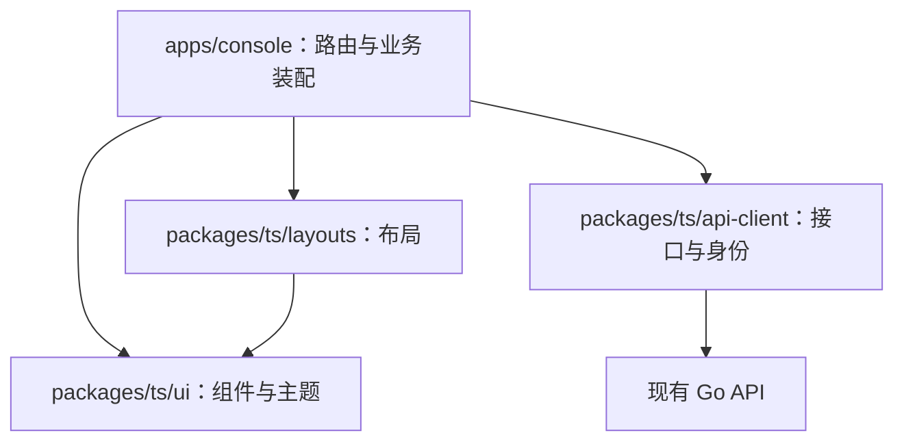

# 前端重构方案：单应用、shadcn/ui 与共享布局

日期：2026-11-09。

状态：**Awaiting acceptance（等待用户验收）**。已按用户确认的方案完成实现与自验，只有用户明确确认后才可改为 Accepted。进展与证据见 [重构验证记录](../verification/frontend-refactor.md)。

用户最新要求：使用 shadcn/ui，技术栈、后台及已有认证页面的布局与风格统一参考 satnaing/shadcn-admin；UI 组件与 layout 必须先在 packages 中抽象，再由应用使用。合并当前两个前端应用，删除其中一个，等实际业务需要时再拆分。

Zustand 和 Recharts 是本次重构的必选技术栈和必交付项，作为后续业务开发的基础，不再采用“当前没有实际需求，暂不引入”的判断。本次完成依赖接入、基础能力封装、使用约定和自验；仅安装依赖不视为完成。Zustand 必须实际接入共享布局状态，Recharts 必须通过 ui 包提供可复用图表并完成独立预览验证，不以当前业务页面是否已有需求作为推迟引入的条件。

## 1. 建议结论与现状依据

**保留 `apps/console`，删除 `apps/screen`，交付一个前端应用；保留 monorepo，在 `packages/ts/ui` 和新增的 `packages/ts/layouts` 内建设共享能力。**

| 当前对象 | 本轮源码核对结果 | 重构决定 |
| --- | --- | --- |
| `apps/console` | 已包含登录、邀请开户、密码恢复、资料、安全、邀请管理和账号首页 | 作为唯一应用保留，接入新 UI、布局和路由 |
| `apps/screen` | 只有登录、账号摘要及跳转 console 的入口；没有独立监测、图表或展示业务 | 删除应用目录、依赖声明、启动进程和构建产物配置 |
| `packages/ts/ui` | 同时放置 AppFrame、通用输入控件、账号摘要、登录表单和手写 CSS | 整理为 shadcn/ui 基础组件、通用组合组件、主题与样式；布局移入 layouts，账号专用展示放回 feature |
| `packages/ts/api-client` | Fetch 客户端、生成类型、IdentityProvider，已处理 Cookie、CSRF 和身份状态 | 延续现有客户端与身份机制；业务请求由应用组织 |
| 工程与部署 | 启动脚本、Docker、Nginx、公开配置、OpenAPI 和测试仍关联两个入口 | 同步收敛为一个应用，不只删除目录 |

选择保留 console 的原因：完整业务都在这里；邀请和重置链接由后端按 `PublicConsoleURL` 生成；现有部署已使用 `/console/`。此时改名为 web 或改部署根路径，会额外增加迁移量，没有当前业务收益。

单应用保留多种布局的能力。以后增加全屏展示，先以 console 内的独立路由和按需加载实现；只有出现独立发布、运行资源、访问方式或部署要求时，再拆独立 app。此次不预建空的 screen 应用或展示业务包。

当前工作区有大量既有未提交改动。实施基线必须以这些当前文件为准，不能用仓库 HEAD 覆盖现有账号能力。实施前已归档基线源码；后续更改在当前工作区上完成。

## 2. 目标与交付范围

1. 后台的侧栏、顶部栏、内容容器、菜单、卡片、表单、列表、弹窗、字体层次和主题，以 shadcn-admin 为视觉基准。
2. 登录采用 shadcn-admin 自带的默认 sign-in 页面；找回密码采用其 forgot-password 页面结构，邀请开户适配其 sign-up 页面结构；重置密码等缺少的流程复用其 AuthLayout、表单和卡片风格补齐。
3. 先完成共享组件和共享布局，再迁移应用页面；应用负责路由、业务规则、请求和数据绑定。
4. 迁移所有现有账号页面，完整保留当前业务语义和异常处理。
5. 最终只启动、构建和部署 console 一个前端；完成 screen 的配置、契约、测试和文档清理。
6. 提供源码来源记录、组件与布局用法、截图对照、自动检查结果、启动方法及人工验收记录。
7. 建立 Zustand 客户端状态管理基础和 Recharts 共享图表能力，后续业务页面直接在此基础上使用。

页面内容采用 InfraPro 的真实功能。上游的任务、聊天、团队、收入统计和演示用户不直接成为产品功能；本轮首页继续呈现当前账号与已有功能入口。

## 3. 参考版本与复刻口径

### 3.1 固定参考源

- shadcn-admin：本轮查询得到的 main 提交为 [`e16c87f213a5ba5e45964e9b67c792105ec74d26`](https://github.com/satnaing/shadcn-admin/tree/e16c87f213a5ba5e45964e9b67c792105ec74d26)，其 package.json 标记版本为 2.2.1。实施以该源码基线为准。
- 认证页面统一取自该提交的 [src/features/auth](https://github.com/satnaing/shadcn-admin/tree/e16c87f213a5ba5e45964e9b67c792105ec74d26/src/features/auth)，与后台使用同一套组件、主题及字体基线。
- shadcn/ui 用于基础组件和 monorepo 接入，新增组件必须与参考项目的 Radix/new-york 配置一致。实施时记录实际采用的文件、版本和本地修改，避免上游更新后静默改变外观。

登录默认选用 `src/features/auth/sign-in/index.tsx` 的居中品牌与卡片版本。上游另有双栏图片版 sign-in-2；本轮以默认版本作为唯一登录视觉基准。

### 3.2 后台视觉基准

参考 [组件配置](https://github.com/satnaing/shadcn-admin/blob/e16c87f213a5ba5e45964e9b67c792105ec74d26/components.json)、[布局源码](https://github.com/satnaing/shadcn-admin/tree/e16c87f213a5ba5e45964e9b67c792105ec74d26/src/components/layout) 和 [主题源码](https://github.com/satnaing/shadcn-admin/blob/e16c87f213a5ba5e45964e9b67c792105ec74d26/src/styles/theme.css)：

| 项目 | 采用方式 |
| --- | --- |
| 组件风格 | 与参考项目一致的 new-york、slate、Radix 系列，统一 CSS 语义变量 |
| 默认后台布局 | 左侧栏 + 右侧 inset 内容区，侧栏默认按 icon 方式折叠 |
| 尺寸 | 以源码的侧栏 16rem、折叠 3rem、手机抽屉 18rem、顶部栏 4rem 为基线 |
| 内容区 | 沿用参考项目的内边距、最大内容宽度和页面标题层次；特殊宽表格在自己的容器内滚动 |
| 主题 | 浅色、深色、跟随系统；颜色、边框、圆角、阴影和状态色集中定义 |
| 字体 | 默认 Inter，中文使用合适的系统字体回退；字体资源本地托管，避免页面依赖外部字体服务 |
| 导航 | 分组、图标、选中态、折叠态提示、移动端抽屉、用户菜单、页面搜索入口 |
| 业务替换 | 品牌替换为 InfraPro，团队切换位置使用单组织品牌展示；菜单只连接已经实现的页面 |

本轮交付参考项目的默认视觉方案及必要交互。字体切换、RTL、所有布局变体的设置面板不作为当前验收项；不为演示配置项扩展产品功能。

“复刻”以固定源码和统一视口截图为基准：结构、间距、密度、主题与交互需要逐项对照；中文文案、品牌、真实业务字段及现有账号规则造成的差异需单独记录。不能仅以“使用了 shadcn/ui”判定视觉完成。

### 3.3 上游认证页面的业务适配

上游提供邮箱登录、社交按钮、注册、邮件恢复及 OTP 示例，部分提交行为使用模拟数据。InfraPro 已确认使用用户名密码、邀请开户和维护人员协助恢复，因此按页面结构复用，并接入现有真实流程：

| InfraPro 页面 | 采用的上游页面/组件 | 业务适配 |
| --- | --- | --- |
| 登录 | `sign-in/index.tsx`、UserAuthForm、PasswordInput | 邮箱字段改为用户名，提交调用现有登录接口 |
| 找回密码 | `forgot-password/index.tsx` 的 AuthLayout、Card、标题和提示层次 | 内容改为维护联系方式及身份核验说明，不显示发送邮件/跳 OTP 的演示流程 |
| 接受邀请 | `sign-up/index.tsx` 的开户表单结构 | 先验证邀请，再填写用户名、显示名称、密码及确认密码；入口仍为 `/invite` |
| 重置密码 | AuthLayout、Card、PasswordInput、表单反馈组件 | 按现有一次性重置链接补齐专用页面 |
| 链接失效、确认已有身份等 | 同一 AuthLayout 与反馈组件 | 明确展示原因及可执行的下一步 |

- Email 改为用户名，保持原字段布局；密码支持显示/隐藏和浏览器密码管理器。
- 保留忘记密码入口，进入现有维护人员协助恢复流程。
- 注册位置改为获取邀请的说明；不展示未接通的社交登录和自助注册按钮。
- 协议区域只展示真实可用的内容，不放 `#` 占位链接或虚构协议。
- 加载中、错误、登录成功回跳、键盘提交、防重复提交均使用真实接口。
- 认证页使用独立 AuthLayout，不套后台侧栏与顶部栏。
- 上游模拟登录、mock token、模拟发送邮件和 OTP 跳转不进入实际身份链路；密码校验采用 InfraPro 的已确认规则。

## 4. 技术选型与具体用途

参考项目依赖见 [固定版本 package.json](https://github.com/satnaing/shadcn-admin/blob/e16c87f213a5ba5e45964e9b67c792105ec74d26/package.json)。参考其组合方式，依赖版本须与本仓库兼容并写入锁文件，不照抄整份依赖清单。

| 技术 | 决定 | 使用位置及原因 |
| --- | --- | --- |
| React、TypeScript、Vite | 延续现有 React 19 / TS 5.9 / Vite 8 基线 | console 与共享 React 包；已有工具链可用，不为复刻外观整体更换版本 |
| pnpm workspace | 保留 | 仍使用 `apps/*` 与 `packages/ts/*`，不额外引入 monorepo 构建平台 |
| shadcn/ui + Radix UI | 引入并统一 | 源码放入 ui 包，提供基础控件与可访问交互；避免混用不同底层实现和样式世代 |
| Tailwind CSS 4 + Vite 插件 | 引入 | 应用构建 CSS，ui 包集中主题，显式扫描 console、ui、layouts 的源码 |
| CVA、clsx、tailwind-merge | 引入 | ui 包管理组件变体和 class 合并，避免页面各自拼出一套样式 |
| TanStack Router 1 | 替换 React Router | console 文件路由、类型化参数、认证路由组、懒加载和路由错误页，与参考项目组织方式对齐 |
| TanStack Query 5 | 引入 | console 的邀请、会话、安全记录等服务端数据；统一加载、刷新、失效和游标数据管理 |
| TanStack Table 8 | 按当前列表需求引入 | ui 包提供通用 DataTable；页面定义真实列和操作，不把业务请求放进表格 |
| React Hook Form 7 + Zod 4 | 引入 | feature 层管理表单值、校验和提交；ui 包提供字段展示和错误反馈 |
| Lucide、Sonner、cmdk | 引入 | 图标、轻量结果提示、已有页面的命令搜索；字段错误仍就近呈现 |
| Fetch + OpenAPI 生成类型 | 保留 | api-client 保持唯一请求入口，继续提供 Cookie/CSRF/错误映射，不并行添加 Axios 请求链路 |
| React Context | 保留 | IdentityProvider 是身份状态唯一所有者，ThemeProvider 提供主题上下文；布局偏好接入下述 Zustand store |
| Zustand 5 | 本次引入 | layouts 内部管理侧栏等客户端布局偏好；建立应用/feature 的跨组件、跨页面客户端状态组织、选择器、重置及持久化约定，为后续业务提供统一基础 |
| Recharts 3 + shadcn Chart | 本次引入 | ui 包建设共享图表容器、提示、图例、主题及常用图表组合，统一后续统计分析与监测图表的基础呈现能力 |
| ESLint、TypeScript、Playwright | 保留并扩展规则与场景 | 检查依赖方向、构建、账号回归、视觉对照与响应式交互；格式工具按实际需要统一配置 |
| Go/Gin、PostgreSQL、Redis | 沿用 | 账号规则和持久化继续由后端负责；本轮只调整与应用合并相关的公开配置及契约，无数据库迁移 |

## 5. packages 设计：先抽象，再使用

### 5.1 目标结构

以下目标结构已落地；实际用法与职责见[前端开发约定](../frontend-development.md)。

```text
apps/
└── console/
    ├── components.json
    └── src/
        ├── app/                 应用装配、providers、router
        ├── routes/              TanStack 路由、守卫、错误页面
        ├── features/
        │   ├── auth/            登录、邀请开户、密码恢复
        │   └── account/         首页、资料、安全、邀请管理
        ├── config/              导航、品牌、公开配置
        └── styles/              唯一应用样式入口与源码扫描声明
packages/ts/
├── ui/
│   ├── components.json
│   └── src/
│       ├── components/          Button、Input、Card、Dialog、Sidebar 等
│       ├── patterns/            PasswordInput、DataTable、反馈状态等
│       ├── charts/              Recharts 图表组合、shadcn Chart 容器/提示/图例
│       ├── providers/           ThemeProvider
│       ├── hooks/
│       ├── lib/                 cn 与纯展示辅助函数
│       └── styles/              tokens、主题、基础样式、字体
├── layouts/
│   └── src/
│       ├── admin/               AdminLayout、侧栏、顶部栏、导航、用户菜单
│       ├── auth/                AuthLayout、认证卡片布局
│       ├── settings/            SettingsLayout
│       ├── state/               Zustand 布局偏好 store
│       └── shared/              内容容器、页面标题等布局元素
├── api-client/                  现有请求客户端、生成类型、身份 React 适配
├── tsconfig/
└── eslint-config/
```

只新增 layouts 共享包，不额外拆出当前没有独立职责的 theme、icons、auth-sdk、business-components 等包。

### 5.2 职责与依赖方向



| 模块 | 对外提供 | 不承担的职责 |
| --- | --- | --- |
| ui | 原始 shadcn 组件、通用组合组件、主题、状态展示、共享图表 | 业务接口请求、账号规则、路由定义 |
| layouts | 完整布局与内部响应式行为、Zustand 布局偏好 store；通过参数、插槽接收品牌、导航、用户展示与操作 | 获取当前账号、查询权限、请求菜单、执行退出接口 |
| console/features | 页面内容、表单规则、query/mutation、业务客户端 store、错误翻译、业务列与图表数据定义 | 复制基础 Button、Sidebar、图表基础封装或整套页面框架 |
| api-client | 类型化请求、Cookie/CSRF、身份状态与活动管理 | UI 样式、页面布局、具体 Router 跳转 |

layout 通过应用传入的链接渲染方式和当前选中项接入导航，不直接绑定 TanStack Router；普通链接和键盘/修饰键打开行为应保持正常。Router 和身份状态通过 console 装配。

包间使用 `workspace:*` 与显式 `exports`，禁止跨目录深度引用应用源码；共享 React 包声明合适的 peerDependencies。使用 ESLint 约束 apps 不直接重复封装 Radix 基础控件，ui/layouts 不反向依赖应用或 api-client。

### 5.3 首批共享能力

- 基础控件：Button、Input、Textarea、Form/FormField、Label、Card、Badge、Separator、Avatar、DropdownMenu、Dialog、AlertDialog、Sheet、Tooltip、Tabs、Table、Skeleton、Sidebar、Command 等，按真实页面需要引入。
- 通用组合：PasswordInput、表单错误/结果提示、加载/空/失败状态、确认弹窗、DataTable 及适合当前接口的加载更多控件。
- 图表：基于 Recharts 与 shadcn Chart 封装 ChartContainer、Tooltip、Legend、主题色及折线、面积、柱状、饼/环形图组合，统一尺寸适配、数值/时间格式化入口和加载、空数据、错误状态。图表接收数据与展示配置，业务指标计算和请求留在应用层。
- 布局：AdminLayout、AuthLayout、SettingsLayout、PageHeader、PageContent；移动端、焦点、侧栏收放与内容宽度在这些模块内部统一处理。
- 客户端状态：layouts 内部使用 Zustand 管理桌面侧栏等布局偏好；建立 store 的类型、选择器、动作、持久化白名单和重置约定。应用级状态放在 console，业务状态按 feature 就近组织。

桌面侧栏展开状态由 Zustand 单独持有，SidebarProvider 以受控方式接入；移动端抽屉的临时状态由布局内部管理。可持久化非敏感界面偏好，账号相关的业务状态在身份切换或退出时重置。图表基础自验使用与产品页面隔离的固定数据夹具，覆盖不同图形与状态，不增加虚构业务指标。

shadcn-admin 的 AuthLayout、品牌位置和认证卡片结构先沉淀在 layouts，字段与按钮使用 ui；登录、邀请开户、找回/重置密码共用这些模块。应用中的 LoginPage 绑定用户名密码、校验和登录请求。现有 AccountSummary 属于账号 feature，不因目前位于 ui 就继续把业务内容放进基础组件包。

不为每个 shadcn 组件再套一个同功能代理组件；保留成熟的组合能力，只对真正重复的行为做聚合。

### 5.4 shadcn 与 Tailwind 的 monorepo 配置

依据 [shadcn monorepo 文档](https://ui.shadcn.com/docs/monorepo)，为参与组件安装的 workspace 配置 components.json、相同的风格/基础色/图标库及正确别名；公共组件落到 ui 包，布局落到 layouts。

迁入上游页面时，先分离公共组件与布局，再绑定业务；使用 CLI 补充组件时也要检查生成结果，不能把默认落点当成已经满足抽象要求。对上游改过的组件记录差异，后续升级逐项合并。

应用样式入口只装载一次 Tailwind 和共享基础样式。按 [Tailwind 源码扫描说明](https://tailwindcss.com/docs/detecting-classes-in-source-files) 显式纳入共享包路径，组件变体使用完整 class 映射，避免生产构建遗漏样式。

## 6. 路由、数据与账号流程

### 6.1 页面迁移表

保持当前公开业务路径，生产仍以 `/console/` 为基础路径。

| 路径 | 目标布局与页面 | 保留的业务能力 |
| --- | --- | --- |
| `/login` | 上游默认 SignIn + 共享 AuthLayout | 用户名密码登录、合法站内回跳、账号创建/改密成功提示 |
| `/forgot-password` | 上游 ForgotPassword 结构 + 共享 AuthLayout | 维护联系方式、恢复说明、返回登录 |
| `/invite` | 上游 SignUp 结构 + 共享 AuthLayout | 邀请校验、退出已有身份后开户、用户名/显示名/密码表单、失效提示 |
| `/reset-password` | 按上游认证风格补齐 + 共享 AuthLayout | 一次性链接校验、新密码设置、成功后重新登录 |
| `/` | AdminLayout | 本人账号摘要与已实现功能入口 |
| `/profile` | AdminLayout + SettingsLayout | 用户名只读、显示名称修改、保存反馈 |
| `/security` | AdminLayout + SettingsLayout | 改密、会话撤销、其他/全部设备退出、安全记录 |
| `/invitations` | AdminLayout | 生成/复制、近期密码复验、撤销/重新生成、状态及游标列表 |
| 未匹配路径和运行错误 | 与访问场景匹配的错误页 | 返回有效页面、重试；区分未登录、未找到和依赖不可用 |

原 URL 无需改为上游的 `/sign-in` 或 `/settings/account`。路由文件组织可以改变，公开地址及已发放的邀请、重置链接继续有效。

### 6.2 数据与身份装配

1. 应用创建客户端与 IdentityProvider，先建立 CSRF 状态，再确认账号帮助信息和当前身份。
2. 通过 console 内的适配把身份状态传入 TanStack Router context；受保护路由确认身份就绪后再加载。参考 [TanStack 认证路由方式](https://tanstack.com/router/latest/docs/framework/react/guide/authenticated-routes)。
3. loading 显示加载状态，anonymous 才跳登录；unavailable 显示可重试错误，不按退出登录处理。
4. 登录成功更新身份并刷新路由判断，再进入白名单内的 returnTo；退出或 401 时清理该账号的查询缓存并更新路由。
5. TanStack Query 通过现有 api-client 读取邀请、会话和安全记录；账号相关 query key 包含账号标识，退出/切换时取消旧请求并清理旧数据。
6. 当前身份仍由 IdentityProvider 单独管理，不在 Query、Context、Zustand 中各保存一份。其活动采集、焦点刷新和故障恢复行为在迁移时保留。
7. Zustand 管理客户端共享状态，TanStack Query 管理服务端数据，React Hook Form 管理表单；同一状态只设置一个所有者。应用负责把查询结果转换为共享图表需要的数据，再传给 ui 包的 Recharts 图表组件。

切换 Router 时同步迁移所有关联的 Link、Navigate、location/search/navigation hooks，避免旧 Router 的页面被直接挂在新 Router 下。基础路径从现有 Vite 配置取得，登录回跳和链接都需要验证 `/console/` 部署情形。

### 6.3 必须守住的业务细节

- 写操作不自动重试；CSRF 更新后由用户明确重新提交，不能静默重复生成邀请、重置密码或撤销会话。
- 邀请和重置 token 继续从 URL fragment 捕获后移入内存并清除地址；处理应先于路由初始化，不写入 query key、localStorage、日志或错误追踪信息。
- 密码长度继续按 Unicode 码点统计，支持中文和空格，不改成普通字符串长度、不 trim 密码；当前密码范围由已确认规则和服务端公开配置驱动。
- 表单保留字段级错误、防重复提交和网络故障后的非敏感输入。服务端仍是规则和归属校验的最终执行方。
- 不同标签页切换账号后，资料草稿、密码输入、已生成的邀请链接及安全记录全部按新身份重置；不能只清 Query 而保留旧表单和一次性链接。
- “退出当前会话”作用于请求携带的当前 Cookie，不能依据已过时的会话列表 ID 撤销；其他设备撤销仍按指定会话 ID 执行，保留现有的区分。
- HTTP 环境下的邀请链接手动复制保留；改用弹窗或 Toast 不得让完整链接无法选中。
- 账号仍采用单组织、相同功能权限、邀请开户、维护人员恢复密码。上游 Clerk、邮箱登录、开放注册、社交登录、OTP、团队和角色模型不进入本轮。
- 现有邀请/安全记录采用游标接口；表格显示“加载更多”等实际能力。没有服务端总数、排序和筛选时，不展示虚构总页数或把当前批次的本地过滤当成全量查询。

## 7. 删除 screen 的完整范围

| 层面 | 实施调整 |
| --- | --- |
| 应用 | 删除 `apps/screen`；移除双端标记、跨端跳转按钮与 screen 专用主题 |
| workspace | 清理 `@infrapro/screen`、根目录 `dev:screen` 脚本及 pnpm lockfile 对应 importer |
| 启动 | `scripts/dev.mjs`、Makefile、preview 只管理 API 与 console；5174 不再是运行依赖 |
| 配置 | 移除 SCREEN_PORT、VITE_OTHER_APP_URL、有效配置中的 PublicScreenURL 和双应用同主机检查；trusted origins 只要求真实使用的来源 |
| API 契约 | 同步更新 account-help 响应、OpenAPI、生成类型和调用方，清理 `screen_url`；保留用于邀请/重置链接的 `console_url`/PublicConsoleURL |
| Docker/Nginx | Web 镜像仅构建和复制 console；Compose 仅配置一个应用；API 代理与 SPA 回退仍明确区分 |
| 测试 | 删除第二个前端 webServer 和端口依赖；跨端共享会话场景改为同应用多标签页与独立浏览器会话回归 |
| 文档 | 更新 README、架构、账号运行手册和新的验证记录；历史自验结果保留历史性质，并说明被本次方案替代的双应用范围 |

兼容决策：生产主入口继续 `/console/`，根地址继续跳该入口；旧 `/screen`、`/screen/`、`/screen/login` 在 Nginx 固定映射到 console 的对应入口，其他旧 screen 子路径统一返回 console 首页。使用固定站内目标，不接收外部重定向地址。兼容规则不提供第二套静态资源或第二个开发服务器，旧的本地 5174 端口不再服务。

当前 YAML 加载启用了严格字段检查。实施时对遗留 `public_screen_url` 提供弃用字段的读取兼容和迁移提示，使旧配置不会因删除 app 而直接阻止启动；该值不进入有效运行配置。示例配置、初始化脚本和部署模板立即移除它，迁移说明列出本地已有配置的清理方法。修改只涉及相关键，不重写已有密钥或数据库设置。

应用和 account-help 契约调整作为同一批发布交付；前端不再依赖 screen_url。若实施基线核对发现另有独立客户端消费该字段，应先记录其迁移方式。

## 8. 实施顺序与每步完成条件

| 迭代 | 工作内容 | 自验与可交付结果 |
| --- | --- | --- |
| 0：冻结基线 | 记录当前工作区、既有账号能力、固定上游源码与参考图；列出旧 screen 引用 | 确认全部页面、配置和业务行为有迁移去向，不覆盖既有改动 |
| 1：共享 UI 与图表 | 接入 Tailwind/shadcn/Recharts，整理 ui 包、主题、控件、图表组合、通用反馈和包导出 | 通过包类型检查与组件交互验证；图表夹具覆盖主题、尺寸与数据状态；生产构建能生成共享包样式 |
| 2：共享布局与客户端状态 | 在 layouts 实现 AdminLayout、AuthLayout、SettingsLayout，接入 Zustand 布局 store 并明确业务 store 约定，复刻默认外观 | 使用测试夹具验证桌面/手机、浅/深主题、键盘、侧栏与状态恢复；不另建常驻 UI Catalog app |
| 3：应用装配与认证 | console 使用共享包，迁移 TanStack Router、身份适配、上游认证页面与现有公开账号流程 | 登录/回跳、邀请、重置、服务故障、深层刷新可用；路由 hooks 完整切换 |
| 4：已登录页面 | 迁移首页、资料、安全、邀请；接入表单和 Query、真实列表 | 原账号功能回归通过；清理旧 AppFrame、旧样式及已经替换的展示实现 |
| 5：单应用收尾 | 删除 screen，调整配置、契约、启动、镜像、代理、测试和文档 | 单应用启动/构建/HTTP 部署通过；旧地址跳转可用，运行不再需要 screen |

每步保持可独立检查的改动范围。UI 和 layout 必须先在 packages 完成，再被页面引用；旧实现可在迁移期间短暂存在，交付时统一清理。遇到验收缺项先修正当前迭代，新业务功能单独进入后续需求。

## 9. 自验计划、交付方式与风险

### 9.1 计划执行的检查

- 工程：依赖方向、包导出、React 单实例与 peerDependencies、lint、类型检查、锁文件、生成契约同步。
- 构建：`pnpm check`、`pnpm build`；检查唯一前端产物、共享包样式、路由懒加载和基础路径。
- 业务：现有 `pnpm test:e2e` 与 `pnpm test:e2e:preview`，改造定位方式但保留业务断言；包括 `account-state.spec.ts` 中跨标签页换账号后草稿/凭证清理及 Cookie 更替后的当前会话退出场景，补足路由、表单与缓存隔离回归。
- 配置/身份：运行受应用合并影响的 Go 配置、HTTP 路由与身份测试；现有 `pnpm test:identity` 用于确认账号行为没有随配置收敛改变。
- 部署：`pnpm test:http` 验证单应用镜像、真实 `/console/` 深链接、旧 screen 跳转、API JSON 错误、普通 HTTP 下复制与会话行为。
- 视觉：至少覆盖 1440×1000、1024×768、375×812，浅色/深色、侧栏展开/收起、登录、表单、表格、弹窗及错误状态；保存参考、实现与差异说明。
- 可访问性：可见焦点、Tab 顺序、标签、错误关联、弹窗焦点归还、Escape、移动端抽屉及减少动效设置。
- 状态管理：验证 Zustand 布局状态的更新、订阅、允许持久化的偏好恢复，以及账号相关 store 的重置约定，防止与身份、Query 或表单形成重复状态源。
- 图表：验证共享图表的包导出、各图形的数据映射、Tooltip/Legend、主题切换、容器缩放和加载/空/错误状态；检查必要的文字说明及不只依赖颜色区分系列。

截图比较先确认参考基线，再记录合理的业务差异；不能把错误界面生成 snapshot 后直接当作通过。对于无实际数据的功能，不用模拟收入、设备指标填充正式页面。

### 9.2 具体风险与处理

| 风险 | 处理方式 |
| --- | --- |
| 上游源码变化、不同 shadcn 底层或样式混用 | 固定来源提交，统一 Radix/new-york，记录所有本地改动和必要来源声明 |
| 迁移路由导致回跳、fragment、子路径失效 | 保持公开路径；覆盖 router 初始化前 token 捕获、站内白名单、前进后退与部署刷新 |
| 引入 Query 后显示旧账号数据或重复写请求 | 身份单一来源、账号维度 key、退出取消与清缓存、mutation 不自动重试 |
| Tailwind 未扫描共享包，开发与生产视觉不同 | 显式扫描三处源码，构建产物预览与 HTTP 部署都检查 |
| 当前 Nginx CSP 与字体、弹层定位/滚动锁定、主题初始化不兼容 | 字体和初始化脚本同源托管；在现有 CSP 下验证组件，发现具体冲突后再做最小调整，不默认放宽整站策略 |
| 只删 screen 目录，遗留配置使启动失败 | 对脚本、Compose、OpenAPI、严格 YAML 解析及测试逐层核对，并提供旧配置迁移说明 |

采用上游代码时记录文件来源和修改，保留对应版权与许可证声明；shadcn-admin 的来源许可文件见 [LICENSE](https://github.com/satnaing/shadcn-admin/blob/e16c87f213a5ba5e45964e9b67c792105ec74d26/LICENSE)。

### 9.3 完成后的启动与交付

目标开发入口为 `pnpm dev`，启动 API 与 console；`pnpm dev:console` 仍可单独启动前端。默认本地访问 `http://127.0.0.1:5173/`；HTTP 部署访问配置主机的 `/console/`。具体命令将以实施后的实际验证结果更新运行手册。

交付时提供修改清单、检查命令与结果、访问地址、截图、未验证环境和已知限制。相关代码和配置自验通过后，实施状态进入 **Awaiting acceptance**；用户手工确认后才进入 **Accepted**。

方案已进入实施与自验。命令结果、参考截图、当前实现截图和差异说明统一记录在[重构验证记录](../verification/frontend-refactor.md)中；既有账号验证结果不代替本次重构自验。

## 10. 用户手工验收表

| 编号 | 操作 | 预期结果 |
| --- | --- | --- |
| FE-01 | 启动项目并检查前端入口 | 只有 console 一个前端进程；不依赖 5174 或 screen 产物 |
| FE-02 | 对照参考项目检查后台框架 | 侧栏、顶部栏、内容间距、菜单、卡片和表格符合冻结的视觉基准 |
| FE-03 | 切换浅色/深色、刷新、折叠侧栏 | 主题与折叠状态按约定保持，无明显主题闪烁或布局跳动 |
| FE-04 | 对照上游默认登录及认证页面，逐一打开登录、找回密码、邀请和重置页面 | 品牌、卡片、字段和提示层次统一；真实用户名密码、邀请与维护恢复流程可用，无模拟认证或未接通入口 |
| FE-05 | 未登录直达资料页，再登录 | 回到有效站内目标；外部 returnTo 不生效 |
| FE-06 | 生成邀请、复制、受邀开户、撤销/重建 | 与现有规则一致，密码复验可用；普通 HTTP 下能手动复制完整链接 |
| FE-07 | 修改资料、密码，完成一次密码恢复 | 资料正确保存；改密/重置后会话按原规则失效；错误定位到正确字段 |
| FE-08 | 两个标签页及两个独立浏览器会话操作退出 | 同一会话失效在重新请求/聚焦时体现；其他会话和全部退出的语义正确，无旧账号数据残留 |
| FE-09 | 切换到手机宽度并用键盘操作 | 导航变抽屉；表单、弹窗可用；页面无整体横向溢出，焦点可见且顺序合理 |
| FE-10 | 模拟依赖故障后恢复 | 显示可重试故障，不误判退出，不自动重放写请求，非敏感表单内容保留 |
| FE-11 | 刷新 `/console/profile`，打开旧 `/screen/` | 深链接正常，旧入口按固定规则跳转；API 错误仍为 JSON |
| FE-12 | 检查页面内容和 packages 使用方式 | 真实账号页面统一使用共享 UI/layout；没有复制的应用内基础组件、虚构业务菜单或演示指标 |
| FE-13 | 在图表测试预览中查看折线、面积、柱状、饼/环形图，切换主题、尺寸与数据状态 | 共享图表已可使用，Tooltip/Legend 与主题一致，缩放及加载/空/错误状态正常 |
| FE-14 | 操作侧栏并刷新页面，检查客户端 store 的重置场景 | Zustand 已实际接入布局；允许持久化的偏好可恢复，账号相关状态按约定重置 |

以上是本次重构的验收标准。自动验证与人工检查证据见重构验证记录，用户确认单独记录。
