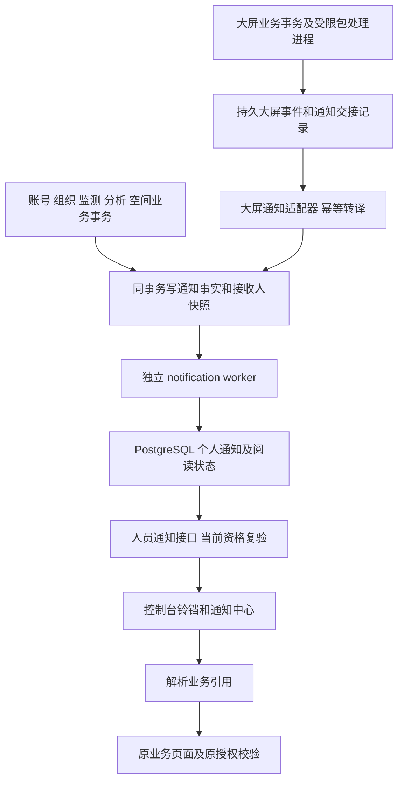

# 系统级站内通知交付范围与代码重构方案

日期：2026-11-13。状态：**Awaiting acceptance（完整实现及功能自验通过）**。2026-11-13 用户授权完整实施；当前交付覆盖 NT-01–NT-08 及全部业务接入。人工验收待用户确认，现有业务的人工验收状态不变。

**本轮建设统一的人员站内通知能力，并完整接入本方案列出的现有业务事件。** 通知归属于接收账号，来源可以是平台、租户或项目。用户在任何工作空间都能查看自己的通知，从通知进入当前有权访问的业务位置。业务模块继续拥有任务、邀请、授权、发布和处理结果，通知模块负责可靠投递及个人阅读状态。

用户已将原预警迭代收窄为站内通知。预警规则、异常事件、确认研判、处置关闭、未确认催办和逐级升级不属于本轮；设备接入、数据解析仍后置。短信、邮件、浏览器系统推送、即时聊天、人工公告编辑和通用流程引擎也不在本轮交付范围。后续预警可以接入同一通知能力。

当前实现的稳定规则已归入[主需求](../requirements.md#in-app-notifications)、[架构](../architecture.md#in-app-notifications)与[选型](../technology-selection.md#in-app-notifications)；[自验记录](../verification/in-app-notifications.md)及[运行／人工验收](../operations/in-app-notifications.md)分别记录实际证据和操作。以下基线与方案自检保留提出方案时的历史，现有大屏代码已经集成到当前主工作区，本轮按该实际代码接入。

## 1 当前系统基线与本轮衔接

### 1.1 两个会话的关系

- [梳理 Progma 已完成与待开发项](codex://threads/01a1d321-518a-7852-9e6d-664e5f021d40)分析的是 InfraPro 当前代码，以 Progma 需求和数字化解决方案为对照。它提出的预警闭环仅作为背景，本轮范围以用户此次收窄后的要求为准。
- [实现大屏 SDK 与运行机制](codex://threads/01a1d36b-8b96-72f3-bf57-864ffdb19c9b)正在现有工作区 /Users/hijacker/.codex/worktrees/283d/InfraPro 实施。已检查其中的实际代码，包括 display、ReadSubject、任务归属、运行订阅和受限包处理进程；不能仅依据当前主工作区尚未出现这些目录就认定它们不存在。
- 本方案写入 /Users/hijacker/Documents/ChatGPT/InfraPro 当前 main 工作区，不新建分支或工作树。核查时两处 HEAD 均为 ab8b2feee207b00829ab8765848d11af02c438b7，但均包含未提交变更，HEAD 不能代表这些实现的完整内容。
- 大屏核查时仍在最终回归，不能写成已经合入、部署或人工验收。后续实施应按其最终交付代码复核接入点；本轮通知方案不修改大屏工作区。

### 1.2 可以复用的能力与实际缺口

| 当前能力 | 已核查的实现 | 站内通知需要补齐的内容 |
| --- | --- | --- |
| 身份与授权 | 人员账号、会话、平台／租户／项目权限、当前资格复验、审计和账号停用。 | 自己的通知箱、通知接收策略、撤权后的内容裁剪；不能把审计读取权当成通知接收权。 |
| 组织业务 | 租户邀请、成员变更、项目成员与角色、管理员交接、租户启停、项目归档。 | 在已提交的关键变化上记录通知事实；补齐无需分享令牌的个人邀请入口。 |
| 监测与分析任务 | PostgreSQL 持久任务、租约、重试、取消、结果发布；派生与分析复用任务宿主。 | 把分散的最终状态提交接入通知，包括直接写 succeeded 的发布路径和过期租约回收路径。 |
| 空间功能 | 上传、转换、产物封存、发布、授权、独立 worker。 | 成功、最终失败及业务授权变化通知，保持转换任务与通知投递分别恢复。 |
| 大屏实现 | 包任务、发布、终端、display_events、display_subscriptions、只读 ReadSubject。 | 把少量管理事实交给人员通知；保留终端身份、订阅确认和包处理权限隔离。 |
| 控制台 | WorkspaceShell、AdminLayout、账号入口、TanStack Query、Sonner 操作反馈。 | 全局铃铛、通知列表／详情、已读归档、分类设置及受控跳转。现有 toast 不提供持久历史。 |

当前未发现完整的人员站内通知模块。identity 的会话失效 outbox、monitoring_changes 的数据变化记录、display_events 的运行记录各有专门用途；它们不能直接变成人员通知箱。

## 2 本轮完整交付范围

| 编号 | 交付内容 | 完成后的行为 |
| --- | --- | --- |
| NT-01 | 通知事实与类型目录 | 来源、事件版本、发生时间、业务引用、接收对象、模板和安全展示规则统一登记。 |
| NT-02 | 可靠站内投递 | 业务提交与通知事实一致；离线可接收、失败重试、进程重启续办、重复消费不重复入箱。 |
| NT-03 | 个人通知中心 | 全局入口、未读数、分页、类型／来源范围筛选、详情、已读、恢复未读、全部已读及归档／取消归档。 |
| NT-04 | 接收规则与基础偏好 | 按业务关系选人；安全与本人资格变更必收，普通任务结果／业务更新可按分类关闭。 |
| NT-05 | 现有业务接入 | 完成第 4 节事件矩阵，包括账号、组织权限、监测、派生分析、空间和大屏管理。 |
| NT-06 | 安全业务跳转 | 通知绑定业务对象；点击时重验当前资格，跳到正确账号、租户或项目位置。邀请接受、下载等继续调用业务接口。 |
| NT-07 | 权限与故障处理 | 撤权裁剪、账号隔离、失效目标、批量操作并发、有限重试、失败诊断和安全重放。 |
| NT-08 | 部署与验收材料 | 增量迁移、独立通知 worker、本地启动、健康诊断、功能回归、合成验收数据和操作说明。 |

这些是同一轮的完整交付项。内部可按“基础能力 → 业务接入 → 联调”推进，但只有基础通知中心可用、其他业务还未接入时，不能宣布本轮完成。

## 3 用户可见规则

### 3.1 一个账号一个通知箱

通知接收人是人员账号。用户进入账号首页、平台管理、租户工作空间或项目工作空间时，顶部显示同一个通知入口；切换工作空间不会丢失其他范围的通知。

通知中心默认显示本人全部可见通知，可筛选“未读／全部／已归档”、账号与安全、组织与权限、任务结果、业务更新，以及当前租户／项目。来源范围由事件确定，不能由浏览器任意指定接收账号或伪造归属。按当前工作空间筛选不改变通知本身的归属。

### 3.2 三类状态分别维护

| 状态 | 所属模块 | 含义 |
| --- | --- | --- |
| 待投递、已入箱、抑制、待重试、失败待处理 | 通知模块 | 是否已经形成接收人的持久通知记录。用户没登录属于正常离线，不是投递失败。 |
| 未读、已读、归档 | 通知模块，逐接收人保存 | 是否阅读和是否从默认列表收起；一人已读不会修改其他人的状态。 |
| 邀请待接受、任务失败、成果可用、发布生效等 | 原业务模块 | 当前业务事实。打开或标记通知已读不接受邀请、不重试任务、不确认工程异常。 |

进入已加载成功的通知详情才自动标记该条已读；打开铃铛面板、请求列表、收到轮询响应均不自动已读。归档默认同时标记已读，取消归档保持已读；恢复未读会取消归档。修改失败时恢复界面状态并提示重试。

“全部已读”明确作用于当前筛选的未归档通知，使用服务端返回的接收序号水位；操作后新入箱的消息保持未读。后台延迟投递的旧事件按新的接收序号入箱，不能因发生时间早而被误标已读。

通知详情显示发生时间、投递时间、来源类别和当前可披露的业务上下文。任务结果已经过期、邀请已接受、对象已删除时显示当前状态，不继续提供失效操作。通知中不存下载地址、邀请令牌或会话凭据。

### 3.3 接收偏好与保留

初始全部开启。本人安全／资格变化及直接发给本人的租户邀请属于必收通知；普通任务结果和业务更新可按类别关闭。偏好只控制人员通知，不改变业务执行、审计或页面内的结果反馈。关闭不删除历史，再开启不补发期间主动抑制的通知。

分类设置保存在服务端，跨设备一致。本轮不增加免打扰日历、任意收件人配置、通知规则编辑器或审批流程。保留策略先采用不自动删除个人通知，用户可以归档；不会沿用大屏诊断的清理周期删除通知。上线材料应说明存储增长与维护查询，后续如需自动保留期限另行确定。

## 4 与现有业务的接入矩阵

以下范围是建议的本轮业务基线。接入对象是会影响协作、本人资格或离开页面后仍需获知的结果。普通资料保存、列表刷新、每个数据点和每次心跳不逐条通知。

| 来源 | 本轮触发事实 | 接收人及范围 | 业务落点与具体约束 |
| --- | --- | --- | --- |
| 账号安全 | 密码修改／重置完成、管理员变更账号可用状态、撤销其他会话或全部会话。 | 本人；账号范围。 | 账号安全页。停用期间不能登录查看，恢复后可见脱敏历史；不暴露凭证、原始 IP 或安全日志正文。正常登录／退出不逐次通知。 |
| 开户邀请 | 已发出的开户邀请被使用。 | 邀请发起人；平台来源。 | 原开户邀请详情。未开户者没有站内账号，不虚构接收人，原分享链接流程保留。 |
| 租户邀请 | 新邀请、重新生成替换旧邀请、撤销／失效、接受成功。 | 目标账号收邀请和状态变化；邀请人收接受结果。 | 新增个人“收到的租户邀请”入口，按目标账号和邀请 ID 校验；平台现有“账号开户邀请”页不能复用成收件箱。 |
| 成员与角色 | 加入、暂停、恢复、移除；平台／租户／项目角色或有效权限变化。 | 受影响本人；保留来源层级。 | 个人可用工作空间／权限说明。角色编辑影响多人时按原事务影响集合逐人形成回执；同次角色和成员变化合并为一条资格变更摘要。 |
| 管理交接与生命周期 | 租户管理员／项目负责人或管理员交接、租户启停、项目归档／恢复。 | 交接双方；状态变化时当时受影响的有效成员。 | 可访问时进入原工作空间；失权者只看“你参与的工作空间状态发生变化”等脱敏个人回执，不能继续读取业务详情或内部停用原因。 |
| 项目资源与设备授权 | 工程资源、设备、监测数据范围、空间资料授权新增／收窄／撤销。 | 受影响项目的当时有效管理人员；项目范围。 | 原授权工作台或项目授权说明。按一次授权命令归并，不对每个对象各发一条；能接收摘要不等于能进入租户管理页。 |
| 监测导入 | 校验完成且需用户继续采用、采用成功、最终失败或需要人工处理。 | 发起人，保留发起时的租户／项目范围。 | 导入批次详情。校验完成与正式采用是不同事实；自动重试中不发最终失败。 |
| 监测导出 | 文件就绪、最终失败、需重新授权或重建快照。 | 发起人，保留任务范围。 | 任务／导出结果页，下载时重新鉴权并现取有效下载能力；通知不携带文件正文。 |
| 派生与历史分析 | 手动试算、回算、依据回放、成果比较、历史分析及成果导出完成／失败／需处理。 | 发起人；沿用该任务范围。 | 派生任务、固定成果或比较结果。父任务只有一个结果摘要，分片和内部子任务不重复通知；短试算依通知偏好入箱，toast 仍用于即时反馈。 |
| 自动派生 | 已有执行结果进入最终失败／需处理，以及该故障条件随后恢复。 | 租户内当时有维护派生资格的管理人员；租户范围。 | 通道计算状态。不能把创建者当作永久执行身份，不能向所有引用该通道的项目广播。连续成功计算不通知；同一故障持续期间归并。 |
| 工程空间 | 图模转换产物封存成功、最终失败、取消结果；发布或授权变化影响协作。 | 转换发起人；发布及授权影响的项目管理人员。 | 原空间版本／任务或授权页。转换成功不自动发布；租户资料不会因被项目引用就向所有项目群发。 |
| 大屏包与发布 | 包校验 ready／failed、发布／回退／撤回、实例启停／归档和读取授权变化。 | 包结果给上传人；管理变化给相关项目中有大屏管理资格的人员，操作本人去重。 | 项目大屏实例的包、发布、授权区域。人员上传工具仍按人员归属，自动生成的只读查询任务不产生人员任务通知。 |
| 大屏持久运行故障 | 已发布包转为 missing 及修复核验恢复；终端被管理员停用／撤销的管理事实。 | 当时有相应大屏管理资格的人员；项目范围。 | 实例诊断／终端管理。普通查询失败、心跳、订阅重连、预算拒绝不逐次通知；不在本轮增加终端离线判定引擎。 |
| 工程定义、资源台账、设备台账、来源绑定 | 接入其中的资格变化与上面列出的结果事件；普通同步增删改保留操作反馈和审计。 | 按已有业务关系处理。 | 本轮不建立“任意对象关注／订阅”和公共产品版本群发，避免为没有明确接收关系的 CRUD 产生噪声。 |

取消任务只有状态实际转为取消后才形成结果；取消请求已提交但任务仍在运行时不提前通知“已取消”。本人主动取消可按普通结果偏好处理，其他人取消本人任务仍应提供原因码和可访问入口。

对持续自动失败，仅归并已有领域状态：按租户、通道、配置／委托代次及故障类别记录一个通知条件周期；首次失败一次，持续失败只增加次数，当前有效代次实际恢复一次。暂停、取消、换配置或撤权不等于恢复，旧 worker 的成功不能关闭新代次的故障。它不计算监测阈值、不判断设施健康，也不实现超时催办。没有合资格接收人时记录原因供运维诊断，不回退为全平台群发。

## 5 接收人和可见性

### 5.1 接收对象在业务发生时确定

业务模块确定事件含义和候选接收人，通知模块负责同一账号去重、偏好、投递和展示。候选来自目标账号、任务发起人、交接双方、事务中已计算的受影响成员或管理人员集合。浏览器不得提交任意账号列表要求系统发送通知。

候选账号和当时的成员身份／范围写成持久快照，处理时分批展开。延迟投递时再次检查当前资格，只能删除已经失去资格的候选，不能把后来加入的成员补进旧事件。自动任务必须按其租户委托选择接收人，大屏终端／ReadSubject 不得放入接收账号列。

批量授权或生命周期变更复用现有影响预览中的受影响集合，在同一事务固定接收集；不得把“运行 worker 时查询当前所有管理员”作为事件发生时的收件人。大规模展开在后台分批进行，重试沿用原接收集。

### 5.2 收件权不扩大业务权限

所有个人接口都从已验证人员会话取账号，并拒绝只读主体；即使终端和人员使用相似的内部 Actor 载体，也不能让终端通过账号通知接口。客户端传入其他账号或其他人的通知 ID 不能读取、标记、归档或解析目标。

保留两类展示策略：

- **个人回执**：本人账号安全、本人成员资格和本人主动任务的脱敏状态可以保留。失去来源资格后移除租户／项目名称、对象名称、业务摘要和目标入口，只显示该账号自身的变化或任务结果。此类回执可以继续已读和归档。
- **范围内业务通知**：共享发布、自动派生故障等依赖当前租户／项目及对象读取资格。失权后停止展示敏感内容，不能从标题、筛选项、搜索匹配或未读数推断受限对象。恢复资格后是否能再看历史仍按该条接收人快照和当前资格判断。

列表、详情、未读数、分类统计和批量已读复用同一可见性规则。先执行范围与对象资格过滤，再分页／计数；不能先取 50 条再隐藏其中一部分并把 50 当作总数。源业务提供批量资格判定或查询约束，避免逐条远程调用；通知核心不复制各域的授权 SQL。

返回正文和解析跳转时都复验当前资格；缓存只保留会话内必要数据。权限修订变化、退出登录、切换账号时清除旧列表、展开详情和迟到请求。服务端即时校验是正确性依据，前端刷新周期不构成权限宽限期。

## 6 模块设计与数据流

### 6.1 两种可靠来源汇入一个通知模块

普通业务采用事务 outbox：业务结果和通知事实在同一 PostgreSQL 事务提交。发通知无需调用网络服务；如果通知事实写入失败，本次业务事务一并回滚，不接受“业务已成功但静默丢弃通知”。数据库故障可阻止业务提交，通知 worker 暂停则只导致延迟投递。

新增轻量 Module notificationevent，只包含事件契约、验证和事务写入 Interface AppendTx。它依赖 pgx 和中性类型，不依赖 access、identity、monitoring、display 或通知查询模块。业务在已有 pgx.Tx 中调用它，通知模块反向使用 access 复验资格，避免 access → notifications → access 循环。

新增 Module notifications，拥有类型目录、模板、投递、个人状态、接收偏好和查询；runtime 是跨域 Adapter 的装配位置。业务 Module 提供有限的接收人／目标资格 Interface，notifications 不直接扫描所有领域表，也不要求业务知道轮询、已读或 UI 文案。

模板和事件 schema 在代码中版本化，经过白名单校验。事件只保存必要字段、稳定业务引用和安全摘要，不保存原始观测、整个成果 JSON、任意 HTML、内部错误栈或原审计正文。

### 6.2 核心数据模型

| 拟新增数据 | 用途与关键约束 |
| --- | --- |
| notification_events | 不可变业务事实；event_type、schema_version、source_module、source_key、scope、actor、occurred_at、业务引用和小型载荷。来源键唯一，重复写同键但不同载荷报冲突。 |
| notification_recipient_sets／recipients | 固定的候选账号集合及其业务关系，唯一事件／账号；大范围接收集分批展开但不重新按当前角色选人。实际表拆分以事务规模验证为准。 |
| notification_deliveries | 每个事件／账号的处理进度、下一次重试时间、租约、fence、尝试次数和结构化原因；区分偏好抑制、资格丧失、依赖失败及非法事件。 |
| account_notifications | 逐账号的一条通知、模板版本、业务引用、个人接收序号、read_at、archived_at、revision；唯一事件／账号，个人状态互不影响。 |
| notification_inbox_states | 账号内接收序号和状态修订。入箱事务锁定该行再分配序号；序号与提交顺序一致，用于分页和全部已读水位。 |
| notification_preferences | 账号／类别的可选设置及修订，必收类型不能被关闭。 |
| notification_conditions | 仅对自动派生和已发布包缺失等已确认持续故障归并；保存来源条件、周期、首次／最近时间、计数和恢复，不承载业务处置流程。 |

账号 FK 只引用 accounts。scope 区分 account、platform、tenant、project；project 必须同时有正确 tenant，复合关系在写入校验和数据库约束中保护。通知不会被挂到 display_subjects，也不会把 tenant_id 为空错误解释为所有租户广播。

索引至少覆盖来源唯一键、事件接收人唯一键、待投递状态和 available_at、账号接收序号倒序、未读／未归档查询及范围筛选。列表采用稳定游标，不使用无界 offset；总数与计数不得通过全量把通知拉到浏览器计算。

### 6.3 投递和重试

worker 通过持久状态和 SKIP LOCKED 分批领取，短事务登记租约，完成时复核 fence。生成个人记录、更新处理结果及账号修订在同一事务提交。崩溃后重新领取，唯一约束阻止重复入箱；系统保证持久重试和幂等效果，不宣称网络上“只执行一次”。

不使用“读取最大自增 ID 然后只读更大 ID”判断是否消费完毕：较小 ID 的事务可能晚提交。领取按待处理状态进行；领域桥接按交接记录与处理收据进行，不依靠提交顺序未经证明的 ID 水位。

临时依赖故障指数退避并设上限；事件格式错误、模板未知等进入失败待处理。CLI 可按事件 ID 查询和重放失败投递，保留原来源键、接收集和个人已读状态。重放操作单独审计，不能变成随意向任意账号发消息的运维后门。

接收集为空、偏好关闭和资格丧失记录为有原因的完成，不无限重试。worker 故障、失败量及最长积压时间由日志、健康检查和 CLI 暴露；通知模块不能依赖“给自己发一条通知”作为唯一故障监控。

锁顺序沿用原业务的 access、账号、目录、租户、项目与对象锁；追加通知事实放在业务状态和审计之后、提交之前。投递领取和资格读取分开，最终事务按既有顺序复验后锁通知状态，避免持有队列行锁反向等待业务账号锁。

## 7 必须做的重点代码重构

### 7.1 收口任务最终状态提交，覆盖所有出口

[任务宿主](../../packages/go/platform/monitoring/task_host.go)已有 TaskLease 和事务资格检查，但 succeeded 分布在多个结果发布文件。新增受控的任务终结 Interface，例如 TaskLease.CompleteTx 和内部 FinalizeTaskTx：调用方传已有事务、任务标识／租约、语义结果与业务引用，统一验证合法状态迁移、更新任务、追加结果事件。

逐项改造以下真实路径，不能只改 jobs.go 的 finishJob：

- monitoring/jobs.go 的正常收尾、reapExpiredJobs、取消路径；monitoring/task_host.go 的控制与重试。
- monitoring/publication.go、exports.go、result_exports.go 的正式采用和导出成功提交。
- derivedmonitoring/publication.go、trial_execution.go、analysis_execution.go、analysis_comparison_execution.go、replay.go 的成功提交。
- derivedmonitoring/control.go、scheduler.go 中批量取消／重启：自动任务取消不群发，人工请求的结果按任务语义处理。
- spatial/jobs.go 的封存成功、失败、取消和租约恢复仍由空间 Module 管理，使用同一个通知事件契约，不强行合并成监测任务表。

发布内容、任务成功和通知事实必须保持同一事务。对象存储／ClickHouse 的原有封存和发布协议不重写；只有正式业务状态提交后才发成功。任务恢复扫描、重复请求及失效 worker 无权再次发布通知。

任务事件增加“面向用户的根操作、结果类别、人员归属、执行代次”信息。手工重试形成新的执行代次；内部自动重试沿用同一代次且不产生中间失败通知。导入校验和采用分别表示“可以继续操作”和“已正式采用”，需要各自的来源键。

### 7.2 重构租户邀请的个人入口

[租户邀请实现](../../packages/go/platform/tenancy/invitations.go)目前由 recipientInvitation 按 token_hash 和 target_account_id 查找。不能为了通知跳转把明文 token 存入数据库正文，也不能把管理员的 invitation detail 接口开放给所有人。

把“定位邀请”与“校验和接受邀请”分开：原令牌入口保留；新增按当前账号和 invitation_id 查询的个人入口，仅目标账号能查看。两者共用邀请状态、版本、过期、邀请人资格、租户可用性和成员冲突检查。接受仍需显式点击、CSRF、会话复验和事务版本校验，通知已读不触发接受。

新增个人路由 /notifications/invitations/:invitationId 或同等明确入口，由租户邀请 Module 提供本人查询／接受 Interface。账号开户邀请页面继续管理“我发出的开户邀请”，不承担租户邀请接收。邀请过期／撤销和创建者失权时，通知内容与操作可用性随当前业务状态变化。补充 tenancy 拥有的幂等到期维护入口，在原邀请规则下持久化到期及一次状态事件；通知 worker 通过装配的维护 Adapter 调用它，不自行更改邀请状态，也不能只靠用户再次查询才触发到期通知。

### 7.3 大屏接入保留现有隔离设计

已检查的大屏实现：[管理事务与 eventTx](/Users/hijacker/.codex/worktrees/283d/InfraPro/packages/go/platform/display/management.go)、[包处理](/Users/hijacker/.codex/worktrees/283d/InfraPro/packages/go/platform/display/worker.go)、[维护路径](/Users/hijacker/.codex/worktrees/283d/InfraPro/packages/go/platform/display/maintenance.go)、[只读主体](/Users/hijacker/.codex/worktrees/283d/InfraPro/packages/go/platform/access/read_subject.go)和[包处理 SQL 角色](/Users/hijacker/.codex/worktrees/283d/InfraPro/deploy/display/package-worker-role.sql)。

包处理进程只持有 display 元数据和包存储权限，不能读取 accounts、其他业务表或全局通知箱。为接入通知，采用大屏自有的持久交接记录与 runtime/display_notifications.go Adapter：

1. 管理命令、包 ready／failed 和维护回收把通知白名单事实与交接记录放在原事务。交接记录固定类型、业务事件 ID、上传账号／管理接收集、范围和版本；包结果从已保存的 upload.actor_id 取人员归属。
2. 包处理进程只写大屏自己的交接记录，不给它全局 notification_events、accounts 或个人通知表的读写权限。管理人员接收集由有资格的管理命令固定；包处理结果仅需上传人，不能要求受限进程查询人员权限。
3. 通知 worker 装配的大屏 Adapter 读取尚未转译的交接记录，按类型复核实际任务／发布／包状态、范围与人员归属，在同一事务写通知事实、原接收集和转译收据。来源键为持久大屏事件 ID／通知类型，重复转译安全。不能信任任意 details 中声称的收件人；上传应用报告的诊断不是可群发的管理事实。
4. display/maintenance.go 的超限失败路径直接写 display_events，也必须补交接记录；display/terminals.go 的 markPackageMissing 和 maintenance.VerifyStorage 的 missing／恢复迁移需补原子条件变化事实，不能只监听 eventTx。
5. 调整大屏事件清理：尚未转译或失败待处理的交接事实必须保留；转译收据与其引用一致。已入箱的通知独立保留，不能随 EventRetention 清理。通知暂停期间不丢弃待转译记录。
6. 新增的交接表与必要索引由增量迁移建立，包处理角色只追加相应大屏表的最小权限。升级旧事件默认不进入交接队列，不扫描历史运行日志大规模补发。

大屏 SDK 本轮**不新增私人 notifications 能力**。普通登录人员在控制台读个人通知，固定终端、运行壳和上传应用都不读取通知箱。display_subscriptions.Ack 仍表示应用成功消费数据，和个人已读无关联。未来项目告警列表属于 alerts Provider，不能从某位管理员的个人收件箱拼出。

HTTP 三 origin 部署是用户在大屏会话中最新明确选择，通知沿用控制台人员 API，不为通知改造大屏 origin、Cookie 或协议，不要求新增 HTTPS 作为本轮前置条件。显示程序仍保持只读，受控业务跳转回控制台后重新核验人员身份。

### 7.4 逐目录修改清单

下表中新路径为拟新增；display 路径以正在开发的大屏工作区最终交付为基线。

| 路径或模块 | 本轮修改 |
| --- | --- |
| packages/go/platform/notificationevent/ | 新增事件类型、来源键、接收集描述、载荷验证与 AppendTx；不引入业务依赖。 |
| packages/go/platform/notifications/ | 新增通知持久化、投递、可见性、模板、个人状态、偏好、条件归并和诊断。 |
| identity/repository_sessions.go、repository_maintenance.go、repository_invitations.go | 在选定安全／开户邀请结果事务产生个人回执，覆盖 CLI 与 HTTP 共用路径。 |
| tenancy/invitations.go、members.go、lifecycle.go；projects/changes.go、roles.go；access/service.go、tenant_role_changes.go | 在明确的业务迁移点记录通知；复用原影响集合；邀请新增本人入口。通用 Audit 函数不自动产生所有通知。 |
| resources、devices、monitoring、spatial 的授权写入位置 | 记录一次授权变更摘要与项目管理接收集；保留各域既有项目资源资格判断。 |
| monitoring/task_host.go、jobs.go 及第 7.1 节发布路径 | 收口最终状态和用户结果事件，保留租约、执行代次、取消和幂等约束。 |
| derivedmonitoring/ 与 spatial/jobs.go | 接入语义结果；提供结果引用和批量资格检查；自动派生按持久故障周期归并。 |
| display/management.go、worker.go、maintenance.go、terminals.go、publication.go | 新增大屏通知交接记录和必要的终态／缺包事实，维护接收人及保留规则。 |
| packages/go/platform/runtime/business.go、拟新增 notifications.go、display_notifications.go | 装配通知及有限跨域 Adapter；保留现有 Displays、WithReadSubjects 和业务 Provider 装配。 |
| services/api/internal/transport/http/notifications/；router.go | 注册本人列表／状态／目标接口，复用人员身份、CSRF、统一错误和路由策略。 |
| packages/go/platform/access/policy.go 及生成工具 | 注册 authenticated 个人操作及独立受限诊断策略；明确拒绝 ReadSubject。不授予管理员默认读取他人通知正文。 |
| services/api/cmd/notification-worker/；config/；tools/infrapro/internal/command/ | 新增独立投递入口、配置、状态和失败重放。运维凭据不进入浏览器，诊断默认无通知正文。 |
| packages/ts/api-client/src/notifications.ts、index.ts | 提供类型化查询／状态更新／目标解析；使用现有超时、取消、CSRF 与会话失效处理。 |
| apps/console/src/features/notifications/；routes/_authenticated/notifications/ | 通知中心、铃铛面板、详情、偏好、本人租户邀请入口和业务目标映射。 |
| apps/console/src/app/workspace-shell.tsx；config/navigation.ts | 挂载账号级通知 Provider、全局入口、筛选和 safeReturn 白名单，避免每次切换项目创建独立通知箱。 |
| packages/ts/layouts/src/admin/admin-layout.tsx | 只增加可注入的 headerActions 插槽；布局包不导入 api-client，不查询业务数据。 |
| contracts/openapi/api.yaml、迁移、scripts/dev.mjs、构建／测试脚本 | 契约、类型和权限生成同步；增加 worker 启动、迁移升级、自验及合成通知场景。 |

不把所有现有审计表改为事件总线，不统一重写监测／空间／大屏任务引擎，也不改原始监测存储。这一轮的重构集中在事实提交、人员接收和展示接口三个位置。

## 8 接口、前端和刷新机制

### 8.1 拟定人员接口

采用现有 /api/v1/me 命名习惯；下列为待实现契约，不代表当前路由已经存在。

| 接口 | 行为 |
| --- | --- |
| GET /api/v1/me/notifications | 按状态、分类、范围与游标返回当前可见通知，同时返回接收水位与修订。 |
| GET /api/v1/me/notifications/summary | 当前可见未读数和分类统计、通知修订、授权修订；故障不伪装为 0。 |
| GET /api/v1/me/notifications/:id | 本人的当前可展示详情，包含已读状态与业务目标是否可用。 |
| PATCH /api/v1/me/notifications/:id | 显式设置已读／未读、归档状态，带 expected_revision；重复同目标状态幂等。 |
| POST /api/v1/me/notifications/read-all | 携带当前筛选与服务端水位，只修改当前本人且仍可见的水位内记录。 |
| GET /api/v1/me/notifications/:id/target | 重新解析业务引用，返回白名单路由与结构化搜索参数，或 unavailable 状态及安全原因。 |
| GET／PUT /api/v1/me/notification-preferences | 获取／保存本人可选分类；必收类型不能关闭。 |
| GET /api/v1/me/tenant-invitations；GET /:id；POST /:id/accept | 列出／查询／接受本人收到的租户邀请，后两条相对前述路径；由 tenancy 执行业务规则，通知只提供入口。 |

业务目标由 kind 和 ID 等结构化引用表示，不接受外部 URL 或任意 HTML。前端只对受支持的目标种类映射路由，search 参数以类型化对象传递；长 URL、过期授权及嵌套 redirect 不能绕过 safeReturn。

个人读写的身份条件是登录本人，不要求先拥有某项目角色；对应的业务内容和动作继续受来源权限限制。项目归档不阻止本人对仍可见通知已读或归档。写接口启用 CSRF，通用不存在／不可访问响应不暴露别人通知是否存在。查询与错误响应使用私有、不缓存的策略，后台轮询不延长用户空闲会话期限，真实点击继续沿用现有 activity 机制。

### 8.2 本轮采用短轮询

前台由一个账号级 Provider 维护刷新：铃铛摘要默认每 15 秒，面板／通知中心展开时每 5 秒；标签页隐藏暂停定时查询，重新聚焦、网络恢复和本人状态更新后立即刷新。退避、超时和取消复用现有客户端；多个组件共享 TanStack Query 的同一 key。

这是本轮明确的刷新方案，不承诺毫秒推送。可靠性来自 PostgreSQL 的持久通知，不取决于浏览器是否连接。可选的跨标签页提示只广播“数据需刷新”，不广播正文，也不作为正确性前提。基本功能无需引入 Redis Pub/Sub、消息中间件、WebSocket 或 SSE。

当前 API bootstrap 有统一 15 秒 WriteTimeout；大屏长连接属于另一个运行服务和身份体系。直接复用大屏事件流会混淆账号与终端语义。将来确需 SSE 时可在通知接口后增加失效提示通道，但不是本轮基础交付的必要条件。

### 8.3 前端交互

AdminLayout 工具栏预留插槽，WorkspaceShell 注入铃铛。桌面点击显示近期列表和“查看全部”，手机使用可全屏展开的列表；不在各项目侧栏复制一套通知入口。通知中心沿用当前 React、Tailwind、shadcn 和语义颜色体系。

未读不能仅靠颜色识别；图标有“通知，N 条未读”可访问名称，数量变化使用单一、带上下文的轻量状态提示，不抢焦点。面板支持键盘开关、Escape 关闭和焦点返回，触摸入口至少 44×44，长标题与范围名称换行。列表加载失败保留明确错误和刷新入口，已有值标明暂未更新。

Query key 包含账号、授权代次、筛选及游标；注销／账号切换销毁查询和本次未完成请求，迟到响应不能写入新账号状态。范围撤权触发现有 tenant／project restriction 清理。通知正文不存 localStorage，不由 Zustand 保存副本；布局状态和服务端数据各自维护。

## 9 技术选择与运行方式

| 技术 | 使用位置与理由 |
| --- | --- |
| Go、Gin、pgx | 沿用现有业务与 HTTP 技术；pgx.Tx 使通知事实进入原业务事务，独立 Go worker 负责投递与恢复。 |
| PostgreSQL、Goose | 保存通知真相、接收集、个人状态、租约与去重约束；Goose 增量迁移。ClickHouse 继续仅承担监测载荷等原职责。 |
| React、TypeScript、TanStack Query／Router | 使用当前控制台和客户端；查询统一管理轮询、缓存、取消与刷新，路由负责回到原业务位置。 |
| 现有 UI／layouts | 延续样式、响应式和键盘交互，新增组合和布局插槽；不引入独立通知组件框架。 |
| OpenAPI 和现有代码生成 | 通知、本人邀请、权限及错误契约一起维护，避免手写类型与服务端不一致。 |
| Go 测试、真实 PG 集成、现有 Node／Playwright 工具 | 验证事务回滚、并发重试、撤权、跨账号清理及真实 UI；通知一致性不能仅靠内存 mock 证明。 |

notification-worker 与 API 分开启动，默认只需要 PostgreSQL 和必要配置，不依赖 ClickHouse、空间转换器或大屏静态壳可用才投递账号通知。runtime 的通知装配只安装有限元数据 Reader／Adapter，不能为了查询任务接收人启动整个监测存储栈。

本机开发命令和现有进程管理补上 worker；生产部署材料写明日志、存活、最长积压、失败投递量、暂停／恢复与安全重放。worker 停止时个人通知仍可读取和已读，来源业务仍把事实积存在数据库。通知模块升级采用当前 checkout，不自行创建分支或工作树。

## 10 迁移与实施安排

1. **固定接入基线和契约。** 核对大屏最终路径、ReadSubject／任务归属和包处理 SQL 角色；将第 4 节事件明确到类型、来源键、接收规则、可见性、模板、目标和重试语义。
2. **完成公共能力。** 新增事件及个人通知结构、事务追加、接收快照、worker、本人接口和通知中心。用合成业务事件验证回滚、重启和隔离；这一阶段不作为最终交付。
3. **完成全部业务适配。** 依次接入身份组织、监测与分析、空间和大屏；重构全部任务最终状态出口、本人邀请和大屏交接保留。为每一来源验证真实业务事务，而非仅调用测试发送接口。
4. **联合验证和交付。** 完成第 11 节检查、生产构建、本地可访问的合成验收环境、启动与预期结果说明；通过后功能状态改为 Awaiting acceptance，用户确认后才改为 Accepted。

主工作区当前已有空间迁移 00034，大屏工作区新增 00035；通知迁移编号必须在最终集成时取未占用的下一编号，不能提前覆盖 00035 或改写已经应用的迁移。扩展只读主体后，账号通知 FK 和人员路由继续显式排除 display_subject_id。

升级顺序为检查备份与现有版本、应用新增结构、部署支持新事实的各 API／worker、启动通知 worker、启用前端入口。跨进程版本不一致时使用显式功能版本检查，不允许配置成“写通知失败但业务静默成功”。原表数据和通知历史不清空；回退先停新写入和 worker，保留新增表，不执行破坏性 Down。

默认不把历年审计、监测变更和大屏运行日志补发为通知。已在运行、升级后由新代码正式结束的任务会生成结果；既有待接受邀请仍可在本人邀请入口查询，但不自动制造一批历史未读。新接入时间和来源启用版本记录下来，不能以自增 ID 最大值跳过迟提交事务。

数据库备份包括事件、接收人、投递、已读／归档、来源交接和幂等键。恢复到时间点会恢复到当时的阅读状态，不承诺保留备份之后的已读；恢复后重新认证、过期租约重领，不能重置来源唯一键再次群发。各业务原恢复和访问失效流程继续适用。

方案确认后，稳定需求、架构与选型分别并入仓库三份主文档，本文件保留讨论与索引作用。实际验证证据单独记录，不把本文的验收目标写成已通过测试。

## 11 功能自验与人工验收

所有测试使用独立合成账号、租户、项目、任务和包，不向真实项目生成试验通知。以下都是后续实现需满足的条件，尚未在本次方案工作中执行。

| 编号 | 场景 | 预期结果 |
| --- | --- | --- |
| AC-01 | 三个工作空间与两个账号 | 同账号统一入口和范围筛选一致；另一账号看不到通知正文、计数、目标或个人状态。 |
| AC-02 | 业务事务回滚、通知事实写入失败 | 业务和通知事实共同回滚；没有“操作未成功但收到成功通知”。 |
| AC-03 | worker 停止、崩溃、多进程重复领取 | 重启后补齐已提交事实，每个事件／账号仅一条；不因网络离线重试业务任务。 |
| AC-04 | 小 ID 事务晚提交、桥接重复执行 | 通知不漏发；已提交大屏事件只转译一次，未转译事实不被清理。 |
| AC-05 | 单条／批量已读、跨设备、同时到新消息 | 读状态逐人持久，版本冲突可恢复；全部已读只覆盖水位内当前筛选，新消息仍未读。 |
| AC-06 | 偏好关闭和重新开启 | 必收仍到达；可选类型抑制有记录，历史不删，恢复时不集中补发。 |
| AC-07 | 本人租户邀请、错误账号、过期和已接受 | 本人可从通知查看并明确接受；错误账号不可枚举；无令牌泄漏，已读不改变成员关系。 |
| AC-08 | 角色变更、移除、租户停用、项目归档 | 影响接收集正确；失权后内容、范围筛选、计数和跳转按同一规则裁剪，个人脱敏回执仍可管理。 |
| AC-09 | 原始导入与导出、自动重试、最终失败和取消 | 各终态真实到达；校验和采用含义正确；自动重试不产生中间失败；取消请求不冒充完成。 |
| AC-10 | 派生发布、试算、分析、比较、回放与成果导出 | 每条直接成功提交路径都有通知；内部子任务不刷屏；自动失败归并，恢复不当作新安全预警。 |
| AC-11 | 空间转换与资料发布 | 真实成功／最终失败／取消可回到原版本；封存成功不等于发布，项目只能看到自己获准的资料。 |
| AC-12 | 大屏上传／维护超限失败／发布回退／缺包恢复 | 上传人和相关管理人员收到正确摘要；受限包处理身份仍不能读账号和全局通知表。 |
| AC-13 | 终端、人员运行会话、SDK ack | 终端不能访问人员通知接口；SDK ack 不改已读；人员从控制台处理通知，大屏告警能力仍明确 unavailable。 |
| AC-14 | 下载过期、目标删除、撤权和账号切换 | 只显示当前合法摘要及失效原因；旧下载能力不泄露，迟到响应不出现在新账号。 |
| AC-15 | 桌面、手机、键盘、200% 字体和刷新故障 | 入口可用、长内容不撑破页面、焦点正确；刷新失败不显示虚假 0，不弹窗打断当前业务。 |
| AC-16 | 现有库升级、恢复到备份、失败重放 | 老业务可用、不补发历史日志；通知状态和去重键保留，来源事实不会因恢复被重复广播。 |

实施自验需运行现有 pnpm check、pnpm build，新增通知的真实 PostgreSQL／race／HTTP 和客户端测试；对任务成功路径、邀请和授权跑相关现有回归；大屏按最终脚本执行 test:display 及受影响浏览器链路。所有新增终态出口需要有可追溯测试，不能只验证公共 helper。

人工验收环境需提供两账号、两租户／项目、成功和失败任务、一个大屏实例及可控停启的通知 worker。完整演示“离开任务页 → 结果提交 → 站内通知 → 阅读 → 正确业务页面”，然后验证停止 worker 后补发、撤权和切换账号。前台刷新间隔按 15 秒／展开 5 秒验证；这只是指定测试环境的交互目标，不是生产容量承诺。

## 12 方案自检记录

2026-11-13 方案自检完成，结果如下。

| 检查 | 结果 |
| --- | --- |
| 用户范围 | 8 项通知交付、现有业务接入、大屏衔接、逐目录重构、技术选择与 16 项验收场景完整；预警处置和设备接入未混入本轮。 |
| 当前实现依据 | 核对两个指定会话及两个实际工作区；检查分散的任务成功／取消／失败出口、邀请令牌入口、大屏只读主体、受限包处理权限及事件保留。大屏最新状态仍为最终回归中。 |
| 文档结构与链接 | 本方案、原预警建议和文档索引共 3 份文件的 84 个本地链接有效；代码围栏、表格列数、NT-01–08 与 AC-01–16 编号、尾部空白检查通过。 |
| 范围一致性 | 原预警建议标记为历史候选范围并链接到本方案；文档索引新增通知入口并纠正大屏“尚未开发”的旧描述。 |
| 文件差异 | 本次仅新增／编辑上述 3 份文档；相关 git diff --check 通过，未修改业务代码或另一工作区。 |

本次没有执行应用功能、浏览器、迁移、部署或性能测试；第 11 节是实现后的验证要求。方案自检与用户确认分别记录，不将通知能力标记为已经实现，也不提前确认现有功能已验收。
