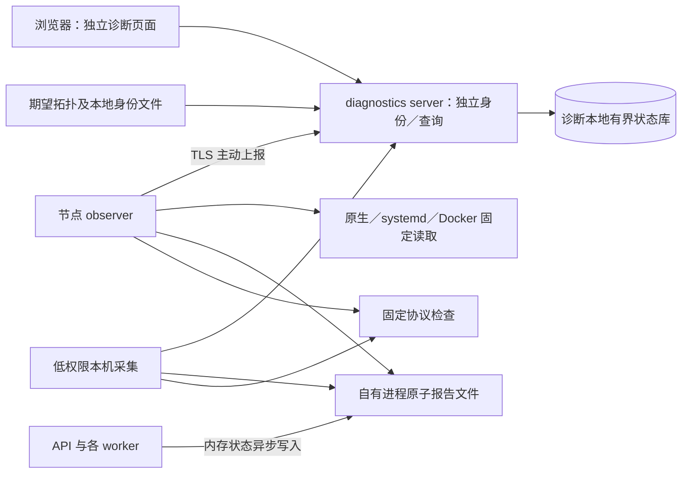

# 独立运行诊断入口详细开发方案

日期：2026-11-14。版本：V1.0。实施状态：**Awaiting acceptance（实现及本机自验完成，待人工验收）**。实施结果、DG-01～DG-60 证据及未验证部署边界见[验收台账](../verification/independent-runtime-diagnostics.md)，启动与恢复见[运行手册](../operations/independent-runtime-diagnostics.md)。

本文保留原“独立运行诊断入口设计建议”完善后的完整设计基线；下文“本次文档阶段”“待实现”等时态记录设计阶段，不代表当前实施状态。用户已澄清：审计与操作追踪有[自己的开发方案](audit-and-operation-tracing-development-plan.md)并按该方案独立实施；本方案不重新设计审计，也不把此前取消的“业务运行状态与异常提醒、问题详情与诊断包、版本与部署清单”合并回来。

最终交付形态确定为：**独立 Go 诊断进程 + 独立轻量前端 app + 期望拓扑清单 + 本机／远端观察器 + 固定类型的只读检查**。诊断的启动、登录和基本查看不依赖业务 API、业务 PostgreSQL、Redis、ClickHouse 或对象存储。用户只有本机，功能验收以本机原生进程、隔离容器和多个本机逻辑节点完成；真实多服务器部署证据另列，不能要求用户先提供服务器，也不能把模拟结果写成真实部署已经验证。

下文的数据结构、接口、命令、目录和脚本构成本轮实施契约；“当前代码基线”和“本次文档自检”保留设计阶段的历史记录，当前结果以验收台账为准。实施使用当前 checkout／分支，不创建分支或 worktree，不覆盖其他在途改动。

## 1 目标、交付边界和使用结果

### 1.1 必须完成的交付

| 编号 | 交付项 | 完成后的结果 |
| --- | --- | --- |
| DF-01 | 独立进程、独立页面与身份 | 业务网页、API、主库停止时，仍能直接打开诊断地址、登录、查看诊断自身和目标状态。 |
| DF-02 | 期望拓扑与覆盖核对 | 列出本实例应该有的节点、组件、进程副本、端点、依赖和检查；未启动的必需项仍可见。 |
| DF-03 | 全部现有进程和依赖接入 | 原生进程、systemd、Docker、固定协议检查、自有进程状态报告统一显示；启用的现有模块不能遗漏。 |
| DF-04 | 节点与资源状态 | 查看相关宿主、虚拟机、容器的 CPU、内存、磁盘和网络证据，能知道哪些指标无权限或不适用。 |
| DF-05 | 多节点观察协议 | 单机与多机使用同一数据模型；节点独立采集、主动上报，身份、重启、乱序、过期和断连有确定行为。 |
| DF-06 | 状态解释与轻量历史 | 分开呈现存活、就绪、工作循环、数据新鲜度和覆盖缺口；显示最近状态变化和有限资源趋势。 |
| DF-07 | 权限、资源边界与故障隔离 | 只读、脱敏、有界；观察器失效不能拖住业务，诊断不能成为远程执行入口。 |
| DF-08 | 开发衔接与本机验收材料 | 契约、脚本、原生／容器／systemd 样例、模块接入清单、本机自动检查和人工演示齐备。 |

### 1.2 具体体验

- 主库关闭：诊断页面仍打开；PostgreSQL 显示“连接失败”，API 显示“进程已退出”或“存活、未就绪”，各 worker 显示自己的实际证据。只有进程确实退出才写“已退出”。
- 某个 worker 空闲：显示“运行中，当前空闲，最近循环检查成功”，不会因为没有业务任务而报故障。
- 节点观察器失联：显示“该节点观察中断，最后数据来自 45 秒前”；旧的绿色状态改成历史状态，不推断服务器已关机。
- 一个副本故障：组件显示“2 个期望副本，1 个可用，1 个不可用”；保留两个副本各自证据，不把其中一个绿色当作全体正常。
- Docker Desktop 内容器内存不足：容器的使用量和限制单独显示；macOS 宿主资源来自宿主观察器，不拿 Linux 容器的内存冒充 Mac 的总内存。
- 诊断服务停止：业务继续运行；页面显示无法连接诊断服务。单个诊断服务不能在自身停止后继续解释自身故障，本轮不建设诊断高可用。

### 1.3 明确不做

不做业务任务积压／失败统计大屏、异常通知和确认／静默流程、日志全文检索、问题工单、诊断包或数据导出、发布版本对照／升级回退、安装器、备份恢复、APM、链路追踪、SQL 分析、自动修复、网页终端、进程或容器控制、远程配置下发、任意脚本／SQL／URL 探测、跨客户实例管理、Kubernetes／云平台管理。

清单只描述**诊断所需的期望拓扑和检查分配**；报告只带进程构建标识和协议版本用于辨认运行代次，不扩展成被取消的版本与部署管理功能。最近状态变化是诊断证据，不产生业务审计事实、业务通知或任务中心记录。节点 CPU／磁盘阈值只用于页面提示，不建设告警规则系统。

## 2 当前代码基线与架构决定

| 已核对的当前代码 | 事实及本次决定 |
| --- | --- |
| [console App](../../apps/console/src/app/App.tsx)、[认证路由](../../apps/console/src/routes/_authenticated/route.tsx) | 根部依赖 IdentityProvider；业务身份不可用会挡住业务页面。新增 `apps/diagnostics`，不用 console 根应用和业务身份上下文。 |
| [layouts](../../packages/ts/layouts/package.json)、[前端工作空间](../../pnpm-workspace.yaml) | 共享布局不依赖业务身份；复用 UI、主题和布局，不复制设计体系。生产静态文件由 Go 提供，不增加常驻 Node。 |
| [API bootstrap](../../services/api/internal/bootstrap/app.go)、[runtime resources](../../packages/go/platform/runtime/resources.go) | 监听前打开数据库、校验迁移和业务资源。诊断有自己的 bootstrap，不调用 `runtime.Open`，不导入业务 runtime。 |
| [API router](../../services/api/internal/transport/http/router.go)、[display runtime](../../services/api/internal/transport/http/display/runtime.go) | 有 healthz／readyz；复用其有限结果，但不透传原始错误响应。进程身份与端点分别记录。 |
| [通知 worker](../../packages/go/platform/notifications/worker.go)、[任务索引 worker](../../packages/go/platform/tasks/worker.go) | 已有数据库心跳或诊断查询；主库停时不能作为唯一证据。增加本地进程报告，保留已有业务行为。 |
| [空间转换器](../../packages/go/platform/spatial/converter.go)、[checker 入口](../../services/api/cmd/files-checker/main.go) | 有按需子进程、内容处理沙箱；只在拥有生命周期的父进程接入诊断，不给解析子进程增加权限。 |
| [dev 启动脚本](../../scripts/dev.mjs)、[Compose](../../deploy/compose/compose.yaml)、[Nginx](../../deploy/nginx/default.conf) | dev 子进程退出可能关闭同组进程，web 依赖 API 就绪。诊断使用单独启动命令、独立端口，不能并入这个失败联动组。 |
| [Go 工作空间](../../go.work)、[Go 构建](../../scripts/go.mjs)、[CLI](../../tools/infrapro/internal/command/root.go) | 新增 Go module；CLI 通过公开 settings 包做离线配置维护，不跨 module 导入 internal。 |
| [业务契约生成](../../scripts/contracts.mjs) | 当前针对业务 api.yaml；新增独立诊断契约和客户端生成，不让业务权限生成器接管诊断身份。 |

## 3 进程、Module 与数据流



同一 `infrapro-diagnostics` 二进制提供 `server`、`observer` 两种角色。server 默认可以内嵌一个低权限本机 Collector；同一节点的某组检查只能分配给一个活动观察器。需要 Docker socket、高权限宿主读取或其他用户报告目录时，用独立 observer 进程，不能让面向浏览器的 server 持有 Docker socket。

- **Topology**：校验清单、分配检查、计算覆盖；隐藏配置文件格式和引用校验。
- **Collector**：按固定计划执行 Adapter，形成标准观察。接口为 `Collect(ctx, ProbeSpec, LocalBinding) Observation`；每次调用有期限，不暴露任意执行方法。
- **ReportSink**：业务侧只有 `Starting / Ready / Begin / End / Idle / Dependency / Stopping` 等类型化方法，默认 no-op；业务不知道诊断网络与状态库。
- **Ingest**：认证观察器、验证分配和代次、原子接收完整快照。
- **State**：存取最后观察与有界历史，计算新鲜度、聚合和覆盖；不连接业务库。
- **Access**：独立本地账号、会话和节点凭据；不调用业务授权。
- **Query**：返回安全只读视图；UI 不接触 Adapter、原始配置、凭据或数据库。

依赖方向：`业务进程 → foundation/diagnosticreport`；`services/diagnostics → foundation/diagnosticreport 的协议类型及独立驱动`；`tools/infrapro → services/diagnostics/settings`；`apps/diagnostics → diagnostics-client + ui/layouts`。诊断 Go module 不导入 `platform/runtime`、业务身份、业务服务或 `services/api/internal`。需要复用的纯结构留在 foundation 或 diagnostics 的公开包，不能为复用把整套平台 bootstrap 带入诊断。

## 4 技术选型与具体用途

| 技术 | 使用方式与理由 |
| --- | --- |
| 当前 Go 1.27 工具链、`net/http`、`embed` | 独立服务、固定路由、超时／body 限制、嵌入前端；不引入新的服务器框架和生产 Node。 |
| 当前 React／TypeScript／Vite、TanStack Query／Router、共享 UI | 单独 app 和查询缓存，沿用 lockfile；所有字体、样式和资源随发布包提供，不依赖公网 CDN。 |
| JSON + JSON Schema + 独立 OpenAPI | 清单、节点绑定、进程报告、网络契约严格校验，生成 TS 类型；配置拒绝未知键。选择 JSON 避免再加一套隐式 YAML 合并语义。 |
| bbolt，拟固定 `v1.5.0` | 诊断本地文件内原子保存接收代次、最后状态与有限历史；不是外部数据库服务。单 writer，网络调用不进事务，提交失败不得确认上报成功。[上游说明](https://github.com/etcd-io/bbolt) |
| gopsutil/v4，拟固定 `v4.26.10` | Darwin／Linux 进程身份及资源 Adapter；缺失字段显式不可用，不把上游平台支持当成本产品已经验收。[上游说明](https://github.com/shirou/gopsutil) |
| godbus/dbus/v5，拟固定 `v5.2.4` | Linux systemd 固定属性读取；Darwin 不加载此 Adapter。读取权限和属性以 [systemd 接口](https://www.freedesktop.org/software/systemd/man/latest/org.freedesktop.systemd1.html)为准。 |
| 现有 pgx v5、go-redis v9、clickhouse-go v2、minio-go v7 | 复用仓库已固定版本，只创建独立、短时、只读探测连接，不能调用业务迁移或初始化代码。 |
| 现有 x/crypto Argon2id、标准库 TLS／crypto/rand | 独立密码散列、随机会话及节点密钥。密码散列格式兼容既有参数习惯，不复用业务账号数据。 |
| 当前 Playwright、Node 测试工具、Docker | 本机隔离实验、真实页面、协议／故障／容器自检；测试代码不成为运行依赖。 |

新增依赖版本是开发锁定基线，实施时写入新 module 的 go.mod／go.sum 并完成平台构建和安全检查；本次未安装这些依赖。不得顺带升级其他 module。bbolt、gopsutil、godbus 的版本依据各自 [bbolt 文档](https://pkg.go.dev/go.etcd.io/bbolt)、[gopsutil 文档](https://pkg.go.dev/github.com/shirou/gopsutil/v4)、[godbus 文档](https://pkg.go.dev/github.com/godbus/dbus/v5)。

## 5 统一数据结构

### 5.1 基础约定

所有 ID 为显式配置的稳定标识，匹配 `[a-z][a-z0-9_.-]{0,63}`；不能用主机 IP、PID、容器临时 ID 或显示名称作为业务标识。ID 在本实例各自类型内唯一。引用必须指向存在的对象。用户可见名称最多 80 字，拒绝控制字符。

时间统一 UTC RFC3339、毫秒精度。`revision / epoch / sequence / bytes` 等可能超过 JS 安全整数的非负整数采用十进制字符串；计数和毫秒期限有上限时用 JSON integer。UUID 用于启动代次、请求和检查尝试。浮点不允许 NaN／Infinity。文件根对象带 `schema_version: 1`，上报 envelope 带 `protocol_major: 1`，嵌套对象继承版本；未知 major 拒绝。未知可选响应字段客户端忽略，未知状态枚举显示“不支持的状态”而非成功。

### 5.2 期望拓扑对象

| 对象 | 字段与约束 |
| --- | --- |
| Manifest | `schema_version, instance_id, revision, display_name, nodes[], components[], replicas[], endpoints[], dependencies[], probes[]`。是完整替换，不做隐式 merge。 |
| Node | `id, display_name, kind, parent_node_id?, resource_scope, assignment_revision, enabled`；kind 为 `physical / vm / container / logical_test / external`，resource_scope 为 `host / vm / container / none`。逻辑测试节点必须标记，不重复计入物理服务器总数。 |
| Component | `id, display_name, kind, expectation, min_ready_replicas`；kind 为 `application / worker / database / cache / object_store / gateway / tool / diagnostics`；expectation 为 `continuous / on_demand / disabled / external`。min 值只用于应用副本可用性门槛，不能推导数据库集群 quorum。 |
| Replica | `id, component_id, node_id, expectation, required_probe_ids[]`；稳定部署槽位。替换容器和进程重启不新增槽位，运行代次改变。 |
| Endpoint | `id, replica_id, purpose, display_name`；purpose 为 `liveness / readiness / serving / storage / asset / control_plane`。真实地址仅在节点本地绑定中，不进入共享视图。 |
| Dependency | `id, from_replica_id, to_component_id, probe_id, required, evidence_mode`；evidence_mode 为 `self_report / shared_network / external_probe`。只有源进程自己的实际结果能直接证明该进程依赖结果；同网络主动检查须标“同网络探测”，宿主等外部视角标 `vantage_mismatch`。 |
| ProbeSpec | `id, node_id, target_kind, target_id, adapter, binding_id, facet, required, interval_ms, timeout_ms, stale_after_ms`。target_kind 为 `node / replica / endpoint / dependency`；facet 为 `presence / readiness / loop / resource`；一个检查可以产出多个明确的子项。 |

拓扑文件不存密码、连接串、真实文件路径、shell、SQL 和脚本。节点必须显式声明，清单外发现的进程／容器不自动加入界面。附加服务可以使用已存在的固定 Adapter，不能由配置注入新执行方式。未登记组件只能被标记为清单覆盖不足，不能宣称自动发现了“全部系统”。

### 5.3 观察、身份与指标对象

| 对象 | 字段与含义 |
| --- | --- |
| Observation | `probe_id, attempt_id, observer_boot_id, observed_at, sample_age_ms, duration_ms, outcome, facets, reason_code, process?, metrics[], evidence`。outcome=pending 时 attempt_id／observed_at／sample_age_ms／duration_ms 为 null，其他结果必须有真实检查时间。上报不得自填 server 的 received_at、effective_age 或聚合结果。 |
| ProcessIdentity | `replica_id, boot_id, pid?, os_start_time_ms?, container_id?, container_started_at?, build_id?`。原生 PID 必须搭配 OS 创建时间；容器 ID 搭配启动时间。PID 为观察器视角，额外 `pid_namespace: host / container`。build_id 最多 64 字，只用构建注入值。 |
| Evidence | `source: os / systemd / docker / protocol / self_report, vantage_node_id, scope, codes[]`；只允许结构化白名单字段，如退出码、固定状态、响应状态码、时长。无自由文本 stdout／stderr／原始 error。 |
| Metric | `key, dimension_id?, unit, value, availability, reason_code?`；availability 为 `available / unlimited / unsupported / permission_denied / not_configured / error`；无有限配额或不可用时 value 必须为 null，unlimited 不等于采集失败。key 是第 10 节白名单；dimension_id 仅允许绑定中登记的磁盘／网卡别名，不能任意标签扩散。 |
| StoredObservation | Observation 加 `instance_id, node_id, manifest_revision, assignment_revision, credential_generation, epoch, sequence, received_at, accepted_server_boot_id`。由 server 生成可信接收字段。 |
| Transition | `id, target_kind, target_id, probe_id?, at, from_state, to_state, reason_code, observation_ref`；仅状态、运行代次、新鲜度或覆盖变化写入；不逐次心跳写事件。 |
| Coverage | `expected, configured, attempted, fresh, unavailable, missing_binding, unsupported, permission_denied, vantage_mismatch` 计数及对应 probe_ids；同时返回 `complete`。失败检查也算已观察，权限缺失不算覆盖完整。 |

同一报告的完整序列化上限 1 MiB，每条 Observation 上限 16 KiB、最多 64 个指标、每个 evidence 数组最多 16 项；不接受任意层级 JSON。进程本地报告另限 32 KiB。超限整份拒绝并给安全错误码，不能部分写入造成“半份最新状态”。

### 5.4 状态维度与聚合规则

| 维度 | 枚举 | 不可混淆的含义 |
| --- | --- | --- |
| expectation | `continuous / on_demand / disabled / external` | 未启用及闲置按需能力不加入常驻故障分母。 |
| presence | `running / stopped / missing / unknown / not_applicable` | stopped 必须有退出证据，missing 必须有成功执行的精确查找；连接超时不等于进程停止。 |
| readiness | `ready / not_ready / starting / unconfigured / unknown / not_applicable` | 就绪只承诺该固定检查实际验证的能力，TCP 接通不等于业务正确。 |
| loop | `idle / working / blocked / stalled / unknown / not_applicable` | blocked 为一次明确循环／依赖失败；stalled 需超出明确执行 deadline 或下一次循环期限，不能只看最近完成时间。 |
| freshness | `fresh / stale / never / historical / clock_uncertain` | 历史缓存、未采集和时钟不可信不能显示实时绿色。 |
| outcome | `pending / ok / failed / timeout / permission_denied / unsupported / not_configured / invalid_report` | pending 表示尚未实际检查，freshness=never、facets=unknown；失败不是观察器出错的通用替代词。 |
| coverage | `complete / partial / none` | 和组件健康独立计算；例如 PostgreSQL 明确拒绝连接可以是覆盖完整、就绪失败。 |

派生 display_state 只有 `healthy / degraded / unavailable / unknown / disabled / idle`，必须同时返回维度和原因，不能只给一个颜色。计算顺序：disabled → 按需且未激活时 idle（仍显示预检失败）→ 无新鲜必需证据 unknown → 有确证停止或必需就绪失败 unavailable → 部分副本／非必需检查／资源提示异常 degraded → 所有必需证据新鲜通过 healthy。混合“已知失败 + 未知”时显示已知失败，附“观察不完整”，不能被 unknown 覆盖掉失败事实。

组件汇总返回 `expected_replicas, ready_replicas, failed_replicas, unknown_replicas, disabled_replicas`，未知不能从分母悄悄去掉。依赖失败显示“可能影响该源组件”，只有源自身证据支持时才改变其 readiness。数据库／缓存／对象存储集群只显示每个已声明副本和厂商探针的有限含义，不自行推导主从一致性、quorum 或数据完整性。

副本计入 ready_replicas 必须满足：全部必需检查新鲜且 outcome=ok，所负责的 presence=running、readiness=ready、loop=idle/working（not_applicable 维度忽略），并无必需覆盖缺项。required loop 的 blocked／stalled 属于明确未就绪，不能因为 PID 存在就计 ready；非必需 lane 失败显示 degraded。min_ready_replicas 只说明配置的最少副本门槛是否满足，任何期望副本失败或未知仍须显示数量和不完整性。

## 6 配置、拓扑清单与节点绑定

### 6.1 文件分工

| 文件 | 拥有者及用途 |
| --- | --- |
| `server.json` | server 的监听、可信 origin、manifest/auth/keyring/state 文件路径、本机采集分配、资源限制。只从 `--config` 或 `INFRAPRO_DIAGNOSTICS_CONFIG` 加载。 |
| `manifest.json` | 不含密钥的期望拓扑；每次修改递增 revision。清单变化不启动／停止任何业务进程。 |
| `observer.json` | `schema_version, instance_id, node_id, assignment_revision, server_url, manifest_file, bindings_file, credential_file, state_dir, tls_ca_file?`。读取同一无秘密 manifest，仅执行本节点分配的检查；不采用引用残缺的剪裁清单。 |
| `bindings.json` | 本节点的 fixed Adapter 联合类型；具体地址、允许目录、进程匹配、秘密文件引用。不会通过 HTTP 分发或向浏览器返回。 |
| `auth.json` | `schema_version, revision, users[]`；每人 `id, username, password_hash, enabled, permissions:["diagnostics.read"]`。本轮只有这个人员权限。 |
| `node-keys.json` | `schema_version, instance_id, revision, keys[]`；每 key 含 `key_id, node_id, generation, secret_sha256, enabled, assignment_revision`，后者须匹配 Node；原始随机 key 只写入对应 observer 的受限文件。 |

全部配置目录默认 0700、配置及秘密文件 0600；共享报告目录按第 8 节的专用组例外，公开证书／CA 可 0644 但不得被非拥有者写入。server 配置里的文件引用必须是绝对路径；manifest 内不能含路径。拒绝 symlink、未知键、重复 ID、错误类型、越界数值和 dangling reference。路径检查和打开必须使用逐级 no-follow／打开后 fstat 核对，不能只靠打开前的字符串或 stat 检查。显示名称和 build_id 也按数据处理，HTML 转义后展示。带 instance_id 的配置必须匹配本实例；auth 文件通过 server 的唯一文件绑定归属，不能多实例共用。启动或热更新先全量验证再原子切换。

server 默认监听 `127.0.0.1:8096`，listen 使用明确的 IP:port，默认 base path `/`；本轮不支持可配置子路径，减少 Cookie／路由错配。非 loopback listener 必须启用 TLS；使用可信 TLS 终止代理时，后端 HTTP listener 只能绑定 loopback，直连远端 HTTP 不允许。只信任配置中的代理地址，不接受任意 X-Forwarded-*。管理网页与节点上报可共用 HTTPS listener，但凭据和路由权限严格分离。

### 6.2 最小拓扑示例

下面是**一个原生 API 副本的可校验最小清单**，不是完整系统清单；完整样例由代码目录和已启用能力生成后人工核对。

```json
{
  "schema_version": 1,
  "instance_id": "local-demo",
  "revision": "1",
  "display_name": "本机诊断演示",
  "nodes": [
    {"id": "mac", "display_name": "本机", "kind": "physical", "resource_scope": "host", "assignment_revision": "1", "enabled": true}
  ],
  "components": [
    {"id": "api", "display_name": "业务 API", "kind": "application", "expectation": "continuous", "min_ready_replicas": 1}
  ],
  "replicas": [
    {"id": "api-1", "component_id": "api", "node_id": "mac", "expectation": "continuous", "required_probe_ids": ["api-process", "api-ready"]}
  ],
  "endpoints": [
    {"id": "api-http", "replica_id": "api-1", "purpose": "readiness", "display_name": "API HTTP"}
  ],
  "dependencies": [],
  "probes": [
    {"id": "api-process", "node_id": "mac", "target_kind": "replica", "target_id": "api-1", "adapter": "native_process", "binding_id": "api-local", "facet": "presence", "required": true, "interval_ms": 5000, "timeout_ms": 1000, "stale_after_ms": 20000},
    {"id": "api-ready", "node_id": "mac", "target_kind": "endpoint", "target_id": "api-http", "adapter": "http_ready", "binding_id": "api-http-local", "facet": "readiness", "required": true, "interval_ms": 10000, "timeout_ms": 2000, "stale_after_ms": 30000}
  ]
}
```

对应 bindings 文件：

```json
{
  "schema_version": 1,
  "instance_id": "local-demo",
  "node_id": "mac",
  "assignment_revision": "1",
  "bindings": [
    {"id": "api-local", "adapter": "native_process", "report_file": "/private/var/tmp/infrapro-diag-demo/reports/api-1.json", "allowed_root": "/private/var/tmp/infrapro-diag-demo/reports", "expected_executable": "/private/var/tmp/infrapro-diag-demo/bin/api", "expected_uid": 501},
    {"id": "api-http-local", "adapter": "http_ready", "url": "http://127.0.0.1:18080/readyz", "expected_status": 200, "expected_json": {"status": "ready"}, "credential_file": null, "tls_ca_file": null}
  ]
}
```

上例 UID 和路径是 macOS 格式示例；初始化命令必须使用实际执行用户和选定目录的规范化真实路径生成，不能硬编码 501 或覆盖其他环境。`expected_json` 只支持最多 4 个顶层标量的精确匹配，不支持脚本、模板或表达式语言。

### 6.3 Adapter 绑定联合类型

公共字段为 `id, adapter`；只允许该类型登记的字段，不接受 `command`、`args`、`query` 或通用 options map。

bindings 根字段为 `schema_version, instance_id, node_id, assignment_revision, bindings`，可选 `allowed_target_hosts:[]`。默认只允许绑定中明确的 loopback／私网地址；外部域名或公网地址必须额外列入 allowed_target_hosts 的精确值，不支持 wildcard。DNS 每次连接解析并校验结果，metadata／link-local 地址始终拒绝。local binding 的实际文件路径、账户名、接口名称不在拓扑 API 中公开。

| adapter | 本地绑定字段 |
| --- | --- |
| native_process | `report_file?, pid_file?, pid_file_format?, allowed_root, expected_executable, expected_uid`；两种定位至少一种；pid_file_format 为 `diagnostics / decimal / postgres`，固定解析，不支持模板。 |
| self_report | `report_file, allowed_root, expected_replica_id, expected_executable, expected_uid, pid_namespace, dependency_key?, lane_id?`；dependency target 必须给 dependency_key，loop 可选单 lane；按第 8 节校验身份。 |
| host_resources | `scope, mount_paths:[{id,path}], network_interfaces:[{id,name}]`；只允许精确声明，最多 8 个挂载点和 8 个接口，id 是对外别名。 |
| systemd_unit | `unit_name, expected_uid?`；仅固定 `.service` 单元名称，不支持 glob／命令；使用 system bus 固定目的服务。 |
| docker_container | `socket_path, selector_labels, expected_replica_id, stats_enabled`；标签必须包括本实例和副本；socket 仅 Unix 路径，不接受浏览器传入的 daemon 地址。 |
| http_live / http_ready | `url, expected_status, expected_json?, credential_file?, tls_ca_file?`；URL 不带 userinfo、query 或 fragment；只用 GET，禁止 redirect。 |
| tcp | `host, port, tls?, server_name?, tls_ca_file?`；只能证明连接／TLS 握手，不产出服务 ready。 |
| postgres | `host, port, database, username, credential_file, tls_mode, tls_ca_file?`；固定只读 SELECT 1，不提供 SQL 参数。 |
| redis | `address, username?, credential_file?, database, tls, tls_ca_file?`；固定 PING，ACL 限制到该能力。 |
| clickhouse | `address, database, username, credential_file, tls, tls_ca_file?`；固定 SELECT 1，不扫业务表。 |
| s3 | `endpoint, region, bucket, credential_file, tls_ca_file?`；固定 HeadBucket，权限不足明确显示，绝不写入测试对象。 |
| keeper_live | `host, port, enabled`；仅在显式允许该健康命令的部署启用固定 liveness 检查，不由结果推导 quorum。 |

credential_file 为最多 4 KiB 的受限 JSON，根含 schema_version=1 和 kind：PG／Redis／CH 用 `password:{password}`；HTTP 用 `bearer:{token}`，固定写 Authorization，不能配置任意 header；S3 用 `s3:{access_key_id,secret_access_key,session_token?}`。这里 kind 是判别字段，其余属性直接位于同一根对象，例如 `{schema_version:1,kind:"password",password:"…"}`，示意值不是可使用凭据。禁止 secrets 通过 URL／普通环境变量／manifest 传入。observer key 文件为 `schema_version,instance_id,node_id,key_id,generation,secret`，secret 为 32 个随机字节的 base64url 无填充编码；不与上述业务探测凭据混用。TLS CA／证书／私钥为对应 PEM 文件，未指定自定义 CA 时使用系统信任根。

### 6.4 校验、分配和变更规则

`infrapro diagnostics config validate --server <file>` 只做离线语法、引用、权限和边界检查，不启动业务或修改配置；`--probe` 只执行已登记的固定检查一次并打印脱敏结果。版本、服务实际可达、凭据是否有权用实测验证，不能由配置校验冒充。

manifest.revision 为全局拓扑版本，assignment_revision 为每节点检查集合版本。节点上报须同时匹配 server 当前两者；拓扑不相关修改也要更新 observer 本地清单的全局 revision。分配改变还要同步 node-keys 中的 assignment_revision，不必因此更换 key secret。文件分发由现有部署方式完成，本轮不提供远程下发。过渡期间保留上一份值为历史并显示 `assignment_mismatch`，不让旧节点静默覆盖新拓扑。

server 每 5 秒检查文件内容摘要（不只 mtime）。合法新版本完整切换，删除目标只从当前视图退出，其有限历史标 retired；新增目标从 never 开始；probe 绑定或期望改变后旧结果失效。非法拓扑保留最后有效版本并显示 reload_error；首次启动没有有效拓扑则开放登录和配置错误页面，无目标绿色状态。observer 以同样周期验证 manifest／bindings，完整匹配后原子切换并重新握手；自身配置非法时停止新探测／上报，不能继续用旧配置冒充新分配。auth／keyring 非法更新采用第 12 节更严格的撤权规则，不能沿用“保留旧权限”。

同 revision 不同内容、revision 倒退均拒绝；合法改绑同时提高 Node 和 bindings 的 assignment_revision。凭据文件内容可独立轮换，观察器每 5s 检查其摘要，变化后销毁旧连接、清除对应 probe 的当前成功证据并重新检查；凭据失效仅影响该检查。observer 自己的 key 文件变化后重新握手，不能把旧 token 当新 key 的授权。

初始工程边界：单实例最多 32 节点、512 副本、2048 检查；每节点最多 256 检查；常驻副本至少一个存活检查，自有进程还须有报告／就绪检查；required_probe_ids 必须属于该副本或其端点。dependency 的源、目标与声明证据模式必须一致。依赖图允许真实环，遍历用 visited 集和深度 8，不能递归挂死；Node 的 parent 关系则必须无环。disabled 节点不分配新检查、不接受上报，目标明确显示未启用。超过边界拒绝配置，界面说明限制；这些是防止无界执行的本轮容量边界，不是压力测试结论。

## 7 全部现有组件与部署组合

### 7.1 应接入的运行目录

以下目录由当前 `services/api/cmd` 与部署文件核对得出。最终交付必须逐项标记 `enabled / disabled / on_demand / external` 及原因；不能因为没有启用就从覆盖目录删除。

| 组件／进程 | 存活与就绪证据 | 依赖或特殊处理 |
| --- | --- | --- |
| api | OS／容器存活 + self_report + healthz／readyz | 数据库、Redis、已启用存储；报告要在业务初始化前启动。 |
| monitoring-worker | 存活 + scheduler、foreground、historical 各 lane | 监测与派生执行在现有进程内，不虚构独立 derived-worker；按当前启用配置声明 ClickHouse、对象存储等依赖。 |
| notification-worker | 存活 + 投递循环的空闲／成功／失败 | PG 不可用时也能读本地循环状态；不把通知正文、收件人或积压数加入本轮。 |
| task-index-worker | 存活 + 回填、对账等循环 | 保留现有数据库心跳；不把主库中的 task diagnostics 作为独立报告来源。 |
| spatial-worker | 存活 + 任务循环 + converter readiness | Python 转换器是按需工具能力；预检失败可见，闲时无 Python 子进程正常。 |
| display-package-worker | 存活 + Maintain／ProcessOne lane | 不增加它对普通业务表、审计表或身份服务的读取权限。 |
| display-runtime | 一个进程 + runtime／assets 两个端点 | 两个端点分别检查，不重复计为两个进程；沿用 runtime readyz 的有限含义。 |
| files-worker | 存活 + heartbeat／cleanup／prepare lane | `--allow-unconfigured` 等待状态显示 unconfigured，不显示文件处理已就绪。 |
| files-checker | 父进程存活 + Unix socket 监听／父进程报告 | 不向内容解析 socket 塞假文件当健康探针；沙箱 child 不写报告、不继承诊断秘密。 |
| audit-worker | 存活 + reconcile／export lane | 按正在实施的审计方案最终入口接入；不重做审计设计，不查询审计正文。 |
| console 静态服务／Nginx 或实际 web 服务 | 所属实际进程 + 声明静态资源 GET | 开发 Vite 可登记为开发服务，生产静态文件不虚构 Node 进程；正常静态响应不等于业务 API 正常。 |
| PostgreSQL | 精确进程／容器（可观察时）+ SELECT 1 | 不执行迁移、表统计、备份或任意 SQL。外部托管时允许进程状态 not_applicable。 |
| Redis | 进程／容器 + PING | 不扫描键、不读取业务缓存。 |
| ClickHouse | 进程／容器 + SELECT 1 | 不查询监测数据和系统全表；失败独立于 PG。 |
| ClickHouse Keeper（部署启用时） | 进程／容器 + 有限 liveness | 内嵌 Keeper 不重复登记宿主进程；独立 Keeper 按真实副本登记。 |
| S3／SeaweedFS／MinIO／外部对象存储 | S3 协议及实际部署的底层进程 | SeaweedFS 若拆为 master／filer／volume／gateway，各自登记；合一进程只计一次。外部服务无宿主权限是明确边界。 |
| diagnostics server／observer | 自身状态、boot、采集和存储状态 | 观察器的有界心跳证明通信，不独立证明宿主其他进程都正常。 |
| migrate／access-sync／其他一次性 CLI | one-shot 维护记录不作为常驻期望 | 不因维护命令未运行而报故障；本轮不收集其业务操作历史。 |

新增后台入口时必须更新“运行组件目录”与清单模板的覆盖检查。实现的 `diagnostics:coverage` 脚本扫描 `services/api/cmd/*/main.go`、构建入口和部署样例，与显式 catalog 比对；遇到未知入口失败，不能自动判定它应该常驻。清单通过检查只说明已登记范围完整，不能识别管理员在仓库外私自增加的服务。

### 7.2 各部署方式使用同一模型

| 部署方式 | server／observer 放置 | 主要证据 |
| --- | --- | --- |
| 全部本机原生、无 Docker | server 原生独立启动；低权限本机 Collector | 本机进程身份、报告文件、协议、宿主资源；没有 Docker 就不加载 Docker Adapter。 |
| 单机容器 | server 使用独立容器或宿主原生；Docker observer 独立运行 | 容器标签／状态／资源；服务网络内 observer 证明容器网络视角；宿主资源需另一个宿主观察来源。 |
| 多机容器 | 一个 server；每个需观测的宿主／网络视角部署 observer | 各自固定分配、独立密钥、TLS 上报；不是把远端 Docker socket 暴露给 server。 |
| 多机原生 | 一个 server；每台需要观察的机器运行原生 observer | 原生／systemd／报告／协议；不能靠远程端口通来证明远端进程身份。 |
| 混合或外部托管 | 按实际位置混合前述 Adapter | 外部托管存储显示协议证据、宿主资源“不在观察范围”；不要求安装访问不到的宿主代理。 |

容器网络与宿主网络不是同一个 vantage。某个业务容器到 PG 的可达性，优先使用该进程自身最近依赖结果；需要主动探测时，把 observer 放进与源共享的网络范围并显式声明 shared_network。即使共享 Docker network，源进程的凭据、代理或按 IP 的规则仍可能不同，不能声称已验证源进程本身成功。宿主探测可作为附加证据，不能覆盖业务容器视角失败。本轮不自动进入目标容器执行命令、不调用 nsenter。Replica.node_id 表示实际部署位置，ProbeSpec.node_id 表示检查执行位置，二者可以不同；观察器不能伪造 evidence.vantage_node_id，必须等于被分配的检查位置。

## 8 自有进程报告契约及各模块接入

### 8.1 报告机制

新增 `packages/go/foundation/diagnosticreport`，无数据库／Redis／HTTP 调用，不导入 platform。进程通过独立 `INFRAPRO_DIAGNOSTICS_REPORT_FILE`、`INFRAPRO_DIAGNOSTICS_INSTANCE_ID`、`INFRAPRO_DIAGNOSTICS_REPLICA_ID`、`INFRAPRO_DIAGNOSTICS_NODE_ID` 启用报告；未配置时 no-op，部分缺失则报告配置错误并禁用 reporter，不能阻止业务启动。诊断服务地址和节点密钥不进入业务进程。

一个进程一个报告文件。ReportSink 只更新有限内存状态，后台 goroutine 每 5 秒写临时文件后原子 rename；首次启动和状态突变合并触发写入，最大每秒一次。业务调用不等待磁盘、诊断网络或报告消费者。退出时最多等 100ms 的最后一次写入；报告失败只输出限频安全错误码，不延长 worker 存活、不改变原有退出码／错误传播。极早启动失败可能没有最终报告，界面应以 OS 证据和历史区分，不能承诺保留所有崩溃原因。

父目录必须预先创建，写入前验证所有权、权限、常规文件、允许根目录及无 symlink；文件 0600。确需不同用户读时，明确配置同一专用组，目录 0750／文件 0640。容器把该副本独立报告目录作为共享 volume，观察器只读挂载；不把宿主整个文件系统挂进去。

### 8.2 ProcessReport v1

```json
{
  "schema_version": 1,
  "instance_id": "local-demo",
  "replica_id": "api-1",
  "node_id": "mac",
  "process": {"boot_id": "11111111-1111-4111-8111-111111111111", "pid": 23001, "os_start_time_ms": "1794614400000", "pid_namespace": "host", "build_id": "dev"},
  "report_seq": "4",
  "emitted_at": "2026-11-14T00:00:15.000Z",
  "uptime_ms": "15000",
  "phase": "ready",
  "lanes": [
    {"id": "http", "state": "idle", "last_attempt_at": "2026-11-14T00:00:14.000Z", "last_success_at": "2026-11-14T00:00:14.000Z", "active_since": null, "deadline_at": null, "next_attempt_at": null, "check_grace_ms": 15000, "reason_code": null}
  ],
  "dependencies": [
    {"id": "postgres", "state": "ready", "checked_at": "2026-11-14T00:00:14.000Z", "reason_code": null}
  ]
}
```

phase 为 `starting / ready / unconfigured / stopping / failed`。lanes 最多 16 个，允许多个工作者用固定 lane 编号；不是每个任务一条。dependency ID 是静态登记角色，不带连接串。lane state 为 `idle / working / blocked`；stalled 由观察器根据有界 deadline 推导。`last_attempt_at / last_success_at` 只在实际业务循环发生时更新，报告 writer 心跳不能改写它们。API http lane 不把“没有用户请求”当不工作；以监听状态和固定 ready 检查为证据。

`Begin(lane, deadline)` 来自原业务操作真实 timeout；操作无明确最大期限时 deadline 为 null，只呈现 working／工作持续时间，不凭猜测判 stalled。不能为了诊断缩短业务任务 timeout。长任务可报告“仍在运行”的固定进度心跳，但不能用它覆盖超出真实 deadline 的事实。空闲循环每次成功无任务返回写 `Idle(lane, next_attempt_at)`；失败后 `End` 同样记录真实退避后的下一次时间。周期循环必须提供 next_attempt_at，API 接收请求这类非周期 lane 才可为 null；writer 不得自动把下一次时间向后挪。

check_grace_ms 默认 15000、允许 15000～60000，覆盖文件写出、观察与短时调度延迟；下一次时间使用该模块真实调度周期，不能把每日维护当成每秒轮询。只有**新鲜报告自身的 emitted_at 已超过 deadline，或超过 next_attempt_at + grace，而相应 lane 仍未推进**，才能推导 stalled；不能拿旧报告加当前墙钟制造停滞结论。报告本身不再更新则标 stale。连续失败写 blocked 和固定原因，恢复一次成功后清除当前错误，保留最近变化。

report_seq 单进程内递增，boot_id 每次启动变化。observer 校验 instance／replica／node／schema、文件大小、拥有者和时间；报告 instance_id 必须等于本实例，node_id 必须等于对应 Replica.node_id，而非强行等于读取它的观察器节点。再用 OS PID+创建时间+可执行文件／UID 验证原生身份；PID 被复用时不能继续绑定旧报告。容器报告由已匹配的容器标签、只属于该副本的挂载点及容器启动时间关联，容器内 PID 不拿去查宿主 PID。无法确认挂载归属则 coverage partial，不能冒充进程身份已确认。

self_report 的进程／loop 样本时间取源文件 emitted_at，不取“刚读到文件”的时间；attempt_id 由固定 UUID namespace + probe_id + process boot_id + report_seq 确定生成。dependency 投影则取自己的 checked_at，attempt_id 由 process boot_id + probe_id + dependency_key + checked_at 生成；仅 header 更新不能制造依赖的新 attempt。重复读取同一份文件不能刷新 freshness。源报告 20s 未更新时报告过期；独立 OS 存活检查仍可显示进程 running。dependency_key／lane_id 不存在显示 not_configured，不从其他 lane 的成功推导该项成功。lane.last_success_at 保持实际业务含义，不被 writer 心跳更新。

报告里的错误只通过固定转换函数映射，如 `dependency_unavailable / configuration_invalid / storage_unconfigured / checker_unavailable / loop_failed`。不填 err.Error()，不含租户、项目、账号、任务 ID、文件名、对象键、业务计数、原始日志、环境变量或命令行。

### 8.3 接入位置与保持的业务语义

| 改造位置 | 具体改法 |
| --- | --- |
| `services/api/cmd/api/main.go`、`internal/bootstrap/app.go` | 最小进程标识准备后、runtime.Open 前创建报告；配置／资源／监听分别更新 phase。readyz 结果只映射固定依赖状态；不让 reporter 成为 API 启动必需。 |
| `services/api/cmd/monitoring-worker/main.go`、`platform/monitoring/jobs.go` | 注入可选 sink；在 RunWorker 的 scheduler、foreground、historical 实际 loop 边界记录 Begin／End／Idle／失败；不改调度或任务 generation。 |
| `cmd/notification-worker`、`platform/notifications/worker.go` | 在 Run 的 Tick 前后记录；PG heartbeat 保留，报告不反查该表。 |
| `cmd/task-index-worker`、`platform/tasks/worker.go` | Run 中回填／对账 lane 分开；无法连接主库时固定 error code 仍能输出到本地。 |
| `cmd/spatial-worker`、`platform/spatial/jobs.go`、`converter.go` | 在 converter.Ready 和 runtime.Open 前启动报告；记录现有固定 `--check` 的结果，不新增任意 Python 执行；WorkOne 记录工作与空闲。 |
| `cmd/display-package-worker`、`platform/display/worker.go` | Maintain 与 ProcessOne 分开记录；沿用既有处理时限和受限身份。 |
| `cmd/display-runtime` | 两个 listener 分别更新状态，进程只有一个 boot；保留大屏 runtime／assets 安全边界，不导入人员 API。 |
| `cmd/files-worker`、`platform/files/prepare.go`、`files/service.go` | 可选 sink 注入；心跳、清理、prepare lanes 各自记录；errgroup 错误和退出传播不变；未配置对象存储时报告 unconfigured。 |
| `cmd/files-checker`、`platform/files/checker.go` | 仅 parent 路径创建 reporter；socket 开始监听后就绪，关闭时 stopping；child 分支没有 reporter、诊断 key 和开放额外端口。 |
| `cmd/audit-worker`、`platform/audit/worker.go` | sink 可选；Reconcile、RunExportOnce 各自更新，保留 1s／5s 等业务等待和权限。按审计实施后的实际函数核对，不修改事实、导出或保留语义。 |

方法注入通过构造 Options／`WithDiagnosticReporter` 之一在各模块的既有初始化风格内完成，统一接收小接口，不通过全局可变单例。测试和未接入调用方默认 no-op。严禁诊断报告调用业务事务、引入循环 import 或让业务等待诊断的共享互斥锁；报告内部拷贝固定大小值，文件 writer 不持有业务锁。

## 9 固定采集 Adapter

### 9.1 原生进程、systemd 与容器

原生只根据已登记 report／pid 文件和身份定位。文件不存在只能证明定位证据缺失；若没有权威 PID 记录，presence 为 unknown、reason 为 `process_locator_missing`，不能说已确认 stopped。拥有有效 PID+启动时间记录而 OS 确认不存在则 missing；明确退出记录或 systemd／Docker 终态才是 stopped。不靠 pgrep 名称匹配，不读完整命令行、环境变量或进程打开文件列表。

第三方原生进程可使用其实际启动器维护的 PID 文件：diagnostics 格式为 `{pid,os_start_time_ms}`，decimal 只读十进制 PID，postgres 只读 postmaster.pid 的第一行。文件上限 4 KiB，校验允许目录、所有者和 executable／UID；无启动时间的格式要求文件 mtime 不早于 OS 创建时间，并保存核对后的 PID+创建时间；若文件时间精度不足以确定，显示 identity_mismatch／unknown，不用容差认领可能已复用的 PID。旧 PID 文件指向一个更晚启动的同名进程也不能认领。无法安全读取／定位的服务明确 unknown；部署样例必须写出该进程 PID 文件或 systemd／Docker 的实际接入方式，不能要求管理员每次手工改 PID 数字。

systemd 通过 D-Bus 读取已声明 unit 的 `LoadState, ActiveState, SubState`，Service 的 `MainPID, ExecMainCode, ExecMainStatus, Result` 和必要启动时间；不使用 GetAll 把 Environment 等属性带进内存响应，不调用 Start／Stop／Restart／ResetFailed。Unit not found 与 D-Bus denied 分别显示 missing／permission_denied；activating 为 starting，inactive 常驻服务为 stopped，oneshot 退出成功不算常驻故障。[接口依据](https://www.freedesktop.org/software/systemd/man/latest/org.freedesktop.systemd1.html)

Docker 先协商 API 版本，使用固定 GET allowlist：版本、按本实例及副本标签过滤的容器列表、匹配容器的 inspect、一次性 stats。不开放通用 daemon 代理、exec、logs、archive、events 长连接或变更请求。selector 匹配零个为 missing，多个为 `ambiguous_identity`，不能任取首个；运行代次包含 container ID + StartedAt；重启次数变化单独显示。inspect 只提取 State、时间、ExitCode、OOMKilled、RestartCount、健康状态枚举和所需资源限制，忽略 Config.Env、Args、Health.Log 正文及 Mounts 中未声明路径。

stats 使用 `stream=false&one-shot=true`，CPU 由同一容器代次连续两点计算，首样本 null；版本低于所需能力时标 unsupported，不假装零值。实现 v1 支持协商区间 1.41～1.56，实际选择双方交集的最高版；无交集明确 unsupported，未来 daemon 更高版本协商到 1.56。最低版和字段缺失走契约测试，真实版本逐项记录；本机 29.9.3 仅是当前可用于后续实测的样本，不代表本次已测试 Adapter。[Engine API](https://docs.docker.com/reference/api/engine/)、[一次性统计版本说明](https://docs.docker.com/reference/api/engine/version-history/)

Docker socket 即使只读挂载，也不等于 daemon API 只有读取权限；隔离 observer、最小宿主权限和应用内 GET allowlist 都是必要边界，无法保证被攻陷且持有 socket 的进程没有管理能力。server 禁止挂载 socket。此判断依据 Docker 的默认访问模型及 socket 保护要求。[授权模型](https://docs.docker.com/engine/extend/plugins_authorization/)、[保护 daemon 访问](https://docs.docker.com/engine/security/protect-access/)

### 9.2 协议检查

| 检查 | 实际操作 | 能说明什么／不能说明什么 |
| --- | --- | --- |
| http_live | GET 固定路径，校验状态码及可选有限 JSON | listener 与路径响应；不能证明主库或业务事务正常。 |
| http_ready | GET 固定就绪路径，有限匹配 | 该应用现有 readiness 的结果；上游错误只映射固定分类，响应不落盘。 |
| tcp | 固定 host/port connect，可选 TLS handshake | 网络连接／证书能力；readiness 为 unknown，不借 TCP 成功给服务 ready。 |
| postgres | 独立只读身份、一次 SELECT 1、查询和连接超时 | PG 可连接、认证与执行常量查询；不证明业务迁移、schema、读写、复制正常。 |
| redis | PING | ACL 允许的连接及响应；不读业务键。 |
| clickhouse | SELECT 1 | 常量查询可执行；不证明监测表数据和副本一致。 |
| s3 | HeadBucket | 对指定 bucket 有请求权限和响应；403 为 permission_denied，不能解释成桶不存在；不验证读写对象正文。 |
| keeper_live | 只发送固定 `ruok`，预期 `imok` | 仅 liveness；禁用该命令时显示未获准／不支持，不能据此断言 quorum 正常。[官方说明](https://github.com/ClickHouse/clickhouse-docs/blob/main/docs/guides/sre/keeper/index.md) |

协议账号按最小权限单独配置；不通过诊断自动创建 PG 账号、Redis ACL 或 S3 key，也不借用管理员全部权限。未配置凭据显示 not_configured，不阻止诊断启动。已有应用对依赖的最近实际操作结果可补充展示，但不读取业务计数或任意元数据表。

所有连接只来自经过本地 OS 权限保护的绑定，浏览器无新增地址入口；禁止 HTTP 跳转、代理环境自动继承和 PG 等驱动从业务环境变量补入默认凭据，目标 DNS 解析限定配置目标，始终拒绝云 metadata／link-local 地址。拒绝 userinfo／查询参数令牌；TLS 校验证书与 server name，不允许 InsecureSkipVerify。读取 body 上限 8 KiB（Docker 解码另设 2 MiB 且只提取白名单），连接超时后关闭句柄。一次探测最多一个连接，DB pool 上限 1，不留下空闲连接。

### 9.3 采集调度和超时

默认：进程／报告 5s，资源 10s，协议 10s；本地调用 timeout 1s，协议 2s，可配置 100ms～5s。interval 最低 1s、最高 5min，stale_after 至少 `3 × interval` 且大于 timeout，最高 15min。失败退避最多 30s，加 ±10% 抖动；退避不延长 stale 判定。一个 probe 前次未结束不重入；节点最多 8 个并发、一个 endpoint 最多 1 个；单轮到期任务超出容量标 `schedule_delayed`，不积累无限队列。

只用可取消／有系统期限的实现；超时后即使底层未返回也不新开无限 goroutine，超出固定槽位显示 adapter_blocked。每个 Adapter 有独立隔离和 panic recovery，错误不会让所有检查停摆。页面刷新只读缓存，不触发直接采集；本轮不提供“立即探测任意目标”的 HTTP 接口。

## 10 是否观察服务器及指标口径

**需要观察，但限于运行诊断需要的基础资源。** 只看组件状态不足以解释磁盘满、容器限额和内存压力。每个指标必须携带 node／scope／source／observed_at；没观察到的物理宿主显示“未接入宿主观察”，不能用容器样本填空。Docker Desktop 的 Linux 容器运行于 VM，与 macOS 宿主分别建模。[Docker Desktop 说明](https://docs.docker.com/faqs/platform/)

| metric key | 单位／计算 | 界面口径 |
| --- | --- | --- |
| cpu.utilization_ratio | 0～1；同一身份两次 CPU time 差值／墙钟差／逻辑核数 | 主机总体比例；首样本、计数回绕或重启时 null。 |
| process.cpu_cores | 非负浮点；进程 CPU time 差／墙钟差 | 使用了多少个逻辑核，可能 >1，不强行当作 0～100%。 |
| memory.total_bytes / available_bytes / used_bytes | 十进制字符串 bytes | host 使用平台 available 定义；展示来源，不能跨 OS 声称完全同口径。 |
| process.rss_bytes | bytes | 进程实际驻留；与宿主可用量分开。 |
| container.memory_used_bytes / memory_limit_bytes | bytes；无有限限制时 limit 为 null、原因 unlimited | 不把“无限制”写成 0；保留 Docker 统计口径，不自行偷偷扣除缓存。 |
| container.cpu_cores / cpu_limit_cores | 核数；unlimited 为 null | 配额与使用并列，宿主核心数不等于容器配额。 |
| disk.total_bytes / available_bytes / used_ratio | 仅声明挂载点；available 是服务用户可用量 | 展示逻辑挂载别名，浏览器不返回敏感绝对目录；相同文件系统去重。 |
| network.rx_bytes_per_second / tx_bytes_per_second | 明确接口两点差分 | 接口吞吐不是带宽容量、丢包率或“互联网正常”。重启／回绕置 null。 |
| process.restart_count / uptime_ms | 次／毫秒 | restart_count 只在 OS／容器有可靠来源时展示；不能由缺采样次数推断。 |

默认页面提示：磁盘 available 比例 <10% 或 available <1 GiB；内存 available <10%；CPU >90% 持续 3 个新鲜样本。可在受限本地配置中关闭或调整，阈值只产生 resource_warning。缺样本、时钟问题或 unsupported 不产生容量警报，不计算预测耗尽时间；没有累计持续证据则不声称“持续高负载”。

磁盘只统计实际服务数据／报告／诊断状态挂载点的 stat，不扫描用户目录、文件正文或个人文件。网络接口只按显式清单读取计数，不收集连接、目标 IP、流量内容。进程详情显示运行用户标识、受限可执行文件别名和 PID，不显示全命令行。当前设备没有某项权限时，页面给出准确缺项及需本地调整的类型；不自动提权。

scope=container 时不能直接把容器内 gopsutil 返回的宿主 `/proc` 总量当容器限额；优先使用已绑定 Docker stats／限制，Linux 原生采集只读取允许的 cgroup v2 固定文件（memory.current、memory.max、cpu.stat、cpu.max）和自身命名空间接口。缺少可靠 scope 映射或仅有未适配的 cgroup v1 时相应限额字段 unsupported，不降级成错误的宿主总量。容器总内存／配额缺项不影响其他已确认的存活证据。

## 11 观察器上报、顺序和新鲜度

### 11.1 身份与启动代次

observer 的长期随机 key 至少 32 字节，文件独立，Bearer 格式为 `key_id.secret`；server 只保存 secret 的 SHA-256，恒定时间比较。key 绑定 `instance_id + node_id + generation + assignment_revision`，只能写分配给该节点的 probe。不能浏览诊断、读取其他节点或修改配置。

observer state_dir 持有文件锁；每次启动原子持久化 `epoch = epoch + 1` 并生成 boot_id，先落盘再联网。server 持久保存每节点／credential_generation 的最高 epoch 及 boot_id：更小 epoch 拒绝；同 epoch 不同 boot 拒绝并显示冲突；更大 epoch 成功提交后 fence 旧进程。复制同一 key 和 state 到两个活跃进程属于错误部署，检测到冲突不得自动轮流抢占。

节点状态文件丢失／回滚后 epoch 可能落后，必须在本地 CLI 显式轮换该节点 credential generation，再安装新 key；不能“为了恢复方便”自动清空 server 顺序记录。key 泄漏后，拥有该 key 的主体可以伪造该节点自己的读数；本协议保证跨节点授权和顺序边界，不提供受攻击宿主的硬件可信证明。

observer 一个时刻只有一个上报请求，连接 timeout=2s、完整 HTTP 请求 timeout=5s；网络失败按 1／2／4／8／16／30s 加 ±10% 抖动退避，成功后回到 5s。401 重新握手一次，403／409 配置或身份冲突等待本地文件变更或下一次 30s 检查，不能忙循环。节点请求的短期 token 到期前 60s 刷新。TLS 失败不自动跳过校验。重连只保留有界当前快照，停止 observer 最多 5s 结束，不拖住业务进程。

### 11.2 会话与完整快照

1. `POST /observer/v1/sessions`：长期 key 鉴权，提交 instance／node／manifest_revision／assignment_revision／epoch／boot_id／protocol_major=1。server 验证分配并原子记录更高 epoch，返回随机 10 分钟短期 token、server_boot_id、last_accepted_sequence、允许的 probe IDs 和最小上报间隔；响应不含目标地址和秘密。
2. 相同 boot 和 epoch 重试建会话可生成新 token，旧 token 同节点仍受相同顺序检查；每 boot 最多 2 个有效 token，超出撤销最旧。epoch、generation、manifest、assignment 或 server_boot 变化立即使旧 token 失效。token 只驻内存，server 重启后 observer 重新握手。更高 epoch 的 handshake 将该代次 sequence 初始化为 0，同 boot 重试保留已接受的序号；返回 last_accepted_sequence 供恢复方核对，不能重置到 1 覆盖已有记录。
3. `POST /observer/v1/reports`：短期 token 鉴权，每 5s 上报该节点所有已分配 probe 的完整快照。每 probe 恰好一项；尚未完成第一次采集也显式给 pending。局部失败用失败 Observation，不能从数组删除后让旧绿色保留。
4. 每份 body 含 `protocol_major, instance_id, node_id, manifest_revision, assignment_revision, epoch, boot_id, sequence, generated_at, observations[]`。sequence 从 1 递增，同 boot 内不可回退；完整快照允许 sequence 间断，不需要重放所有中间帧。
5. server 对原始 body 计算 SHA-256 并在同一事务提交“序号／摘要／所有 latest／变化历史”；严格重复的 sequence+digest 返回原确认，**不更新收到时间、节点在线时间或样本年龄**；同序号不同内容返回 409，较小序号拒绝。
6. ack 含 `accepted_sequence, duplicate, server_boot_id, received_at, config_revision`。仅 durable commit 成功才 200；响应丢失可重发同一字节 body。网络失败只保留一个未确认 body 和一个最新采集快照，不累计无限离线队列；重连后优先发送当前快照，旧数据不会伪装恢复。

握手不能降低 epoch，不能凭老 boot 的重复握手撤销新 boot；新 epoch 若尚无报告，节点显示“重新连接、等待第一份数据”，旧代次数据立刻变历史。每节点报告 1 MiB、256 个 probe 上限，拒绝 Content-Encoding 压缩；预先校验内容、授权和清单匹配后再进入短事务，提交前再次核对最新 key／manifest 版本，防止并发撤权仍写入。先验证 token 再分配大 body 解析预算。不得用节点传来的 node_id 决定权限，必须与已认证身份完全一致。

### 11.3 样本新鲜度及时间问题

writer 心跳、observer 心跳、probe 实际采样是三件事。相同 attempt_id 的缓存观察只保留原 observed_at 和增加后的 sample_age_ms；新 frame 不能把旧检查刷新为新检查。上报每次包括该样本自采集完成以来的单调时钟 age；server 计算 `effective_age = max(sample_age_ms, max(0, received_at - observed_at))`，再加接收后本机单调经过时间。不得以浏览器时钟判定。

generated_at 与 server 接收时间相差超过 5s 时标 `clock_uncertain`（网络异常延迟也按时间不可信处理），不显示“实时正常”。时钟向后调整、observed_at 晚于本帧 generated_at、age 回退、同 attempt_id 内容变化均拒绝或降为 invalid_report；同 attempt_id 只允许 age 增长，不允许 facets／metrics／观察时间变化。无 NTP 也能启动，但时钟异常会明确影响远端新鲜度判断。

超过 probe.stale_after 显示 stale；节点连续 20s 没有新确认完整帧显示 observer_offline，不能据此改写 presence=stopped。新鲜度在查询时计算，并由每 5s 的状态任务记录跨阈值变化，因此没有新上报也会变灰。server 重启后磁盘 latest 全部 historical，直到相应 probe 收到新的 attempt；重新提交旧 attempt 或只换 frame sequence 不使其恢复 fresh。

本机嵌入 Collector 走同样的 Observation 校验、状态计算和预算；不伪造外部 token。其状态在存储故障时可转为显式 volatile 只读视图，远端持久接收规则见第 14 节。

## 12 人员身份、权限与安全边界

### 12.1 权限矩阵

| 主体 | 登录／查看页面与拓扑 | 上报观察 | 修改配置、账号、key | 业务系统权限 |
| --- | --- | --- | --- | --- |
| 未登录访客 | 仅静态登录壳、匿名 bootstrap、通用 healthz | 无 | 无 | 无 |
| 本地诊断账号 `diagnostics.read` | 本实例全部已脱敏诊断视图 | 无 | 无网页修改权限 | 不产生任何业务权限 |
| observer 短期 token | 无 | 仅自身被分配的检查 | 无 | 无 |
| observer 长期 key | 无 | 仅申请自身上报会话 | 无 | 无 |
| 有配置目录 OS 权限的本地维护者 | 可用 CLI 管理诊断文件 | 不因此成为业务用户 | 离线 validate／账号维护／key 轮换 | 沿用独立的既有业务维护方式 |
| 业务平台／租户／项目管理员 | 不自动授权 | 无 | 无 | 原有权限保持原意 |

人员本轮只有“本实例诊断只读”一档。不设计租户级基础设施权限、在线角色管理、业务单点登录或将基础设施状态开放给所有用户。账号数量上限 32，部署范围就是一个实例，不通过传入 instance_id 切换查看别的实例。

### 12.2 本地账号与会话

`infrapro diagnostics auth init/add/set-enabled/reset-password` 通过终端读取密码、不回显，不接受密码命令行参数或环境变量。密码至少 12 字符、上限 128 UTF-8 字节；Argon2id 固定 m=64 MiB、t=3、p=2、salt=16 bytes、hash=32 bytes。读取散列参数必须验证上限，恶意 auth 文件不能触发任意内存分配。创建／变更原子写 auth.json 并递增 revision，不能接触业务 accounts 表。

登录返回 32 字节随机会话 Cookie，server 内存仅保存散列；Cookie `HttpOnly; SameSite=Strict; Path=/`，无 Domain。HTTPS 用 `__Host-infrapro_diag` + Secure；仅 loopback HTTP 开发模式使用不同名称 `infrapro_diag_local`，绝不发送业务 Cookie／token。**Cookie 不以端口隔离**：部署时诊断使用专用主机名，开发也推荐独立 loopback host；服务只解析自己的 Cookie，并对重复 Cookie 名拒绝，不能宣称换端口就完成 Cookie 隔离。

会话绝对寿命 8h、空闲 30min；每账号最多 4 个、全局 64 个。读取轮询不续期，只有页面可见且发生真实导航／鼠标键盘活动时最多每分钟一次 `session/activity` 续空闲期，后台定时器不能无条件保活。server 重启、账号停用／密码变更／auth revision 变化均撤销会话。浏览器内存保存 CSRF token，不写 localStorage／sessionStorage；退出和 401 清空 Query 缓存、详情和筛选中的敏感显示。

auth 文件每 5s 校验摘要和权限。合法变更撤销受影响会话（可直接全量撤销）；非法、缺失或权限异常的变更停止新的登录和所有受保护查询，返回 `auth_configuration_unavailable`，采集仍继续。不得因配置失效保留旧授权；每次响应前确认当前 auth revision 与请求快照一致。首次缺账号时只公开“尚未初始化，请在服务器本地初始化”，不公开路径、账号列表或内部错误。

keyring 的合法轮换／禁用立即撤销该节点旧 token，并将旧 generation 的当前视图标为 historical；每次握手和提交再次验证 key 的 enabled／generation。keyring 非法／缺失时 fail closed 所有远端接收，人员登录与已授权查询仍可用于查看诊断故障。本地 CLI 只增加 revision／generation，禁止复用撤销后的 key_id。加载低于已持久记录的 keyring revision 视为配置回滚错误，不能重新激活旧 key。

撤权以服务端成功检测并切换配置的时刻生效（轮询最长 5s），响应在写出首字节前再次检查 revision；此前已经发出的字节无法追回。测试覆盖“查询已计算但尚未发送时发生撤权”，不承诺撤回客户端已收到的数据。

登录按来源 IP 和用户名各 5 次／分钟、总 30 次／分钟，最多 2 个并发密码验证，其他 429；用户名不存在也执行固定 dummy hash，错误统一为 authentication_failed。限流表全局最多 1024 项并过期回收，不能让随机用户名耗尽内存。不默认信任代理转发来源 IP。认证端点 body 4 KiB，拒绝压缩请求。

### 12.3 CSRF、浏览器和脱敏

GET `/session/bootstrap` 设置 10 分钟预登录 nonce Cookie并返回 CSRF token；仅同源读取，禁止 CORS。login 验证预登录 Cookie、CSRF header 和 Origin；成功旋转 nonce／session。logout、activity 同样验证 session CSRF 和精确 Origin。GET 不改变目标状态和人员权限。Host 必须匹配配置 host allowlist；Origin 不能从 Host 反射生成。非浏览器 observer 路由不用 Cookie，只收 Bearer，独立权限。

预登录 nonce／CSRF 以散列存在内存，最多 1024 组、10 分钟过期；bootstrap 每 IP 30 次／分钟、全局 120 次／分钟，耗尽返回 429，不无限增长。除生成匿名防 CSRF 凭据外，GET 不改变人员权限、业务或目标状态。账号 username 采用 1～64 位 ASCII 字母／数字／点／下划线／连字符，首位字母，规范化为小写；错误信息不泄露账号是否存在。

HTML 和 API 设置 `Cache-Control: no-store`（带 hash 的静态资源可 immutable）、`X-Content-Type-Options: nosniff`、`Referrer-Policy: no-referrer`；CSP 含 `frame-ancestors 'none'; script-src 'self'; connect-src 'self'`，禁用外部嵌入与脚本。共享 UI 必需的内联 style 仅在 style-src 显式允许，不为脚本开放 unsafe-inline／eval。禁止在 URL 中放 token，诊断链接只指向 origin，不夹带业务会话。业务控制台的链接配置只能使用显式允许的 http loopback 或 https origin，`noopener noreferrer` 打开。

脱敏在 Adapter 到 Observation 边界完成，Query 再按 DTO 白名单输出。日志不打印请求 body、Authorization、Cookie、bindings、DSN、密码文件路径、报告原文、环境变量、原始命令行或上游错误；错误统一使用受限 reason_code + 自己生成 request_id。对大长串、换行、HTML、凭据样式注入进行测试。用户可见操作说明来自静态 reason catalog，不拼接目标返回文本。

登录成功／失败、退出、配置重载结果、observer 身份冲突可保存有限诊断访问记录，只含时间、账号 ID／node ID、结果码、request_id；不记录每次页面浏览，不入业务审计。它不是合规审计替代物，也不提供删除／导出接口。

## 13 HTTP 接口与响应契约

人员 API 基址为 `/api/diagnostics/v1`，与业务 `/api` 实现完全独立。统一 JSON；查询 GET 不产生采集和控制副作用。人员成功响应为 `{meta,data}`，meta 含 `request_id, server_time, server_boot_id`；受保护的诊断查询再含 `manifest_revision, auth_revision, snapshot_id, diagnostics_state`。人员错误为 `{meta,error:{code,message_key,request_id,retry_after_ms}}`，不携带底层 err 字符串。204 无 body；observer 路由采用第 11 节的直接对象，不套人员 envelope，错误同样用安全 error 对象；healthz／readyz 只有固定 status。

HTTP 服务设置 ReadHeaderTimeout=3s、ReadTimeout=5s、WriteTimeout=10s、IdleTimeout=30s、MaxHeaderBytes=16KiB。受保护查询从内存快照读取，计算预算 1s，序列化结果上限 1 MiB；每副本最多 32 个直接检查／端点，组件列表只给简要投影，不能在一行展开所有历史。响应超限返回安全错误，不静默截断成完整结果。此限制必须在契约边界和最大合法样例中验证。

### 13.1 人员端接口

| 方法与路径（相对 API 基址） | 请求 | 成功响应／权限 |
| --- | --- | --- |
| GET `/session/bootstrap` | 无；anonymous | 200 `initialized, login_allowed, csrf_token`；不含拓扑／账号／配置详情。 |
| POST `/session/login` | `{username,password}` + preauth CSRF／Origin | 200 `user:{id,username,permissions}, csrf_token, expires_at, idle_expires_at` + Cookie；认证失败 401。 |
| GET `/session` | 会话 Cookie | 200 同上，不轮换 token，不延长空闲期。 |
| POST `/session/activity` | `{}` + CSRF／Origin | 200 `idle_expires_at`；需要有效会话，绝对寿命不变。 |
| POST `/session/logout` | `{}` + CSRF／Origin | 204 并清 Cookie；同源已经失效的会话也可清除 Cookie。 |
| GET `/overview` | 无 | 200 `instance, summary, coverage, observer_summary, resource_warnings[], recent_transitions[<=20]`；read。 |
| GET `/nodes` | `state?,kind?,cursor?,limit?` | 200 Page<NodeView>；read。 |
| GET `/nodes/{id}` | `snapshot_id?` | 200 `node, observer, resource_series_summary, replica_counts, coverage`；read。 |
| GET `/components` | `state?,kind?,node_id?,cursor?,limit?` | 200 Page<ComponentView>；read。 |
| GET `/components/{id}` | `snapshot_id?` | 200 `component, replica_summaries, dependency_summaries, coverage`；read。 |
| GET `/replicas/{id}` | `snapshot_id?` | 200 `replica, process, facets, endpoints, checks, dependencies, coverage`；read，详情内数组受拓扑上限约束。 |
| GET `/checks/{probe_id}` | `snapshot_id?` | 200 `probe_summary, current_observation, last_success_at, reason, related_ids`；read，不能返回 binding。 |
| GET `/transitions` | `target_kind?,target_id?,from?,to?,cursor?,limit?` | 200 Page<TransitionView>；read，最多查询保留窗口。 |
| GET `/metrics` | `target_kind,target_id,metric_key,dimension_id?,from,to` | 200 `unit, scope, source, points[], missing_intervals, retention`；read，最大 6h／360 点，只能查白名单 key；磁盘／网卡须指定已登记 dimension_id。 |
| GET `/self` | 无 | 200 `build_id, protocol_major, uptime_ms, config_state, auth_state, store_state, collectors, limits, retention, warnings`；read。 |

NodeView 含 Node 的公开字段、observer.online／last_received_at／boot、各维度摘要、Metric 白名单和 coverage。ComponentView 含公开 Component、各副本计数、display_state／reason_codes；不展开全实例图。ProbeView 不含本地绑定，只含 Adapter 类型、目标别名、时间设置、视角及已脱敏 Observation。所有 detail 的“关联跳转”是同一诊断站内 ID 链接，不生成 SQL、shell 或任意 URL。

Page 为 `items, total, next_cursor, snapshot_id, expires_at`。默认 limit=50、最大 100；所有查询过滤键固定，字符串最长 128 字节。page cursor 为 server 签名不透明值，绑定 session／auth revision、manifest revision、server boot、snapshot、筛选、排序与 offset，不能跨账号或改变筛选复用。排序固定为 display_state 严重度 + 稳定 ID，transition 按 at+id 降序。

快照只保存脱敏派生结果，最多 8 份／总 32 MiB、TTL 60s；一次分页共享计数和排序。容量淘汰或版本变化返回 409 `snapshot_expired`，客户端从首页重取。刷新创建新快照；同快照的 freshness 仍按当前 server time 重新计算，不能冻结绿色。详情目标已删除返回 404 `target_removed`，保留页内提示并返回列表，不无限重试。

目标检查失败、部分节点离线和 coverage partial 均返回 200，正文保留证据。诊断自身不能合法授权或提供服务才使用 5xx。只读 API 默认每账号 120 次／分钟、burst 30、全局 16 个并发；超限 429 + Retry-After。目标失败不得触发浏览器同步请求所有节点。

### 13.2 observer 与基础探针接口

| 路由 | 输入／输出和边界 |
| --- | --- |
| POST `/observer/v1/sessions` | 第 11 节完整身份字段，body <=16 KiB；长期 key；200 `token, expires_at, server_boot_id, last_accepted_sequence, probe_ids, min_report_interval_ms`。每节点 6 次／分钟，合法 token 即将到期前 60s 更新。 |
| POST `/observer/v1/reports` | 第 11 节完整快照，body <=1 MiB；短期 token；200 原子确认。每节点最多 1 次／秒、正常 5s；不接受 Cookie 身份。 |
| GET `/healthz` | 匿名固定 `{status:"ok"}`，仅说明诊断 HTTP 主循环响应；不暴露环境。 |
| GET `/readyz` | 仅固定 ready／not_ready，200／503；合法 auth、可用静态页面／API、有效 topology、可写 state 为 ready。目标 PG 等失败不影响此探针。退化状态仍可登录查看但此探针 503。 |

通用错误码：400 `invalid_request / invalid_report / protocol_unsupported`，401 `authentication_required / observer_session_expired`，403 `permission_denied / csrf_invalid / origin_denied / observer_scope_denied`，404 `target_not_found / target_removed`，409 `snapshot_expired / manifest_mismatch / assignment_mismatch / epoch_conflict / stale_sequence / sequence_conflict`，413 `payload_too_large`，429 `rate_limited`，503 `auth_configuration_unavailable / state_unavailable / initialization_required`。客户端使用 code，不依赖 message 文本。

schema 中严格区分 nullable、optional 和空数组；`never/pending` 没有 observed_at／attempt_id，不能用 Unix epoch 伪造。查询必须能展示“检查尚未执行”，错误码必须在 reason catalog 有中文解释、有限建议及证据意义。建议只描述维护方向，不包含直接执行按钮。

### 13.3 返回示例

下面为省略公共 envelope 的 `checks/{id}.current_observation` 投影示例；code 与维度不会矛盾：

```json
{
  "probe_id": "pg-connect",
  "attempt_id": "22222222-2222-4222-8222-222222222222",
  "observed_at": "2026-11-14T00:00:20.000Z",
  "received_at": "2026-11-14T00:00:20.120Z",
  "effective_age_ms": 2120,
  "outcome": "failed",
  "facets": {"presence": "unknown", "readiness": "not_ready", "loop": "not_applicable"},
  "freshness": "fresh",
  "reason_code": "connection_refused",
  "evidence": {"source": "protocol", "vantage_node_id": "mac", "scope": "host", "codes": ["connection_refused"]},
  "metrics": [],
  "persistence": "durable"
}
```

这表示“刚刚从该位置尝试连接，明确失败”，没有声称已证明 PG 进程退出。

### 13.4 reason catalog 的最低内容

除第 13.2 节 API 错误外，所有 Adapter 和派生状态只能使用下表登记的检查原因，携带有限枚举参数；实现时生成 Go／TS 同源常量。新增原因须修改契约和测试，不能临时塞入上游错误文本。reason 的中文说明和维护方向是只读帮助，不提供执行链接。

| 原因组／主要 code | 中文解释及判断边界 |
| --- | --- |
| `check_pending / not_configured / storage_unconfigured` | 尚未首次检查／缺绑定或凭据／存储未配置；没有“已正常”的证据。 |
| `process_locator_missing / process_not_found / process_exited / identity_mismatch / ambiguous_identity` | 定位缺失、精确查找不存在、已退出、身份不符或多个候选；分别映射 unknown／missing／stopped，不能都叫“已停止”。 |
| `connection_refused / connection_timeout / dns_failed / tls_invalid / authentication_failed / response_mismatch` | 连接、时间、域名、TLS、认证或固定响应验证失败；只能解释该探测。 |
| `permission_denied / adapter_unsupported / protocol_unsupported / vantage_mismatch` | 无权、尚不支持、协议不兼容或视角不足；覆盖缺项。 |
| `report_stale / report_invalid / report_identity_mismatch / clock_uncertain` | 报告过期、格式不合法、身份不符或时间不可信；保留 OS 独立存活证据。 |
| `dependency_unavailable / checker_unavailable / loop_failed / deadline_exceeded` | 工作循环有具体失败或期限已过；不含任务 ID 和业务错误正文。 |
| `observer_offline / observer_revoked / epoch_conflict / assignment_mismatch` | 观察通道失联、身份撤销、启动代次冲突或分配不同；不直接宣称宿主关机。 |
| `schedule_delayed / adapter_blocked / adapter_error / response_limit_exceeded` | 诊断自身采集／响应预算不足或执行失败；不能推成目标已宕机。 |
| `cpu_pressure / memory_pressure / disk_pressure / unlimited` | 有限资源提示或无有限配额；不是业务告警，也不触发清理。 |
| `configuration_invalid / reload_error / auth_configuration_unavailable / keyring_invalid / state_unavailable / state_version_unsupported / ui_not_built` | 诊断自身配置、身份、存储或构建问题；self 页显示安全帮助，未经认证不展示细节。 |

HTTP 连接被明确拒绝用 connection_refused；无法细分的协议错误用 adapter_error，禁止猜测目标内部原因。诊断自身 reason 也有固定映射；500 响应可用 response_limit_exceeded／adapter_error，不泄露堆栈。

## 14 本地存储、历史与自身故障

### 14.1 bbolt 数据布局

诊断状态文件位于独立 state_dir，默认 0700／0600；不复用业务数据目录、迁移表或备份文件。数据库格式 `store_schema_version=1`。键使用长度分隔编码，不能用未转义字符串拼接；值为版本化 JSON。单 writer 队列最多 32，事务不得持有网络请求、用户密码验证或 Adapter IO。

| bucket | 键／主要字段 | 约束 |
| --- | --- | --- |
| meta | schema_version、instance_id、last_manifest_revision、last_keyring_revision | 不匹配实例拒绝复用；不自动覆盖，不允许无声回滚 keyring。 |
| observer_fences | node_id／credential_generation → epoch、boot_id、sequence、digest、received_at | 与 latest 原子更新；账号／key 本身不存这里。已撤销 generation 的 fence 保留至相应 key 不再可用。 |
| latest | probe_id → StoredObservation | 每个当前分配一个；被移除目标标 retired，有限时间清理。 |
| transitions | 时间＋ID → Transition | 24h 且最多 10000 条，先到上限先回收；按连续相同变化合并，不能心跳刷屏。 |
| metrics | target＋key＋dimension_id＋分钟槽 → MetricPoint | 每分钟最后一个有效样本，最长 6h／每序列 360 点；总 50000 点或 64 MiB，先到为准。缺采样保留断点，不补零。 |
| access_records | 时间＋ID → 诊断访问摘要 | 7 天且最多 2000 条；不存 IP 明文、请求 body 或业务操作。 |

latest 保留当前值，history 被预算淘汰不影响当前状态；API 返回 retention actual_from、evicted_count，图表明确“更早记录未保留”。停机期间没有样本，不回填趋势。账号及 node key 散列仅在配置文件；会话、CSRF、查询快照在内存，绝不持久化原始 token。

state 文件预算 256 MiB，在距预算 32 MiB 时停止增加历史并优先回收；写入前按实际文件大小、可复用页和有界事务估算，预计无法安全提交则 state_unavailable。预算含页与索引开销，不能仅累计 JSON 长度；bbolt 单次分配可能造成页对齐余量，必须通过边界测试记录最大余量，达到预算后不再持续扩张。bbolt 删除数据会复用空闲页，不保证文件立即变小；提供离线 `state compact` 仅压缩诊断状态，需关闭本实例 server、校验锁、临时空间和原文件，成功 fsync+原子替换；不能在线删库“修复”。压缩不会改 epoch／序号。文件损坏保留现场，不自动创建空库冒充历史仍完整。

### 14.2 启动与恢复

启动顺序：最小配置／listener 安全校验 → 加载本地 auth／manifest／keyring → 独占锁与状态库 → 静态页面和接口 → Collector／上报接收。配置依赖之间不发生任何业务 DB 连接；业务目标不可用只影响对应 Observation。非法 listen／TLS 设置、同目录第二 writer 或 instance 不匹配必须拒绝启动，不能开一个不受保护的替代服务。

合法监听配置下，manifest 未配置、状态库不可写／损坏或 Adapter 不支持允许提供受保护的错误页面。auth 不合法时仅公开通用初始化／不可用提示，不能开放目标信息。已有持久状态加载后标 historical；本机 Collector 可先提供 volatile 新观察并显示“未持久化”。state 不可写时拒绝新 observer 会话和报告（503），不会 ack 后丢失顺序信息；远端旧状态逐渐过期。恢复可写需要完整重开／检查成功后才恢复接收。

内存中也有上限：采集结果按拓扑固定槽位存储，总 latest 序列化预算 32 MiB；快照额外 32 MiB；报告队列 2 份／observer；token／账号／登录限流按前文上限。达到预算使具体部分降级，禁止无限增大缓存。stdout 日志由部署环境轮转，默认不自行写无限日志文件。

磁盘满、只读、损坏、权限不足、重复 server 启动、非法 schema 都有测试。schema 未来升级只能先检查版本并在停服情况下备份诊断状态后执行有版本的迁移；本轮只有 v1，遇到未来版本返回 `state_version_unsupported`，不能静默清空。诊断缓存不是业务备份，删除它会损失历史和 fence，必须走受控重置并轮换所有 node generation，不能建议普通 rm 后继续用旧 key。

### 14.3 本轮离线 CLI 范围

| 命令组 | 参数／效果 |
| --- | --- |
| `infrapro diagnostics config init` | `--directory --instance-id --profile`，profile 取 native、docker 或 mixed；生成无秘密拓扑骨架和说明，不猜业务密码，不覆盖既有文件。 |
| `config validate` | `--server <server.json> [--probe]`；静态校验或固定一次采集，只打印脱敏结果，退出码 0／2（配置失败）／3（检查未全部通过）。 |
| `auth init/add` | `--server --username`，交互密码；init 仅在 auth 不存在且无账号时；add 新增稳定 user ID。 |
| `auth set-enabled/reset-password` | `--server --username`，前者必须给 `--enabled true` 或 `--enabled false`；后者交互输入；原子递增 revision，受影响会话失效。 |
| `observer-key issue/rotate/revoke` | `--server --node-id`；issue／rotate 还需 `--output-file` 写新 key 0600，默认拒绝覆盖；revoke 禁用并撤销会话。密钥不打印终端。 |
| `state inspect/compact` | `--server`；inspect 只读库结构及预算，不打印观察原文；compact 要独占状态锁，server 运行时明确拒绝。 |

所有写配置命令有自己的配置编辑锁，先验证、临时文件 fsync 再 rename；失败不留下半份 auth／keyring。本轮无通用 `run`、`exec`、远程命令、业务进程 restart，也无静默 reset state 命令。恢复损坏状态的操作说明要求本地人工隔离旧文件并轮换 key，代码不得自动执行。

## 15 前端页面与交互开发

### 15.1 页面及内容

新增 `apps/diagnostics`，使用项目已有字体、主题 token、表格、徽标、反馈和布局。首页是运行诊断信息，不设计营销首页、业务工作台或新的设计体系。导航只有“总览、组件、节点、最近变化、诊断自身”；登录页独立于业务账号。

| 路由 | 内容与交互 |
| --- | --- |
| `/login` | 独立诊断账号登录，明确账号用途；认证错误定位到表单，未初始化时给本地维护说明；不展示主机／拓扑信息。 |
| `/` | 实例名、最后刷新、诊断自身状态、期望／已覆盖／缺项计数、异常组件列表和节点失联提示；必须同时显示覆盖缺口，不能只摆绿色总数。 |
| `/components`、`/components/$componentId` | 按 kind／状态／节点筛选；组件展开副本、端点、依赖和所需检查；显示“1/2 副本 ready，1 个未知”等具体计数。 |
| `/replicas/$replicaId` | 稳定槽位与当前运行代次、presence／readiness／loop／freshness 分行、最近成功、当前失败、所属节点和依赖；点击检查打开只读证据抽屉。 |
| `/nodes`、`/nodes/$nodeId` | node kind 和资源 scope 常驻显示；observer 通信与主机判断分开；CPU／内存／相关磁盘／网络短趋势，断点留空。 |
| `/history` | 有限时间内状态变化，按目标筛选；标明实际保留窗口；不是日志搜索或操作审计页。 |
| `/self` | 当前 build／协议、拓扑 revision、reload 状态、store 容量／durability、采集预算、unsupported／permission 缺项、节点连接状态；没有配置编辑和重启按钮。 |

列表行至少包含名称、期望、当前状态、观察时间和覆盖；详情才展示精确 PID、代次、证据来源。所有异常原因要能在一至两次点击内定位到具体 probe 和 vantage；不要要求用户理解内部 epoch 或 JSON 才能知道“从哪儿测的、多久前测的、测到了什么”。epoch 等只在诊断自身的高级只读详情显示。

### 15.2 刷新、错误与可访问性

- 总览和当前详情前台每 5s 取一次服务器快照，列表／历史按需或 10s；同时最多 3 个请求，切页取消无用请求。页面隐藏暂停轮询；恢复可见立即刷新一次。配置由服务端给最小刷新间隔，客户端不能突破。
- 诊断网络失败保留当前值并显著显示“无法连接，以下为某时刻数据”，同时随时间变旧；连续失败退避到 30s。目标服务失败是普通成功响应，不弹“诊断 API 请求失败”。401 立即清空并回登录，403 或 auth_configuration_unavailable 清空受保护缓存并显示访问不可用，409 snapshot_expired 重取一次，禁止无穷重试。
- 快照分页保持当次顺序／总数，即使 freshness 持续变旧也不在翻页中改变排序；刷新后重新排序。清单变化取消旧详情／旧 cursor，给“配置已更新”提示。
- 颜色必须配合中文文字／图标，unknown／stale 使用明确的灰态和时间，不沿用上次绿色。数字 null 显示“未获取／无权限／不适用”，不补 0。display_state 不能掩盖子维度差异。
- 使用语义 table、表头、可聚焦链接、键盘抽屉和 Escape 关闭。仅有一个受控 `aria-live=polite` 区域播报重要状态变化，节流，不移动当前焦点、不朗读每个指标刷新。表单错误摘要关联具体字段；尊重 reduced-motion。
- 页面区域各自有 ErrorBoundary；某张图表不可绘制不挡住身份、状态表格和最近观察时间。320px 宽度至少可看核心字段，表格横向滚动；桌面保留表格密度。
- 不使用业务 IdentityProvider、tenant switch、business api-client／权限目录、业务通知／任务 hook，不装 Service Worker 缓存认证页，不把会话和服务器响应写入浏览器持久存储。多个 tab 通过 BroadcastChannel 仅广播 logout／auth-changed，不广播 token 或状态正文。

业务 console 只新增受 `VITE_INFRAPRO_DIAGNOSTICS_ORIGIN` 配置控制的外部“运行诊断”链接；链接是便利入口，直接地址必须可独立使用。链接可见性不代表诊断授权；即使 console 完全不可用，书签和独立地址仍有效。

## 16 目录、模块和文件改造清单

下表中“新增”的路径是拟实施位置，当前并不存在；已有路径用于定位 owning source。第 8.3 节定义了所有业务 loop 的具体接入点，两表合起来是代码实施范围。

| 位置 | 需要完成的改动 | 依赖及检查 |
| --- | --- | --- |
| 新增 `services/diagnostics/go.mod`、`cmd/infrapro-diagnostics/main.go` | 单独 module 和 server／observer 子命令；根目录 go.work 加入，tools/infrapro/go.mod 添加公开 settings 的 module 依赖，foundation/go.mod 只增加 reporter 必需的底层依赖。 | 不导入 platform；Darwin／Linux 编译。 |
| 新增 `services/diagnostics/settings` | 公共配置 DTO、校验、受限文件与原子编辑、auth／keyring 格式、锁；供 server 与 CLI 复用。 | 不初始化 listener／业务 DB；离线校验测试。 |
| 新增 `services/diagnostics/internal/topology`、`model`、`state` | 稳定实体、引用、聚合、freshness、coverage、保留预算。 | 状态表驱动测试覆盖未知／失败／过期组合。 |
| 新增 `internal/collector`、`internal/adapters` | 调度及 native／systemd／Docker／资源／各固定协议 Adapter。 | 共用接口行为测试，OS 实现按 build tag；无任意命令 Adapter。 |
| 新增 `internal/ingest`、`internal/store` | epoch fence、完整帧顺序、原子事务、历史及故障退化。 | race、重复／乱序／重启／commit failure；不 mock 掉原子存储本身。 |
| 新增 `internal/access`、`internal/transport/http` | 本地账号、CSRF、session、Origin／Host、query DTO 和 observer 路由。 | 权限矩阵、撤权竞态、超限与秘密不泄漏。 |
| 新增 `internal/web` | 嵌入资源、SPA fallback、正确 MIME／CSP、构建标识。 | 缺失资源不得 fallback 返回 index 冒充脚本；API 未知路由保持 JSON 404。 |
| 新增 `packages/go/foundation/diagnosticreport` | 小型 sink、报告结构、异步 writer、有限错误映射。 | 业务无诊断时 no-op；写盘挂住／权限失败不阻塞业务。 |
| 已有 `services/api/cmd/*`、第 8.3 节 platform 模块 | 进程生命周期及 lane 接入；构造参数可选。 | 原有任务／权限／退出语义回归；checker 沙箱回归。 |
| 新增 `contracts/openapi/diagnostics.yaml`、`contracts/diagnostics/*.schema.json` | 查询／观察 API、manifest、server、observer、bindings、auth、keyring、process-report schemas、reason catalog。 | 参考当前 JSON 格式 OpenAPI 工具；示例必须 schema-valid。 |
| 新增 `packages/ts/diagnostics-client` | 生成 types + 小型同源 fetch 包、结构化错误、AbortSignal。 | 不依赖业务 api-client；认证失败清缓存由 app 处理。 |
| 新增 `apps/diagnostics` | 独立 Vite／router／query／session provider／页面；共享 UI。 | ESLint 依赖边界禁止导入 console 和业务 client；typecheck／真实浏览器。 |
| 已有 `apps/console/src/config/navigation.ts` 及配置解析 | 可选独立诊断 origin 链接；只传地址，不传业务 token。 | 配置无效隐藏链接并提示本地配置，不能生成 javascript: 链接。 |
| 已有 `tools/infrapro/internal/command/root.go`，新增 `diagnostics.go` | 第 14.3 节离线命令；公开 settings 包，命令帮助及错误退出码。 | 账号 secrets 不经参数／日志；避免导入 Go internal。 |
| 已有 `scripts/contracts.mjs`、新增 `scripts/diagnostics-contract.mjs` | 独立生成目标，扩展 contracts:check；不能覆盖业务 schema。 | 生成幂等、diff check、全部 reason/enum 和接口一致。 |
| 已有 `scripts/go.mjs`、`package.json`、`eslint.config.mjs`、`.gitignore` | 自动 module 检查，发布构建顺序，独立 dev 命令和测试，忽略本地 secrets／assets 产物。 | 保留在途功能已有脚本和配置，不整份重写。 |
| 新增 `deploy/diagnostics`、`deploy/docker/diagnostics.Dockerfile` | 原生、systemd unit、独立 Compose、混合拓扑配置样例；server 与 observer 权限隔离。 | 不依赖 API health、PG 或 ops one-shot，不给 server Docker socket。 |
| 新增 `scripts/fixtures/diagnostics-lab.mjs`、相关 test/demo/browser 脚本 | 隔离资源创建、确定性故障注入、恢复、证据台账。 | 仅操作本 lab 所有资源；不 kill 占用端口的其他进程。 |
| 新增 `docs/operations/independent-runtime-diagnostics.md`、`docs/verification/independent-runtime-diagnostics.md`、`docs/development/diagnostic-reporting.md` | 启动／登录／本机验收／真实部署待核对项、逐项证据、后续进程接入规则。 | 自验与人工接受分列，新增组件不能静默漏接。 |
| 已有 `docs/README.md`、`docs/architecture.md`、`docs/technology-selection.md` | 功能实现后更新实际架构、依赖与入口；本次只更新设计索引。 | 不把设计写成已部署，不修改审计实施状态。 |

## 17 构建、配置和启动交付

### 17.1 server 配置的确定字段

`server.json` 顶层允许：`schema_version, instance_id, listen, public_origin, allowed_hosts, tls, trusted_proxy_cidrs, manifest_file, auth_file, node_keys_file, state_dir, local_observer, limits, resource_hints, development_origins`。未给 limits 使用本文默认值；未知键拒绝。`tls` 为 null（仅 loopback／受信本地 TLS 代理）或 `{cert_file,key_file}`；public_origin 是精确 origin，不包含路径。local_observer 为 null 或 `{node_id,assignment_revision,bindings_file}`；其节点不可再发远端 key，本机内部身份记录 credential_generation 为 `0`，外部 key generation 从 `1` 开始。development_origins 默认空，仅在显式 `server --development` 且 listener 为 loopback 时允许最多 2 个精确 loopback origin；生产启动发现非空即拒绝，不接受通配符。

limits 只开放 `max_nodes<=32, max_replicas<=512, max_probes<=2048, probes_per_node<=256, concurrent_probes<=8, store_max_bytes<=268435456, history_points<=50000`，均可调低但不能经配置突破本轮代码上限。其余安全上限固定在代码和 schema；不开放任意内存、响应大小或 TLS 绕过选项。resource_hints 含 `enabled, cpu_ratio, cpu_samples, memory_available_ratio, disk_available_ratio, disk_available_bytes`，分别校验合理范围。

```json
{
  "schema_version": 1,
  "instance_id": "local-demo",
  "listen": "127.0.0.1:8096",
  "public_origin": "http://127.0.0.1:8096",
  "allowed_hosts": ["127.0.0.1:8096"],
  "tls": null,
  "trusted_proxy_cidrs": [],
  "manifest_file": "/private/var/tmp/infrapro-diag-demo/manifest.json",
  "auth_file": "/private/var/tmp/infrapro-diag-demo/auth.json",
  "node_keys_file": "/private/var/tmp/infrapro-diag-demo/node-keys.json",
  "state_dir": "/private/var/tmp/infrapro-diag-demo/state",
  "local_observer": {"node_id": "mac", "assignment_revision": "1", "bindings_file": "/private/var/tmp/infrapro-diag-demo/bindings.json"},
  "limits": {},
  "resource_hints": {"enabled": true, "cpu_ratio": 0.9, "cpu_samples": 3, "memory_available_ratio": 0.1, "disk_available_ratio": 0.1, "disk_available_bytes": "1073741824"}
}
```

auth.json／node-keys.json 在没有远端节点时也使用合法空 users／keys 数组；空 users 只允许初始化提示，不能自动创建默认密码。observer.json 无 local_observer、auth_file 和监听配置，不能无意开放网页。

### 17.2 构建顺序与命令

生产二进制内嵌 `apps/diagnostics/dist`。为保证普通 Go 开发检查可运行，源码 embed 目录保留一个 `ui-not-built.html` 标记页；其余生成资源忽略提交。**release 构建必须先构建前端、清空旧生成 assets、复制并校验 manifest，再编译 Go**；release 检查发现 placeholder、缺失 hash 资源或旧 build ID 必须失败。源码 Go build 带 placeholder 时只服务明确“前端未构建”，readyz=503，不把它交付为完整可用页面。

当前根 `build` 是 Go 在前、apps 在后，实现时调整为 `build:apps → diagnostics:embed → Go build → diagnostics:release-check`；其他 app 的构建保持原命令语义。开发 `dev:diagnostics` 独立管理 Go 服务和自己的 Vite，不进入 `scripts/dev.mjs` 的业务子进程退出联动组；代理仅指向本诊断服务且保留原 Origin，Vite Origin 加入 development_origins，浏览器仍只请求同源代理。HMR 所需连接仅在 development 模式开放固定本地地址，生产不保留宽泛 Origin／WebSocket 放行。

| 待实现命令 | 作用 |
| --- | --- |
| `pnpm dev:diagnostics` | 单独启动诊断开发入口；终端打印实际地址和配置状态，不打印密码／token。 |
| `pnpm build:diagnostics` | 独立前端、embed、Go 二进制和 release 验证；无业务数据库要求。 |
| `pnpm diagnostics:contracts` | 生成诊断 schemas／OpenAPI／TS types，检查示例和 reason catalog。 |
| `pnpm diagnostics:coverage` | 当前入口与 catalog、拓扑模板覆盖比较。 |
| `pnpm test:diagnostics` | 模型、store、auth、API、协议、自有进程接入、隔离本机故障测试；输出逐条证据。 |
| `pnpm diagnostics:browser` | 真实 Go 服务 + 独立生产前端，验证登录、故障页、刷新和权限。 |
| `pnpm diagnostics:demo` | 创建可人工验收的隔离本机 lab，输出访问地址和受限账号文件路径。 |
| `pnpm diagnostics:lab -- <action>` | action 为 status、fault 加 case、recover 或 down；只管理对应 lab run_id 资源，恢复可重复，down 保留验收证据。 |
| `pnpm diagnostics:acceptance --check` | 台账完整性及必需用例通过检查，不能把 skipped 计为 passed。 |

二进制命令：`infrapro-diagnostics server --config <server.json>`、`infrapro-diagnostics observer --config <observer.json>`。systemd 样例分别用专用用户、受限目录、Restart=on-failure，server 不依赖业务 unit；observer 的 Docker 组／socket 权限单独说明。原生 macOS 可直接运行二进制，不强制依赖 systemd／launchd；提供终端启动和停止步骤。

### 17.3 容器和升级边界

诊断 Compose 为独立 project 或独立 profile，server 不设置 `depends_on: api/postgres/ops`；独立监听地址和 state volume，UI 跟随二进制。Docker observer 只拿它需要的 daemon socket／报告 volumes／binding secret；默认非 root，实际 socket 所属组在本地配置。需要低权限容器网络探测时使用第二 observer，不为了方便把特权 observer 和浏览器 server 合并。

server 若通过业务 Nginx 才能访问，就没有满足独立入口。样例必须提供直接受保护地址，或独立于业务发布和存活的 TLS 代理；远程部署可用现有安全隧道，但不得公开无认证端口。诊断与业务同时在同一宿主时，宿主整体宕机仍会同时不可用，此限制写进入门说明。

本轮支持协议 v1 同 major 兼容新增可选响应字段，major 不同明确拒绝。清单／bindings／报告拒绝未知输入键。本轮不交付滚动升级调度器；以后升级先保留配置，重启会撤销会话、标历史，观察器重新握手。版本 build_id 只用于辨认进程，不做发布矩阵和远程安装。

## 18 只有本机时的验收策略

### 18.1 验证层级及什么可以证明

截至本次设计核对，本机为 macOS arm64，Docker Desktop 可用；只读取过版本／环境信息，没有启动、停止或修改验收环境。后续实施由 Codex 提供隔离 lab，用户不用准备多台服务器。

| 层级 | 本轮必须完成的自验 | 能证明／不能冒充的结论 |
| --- | --- | --- |
| L1：无 Docker 依赖的原生核心 | 原生 server／observer、实际 native 子进程、报告、宿主资源、独立认证；运行环境不提供 Docker socket | 证明诊断本身与 native 路径不依赖 Docker；不能写成 PG／CH／S3 全部原生部署已安装验收。 |
| L2：本机真实容器与真实服务 | 独立 Compose project 下的 PG／Redis／CH／Keeper／S3、容器状态和自有进程集成 | 验证真实客户端／Docker 行为；必须记录实际版本、架构和资源界限。 |
| L3：本机多个逻辑节点 | 至少 3 个 observer 身份、独立配置／key／state／网络视角，含 native 和容器 | 验证通信、授权、混合 Adapter、丢包／延迟／断连、乱序／重启；页面明确 logical_test，不假装三台物理服务器。 |
| L4：Linux／systemd 适配契约 | Linux build、真实容器内可用的 Linux 原生采集、隔离私有 D-Bus fixture 返回合法 systemd 响应和权限错误 | 完成 Adapter 代码与协议测试；fixture 不等于真实 systemd unit 集成。若本机可由 Codex 提供安全隔离的 Linux VM，则补实测；用户无需提供 VM。 |
| L5：真实部署证据 | 记录尚未具备的独立服务器／发行版／网络证据和以后部署检查步骤 | 不属于用户本轮必须提供的环境；不能标 passed，也不把本轮功能交付卡在“先买服务器”。真实部署前仍需按清单核对权限、网络、证书和 OS 差异。 |

**本轮软件验收门槛是 L1～L4 的指定检查全部通过；部署覆盖的证明范围据实记录。** Linux systemd 的真实 unit 行为若无环境，标“Adapter 契约通过，真实 unit 未验证”，不能把这行混入已通过的真实环境数。各部署方式在代码和模型上完整支持，不通过留空 Adapter／返回假健康来规避多机要求。

### 18.2 隔离实验与样本

lab 使用唯一 run_id、临时根目录、单独 Compose project／network／volumes、独占账号和数据库，端口自动申请且记录所有权。绝不停止用户现有 PostgreSQL／Redis／Docker daemon、业务验收进程或其他容器；绝不通过 pkill 名称、清空全局 volume 或杀占用端口进程来腾位置。故障注入只能命中本 lab 创建并以 PID+启动时间／容器 ID+label 再确认的对象。

自动 L3 套件为跨容器通信生成短期测试 CA／证书，仅装入该套件客户端的信任配置，覆盖 hostname／过期／错误 CA 拒绝；不得修改用户系统信任库或以 InsecureSkipVerify 跳过。人工 demo 的浏览器入口只绑定 loopback HTTP，可由宿主上的独立 observer 读取真实 Docker 状态；真实容器内 observer 的 TLS 通信另以自动证据核对，不要求用户在浏览器安装测试证书。

自有 10 个进程均用本次实际编译程序接入；其正常空闲、依赖错误、初始化失败和退出需要有对应集成证据。使用合成业务数据触发必要工作循环，但不扩张业务验收范围。不可用 stub 代替真实 worker 集成；协议失败、超时、超大 body、clock skew、磁盘错误可用固定 fixture／注入点实现，证据标“故障注入”。

native-only 套件不需要业务依赖即可验证诊断独立启动和进程采集；全模块集成可使用隔离容器承载真实数据库和对象存储。当前所有已启用服务必须有实测，未启用服务说明 disabled 原因；系统声明支持但本轮未实际部署的供应商／OS 组合单列未验证。例如本机测过 MinIO 不能写成所有 S3 厂商均通过。

故障注入提供固定 case：`business-offline / postgres-offline / worker-stop / worker-loop-failure / observer-disconnect / stale-replay / container-restart / permission-denied / disk-pressure / store-unwritable / report-corrupt / credential-revoke / clock-skew`。其中 disk-pressure 用隔离小卷或指标 fixture，不写满用户硬盘；store-unwritable 用测试目录／可控存储故障，不破坏实际诊断文件。

### 18.3 用户本机人工验收步骤

1. 执行待交付的 `pnpm diagnostics:demo`。读取脚本输出的独立 URL 和本地 0600 账号说明文件，登录诊断；账号不放 URL，界面能看到本机、容器、逻辑测试节点的明确类型。
2. 打开组件目录和某个副本详情，核对 API、各 worker、存储及诊断自身；查看进程代次、最近采样、依赖和缺项。未启用项有说明，空闲 worker 不红。
3. 执行 `pnpm diagnostics:lab -- fault business-offline`，只停止 lab 业务 web／API／PG。新浏览器会话仍能登录诊断；应观察到 API 的精确进程证据、PG 协议失败和仍活着的节点观察器。总览给明确故障与覆盖，而不是整页报错。
4. recover 后执行 worker-stop、worker-loop-failure。前者与后者有不同文字：确认停止／缺失，或进程存活但循环失败；查看失败位置和最后成功时间，恢复后看到新的有效样本。
5. 执行 observer-disconnect，等待节点 20s／probe 自身 stale_after 窗口；旧绿色变“观察中断／数据过期”，其余节点继续更新。重新连接后只接受当前代次和新采样。
6. 执行 container-restart 与 permission-denied。能看见容器代次变化；无权限资源显示缺项而非 0。Docker VM／container 资源不标为 macOS host。
7. 执行 store-unwritable、credential-revoke、clock-skew；页面或 API 明确说明诊断自身退化／会话失效／时间不可信，不能靠旧会话或旧快照继续显示实时正常。
8. 执行 recover 再执行 status，所有 lab 期望项恢复；查看验收台账和实际未验证清单。最后 down 只关闭本 lab，用户现有环境保持原状态。

这些命令是实施交付要求，本次文档阶段未创建／执行。人工验收以可观察结果为准，不要求用户阅读 protocol epoch、搭建服务器、手工制造磁盘满或自己编写模拟器。

## 19 逐项开发验收条件

每项必须记录实际执行命令、run_id、环境／版本、结果、必要脱敏截图或结构化响应、恢复结果；仅代码存在不能标 passed。表中 L1～L4 取第 18 节定义，L4 的 D-Bus fixture 只能写契约测试。自动检查是 Codex 自验，人工接受由用户明确确认。

| 编号 | 交付关联／层级 | 操作与必须观察到的结果 |
| --- | --- | --- |
| DG-01 | DF-01／L1 | 在无业务 DB、Redis、CH、S3 可连接且未挂 Docker socket 的环境启动诊断；静态页面、账号登录、查询可用，只有目标检查失败。 |
| DG-02 | DF-01／L1+L2 | 停止 lab 业务 web、API、PG；已有会话和全新浏览器会话均可进入诊断，业务反向代理不在访问链。 |
| DG-03 | DF-01／L1 | 分别停止诊断 server 和 observer；业务原有操作、任务循环和退出语义不改变；恢复后历史与新采样有明确区分。 |
| DG-04 | DF-01+08／L1 | 检查生产包不含 placeholder、不依赖 Node／Vite／CDN；缺失静态资源返回真实 404，API 404 不返回 SPA HTML。 |
| DG-05 | DF-02／L1 | 清单声明常驻进程但未启动；目录仍展示该槽位，missing 与 locator 缺失导致 unknown 按证据区分。 |
| DG-06 | DF-02／L1 | disabled／on_demand／external 正确展示；未运行的 Python 子进程、一次性迁移命令不算常驻故障。 |
| DG-07 | DF-02／L1 | 重复 ID、悬空引用、越界时间、未知 Adapter、未知配置键、依赖视角错误均被拒绝或明确显示缺项，不能覆盖完整。 |
| DG-08 | DF-02／L1+L3 | 合法增加／删除／重绑目标后 revision 变化；旧观察失效，新目标 never，旧 cursor 409；配置无效保留有效拓扑并显示 reload_error。 |
| DG-09 | DF-02+03／L1 | catalog 检查覆盖全部 10 个现有常驻入口、web、已启用底层依赖；加入一个未知 cmd fixture 会让覆盖检查失败。 |
| DG-10 | DF-03／L1 | 原生 PID 被复用、可执行文件／UID 不匹配、报告路径 symlink 时不误认原进程，保留安全错误码。 |
| DG-11 | DF-03／L1+L2 | API 在业务初始化前启动报告；PG 初始化失败或 readyz 失败时给出正确证据；不要求 API 存活才能登录诊断。 |
| DG-12 | DF-03／L1+L2 | monitoring scheduler／foreground／historical 三个 lane 各有空闲／工作／错误证据；不新增假的 derived-worker。 |
| DG-13 | DF-03／L1+L2 | notification 和 task-index 的实际循环均接入；停 PG 后，能查看本地结果，查询诊断不依赖它们的 PG 心跳表。 |
| DG-14 | DF-03／L1+L2 | spatial-worker converter 预检失败、空闲、实际转换正常和失败有证据；空闲时不把没有 Python 子进程当故障。 |
| DG-15 | DF-03／L1+L2 | display-package-worker Maintain／ProcessOne 有证据；display-runtime 一个 PID 对两个端点，单端点失败不把两个虚拟进程都报停。 |
| DG-16 | DF-03／L1+L2 | files-worker prepare／cleanup／heartbeat 都接入；未配置存储显示 unconfigured；原 errgroup 错误仍按原规则退出。 |
| DG-17 | DF-03+07／L1+L2 | files-checker 父进程状态正常；不向解析 socket 发伪造文件；child 无诊断 key／reporter，原沙箱测试通过。 |
| DG-18 | DF-03／L1+L2 | audit-worker 的 reconcile／export lane 有实际集成证据；诊断接入不改变审计事实、权限、任务或导出语义。 |
| DG-19 | DF-03+07／L1 | report writer 无权限、写入失败或模拟挂住时，业务调用不被阻塞；退出等待有上限；报告错误不变成业务失败。 |
| DG-20 | DF-03／L1 | idle、真实 deadline 内长任务、超过 deadline、错过已声明下一次循环、持续依赖失败、已恢复成功分别显示准确；只有报告 writer 在运行时也能识别 loop 停滞，正常长间隔维护不误报。 |
| DG-21 | DF-03／L2 | Docker 精确标签零个／一个／多个匹配正确；同机无关容器不进入响应；退出码、OOM、健康枚举和重启代次可查。 |
| DG-22 | DF-03+07／L2 | Docker Adapter 只发白名单 GET；server 无 socket；版本协商、permission denied、daemon 不可达和无 healthcheck 分别呈现。 |
| DG-23 | DF-03／L4 | systemd D-Bus 合法 active／activating／failed／not-found／denied 映射正确；请求记录中无 GetAll、Start／Stop 等控制方法；真实 unit 未测时标签诚实。 |
| DG-24 | DF-03／L2 | 真实 PG、Redis、CH、S3 固定探针通／断／认证失败／权限不足符合语义，无任意 SQL、键扫描或对象写入；Keeper 未启用时不假健康。 |
| DG-25 | DF-04／L1 | 本机 CPU、内存、相关磁盘／网卡来源和单位正确；首样本／回绕／无权限为 null，未声明用户目录不被扫描。 |
| DG-26 | DF-04／L2 | Docker 容器资源与 macOS 宿主分列；VM 未接入显示缺项，unlimited 不显示 0，同文件系统和逻辑测试节点不重复计服务器容量。 |
| DG-27 | DF-04+06／L1 | CPU 持续样本、内存／磁盘提示按阈值显示；注入未知样本不产生容量警报；无通知、清理或重启按钮。 |
| DG-28 | DF-05／L3 | 至少三个独立观察器、key、state、分配正常上报，混合 native／容器；UI 标 logical_test，不声称三台物理机。 |
| DG-29 | DF-05／L3 | 节点 key／token 冒充其他节点、改 probe_id、添加未分配目标、缺少完整帧项均被拒绝，旧状态不被部分更新。 |
| DG-30 | DF-05／L3 | 相同序号同 body 重发得到 duplicate ack，received_at、在线时间和样本新鲜度都不前移；同序号异 body 409。 |
| DG-31 | DF-05／L3 | 旧序号、旧 epoch、同 epoch 不同 boot、新 epoch 后旧 token／旧握手均不能覆盖新状态；节点重启成功恢复。 |
| DG-32 | DF-05／L3 | observer state 回滚／丢失不自动清除 fence；受控 generation 轮换后恢复；旧 key 和旧会话不可再用。 |
| DG-33 | DF-05／L3 | 模拟 ack 丢失、事务失败及 server 重启；只有完整 commit 被确认，顺序和最新数据一致，未写成功的报告返回 503。 |
| DG-34 | DF-05／L3 | 断网和延迟只影响对应节点；20s 无新确认显示 observer_offline，其他节点持续更新；有限缓冲不重放整段离线历史。 |
| DG-35 | DF-05／L3 | 同 attempt_id 缓存重发、未来时钟、时间回退、age 回退按约束处理；不能靠新 frame 把旧采样变实时绿色。 |
| DG-36 | DF-05+06／L3 | 同一依赖从不同网络视角一通一断，分别保留；宿主成功不覆盖容器失败；源组件影响解释符合自身证据。 |
| DG-37 | DF-06／L1 | 同时覆盖 presence／readiness／loop／freshness／coverage 的组合，已知失败不被 unknown 掩盖，缺样本不显示成功。 |
| DG-38 | DF-06／L1+L3 | 单副本故障保留其他副本及分母；min_ready 门槛不替代完整性提示，不声称数据库 quorum 已验证。 |
| DG-39 | DF-06／L1 | 无新报告时查询与定时状态任务仍会使旧状态过期；重启缓存一律 historical，新 attempt 才恢复 fresh。 |
| DG-40 | DF-06／L1 | 状态历史不逐心跳刷行，6h 趋势断点不补零，历史上限／淘汰窗口明确显示，没有数据导出入口。 |
| DG-41 | DF-07／L1 | 业务管理员 token／Cookie 访问诊断被拒绝；诊断用户不获业务权限；observer key／token 不能读人员 API。 |
| DG-42 | DF-07／L1 | 未登录只见通用壳；账号密码散列、CSRF、Origin、Host、Cookie 属性符合约定，不能跨站登录／退出／保活。 |
| DG-43 | DF-07／L1 | 密码修改／账号停用／auth 文件非法后现有会话在重载边界失效；尚未发出首字节的并发旧响应重新核权，UI 清空旧缓存。 |
| DG-44 | DF-07／L1 | 后台轮询不续空闲期；30min 空闲／8h 绝对过期用可控时钟验证；真实会话登出清空所有 tab 缓存。 |
| DG-45 | DF-07／L1+L3 | 登录并发、随机用户名、查询并发、上报速率／大小／未知键均有界；429／413／403 正确，不挤占全部采集槽位。 |
| DG-46 | DF-07／L1 | 账号／key CLI 不在参数、输出和错误中泄密；配置原子更新、编辑锁、拒绝危险权限／symlink，失败保留旧完整文件。 |
| DG-47 | DF-07／L1+L3 | 远端必须 TLS、验证 CA／hostname；拒绝跳转、云 metadata 及非允许目标；不能通过浏览器配置任意 URL／命令。 |
| DG-48 | DF-07／L1+L2 | 检查 API、HTML、缓存、历史、日志的敏感标记样本，不能出现 token、密码、原始错误、命令行、环境变量或业务正文。 |
| DG-49 | DF-07／L1 | 慢 probe、挂住 Adapter、panic 不拖死总览和其他采集；有界槽位不产生无限 goroutine；页面刷新不增加探测频率。 |
| DG-50 | DF-07／L1 | bbolt 重复 writer 拒绝，实例 ID／schema 错误不覆盖原库；原子提交失败不确认，业务库无诊断迁移。 |
| DG-51 | DF-07／L1+L3 | 磁盘满／只读／损坏保留现场；受保护页显示 store 退化，本机 volatile 明示，远端报告 503、旧数据过期；恢复后完整校验再接收。 |
| DG-52 | DF-07／L1 | history 和 state 容量受限，淘汰不丢当前 fence；离线 compact 要锁且保留 epoch／序号，失败不覆盖原文件。 |
| DG-53 | DF-01+06／L1 | 浏览器业务全停仍可新登录；目标失败显示 200 内的故障证据，诊断断连显示旧数据时间，401 清空而非显示缓存。 |
| DG-54 | DF-06／L1 | 页面节点→副本→检查→依赖可定位；筛选分页总数一致，过期 cursor／目标被删除／配置变化正常恢复，无无限重试。 |
| DG-55 | DF-06／L1 | 键盘、错误摘要、颜色文字并用、节流 live region、窄屏和图表 ErrorBoundary 均可用；刷新不抢焦点。 |
| DG-56 | DF-08／L1+L2 | native 和 Compose 启动样例可用；诊断不加入业务 dev 故障联动，不 depends_on 业务就绪，不通过业务 Nginx 才能访问。 |
| DG-57 | DF-08／L1 | OpenAPI、schema、TS 类型、例子和 reason catalog 一致且生成幂等；root check 覆盖新增 module／app，无非法依赖。 |
| DG-58 | DF-08／L1+L2 | 接入影响的业务测试通过，特别是 worker 退出、任务生命周期、display 权限和 files checker 沙箱；无行为回归。 |
| DG-59 | DF-08／L1～L4 | lab faults 只作用自己资源，恢复／down 不伤用户原环境；日志与账号文件权限正确，未测试项明确标注。 |
| DG-60 | DF-08／L1～L4 | 60 项台账完整、必要脚本／访问说明／人工步骤交付；真实多服务器、未测 Linux unit／供应商组合单列，未做负载／长稳测试不冒称通过。 |

验收不能只拿单元测试数作为结论。DG-11～DG-18 要有实际 owning process 的集成证据，DG-21～DG-24 的真实容器／服务要求不能被纯 mock 替代，DG-28～DG-36 必须有真实本机网络上报进程；故障可注入，但证据类型必须写明。DG-23 的指定门槛按 L4 执行，真实 systemd 环境结果另外记录。

## 20 实施顺序、检查和交付状态

### 20.1 内部实施顺序

1. 固定 schemas／OpenAPI／reason catalog／运行目录，建立模型与集合校验、状态聚合和时钟测试。确定完整样例和边界后再写 Adapter，防止每个采集器自定义状态。
2. 完成独立 server、状态库、配置加载、离线 CLI、身份与查询接口，做“业务依赖全关”的独立启动测试。
3. 完成原生进程／资源／协议 Adapter 和 ReportSink，接入全部实际 API／worker／checker 父进程；通过原业务相关回归。
4. 完成 Docker／systemd Adapter、observer 握手／fence／完整帧和多观察器本机 lab，验证断连、重启、乱序、时钟、密钥轮换及存储失败。
5. 完成独立前端、控制台链接、发布 embed、原生／容器／systemd 样例及真实浏览器测试；与业务停机联动验收。
6. 执行全部本轮门槛，修复失败，整理 60 项证据与未验证部署边界，提供可重复人工 demo。只有全部完成才进入功能 Awaiting acceptance。

这些是内部开发步骤，不是用户需要逐阶段确认的交付切分；不能以“先支持单机、以后再填多节点协议”的未完整结果交付。当前用户要求的是详细方案，本次没有推进上述代码实现。

### 20.2 实施自验清单

- 常规：新旧 module `gofmt/vet/test/build`、相关 Go race 测试、前端 lint／typecheck、contracts:check、diagnostics:coverage、生成幂等与 release 资源校验；新增 pure 模型测试必须验证边界行为，不只镜像实现。
- 重点：真实 API／worker 接入、局部故障／恢复、读写授权、原子顺序、会话撤销、沙箱、敏感数据不泄漏；对受影响业务跑有针对性的回归，不要求用户已经延期的整系统负载／长期稳定性测试。
- 浏览器：生产构建入口、断业务依赖下新登录、过期和未知、列表到具体检查、刷新／分页／撤权、键盘和窄屏；截图只来自脱敏 lab。
- 交付：可执行构建、独立 URL／登录初始化、配置样例、完整覆盖目录、运行和恢复说明、验收 demo／台账、未验证部署清单。当前已经运行的用户验收环境不得作为破坏性故障实验场。

### 20.3 证据文件与状态

后续 `docs/verification/independent-runtime-diagnostics.md` 须逐项记录：`case_id, deliverable_ids, evidence_type(real_local/container/contract/fault_injection), run_id, command, environment, result, artifact_paths, recovery_result, limitations`。工件写 `.artifacts/diagnostics/<run_id>/`，账号／key 与可提交证据分开且忽略提交；公开文档不能包含密码或访问令牌。

功能状态按 **In progress → Awaiting acceptance → Accepted**：实现及全部本机门槛通过后才 Awaiting acceptance，用户明确确认后才 Accepted。当前这份文档的 Awaiting acceptance 只表示详细设计已自检、待用户核对，不能解释为功能已经交付或人工已验收。

本轮本机门槛足以验收独立诊断能力、实际模块接入、容器适配与多节点协议；真实独立服务器的 OS／证书／路由／宿主权限、真实 systemd unit、未测 S3 实现以及负载／长稳结果，必须继续标未验证部署证据。以后首次部署到相应环境时按运行手册补证据，不要求用户在本次提供这些环境。

## 21 本次文档自检记录

本节只记录本次详细设计工作的验证，不代表实现测试：

- 已核对当前 console 认证启动、API bootstrap、全部现有常驻进程、各 worker 主循环、checker 父子边界、Compose／dev 启动依赖、Go／前端工作空间和 CLI 边界。
- 已对齐独立进程、独立身份、全组件目录、服务器基础资源和部署方式不定的要求；已撤销原提案中“必须提供两台真实独立节点才能验收”的条件。
- 已将审计与操作追踪限定为现有方案的运行进程接入，没有重新设计审计，也没有恢复此前取消的三项扩展。
- 文档自检通过：21 节结构、20 个本地链接、5 个 JSON 示例解析、最小清单引用及时间约束、10 个现有常驻入口覆盖、DG-01～DG-60 连续编号与 DF-01～DF-08 验收映射、Markdown 表格／代码围栏和空白检查均通过。JSON 检查为本次文档结构与例子核对；未来实现 schema 的契约测试尚未执行。
- 已复核旧报告不刷新实时状态、空闲循环下一次期限、独立撤权、上报代次／原子提交、容器／宿主指标、资源预算、只读边界和本机证据的适用范围。保留 README 中其他并行工作的既有更新，本次只改诊断索引。
- 本次不运行实现验收、不修改代码、不操作用户业务进程／容器、不提交或推送 Git；仅交付本文件和设计索引更新。
