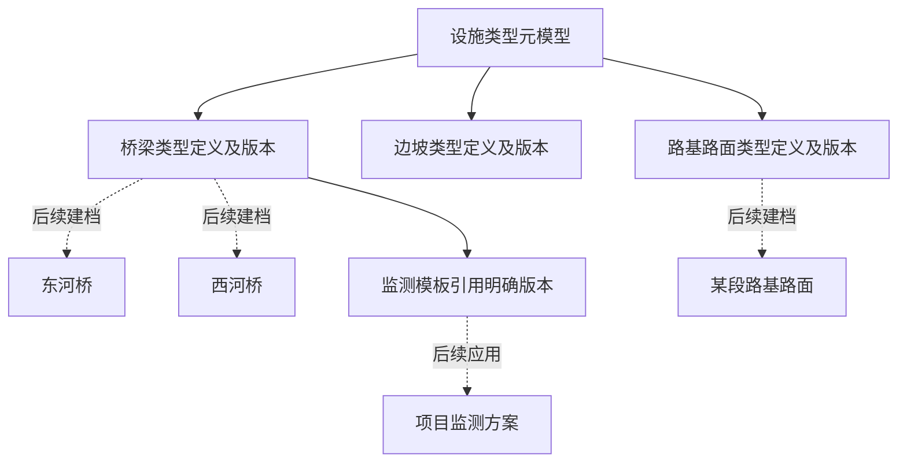

# 基础设施类型定义、指标库与监测模板管理详细方案

日期：2026-11-10。版本：V1.0。文档状态：**用户已确认，实施及自验完成**。迭代状态：**Awaiting acceptance（待人工验收）**。

2026-11-10：用户明确确认本方案并授权实现全部内容。下文保留方案制定时的背景记录；实施、自验与人工验收结果分别记录，不以方案确认代替功能验收。

> 后续实例设计已调整，见[设施实例、构件、测点与业务监测通道管理详细方案](engineering-resource-management-plan.md)。实际资源不建立独立“项目监测方案”，不使用建档进度或实例发布流程；测点本轮直接添加，图纸和三维绑定后续完成，最少构件数量不阻断实例保存。本文类型、指标、单位及模板的定义管理范围保持不变；涉及未来独立方案实例的描述由新方案覆盖，本轮资源使用也不新增模板应用功能。

本方案按用户要求，整合主线程的本轮八项交付、侧边讨论明确的设施类型元模型，以及“系统当前不建设任何审批内容”的决定。它用于确定实施与验收规则。实际实现、检查结果和访问方式见[操作手册](../operations/infrastructure-type-definition.md)及[自验记录](../verification/infrastructure-type-definition.md)，自验不代替用户人工验收。

## 1. 依据、已明确原则与本稿作用

### 1.1 依据

- 主线程：[设计多类型设施监测方案](codex://threads/01a1c423-3da8-7222-ad44-1c273d3adc61)，本轮范围为类型与结构属性、指标单位、公共模板、租户模板、版本、预览、权限审计和工程交付。
- 原始讨论稿：[多类型基础设施监测方案与首轮迭代范围](infrastructure-model-plan.md)。其中“设施类型下面再建立多个模型”的表达，由本次用户明确的三层关系修正。
- 本次讨论：**设施类型元模型 → 设施类型定义 → 设施实例**。桥梁、边坡、路基路面都是类型定义数据，不能成为必须新增代码的类型枚举或专用类。
- 本次决定：**当前系统不建设任何审批流程；以后出现实际审批需求时再单独设计。** 此决定不只针对双人审批。
- 现有工程约定：[架构](../architecture.md)、[前端开发约定](../frontend-development.md)、[项目管理方案](project-management-plan.md)、仓库根目录 AGENTS.md。

### 1.2 已明确的原则

| 编号 | 原则 | 在本方案中的落实 |
| --- | --- | --- |
| P-01 | 同类设施可按工程需要启用不同功能 | 类型定义不硬编码视频、告警等功能组合；实际组合属于后续项目监测方案。 |
| P-02 | 资源归租户统一管理，项目按授权引用并各自维护方案 | 类型和模板不生成项目私有的真实设施副本；租户与项目实例功能仍按主线程范围后续交付。 |
| P-03 | 类型自身需要建模 | 提供统一元模型，桥梁、边坡、路基路面以类型定义记录存在；实际设施引用类型定义的明确发布版本。 |
| P-04 | 当前不做审批 | 没有审批单、审批人、提交审批、通过/驳回、审批待办或审批状态；有权人员直接执行校验后的发布等操作。 |

八项范围由用户指定作为本稿的整理依据；下文将其余细节收敛为完整方案。2026-11-10 用户已确认整体方案并授权全部实施，最终功能人工验收仍单独进行。

本次单独形成详细文档，保留主线程讨论稿。对本轮设施类型分层与审批规则的理解，以用户最新明确内容和本稿对应说明为准；其他现有迭代的实现与验收状态不因此改变。

## 2. 目标与本轮交付范围

### 2.1 可观察目标

平台人员通过管理界面编制并发布一种新设施类型；系统读取定义生成属性表单与构件结构，并按定义校验样例。平台与租户可围绕已发布定义编制监测模板。新增使用已有字段和结构能力的类型，不改源码、不新增类型专用表、不重新构建或部署。

本轮验证“定义能够驱动编制与预览”。实际设施建档、数据采集、项目授权和监测运行分别在后续迭代验收。

### 2.2 八项交付映射

| 编号 | 主线程交付 | 本方案的具体交付 |
| --- | --- | --- |
| IM-01 | 设施类型与模型管理 | 调整为**设施类型定义管理**：依据统一元模型建立类型定义，支持列表、搜索、新建、复制、草稿编辑、版本与可用状态查看；不再要求先建分类再建另一层业务模型。 |
| IM-02 | 构件结构与工程属性 | 在类型定义中编制构件类别、父子关系、数量约束和各对象属性，提供数据约束、表单组织及校验。 |
| IM-03 | 指标与单位目录 | 公共指标、单位及单位类别管理，表达含义、数据形态、允许单位和枚举状态；支持版本、引用与样例值验证。 |
| IM-04 | 平台公共监测模板 | 按明确类型版本配置监测项、目标构件、指标、资源绑定要求、分组与顺序，支持完整编制发布流程。 |
| IM-05 | 租户私有监测模板 | 有权成员选用公共定义，新建或复制本租户模板，独立编辑、发布、停用、恢复并查看来源和版本。 |
| IM-06 | 版本与生命周期 | 草稿修订、发布快照、依赖固定、独立复制、停用恢复、删除限制及并发冲突处理。 |
| IM-07 | 可操作预览 | 动态属性表单、样例构件编辑、结构与字段校验、监测项和待绑定资源要求预览；清楚标注样例性质。 |
| IM-08 | 权限、审计与工程交付 | 平台/租户范围授权、状态联动、审计、数据库增量迁移、HTTP 契约、前后端、自验与人工验收文档。 |

### 2.3 本轮不实现的运行能力

- 真实设施、构件、测点、业务通道、设备和摄像机的建档、接入与维护。
- 项目资源使用授权、维护委托、实际项目监测方案及具体资源绑定。
- 观测数据存储、实时/历史曲线、告警执行、通知、视频播放、巡检和专业分析。
- 真实实例跨类型定义或模板版本的数据升级迁移工具。
- 类型继承、任意脚本、用户自定义控件、动态加载代码及插件市场。
- 审批、额度、用量控制、计费和许可开通。

功能扩展的接入约定纳入第 21 节；不存在的运行模块不作为可用功能展示。示例数据与预览结果不能当作正式工程数据。

## 3. 领域概念与三层模型

### 3.1 规范用语

| 概念 | 定义 | 示例 |
| --- | --- | --- |
| 设施类型元模型 | 规定如何描述一种设施类型的统一结构与表达规则 | 类型身份、版本、属性、构件类别、关系、约束及呈现信息。 |
| 设施类型定义 | 根据元模型编制的一份可版本化业务定义 | 桥梁类型、边坡类型、路基路面类型。 |
| 类型定义版本 | 某次发布的完整类型定义及固定依赖 | 桥梁类型 V1。 |
| 设施实例 | 按某个类型定义版本建立的真实工程对象 | 使用桥梁类型 V1 建档的东河桥；本轮不持久化正式实例。 |
| 构件类别定义 | 类型定义中对某类构件及其属性的描述 | 桥墩、支座、路面结构层；它们也属于配置数据。 |
| 构件实例 | 实际设施中的一个具体构件 | P1 桥墩；本轮只在预览中建立样例。 |
| 指标定义 | 对某项观测值含义、形态与单位的规定 | 明确方向和参考含义的位移、温度、某种状态。 |
| 监测模板 | 可复用的监测内容与资源绑定要求 | 桥梁日常监测模板；不含现场设备或测点身份。 |
| 项目监测方案 | 项目针对获准资源形成的实际监测安排 | 绑定东河桥若干通道并选择实际功能；本轮后续交付。 |

元模型由通用程序实现，业务人员在其支持范围内配置类型定义。元模型格式用 `metamodel_version` 标识；业务类型的 V1/V2 是另一种版本，二者分开管理。首轮不提供“在界面上任意改写元模型解释规则”的能力。

### 3.2 对原方案表达的修正

1. “设施类型定义”本身就是完整的业务模型；不再强制存在“设施分类 → 独立模型 → 实际设施”的额外层次。
2. 桥梁、边坡、大坝、路基路面以数据库记录和版本内容存在；类型标识不出现在程序的业务分支、封闭枚举或路由清单中。
3. 属性名、构件类别、合法父子关系等同样是配置，仅将类型名称放入数据库不满足本轮目标。
4. 同一类型定义版本可描述数量不同的合法构件样例；数量差异通常属于实例数据。
5. 梁桥与斜拉桥若确实需要不同结构规则，首轮可分别编制独立类型定义并通过复制复用起点。此处只是表达方式，不建立继承体系，也不要求当前确定完整行业分类法。
6. 如果以后需要上层分类或标签，其作用是组织和检索，不能成为解释新类型所必需的代码条件。

### 3.3 不变规则

- 正式实例未来必须明确引用类型定义版本；不得使用含义随时变化的“最新版”指针解释已有实例。
- 监测模板引用类型版本和指标版本，不改变被引用定义的含义。
- 稳定标识与显示名称分开；更名不会创建另一对象或改变引用。
- 类型定义的通用解释不包含设备协议、视频播放或专业算法实现。
- 公开定义和租户私有模板分别归属；复制只产生来源关系，不产生共享写入或自动继承。

## 4. 平台、租户、项目职责

| 对象或操作 | 平台 | 租户 | 项目 |
| --- | --- | --- | --- |
| 类型定义、指标、单位 | 编制、发布和维护公共目录 | 有权成员选用已发布内容 | 本轮无独立入口。 |
| 公共监测模板 | 编制、发布、停用恢复 | 浏览、预览、复制为私有模板 | 后续按授权选用。 |
| 私有监测模板 | 平台身份不产生读取或维护资格 | 本租户有权成员编制、发布、停用恢复 | 后续应用为实际方案。 |
| 正式设施与监测资源 | 提供通用管理能力 | 按已确认原则统一管理 | 按授权引用；本轮不落地实体和授权流程。 |
| 实际功能与工程参数 | 提供真实模块及规则执行能力 | 管理公共资源配置 | 后续各自维护监测方案。 |

本轮允许租户新建私有监测模板，或复制公共及本租户可用模板。租户不能编辑公共原件，也不自建私有类型定义、私有指标和单位规则。出现新的业务类型或指标时，由有权平台人员直接配置、校验和发布，无需开发新的设施类型代码。

有效租户的有权成员可以使用可用公共定义，不增加逐租户开通流程。租户停用或成员失去资格后，相关私有内容访问与操作按现有授权规则停止；其他租户不受影响。

## 5. 设施类型定义管理

### 5.1 内容结构

| 部分 | 内容 |
| --- | --- |
| 身份 | 系统 ID、稳定编号、创建时间、创建人、复制来源。 |
| 版本资料 | 名称、说明、元模型格式版本、发布说明。 |
| 根对象属性 | 设施自身的字段定义、约束、单位引用及表单组织。 |
| 构件类别 | 各类别的稳定键、名称、说明和属性定义。 |
| 组成关系 | 父级类别、子级类别、最小与最大数量、呈现顺序。 |
| 呈现信息 | 属性分组、字段顺序、说明与已支持的控件选择。 |
| 发布信息 | 版本号、依赖清单、内容摘要、发布时间和发布人。 |

编号在定义所属范围及对象种类内唯一，创建后不修改、不复用；显示名称允许相同但界面同时显示编号。名称、说明等发布内容也随新版本修改，不原地改写历史版本。源对象未发布时可在其草稿中调整显示资料。

### 5.2 操作流程

1. 有权平台人员新建类型定义，填写编号、名称和说明，形成草稿。
2. 配置根对象属性、构件类别、结构规则和表单组织。
3. 保存草稿；允许业务内容暂不完整，明确列出待完善项。
4. 执行完整校验，在预览中建立样例并验证规则。
5. 有发布权限者直接发布，服务端重新验证当前修订、权限和依赖；成功产生 V1。
6. 后续修改从已有版本建立同一对象的新草稿，发布 V2。V1 保持不变。

列表支持名称/编号搜索、可用状态筛选及分页，显示最新发布版本和是否存在草稿。详情可以查看所有有权读取的版本、差异、来源和操作记录。不存在按“桥梁/边坡/路基路面”分别实现的页面。

复制为新类型定义时必须指定新编号，复制内容及引用形成独立草稿，并记录来源对象和来源版本。复制不是给原对象增加版本。

## 6. 构件类别与结构规则

组成关系先采用有明确父级的树。设施根节点由通用系统约定，每个构件实例只能有一个组成父级；同一父级可以拥有多个同类别子构件。监测分组和物理组成分别表达。

| 规则 | 本轮含义 |
| --- | --- |
| 父子合法性 | 只有类型定义允许的类别对才能建立组成关系。 |
| 数量约束 | 每个父实例下，某个子类别的数量满足 `min_count`、`max_count`；最大值可为空表示不设业务上限。 |
| 可选构件 | 最小数量为零；有实例时仍须满足其自身字段和子结构要求。 |
| 结构完整性 | 所有使用的类别必须可从根到达；首轮类别关系图无环，实例组成无环且无重复父级。 |
| 类型内身份 | 构件类别键在本类型定义内稳定；同一键不能在新版本中被重新解释为另一种构件。 |
| 分步编辑 | 预览允许暂时缺少必需构件，显示完整性问题；完整校验不能因此通过。 |

最小数量不得为负，最大数量不得小于最小数量，类别及关系不能重复或悬空。支持无构件、仅有设施根属性的类型。关系规则可以表达不同深度，不为所有设施设定相同的业务层数。

构件类别随所属类型定义一同版本化，首轮不建立全局构件类别继承库。对实例树编辑提供新增、修改、删除和改变合法父级的操作；删除样例节点时展示其样例子树影响。

技术性的输入大小、节点数量和执行时间保护应在实现及操作文档中明确，作为系统处理能力限制，不计作租户配额或商业用量控制。

## 7. 工程属性定义

每个字段包括稳定键、名称、说明、数据形态、是否必填、静态默认值及相应约束；数值字段可关联明确单位版本。呈现分组与顺序不改变数据语义。

| 字段形态 | 值与约束 | 预览控件 |
| --- | --- | --- |
| 文本 | 字符串、最小/最大长度 | 单行或多行输入。 |
| 整数 | JSON 整数、上下界；限定前后端均能精确表达的安全整数范围 | 数值输入。 |
| 小数 | 有限 JSON 数值、上下界；不接受 NaN/Infinity | 数值输入；显示精度不自动改写值。 |
| 布尔 | true/false | 开关或选择；false 是合法值。 |
| 日期 | 明确的年月日日期，不带时区 | 日期选择。 |
| 日期时间 | 带时区偏移的规范日期时间 | 日期时间选择，提交时携带偏移或 UTC。 |
| 单选枚举 | 枚举选项的稳定字符串键 | 单选。 |
| 多选枚举 | 不重复的枚举键数组，可规定选择数量 | 多选。 |

零值、false 与字段缺失必须区分。可选字段未填写时省略，不用空字符串冒充数值或日期；必填文本还需满足最小长度，必填多选至少选一项。首轮不支持字段值为 null 的独立业务含义。

文本长度统一按 Unicode 码点计数，包含非 BMP 字符的输入也必须前后端一致；前端不能直接以 UTF-16 的字符串长度代替。数值必须处于前后端共同支持的有限表示范围，超出范围明确拒绝，不通过静默截断或舍入接受。

默认值必须通过同一字段规则验证，只在创建样例的初始输入时明确填入，不在校验时悄悄补值。已有样例不因修改默认值而自动变化。选项键发布后不得换义；删除选项、字段或改变类型在新版本中明确展示差异。

已发布字段键不用于另一种数据形态或量纲；这种变化使用新字段键，历史键保留其含义。系统可以检查结构与形态差异，但不声称能够自动判断所有文字描述的工程含义是否正确，配置人员仍需核对定义内容。

不开放任意正则表达式、脚本、计算字段、动态默认值、文件上传、任意嵌套对象和自定义组件。多选数组属于明确支持的字段形态，不由此开放任意数组结构。

## 8. 指标与单位目录

### 8.1 指标定义

指标具有稳定编号、名称、含义、数值/枚举状态形态和相关规则。名称相同不能据此自动合并；方向、参考基准等改变观测含义时，应明确区分指标或采用已明确的定义参数。首轮不实现任意参数化测量语言。

数值指标明确单位类别、标准单位、允许单位与必要的值形态约束；标准单位必须属于允许单位。枚举状态指标定义选项键及含义，不配置物理单位。定义约束属于数据有效性，不等于工程告警阈值。

指标按公共定义的草稿、发布、停用与恢复流程管理。模板引用指标的明确版本；后续改变名称或说明也形成新版本，改变核心测量含义时建立新指标身份，不能借更名重解释原数据。

### 8.2 单位与单位类别

单位包括稳定编号、名称、符号、单位类别和说明。单位类别是平台维护的目录数据，可新增；已被引用的类别键不允许改变含义。相同量纲不能替代具体指标的业务含义判断。

单位的发布内容版本化，指标和类型字段引用明确单位版本。允许单位必须与指标的单位类别匹配；不允许将长度单位作为压力指标的合法单位。无量纲数值与枚举状态分别处理。

本轮记录和验证单位适用关系，不执行实际采集值的单位转换，不承诺任意单位换算。样例校验中的范围按照该字段或指标明确声明的单位解释，不能更换单位标签而保持原数值含义不变。

### 8.3 首轮数据形态

指标支持单值数值及枚举状态。不同方向的位移可以分别定义为含义明确的单值指标；这不代表已经支持波形、频谱、矩阵或向量计算。视频流是功能模块处理的内容，不注册为一个普通数值指标来假装提供视频功能。

## 9. 公共监测模板

### 9.1 模板结构

| 部分 | 内容 |
| --- | --- |
| 基本资料 | 稳定编号、名称、说明、监测目的、来源。 |
| 适用目标 | 一个或多个明确的设施类型定义版本；禁止运行时自动跟随最新版。 |
| 监测分组 | 名称、说明、显示顺序。 |
| 监测项 | 稳定项键、名称、说明、默认是否选用、所属分组。 |
| 目标映射 | 针对每个适用类型版本，明确根对象或构件类别；不靠同名猜测兼容。 |
| 指标引用 | 该项使用的指标发布版本及相应单位引用。 |
| 绑定要求 | 未来需要绑定的目标类别、指标和最小/最大资源数量；不包含实际设备或测点 ID。 |
| 展示组织 | 分组及排序，用于本轮定义预览；不宣称提供运行中的曲线或告警。 |

同一类型版本可以有多份监测模板。模板支持多个目标版本时，必须分别给出有效映射并逐项校验；不能仅凭它们都叫“桥梁”就认定兼容。

每个保留的监测项至少引用一个有效指标，绑定数量规则自洽，目标类别在适用类型版本中存在。某项默认不选用，不代表启用它时可以跳过完整性校验。

### 9.2 编制与发布

选择可用类型版本 → 编排监测分组与监测项 → 选择目标和指标 → 设置资源绑定要求 → 校验并预览 → 有权者直接发布。

草稿可以保存未完成内容，但不能发布悬空引用、私有跨租户引用、不兼容单位或不存在的构件目标。发布仅证明监测定义完整有效，不意味着现场已有资源、数据或运行模块。

本轮模板不包含真实资源标识、连接凭据、自动生效的工程告警限值、视频播放参数或任意代码。后续接入功能模块时，通过明确的模板版本演进扩展配置。

## 10. 租户私有模板与复制规则

租户有权成员可以使用可用公共类型、指标和单位新建私有模板，也可复制可用公共模板或本租户模板。副本拥有新的身份、编号和版本序列；内容独立，来源只用于追溯。

公共模板更新不会改变副本；副本更新不会影响公共原件。复制来源属于历史关系，不能被当成自动同步依赖。副本实际使用的类型、指标和单位仍是受可用性约束的明确依赖。

租户 A 的模板不能被租户 B 列表、搜索、详情、复制、预览或引用。公共定义不能依赖租户私有内容。首轮不支持私有模板相互嵌套，不提供私有模板一键公开或跨租户分享。

复制必须重新确认源版本可新使用及目标范围权限。租户模板内部编号只在所属租户内唯一，不因另一租户使用相同编号而冲突。平台人员没有相应租户资格和权限时，不能用平台身份读取私有模板。

本轮不提供项目模板管理入口；后续项目使用模板时保存其来源版本和实际方案，不复制设施、测点和原始观测数据。

## 11. 无审批的发布与版本生命周期

### 11.1 当前统一规则

系统当前不建设审批内容。发布的前提只有：操作者当前有权、对象属于正确范围、草稿修订匹配、数据与依赖校验通过。满足条件即在一次业务事务中发布。

查看、编辑、发布、停用恢复仍是不同操作权限，一个人可以同时持有。权限判断、配置校验、必要的操作确认和审计不组成审批流程。页面中不出现“待审批”“审批通过”“退回修改”等状态或审批人字段。

### 11.2 状态与操作

草稿与发布版本分开保存。发布版本的内容不可变，其“可新使用/已停用”状态单独管理；类型定义等对象的目录状态由其草稿和版本情况推导，不叠加另一套审批状态。

| 对象状态 | 可做的事 | 限制 |
| --- | --- | --- |
| 草稿 | 编辑、校验、预览、删除、发布 | 不作为其他对象的正式版本依赖。 |
| 已发布且可用 | 查看、预览、选择引用、复制、建立后续草稿、停用 | 不原地修改已发布内容。 |
| 已发布但停用 | 查看历史、预览已有引用、建立同一对象的修订草稿、恢复 | 不允许新采用或复制为新的业务对象；保留维护修订能力。 |
| 依赖不可用 | 查看定义与问题原因、修订本对象 | 本对象即使未被手动停用，也不能绕过不可用依赖供新采用。 |

一个定义首轮最多有一份当前草稿，采用修订号控制多人编辑。已发布版本按对象递增编号；发布成功后消费本次草稿，继续编辑需显式建立下一草稿。发布 V2 不自动停用 V1。

没有发布版本的对象可删除其未被引用草稿并保留必要编号保留和操作历史；已经发布的对象只允许删除后续草稿，不能删除发布历史。删除草稿不会删除任何已发布版本或副本。

### 11.3 固定引用与停用影响

发布时记录所有解释所需的版本依赖及内容摘要。模板到类型、指标、单位的引用全部固定，历史页面不通过当前名称或“最新版”拼接历史含义。

新采用包括：新增定义引用、从源复制新对象、发布带这些依赖的新版本，以及未来创建新的实例/方案。服务端检查整个依赖链均已发布且允许新使用。

停用单位 V1 后，依赖它的指标或模板仍能按原定义解释和预览，但不得被用于新采用。依赖恢复后重新计算可用性，不自动恢复已删除的关系或用户权限。已有副本不受复制来源状态连带控制，只受其实际依赖影响。

已有租户私有版本读取其历史公共依赖时，采用限定引用路径的解析：可读取解释该有权版本所必需的固定依赖，不因此获得公共草稿或全部已停用目录的浏览权。恢复模板时若其依赖仍不可用，返回明确原因，不显示“可使用”。

本轮不迁移正式设施或项目方案。未来升级需要明确选择、影响预览及执行；当前不添加升级审批流程。

## 12. 校验与可操作预览

### 12.1 校验分层

| 层次 | 检查内容 | 执行时机 |
| --- | --- | --- |
| 输入和范围 | 请求结构、字段形态、对象归属、当前身份与操作权限 | 每次请求。 |
| 元模型 | 定义格式版本、已支持的字段形态、未知配置项、稳定键和基本格式 | 保存、校验、发布；草稿完整性错误允许带诊断保存。 |
| 结构语义 | 类别存在、关系无环、根可达、数量自洽、字段默认值有效 | 完整校验和发布。 |
| 引用语义 | 类型/指标/单位版本存在、范围合法、目标映射及单位匹配 | 保存显式引用、完整校验和发布。 |
| 可新使用性 | 当前对象和完整依赖链已发布、未停用，当前租户状态允许 | 新选择、复制、发布；不能仅信任前次预览结果。 |
| 样例值与结构 | 按类型字段规则检查样例值和样例构件树 | 预览交互及服务端预览请求。 |

草稿可暂缺名称、构件配置等业务内容，但身份、作用范围、已提供引用的访问资格和请求安全边界必须有效。缺项以结构化问题返回；不能把格式错误或跨租户引用当作“草稿不完整”保存。

每个问题至少包含稳定错误码、中文说明、配置路径及相关对象键。用户能够从问题跳到对应字段、构件关系或监测项。阻断问题与提示分别展示，不把错误吞成一个笼统的“校验失败”。

### 12.2 预览行为

1. 选择草稿或发布版本，生成根属性表单和可用构件列表。
2. 添加、删除、编辑样例构件，选择合法父级，检查重复数量和完整性。
3. 输入合法与非法字段值，显示与后端一致的错误位置；不默默更正用户输入。
4. 对监测模板，选择一个适用类型版本，显示分组、监测项、指标及“待绑定何种资源”的要求。
5. 可用临时样例对象检查目标映射和数量要求，但不伪造真实设备接入、通道在线状态、曲线或视频。

预览统一标注“样例预览，不创建正式设施或监测数据”。样例主要保留在当前页面内存；离开或切换账号/租户时清理，不将样例写入正式资源表。刷新页面不承诺保留未保存的样例，界面说明这一点。

预览 POST 请求仍复用现有身份与 CSRF 保护。验证样例不产生业务写入，也不为每次按键写审计记录；提交发布等真实变更另行审计。样例正文不写入普通请求日志。

### 12.3 发布前验证与发布时验证

前置校验用于定位问题，不能作为长期有效的发布许可。发布请求携带预期草稿修订；服务端在最终事务中复验当前内容、引用状态和权限。校验后有人改过草稿或停用了依赖，发布应失败并显示变化原因。

## 13. 前后端校验技术及现有约束

字段定义是唯一配置来源。服务端将受支持的字段定义编译为 JSON Schema Draft 2020-12 的明确子集，保存发布版本的规范化内容及编译格式版本；客户端不能提交一份与元数据含义不同的“已编译规则”作为真相。

后端拟使用 `github.com/santhosh-tekuri/jsonschema/v6` 检验字段样例，显式启用日期与日期时间的格式断言。该库对 2020-12 与格式断言的支持已核对其[官方说明](https://github.com/santhosh-tekuri/jsonschema)。结构、依赖、单位与权限校验仍由 Go 业务逻辑执行。

支持的 Schema 关键词限制为本轮字段需要的类型、属性、必填、额外属性限制、枚举、长度、数值范围、多选数组数量/去重，以及受控日期格式等；只使用内部生成的局部引用。禁止远程引用解析、任意脚本和用户提供的新词汇。服务端从允许的已发布定义解析业务依赖，不把它们当成网络 URL 加载。

现有前端通过统一 Zod 配置启用 `jitless`，需遵守现有 CSP。首轮继续使用 React Hook Form 和此 Zod 入口，对同一份受支持的字段规则进行有限映射；不为桥梁、边坡等分别手写 Zod schema。JSON Schema 的任意关键词并不因此成为受支持产品能力。

前后端使用同一组字段规则和有效/无效样例做一致性检查，覆盖零值、false、缺失、中文长度、日期、时区、数值边界和枚举数组。后端始终是最终校验依据。默认值只在明确的初始化动作中应用，关闭隐式类型强制转换和校验时数据修改。

本轮不引入需要浏览器动态代码编译的通用规则引擎。Ajv 具备标准支持，但不因采用动态 Schema 而放宽既有 CSP；未来若调整校验方案，需同时验证新增类型无需重新构建这一目标。参见[JSON Schema 2020-12](https://json-schema.org/draft/2020-12)及[Ajv 标准支持说明](https://ajv.js.org/json-schema.html)。

## 14. 权限与范围隔离

### 14.1 权限目录

权限继续由现有 `access` 统一定义，数据库和前端使用现有投影/生成机制。以下为建议的业务分组，最终编码在实施时按现有命名规范落实：

| 范围 | 权限组 | 允许的操作 |
| --- | --- | --- |
| 平台 | 类型定义查看/编辑/发布/状态管理 | 类型详情、版本、草稿、复制、删除草稿、发布、停用恢复。 |
| 平台 | 指标单位查看/编辑/发布/状态管理 | 公共指标和单位目录及其版本管理。 |
| 平台 | 公共模板查看/编辑/发布/状态管理 | 公共监测模板管理。 |
| 租户 | 公共工程目录查看 | 在本租户上下文选用、读取和预览有权的公共内容。 |
| 租户 | 私有模板查看/编辑/发布/状态管理 | 本租户模板管理；复制还需源内容读取资格。 |
| 对应范围 | 既有审计查看能力 | 查看当前范围内获准的工程配置事件。 |

读取与修改、发布、状态管理分别校验，不凭操作者是创建者、平台管理员或租户管理员直接放行。页面进入需要读取资格，执行变更还需对应动作权限；同一人可以同时拥有全部所需权限，不要求另找审批人。

目录接入、内置角色同步沿用现有机制，不批量改写自定义角色，不增加项目权限或项目角色。本轮角色配置工作只覆盖真实提供的功能，不提前登记视频或告警的占位权限。

### 14.2 隔离要求

- 租户 ID 从已授权的路由上下文确定，不能通过请求正文改变对象归属。
- 所有查找同时限定对象、种类与所属范围；列表、搜索、版本、复制、预览和依赖解析使用相同限制。
- 私有模板使用公共依赖不使其变成公共内容；公共对象不允许引用私有模板。
- 账号/会话、租户状态、租户成员关系和角色按当前数据库状态复验。Redis TTL、缓存页面或按钮可见性都不能延长已撤销访问。
- 平台管理身份不隐含私有模板业务资格。平台人员查看公共定义影响时，只获得有权的公共详情与必要的受限引用提示，不泄露私有模板内容。
- 当前对象不可访问时，详情和依赖错误不泄露其他租户的名称、模板编号或配置正文。

## 15. 存储设计与数据完整性

采用 PostgreSQL 关系数据加受约束 JSONB。关系数据负责身份、作用范围、版本、引用和并发；JSONB 保存可变的字段、构件和模板内容。每增加一种设施类型不新增表。

### 15.1 建议的逻辑存储

| 数据 | 主要信息与约束 |
| --- | --- |
| 工程定义身份 | ID、对象种类、public/tenant 范围、所属租户、稳定编号、来源、时间；作用范围内唯一。 |
| 当前草稿 | 定义 ID、内容、草稿修订、基础版本、编辑者；一个定义最多一份当前草稿。 |
| 发布版本 | 独立版本 ID、定义 ID、递增版本号、规范化内容、格式版本、内容摘要、发布时间/人；正文不可修改。 |
| 版本可用状态 | 发布版本 ID、可用/停用、状态修订、原因、操作时间/人；与不可变正文分开。 |
| 发布依赖 | 引用版本 ID、被引用版本 ID、关系类别和内容位置；均使用明确外键，不保存“最新版”引用。 |
| 单位类别目录 | 稳定键、名称、含义；被引用后禁止换义或删除。单位发布内容冻结解释所需类别信息。 |
| 编号保留 | 已使用编号及原定义身份，防止删除草稿后重新分配造成来源混淆。 |
| 操作收据 | 作用范围、操作者、操作、请求标识、载荷摘要、结果版本；保证重复提交一致。 |
| 审计 | 使用现有范围隔离的事件机制，记录定义及版本操作。 |

可采用少量共享工程定义/版本表承载类型定义、指标、单位、模板四种明确对象种类，分别使用严格的领域验证器。这里的“对象种类”区分元对象职责，不是桥梁、边坡等设施类型枚举。首轮不由用户新增任意元对象种类，不建设万能实体系统。

公共类型、指标和单位不得带租户归属；只有模板可拥有租户私有范围。通过 CHECK、唯一性、外键及必要的受控事务检查保护这些约束，不能只由页面决定。

JSONB 中的已发布引用需提取为可校验的依赖关系，发布时同时写入，禁止正文和依赖表分别更新。复制来源与有效依赖分别保存。发布版本的内容摘要用于一致性检测和缓存键，不代替数据库约束或权限检查。

### 15.2 并发及幂等

草稿写入携带预期修订，过期返回冲突，不覆盖其他人的编辑。发布时锁定当前定义，分配版本号、复验依赖、创建发布版本、写依赖、消费草稿、记录审计与收据在同一事务完成。

沿用现有授权锁顺序：授权状态与身份复验在前，工程目录/定义锁在后。发布、停用和恢复共享明确的目录变更协调机制，依赖对象按稳定顺序访问，避免检查通过后依赖先被停用的竞态。第一轮可用单个工程目录状态锁串行化发布和状态变化；草稿编辑仍按定义独立控制，不提前引入分布式锁。

相同范围、操作者和请求标识的同一操作重复提交返回相同结果，不重复生成版本或审计；载荷不同则返回冲突。返回已有收据前仍复验当前访问资格，不能用历史成功结果绕过撤权。

网络中断导致发布结果不明确时，用户可查询版本与请求结果再重试；前端不自动重放写请求。数据库失败或事务回滚不留下半份发布定义、依赖或审计。

## 16. 后端模块、HTTP 契约与错误语义

### 16.1 模块职责

建议在现有 `packages/go/platform` 内增加工程配置业务包，例如 `engineering`，不新增 Go module 或独立常驻服务。

该 Module 对外提供完整业务操作的 Interface：类型/指标/单位/模板的草稿管理、校验、预览、发布、可用性调整、复制及有范围的查询。其 Implementation 内部集中组织规范化、校验、依赖解析和事务；HTTP 层不拼接多个独立写操作完成一次发布。

PostgreSQL Adapter 和校验器在模块内部协作。依赖方向保持工程配置 → access/基础能力，HTTP → 工程配置；工程配置不导入 Gin，access 不反向依赖工程业务。只为实际变化处设置 Seam，不为唯一数据库实现额外创建通用 Repository 框架。

### 16.2 接口分组

以下路径是相对现有 API 前缀的建议，实施时在 OpenAPI 中统一确定；其中没有设施类型专用路径：

| 分组 | 典型操作 |
| --- | --- |
| `/platform/engineering/type-definitions` | 列表、新建、详情、草稿、版本、校验、预览、发布、复制、停用恢复。 |
| `/platform/engineering/metrics`、`units` | 指标、单位与类别目录操作。 |
| `/platform/engineering/monitoring-templates` | 公共模板完整管理。 |
| `/tenants/{tenantId}/engineering/catalog` | 本租户上下文中的公共目录读取与受控依赖解析。 |
| `/tenants/{tenantId}/engineering/monitoring-templates` | 本租户私有模板完整管理及复制公共模板。 |

变更请求携带请求标识和预期修订；发布明确指向一份当前草稿。可用状态变更也有预期状态修订，防止停用/恢复相互覆盖。只接受本操作允许修改的字段，客户端不能指定发布者、作用范围或版本号。

校验/预览接口使用 POST 承载输入，但无正式业务副作用。版本差异接口比较两个明确版本或草稿，不通过改变当前版本来完成比较。

### 16.3 主要反馈

| 情况 | 结果 |
| --- | --- |
| 请求格式错误、未知操作字段 | 400，并说明输入位置。 |
| 未登录或会话无效 | 401，沿用现有身份处理。 |
| 操作权限不足 | 403；不可见对象按现有防泄露策略处理。 |
| 对象不存在或不在允许范围 | 404，不暴露其他范围对象。 |
| 草稿/状态修订冲突、请求标识冲突、依赖状态变化 | 409，提示重新读取当前结果，不自动覆盖。 |
| 定义、单位、结构或样例校验失败 | 422，返回结构化问题列表。 |
| 临时依赖故障 | 按现有错误约定反馈可重试状态，保存本地编辑，不自动重新发布。 |

没有“等待审批”响应、审批查询或审批回调。权限检查与配置校验失败必须直接返回原因。

## 17. 前端页面和交互

### 17.1 页面组织

平台在工程配置分组提供“设施类型定义”“指标与单位”“公共监测模板”。租户提供“公共工程配置”和“本租户监测模板”。项目工作空间本轮不增加监测运行入口。

类型定义编辑器组织为基本资料、设施属性、构件类别、组成关系、预览与问题、版本历史等明确内容。所有设施类型使用同一个编辑器，区别来自定义数据。菜单也不为每个设施类型生成一套专用页面。

模板编辑器组织为适用类型版本、监测分组与监测项、指标与目标映射、绑定要求、预览、发布版本。租户模板页面显示“公共来源/本租户维护”及来源版本，避免用户误以为编辑副本会改动公共原件。

### 17.2 关键交互

- 明确区分“保存草稿”“校验”“预览”“发布”；发布直接完成操作，不跳入审批页面。
- 发布前显示将发布的版本内容、依赖和阻断问题；不把旧校验结果当作当前必然可发布的状态。
- 停用前显示后续新采用受到限制、已有历史保留，以及有权查看的引用影响。恢复时明确依赖是否仍不可用。
- 同一对象的不同版本可比较字段、构件、约束和引用变化；同名对象同时展示编号。
- 发布完成显示明确版本及结果；空列表、权限不足、数据加载失败和草稿冲突分别反馈。
- 异常时保留当前合法范围内未提交的编辑；真实失权或切换账号/租户时清理敏感内容和样例。

### 17.3 状态与请求

沿用 TanStack Query、现有身份 Provider 和取消机制。查询按账号、租户成员关系、对象和版本隔离；写操作完成回调必须校验页面上下文代次。切换租户后，旧请求不能把前一租户的模板写回当前页面。

React Hook Form 管理表单输入，现有共享 UI 提供控件；业务元数据解释放在工程 feature，不让公共 UI 包访问工程 API。前端路由树、API 类型与权限类型继续使用现有生成流程，不手工修改生成结果。

## 18. 审计与操作追溯

记录类型/指标/单位/模板创建、复制、草稿有效变更、发布、停用恢复和草稿删除。事件包含操作者、时间、作用范围、对象与版本、来源、结果及必要原因；发布事件能定位完整不可变快照。

草稿审计记录发生变化的字段或结构化差异，完整发布内容通过发布版本追溯；不把每次预览输入和全部正文反复写进普通日志。发布失败不产生成功事件，重复提交不重复记录成功。

平台公共定义事件进入平台可见范围；租户私有模板事件进入对应租户范围。复制公共模板到租户只在目标范围记录私有结果，平台日志不泄露租户模板内容。项目审计本轮不增加虚构监测事件。

审计是已发生操作的记录，不是等待其他人处理的任务，也不形成审批节点。

## 19. 技术选择、用途与理由

| 技术 | 使用位置与方式 | 选择理由 |
| --- | --- | --- |
| Go | 工程配置业务模块、元模型规范化、结构与依赖验证、版本事务 | 与现有后端及 CLI 共用完整业务规则。 |
| Gin | 身份适配、路由、严格请求解码、标准错误响应 | 沿用现有 HTTP 接入，不把领域规则写进 Handler。 |
| PostgreSQL + pgx | 定义身份、JSONB 内容、版本、依赖、锁、操作收据和审计 | 既支持可变字段，又能约束引用与原子发布。 |
| Goose / infrapro CLI | 追加迁移、同步权限目录、版本检查 | 保持现有部署运维方式，不由 API 启动时修改数据库。 |
| JSON Schema 2020-12 子集 + Go jsonschema/v6 | 类型属性及样例值的服务端规则验证 | 使用标准字段约束，同时保留有限、可验证的产品能力范围。 |
| React + TypeScript + Vite | 单 console 内的工程配置 feature、动态表单和样例树 | 新设施类型使用同一套页面，不新建应用或类型专用页面。 |
| React Hook Form + 现有 Zod jitless 入口 | 表单输入、同源字段规则映射及错误呈现 | 复用现有工具和 CSP 约束，不依赖每种类型重新编译前端。 |
| TanStack Router / Query / Table | 路由、范围隔离的查询缓存、目录表格 | 延续工作空间切换、请求取消和列表约定。 |
| OpenAPI 与现有类型生成脚本 | 固定业务操作及动态定义载荷契约 | 新增设施类型只新增数据；客户端支持结构化错误与版本引用。 |
| 现有 Go、HTTP、Playwright 检查体系 | 规则、事务、隔离、界面及部署路径验证 | 用真实 PostgreSQL 和实际页面确认关键行为。 |

保留仓库当前锁定的工具链。实施已将 Go 校验依赖锁定为 `jsonschema/v6 v6.0.3`，API 独立模块的依赖校验和同步。Redis 维持现有缓存与限流职责，不作为定义内容或可用权限的唯一真相。

Schema 编译结果可以按不可变内容摘要缓存；依赖当前可用性、账号和租户权限必须单独复验。不能因缓存了发布定义而缓存其永久可用资格。

## 20. 数据库迁移、启动与交付文件

### 20.1 迁移要求

本次读取的工作区为 `feature/account-access-console`，提交基点 `776663f`；目录存在其他迭代未提交内容，已看到的数据库迁移到 `00007_projects.sql`。这些信息只用于本次方案核对，不能替代实施开始时重新确认。

实施追加工程配置所需表、约束与索引，迁移编号以当时仓库最新状态确定。保留已有账号、租户、项目、角色、邀请和审计，不重建数据库、不重复首次账号初始化。

迁移不自动创建正式桥梁、边坡、大坝或路基路面，也不自动发布示例类型。示例存放在隔离测试资料和操作步骤中。权限目录按已有同步机制接入真实新权限，不创建审批或未来运行模块权限。

验证既有数据库升级与空测试库初始化两条路径，确认原业务数据和授权仍可使用。沿用现有不以破坏性 Down 清空历史的迁移策略；部署失败的恢复步骤在实施交付手册中写明并验证适用范围。

### 20.2 计划新增或修改的位置

| 位置 | 交付内容 |
| --- | --- |
| `packages/go/platform/engineering/` | 工程配置领域操作、规则、持久化及对应测试。 |
| `packages/go/platform/access/` | 实际权限目录、HTTP 操作策略与角色同步衔接。 |
| `packages/go/platform/migrations/` | 增量结构与完整性约束、升级验证。 |
| `services/api/internal/transport/http/engineering/` | HTTP 适配与路由接入。 |
| `contracts/openapi/`、`packages/ts/api-client/` | 契约源、生成类型、客户端请求。 |
| `apps/console/src/features/engineering/` 及路由 | 平台与租户页面、定义解释、预览和状态处理。 |
| 现有共享 UI 包 | 仅补充确有复用价值的通用控件；不混入工程 API 和权限逻辑。 |
| `tests/` | 跨语言规则样例、HTTP/E2E 用例及非正式示例配置。 |
| `docs/operations/`、`docs/verification/` | 操作与升级手册、独立自验及人工验收记录。 |

上述位置已落实对应实现；详细接口、v8 迁移及 17 项新增权限编码以当前契约源和独立自验记录为准。

### 20.3 实施完成后的访问方式

沿用当前本地环境及统一运维命令：在已配置且已有账号的环境中执行新增迁移、权限同步与检查，再使用 `make dev` 启动。默认 console 地址为 `http://127.0.0.1:5173`，实际地址以运行配置为准；既有环境不再执行账号 bootstrap。

平台有权人员从工程配置菜单进入，租户有权成员先切换到对应租户再进入模板页面。部署环境继续支持现有 `/console/` 路径和刷新深链接。

准确的迁移、权限同步、启动、访问命令及菜单所需权限已记录于[操作手册](../operations/infrastructure-type-definition.md)。本机已完成 v7→v8 升级并保留存量账号与业务数据。

## 21. 后续功能模块与实例的接入约定

### 21.1 本轮保留的扩展关系

未来设施实例记录租户 ID、类型定义版本 ID、实际属性及构件数据；通用实例操作读取定义完成校验，不新增按桥梁/边坡/路基路面分支的建档逻辑。真实实例表和接口不在本轮创建。

未来项目监测方案引用获准资源与明确模板来源版本，保存实际监测项、绑定和功能组合。模板内容的改变不会自动改写方案。共享资源的采样、标定等参数由获准维护方统一调整，各项目的告警和分析安排分别管理。

### 21.2 功能模块契约

模块实现时至少声明稳定标识、配置格式版本、支持的上下文、依赖与兼容要求、真实权限和页面入口。启用检查模块可用、工程配置完整、资源范围与当前人员权限，菜单和后端判断一致。

例如首次建设视频，需要真实实现摄像机资源关联、授权和播放接入。该模块可以被桥梁、大坝、路基路面等类型复用；类型名称不是视频可用性的条件。再次为另一类型使用已有视频能力，通过配置完成。

首轮仅记录上述约定，不实现空注册表界面、虚构模块开关或演示菜单。模块代码先随现有 API 和 console 统一发布，不预建热插拔插件平台。新增字段基础形态或新算法同样属于通用能力扩展，与新增一个设施类型定义不同。

未来如需要审批，应以真实用例单独设计并更新方案；当前不预留审批单、审批字段或隐藏审批状态机。后续资源授权也不能因为“有授权操作”就默认引入审批。

## 22. 新增路基路面的贯穿验收场景

本场景用于证明新增类型只需配置，结构仅为示意，不表示完整行业规范。

| 步骤 | 操作 | 预期结果 |
| --- | --- | --- |
| 1 | 平台有权人员创建编号为 `road_subgrade_pavement`、名称为“路基路面”的类型定义 | 新增一份元模型约束下的定义草稿，程序不新增枚举或专用类。 |
| 2 | 配置“路段名称”“起点桩号”“终点桩号”等根属性 | 通用编辑器保存字段定义，预览自动生成相应输入。 |
| 3 | 增加“路基”“路面结构层”等构件类别，配置合法关系和数量规则 | 通用样例树能够按规则增删编辑这些构件。 |
| 4 | 给结构层配置厚度等数值字段并选择明确的长度单位版本 | 字段值、单位及范围按配置校验；没有路面专用校验代码。 |
| 5 | 校验并发布 V1 | 有权限且校验通过即发布，无审批单、审批人或等待状态。 |
| 6 | 采用 V1 预览两套合法的不同构件数量样例，再尝试非法关系和值 | 合法样例通过，非法输入定位到具体位置；不创建正式路段。 |
| 7 | 为 V1 建立一份公共监测模板，引用已有或新配置发布的适用指标 | 模板按数据引用表达目标和指标，无类型专用前端代码。 |
| 8 | 租户复制模板，调整监测项并发布私有版本 | 原公共模板保持不变，其他租户无法访问该副本。 |
| 9 | 修改类型定义并发布 V2 | 旧模板仍指向 V1；其预览和解释不被 V2 改写。 |

自验应在同一个已启动构建上完成步骤 1–9，记录期间没有源码修改、数据库结构迁移或重新部署。还应使用测试中新产生的任意类型编号重复主路径，防止程序仅对示例名称作了特殊处理。

后续真实建档迭代再验证“租户创建 A 路段，并引用该类型定义 V1”。本轮样例通过不替代这项未来验收。

## 23. 实施拆分与完成条件

| 步骤 | 工作内容 | 本步完成条件 |
| --- | --- | --- |
| 1. 契约和元模型 | 落实定义格式、字段形态、错误结构、版本身份和数据库约束 | 合法与非法定义样例可由服务端准确验证，新增业务类型不需要改程序。 |
| 2. 类型及指标单位 | 平台目录、草稿编辑、动态属性和构件规则、单位与指标引用 | 通过页面建立并预览桥梁/边坡/路基路面等定义，相关规则与权限检查通过。 |
| 3. 公共模板与版本 | 目标映射、指标绑定要求、发布快照、停用恢复和独立复制 | 版本、依赖与并发结果符合约定，能够读取一致历史。 |
| 4. 租户私有模板 | 公共目录选用、私有编制、复制、发布与隔离 | 跨租户负向访问、角色撤销及状态联动检查通过。 |
| 5. 预览与交付收尾 | 完整样例交互、错误定位、审计、迁移、部署路径及操作文档 | 八项交付全部自验通过并有证据，交付人工验收入口与步骤。 |

每步保持可独立验证，实施顺序不拆掉本轮已经列入的交付。遇到规则冲突时调整具体方案并记录，不通过隐藏功能或删除验收项宣称完成。

后端测试跨公开业务 Interface 验证可观察行为，数据库测试使用真实隔离 PostgreSQL；不为校验器内部每个步骤编写只重复实现的测试。

## 24. 自验矩阵

以下为确认的检查矩阵，实际执行范围、证据和结果单独记录于[自验记录](../verification/infrastructure-type-definition.md)。

| 编号 | 检查内容 | 必须观察到的结果 |
| --- | --- | --- |
| SV-01 | 任意新设施类型 | 未预置编号可编制、发布、预览；同一构建与数据库结构支持新类型。 |
| SV-02 | 元模型和字段子集 | 不支持的字段形态、未知配置、脚本或远程引用被拒绝。 |
| SV-03 | 前后端样例一致 | 相同样例在前后端的有效/无效结论一致，含零、false、缺失、Unicode、日期时区和边界值。 |
| SV-04 | 构件与数量 | 非法父子、环、不可达类别、重复父级、数量矛盾和缺少必需构件得到明确结果。 |
| SV-05 | 指标及单位 | 状态值、数值形态和允许单位匹配；不兼容单位不能发布。 |
| SV-06 | 模板目标映射 | 多目标版本分别校验，缺失构件或指标引用不能靠名称匹配蒙混通过。 |
| SV-07 | 发布不可变性 | V2 不改变 V1；旧快照不读取当前字段名、单位说明或最新版依赖拼接含义。 |
| SV-08 | 独立复制 | 公共原件、租户副本和后续副本各自变化；来源停用不等同于实际依赖停用。 |
| SV-09 | 依赖停用恢复 | 完整依赖链限制新采用，已有有权引用仍可解释；不可借旧模板或副本绕过。 |
| SV-10 | 无审批流程 | 同一人持有编辑与发布权限可直接发布；产品、接口、数据状态均无审批环节。 |
| SV-11 | 发布权限 | 只有编辑权限者不能通过界面或直接 HTTP 发布；有发布权限但校验失败者也不能发布。 |
| SV-12 | 租户隔离 | 列表、详情、版本、搜索、复制、预览、错误消息和依赖解析均不越租户。 |
| SV-13 | 当前资格 | 账号停用、租户停用、成员结束、角色撤销后，新请求立即按当前真实状态限制。 |
| SV-14 | 并发发布与编辑 | 旧修订不覆盖新内容；同时发布不重号、不丢草稿、不生成半成品。 |
| SV-15 | 发布与停用竞态 | 事务顺序明确，发布不能在依赖已不可用时继续提交。 |
| SV-16 | 幂等与失败 | 重复请求只产生一个结果和成功审计；冲突载荷被拒绝，失败完整回滚。 |
| SV-17 | 前端上下文 | 切换账号/租户不会回填旧模板；失权清内容，短暂故障保留编辑；写入不自动重放。 |
| SV-18 | 审计范围 | 平台公共事件和租户私有事件隔离；复制不泄露目标私有内容。 |
| SV-19 | 增量升级 | 已有数据库升级后保留账号、租户、项目、角色及审计；新迁移和目录检查通过。 |
| SV-20 | 构建与部署约束 | 现有 CSP 下动态表单可用，`/console/` 深链接可刷新，不依赖 unsafe-eval 或类型专用构建。 |
| SV-21 | 范围检查 | 无正式资源数据、虚假视频/告警运行入口、审批或配额模块；预览有明确标识。 |

实施阶段运行与变更相关的 Go 规则/事务测试、HTTP 测试、浏览器流程及现有静态和契约检查。仓库当前检查入口包括 `make check`、`make build`、`make test-go`、`pnpm test:e2e`、`pnpm test:http`；具体执行范围与结果写入独立验证记录，不在本方案提前填“通过”。

## 25. 用户人工验收步骤

实施完成后提供准确环境地址、账号角色准备方式及示例配置；无需在正式环境导入示例工程。推荐使用两个测试租户、一个平台编制角色、一个仅能编辑的角色，以及一个有发布权限的角色。

| 编号 | 人工操作 | 预期结果 |
| --- | --- | --- |
| MA-01 | 进入平台设施类型定义页面，新建“路基路面” | 创建的是可编辑的类型定义，无需先找开发增加一个类型。 |
| MA-02 | 增加属性、单位和构件规则并预览 | 表单和样例树随定义变化；没有类型专用页面。 |
| MA-03 | 建立不同数量样例并尝试非法输入 | 合法结构通过，非法字段/关系/数量定位明确，保存正式数据的入口不存在。 |
| MA-04 | 使用有发布权限账号直接发布 V1 | 校验通过后立即得到发布版本；没有提交审批或等待审批。 |
| MA-05 | 使用只有编辑权限的账号尝试发布 | 明确提示权限不足，直接请求也不能绕过。 |
| MA-06 | 同一类型建立两份不同监测模板 | 各自显示不同监测项和待绑定要求，共用相同类型定义。 |
| MA-07 | 租户 A 复制公共模板，修改并发布 | 公共原件不变，租户 A 副本有独立编号和版本。 |
| MA-08 | 租户 B 或无租户资格的平台账号尝试读取 A 的副本 | 无法获得私有详情、预览或引用信息。 |
| MA-09 | 发布类型或指标 V2，再查看原模板 | 原模板仍使用原版本；可比较变化，但不会自动更新。 |
| MA-10 | 停用依赖后尝试新增引用、复制或发布 | 明确说明不可新使用；已有有权内容仍能按历史版本查看预览。 |
| MA-11 | 两个窗口编辑同一草稿，先后提交 | 后提交的过期修订收到冲突，前一人的内容不被覆盖。 |
| MA-12 | 查看发布、复制和停用的操作记录 | 操作者、时间、对象、版本、来源及范围正确，没有审批处理记录。 |
| MA-13 | 保持服务运行，再新增另一任意名称类型 | 同一套程序继续完成编制、发布与预览，无重新部署步骤。 |

人工验收记录由用户明确确认，不能用示例截图、单元测试通过或文档完成替代。发现本轮验收不满足时在本轮修复，新增业务需求另行收敛范围。

## 26. 主线程规则的整合结果与评审重点

| 原编号/事项 | 本稿处理 | 确认依据或状态 |
| --- | --- | --- |
| D-01 功能组合 | 保留，同类设施按工程选择功能 | 主线程已明确。 |
| D-02 资源归属 | 保留租户统一管理、项目授权引用与独立方案 | 主线程已明确。 |
| IM-01 类型与模型 | 修正为元模型驱动的设施类型定义管理 | 本次讨论已明确三层关系。 |
| D-03 本轮大小 | 维持八项配置管理交付，正式资源与运行后续 | 用户要求按主线程本轮范围整理；本稿未扩大运行范围。 |
| D-04 编制职责 | 平台公共类型/指标/单位/模板，租户私有模板 | 沿用主线程建议，作为本稿完整推荐规则。 |
| D-05 数据形态 | 常用属性、单值数值与枚举状态 | 沿用主线程建议，明确有限子集和校验。 |
| D-06 复制与调整 | 副本独立、来源追溯、实际方案后续调整 | 沿用主线程建议，补充来源与真实依赖的区别。 |
| D-07 生命周期 | 不可变发布版本、停用恢复、受限删除 | 沿用主线程建议，补充依赖链与并发规则。 |
| D-08 审批 | 更新为当前系统不建设任何审批内容 | 用户本次明确；比“首轮不强制双人审批”更明确。 |
| D-09 可见性 | 有权租户可用公共内容，私有内容隔离 | 沿用主线程建议，补充历史依赖读取规则。 |

整体评审重点是：平台与租户的编制分工、首期支持的数据形态、复制/停用/版本规则是否符合当前业务。数据库表名、校验库锁定版本、具体权限编码和内部实现由 Codex 在上述业务规则下落实，不要求用户逐项设计。

本稿没有引入新的必须先完成的审批、运营开通或授权申请流程。资源授权粒度、共享设备参数变更、项目运行状态、实际告警策略和视频接入协议留到对应迭代再具体确定。

## 27. 状态记录与交付判定

| 项目 | 当前情况 |
| --- | --- |
| 详细方案 | V1.0 已获用户整体确认，授权实现全部内容。 |
| 已明确原则 | 依第 1 节及本方案实施；本轮包含 IM-01–IM-08，无审批和运行模块。 |
| 功能实现 | 本方案范围已实现；本机 v8 迁移、权限同步和启动完成。 |
| 功能自验 | Go、静态、构建和专项检查通过；最终完整浏览器回归 97 项、HTTP 部署检查 7 项全部通过，证据见独立记录。 |
| 用户人工验收 | 待用户执行第 25 节及操作手册步骤并明确确认。 |
| 迭代状态 | Awaiting acceptance；实现与自验完成，待用户人工验收。 |

八项交付相关实现与自验已完成，操作手册、验证证据、访问方式、已知限制和未验证项已提供，进入 Awaiting acceptance。用户明确确认人工验收后才进入 Accepted。

系统内不做审批与用户评审方案、最终人工验收是不同事项。本轮已经实施和执行本机迁移，不包含生产部署。

## 28. 参考资料与验证依据

- [主线程范围讨论](codex://threads/01a1c423-3da8-7222-ad44-1c273d3adc61)及[原讨论稿](infrastructure-model-plan.md)：八项交付和已明确业务原则；类型分层和审批以本次澄清修正。
- [现有架构](../architecture.md)、[前端开发约定](../frontend-development.md)、[统一 CLI](../../tools/infrapro/README.md)、[迁移约定](../../packages/go/platform/migrations/README.md)：复用现有工程路径和部署方式。
- [现有前端校验入口](../../apps/console/src/config/validation.ts)与 [Nginx 配置](../../deploy/nginx/default.conf)：核实 jitless 和 CSP 约束，避免动态类型方案依赖放宽脚本策略。
- [JSON Schema Draft 2020-12 官方规范](https://json-schema.org/draft/2020-12)：字段约束与格式词汇的依据。
- [Go jsonschema 官方仓库](https://github.com/santhosh-tekuri/jsonschema)：后端标准支持和显式格式断言的技术选择依据。
- [Ajv JSON Schema 说明](https://ajv.js.org/json-schema.html)：标准版本支持的参考；本稿不因此引入其浏览器运行时编译路径。

外部资料只支持具体技术事实；设施类型分层、作用范围、复制、停用和无审批规则是本项目根据用户需求形成的设计。
