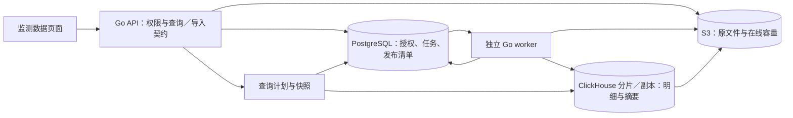

# 监测数据基础闭环详细开发方案（V1.0）

日期：2026-11-12。文档状态：**Awaiting acceptance（方案已整理并完成文档自检，待用户审阅）**。功能状态：**In progress（尚未开始实现）**。本轮交付的是开发方案；没有执行代码开发、数据库迁移、集群部署或规模压测。

需求基线见[总体方案](monitoring-data-foundation-plan.md)。本文保留已确认业务规则、完整开发约定和实施前置验证条件；尚未开始功能实现。

## 1. 执行依据与交付目标

### 1.1 怎样使用本文

本文把已确认需求收敛成可以拆分开发、编写契约、验证和验收的完整方案。后续实施以本文的范围、规则编号、接口职责和验收矩阵为执行依据；早期文档中的“下一步讨论”不再作为另一套并行方案。

- **用户已确认的业务约束**：测点优先、多测点比较、永久原始数据、全部历史在线、可扩展集群，以及总体方案中的存储、查询和统计规则。
- **本文给出的开发约定**：权限细分、物理布局、精度边界、任务协议、默认查询预算、首期部署拓扑等，是为完成这些需求作出的具体设计。它们不是已经运行或已经压测的事实。
- **实施前置验证条件**：实际样本的时间与数值范围、对象存储实现、软件精确版本、参考硬件及容量／性能结果。第 23–25 节定义验证方式；不得用“以后优化”跳过正确性条件。

本方案只覆盖本轮交付。实施按小步完成，每一步有独立检查；全部范围自验通过才进入功能 Awaiting acceptance，用户明确验收后才记为 Accepted。技术验证未通过时修订方案，不同时实现多套数据库来回避选型。

### 1.2 用户最终看到什么

进入租户或项目的“监测数据”，从设施／构件定位到测点，在展示区选择通道。可以把一个孔内多个深度的温度曲线放在同一张图上；也可以查看单个通道明细、全历史起止与数量、逐通道数学统计，以及按日／月／年的统计表。

拖动图表到过去的时间才加载对应数据；放大后逐步看到更细的数据直至原始观测。导入历史文件后先看到校验和重复核对结果；合格批次统一生效。撤销批次后曲线和统计按同一生效集合更新，原文件和原观测继续保留。大导出在后台执行，页面可离开后回来下载。

### 1.3 本轮范围

| 编号 | 必须交付 | 完成边界 |
| --- | --- | --- |
| MD-01 | 统一观测、精度和质量模型 | 整数／小数／枚举；来源、批次、观测时间、质量、不可变原始依据；与现有通道语义衔接。 |
| MD-02 | 永久明细与集群存储 | PostgreSQL 控制元数据、ClickHouse 原始明细／摘要、S3 兼容在线容量层；分片、副本、恢复和扩容路径。 |
| MD-03 | CSV／XLSX 历史导入 | 标准模板、上传与映射、流式校验、整批发布、错误报告、重复核对、幂等和中断恢复。 |
| MD-04 | 补录与批次撤销 | 任意历史时段补录；整批撤销；保留依据；受影响摘要重算；显式重新采用已撤销观测。 |
| MD-05 | 统一查询 | 最新值、全历史概况、原始明细游标、按视窗趋势、质量筛选、查询快照及失败语义。 |
| MD-06 | 基础统计 | 三类数量、逐通道起止／极值／均值／总体标准差；枚举计数；日／月／年统计。 |
| MD-07 | 数据浏览界面 | 测点选择、通道叠加、多测点比较、时间分块加载、明细、统计、导入／撤销／任务交互。 |
| MD-08 | 权限与后台导出 | 数据读／导入／撤销／导出等独立权限；项目通道和时间授权；CSV／Parquet 后台导出。 |
| MD-09 | 运维与可观测性 | 持久任务、对账、备份恢复、在线分层、分片迁移、容量指标、统一 CLI 入口。 |
| MD-10 | 验证与交付材料 | 真实组件集成测试、故障测试、分级规模验证、操作手册、人工验收案例和证据。 |

本轮不实现：设备协议执行、实时设备连接、波形／频谱等高频块数据、逐条在线改值及复杂版本编辑、空间温度剖面、自动插值／科研计算、告警执行、报告／大屏编辑器、业务额度和计费。保留接口演进空间不等于创建这些功能的空实现。越界“可疑”只参与数据质量处理，不新增告警系统。

## 2. 现有工程衔接与技术选择

### 2.1 当前代码基线

核对基线为当前 `main` 工作树。工作树已有其他任务修改，本方案不覆盖它们，不创建分支或 worktree。

| 现状 | 本轮衔接方式 |
| --- | --- |
| Go 1.27；foundation／platform／API／infrapro 四个模块 | 业务放在 platform；worker 作为 API 模块中的独立可执行程序，不增加无必要的新 Go 模块。 |
| PostgreSQL、pgx、Goose；Gin API；Redis | 沿用控制库、事务、HTTP 和已有缓存基础。Redis 只作可丢失缓存／加速，不作批次生效的唯一依据。 |
| React 19、TypeScript、TanStack Query／Router／Table、共享 UI | 增加监测数据功能目录及租户／项目路由，复用列表、抽屉、权限和请求基础设施。 |
| 设施 → 构件／测点 → 业务监测通道 | 复用稳定 ID 和现有位置字段；不新增“监测方案启用”前置流程。 |
| 通道固定指标版本、单位版本、方向、基准、时间含义 | 导入绑定通道的既定语义；历史人工数据不自动绑定当前设备输出。 |
| 指标值形态为 integer／decimal／enum | 首版只支持这三类；属性定义中的显示精度不充当监测数据存储精度。 |
| 既有项目资源授权与修订号 | 新增数据授权层，和资源授权相交；不得只检查导航入口或前端按钮。 |
| `runtime.Compose` 聚合资源／设备依赖 | 在此组装监测与资源引用检查；保留设备引用保护，不用新适配器覆盖旧适配器。 |

### 2.2 技术基线及作用

| 技术 | 在本轮的准确职责 | 选择理由与限制 |
| --- | --- | --- |
| PostgreSQL + pgx + Goose | 授权、批次、源文件清单、任务、发布清单、版本、水位、审计 | 需要短事务和唯一约束；不存放百亿级逐条观测或逐条任务。 |
| ClickHouse 开源自托管，26.8 LTS 系列作为验证起点 | 类型化原始观测、不可变摘要、按通道／时间裁剪读取 | 适合列式扫描和跨通道统计；应用承担发布、撤销及精确可见性，不依赖全局事务或最终去重。 |
| ClickHouse Keeper + ReplicatedMergeTree | 分片内复制与协调 | 分片扩容量，副本保可用性；两者分开配置。 |
| S3 兼容对象存储 | 原始文件、清单／错误报告、在线历史数据磁盘、导出和备份的独立命名空间 | 历史持续在线；原文件与数据库底层对象有不同生命周期。具体服务产品须通过契约验证。 |
| Go worker + PostgreSQL 持久队列 | 校验、发布准备、摘要、导出、对账、迁移 | 首版不引入 Kafka／Flink／Spark；任务按块处理，水平增加 worker。未来协议高频接入再单独评估消息流。 |
| 官方 ClickHouse Go 驱动、S3 Go 客户端、Excelize | 批量读写、对象操作、XLSX 读取 | 各依赖锁精确版本；超时、取消、内存和错误处理有组件测试。 |
| Go `encoding/csv`、`math/big`；Apache Arrow Go／Parquet | CSV、十进制精确摘要、后台列式导出 | 不经过 JavaScript 浮点数保存原值；Parquet 明确纳秒和十进制格式。 |
| Apache ECharts Canvas + 自建视窗控制器 | 有界曲线和枚举事件绘图 | 图表负责显示；分块取数、权限缓存、取消及精度切换由应用负责。 |

这些是本方案的单一路线。IoTDB 是选型验证失败后的对照备选，不进入首版的双引擎运行架构。ClickHouse Cloud 的 SharedMergeTree、云弹性或商业产品能力不作为自托管承诺。

实施 S-01 时冻结 ClickHouse 的精确 patch、镜像 digest、Go／前端依赖版本及对象存储服务版本，保存锁定清单。不使用 `latest`，也不把“26.8 LTS”当作已经验证的安装版本。

## 3. 端到端结构



浏览器只访问业务 API，不获得数据库连接或对象存储管理凭据。API 从当前权限生成受限查询计划，从已发布清单选择完整数据；worker 写入的数据准备完成前不参与业务查询。发布清单是“采用哪些数据”的依据，ClickHouse 中有物理行不等于已经生效。

所有原始数据都保留完整精度。近期常访问的数据库 part 可以在本地 SSD，较老 part 放在始终在线的对象存储磁盘；通过相同接口访问。分层只迁移物理位置，不删除原始明细，不只留均值，也不要求人工解冻。

## 4. 观测、时间、数值和质量契约

### 4.1 身份与业务唯一性

**D-01**：一条观测是一个通道的一次结果。宽表一行五个通道须规范化成五条观测。副本、摘要、重试、被确认重复的来源行不增加观测数。

**D-02**：观测具有稳定 `observation_id`，独立于名称、文件名、上传次数和物理存储位置。来源记录由 `source_file_id + sheet/line/cell + mapping_revision` 定位；可信来源 ID 只在明确命名空间和不可变载荷契约下使用。名称相同或文件哈希相同不自动证明是同一次业务导入。

本轮 CSV／XLSX 的可选 `source_record_id` 默认仅作来源参考，不因文件有这一列就认定为可信全局身份；跨文件仍按 C-04 核对。首版自动幂等依靠已封存文件位置、映射版本、载荷及操作收据。未来协议来源的可信事件命名空间不在本轮接入范围。

**D-03**：首版同一通道、同一规范化观测时刻只允许一条当前采用的观测。新数据同时间不同值阻止发布；同值但身份不明确进入核对。若确为两次独立观测却无法从来源区分时刻，维持阻塞，补充真实时间精度或修正通道映射；不得伪造时间、自动合并、自动采用较新值。

同一请求重放已确认的同一来源／解析版本／载荷可直接返回既有收据，这是操作幂等，不代替跨文件的重复核对。被认定为同一可信来源身份却携带不同载荷为冲突。

身份生成由服务端执行：首次新观测使用固定批次命名空间、稳定源位置与映射版本生成 UUID，块切分／物理重试不改变它；确认重复或再次采用则复用已核对目标身份。每个采用再有独立 UUID，每个逻辑块内部有从零开始的稳定 `row_ordinal UInt64`。规范载荷摘要使用带版本／类型／长度边界的编码后计算 SHA-256，不能直接拼接字符串；发现同身份不同载荷必须比较实际规范字段并阻止发布。客户端不能指定“首次采用”标记或覆盖已有身份。

**D-04**：原始观测不可覆盖。采用、撤销、再次采用是独立的生效记录；再次采用相同原始观测复用 `observation_id`，新增生效记录而不新增累计唯一数。若值、时刻、通道或语义发生改变，形成新观测，并保留更正依据。首版不提供任意逐条改值 API。

### 4.2 字段与保真边界

| 字段组 | 必须保存的内容 |
| --- | --- |
| 身份 | 租户、稳定通道、观测 ID、采用 ID、首次采用标记。 |
| 时间 | UTC 观测时刻、来源时区／偏移、来源精度、接收时刻；区间型的显式区间起止。 |
| 值 | integer／decimal／enum 类型化值；原始文本或可定位原文件的依据；不以格式化显示值替代原值。 |
| 语义 | 通道语义摘要及所引用的指标／单位版本、时间含义；既有语义不可随显示名称改写。 |
| 质量 | 来源质量原文、规范化来源质量、规则质量、最终质量、质量原因、校验规则版本。 |
| 来源 | 批次、文件、行／列／工作表、可信来源 ID（如有）、解析／映射版本、校验和。 |
| 处理 | 首次发布序号、采用批次、撤销记录关联；物理块／尝试标识用于内部精确读取。 |

开发精度约定：时间使用 `DateTime64(9, 'UTC')`，不因 1 Hz 假设截断到秒；本轮接收 `1900-01-01T00:00:00Z` 至 `2262-04-11T23:47:16.854775807Z`（含端点）。实施用冻结版本验证端点和往返，不接受数据库越界回绕。整数使用 Int64；小数使用 Decimal128(12)，最多 26 位整数与 12 位小数。超出表示范围的输入是 C-05 校验错误，原文件保留，不截断、不舍入后发布。真实样本不满足时，先修订类型与导出契约再实施，不能让开发人员临时转为 Float64。

API 中计数、64 位整数、十进制原值、修订号用十进制字符串；时刻用带 `Z` 或偏移的 RFC 3339 纳秒字符串。图表坐标可用 Float64 近似显示，但原值提示、表格、导出保留规范化字符串；显示小数位只影响展示。

PostgreSQL 中涉及观测边界的授权、块范围、dirty 窗口和索引使用 UTC 纳秒 `bigint`／`int8range` 及明确无界端点，不能经过只保留微秒的 timestamptz 截断。任务创建／审计时间可沿用现有 timestamptz。Go、JSON、CH、游标和 Parquet 的同一边界必须端到端保留 9 位小数秒。

### 4.3 时间与区间

**D-05**：查询区间统一 `[from, to)`。按观测时刻排序，接收时间只用于追溯；“最新”不等于最后上传。内部统一 UTC，默认显示时区 Asia/Shanghai，可切换 IANA 时区。日／月／年统计按所选时区的自然日历分组，不能把一年固定成 365 天或一天固定成 24 小时处理所有时区。

无偏移的时间必须在导入配置中选择来源时区；歧义或不存在的夏令时时刻要求显式偏移，不能默默猜测。CSV 模板默认 ISO 时间，其他格式必须选择具体解析格式；禁止自动尝试多个歧义格式。Excel 日期处理见第 7 节。

`observation_time` 按瞬时点处理。`interval_end` 必须提供明确 `interval_start`，或在本次映射中指定固定持续时间并保存版本；自由文本 `aggregation_description` 不能被解释为计算规则。结束时间用于列表和曲线定位；区间必须正长。项目读取区间型观测要求完整区间被授权范围覆盖，不能用只获准的结束时刻泄露跨界结果。日历分组归入结束时刻所在组，界面显示该口径；首版不拆分区间值，不计算加权平均或累计量。

### 4.4 质量与指标边界

**D-06**：有效质量为 `good`、`unmarked`、`suspect`、`bad`。无来源标记为 unmarked；无法识别的非空质量代码是映射错误。默认筛选 `good + unmarked`，曲线、明细和数学统计共享这一条件。

| 来源质量 | 数值未越界 | 数值超指标上下限 |
| --- | --- | --- |
| good | good | suspect |
| unmarked | unmarked | suspect |
| suspect | suspect | suspect，增加越界原因 |
| bad | bad | bad，增加越界原因；不降级成 suspect |

上下界按包含边界处理，`x < min` 或 `x > max` 才越界；没有配置的界不推断。校验快照以已发布指标版本持久化正文中的十进制数值为依据，用保留数值 token 的读取方式解析为精确十进制，不将现有 Go `float64` 字段中转后用于边界比较。若既有版本在发布前已经丢失额外精度，只能按已保存的定义解释，不能猜测原输入或回写旧版本；S-01 对真实边界和新建高精度指标的需求单独验证。

真实零值正常保留；空值、NaN／Infinity、类型不匹配、未知枚举、单位不匹配不能当零。首版单位须与通道单位版本一致，不做隐式换算。枚举保留稳定键，标签只作展示。质量规则不会追溯自动改变已发布历史；更正历史使用批次撤销／重新导入，不暗中刷新旧质量。

## 5. 元数据、明细、清单与摘要布局

### 5.1 PostgreSQL 表职责

以下为逻辑表及关键约束，实施迁移按项目命名规范落地。除审计外不为每条观测创建 PostgreSQL 行。

| 表 | 关键内容与约束 |
| --- | --- |
| `monitoring_source_files` | tenant、object_key、sha256、size、原名、上传者、完整性、接收时间；完整文件只读，物理对象不可覆盖。 |
| `monitoring_import_batches` | 租户／来源项目、状态、revision、源文件、映射版本、阶段计数、报告指针、发布／撤销收据；一个批次最多首次发布一次。 |
| `monitoring_import_mappings` | 不可变解析版本、时区、列映射、通道映射、单位、质量映射、区间规则及 hash。 |
| `monitoring_batch_resolutions` | 对完整冲突集合的处理决定、preview_hash、操作者、理由、目标版本、明细对象指针；不保存数十亿逐行决定。 |
| `monitoring_chunks` | logical_chunk_id、batch、mapping_revision、租户／逻辑分片／月份、时间范围、行数、payload hash、源定位清单；通常每块 10 万–100 万观测。 |
| `monitoring_write_attempts` | chunk_id、attempt_id、lease fence、目标分片／路由、sealed 状态、验证摘要、副本就绪信息；每块只有一个被发布选中的 attempt。 |
| `monitoring_publications` | batch、连续提交序号、清单 hash、commit_at、撤销序号／原因；唯一 batch，发布与撤销均留审计。 |
| `monitoring_publication_chunks` | publication → chunk → selected attempt；记录采用数、首次采用数、质量计数和范围；发布后不可原地改选 attempt。 |
| `monitoring_channel_versions` | tenant/channel、内容修订、撤销修订、摘要水位；并发冲突协调和局部失效。 |
| `monitoring_summary_heads` | tenant/channel/level 的已完成摘要树根、水位及修订；窗口节点放列式存储／不可变清单，不能为所有分钟桶建立 PG 行或在一行堆无限 JSON。 |
| `monitoring_data_grants` | project、资源授权 ID、channel、时间范围、能力、revision、撤销信息；租户治理。 |
| `monitoring_jobs` / `monitoring_job_steps` | 任务状态、输入 hash、优先级、进度、租约、fence、重试及错误；只按块／阶段建立步骤。 |
| `monitoring_exports` | 查询快照、权限修订、格式、结果清单、校验和、过期时间、撤销状态。 |
| `monitoring_routes` / `monitoring_relocations` | 固定逻辑分片到物理分片的版本映射、迁移清单及切换状态。 |
| `monitoring_receipts` | scope + actor + operation + request_id 唯一；请求 hash、防重结果、关联业务对象。 |

所有跨表关系包含 tenant 校验；跨租户 FK／查询错误必须被数据库约束或业务事务拒绝。任务、批次、清单和授权按常用 tenant/status/time 建索引；不能建立 `(channel, time)` 的百亿行 PostgreSQL 去重表。

### 5.2 ClickHouse 表

原始表 `monitoring_observations_local` 使用 ReplicatedMergeTree，按 UTC 观测月份分区，首版排序键 `(tenant_id, channel_id, observed_at, observation_id, adoption_id)`。分区不得按通道或批次创建。分区粒度、压缩和稀疏索引在 S-01／S-08 用真实分布验证，不能只凭空表推断。

关键列：tenant/channel/observation/adoption/batch/chunk/attempt 的 UUID 身份、`row_ordinal UInt64`、`observed_at DateTime64(9, 'UTC')`、可空区间起点、值种类、可空 Int64／Decimal128(12)／枚举键、质量和原因、来源定位、首次采用标记、语义与映射版本。只有值种类对应的一列非空；导入和读回核验双重检查。每行携带的身份和来源开销必须纳入实测字节数。

表中物理行表示一次采用的不可变存储载荷。同一原始观测再次采用可形成新的采用载荷，但共享 `observation_id`；累计唯一数只计首次采用。原始身份索引及首次采用依据永不因撤销被删除。放弃的写入 attempt 不对外可见，属于可回收的工作副本；回收前确保原文件／规范化暂存和历史生效依据均完整。

另建：

- `monitoring_chunk_channel_index`：块内通道、时间／身份范围和摘要，裁剪清单和冲突核对；不可见块不得进入有效索引头。
- `monitoring_summary_contributions`：按采用批次／块、通道、窗口、质量保存可重建的贡献。
- `monitoring_summary_versions`：已合成的分层摘要，包含版本、覆盖水位、精确计数／数值状态、极值真实时刻和覆盖信息。

摘要、索引也采用“先完整写入、验证、再切换指针”，不把后台合并完成作为正确性的前置条件。可以提供 Distributed 表供内部诊断，但业务查询由路由器明确选择就绪分片／副本，禁止 `skip_unavailable_shards` 式静默缺数。所有业务 SQL 都必须附带当前选中 attempt／摘要版本过滤。

### 5.3 对象布局与保留

对象命名使用 tenant + 类型 + 不可变 ID，不能用用户文件名作路径。分别管理原文件、规范化暂存、核对／错误报告、清单快照、数据库磁盘对象、导出、独立备份；最小权限凭据相互分离。

| 内容 | 生命周期 |
| --- | --- |
| 已完成上传的原文件、发布依据、撤销与重复核对依据 | 永久保存，包括失败／取消批次的原始依据；不因无新增数据删除。 |
| 已采用原始观测及其历史生效依据 | 永久保留；转冷、撤销、退役均不删除。 |
| 摘要／缓存 | 可重建；替换后按快照保留期安全回收。 |
| 未完成上传分片、从未生效的废弃写尝试 | 默认 7 天清理；有运行任务、引用或待调查标记则保留。完整源文件不适用此 TTL。 |
| 导出结果 | 默认 7 天，允许重新申请；过期的是结果文件，不是监测数据。 |
| 备份 | 按恢复策略独立管理，不能把当前副本称为备份。 |

S3 生命周期不得把在线原始明细移到需要人工恢复的存储类型。ClickHouse 原生磁盘对象不是一套可随意修改的外部 Parquet 文件；本地磁盘元数据、库表定义和对象数据一并纳入恢复。对象存储自身的冗余不替代数据库副本及独立备份。

不同 CH 副本使用独立受控前缀，不能让独立实例共同管理同一可写目录。永久保留的是逻辑原始观测和依据；MergeTree 正常合并后可以回收已被替代的物理 part。不可把原文件的不可变保留策略直接套到活跃数据库 part 前缀，阻止数据库正常合并／维护。

## 6. 整批生效、幂等与并发协议

### 6.1 必须成立的不变量

**D-07**：批次要么全部实际采用记录可查询，要么一条也不生效。已确认忽略的重复行从待采用集合剔除；其他错误不允许“先导入正确部分”。

**D-08**：业务读取只使用 PostgreSQL 已提交的发布清单。尚未发布、失败、放弃、重复尝试的物理数据不参与任何数量／曲线／数学统计。

**D-09**：同一逻辑块只选一个已封存且验证完成的 attempt；同一 attempt 内也必须证明无重复物理行。ClickHouse 去重窗口、ReplacingMergeTree 和 `FINAL` 不承担永久业务唯一性。

**D-10**：查询期间所选原始载荷必须存在且在读副本完整可用。部分分片失败或落后不能伪装成空数据；等待、转就绪副本或明确失败。

### 6.2 发布流程

1. 完整接收源文件，校验大小与 SHA-256 后封存；生成不可变映射版本。
2. 流式解析并外部排序，产生规范化候选和按通道／时间的索引。校验全部内容，输出结构错误、质量计数、重复／冲突集合。
3. 取得相关通道内容修订向量，与当前及保留历史候选核对。人工确认同值重复后固化忽略清单。所有 C-02／C-05 问题归零才能进入 ready。
4. 准备实际采用记录、稳定观测 ID／采用 ID、规范化 payload hash。按租户／逻辑分片／月份切逻辑块；块边界固定，重试不能改变身份。
5. worker 每次物理写入分配全新 attempt_id。直接写对应分片本地表，等待明确完成；配置所需副本确认。超时或连接丢失且结果不确定时，封禁该 attempt，不继续对同一 attempt 盲重放，另建新 attempt。
6. 逐块检查总行数、唯一 ordinal 数、预期身份／载荷摘要及质量计数；验证选用副本具备完整数据。只有确认写入结束、不会再有在途重放的 attempt 才能 sealed。所有块及贡献摘要均通过后，形成不可变发布清单。
7. 开启 PostgreSQL 短事务，先按既有 scope／授权事务的全局顺序取得授权修订锁，再按通道 ID 固定顺序锁版本行，最后锁发布序号行；再次检查租约 fence、批次 revision、当前操作权限、通道语义／状态、重复确认目标及步骤 3 的内容修订。撤权与发布必须在共同修订锁上串行化，不能只在事务外做一次权限检查。任何变化都回到核对，事务中不执行长时间 ClickHouse 扫描。
8. 在短事务中分配租户提交序号，写发布及块选择、数量变化、摘要 dirty 范围、审计／收据和后续任务，更新通道内容修订，再提交。批次统一进入 published。序号只表示已提交发布，不用“预分配最大序号”充当可见水位。
9. 启动分层摘要合成；未完成部分按第 11–13 节回退或返回计算中。客户端依据新版本刷新，不把未重建摘要当作最新结果。

检查 count 与 hash 不是数据库事务的替代品；确定写入已结束、attempt 不再允许写入、清单选择唯一、读取副本就绪四者都需要满足。写客户端关闭隐式重试；若驱动或代理不能保证，则把该链路的重放行为纳入故障测试，不能直接上线。

### 6.3 清单查询与规模

一次查询先从 PostgreSQL 获取已提交发布水位及对应清单根，再按逻辑分片、月份、通道／时段索引裁剪。将选中的 `(chunk_id, attempt_id)` 作为有界外部表或参数传给**每个实际执行的分片查询**。内部临时表不能跨连接假定存在；所有动态内容参数化。

空清单直接表示空集合；清单读取或传输失败必须终止查询，绝不能省略过滤条件。清单量超交互预算时使用服务端已封存索引／后台任务，不放大为无边界 SQL 参数。

大量历史清单使用不可变分层索引和检查点；PostgreSQL 只保存根、粗范围和控制状态。典型块为 10 万–100 万条，百亿条对应约 1 万–10 万个满块，实际小文件会增加块数，必须实测并合并批量写入。一个逻辑块可包含同租户／逻辑分片／月份的多个通道，不为每通道每秒创建元数据。全历史概览读摘要树，不每次把全库清单传入明细查询。

请求期间固定清单根和路由版本；旧清单载荷在快照有效期内保留。后续压实可以生成新的物理布局并校验后切换清单，不能直接改写已发布选择。禁止普通业务路径绕过 Reader 直接查询原始表。

### 6.4 幂等与失败恢复

同 scope／actor／operation／request_id 且请求 hash 相同返回原收据；相同键不同正文返回冲突。持久任务以业务目标和版本唯一去重。PG 提交成功但响应丢失时查询收据，不能再发布一次；PG 提交失败则数据继续不可见。

旧 worker 租约失效后，即使迟到写入完成也无法发布：所有状态切换检查单调 fence。重启后从持久步骤恢复，核对对象、块、attempt 和收据；“任务显示成功”不能代替发布记录。补录、重试、导出及迁移分别有任务身份，不复用文件名去重。

跨存储没有宣称分布式 ACID：**先耐久准备数据，再用控制库原子选择可见集合**。ClickHouse 的实际事务和重试去重边界见[官方事务说明](https://clickhouse.com/docs/concepts/features/operations/insert/transactions)与[重试去重说明](https://clickhouse.com/docs/concepts/features/operations/insert/deduplicating-inserts-on-retries)。

## 7. 历史文件导入

### 7.1 首版模板与映射

一个完整文件对应一个导入批次。浏览器可选择多个文件，形成多个独立批次并明确显示；多选文件不宣称整体事务。批量历史迁移工具使用同一导入服务与规则，不能绕过核对直接 INSERT。

| 模板／模式 | 列与处理 |
| --- | --- |
| 标准长表 | `channel_key, observed_at, value` 必填；`unit, quality, source_record_id, interval_start` 按映射或通道语义补充。一个结果一行。 |
| 单通道文件 | 在导入配置选定通道，文件至少 `observed_at, value`；其他列同上。 |
| 时间＋多个通道值列的宽表 | 选择一个时间列，为每个值列明确映射到一个通道；按单元格生成观测。首版支持同一时间列，不提供任意公式或脚本 ETL。 |

`channel_key` 是本次导入映射中的可读别名，最终绑定稳定通道 ID；名称歧义必须人工选择。列映射、工作表、表头行、编码、分隔符、时区、质量字典和区间规则形成不可变版本。改变映射须重新全量校验，旧核对确认失效。

CSV 默认 UTF-8（接受 BOM）和逗号分隔，可显式选择系统支持的编码／分隔符。数字小数点为 `.`，不自动删除千位符或按地区猜值；科学计数法可以精确展开，仍受存储范围限制。空行可跳过并计数；缺字段的业务行按 C-05 报错。宽表空值格只能在映射中明确选择“没有这次观测”，其数量单独列出；默认作为缺值错误，不能悄悄漏掉数据。

XLSX 只读取用户选定的工作表，预览工作表名称及维度。数值型 Excel 日期根据工作簿的 1900／1904 日期系统转换，保留转换依据；无效日期、Excel 虚构的 1900-02-29 等拒绝。已有 Excel 数字精度损失无法恢复；长整数和高精度小数模板要求文本单元格，不能宣传读回了文件写入前的精度。

首版不执行公式、不接受公式缓存作为原始值。先用有界 ZIP/XML 扫描目标工作表中的公式及共享／数组公式范围，再流式读行；发现业务映射区域公式则报错。不得逐格 `GetCellFormula` 后声称整个流程仍保持流式内存。禁止宏／外部链接求值；设置压缩展开、单行／单元格大小和临时盘上限，超限返回可定位错误。

### 7.2 上传、预览与校验

上传使用独立流式路径，默认 32 MiB 分片，支持断点续传与每片校验。服务端完成对象合并及完整哈希验证后才能进入 received；现有管理 JSON 的 256 KiB 限制不适用于文件流。源文件名仅作显示并转义，不进入磁盘路径。

页面预览有界样本，只帮助配置映射，不能将“前 100 行通过”作为全量通过。全量校验在后台读取全部映射区域，报告总解析行／候选观测／空行／缺值格／错误／越界／待核对／忽略／拟新增数量，计数对象明确。错误详情分页，完整错误报告后台生成。

默认技术保护值由配置统一管理：同时上传 3 个文件、CSV 32 GiB／XLSX 压缩文件 512 MiB、展开暂存 8 GiB；S-01 依据实际文件和硬件调整并在界面显示。它们是单任务资源保护，不是租户用量额度。超出时可使用经过同样验证的分片文件／后台迁移入口，不能部分导入后才报错。

### 7.3 状态与操作

| 状态 | 可用动作及进入条件 |
| --- | --- |
| uploading | 续传／取消；文件未封存，不可校验或发布。 |
| received / validating | 配置映射／启动校验；校验中可取消。 |
| needs_resolution | 有错误或重复冲突；查看问题、改映射、确认重复、提交修正文件。 |
| ready | 全量校验通过且问题已处理；显示拟采用数、忽略数及时间覆盖，可提交生效。 |
| preparing | 写入并验证所有块；不可编辑映射；取消请求与发布提交互斥。 |
| published | 全部实际采用数据生效；查看收据、来源、申请整批撤销。 |
| completed_noop | 全部候选已确认重复，无新增；保留来源与收据，不制造空发布。 |
| failed | 技术失败；保留阶段及错误；按可重试分类重试，不复用不确定 attempt。 |
| cancelled | 从未生效；保留已封存来源与处理历史，可创建关联的新尝试。 |
| revoked | 已发布后整批撤销；原始依据保留，不能通过简单改状态复活。 |

修正文件产生新源文件／关联批次，保留前一个失败版本；同一文件改映射产生新映射 revision。请求与任务均带预期 revision，旧页面提交返回 409 并保留输入，不覆盖新处理结果。

### 7.4 重复与冲突处理

**D-11**：跨文件同通道、同时间、同值且身份不明，先拦截，只有确认是同一次观测后才忽略新记录。确认记录包含新来源位置、目标 observation_id、载荷摘要、操作者、时间、理由和核对版本；相同值但不同质量的确认不改变原观测质量。

大批核对可按通道、时间和相同来源特征分组确认，但作用于服务端生成的**完整固定集合**，不只当前一页，也不自动包含后来新增问题。确认前显示数量、范围及抽样依据；preview_hash 或目标状态变化必须重新核对。

同时间不同值的首版处理出口只有：修正新文件／映射；放弃新批次；或有权限者先撤销错误的旧批次，再完整导入修正数据。不能把不同值标为“同值重复”跳过，也不提供“自动保留最后上传值”。如果撤销旧批次会影响其他正确记录，先在影响预览中明确，后续新批次须重新包含应保留的记录。

批次内部重复也核对：同一规范化来源位置的技术重放幂等；不同来源行的同时间同值需确认重复；不同值阻塞。确认后保留一个明确的代表观测，其余形成来源关联。确认为独立事件但不能区分业务时刻的，按 D-03 继续阻塞。

## 8. 补录、撤销与再次采用

**D-12**：允许在任何历史时段补录，不设置“超出迟到窗口就丢弃”的业务规则。补录仍经过全部校验、重复核对和整批发布，不把旧数据当作最新观测。

撤销先生成固定影响预览：实际采用数、涉及通道／时间、质量数量、会失效的摘要范围、进行中的导出／查询影响，以及哪些重复来源不会恢复。需要撤销权限、全部实际采用记录的范围权限和理由；确认时校验 preview_hash、批次 revision 和当前授权。

撤销事务标记该 publication 不再在用，更新有关通道撤销修订，产生 dirty 窗口和任务，保存收据与审计；不删除 CH 原始载荷或对象文件。已经只读的历史信息继续可按历史权限查询。已撤销批次重复撤销返回原收据。

**D-13**：撤销只影响本批次实际采用的数据。A 有 100 条，B 忽略 A 的 80 条重复并新增 20 条，则撤销 B 只减少 20；撤销 A 后 B 的 80 条忽略记录不会自动成为生效观测。

再次采用通过新批次明确执行：选择保留原文件／原批次作为来源，显示“重新采用已撤销观测”，重新校验当前权限、通道语义和冲突；复用原始 observation_id，新增 adoption_id。完全相同的原始观测累计唯一数不变；更正后的新值形成新身份。新批次不自动恢复旧批次内所有记录。首版仍以整批采用／整批撤销为维护单位，不做任意单点编辑。

通道及祖先退役后允许有权限者查看历史；补录或再次采用需显式提示资源退役并按既有资源写入规则处理，不越过停用状态。已有观测引用使通道及所依赖语义不可物理删除。撤销全部数据也不解除永久来源引用。

## 9. 租户／项目权限

### 9.1 权限键与操作

新增权限族，最终键名随当前权限目录生成流程冻结，不能手工只改前端常量。建议键如下，租户和项目分别注册，项目入口不回退到租户管理员权限。

| 后缀（前缀 `tenant.monitoring` / `project.monitoring`） | 能力 |
| --- | --- |
| `data.read` | 当前数据概况、最新、趋势、明细、基础统计；必须同时有可见通道。 |
| `data.history.read` | 已撤销观测／采用历史；不自动授予导入管理或完整源文件下载。 |
| `data.export` | 对获准读取集合创建导出及下载自己的有效结果；需要 data.read。 |
| `imports.read` | 导入批次、校验和核对处理信息；返回范围裁剪后的内容。 |
| `imports.manage` | 上传、映射、校验、重复确认、提交生效、取消、重试；需要 imports.read 和覆盖范围的维护授权。 |
| `batches.revoke` | 预览／撤销完整批次；需要相应批次可见与维护范围。 |
| `source.read` | 下载完整原始文件；另外检查全文件范围，不从 data.read 推导。 |
| 租户专有 `authorization.read` / `authorization.manage` | 查看／配置项目数据通道、时间和能力授权。 |

租户内仍检查活动账号、成员、租户及对应操作权限。系统内置管理员角色按现有目录升级机制增加必要权限，已有自定义角色不自动增加新能力；迁移用例必须验证这一区别。

### 9.2 项目数据范围

**D-14**：项目有效范围 = 当前项目成员操作权限 ∩ 有效设施关联／通道资源授权 ∩ 数据授权的通道与时间 ∩ 当前生命周期限制。资源档案可读不能推导监测数据可读。

数据授权逐通道绑定既有 resource_grant_id，配置 `read / export / import / revoke / history / source` 能力和时间范围。支持明确选择全部历史或有界 `[from,to)`；未配置默认为没有数据权限，不用项目创建日、成员加入日或设施绑定日猜起点。多条时间授权取规范化并集，不重复计数；无界端点在 UI 中明确显示。

资源授权被撤销后对应数据授权立即无效。将来新建资源授权不会自动复活旧数据授权，需重新授予。项目维护共享数据必须由租户明确授权 import／revoke；项目不会因为创建过批次永久获得维护权。项目能撤销的批次必须**全部实际采用记录**均在当前维护范围内，不能对半个批次执行“部分撤销”。

项目归档后允许继续读取及导出当前获准数据，禁止新导入、发布、撤销和授权变更；导出是读取任务，仍检查当前权限。实现要按业务操作分类 `ProjectActiveOnly`，不能仅凭 HTTP POST 判为写操作。前端监测上下文也不能照搬 `ProjectResources.available` 中只允许 active 项目的条件而误屏蔽归档读取。

### 9.3 防止间接泄漏

所有数量、最早／最新、统计、边界邻点、搜索、图例、缓存、错误报告和任务结果都按相同范围过滤。只给部分时段时，跨授权边界的摘要桶不能直接使用，须裁剪重算；禁止用全租户最早时间或总数填充项目卡片。

完整原文件下载需 source.read，且文件的全部业务内容均被当前范围覆盖。包含其他通道、越界时段、无法解析／无法判定范围的行时，项目不能下载整个文件；可下载明确裁剪的错误报告或获准规范化数据。导入拥有者离开项目后不会保留下载资格。

请求开始、任务执行分块、发布提交、导出完成和每次下载都校验当前权限。长下载在服务端流式分块中继续校验修订，撤权后终止后续传输；已到达客户端的数据无法撤回。不要用长有效期直签 URL 绕过下载检查。切换工作空间或授权修订后清理前端缓存，迟到响应不得重新填入。

系统为已发布数据重建摘要可继续运行，这是派生维护任务；用户发起的导入发布／导出不能借旧任务越过撤权。租户停用按既有全局规则拒绝业务访问。

## 10. 查询快照、最新值与明细

### 10.1 统一查询描述

查询条件包含：工作空间、点／通道选择、时间范围、质量集合、时区、数据状态（默认当前在用）、值类型约束和查询种类。服务端先解析成稳定去重的通道集合及授权时间段，不信任客户端给出的 tenant／project 归属或“已授权”标记。

全历史使用显式 `all_history`，授权范围可有无界端点，查询计划以省略对应上下界谓词表示；不能构造“最大可表示时刻再加 1 纳秒”的溢出哨兵。有限范围须 from < to；超出存储域的日历边界在应用层裁剪，值类型和时区保持一致。

`selection_id` 表示在当前权限下解析出的集合及其 hash。全工作空间概览通过服务端分页／批量解析，不让浏览器提交几万个 ID，也不对每通道执行一次权限 SQL。改名不改变选择，新增通道不会悄悄加入已固定的比较／导出快照。

**D-15**：快照绑定 scope、actor、selection hash、过滤、提交水位、相关通道撤销修订、权限修订和路由版本。普通追加／补录可以继续使用旧水位分页；撤销使相关旧快照返回 `snapshot_stale`，客户端重新加载。快照不冻结权限，后续每次请求仍查当前资格。

交互快照默认 15 分钟，可在权限／撤销修订不变时续期；游标只在其快照内有效。后台导出使用单独受租约保护的清单引用，不能因为交互 TTL 到期释放在用载荷。存储迁移保留旧路由读取能力至所有引用释放或显式取消。

### 10.2 明细

稳定排序默认 `(observed_at DESC, channel_id DESC, observation_id DESC, adoption_id DESC)`；正向读取使用完整相反顺序。后续页用 keyset 条件和不透明签名游标，不使用大 OFFSET。并行分片读取各自有界候选，再按完整键归并截取；游标包含必要分片位置或统一边界，不能只记秒级时间。

默认每页 200，最大 1,000 条，支持跳到指定日期、前后翻页。返回 `has_more` 和 next/prev cursor；总数独立由概况／统计返回，不为每页做全表 COUNT。前端默认最多缓存 10 页，超出丢最远页，浏览器内存不随多年滚动无限增长。

显示真实时间、测点／通道、规范化值、单位、质量及原因；来源定位／处理历史按权限展开。默认只显示 good+unmarked；“全部质量”显式切换。无数据、过滤后为空、无权限、尚未加载、服务失败分别表示。

### 10.3 最新值与覆盖

每通道返回两组独立字段：所有当前在用观测的最早／最新覆盖；当前质量筛选下的最新观测和值。可能“最新有一条无效记录，最新可参与统计值更早”，不能合成一个含糊的最新时间。

全工作空间最早／最新是当前获准、当前在用观测的边界；累计唯一数包括已撤销记录，但不以该累计数的历史边界冒充当前覆盖。需要查看撤销历史时进入独立历史条件并标识，默认曲线不混入撤销数据。

## 11. 按视窗加载趋势

### 11.1 请求预算与分辨率

**D-16**：查询只覆盖当前可视时间块及少量预取。按显示像素和曲线数量选择分辨率，不以用户拖到十年就返回十年原始数组。任何有界响应都必须明确代表完整请求窗口，不能简单 `LIMIT N` 截掉后半段。

首版建议默认：最多 50 条比较曲线、全图最多 20,000 个返回绘图点、每条通常不超过 2,000 点；窄屏预算随宽度下降。50 是可配置的交互保护值，导出和全工作空间概况不受这个曲线数上限限制。实际孔若超过此数，保留选择并分页／分图，不静默漏掉曲线。

服务端以 `plot_width_px`、全图预算、通道数、观测密度估计目标桶宽，再选 raw／1 分钟／15 分钟／1 小时／UTC 日等摘要层或合并层。长期跨度使用分层树合并成更粗窗口，不为所有通道预先生成每秒空摘要。最高层保留全历史概况；枚举走自己的事件表达。

时间 tile 采用与分辨率绑定的固定边界及半开区间。客户端只请求缺块，最多预取左右各一个块，默认并发 3、LRU 总点数／字节双上限；快速拖动约 150 ms 合并请求，取消旧请求，依 request generation 丢弃过期响应。取消传递到服务端和数据库 query_id。

### 11.2 数值绘制

粗桶保留实际首点、最小值点、最大值点、末点，按真实时间排序且按 observation_id 去重；可画真实极值点或 min/max 包络，并标注摘要粒度。均值曲线如显示必须单独标为均值，不能代替原始趋势。缩放至原始分辨率后 tooltip 对应真实观测。

边界邻点只在获准范围内获取，用于连接当前窗口边缘，不计入窗口统计。存在明确缺口或质量被排除的区段时断开；不能因抽样把无效段两端直接连成“连续正常”。大量缺口超过预算时返回覆盖／不连续标志，在粗图使用区间包络或缺口提示，放大再读取边界。

周期采样只有在明确的采样计划覆盖时段内才推算缺测，不能拿今天的 interval_seconds 回推多年应采数量。没有计划的 manual／event 只展示实际观测间隔，不编造缺测率。自动缺口判断规则及来源显示在图例说明中。

### 11.3 比较与枚举

同指标版本语义、同单位、时间含义兼容的通道默认同轴比较；方向／参考基准不同的显示差异提示并默认分组。不同量纲用时间轴对齐的分图，首版不引入双纵轴和隐式单位转换。所有曲线按真实时间绘制，采样不同不强行对齐、补零或插值。

图例为“测点／深度等位置摘要 · 通道／指标 · 单位”，颜色和线型随稳定通道 ID 保持。孔与深度复用已有工程对象／位置数据，不增加钻孔模型或深度剖面功能。

枚举显示事件点或采样状态标记，默认不把某次状态无限持续到下一次观测。粗视窗用各状态计数及发生范围，放大查看事件；没有业务定义的持续时间不能被推断为占比时长。

### 11.4 响应与错误

每个 tile 返回请求范围、实际分辨率、质量条件、快照、计数、覆盖状态、是否摘要及真实点定位。必要分片不可用时该 tile 明确失败，已有其他 tile 可以保留并标出失败区域；不能把不完整窗口显示为成功，也不能把未加载画成缺测。

浏览历史时后台新数据只显示“有新数据”，不把视窗拉回最新。提供“返回最新”、日期跳转、键盘可操作的时间范围控件；无需只能拖动才能访问历史。

## 12. 统计口径与精确计算

### 12.1 三类数量

**D-17**：全历史数量、当前窗口数量分别按范围计算，但各数量本身的定义固定。

| 展示名／字段 | 定义 |
| --- | --- |
| 累计唯一入库数 `ever_published_count` | 在当前获准通道／时间范围中，曾成功采用过的唯一 observation_id 数，包括已撤销；不包括失败候选、忽略重复、数据库副本、重试及摘要。再次采用同一观测不增加。 |
| 当前在用数 `active_count` | 当前已发布且未撤销的观测，包含所有质量；不随质量筛选改变。 |
| 本次统计样本数 `sample_count` | 当前在用且满足质量、时间、通道和数值条件的观测；与曲线／明细的统一筛选对应。 |

累计唯一数的全历史值只随首次采用增加；切换授权范围、时间窗口或通道集合后当然可能减少。界面不能把这些范围变化错误描述为数据库丢数。项目数值始终限于授权，不泄露其他项目共享数据范围。

### 12.2 数学与枚举统计

| 数据类型 | 首版指标 |
| --- | --- |
| integer／decimal | N、最早／最新采样时刻、首末值、最小／最大值及发生时刻、算术平均、总体标准差。 |
| enum | N、最早／最新、各状态计数及占已选样本比例；不对枚举编码求均值／标准差，不声称时长占比。 |

数学统计默认**逐通道**，多个通道样本不混为一条平均曲线。跨通道概况可合计条数和覆盖范围，但不把不同量纲、不同频率的数值混算。极值相同时返回最早发生时刻及并列数；展示“另有 N 次相同极值”，不任意返回一个日期。

**D-18**：总体标准差采用 N 分母：`sqrt(Σ(x - mean)² / N)`。N=0 时 mean/min/max/stddev 为 null、时间为空；N=1 时标准差为 0。不使用 N−1，不把样本标准差同名替换，不用格式化后的值计算。

精确摘要对每个同量纲数值序列保存 `N, S1=Σc, S2=Σc²`，其中 c 是乘以 `10^scale` 的整数系数（小数 scale=12；整数可统一到同一精度或显式带 scale）。Go `math/big.Int` 计算与合并，序列化为可验证的十进制整数／二进制编码，避免 Decimal128 的乘方／总和溢出与 Float64 大数相减消失。

```text
mean = S1 / (N × 10^scale)
population_variance = (N × S2 − S1²) / (N² × 10^(2×scale))
population_stddev = sqrt(population_variance)
```

均值和方差保留精确有理状态；标准差计算为高精度小数，再按显示位数舍入。默认显示 6 位小数，可切换查看更多；API 返回约定精度字符串和舍入方式（half-even），原始值不变。分组结果不能通过“各组平均值再平均”合并，必须按 N／S1／S2 合并。CH Decimal 存储不等于其任意聚合运算不会溢出，参考[官方 Decimal 说明](https://clickhouse.com/docs/reference/data-types/decimal)。

计算结果默认返回 12 位小数，并附 `scale`／`rounding`；可请求 0–18 位展示精度。标准差中间开方至少使用 96 位十进制有效精度并验证舍入边界，不能仅用 float64 再格式化成 12 位。显示 6 位时极小标准差可能显示为 0.000000，须可展开原结果并说明显示精度；例子中的 10^-12 不得在计算结果中丢失。

首版不提供中位数、百分位、时间加权、积分／累计、趋势回归或自动异常识别；这些不是本轮验收缺项。保留摘要可重建能力，不为未来全部科研指标预建昂贵状态。

### 12.3 日／月／年分组

**D-19**：提供逐通道、按所选时区自然日／月／年统计表。每组使用相同质量和数据快照；时间范围首尾可为不完整日历组，返回实际覆盖区间和 partial 标记。

无样本组可显示空行／空桶，N=0，数学结果 null，不填 0℃。长跨度表格游标加载，导出走后台。UTC 预聚合不直接冒充本地日历统计：完整内部桶合并，时区／授权／筛选边界用更细摘要或原始数据重算。夏令时 23／25 小时日、闰日、跨年均有测试。

## 13. 摘要更新与查询一致性

摘要按通道、窗口、值种类和质量分别保存，具备 N、S1、S2、首末、极值／时间／并列数、覆盖信息。分钟层只为有数据或真实边界创建记录；父级按固定层次合并，长期全历史查询使用每通道检查点及变化区间。

摘要头是有界数量的通道／层级根指针，时间窗口组成不可变分层树；变更只重建受影响的路径，不能每次发布复制整个多年目录。dirty 区间合并为有界任务。重建先固定目标水位和撤销修订，完成时用比较并交换发布头；期间新发布的 dirty 区间继续保留，旧 worker 不能清掉更晚变更或覆盖较新摘要。

**D-20**：发布、补录、撤销在同一控制事务记录受影响通道／时间窗口及全历史头需要更新。普通追加可合并新的贡献；撤销或更正通过仍在用贡献重建该窗口，再沿父级更新，不能只从均值里减一个数，也不能指望增量物化视图自动撤回旧数据。

原始贡献按已验证载荷生成，和 selected attempt 关联；任何摘要先验证后发布自己的版本。原始数据仍是最终依据，摘要可全部重建。新摘要不覆盖旧快照尚引用的版本。

一次概况／统计响应的 count、mean、stddev、min/max、时间必须属于同一快照：

1. 摘要完整覆盖该快照时返回 completed。
2. 只差少量窗口且扫描预算允许，合并稳定摘要与这些窗口的精确原始／贡献结果，返回 completed。
3. 需要超预算工作时返回 202 + job_id + 所需快照，显示“正在更新／计算”；可显示明确标注旧版本的上一份完整结果。
4. 任何必要存储失败返回失败状态，不把旧均值配上新条数，也不把“计算中”显示为 0。

摘要缓存键包含选择、质量、时间、时区、发布水位、撤销修订及摘要版本。发布失效受影响范围，撤销立即禁止复用受影响旧结果；没有关系的通道不全局清缓存。服务端与前端均遵守相同规则。

## 14. 后台导出

首版导出格式为 UTF-8 CSV 和 Parquet；不将 XLSX 作为海量导出格式。范围可为原始明细或基础统计表。默认导出用户当前筛选，明确显示质量、时间、时区、通道数、估计条数及数据快照；全部质量需显式选择。

**D-21**：导出从同一固定发布水位读取，不受普通后续追加／补录影响；相关撤销或权限变化使任务失效并停止可下载，不静默跨版本继续。用户可基于最新范围重新发起；系统不把失败任务自动扩大权限后续跑。

worker 按确定的分片和时间段流式生成分卷，逐卷校验条数与 hash，最后发布结果 manifest。CSV 默认每卷约 100 万行或 256 MiB 未压缩大小，以先到者为准，可配置；Parquet 按有界 row group／文件大小写入。每卷标识相同快照和条件；全局数量与统计摘要可对账。临时卷未完成前不可下载。

CSV 附字段、时区、筛选和导出模式说明。`exact` 交换模式保留规范化精确文本，供明确按文本／类型导入的工具读取；`spreadsheet_safe` 阅览模式对可能被解释为公式的非数值内容（包括名称和枚举）做明确的可逆转义，并在 manifest 标注，不能把转义后的文本声称为原值。合法负数按数值类型处理，不粗暴添加前缀。需要原始类型和精度的默认推荐是 Parquet：明确使用支持 nanos 的逻辑类型和格式版本（如 2.6），Decimal128(12)／Int64／枚举分别编码，禁止允许精度截断的选项并做往返验证。

结果默认保留 7 天，任务记录和操作审计保留。下载需当前 data.export/data.read 及完整结果范围；每次下载经 API 检查并受控流式发送。原始源文件下载是另一项 source.read 操作，不能把导出权限等同原文件权限。

## 15. 页面、导航与交互

### 15.1 页面和路由

租户入口拟为 `/t/:tenantId/monitoring`，项目入口为 `/t/:tenantId/p/:projectId/monitoring`，子路由含 imports、batches、jobs；最终文件路由遵循当前仓库生成规则。设施、测点、通道详情可携带稳定选择链接跳转；浏览器地址不保存敏感源文件地址或权限快照。

```text
监测数据
┌ 设施／构件／测点搜索与多选 ┬ 全部／已选集合的全历史概况 ┐
│ 选择到测点                │ 通道选择：指标、单位、位置  │
│ 支持多测点加入比较        │ 时间、时区、质量、返回最新  │
│                           │ 趋势图／明细／统计          │
│                           │ 当前窗口统计与版本状态      │
└───────────────────────────┴───────────────────────────┘
另有：历史导入、批次处理与撤销、后台任务；项目数据授权在租户治理入口。
```

### 15.2 默认与状态

进入工作空间先取获准全历史概况；选到一个测点后列出通道供选择。测点只有一个可读数值通道可默认选中；多通道时按兼容指标分组，避免一开始叠加全部不同量纲。多个测点加入比较后保留此前通道选择；被撤权的通道移除并说明，不透露原范围。

默认趋势为所选通道最新有数据时刻之前 24 小时，明确显示日期；没有数据则展示空状态与可用导入入口。切换“相对当前时间”是显式动作，避免历史工程打开后看起来空白。全历史概况卡片不随图表拖动变化；当前窗口统计固定在独立区域。

导入页面按“上传 → 映射 → 全量校验／核对 → 生效结果”展开。长任务允许离开页面，进度按读取字节／候选数／完成块显示，不伪造百分比；遇到错误定位到文件、工作表、行列和原因。发布前展示实际采用数与忽略数，全部重复明确“完成，无新增数据”。

撤销使用影响预览和理由，提交按钮文字为“撤销该批次”，不使用含糊的“删除”。任务中心显示运行／等待处理／失败／完成／已失效／结果过期，支持可允许的取消、重试和重新申请。

### 15.3 可访问性与缓存

桌面左侧选择、右侧数据；窄屏把对象选择变成可回到原焦点的抽屉，曲线图保持可用高度，通道列表可搜索和折叠。图例同时使用线型、文本和颜色，明细提供图形的等价数据入口。

时间输入、日期跳转、图例开关、核对选择、翻页和弹层均可键盘操作；加载状态对读屏可见，焦点不被后台轮询抢走。按当前共享 UI 的门户／弹层规范实现，不再复制一套自定义选择器。

TanStack Query 的键包含 account、tenant、membership、project、资源授权修订、数据授权修订、数据快照和完整筛选。工作空间切换先取消请求再移除相应缓存；后到响应同时检查 scope 与 generation。API 失败保留最后一份完整结果并标时间，不能将错误转空数组。

## 16. HTTP 契约与返回规则

### 16.1 路径与操作清单

租户前缀 `T = /api/v1/tenants/:tenant_id/monitoring`；项目前缀 `P = /api/v1/tenants/:tenant_id/projects/:project_id/monitoring`。T/P 使用相同 DTO，scope 从路由和当前会话建立。表中路径相对于 T/P；项目不具备某项授权时返回明确权限结果，不转到租户路由取数。

| 方法／路径 | 主要输入 | 结果／权限 |
| --- | --- | --- |
| GET `/points`、`/points/:id/channels` | 父级、搜索、cursor | 受限导航／通道；data.read + 资源可见。 |
| POST `/selections` | point_ids／channel_ids 或全工作空间条件 | 稳定 selection_id、通道摘要、授权修订；只读操作。 |
| POST `/queries/overview` | selection、quality、snapshot? | 三类数量、当前覆盖、质量计数、版本／202；data.read。 |
| POST `/queries/latest` | selection、quality、snapshot? | 逐通道最新与覆盖；data.read。 |
| POST `/queries/details` | selection、range、quality、order、cursor? | 有界 rows／游标／snapshot；data.read 或 history.read。 |
| POST `/queries/trends` | selection、range、quality、pixel budget、tiles、snapshot? | 有界 tile、粒度、覆盖、状态；data.read。 |
| POST `/queries/statistics` | selection、range/all_history、quality、timezone、group? | 逐通道／日历组结果或202任务；data.read。 |
| POST `/snapshots/:id/renew` | snapshot／expected revision | 检查当前资格后续期；只读会话操作。 |
| GET `/imports`、`/imports/:id` | filters、cursor | 状态／进度／计数／收据；imports.read。 |
| POST `/imports` | 文件名／大小、来源上下文、request_id | 创建上传批次；imports.manage。 |
| PUT `/imports/:id/upload/parts/:part` | 二进制流、分片 hash | 分片收据；imports.manage。 |
| POST `/imports/:id/upload/complete` | 分片清单、全文件 hash、revision | 封存文件；imports.manage。 |
| POST `/imports/:id/mappings` | 明确映射配置、expected_revision | 新映射版本；imports.manage。 |
| POST `/imports/:id/validate` | mapping_revision、request_id | 202 job；imports.manage。 |
| GET `/imports/:id/issues` | kind、cursor | 有界问题、固定核对集合 hash；imports.read。 |
| POST `/imports/:id/resolutions` | 问题集合／hash、confirm_duplicate、理由、revision | 核对收据；imports.manage。 |
| POST `/imports/:id/publish` | expected_revision、validation_hash、request_id | 202 准备任务或既有发布收据；imports.manage。 |
| POST `/imports/:id/cancel`、`/retry` | revision、request_id、理由 | 符合状态机的结果；imports.manage。 |
| POST `/imports/:id/readopt` | 源批次／所选源文件、范围、request_id | 创建关联的新导入批次；imports.manage，不直接改状态。 |
| GET `/batches/:id` | ID | 发布／撤销收据与受限来源信息；imports.read 或对应 history.read。 |
| POST `/batches/:id/revoke-preview` | revision | 完整范围影响与 preview_hash；batches.revoke。 |
| POST `/batches/:id/revoke` | revision、preview_hash、reason、request_id | 撤销收据；batches.revoke。 |
| POST `/exports` | 完整查询、format、snapshot?、request_id | 202 export job；data.read + data.export。 |
| GET `/jobs`、`/jobs/:id` | cursor／ID | 只返回当前有权的任务；任务的原始操作权限继续有效。 |
| POST `/jobs/:id/cancel` | revision、request_id | 受控取消；不能借此取消其他人的系统维护。 |
| GET `/exports/:id/files`、`/exports/:id/files/:part/download` | 结果 ID | 清单／受控下载；重新检查范围及权限。 |
| GET `/source-files/:id/download` | 文件 ID | 完整原文件；source.read + 全文件范围覆盖。 |

租户治理路径 `/api/v1/tenants/:tenant_id/projects/:project_id/monitoring-access` 提供 GET 列表、POST 授予、POST `/:id/revoke-preview`／`/:id/revoke`，复用既有资源授权的请求身份、版本、预览和审计模式。这里虽然带 project_id，操作者按租户治理权限校验。

所有读取型 POST 在操作目录注册为读取，不触发“归档项目不可写”的误拦截；导出创建是受限读取任务。所有变更接口注册 operation、权限、审计与 request_id，不用可任意 action 的通用 RPC。

### 16.2 代表性 DTO

```json
{
  "selection_id": "selection-opaque-id",
  "range": {"from": "2020-01-01T00:00:00+08:00", "to": "2021-01-01T00:00:00+08:00"},
  "quality": ["good", "unmarked"],
  "timezone": "Asia/Shanghai",
  "snapshot_id": null,
  "group": "month"
}
```

```json
{
  "status": "completed",
  "snapshot_id": "signed-opaque-id",
  "as_of": "2026-11-12T03:00:00Z",
  "counts": {"ever_published_count": "120", "active_count": "100", "sample_count": "98"},
  "coverage": {"first_at": "2020-01-01T00:00:00Z", "last_at": "2020-12-31T12:00:00Z"},
  "quality": ["good", "unmarked"],
  "data_revision": "19",
  "summary_revision": "42",
  "next_cursor": null
}
```

示例仅说明字段形态，日期／数量不是实际系统数据。统计结果另含 channel_id、group_range、N、min/max 及时间、mean、population_stddev；原始明细含 observation_id、adoption_id、值种类和值字符串。趋势另含 tile_id、resolution、representation、coverage 和真实点身份。错误／处理中响应不用 completed 的空结果占位。

### 16.3 错误与一致性

沿用当前统一错误 envelope，并增加稳定业务 code：

| HTTP | 典型 code／动作 |
| --- | --- |
| 202 | `calculation_pending`、`job_accepted`；返回 job_id、目标快照、建议轮询间隔。 |
| 400 / 422 | 非法字段／时间／精度／映射；说明字段或源位置，不泄露他人数据。 |
| 401 / 403 / 404 | 按既有身份和防枚举约定区分；跨 scope ID 不返回隐藏对象详情。 |
| 409 | `revision_changed`、`snapshot_stale`、`validation_changed`、`duplicate_unresolved`、`value_conflict`、`request_id_reused`、`project_archived`。 |
| 410 | `snapshot_expired`、`export_expired`；引导重新查询或生成。 |
| 413 / 429 | 上传／查询预算或并发保护；说明可调整方式和 retry_after，不冒充业务额度。 |
| 503 / 504 | 必要存储不可用／查询超时；没有成功的部分总数，允许重试当前快照。 |

请求统一 trace_id；慢查询可关联 query_id，响应不暴露连接串、object_key 或 SQL。请求结束前复查相关撤销和授权修订，期间变化则不发布已失效结果；流式导出按第 9 节持续复查。Strict DTO 拒绝未知字段、重复键、越界数字及不适用字段，复用当前契约测试方式。

## 17. Go 与前端模块划分

采用少量职责完整的模块，隐藏存储和发布细节；不为未来所有数据库建立通用插件平台，不让 HTTP handler 拼 ClickHouse SQL。

| 拟落点 | 责任／公开边界 |
| --- | --- |
| `packages/go/platform/monitoring` | 对外 Reader、ImportService、MaintenanceService、ExportService；接收明确 scope／actor／条件，返回业务结果和收据。 |
| `monitoring/internal/observation` | 值、时间、质量、稳定身份、规范化与精确统计；纯规则可用小样本验证。 |
| `monitoring/internal/ingestion` | 文件解析、外部排序、冲突核对、块准备及发布状态机。 |
| `monitoring/internal/query` | 授权计划、快照、清单选择、分辨率、归并和有界响应。 |
| `monitoring/internal/store` | 专门的 PG 控制存储、ClickHouse 载荷／摘要存储、S3 对象实现；批量接口隐藏 SQL 和物理路由。 |
| `monitoring/internal/jobs` | 任务租约、步骤、重试及执行器；依赖具体业务操作，不重复实现状态规则。 |
| `packages/go/platform/runtime` | Compose 新服务、资源引用聚合、现有 access/resources/engineering 的窄适配器，避免双向导入。 |
| `services/api/internal/transport/http/monitoring` | DTO、流式上传、错误映射、operation 注册、上下文取消。 |
| `services/api/cmd/monitoring-worker` | worker 独立进程入口，与 API 同 Go 模块；独立并发、资源和健康检查。 |
| `apps/console/src/features/monitoring` | 页面、scope context、选择、视窗控制器、明细、统计、导入、批次、任务。 |
| `contracts/openapi/api.yaml` 与 `packages/ts/api-client` | 先定公共 DTO，再按现有脚本生成类型／权限；不手改生成文件。 |
| `tools/infrapro` | 统一监测存储检查、迁移、对账、摘要重建、迁移分片、备份恢复入口。 |

内部边界以实际复杂性拆文件，不把表一一暴露成公共 CRUD 服务。接口只用于有独立运行边界的依赖，如对象读写、块存储、时钟；业务测试使用真实 PG／CH／S3 集成验证关键协议，不靠“内存实现也通过”证明跨存储正确性。

资源引用聚合器合并设备安装／来源引用与监测永久引用，哈希覆盖各自稳定依据；只返回影响预览需要的摘要，不泄露隐藏通道数量或名称。工程版本 UsageReader 增加必要引用，避免有历史数据的指标／单位版本被删除。

## 18. 持久任务、背压与运行参数

### 18.1 调度协议

worker 从 PG 以短事务领取可执行任务，使用 `FOR UPDATE SKIP LOCKED` 或等价有界领取；保存 owner、lease_until、递增 fence。心跳续租、步骤提交和最终生效都核对 fence。工作单元按文件范围／块／摘要窗口，不能在持有 PG 事务时解析大文件。

任务状态：queued → running → succeeded／failed／cancelled；needs_action 等待业务核对，retry_wait 等待技术重试。批次状态与任务状态分开，一个校验任务成功不等于批次已经发布。取消是协作式：准备过程停止后保留依据；一旦发布事务已提交只能按撤销流程处理。

网络、暂时不可用和限流使用有上限指数退避；输入错误、冲突、权限丢失不可无限重试。默认技术失败最多 5 次后 failed，错误可人工重试；不确定写入每次新 attempt。任务日志记录位置／ID，不记录完整敏感原文或凭据。

### 18.2 资源优先级

交互查询优先于导出和大回填；导入校验／写入、摘要、导出、迁移分队列设并发及 CPU／内存／I/O 预算。单租户大量历史任务不能占满全部 worker，使用公平轮转和部署级并发保护；这不引入业务额度管理。

默认起点：每 worker 2 个重任务、内存预算 1 GiB／重任务、物理写入批 10 万–100 万行、交互数据库查询 10 秒超时、冷明细 30 秒，超过则可转后台或明确失败。配置与资源不足要可见，不能 OOM 后循环重启。外部排序用受限临时盘，空间不足暂停／失败，不留下可见半批数据。

批量大小同时受行数和编码后字节数限制，初始每次物理写入上限 128 MiB，并为 Go 对象、排序、驱动和摘要预留独立余量；不能只看行数让百万宽行超过 1 GiB。在初次规范化分块时按该上限形成多个独立逻辑块，分别分配 attempt、验证，最后随批次统一发布。块身份固定后不能为重试改变边界，也不复用同一 attempt 追加物理请求。

支持逻辑小块合并为一次物理批写以控制 part 数；不同业务块仍保留独立 ID 和发布选择，不改变整批语义。没有数据的摘要窗口不建空记录；稀疏窗口若摘要不比原始记录更经济，可直接使用叶索引／原始块并只物化较粗父级，避免分钟摘要比原数据膨胀数倍。

worker 关闭时停止领取，完成或检查点当前可恢复步骤，然后释放租约；不会为快速退出直接标记成功。API、worker 和 CLI 读取同一存储布局版本，不允许版本不兼容节点参与发布。

## 19. 集群部署、在线分层与扩容

### 19.1 渐进拓扑

开发环境可用一个 CH 节点验证功能；生产起点建议一个物理分片、两个独立副本和三个 Keeper 成员，按故障域布置。副本与 Keeper 可与其他服务合理共机，但同一物理主机上的两个副本不算双机容灾。硬件清单依据 S-01／S-08 实测生成，这里不承诺固定机器数支持无限增长。

PostgreSQL 控制库、对象存储本身和网络也必须有备份／可用性方案。API 可多实例，worker 可按队列增加实例，ClickHouse 增加分片扩唯一数据容量，增加副本扩故障冗余及可用读能力。不能只扩 worker 而忽略对象存储带宽或合并压力。

首版设置 256 个固定逻辑分片，使用版本化且跨语言一致的 `hash(tenant_id, channel_id)` 映射；逻辑分片到物理分片由目录配置。256 为验证起点而非节点数量；S-01 评估大租户／热点分布后冻结。不能用 `hash % 当前物理节点数`，否则每次扩容都会改变全部旧数据路由。

S3 兼容性至少验证 multipart 完成／中断、精确 Range GET、上传完成后的可读性、校验和、TLS、故障重试和独立命名空间。multipart ETag 不能当作整个文件 SHA-256；先证明实际 provider 的行为再锁配置。对象短暂不可用与对象确实不存在须分开报告。

写入到确定分片的本地复制表，初始双副本目标为两份确认后才允许发布。副本不足时批次可保留为准备中，不降级成单份成功却仍声称满足耐久目标。已发布数据从已核验的副本读；副本重启／恢复更换就绪 epoch，核对所需数据和复制水位后才入读池。禁止读落后副本返回缺行。

### 19.2 在线容量层

近期与高频访问 part 优先本地 SSD，历史转至 S3 磁盘，服务端配置有界本地读缓存。初始可按观测时间 90 天作为热层目标，并结合实际访问／磁盘水位调整；这不是历史保留期限。回填几十年前数据写入后也需完成验证和合并，不能因“立即转冷”失去暂存空间预算。

只使用经验证的自托管普通复制及对象磁盘模式；不采用未证明适合生产的 zero-copy replication，不将 `s3_plain_rewritable` 当作支持同样复制语义的替代。原生 S3 磁盘还依赖本地元数据及库表定义，恢复清单必须完整。[官方外部磁盘说明](https://clickhouse.com/docs/concepts/features/configuration/server-config/storing-data)

### 19.3 分片迁移协议

1. 为选定逻辑分片创建 relocation 和目标路由版本，记录冻结的源清单根；新增目标表／副本就绪。
2. 在线复制基线不可变原始载荷、贡献和摘要，校验身份、数量、质量、精确值摘要、来源引用及时间范围；复制过程中原路由继续服务。
3. 跟随新增发布增量复制；不要把 A、B 两边同时当作独立有效数据合计。
4. 对该逻辑分片设置短发布屏障，完成尾部增量／校验和目标读就绪；普通上传和校验可继续排队。
5. 在 PG 事务切换路由版本和新发布位置，解除屏障。新快照只读新路由，旧快照保留旧路由；任一快照对每个块只选一个位置。
6. 观察并对账。失败时在尚未接收新发布前直接回退；已接收新发布后须先反向同步并验证，不能简单把指针拨回旧节点。
7. 待所有旧快照／导出引用结束、备份与对账通过后，才回收旧物理副本。回收的是重复存储，不删除唯一原始观测。

首版交付迁移任务、状态检查、暂停／继续、预览与安全切换工具；不承诺全自动任意节点均衡。新增节点不会自动重分布历史，依据[官方扩容说明](https://clickhouse.com/docs/guides/oss/deployment-and-scaling/scaling-clusters)。

## 20. 对账、备份恢复与可观测性

### 20.1 对账

周期对账覆盖：PG 发布清单 → selected attempt 存在性／副本完整性；源文件 hash；首次采用／当前数量；摘要版本水位；对象引用；路由归属；孤立任务／过期租约。数量一致不是充分条件，还要核对稳定身份和载荷摘要；数学状态按样本精确重算比较。

发现缺块、重复采用、错误摘要或源文件损坏时隔离受影响范围，查询明确失败／更新中，创建可追踪修复任务。不得用跳过坏块、删除重复源文件或重建均值掩盖原始数据问题。对账与修复都记录实际范围、版本和结果。

### 20.2 备份与恢复

备份集合包括 PostgreSQL（及 PITR 所需日志）、ClickHouse 表定义和必要本地元数据、原始 part 对象、原文件、不可变发布清单、映射／质量规则、路由、密钥配置引用和恢复清单。备份使用独立故障域／凭据；密钥保管方案可恢复但不把密钥明文写报告。

为跨存储备份生成应用 checkpoint：已提交发布上界、涉及的 selected attempts／对象、路由及校验和。控制库恢复点只能开放其引用载荷已经证明可恢复的发布；备份过程中较新数据可以继续写入，但不谎称已包含在该 checkpoint。原始对象不可变使增量复制可行，最终清单完整性必须校验。

恢复流程：恢复控制库和依赖配置 → 恢复原始载荷／源文件与 CH 元数据 → 禁止写入并对账 → 标记副本就绪 → 重建可缺失的派生摘要 → 验证授权、数值与来源 → 开放读取 → 恢复发布。缺少清单引用数据时保持受影响范围不可用，不能悄悄丢弃发布记录让总数看起来正常。

至少做一次独立环境实际恢复，包括已撤销批次和重复核对依据；文件存在／备份命令成功不算恢复测试。恢复点目标、恢复耗时、能容忍的故障域由参考部署实测和运维承诺给出。永久保存是保留策略，不等于未经验证的零丢失／零停机 SLA。

### 20.3 指标和运维入口

必须采集：每秒读写／导入进度、队列等待、批次在各状态停留时间、冲突／错误数、选中／废弃 attempt、摘要 dirty 年龄、各类查询 p50/p95/p99、扫描行／字节、响应点数／字节、取消耗时、缓存命中、part 数／合并积压、复制延迟、对象存储错误和吞吐、空间／临时盘余量、恢复／迁移耗时。

用 trace_id 贯穿 API、job、publication、CH query；审计记录谁在什么 scope 对什么范围做了什么和理由，不记录凭据或整个原始文件内容。

拟新增 `infrapro monitoring` 下的 `storage check`、`verify`、`summaries rebuild`、`routes plan/move/status`、`backup`、`restore`、`jobs inspect/retry` 子命令。这些是待实现接口，不是当前已可运行命令。变更命令先显示固定范围／影响并校验版本；读取检查不能暗中修复或删除数据。

## 21. 迁移、配置与兼容发布

实施前重新读取当前迁移最高版本；本次看到源码已有 `00011_device_product_resources.sql`，不据此宣称实际业务库已是 v11。新 PG 迁移按届时版本顺延，独立保存 CH DDL／布局版本与执行收据，不假设 Goose 能自动保证所有 CH 节点同时完成。

初次迁移只新增必要表、权限和约束，不创建样例监测值，不自动给所有项目开放历史。既有账号、租户、项目、工程、设备关系须升级前后逐项比较。新增监测引用保护保持旧设备保护语义。

应用启动检查所需控制库／CH 布局版本、对象权限和路由；版本不足时对应监测能力不可用，不能退回 PostgreSQL 临时存原始明细。滚动发布只有在新旧协议显式兼容时允许，否则按维护窗口整体升级；worker 和 API 不兼容时禁止共同发布。

原始载荷表的失败升级优先前向修复；有数据的表不能用 destructive down migration 回滚。应用回滚保留新增数据和发布记录，恢复旧 API 前先证明其不会误读／误写新布局。密钥、连接串通过现有配置／secret 机制注入，示例配置不给真实凭据。

新增配置形成单一说明：PG／CH 节点与 TLS、Keeper、对象 endpoint／bucket、每类队列并发、上传／临时盘限制、写块大小、查询预算、快照 TTL、导出 TTL、热层目标、备份 checkpoint、日志／指标。所有时间单位、字节单位和默认值在启动时校验，禁止裸数字的含糊配置。

## 22. 分步实施与每步交付

| 阶段 | 工作与可独立验证的产物 | 通过后才能进入 |
| --- | --- | --- |
| S-01 样本与存储契约验证 | 锁定版本；真实格式／精度／时区样本；CH+S3 纳秒／Decimal 往返、attempt 失败／重放、副本落后、外部清单查询；测初始 bytes/row 与摘要膨胀；确认对象存储和参考硬件。 | 存储模式和精度契约冻结；失败先修订方案，不进入大规模实现。 |
| S-02 领域／权限／元数据 | MD-01、PG 增量迁移、操作目录、项目通道／时间授权、scope 与资源引用聚合、严格 DTO 草案、升级测试。 | 语义与授权测试通过，既有引用保护无回归。 |
| S-03 最小真实导入闭环 | CSV 长表→原文件→全量校验→CH 块→清单发布→明细；故障、幂等、同值核对／异值拦截；worker 基础。 | 真实跨存储整批可见性通过，不能只用 mock。 |
| S-04 完整导入和维护 | XLSX／宽表、断点上传、错误报告、撤销／再次采用、补录、任务恢复、发布并发、来源下载权限。 | MD-03/04 行为与 C-01–C-06 案例通过。 |
| S-05 查询／摘要／统计 | 游标、快照、最新／概况、精确数值状态、分层摘要、日月年组、重建与局部失效。 | 三类数量与 C-07 算例通过；撤销与时区边界通过。 |
| S-06 页面与导出 | 测点／通道比较、视窗加载、状态、后台导出、归档读取、窄屏／键盘、权限缓存。 | 实际 API 端到端测试通过，数值与浏览体验可人工核对。 |
| S-07 运维与故障恢复 | 在线分层、校验与修复任务、复制故障、实际备份恢复、逻辑分片迁移及回退工具、CLI／手册。 | 数据完整性及故障演练通过；不以运维文档替代运行证据。 |
| S-08 规模与混合负载 | 亿／十亿／目标百亿规模；查询与导入／回填／导出／迁移混合；调优、硬件容量和指标报告。 | 达到约定场景的目标，或明确列为未完成；不能用小样本通过替代。 |
| S-09 交付验收 | OpenAPI／生成代码／全量相关回归、部署配置、操作手册、测试报告、人工验收数据及 MA 清单。 | 全范围自验通过→功能 Awaiting acceptance；用户明确确认后 Accepted。 |

S-03 即形成可验证的小闭环，后续扩展不得改变已经锁定的原始保真和整批规则。每阶段在同一当前分支／checkout 工作，保留其他任务修改；不因“隔离开发”自行创建分支或 worktree。

后两个文件在实施时创建，本次不以空模板声称已交付功能。

## 23. 容量与性能验证方案

### 23.1 容量模型

已知：几万个通道，部分时段约 1 Hz，已有几十亿至上百亿记录。每日新增按实际活跃时段累计，不能将全部通道全年 1 Hz 当日均负载。举例：持续 1,000 条/秒是 8,640 万条/日、315.36 亿条/年；这只是量级示例。

```text
原始载荷容量 = 累计实际采用载荷数 × 实测压缩后字节/载荷
总容量 = 原始载荷 + 历史重新采用/工作副本 + 摘要/索引 + 原文件/报告
       + 各自复制或纠删码开销 + 独立备份 + 合并/回填/迁移临时余量
```

重复文件的原始依据也占空间；不能只以“唯一观测数×一个裸温度值”估盘。稀疏、密集、不同质量、枚举、乱序、宽表、不同来源长度分别实测。预算明确各项的冗余口径，避免把数据库副本和对象纠删码重复遗漏或重复计算。

容量报告同时给当前存量、日增范围、12／24 个月规划、扩容触发水位、采购／迁移提前期。原始数据不设自动删除期限，但永久保存仍需持续增加容量和备份预算。

### 23.2 规模阶梯与负载

| 等级 | 数据／拓扑 | 需要证明 |
| --- | --- | --- |
| P-0 | 可人工核对的百～百万条，含全部边界 | 身份、精度、发布、质量、授权、统计、错误恢复正确。 |
| P-1 | 至少 1 亿原始观测，真实列宽／质量／稀疏分布 | 分区、索引、合并、清单元数据、摘要膨胀和内存有界。 |
| P-2 | 至少 10 亿原始观测，多个物理分片／副本 | 跨分片查询、热冷读取、持续导入＋历史回填＋导出、局部故障。 |
| P-3 | 至少 100 亿原始观测或首期真实存量中的更高目标 | 跨多年、几万通道的获准概况；目标并发；扩容与恢复路径。 |

生成数据必须是真正写入完整原始列的独立观测，不能用 count 常量、只造摘要或重复压缩极好的同一值冒充。记录分布／随机种子、软件锁定、硬件／网络／对象存储拓扑、磁盘余量、冷热缓存状态、并发及扫描量。

典型混合场景基线：3 万通道名录、部分通道活跃；10 个交互用户，每次 10 条曲线，分别覆盖 24 小时、30 天、10 年；5,000 条/秒总导入处理目标起点，30,000 条/秒持续 10 分钟作为峰值压力包络；同时一个历史回填和两个导出。这里的速率是测试目标，不是用户确认的日均流量，也不表示本轮接入设备协议。单独再测 50 曲线及权限范围极碎的压力场景。

### 23.3 拟验收性能目标

下表是参考部署的开发目标，S-01 冻结硬件／并发后执行，不是当前实测成绩。所有延迟从 API 收到请求到完整响应；页面另测渲染和交互。

| 场景 | 初始目标与条件 |
| --- | --- |
| 已就绪摘要的全历史概况／10 曲线趋势 | 参考混合负载下 p95 ≤ 2 秒；返回点数与扫描量有界。 |
| 近期明细 200 条 | 热缓存 p95 ≤ 2 秒，不随页序号增大出现 OFFSET 型退化。 |
| 历史明细／冷趋势首次读取 | 在线容量可用、缓存冷时 p95 ≤ 10 秒；超时明确提示或后台计算，不能要求人工恢复。 |
| 原始数据发布后最新／明细可查 | 发布响应完成即逻辑可见；无半批；副本不足明确失败／等待。 |
| 常态追加后的摘要 | 默认 30 秒内更新目标；实际 backlog／水位可见。大回填和撤销给任务进度，不承诺 30 秒扫完任意历史。 |
| 图表缩放／拖动反馈 | 本地框架响应通常 ≤ 100 ms，显示加载状态；网络数据独立计时，点数不超预算。 |
| 查询取消 | 取消后目标 2 秒内停止相关后台扫描或记录无法即时取消的明确原因。 |
| 大导出 | 提交返回任务目标 ≤ 1 秒；完成时间按真实字节量和并发记录，不承诺任意大小瞬时完成。 |

至少持续 2 小时混合负载及 24 小时稳定性观察，报告 p50/p95/p99、错误率、资源高水位、合并／摘要积压是否收敛。基于测得吞吐估计大回填和恢复时间，同时报告不可用窗口。

如果只有小规模硬件，允许完成 P-0/P-1 和功能阶段并独立展示，但 MD-10 的目标规模验证仍标记未完成，整体不能记作全部自验通过。未经用户调整交付边界，不把百亿验证从本轮悄悄移除。

## 24. 自验项目与证据

已确认规则与执行／验证的对应关系如下；这也是检查讨论没有在开发细节中被弱化的依据。

| 规则 | 本文执行约定 | 主要自验／人工验收 |
| --- | --- | --- |
| C-01 永久原始、历史在线、后台大导出 | 第 5、14、19、20 节；D-10、D-21 | SV-12/13/14；MA-03/13/15 |
| C-02 同时间异值阻止新批次 | D-03、D-07、D-11；第 6–7 节 | SV-03/04；MA-08/09 |
| C-03 未标注参与，疑似／无效默认排除 | D-06；第 10–13 节 | SV-02/07；MA-04 |
| C-04 同值先核对，确认忽略但保留来源 | D-11、D-13；第 7–8 节 | SV-03/05；MA-08/10 |
| C-05 错误整批不生效 | D-07/08/09；第 6–7 节 | SV-02/04；MA-06/09 |
| C-06 越界保留原值、标可疑 | D-06；第 4、7 节 | SV-01/02；MA-07 |
| C-07 基础统计、三类数量、日月年 | D-17/18/19/20；第 12–13 节 | SV-07/08/09；MA-04/05 |

| 编号 | 必测内容 | 关联范围 |
| --- | --- | --- |
| SV-01 | 时间纳秒／时区／日期系统、整数／小数边界、枚举、零／缺值／特殊值、区间授权；原值往返。 | MD-01 |
| SV-02 | 结构错误整批阻止；越界保留 suspect；bad 不降级；unknown quality 报错。 | MD-01/03 |
| SV-03 | 同文件／跨文件重复核对、异值冲突、全部重复 no-op、目标变更及映射变更使确认失效。 | MD-03 |
| SV-04 | 物理 INSERT 成功但响应丢失、有限去重窗口外重放、旧 worker 迟到、两个发布并发、PG 提交丢响应；无重复采用或半批。 | MD-02/03 |
| SV-05 | 撤销 A/B 算例、同原始身份重新采用、更正产生新身份、撤销期间查询／导出失效。 | MD-04/05/08 |
| SV-06 | 冻结水位明细双向游标；补录／同秒不同精度／分页边界／跨分片归并不重不漏。 | MD-05 |
| SV-07 | 三类数量、极值并列、空／单样本、均值／总体标准差的精确基准；大数小差；分组合并。 | MD-06 |
| SV-08 | 日月年、时区／DST／闰日、授权边界／区间结束归组；不混合通道或量纲。 | MD-06/08 |
| SV-09 | 摘要乱序补录／撤销重建、版本切换、部分失败／超时；不混搭新 count 与旧 mean。 | MD-05/06 |
| SV-10 | 曲线点数／请求／缓存有界，首末／极值／缺口正确，过期响应丢弃，枚举不推断持续。 | MD-07 |
| SV-11 | 租户／项目／通道／时间隔离，归档读取、写入阻止、撤权、源文件混合范围、授权不自动复活。 | MD-08 |
| SV-12 | CSV／Parquet 精度、分卷和总数、后台恢复／取消、权限变化、结果过期及受控下载。 | MD-08 |
| SV-13 | 冷数据无需恢复可读、对象失败明确报错、副本落后／断链／重启就绪、清单／载荷对账。 | MD-02/09 |
| SV-14 | 实际独立备份恢复，撤销／来源证据仍完整；逻辑分片迁移、尾部增量和回退无重漏。 | MD-09 |
| SV-15 | PG／CH 升级、旧数据不变、自定义角色不扩权、设备与监测引用保护并存。 | MD-01/08/09 |
| SV-16 | P-0–P-3、混合负载、稳定性、字节数／硬件报告与扩容触发条件。 | MD-02/10 |
| SV-17 | 桌面／窄屏、键盘、长名称、多通道、真实 API 导入和任务流程；工作空间切换／撤权缓存。 | MD-07/08 |

纯规则用单元／性质测试；事务与读写协议必须用真实 PostgreSQL、ClickHouse、副本和 S3 兼容环境的集成测试。故障注入覆盖写入确认之前／之后、发布提交之前／之后、任务租约过期、对象读取失败等位置。测试不通过不得简单增加重试掩盖。

现有 `pnpm check`、权限／契约生成检查、相关 Go 测试、HTTP 和浏览器测试均按变更范围执行；重资产存储／规模测试设独立命令和环境，不能纳入普通开发检查导致每次必须百亿装载。每份报告记录实际命令、版本、数据量、耗时和结果，失败后的复验分别记载。

统计基准至少固定这些可人工复核的例子：

- 五条值：`-2 good, -1 unmarked, 5 suspect, 99 bad, -3 good`。累计／在用均 5；默认 N=3，均值 -2，总体标准差 `sqrt(2/3)`。撤销最后一条所在的独立批次后累计仍 5，在用 4，默认 N=2，均值 -1.5，标准差 0.5。
- A=100，B=80 条确认重复＋20 新增。两者生效后累计／在用 120；从此状态单独撤销 B 后在用 100，单独撤销 A 后在用 20；两个撤销例子不是先后执行。
- 100 条含一个时间错误：新增 0；100 条仅两条越界：在用新增 100、默认样本新增 98；所有原值和原文件仍可追溯。
- 大数小差 `10000000000000000000000000.000000000001` 与 `10000000000000000000000000.000000000003`：均值末位为 2，标准差 `0.000000000001`，不能因 Float64 精度得到 0。

## 25. 人工验收清单

使用独立验收环境、脱敏孔／测点／通道和可手算文件，准备租户管理员、项目只读、项目可导入、项目无权限四类账号。凭据留在受限本机材料，不写入仓库。

| 编号 | 用户操作 | 预期结果 |
| --- | --- | --- |
| MA-01 | 从设施选中一个测点，再加入同孔其他深度测点 | 展示区可分别选通道，同图比较温度；名称／深度／单位明确，无设备绑定前置要求。 |
| MA-02 | 查看全历史概况，拖动并缩放图表 | 全历史卡片保持对应全范围；窗口统计随视窗变；多年到局部逐级加载，原始极值可核对。 |
| MA-03 | 跳到多年前日期，连续前后翻页 | 在线显示历史原值，不要求人工恢复；分页无重复、漏行和页码越深越慢。 |
| MA-04 | 切换默认／全部质量，查看最新和数学统计 | 未标注默认参与，可疑／无效默认排除；三类数量标签清楚，最新覆盖与最新可用值可不同。 |
| MA-05 | 按日／月／年及不同展示时区查看统计 | 分组、起止、均值、总体标准差可手算核对；空桶非零值，不混算不同通道。 |
| MA-06 | 导入包含一个格式错误的 100 条文件 | 整批不生效；可定位错误，修正文件后重新校验；原文件留存。 |
| MA-07 | 导入仅有两条越界的 100 条文件 | 全部原值保留；两条标可疑；在用增 100，默认样本增 98，不产生告警动作。 |
| MA-08 | 导入同时间同值及同时间不同值的文件 | 前者核对后可忽略并保留来源；后者阻止新批次生效，不覆盖原值。 |
| MA-09 | 中断上传／导入后恢复，重复点击发布或重放请求 | 续传／恢复可追踪；一个批次只生效一次，数量不翻倍，无半批。 |
| MA-10 | 按 A/B 算例撤销，再显式重新采用原观测 | 只撤销本批实际采用记录；忽略重复不自动恢复；原身份重新采用不增加累计唯一数。 |
| MA-11 | 项目只授权一个通道的部分历史 | 导航、统计、趋势、边界、明细、任务和导出均不泄漏其他范围；完整混合源文件不可下载。 |
| MA-12 | 查看过程中撤权、切工作空间、归档项目 | 新请求与下载遵守当前权限，缓存被清理；归档可读／可导出，不能导入或撤销。 |
| MA-13 | 发起大 CSV／Parquet 导出后离开页面 | 任务后台执行，回到任务页可下载分卷并核对精度／总数；撤销或撤权后结果失效。 |
| MA-14 | 演示关闭一个副本／对象存储故障后恢复 | 使用完整就绪副本或明确提示，不显示假的空数据或部分成功。 |
| MA-15 | 展示独立恢复、在线分层和分片迁移报告并抽查原值 | 原文件、撤销依据、身份、数量和精度一致，历史仍在线；报告有实际环境和耗时。 |
| MA-16 | 查看百亿目标的规模报告与实际页面 | 规模／并发／硬件／冷热状态明确，性能符合冻结条件；未做的项明确标未完成。 |

## 26. 冻结事项与完成判据

现阶段业务范围和 C-01–C-07 已有用户确认，本文件完成了详细技术和开发约定的整理。需要 S-01 样本／环境确定的只有：实际精度边界是否匹配、对象存储服务、精确软件版本、初期硬件／增长／并发，以及据此冻结的性能与恢复指标；这些不阻碍审阅开发设计，也不允许直接以猜测替代实施验证。

本轮方案完整性检查关注：MD-01–MD-10 均有实施阶段和自验／人工验收；C-01–C-07 未被弱化；原始数据永久保留、在线历史、整批可见、精确去重与统计、项目权限和故障行为没有相互矛盾。检查结果独立记录，不等同功能测试通过。

实施全部范围通过自验后，交付可运行入口、配置与启动方法、实际结果、未验证项／已知限制、恢复和扩容手册、人工验收数据。用户确认功能后才进入 Accepted。没有把本文件的拟验收指标写成已经达到，也没有因为完成设计而执行实现、部署或迁移。
