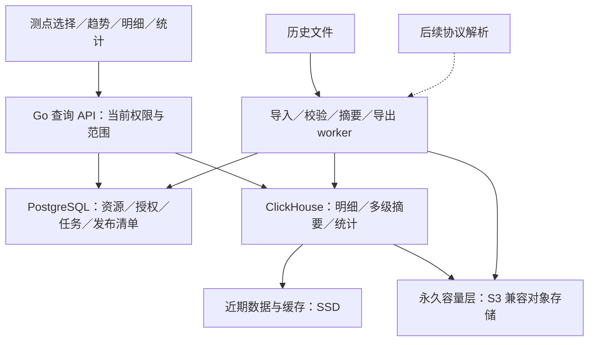

# 监测数据基础闭环方案

创建日期：2026-11-11。更新日期：2026-11-12。版本：V1.0。状态：**需求讨论已收敛，详细开发方案待审阅**。本轮功能实现、规模压测与人工验收均未开始。

讨论起点：[规划账号权限后的下一步](codex://threads/01a1c07e-e171-7f02-bde7-b5c66f3adfb7)最后提出的七项迭代内容。本文保留需求来源与架构演进，具体实施以[完整详细开发方案 V1.0](monitoring-data-development-plan.md)为准；其中区分用户已确认规则、开发约定和待实测条件。早期推荐不等于已经部署或性能已经验证。

## 1. 已确认需求与范围调整

2026-11-12 用户明确：

1. 主路径选择到**测点**；在数据展示区选择通道，可叠加同一测点的通道，也可比较多个测点的通道。
2. 典型场景是一个孔中不同深度测点的温度趋势放在同一张图上比较。
3. 需要全历史最早观测时间、最新观测时间、数据总数及数学统计，不只有当前图表窗口的统计。
4. 几万个通道，历史观测几十亿至上百亿条，原始监测数据永久保存。
5. 约 1 Hz 是**部分通道、部分时段**的频率，不是全部通道全年持续频率。
6. 部署在可扩展的服务器集群；技术和代码先完整设计，硬件逐步扩展。
7. 明细按页加载；图表随拖动和缩放按浏览时间区间加载，类似行情图的历史浏览体验。
8. 原始数据永久保留，所有历史在线可查，无需人工恢复；接受较早原始明细首次读取比近期慢，大批量导出后台完成。具体延迟指标尚未约定。
9. 同通道、同一观测时刻出现不同数值时，保留原始依据，阻止新批次正式生效，先处理冲突；不自动采用后上传数值。
10. 历史数据无质量标记时标为“未标注”，默认参与曲线和数学统计；明确标为“可疑／无效”的记录默认排除，可以切换条件查看。
11. 跨文件同通道、同一时刻、同值且缺少统一来源身份时，先拦截核对；确认重复后忽略新记录，保留原文件依据。
12. 除已确认可忽略的重复记录外，批次中存在时间格式、单位、枚举等校验错误时，整批不生效，修正后重试。
13. 数值可解析但超出指标定义上下限时，保留原值并标为可疑，默认不参与曲线和数学统计，不触发告警；来源原质量标记另行保留。
14. 首版统计包含累计唯一入库数、当前在用数、本次统计样本数，逐通道基本数学统计（总体标准差使用 N 分母），以及按日／月／年分组；本轮不增加中位数、分位数、累计量或时间加权计算。

第 8–14 项为已确认的存储、查询与统计规则。详细方案已经给出单一开发技术路线、权限／维护约定和拟验收指标；精确版本、硬件和性能由实施验证冻结，尚无实测成绩。

V0.1 的 PostgreSQL 观测存储起点及冷热归档后置建议不足以覆盖上述需求。调整为：**独立监测数据存储、永久完整明细、在线存储分层、集群扩展、按视窗查询、多分辨率摘要、全历史统计及一致性机制进入本轮总体设计与验证范围**。实施范围随总体方案确认，不以设计文字代替交付。

原七项范围保留：统一观测与持久化、标准历史导入、补录与撤销、统一查询、数据浏览、授权与导出、规模验证。协议与真实设备连接、高频波形、复杂修订／科研计算、告警报告、大屏编辑器仍后置；额度和用量控制沿用此前决定。

## 2. 容量规划口径

分别记录存量、典型／峰值活跃通道、频率与持续时间、实际日增量、历史回填吞吐和同时查询人数。不能将全部通道的最高频率直接当日常增长。

```text
每日新增 = 各通道当天实际观测数之和
永久明细容量 = 累计观测数 × 实测每条物理字节数
部署容量 = 明细 + 摘要 + 原文件 + 索引/元数据 + 副本/纠删码 + 独立备份 + 合并/迁移余量
```

以下仅为持续速率的量级示例，不是用户实际日均量，年度按 365 天计算：

| 全系统平均新增速度 | 每日新增 | 每年新增 |
| --- | ---: | ---: |
| 1,000 条／秒 | 0.864 亿 | 315.36 亿 |
| 5,000 条／秒 | 4.32 亿 | 1,576.8 亿 |
| 30,000 条／秒 | 25.92 亿 | 9,460.8 亿 |

存量、持续写入、集中补传和历史回填分别验证。压缩率必须用包含时间、值、身份、来源、质量和批次的真实样本实测，不使用厂商宣传数字承诺容量。永久保存不设置自动删除原始明细的期限，随实际增长安排扩容。

## 3. 页面与使用体验

### 3.1 测点选择与通道叠加

租户和项目共用页面结构，各按当前权限取数；现有设施／测点详情可以跳转。

| 区域 | 建议行为 |
| --- | --- |
| 左侧对象导航 | 设施及已有构件／组织关系 → 测点。搜索、单选查看或多选加入比较，不强迫在树中继续选择通道。 |
| 展示区通道选择 | 列出已选测点的获准通道，显示测点、指标、单位、方向／基准，选择显示哪些曲线。 |
| 全历史概况 | 最早／最新观测时间、记录总数、通道数及统计截至版本，不随图表缩放改变。 |
| 时间与趋势 | 常用／自定义窗口、时区、缩放、拖动、日期跳转、返回最新位置。 |
| 明细／统计 | 明细逐页读取；全历史和当前窗口统计明确分开，数学统计默认逐通道显示。 |

孔内曲线以孔名称、测点名称、深度、指标和单位标识，可选择多个深度进行趋势比较。孔的组织和深度复用现有工程模型与位置语义，具体映射待核对；本次不据此新增钻孔管理模块或温度—深度剖面分析。

同指标、同单位且时间含义兼容的曲线默认同轴；详细方案采用时间轴对齐的分图处理不同量纲，首版不做双纵轴。采样不齐的通道按真实时间绘制，不按数组下标对齐，不自动补零、插值或平滑。曲线名称、颜色及线型稳定；全图点数和曲线预算见详细方案，超出保留选择并分图／分页。

### 3.2 三种统计范围

- 工作空间概览：当前获准的所有监测数据的全历史概况。
- 已选测点／通道概况：所选集合的全历史信息及逐通道数学统计。
- 当前窗口统计：仅随所选时间窗口变化。

“全部历史”始终是当前有权访问的全部历史。项目仅获准部分通道／时段时，不能使用全租户总数、最早时间或极值代替。

## 4. 图表按视窗与分辨率加载

### 4.1 查询协议与交互

请求建议包含工作空间、去重后的通道集合、半开时间区间 `[from,to)`、显示宽度／点数预算、质量条件及数据快照。服务端返回完整窗口的有界表达、覆盖情况、实际分辨率、截至位置和版本。

1. 首次只取当前窗口以及有界的全历史导航摘要，不读取全历史明细。
2. 左右拖动按固定时间块补取缺块；缓存键包含通道、精度、时间块、数据版本及权限范围。相邻块只少量预取，缓存和并发有上限。
3. 几年／几月范围读粗摘要，几天／几小时读细摘要，足够近时读原始观测。秒／分钟／小时／日等精度阶梯按采样分布和实测选择。
4. 总点数随显示宽度和曲线数有界；曲线多时分配全图预算，避免每增加一条就无限增加数据。
5. 快速拖动合并请求、取消旧请求，并丢弃过期响应；取消尽量传递到数据库查询。
6. 视窗坐标独立于已加载点，局部响应不能使时间轴突然收缩。必要的边界相邻点只用于绘图，不混入所选窗口统计。
7. 浏览历史时新数据不把用户拉回最右侧；提供显式“返回最新”。
8. 加载、失败、无数据、缺测和无权限分别显示，未加载块不能画成真实缺测。

### 4.2 摘要正确性

摘要保留数量、首末观测、极值及其时间、质量／缺测覆盖和语义边界。展示使用真实首末／极值点或区间包络，不仅保留平均值，也不照搬股票开高低收的金融语义。

真实缺口／状态变化超过显示预算时，粗层明确表示不连续或覆盖情况，放大后获取真实边界；不为减点而跨缺口连接。枚举另用状态段／事件表达，延续状态规则需要业务定义。跨块采用半开区间和稳定身份，避免重复／遗漏；下钻保持同一语义与数据版本，摘要不替代永久原始记录。

### 4.3 图表技术

业务外壳沿用 React / TypeScript；监测趋势建议评估 **Apache ECharts Canvas + 自建视窗数据控制器**。现有 `SeriesChart` 接收完整数组，不能直接承担分块调度、缩放取数与缓存生命周期。

ECharts 的 `datazoom` 事件可以触发视窗查询；远程分块、请求取消、摘要切换由项目实现，不是启用图表选项即具备。[官方事件说明](https://echarts.apache.org/handbook/en/concepts/event/)

## 5. 明细、数学统计与导出

### 5.1 明细分页

采用时间定位和游标分页，稳定排序包括时间、通道及唯一观测身份。支持前后翻页、跳转日期；总数独立查询，不依靠大偏移 `OFFSET` 跳到第几百万页。

游标绑定通道集合、筛选、快照；后续页仍校验当前权限。迟到／补录期间不会使同一快照漏行或重复。表格渲染和已载页缓存有界，大导出不在浏览器逐页拼接。

### 5.2 已收敛的数学统计范围

| 统计项 | 计算口径 |
| --- | --- |
| 最早／最新观测时间、总数 | 当前覆盖排除未发布／撤销批次；数量明确区分累计唯一（含撤销）、当前在用和本次统计样本，共享项目不复制计数。 |
| 有效样本数量、质量分布 | 总条数与参与数学统计的数量分开；未标注默认参与，但仍保持未标注身份；可疑／无效默认排除，可切换条件查看。 |
| 最小／最大值及发生时间 | 逐通道计算，定义并列极值的确定性返回；不混合不同量纲。 |
| 均值、总体标准差 | N 分母；精确整数系数摘要与高精度结果，细节见详细方案；不平均各桶均值，不从降采样曲线计算。 |
| 自然日／月／年分组 | 首版交付，逐通道、明确时区、相同质量与快照口径。 |
| 累计量、时间加权、中位数、分位数等 | 不在首版交付范围；未来单独定义语义、精度和成本。 |

维护“通道 × 时间块”的版本化统计、上层汇总和通道全历史摘要。全租户可合并通道摘要；项目按授权通道和时间段组合，授权边界不足整桶时取细层／原始记录，不计入隐藏时段。

补录与撤销重建受影响块及上层摘要。最早／最新、极值不能简单做减法；统计带截至时间／版本。重建中的结果显示状态或执行受控精确计算，不返回失效旧值冒充当前值。

### 5.3 导出

大范围导出由独立 worker 分块流式处理，支持进度、取消和下载权限复核；结果有效期不影响永久原始数据。导出与浏览共用语义，不要求共用 SQL。全历史数十亿行导出不承诺交互秒级；格式与分卷另定，不能放进单个电子表格。

## 6. 技术架构建议

初步首选：**PostgreSQL 元数据 + ClickHouse 自托管观测分析集群 + S3 兼容永久容量存储 + 独立后台 worker + React/ECharts**。这是待验证推荐。



### 6.1 选型与边界

- ClickHouse 适合验证“通道和时间范围检索 + 多通道数学统计 + 批量导入”的组合，并可显式表达观测身份、质量和批次。按自托管能力设计，不能套用 Cloud 的自动弹性／SharedMergeTree 承诺。
- Apache IoTDB 为重点备选。验证同时间戳覆盖是否符合观测身份、历史更正、全局统计和实际发行版分层存储能力。
- TimescaleDB 的 PostgreSQL 衔接有优势，但当前自托管水平扩展路径需独立核实，不依据历史多节点文档承诺本轮能力。
- 不因百亿记录预装 Hadoop／Spark／Flink／Kafka 全套组件。交互分析、永久容量和后台计算分别有明确职责；后续持续设备流需要持久日志／流处理时再按恢复和吞吐要求引入。

实施前须核实所选版本的官方能力、开源／商业边界与限制，并完成本项目的实际压测。

### 6.2 数据布局

1. PostgreSQL 保存业务和任务元数据，不逐条写入观测或更新全局计数。
2. 观测使用类型化列与稳定标识，避免逐条重复完整定义 JSON、设施名称或说明。关联不可变语义／来源版本，禁止按当前配置重解释历史。
3. 时间精度、整数范围、小数精度和无损编码按指标确定，不静默转浮点／舍入以节省空间；原始文件／内容保留。
4. 查询排序优先围绕租户、通道、时间和观测身份；时间分区粒度按批量及生命周期实测。分区不同于分片，不能机械地每通道一表／一分区。
5. 大租户通道可分布到多个分片，避免整个主使用部门落在单节点；稳定逻辑分片、物理映射、历史路由和迁移切换显式设计。
6. 最新值、全历史摘要、时间块摘要和原始明细采用各自路径；所有路径共享业务口径及授权。

### 6.3 永久保存与在线分层

用户已确认所有历史在线可查询、无需人工恢复，接受较早原始明细首次读取稍慢，大导出后台完成。建议近期／热门块使用快盘或缓存，较早完整明细使用容量层，历史摘要保持可快速查询。冷热界线和具体延迟指标仍待确认。

优先验证 ClickHouse 原生数据文件的对象存储路径，保持统一查询入口。MergeTree 文件、独立源文件和可选 Parquet 导出并非同一件事；不要求同时复制多套完整分析系统。

永久保存包括完整时间、数值、质量、身份与来源，不是永久保留小时均值。不设置删除原始明细的 TTL，不删除唯一原件；撤销表示退出当前结果，原记录保留。层间迁移有目录、校验、回退及恢复演练。[官方 S3 集成](https://clickhouse.com/docs/integrations/s3)

副本、对象存储冗余和独立备份分别设计。对象文件存在不等于可恢复，还需保护表定义、语义版本、发布／撤销清单和业务元数据，并核算所有存储放大。

## 7. 导入、去重、撤销与一致性

CSV/XLSX 为人工入口；大规模历史回填需要服务端分块任务、断点恢复和可校验结果，不能要求浏览器解析百亿历史。既有数据库迁移适配器的范围另行确认。

建议链路：原文件持久化 → 校验／规范化分块 → 重复与冲突处理 → 批量写入 → 数量／校验和核对及基础摘要准备 → 发布可查询批次。校验错误按已确认规则阻止整批生效，已核对重复的记录排除后保留依据；数值越界作为可疑质量处理，不当作格式错误拒绝整批。页面表达接收、处理、待处理、失败和可用，未完成批次不冒充完整数据。

使用持久清单、不可变块身份和显式发布状态。PostgreSQL、ClickHouse 和对象存储之间没有统一事务；跨分片写入也不能作为整个业务批次原子完成的证据。重复执行可对账，失败块可恢复，孤立结果不得进入正式查询。[ClickHouse 事务边界](https://clickhouse.com/docs/concepts/features/operations/insert/transactions)

同一提交重试保持观测身份；跨文件同通道同一时刻同值先拦截核对，确认重复后忽略新记录并保存原文件依据，不直接凭值相同自动判重。不同值阻止新批次生效，不自动覆盖旧值。冲突检测同时考虑新批次内部和当前在用记录，处理完成后再次校验。ClickHouse 主键不提供唯一约束，ReplacingMergeTree 的后台合并不等于即时去重。[官方说明](https://clickhouse.com/docs/guides/replacing-merge-tree)

建议每次重复核对保留新源记录与原观测的关联、处理者和依据；忽略不增加在用数量，也不覆盖原质量。撤销新批次只影响该批次实际生效的观测；原批次撤销不会让其他批次已忽略的记录自动生效。全部记录均确认重复的批次可记为完成但无新增，并明确与新增数据成功区分。

维护建议仍以补录和批次撤销后重新导入为主。撤销立即改变正式可见范围并使摘要／缓存失效；后台重建期间返回明确状态或受控精确结果，不继续展示失效统计。

分块贡献和版本化重建支撑计数、极值、均值、方差更新，不能仅给追加表挂 SUM/COUNT 视图就宣称支持撤销。增量视图针对插入块执行，原表或关联状态变化不会自动完成所有历史汇总更正。[官方增量视图](https://clickhouse.com/docs/materialized-view/incremental-materialized-view)、[官方常见问题](https://clickhouse.com/blog/common-getting-started-issues-with-clickhouse)

查询会话固定数据快照／发布位置，明细、曲线、统计带同一版本依据。纯追加和历史补录使用新的发布序号，旧会话不混入新序号，以保持分页稳定；撤销等改变既有正式结果的操作增加更正修订号，使旧游标／视窗结果失效并要求刷新。需要查看撤销前记录时走独立历史追溯能力，不以旧快照继续冒充当前正式数据。

副本未就绪时等待、转到就绪副本或明确提示，不能静默少返回数据。快照不冻结访问资格，后续请求与下载检查当前权限。上述发布序号、更正修订和摘要版本都是应用协议，不能仅靠数据库默认隔离级别推定已经满足。

## 8. 权限

遵循[项目资源方案](project-resource-management-refactor-plan.md)和[业务词汇](../../GLOSSARY.md)：数据属于租户，项目是使用范围，不复制数据；档案读取不自动获得监测值读取权。

详细方案定义独立查看、导入、撤销、导出权限及项目通道／历史时间授权；项目维护共享数据须明确授权，未授予默认不可读，归档后保留获准读取和导出。具体开发约定见详细方案第 9 节，不从项目入口回退使用租户权限。

概况、趋势摘要、边界块、缓存、任务和下载使用相同范围。整桶含隐藏时段时裁剪后重算，不能泄露计数／极值；仅获准一个通道不能下载含其他通道的整个源文件。数据库和对象存储不直接开放给浏览器。

## 9. 代码与渐进部署边界

技术先设计完整，硬件逐步扩展。以下为建议职责，不创建占位实现：

| 边界 | 责任 |
| --- | --- |
| platform 监测业务模块 | 观测语义、范围／权限、导入发布撤销、查询计划和结果版本，不依赖 HTTP 或图表。 |
| 存储适配 | 按业务接口实现观测批量写入、查询、摘要、文件和恢复；选型验证后固定实现，不先造通用多数据库平台。 |
| 查询 API | 概况、趋势、明细、统计和任务独立路径，明确视窗、精度、游标、版本、质量和取消协议。 |
| 后台 worker | 持久任务、分块导入、摘要、导出、校验和迁移；独立进程／资源，可增加实例。 |
| console 功能 | 测点选择、通道比较、全历史概况、视窗调度、明细分页和任务交互。 |
| 契约与运维 | OpenAPI 类型；PostgreSQL 增量迁移及新存储版本；统一 infrapro 运维入口和恢复流程。 |

以逻辑分片、副本和路由版本设计。初期少量分片，新增分片增加容量／吞吐，副本提供可用性和适当的读取扩展；增加副本不增加唯一数据容量。协调服务和副本按故障域放置，同主机多进程不能视为生产高可用。

新增节点不代表旧数据自动均衡。必须设计块复制与校验、路由切换、并发写入、避免重复／漏读及回退。扩容后重新验证热点查询与恢复。机器数、磁盘、CPU、内存和网络由初期日增量及实测决定，不承诺固定几台支撑无限增长。

## 10. 自验与人工验收预期

1. 选到测点后可选通道；同孔不同深度温度同图比较，身份清楚，不齐采样未被伪造为同时测量。
2. 全历史起止与总数不随图表拖动改变；当前窗口统计明确分列。
3. 从多年缩放至秒级，按窗口取数和切换精度，保留极值／缺口；请求、点数和缓存有界。
4. 很早时间的明细连续分页不依赖大 OFFSET；补录期间快照分页不重不漏。
5. 可手工核对样本验证数学统计，再验证乱序、迟到、重复提交、同时间不同观测、质量缺失和撤销。
6. 部分通道／时段授权在概况、边界摘要、缓存和导出均生效；撤权约束后续访问。
7. 中断导入、摘要或迁移后可恢复／回退和对账；跨存储恢复还原观测、语义与可见状态。
8. 冷热迁移保留完整原始值、条数、来源及权限；从独立备份实际恢复校验，不只检查文件存在。
9. 分阶段验证小样本语义、亿级布局、十亿级混合负载、目标百亿级存量与跨年查询。硬件／样本不足时明确待验证，不用摘要条数或厂商测试冒充目标规模。
10. 混合持续写入、回填、多测点趋势、全历史统计、原始明细、导出和节点迁移，记录延迟分位数、扫描量、传输量、压缩、合并、资源和恢复耗时。

最终性能门槛同时注明规模、并发、硬件、冷热状态和新鲜度。本次仅文档研究，未运行数据库性能测试；自验结果与用户接受分别记录。

## 11. 详细开发方案与下一阶段

[完整详细开发方案](monitoring-data-development-plan.md)已覆盖 MD-01–MD-10、字段与表职责、接口、任务／发布协议、页面、权限、统计、分层／扩容／恢复、S-01–S-09 实施顺序、SV 自验及 MA 人工验收。

当前只交付方案，不开始实现。实施首步用真实样本和测试环境冻结时间／数值精度、对象存储、精确软件版本、初期硬件、日增量／并发及性能目标；这些验证输入不再混同于尚未定义的产品范围。方案文档自检与未来功能验证分别记录。
