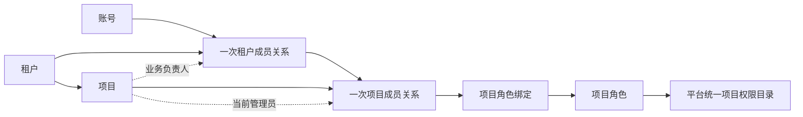
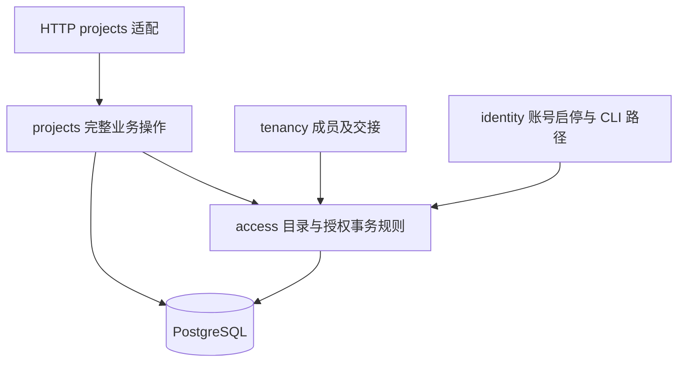

# 项目基础管理、成员授权与归档恢复迭代方案

日期：2026-11-10。版本：V1.0。方案状态：**已于 2026-11-10 获用户确认（含 D-01–D-16）**。功能状态：**Awaiting acceptance**；2026-11-10 实施及完整自验已通过，人工验收待用户确认。方案核对与实现证据分别记于[验证记录](../verification/project-management.md)。

后续方案：本文未包含的项目资源授权和维护委托，现由[租户统一资源与项目授权管理重构详细方案](project-resource-management-refactor-plan.md)单独设计。该重构当前仅编写方案，未修改项目或资源实现。

本轮交付一个完整的项目管理闭环：租户中的有权人员创建项目并指定管理员，管理员组织本租户成员、配置项目角色与职责，成员进入获准项目工作；项目可以归档、撤权和恢复，账号及租户状态变化能够立即约束项目访问，重要变化可以追溯。

范围依据[规划账号权限后的下一步](codex://threads/01a1c07e-e171-7f02-bde7-b5c66f3adfb7)最后一轮完整交付范围，以及其前两次范围修正。**项目配额及用量管理、资源目录及资源使用授权均已被用户移出本轮。** 早期方案关于“项目数量约束随项目创建设计”的表述，在本轮以这一最新范围为准。

用户已明确确认本方案及其业务规则并授权实施，第 20 节 D-01–D-16 按本文执行。方案确认不代表功能人工验收。

## 1 目标与交付范围

### 1.1 九项交付与原会话对应

| 编号 | 交付项 | 本轮完成后的行为 | 主要设计章节 |
| --- | --- | --- | --- |
| PJ-01 | 项目基础管理 | 租户内列表、搜索筛选、创建、详情、编辑；原子初始化及重复提交保护 | 3、4、12、13 |
| PJ-02 | 项目工作空间 | 我的项目、进入及切换项目/租户，明确上下文，失权清理 | 5、11 |
| PJ-03 | 项目普通成员 | 从有效租户成员添加，查看、暂停、恢复、移除与重新加入 | 7 |
| PJ-04 | 项目权限和角色 | 统一权限目录、平台预置项目角色、复制、自定义角色及启停删除 | 6、8 |
| PJ-05 | 成员授权 | 多角色、授权增减预览、实际权限及来源说明、授予边界 | 8、10 |
| PJ-06 | 管理交接 | 管理员交接、负责人变更、管理连续性保护及失管恢复 | 9 |
| PJ-07 | 归档恢复 | 运行中/已归档两态，归档影响、受限操作、恢复资格及历史保留 | 10 |
| PJ-08 | 上下层联动 | 账号、租户、租户成员、项目成员及角色共同决定访问 | 7、9、10、14 |
| PJ-09 | 审计及工程交付 | 范围隔离、清晰反馈、迁移、契约、前后端、自验和人工验收说明 | 12–19 |

九项均属于本轮。实施划分为小步自验，不将项目成员、角色或归档恢复重新移到下一轮。

### 1.2 主要使用场景

1. 租户管理员把项目创建权限授予项目筹建人员。筹建人员创建项目 A，选择业务负责人及初始管理员；自己不因创建动作获得 A 的成员身份。
2. 项目管理员从本租户成员中加入乙、丙，分别授予资料维护和审计职责；同一人在项目 B 的职责独立配置。
3. 乙暂停参加项目时，管理员暂停其项目成员关系；恢复后根据当时的账号、租户和授权状态重新判断可用能力。
4. 管理员离岗前，将项目管理员职责交给另一有效租户成员；负责人可以另行变更，两类操作互不替代。
5. 项目结束后归档，仍可按权限查资料和历史、暂停或移除成员、撤销授权；再次启动时恢复原项目。
6. 账号应急停用导致项目管理员不可用时，租户有权人员通过专门入口恢复管理；不依赖平台身份直接读取项目业务内容。

### 1.3 明确不包含

- 平台额度、配额、用量、项目数量上限、已用/剩余、名额预占、额度申请与调整；不新增相应表、字段、校验、页面或永远放行的占位逻辑。
- 设施、设备、测点、通道等目录，资源使用授权、工程资源主责与维护委托。
- 设备接入、监测数据、导出、科研、报告、大屏等业务模块及其预留权限。
- 项目删除、彻底清理、计费、完整离线许可。
- 跨项目通用认证服务、OIDC、单点登录或新认证体系。
- 本轮不增加项目邀请链接、外部人员入驻、批量成员操作、成员自助退出、角色继承、拒绝型权限、临时授权及审批流；后续有需求再独立设计。

本轮列表分页和变更影响中的成员数量是当前功能的展示信息，不建设平台用量统计。

## 2 当前基线与实施前提

### 2.1 已核对的源码基线

核对工作区为 `feature/account-access-console`，HEAD 为 `776663fc125223a02df6f46a24e5d0cf7663a8da`。工作区存在租户成员、角色授权和生命周期的未提交变更；本方案以当前源码说明接入点，实施时须重新固定上一轮最终基线。

| 当前来源 | 已有能力或事实 | 本轮衔接 |
| --- | --- | --- |
| `packages/go/platform/identity` | 项目自身认证、会话、账号启停、应急维护 | 继续复用认证；账号启停补充项目管理连续性检查 |
| `packages/go/platform/tenancy` | 租户资料、成员、邀请、管理员交接及启停源码 | 项目依赖具体租户成员关系；成员结束及交接增加项目联动 |
| `packages/go/platform/access` | 唯一权限目录、策略、角色、事务授权锁及修订 | 增加 project 范围，保留既有平台和租户语义 |
| `packages/go/platform/migrations` | 源码迁移目标为 v6 | 项目新增迁移按实施时最新版本接续，当前预计 v7 |
| `apps/console` | 单 React 应用、租户上下文、共享界面 | 新增项目 feature 和路由，不另建应用 |
| `contracts/openapi/api.yaml` | 前后端契约源 | 新增项目契约，同步生成类型及权限常量 |

方案编制时基线尚无项目实体、项目成员和项目业务实现。该段描述实施前状态；本轮已实现项目功能，并完成本机 v6→v7 增量升级。实际验证、环境和人工验收状态以[验证记录](../verification/project-management.md)为准。

### 2.2 开发与交付前置条件

- 项目方案可先评审；业务实现以租户启停及既有成员、角色功能自验通过的确定版本为基线。
- 不覆盖其他迭代的未提交内容；记录其实际版本、验证结果和仍未解决的问题。
- 项目依赖的租户状态校验、管理员交接和成员关系语义须稳定。若上一轮修改这些规则，同步更新本方案及验收矩阵。
- 既有功能的人工验收与本轮验收分别记录，不能以本轮测试代替上一轮用户确认。

## 3 领域对象与不变规则

### 3.1 本轮术语

| 术语 | 含义 | 必须区分的概念 |
| --- | --- | --- |
| 项目 Project | 属于一个租户的业务工作空间，拥有稳定身份 | 不等于租户、设施或资源所有权 |
| 项目创建者 | 执行创建操作的账号，是不可改写的历史事实 | 不因此成为成员、负责人或管理员 |
| 项目负责人 | 对项目业务目标负责的人员，引用一次租户成员关系 | 职责字段不授予访问或管理权限 |
| 项目成员关系 | 某次租户成员关系参加某项目的一次关系 | 不能只按账号 ID 绑定或复活历史 |
| 当前项目管理员 | 本轮每个正常项目唯一承担管理职责的项目成员 | 通过受保护角色取得实际能力，不凭称谓放行 |
| 项目角色 | 只能在具体项目成员关系上生效的权限集合 | 平台供给不等于平台范围；不跨项目共享自定义角色 |
| 租户项目治理 | 租户范围的创建、治理摘要查看和失管恢复能力 | 不等于项目业务访问 |
| 项目管理员不可用 | 管理职责存在，但账号或上层资格导致无法履职 | 不是项目第三种生命周期状态 |
| 项目管理空缺 | 受控上层修复结束原关系后，等待重新任命管理员的异常 | 不允许普通创建或日常操作产生 |

本表术语已同步到 `GLOSSARY.md`，分别明确租户交接与项目交接，以及角色绑定和有效权限的作用范围。

### 3.2 关系图



### 3.3 必须始终成立

1. 一个项目永久属于一个租户。本轮不迁移项目所属租户。
2. 项目、成员、角色、绑定和审计均有可校验的租户及项目归属，不能仅信任 URL、请求体或前端上下文。
3. 创建者、负责人、管理员可以是同一人，也可以不同；分别记录，分别授权。
4. 项目成员必须引用同租户的具体 `tenant_membership_id`；新租户成员关系不能继承旧关系的项目权限。
5. 普通项目成员可以持有零个或多个角色；当前管理员由专用流程维护唯一的固定管理员角色。
6. 同一权限的多个有效来源取并集；撤销一个来源不能误删其他来源。
7. 项目状态只有 `active`（运行中）和 `archived`（已归档）。管理员健康、负责人可用性和本人访问资格分别展示。
8. 业务写入、角色/成员变化、授权修订和成功审计在同一事务中完成。
9. 退出或撤权是明确的历史变化；恢复项目、租户或账号不能重新建立已结束关系或已撤销绑定。

## 4 项目基础管理

### 4.1 项目资料

| 字段 | 规则 | 变更规则 |
| --- | --- | --- |
| 项目 ID | 服务端生成 UUID，稳定标识 | 不可修改 |
| 所属租户 | 来源于经过验证的租户上下文 | 不可迁移 |
| 名称 | 必填，NFKC 规范化并去首尾空白，1–100 字符 | 运行中可改；允许同租户重名，以编号区分 |
| 编号 | 必填，转小写后匹配 `[a-z0-9][a-z0-9_-]{2,31}` | 租户内唯一；改号保留历史归属，其他项目不能复用 |
| 业务目的 | 必填，去首尾空白，1–1000 字符纯文本 | 运行中可改 |
| 说明 | 可选，最多 2000 字符纯文本 | 运行中可改；本轮不含附件和富文本 |
| 业务负责人 | 创建时必选，同租户账号正常且 active 的租户成员 | 独立操作变更；不通过普通资料 PATCH 偷换 |
| 计划开始、结束日期 | 可选，日历日期 `YYYY-MM-DD`；都填写时开始不得晚于结束 | 不自动归档、恢复或触发其他任务 |
| 当前管理员 | 创建时必选有效租户成员 | 只允许交接/失管恢复，不允许普通编辑 |
| 状态及变更记录 | 状态、操作者、原因、时间 | 只允许生命周期操作 |
| 版本和创建/修改信息 | 服务端维护，时间存 UTC，界面按 Asia/Shanghai 显示 | 用于冲突检查和追溯 |

历史编号在同一租户内持续保留给原项目，原项目可以改回自己的旧编号；不同租户可以使用相同编号。归档不释放编号。名称、目的和说明不解释为 HTML。

### 4.2 列表与详情

- 租户项目治理列表可按名称/编号搜索，按状态、负责人、管理员不可用/空缺筛选；默认显示运行中项目，可查看已归档项目。
- 治理摘要只包含身份、名称、编号、状态、负责人/管理员摘要及可用性、计划日期和创建/更新时间；业务目的、说明、成员明细及角色内容须从项目接口按项目权限读取。
- 项目工作空间提供资料详情和编辑。使用稳定游标分页，默认 20 条、最高 100 条；按创建时间和 ID 确定稳定顺序，不显示虚构总页数。
- 编号冲突、候选人失效和版本冲突分别提示；已经输入的合法内容在短暂网络失败时保留。

### 4.3 创建的原子结果

创建请求包含项目资料、负责人租户成员 ID、初始管理员租户成员 ID、原因和 `client_request_id`。

同一事务内完成：复验身份及租户创建权限 → 检查租户 active → 校验两个候选人当前资格 → 校验/保留编号 → 写项目 → 建立管理员项目成员关系 → 授固定项目管理员角色 → 写审计和授权修订。

负责人若与管理员不同，不自动加入项目；创建者亦不自动加入。创建成功页明确显示“项目已创建、指定管理员”，仅实际取得项目访问资格的人看到进入按钮；其他创建者返回治理列表。

任一步失败整体回滚。相同租户、操作者、创建操作和请求 ID 对应相同规范化请求时返回原创建结果；同键不同内容返回冲突。不同请求 ID 并发抢占同一编号最多一个成功。此处没有项目名额检查或计数。

## 5 项目工作空间与访问范围

### 5.1 三类入口

| 入口 | 使用者和权限 | 内容 |
| --- | --- | --- |
| 我的项目 `/projects` | 已登录账号；服务端只查询本人当前租户及项目关系 | 本人项目卡片、状态、可进入性和必要限制原因 |
| 租户项目治理 `/t/:tenantId/projects` | 有效租户成员及 `tenant.project.read` | 本租户治理摘要、创建和失管恢复的相应入口 |
| 项目工作空间 `/t/:tenantId/p/:projectId` | 有效上下层关系及对应项目操作权限 | 资料、成员、角色、权限目录、操作记录 |

“我的项目”包括本人尚未结束的项目关系。项目成员暂停、租户停用或没有业务权限时，只展示本人有权知道的最小摘要和原因；租户成员已暂停/结束时不在个人列表继续披露项目，旧链接返回无访问资格。已结束的项目关系不继续出现在列表，历史由有权管理人员查看。

### 5.2 完整授权条件

执行项目操作必须同时满足：会话及账号有效、路径租户/项目真实匹配、租户 active、绑定的租户成员 active、项目成员 active、该项目角色提供所需权限、项目状态允许该操作，以及目标保护和授予范围规则。

业务读写从项目成员授权取得能力，不要求成员同时拥有租户资料读取权限。清空某人的租户业务角色并不结束其租户成员资格，因此其独立项目权限可以继续有效。租户成员暂停/结束则会阻断项目资格。

租户治理接口按专门租户权限校验，不伪装成项目接口的兜底分支。平台管理员没有隐式项目成员关系；租户管理员也不能仅凭租户身份读取所有项目的成员、角色或业务资料。

### 5.3 最小上下文与授权解释

有效租户成员可查询本人当前项目关系的最小上下文：项目名称/编号/状态、本人关系 ID、关系状态、本人已配置角色和限制原因。无业务角色时可以看到“尚未获项目业务授权”，不能读取完整资料或其他成员。

对无本项目关系的人，项目接口统一返回不透露对象存在性的 404；合法关系下缺少具体动作权限返回 403。只有确认本人范围资格后才披露租户停用、项目归档等状态。

`effective_permissions` 表示当前有效角色提供的权限并集；`allowed_operations` 表示叠加归档、操作前置权限及本人状态后真正可执行的操作。界面明确区分“已经授予某权限”和“当前操作受归档限制”，不把归档显示成角色被撤销。

## 6 统一权限目录与预置角色

### 6.1 租户项目治理权限

以下 3 项为新增 tenant 范围权限，通过租户角色授予。

| 权限编码 | 能力 | 租户自定义角色可选 |
| --- | --- | --- |
| `tenant.project.read` | 查看本租户项目治理摘要 | 是 |
| `tenant.project.create` | 创建项目并指定初始管理员；同时需要 read | 是 |
| `tenant.project.recover_admin` | 修复管理员不可用或空缺的项目；同时需要 read | 否，仅固定租户管理员角色 |

当前租户管理员预置角色在本次明确增加这 3 项；既有租户自定义角色不自动增加。平台角色不包含这 3 项，也不包含下面的项目权限。

### 6.2 项目普通可配置权限

以下 11 项为新增 project 范围权限，可选入普通项目自定义角色。

| 权限编码 | 能力 | 配套条件 |
| --- | --- | --- |
| `project.profile.read` | 查看完整项目资料 | 项目成员资格有效 |
| `project.profile.update` | 修改名称、编号、目的、说明和日期 | 同时需要 profile.read；项目运行中 |
| `project.member.read` | 查看项目成员、状态及关系历史 | 不自动开放其全部授权明细 |
| `project.member.add` | 从本租户有效成员中添加普通项目成员 | 同时需要 member.read，能覆盖默认角色权限 |
| `project.member.suspend` | 暂停普通项目成员 | 同时需要 member.read，目标权限覆盖及管理员保护 |
| `project.member.resume` | 恢复普通项目成员 | 同时需要 member.read，目标权限覆盖、上层资格有效、项目运行中 |
| `project.member.remove` | 结束普通项目成员关系 | 同时需要 member.read，目标权限覆盖及管理员保护 |
| `project.role.read` | 查看本项目可用角色及定义 | 只查询本项目角色和项目预置角色 |
| `project.permission.read` | 查看统一目录中的项目权限 | 管理保留项可见但不可选 |
| `project.authorization.read` | 查看其他项目成员的授权解释 | 同时需要 member.read |
| `project.audit.read` | 查看本项目操作记录 | 服务端限定 project_id |

### 6.3 项目管理员保留权限

以下 10 项只在固定项目管理员角色中声明，不能通过复制或普通角色配置下放。

| 权限编码 | 能力 | 配套读取权限 |
| --- | --- | --- |
| `project.role.create` | 新建或复制本项目角色 | role.read、permission.read |
| `project.role.update` | 编辑自定义角色名称与说明 | role.read |
| `project.role.set_permissions` | 配置自定义角色权限 | role.read、permission.read |
| `project.role.set_status` | 启用或停用自定义角色 | role.read |
| `project.role.delete` | 软删除没有当前绑定的自定义角色 | role.read |
| `project.member.assign_roles` | 配置普通成员多角色 | member.read、role.read |
| `project.administrator.transfer` | 正常交接当前项目管理员 | profile.read、member.read |
| `project.owner.change` | 变更业务负责人 | profile.read |
| `project.archive` | 归档项目 | profile.read |
| `project.restore` | 恢复项目 | profile.read |

合计新增 24 项权限：3 项租户治理、11 项项目普通能力、10 项项目管理员保留能力。目录注明中文名称、说明、适用范围、风险、生命周期及可配置性。首轮将授权配置收敛到一个管理责任点，同时允许成员管理和资料维护分工；若后续开放授权管理员角色，应单独评审其委派规则。

角色选择器提示操作所需的配套读取权限；不得悄悄添加权限。服务端按最终多角色并集校验操作，不要求配套权限必须来自同一个角色。仅拥有写权限但缺少配套读取权限时，授权解释应说明该操作仍不可执行。

### 6.4 平台预置项目角色

| 内置 key / 名称 | 明确权限集合 | 分配与复制 |
| --- | --- | --- |
| `project_admin` / 项目管理员 | 本方案 21 项 project 权限逐项声明 | 仅创建、交接和失管恢复；不可复制或普通分配 |
| `project_member` / 项目普通成员 | profile.read | 加入时显式绑定，后续可以撤销；可直接分配或复制 |
| `project_profile_maintainer` / 项目资料维护员 | profile.read、profile.update | 可直接分配或复制 |
| `project_member_manager` / 项目成员管理人员 | profile.read、member.read/add/suspend/resume/remove、authorization.read | 可直接分配或复制；仍受目标覆盖约束 |
| `project_auditor` / 项目审计查看员 | profile.read、member.read、role.read、permission.read、authorization.read、audit.read | 可直接分配或复制 |

表内省略前缀的权限均为 `project.*`。预置定义由现有代码目录和发布流程维护，平台角色页面按适用范围提供只读查看；本轮不建设网页共享角色发布中心。

直接绑定的预置角色跟随平台发布后的有效定义；复制生成独立自定义角色，仅记录来源 ID 和版本，不持续同步。预置新增权限须明确列入发布变化及影响预览，不使用通配符自动吸纳未来业务权限。

## 7 项目成员生命周期与上层关系

### 7.1 添加成员

普通项目成员从本租户现有有效成员中直接添加，本轮不再走邀请领取流程。操作者需要 member.read、member.add，并能授予默认 `project_member` 的权限。

候选人查询必须专门限定为当前租户的正常账号和 active 租户成员；只返回用户名、显示名、成员 ID 及必要资格提示，不给项目操作者完整租户成员治理能力。查询按姓名/用户名搜索，至少 2 字符，每次最多 20 条；禁止搜索平台全体账号或任意其他租户。

服务端在提交时再次校验候选人。新增成员关系并显式绑定普通成员角色；角色进一步分配走独立授权操作。不能把角色 ID 混入添加请求以绕过授权规则。

### 7.2 状态与迁移

| 当前状态 | 操作 | 结果 | 授权处理 |
| --- | --- | --- | --- |
| 不存在当前关系 | 添加 | 新 active 关系 | 显式授普通成员角色 |
| active | 暂停 | suspended | 保留绑定，停止业务访问 |
| suspended | 恢复 | active | 按当前上层状态及角色定义重新生效 |
| active / suspended | 移除 | ended | 撤销全部未撤销绑定，保留历史 |
| ended | 再次添加 | 新关系、新 ID | 仅初始普通成员角色，不恢复旧角色 |

已有 active/suspended 关系时不重复添加；暂停关系须走恢复，不能通过“添加”绕过。移除后不提供原关系恢复接口。成员变化原因 1–500 字符，记录操作者、时间和版本。

普通成员暂停期间可以由项目管理员预配置角色，但只有账号和租户成员仍有效、项目运行中时才允许增加绑定；账号不可用或租户成员暂停时只允许减少原绑定。父租户停用时全部项目业务管理暂停。

### 7.3 成员操作范围

- 操作者不能通过普通接口暂停、移除自己或当前项目管理员；本轮不实现自助退出。
- 除当前管理员外，其他操作者必须覆盖目标全部已配置的有效目录权限，计算包含停用角色配置的权限，防止通过恢复状态间接授予超出本人范围的能力。
- 当前管理员仍检查具体动作权限、项目状态和角色可配置性；固定角色身份用于一致性保护，不是绕过鉴权的分支。
- 负责人可以是普通项目成员，也可以尚未加入项目；负责人身份不妨碍成员暂停/移除，但界面需要同时提示业务责任的当前可用性。

### 7.4 租户与账号联动

| 上层变化 | 项目侧处理 |
| --- | --- |
| 租户停用 | 所有项目业务和租户范围项目治理停止；保留项目真实状态、关系和绑定，不批量改成 archived |
| 租户恢复 | 逐次请求重新校验现状；已归档项目仍归档，已结束关系仍结束 |
| 租户成员暂停 | 本人所有相关项目访问受限；保留项目成员自己的 active/suspended 状态 |
| 租户成员恢复 | 只解除上层限制；项目自身暂停、无角色或归档限制继续生效 |
| 租户成员移除 | 在同一事务结束引用该成员关系的全部当前项目关系，并撤销其项目角色绑定 |
| 租户成员重新加入 | 新租户成员 ID；不取得旧项目关系，需逐项目重新添加 |
| 账号停用 | 立即停止该账号全部访问；普通项目关系保留，管理保护按第 9 节执行 |
| 账号恢复 | 不恢复历史会话、已结束关系或已撤销授权；保留关系按当前状态重新判断 |
| 租户角色增减或清空 | 不隐式增减项目角色；有效租户成员资格仍单独判断 |
| 项目成员或项目角色变化 | 只影响当前项目，不修改租户成员、个人账号或其他项目 |

租户成员结束的级联逻辑须覆盖普通移除、租户管理员交接和既有维护路径，不能只修改一个网页按钮对应的接口。

账号启停和租户成员处置仍使用各自既有上层权限，不要求操作者加入每个受影响项目。其效力来自上层资格变化；项目管理员保护继续生效，影响详情按操作者的实际查看范围脱敏，不把上层处置权限转换为项目业务读取权限。

## 8 自定义角色、多角色配置与权限解释

### 8.1 角色规则

- 名称规范化后 1–50 字符，说明最多 500 字符；在项目内唯一，保留预置项目角色名称，跨项目同名独立。
- 新建可以为空权限集合；有权限时只能选择当前 active 且允许项目配置的目录项。空角色不授予隐藏权限。
- 来源只能为普通预置项目角色或本项目未删除自定义角色；项目管理员、其他项目自定义角色、租户角色及平台角色均不能复制进本项目。
- 复制携带来源版本和最终权限集合；退役权限必须在确认后移除，不能通过复制新增退役能力。
- 内置角色只读；自定义角色支持改名/说明、权限调整、启停和软删除。
- 停用角色保留已有绑定，但不贡献有效权限，不允许新增绑定；启用前重新预览全部绑定人的影响。
- 删除仅允许没有任何未撤销绑定的角色，包括绑定到暂停成员的情况；历史绑定仍保留，删除后可追溯。
- 已被撤销的绑定不会因角色重新启用而恢复；角色软删除后不提供恢复接口，本轮可新建同名角色但使用新 ID。

### 8.2 多角色配置

成员角色提交使用最终角色 ID 集合，缺失、null、重复 ID 和跨范围 ID 拒绝；空数组明确表示清空。普通成员可以不保留默认角色，系统不在登录、刷新或恢复时补回默认角色。

同一请求中保留既有停用角色绑定是合法的，但不能新增停用角色。当前管理员不参与通用多角色编辑，固定管理员绑定只能由管理流程处理。

操作者可委派集合为“本人本项目有效权限 ∩ 项目允许普通配置的权限”。新角色、复制、增加权限、新增绑定及恢复操作都以提交时的集合复核，不能用已失效预览或其他项目权限扩权。操作权限本身不扩大可委派范围。

### 8.3 授权解释

本人最小上下文及有权管理人员的成员详情展示：

1. 配置的角色、来源、状态及绑定时间；已撤销绑定进入历史区。
2. 当前有效权限及每项权限的全部有效角色来源。
3. 没有生效的配置及原因：角色停用/删除、权限退役、成员暂停、上层资格失效、租户停用。
4. 归档及读取前置条件对可执行操作的限制。
5. 本人当前项目身份与租户成员关系 ID 的对应，页面以姓名和状态为主，不把数据库细节塞入日常操作流程。

### 8.4 变更影响预览

预览包括角色/绑定变化、配置权限增减、实际有效权限增减、涉及成员数量和有权查看的成员列表、当前及恢复后影响、管理员保护、被阻止的原因。成员列表分页，不能只评估第一页。

停用一个角色时，若成员仍通过另一个角色取得相同权限，应显示该权限继续有效；不能把所有绑定人都统计为完全失权。对暂停成员同时展示当前不生效与未来恢复后的变化。

预览返回对象版本、相关角色/成员版本、目录校验标识、影响摘要及 `preview_hash`；提交在事务中重新计算。影响变化后必须重新展示并确认，不自动沿用旧确认。全局授权修订用于通知刷新，其他租户的无关修订不应单独导致本项目草稿丢失。

## 9 管理员交接、负责人变更与失管恢复

### 9.1 单一当前管理员

建议本轮每个正常项目恰有一个当前管理员，以明确交接和责任；普通成员可承担可委派职责，不建立多个并列管理员。该规则是本方案业务建议，不是原会话已经指定的人数要求。

当前管理员必须有 active 项目关系、明确的 `project_admin` 绑定和有效租户成员资格；账号正常时才视为可履职。固定管理员角色不允许停用、删除、复制或由一般接口授予/撤销。

### 9.2 正常项目管理员交接

项目管理员通过专门入口选择同租户有效成员，预览原管理员的退出结果、接任者被替换的角色及影响，填写原因并完成近期密码复验。

同一事务内：验证现任及接任资格 → 若接任者没有当前项目关系则新建 → 若已有 active 普通关系则复用 → 撤销接任者原全部项目角色 → 授固定管理员角色 → 修改当前管理员指向 → 结束原管理员的项目关系并撤销其全部绑定 → 审计及授权修订。

接任者项目关系 suspended 时拒绝，不隐式恢复；ended 时新建关系。不得交接给自己。**原管理员的租户成员关系保持不变**；如需继续作为普通项目成员，应重新添加并取得新关系，避免保留隐蔽授权。负责人字段不随管理员交接自动变化。

归档项目仍允许此专门交接；必要的新管理员成员关系是归档状态下唯一的新增成员例外，不开放普通添加或批量授予。

### 9.3 负责人变更

有 owner.change 权限的项目管理员可从同租户有效成员中选择新负责人；记录原因和前后责任人，不创建成员或授予角色。运行中允许变更，归档后保留原责任记录，需恢复项目后再变更。

负责人账号停用、租户成员暂停/移除时保留原引用和姓名快照，标记负责人不可用；不自动改成管理员，也不阻止对非管理员的正常安全处置。

### 9.4 常规管理保护

下列操作必须检查受影响的全部项目，含已归档项目：账号常规停用，租户成员暂停/移除，租户管理员交接导致原租户关系结束，项目成员暂停/移除，项目管理员角色及绑定调整。

如果将使某项目失去可用的当前管理员，常规操作拒绝，提示先交接或修复项目管理；不自动把负责人、创建者或操作者任命为管理员。已不可用的管理员也必须先经过失管恢复，再通过普通成员接口结束关系。

影响提示按调用者已有查看权限脱敏：租户项目治理人员可看到本租户项目名称和处理入口；平台账号操作者若没有项目治理资格，只得到受影响租户及管理职责提示，不泄漏项目成员、角色和业务内容。

### 9.5 应急停用与失管恢复

既有维护 CLI 的应急停用仍可立即撤销账号访问，不能因项目任职妨碍安全处置。它保留项目关系和当前任职，记录管理员不可用；不静默授予替代账号。

“不可用”依据数据库中明确的账号/关系状态判断，不能把网络失败、依赖超时或权限目录损坏当成失管并允许夺取管理。目录或结构损坏先按运维路径修复，业务接口返回不可用。

租户 active 且操作者具备 `tenant.project.read` 和 `tenant.project.recover_admin` 时，可以对当前管理员不可用或明确空缺的项目指定接任者。此入口不要求操作者已经是项目成员，只开放治理摘要、必要候选人与管理修复；不能修改项目资料或任意成员角色。

恢复使用与正常交接相同的原子初始化/替换规则、影响预览、原因、近期复验和审计。管理员可用时拒绝调用“失管恢复”强制夺取管理；正常交接由当前项目管理员执行。恢复成功不使操作者自动加入项目，除非其被明确选作接任者。

### 9.6 租户管理员不可用时的恢复链

既有租户管理员交接会结束原租户成员关系，必须处理其项目任职，避免出现循环依赖。

- **正常租户管理员交接**：若原租户管理员仍负责项目，先交接这些项目，再执行租户交接。
- **原租户管理员账号已不可用的修复交接**：平台现有受权人员先预览被结束的项目关系及管理空缺，明确确认后允许完成租户管理员修复。事务内结束旧租户关系及对应项目关系、撤销绑定，将其所任项目的当前管理员指向置空，并记录受控空缺原因及审计。
- 新租户管理员获得本方案明确声明的项目治理权限；若租户停用，先按现有平台流程恢复租户，再逐项目修复管理员。租户恢复不要求所有项目先恢复管理，因而不会形成死锁。
- 空缺不新增项目生命周期状态；普通创建、交接或成员删除不得制造空缺。项目处于空缺时已有普通成员继续按其权限及项目状态访问，不能以空缺为由扩权；项目恢复运行前必须有可用管理员。

这是对现有租户交接的明确兼容变更，需作为 D-12 评审并单独验收。平台修复租户不直接获得项目业务权限，也不替项目授予任意业务角色。

该修复例外的具体条件为原账号状态已是 disabled、调用者有现有平台租户交接权限、完成近期复验，并提交包含受影响全部项目的最新预览及显式确认。仅租户停用、项目归档或网络故障不能触发此例外；原租户管理员正常时仍执行常规交接保护。

## 10 项目归档、恢复与状态操作矩阵

### 10.1 状态规则

创建默认运行中。归档和恢复都是明确的人工操作，要求有权项目管理员、1–500 字符原因、影响预览、近期密码复验和版本复核。

归档保存当前身份和全部历史，记录当前归档时间、操作者及原因；每次归档/恢复另记不可改写的生命周期事件。恢复沿用原 ID、编号、成员关系和有效绑定，当前归档字段可清空，但历史事件保留。

计划结束日期不触发归档。已归档项目重复归档、运行中重复恢复返回当前状态冲突，不重复写状态事件；同一已完成请求的合法幂等重放返回原收据。

### 10.2 状态与操作

表中“允许”仍须具备动作权限、有效上层资格及目标保护条件；租户停用列只涉及本轮项目及租户范围项目治理，既有平台租户修复仍按原规则执行。

| 操作 | 项目运行中 | 项目已归档 | 租户停用 |
| --- | --- | --- | --- |
| 完整资料、成员、角色、项目审计读取 | 允许 | 允许 | 拒绝 |
| 本人最小状态摘要 | 允许 | 允许 | 仅本人有权知道的停用摘要 |
| 编辑项目资料/编号、变更负责人 | 允许 | 拒绝 | 拒绝 |
| 添加普通成员、恢复暂停成员 | 允许 | 拒绝 | 拒绝 |
| 暂停或移除普通成员 | 允许 | 允许 | 拒绝 |
| 创建/复制角色、角色改名说明 | 允许 | 拒绝 | 拒绝 |
| 修改自定义角色权限 | 可增减 | 仅原权限集合的真子集，允许清空 | 拒绝 |
| 停用自定义角色 | 允许 | 允许 | 拒绝 |
| 启用自定义角色 | 允许 | 拒绝 | 拒绝 |
| 删除无当前绑定的自定义角色 | 允许 | 允许 | 拒绝 |
| 调整普通成员角色 | 可增减 | 仅减少已有角色绑定，不允许替换成新角色 | 拒绝 |
| 专门的管理员交接/失管恢复 | 允许 | 允许，只有必要管理角色例外 | 拒绝 |
| 项目归档 | 允许 | 状态冲突 | 拒绝 |
| 项目恢复 | 状态冲突 | 检查可用管理员后允许 | 拒绝 |
| 租户项目治理摘要及创建 | 允许 | 摘要可读；创建的是独立新项目 | 拒绝 |

归档期间撤权以配置集合判断，不能只比较此刻有效权限。停用角色虽然当前不生效，也不能通过新增绑定、增加其配置权限或恢复成员为将来埋入扩权。纯相同内容提交不产生变更事件。

### 10.3 归档影响与恢复检查

归档预览显示将被阻止的动作、当前成员和角色概况、仍允许的治理/撤权、管理员和负责人可用性。没有监测任务、资源或导出模块时，不显示或虚构“停止任务/关闭设备”等影响。

恢复检查租户 active、操作者最新资格、当前项目管理员的账号及上下层关系、固定角色结构和版本。普通成员异常、停用角色或负责人不可用作为提示，不自动修复，不阻断其他有效成员重新使用项目。

恢复不会复活移除的成员、已撤销角色绑定、已删除角色、过期会话或旧租户关系。归档期间完成的撤权和管理交接继续有效。

### 10.4 状态竞态

归档与添加成员/扩权并发，以统一授权事务锁确定顺序：添加先提交则纳入归档预览复核；归档先提交则新增被拒绝。恢复与账号停用、成员移除、租户停用同样按锁内最新状态判断。

撤权或状态变更提交后才开始授权的新请求必须受新规则限制；已在提交前取得锁并完成授权的请求可以先完成。前端取消请求不能撤销服务端已提交操作，返回后应重新读取真实状态。

## 11 页面、导航与反馈

### 11.1 页面清单

| 页面 | 建议路由 | 主要内容及操作 |
| --- | --- | --- |
| 我的项目 | `/projects` | 当前关系项目、租户/项目状态、本人角色摘要、进入及筛选 |
| 租户项目治理 | `/t/:tenantId/projects` | 摘要列表、搜索筛选、创建、失管提醒 |
| 创建项目 | `/t/:tenantId/projects/new` | 资料、负责人、初始管理员、创建结果 |
| 项目治理详情 | `/t/:tenantId/projects/:projectId` | 最小治理摘要、管理员状态、受权恢复入口 |
| 项目资料 | `/t/:tenantId/p/:projectId/profile` | 资料读取/编辑、负责人变更、管理交接、归档恢复 |
| 项目成员 | `/t/:tenantId/p/:projectId/members` | 当前及历史关系、添加、状态操作 |
| 项目成员详情 | `/t/:tenantId/p/:projectId/members/:membershipId` | 关系状态、角色、有效权限、来源、授权配置及历史 |
| 项目角色 | `/t/:tenantId/p/:projectId/roles` | 预置/自定义、启停状态、搜索、创建及复制 |
| 项目角色详情 | `/t/:tenantId/p/:projectId/roles/:roleId` | 定义、权限、绑定影响、修改/启停/软删除 |
| 项目权限目录 | `/t/:tenantId/p/:projectId/permissions` | 分组搜索、作用范围、风险、可选与保留能力 |
| 项目操作记录 | `/t/:tenantId/p/:projectId/audit` | 时间、事件、操作者、对象、原因筛选及详情 |

路径均为开发环境应用内路径；部署在 `/console/` 时由现有 basepath 统一添加前缀。项目根路径只重定向到本人可访问页面或本人授权摘要，不以重定向扩大读取权限。

### 11.2 导航与上下文隔离

顶部持续显示“租户名称 / 项目名称 / 状态”，侧栏区分当前项目、当前租户治理与个人工作空间。租户管理员未加入项目时，治理详情不显示可用的业务进入按钮。平台角色页面增加“预置项目角色”只读分类，区分维护来源与生效范围。

项目切换候选仅来自本人的当前项目关系；项目 A 的成员/角色子路径不能原样拼接到项目 B，应返回 B 的可用入口。租户切换同样重新选择项目，保留可解释的面包屑和返回目标。

同步扩展 `safeReturn` 的合法回跳白名单和生产 basepath 处理；导航依赖路由明确的租户/项目上下文，不能继续用路径包含 `/roles` 或 `/members` 就认定为租户页面。项目父路由验证有效租户关系，不以租户业务权限代替项目权限。

查询 key 至少包含账号 ID、租户 ID、租户成员关系 ID、项目 ID、项目成员关系 ID 和具体资源/筛选条件。项目上下文首次读取可先用账号/租户/项目定位，取得关系后建立关系级业务查询。

每次切换、退出或确认失权时取消旧查询，移除旧范围缓存、表单及弹窗；请求使用 AbortSignal，响应和写请求完成回调携带范围代次，旧响应不得重新填充当前页面。仅变化的授权修订触发重新核验，不把其他项目变化误当作当前草稿失效。

失效处理必须同时覆盖项目查询、父租户查询和个人“我的项目”投影；不能只清理现有 `tenant` 前缀而遗漏新增项目 key。查询命名与范围清理集中在共享客户端/上下文辅助函数中，避免各页面自行拼接规则。

浏览器焦点恢复、可见性变化、鉴权修订通知、写入成功以及 403/状态限制错误均触发上下文复核；活动页面定期复核沿用现有约 30 秒节奏。服务端不等待前端轮询才撤权。多标签页通过现有身份通知及焦点复核更新，不承诺已离线页面瞬时清屏。

### 11.3 表单与危险操作

沿用现有 shadcn/ui、共享表单及确认弹窗，不重做视觉系统。字段有固定标签、字数/格式帮助及邻近错误；焦点留给共享 Dialog/Sheet 管理，提交失败保持弹窗，成功后焦点回到合理入口。

管理交接、失管恢复、归档恢复、成员移除、角色启停/删除和权限调整使用“变更内容 → 真实影响 → 原因 → 确认”的流程。权限选择搜索不清空已选项，分组全选只覆盖当前可选集合，保留项只读并解释原因。

预览失效时保留草稿，显示变化并要求重新确认。近期密码复验只更新验证状态，随后重新取预览，由用户再次提交；不自动重放危险操作。密码仅在当前控件内存中存在。

### 11.4 页面状态

| 状态 | 页面表现 |
| --- | --- |
| 初次加载 | 明确正在核验范围或加载内容；不展示上一个项目残留 |
| 无项目/无成员/无角色 | 区分尚未创建、筛选无结果和本人无资格，给出相应入口 |
| 缺少某操作权限 | 隐藏或禁用对应动作并提供简明解释；服务器仍拒绝直接调用 |
| 成员关系失效 | 清除业务内容，显示返回我的项目/我的租户入口 |
| 租户停用 | 统一受限页及允许公开的原因，不显示项目完整资料 |
| 项目归档 | 常驻只读状态条，保留当前可用的读取、撤权、交接/恢复入口 |
| 版本冲突 | 保留草稿，显示服务器当前版本及差异，允许人工重新提交 |
| 网络或依赖故障 | 显示暂不可用，保留同范围合法草稿，禁止未经复核提交 |
| 写请求结果不明 | 提示刷新核对，沿用同一请求 ID 查询/重试；不自动生成新请求重复执行 |

适配桌面和窄屏，表格在窄屏提供必要列与详情入口；键盘可完成搜索、选择和确认，状态不只用颜色表达。验收关注标签、焦点回归、弹窗溢出、长名称及浅/深色主题。

## 12 数据模型与数据库约束

### 12.1 新增表

| 表 | 关键字段 | 约束与用途 |
| --- | --- | --- |
| `projects` | id、tenant_id、name、code、purpose、description、owner_tenant_membership_id、administrator_membership_id、status、planned_start/end、version、创建修改及生命周期信息 | tenant_id 不可变；`(tenant_id,id)` 唯一；业务负责人引用本租户关系；状态仅 active/archived |
| `project_codes` | tenant_id、code、project_id、first_used_at | `(tenant_id,code)` 唯一；当前编号组合外键保证归属，旧编号永久保留 |
| `project_memberships` | id、tenant_id、project_id、tenant_membership_id、account_id、status、version、加入/状态/结束信息及原因 | 项目组合外键和租户成员三元外键；同项目同账号最多一个 active/suspended 当前关系 |
| `project_member_roles` | id、tenant_id、project_id、membership_id、role_id、binding_scope、授予/撤销人及时间 | scope 固定 project；同成员同角色最多一个未撤销绑定；关系/角色归属必须匹配 |
| `project_operation_receipts` | tenant_id、actor_id、operation、client_request_id、payload_hash、project_id、结果标识、完成时间 | 四元幂等键唯一；只保留成功操作的最小结果，不保存凭证及完整业务响应 |

项目正常创建时管理员非空。仅第 9.6 节的受控修复允许管理员指向为空，并必须同时保存 `management_gap_reason`、形成时间、操作者和原管理员历史引用；有现任管理员时这些当前空缺字段为空。数据库约束明确这两种结构，不能只删除 NOT NULL 而不补约束。

项目 ID 和初始管理员成员 ID 在事务内预生成；需要互相引用的组合外键使用可延迟检查，提交时必须满足全部结构，不能先提交空项目再异步补成员。

### 12.2 扩展已有权限及审计表

| 已有对象 | 本轮变更 |
| --- | --- |
| `permission_catalog` | scope 增加 project；增加 project_custom_role_assignable；派生 binding_scope 显式映射 self/platform→platform、tenant→tenant、project→project |
| `roles` | binding_scope 增加 project，增加 owner_project_id；项目自定义角色同时持有 tenant 和 project 归属，预置项目角色两者均为空 |
| `role_permissions` | 继续共享同一权限关系表，组合外键阻止平台/租户/项目权限混装 |
| 角色来源及分配策略 | 复用 source_role_id/version；受保护分配策略扩展识别 tenant_admin 与 project_admin，分别约束 |
| `account_security_events` | 增加 project_id 及与 tenant_id 的组合外键，actor_scope 增加 project；记录经白名单构建的项目变化快照 |
| `authorization_state` | 继续使用现有授权修订和目录校验，不引入第二套项目权限真相 |

项目预置角色在 project 范围内保留名称，项目自定义角色按 owner_project_id 保证名称唯一。修改现有 `roles_tenant_name`、创建幂等索引和 `tenant_roles_valid` 等条件时必须显式限定 binding_scope=tenant，防止项目角色被误认为租户角色或发生名称冲突。

修改派生 binding_scope 时需要先处理依赖的外键/唯一约束，重建后恢复验证；不能只增加一个 scope 枚举。旧平台角色、租户角色、权限和绑定的值保持原语义。

同时检查所有平台/租户角色列表、候选、绑定、审计、目录同步与 CLI 维护查询，显式限定各自 binding_scope。禁止沿用“不是 tenant 就是 platform”或仅凭 owner_tenant_id 非空判定租户角色的二分逻辑；未知范围默认拒绝。

### 12.3 数据完整性

1. 项目成员的 `(tenant_id,account_id,tenant_membership_id)` 必须引用对应租户关系；项目的 tenant_id 必须与该关系一致。
2. 项目绑定只能引用项目预置角色或归属于本项目的角色；普通外键之外需校验共享预置/本地角色两种合法情况。
3. ended 项目关系不得有未撤销绑定；父租户成员 ended 后不得留下当前项目关系。
4. 有管理员指向时，该关系必须 active、归属当前项目，且只持有固定管理员角色；其他关系不得绑定管理员角色。账号应急停用属于可用性异常，不破坏任职结构。
5. 空缺结构只允许带完整受控原因且无现行管理员绑定；正常创建、交接和恢复命令额外强制检查非空。
6. 自定义角色不能包含其他范围、保留能力或新增退役权限；停用角色可保留既有绑定，但禁止新增绑定。
7. 在用角色不允许软删除；软删除、角色停用和关系结束的历史不能通过物理级联删除抹去。

用组合外键、CHECK、部分唯一索引及针对受影响项目的延迟约束触发器共同保护。角色变更触发器需检查所有引用项目；测试直接 SQL 非法写入，验证规则不只存在于网页。

### 12.4 索引、版本和查询

项目按 `(tenant_id,status,created_at,id)` 分页；成员按 `(project_id,status,joined_at,id)` 分页，增加 tenant_membership_id 和 account_id 的联动索引；当前角色绑定按 project/role/member 索引；项目审计按 `(project_id,id DESC)` 索引。

项目 version 用于资料、负责人、管理员及生命周期变化；成员 version 用于成员状态和角色集合；角色 version 用于定义、状态及删除。所有版本通过字符串传给前端，避免大整数精度问题。影响预览另组合相关对象版本和当前定义，不用列表页更新时间代替版本。

## 13 接口契约

以下均为拟新增契约，前缀 `/api/v1`。`T` 表示 `/tenants/{tenant_id}`，`P` 表示 `T/projects/{project_id}`；实现时每个操作须在统一策略目录登记独立 Operation，不能只靠 handler 中的临时判断。

### 13.1 个人与租户项目治理

| 方法与路径 | 行为 | 授权 |
| --- | --- | --- |
| GET `/me/projects` | 本人项目摘要及分页 | 当前身份及本人关系投影 |
| GET `T/project-governance` | 租户项目治理列表 | tenant.project.read |
| GET `T/project-governance/{project_id}` | 治理摘要 | tenant.project.read |
| GET `T/project-candidates` | 创建所需负责人/管理员候选 | tenant.project.read + create |
| POST `T/projects` | 创建项目及初始管理关系 | tenant.project.read + create |
| GET `T/project-governance/{project_id}/administrator-candidates` | 失管恢复候选 | tenant.project.read + recover_admin |
| POST `T/project-governance/{project_id}/administrator-recovery/preview` | 恢复影响 | tenant.project.read + recover_admin |
| POST `T/project-governance/{project_id}/administrator-recovery` | 原子恢复管理 | 同上，近期复验 |

### 13.2 项目资料、成员和生命周期

| 方法与路径 | 行为 | 授权说明 |
| --- | --- | --- |
| GET `P/context`、GET `P/availability` | 本人关系/授权上下文、受限状态摘要 | 本人关系；停用时仅允许最小摘要 |
| GET / PATCH `P/profile` | 读取/修改资料 | profile.read / read + update |
| GET `P/owner-candidates`、POST `P/owner/preview`、POST `P/owner` | 负责人选择及变更 | profile.read + owner.change |
| GET `P/administrator-candidates`、POST `P/administrator-transfer/preview`、POST `P/administrator-transfer` | 管理员交接 | profile.read + member.read + administrator.transfer |
| GET `P/members`、GET `P/members/{membership_id}` | 成员及详情 | member.read |
| GET `P/member-candidates`、POST `P/members` | 候选及添加 | member.read + member.add |
| POST `P/members/{membership_id}/{suspend,resume,remove}/preview` | 成员变化影响 | 相应 read + 动作权限 |
| POST `P/members/{membership_id}/{suspend,resume,remove}` | 成员状态变化 | 同上，目标保护及权限覆盖 |
| POST `P/{archive,restore}/preview`、POST `P/{archive,restore}` | 生命周期预览与提交 | profile.read + 相应动作权限，提交近期复验 |
| GET `P/audit` | 项目操作记录 | project.audit.read |

表内花括号操作名为多个独立路由的简写，不实现任意动作字符串驱动的通用写入接口。候选查询从对应动作派生最小访问范围，不能绕过该动作的权限检查。

### 13.3 项目角色与授权

| 方法与路径 | 行为 | 权限 |
| --- | --- | --- |
| GET `P/permissions` | 项目权限目录 | permission.read |
| GET `P/roles`、GET `P/roles/{role_id}` | 角色列表及定义 | role.read |
| GET `P/roles/{role_id}/members` | 角色当前绑定及影响成员 | role.read + member.read |
| POST `P/roles`、POST `P/roles/{role_id}/copy` | 创建/复制自定义角色 | role.create + 配套读取权限 |
| PATCH `P/roles/{role_id}` | 名称说明 | role.update + role.read |
| POST `P/roles/{role_id}/{permissions,status,delete}/preview` | 权限、启停、删除影响 | 相应动作与配套读取权限 |
| PUT `P/roles/{role_id}/permissions` | 替换权限集合 | role.set_permissions + 配套读取权限 |
| POST `P/roles/{role_id}/status` | 显式目标 active/disabled | role.set_status + role.read |
| POST `P/roles/{role_id}/delete` | 带版本和原因的软删除 | role.delete + role.read |
| GET `P/members/{membership_id}/authorization` | 其他成员授权解释 | authorization.read + member.read |
| POST `P/members/{membership_id}/roles/preview`、PUT `P/members/{membership_id}/roles` | 最终多角色集合 | member.assign_roles + 配套读取权限 |
| GET `/access/project-role-presets` 及详情 | 平台只读预置项目角色 | 既有 platform.role.read，不返回项目绑定成员 |

本人授权解释通过 context 提供，不要求把读取他人授权的权限授给所有成员。角色权限预览若包含成员姓名，还必须有 member.read；本轮保留权限由固定管理员持有，完整角色中已包含配套权限，服务端仍逐项检查。

### 13.4 通用请求与响应

- 写入携带 `client_request_id`、`reason`、目标 `expected_version`；涉及项目状态还带 `expected_project_version`，成员角色变化带相关 role_versions。
- 需预览的写入再带 `preview_hash`；管理员及负责人候选传具体 tenant_membership_id，不只传 account_id。
- 成功响应包含对象 ID、最新版本、授权修订和 `replayed`，列表包含 items、next_cursor。角色/权限集合使用明确数组，不以空值表示删除。
- 服务端拒绝未知字段、非法 UUID/日期/版本、超长字符串、空原因及跨范围对象；状态与任职字段不接收普通资料批量赋值。
- 幂等键按操作隔离；相同请求正常重放不重复创建成员、角色、绑定、审计或生命周期事件。重放也复验当前会话及可见性，不返回失权前的敏感响应。
- 交接后原操作者已经失去项目权限时，重试可以返回无访问资格；客户端不能因此创建新请求再次交接，应通过当前合法摘要或联系现任管理员核对结果。
- 业务接口响应采用现有 no-store 约定，禁止共享缓存跨账号提供内容。

近期复验沿用现有会话机制和有效期，由策略明确覆盖：管理员交接/恢复、归档/恢复、负责人变更、角色创建/复制/权限调整/启停/删除、成员角色配置和成员移除。预览只读，不替代提交时复验；资料编辑、角色名称说明和普通成员添加/暂停/恢复仍按各自权限及状态规则执行。

幂等处理在身份和当前范围复验后、执行新的版本检查及写入前查询既有成功收据；内容哈希包含目标范围、目标对象和规范化输入。命中合法重放时不因操作已成功递增版本而再次执行。首次请求则校验版本/预览并将收据与业务一起提交；事务失败不留下成功收据。

### 13.5 错误契约

| HTTP / code | 语义与用户动作 |
| --- | --- |
| 400 `validation_failed` | 字段错误，定位并修正 |
| 401 既有会话失效错误 | 返回登录，清理当前身份数据 |
| 403 `permission_denied` / `grant_scope_exceeded` | 动作权限或委派范围不足，刷新授权 |
| 403 `tenant_disabled` | 通过身份和归属核验后显示公开停用摘要 |
| 403 `reauthentication_required` | 完成已有近期密码复验，再预览并提交 |
| 404 `project_not_found` | 对象不存在、租户/项目不匹配或无该范围资格，不区分探测原因 |
| 409 `version_conflict` / `preview_stale` | 保留草稿，重新读取及确认差异 |
| 409 `project_code_taken` / `role_name_taken` | 名称/编号唯一性冲突，不披露其他范围详情 |
| 409 `request_payload_conflict` | 幂等键已用于不同内容，核对原操作后重新发起 |
| 409 `project_archived` / `state_conflict` | 当前状态不允许，展示可用操作 |
| 409 `project_admin_transfer_required` / `administrator_unavailable` | 先交接或恢复管理，按查看权限提供指引 |
| 409 `membership_exists` / `candidate_unavailable` / `role_in_use` | 重新选择对象或处理既有关系 |
| 503 既有 `unavailable` | 数据库、依赖、目录不一致或有界锁等待失败；不误报为失权 |

错误名称是拟定契约；实现时与现有同语义错误统一，OpenAPI、客户端和浏览器反馈同步。不能把原始 SQL、内部堆栈、私有原因或其他项目成员写进错误消息。

## 14 后端职责、事务及即时生效

### 14.1 模块分工

新增 `packages/go/platform/projects`，作为项目业务的深模块。HTTP 调用一次完整的 Create、ChangeMember、TransferAdministrator、Archive 等命令即可获得符合规则的结果，无须由 handler 编排“先插项目、再插成员、最后补授权”。

| 模块 | 职责 |
| --- | --- |
| `platform/projects` | 项目资料、编号、成员生命周期、负责人/管理员、归档恢复；组织完整事务 |
| `platform/access` | 唯一权限目录和策略、项目范围授权、角色及绑定、来源解释、授权修订、管理连续性与上层关系级联的事务内能力 |
| `platform/tenancy` | 租户业务；租户成员结束/管理员交接时调用 access 的项目保护及级联能力 |
| `platform/identity` | 认证和账号生命周期；共享账号启停事务增加项目管理员保护，不依赖 projects |
| `platform/migrations` | 项目及权限范围的增量约束、索引和升级检查 |
| `services/api/internal/transport/http/projects` | Gin 适配、可信 Actor、字段解析、错误映射和契约输出 |
| `platform/runtime` / API bootstrap | 装配项目模块与既有 PostgreSQL、access，不新增常驻服务 |

依赖保持 projects→access、tenancy→access、identity→access，access 不反向导入三个业务模块。共享的授权图保护及关系级联由 access 提供事务内操作，避免 identity 与 projects 的循环依赖，也避免 HTTP/CLI 各写一套 SQL 保护规则。



复用已有 PostgreSQL Adapter，不为当前只有一种存储实现增设通用 Repository 框架。领域测试与真实调用跨同一业务 Interface，重点验证可观察结果和不变规则。

### 14.2 锁顺序与事务

沿用全局授权状态锁：普通读取取共享锁；项目写入、成员/角色/管理员/生命周期、账号与租户状态、目录同步取排他锁。项目资料操作也写入授权修订和审计，因此直接使用排他锁，避免事务中途升级锁；仍锁定目标项目并校验版本。

统一顺序为：授权状态锁 → 相关账号按 UUID 排序 → 会话复验 → 租户及租户成员 → 项目按 UUID 排序 → 项目成员/角色/绑定 → 编号、幂等收据和审计。现有账号、租户交接、角色发布及 CLI 路径都纳入相同顺序，不能只规定新接口。

在锁内复验 Actor、会话、范围、租户状态、操作权限及目标资格后，才披露状态或执行写入。预览不持有跨请求数据库锁；提交重算影响，检查版本/哈希后写入。

复用现有有界事务和锁等待配置。涉及全部项目的上层变化在一个事务内完成，超时则整体失败；不能为了分批而提前提交父关系结束。实际规模超出单事务可承受范围时再单独设计迁移，不在本轮引入异步最终一致性。

### 14.3 授权更新与缓存

授权变化在同一事务更新修订，提交后的新请求从 PostgreSQL 当前状态重新检查。Redis 继续承担现有会话缓存和限流，不成为项目权限真相；不依靠 TTL 到期、前端按钮或重新登录才能撤权。

前端重新读取 context 和 affected 资源；一个项目失权只清理该项目范围，上层租户失效清理其全部项目，账号失效清理所有身份数据。接收到旧修订/旧代次响应时丢弃，不能覆盖新状态。

### 14.4 权限目录发布

`access sync/check` 必须理解 project 范围、预置角色、可配置标志、管理员结构、绑定归属和项目影响；旧校验不能因遇到 project 就跳过。

同步不自动给既有自定义角色追加权限。预置定义减少权限或权限退役后，相关项目立即按新定义生效，历史快照仍可解释旧配置。固定管理员的必要管理能力不能被普通发布意外移除。

归档禁止扩权也约束预置角色发布：同步预检若发现变更将使已有归档项目的直接绑定新增权限，整次同步拒绝并报告受影响范围，不静默扩大。需另行安排明确的恢复/授权变更或调整发布内容；本轮不建设按项目冻结模板版本的系统。只有减少权限的同步及必要维护可在租户停用时执行，不能恢复其业务访问。

## 15 审计与历史保留

### 15.1 事件与内容

记录项目创建、资料修改、编号变化、成员添加/暂停/恢复/移除、角色创建/复制/资料和权限变更/启停/删除、多角色绑定变化、管理员交接/不可用/空缺/恢复、负责人变更、归档/恢复，以及上层关系结束导致的项目级联变化。

事件包含 tenant_id、project_id、操作者及操作范围、目标 ID、时间、request_id、原因、白名单前后变化和必要的角色/权限名称快照。成功审计失败则业务事务回滚；失败尝试进入受控服务端日志，不伪装为成功业务事件。

### 15.2 可见性

| 查看入口 | 可见内容 |
| --- | --- |
| 项目审计 | 具备 project.audit.read 的有效项目成员查看该项目完整业务变化；不返回密码、令牌、IP/UA 等维护信息 |
| 租户操作记录 | 同时具备 tenant.audit.read 和 tenant.project.read 时，可查看项目创建、管理员治理和管理异常的有限摘要；不能读取项目所有成员/角色变化 |
| 平台操作记录 | 保留平台自己执行的账号/租户治理及其必要影响摘要；不因已有平台审计权限自动展开项目业务事件 |
| 维护 CLI | 沿用受控运维访问边界，不转换成平台网页的项目数据读取权限 |

查询必须在数据库条件及响应投影中共同限定范围；搜索、筛选、分页游标和影响数量同样不能泄漏未获权内容。特别修改现有平台审计“有租户查看权限即可包含租户事件”的路径：新增 project_id 后不得顺带包含全部项目事件。

### 15.3 保留策略

本轮不删除项目、项目成员历史、已撤销绑定、生命周期记录和项目审计。现有账号清理任务会按保留期清理 account_security_events，项目事件接入同表时必须排除 `project_id IS NOT NULL` 的记录，保证“归档保留历史”可实际成立。

现有非项目事件仍沿用其已定义保留期。项目长期归档清理或审计保留期限调整另行设计，不在本轮承诺无限容量，也不提供项目清理入口。备份必须包含新增表和项目事件。

## 16 技术选择与具体用途

沿用仓库锁定的技术版本，不在本轮升级工具链或引入新服务。

| 技术 | 使用位置与方式 | 选择理由 |
| --- | --- | --- |
| Go | projects/access 业务、事务规则、CLI 联动及测试 | 与现有账号租户业务共享规则，保持依赖方向 |
| Gin | 现有 API 中新增 projects HTTP 适配器 | 复用身份、CSRF、请求 ID、错误契约及部署 |
| PostgreSQL + pgx | 项目、成员、角色、幂等收据、审计及锁 | 在同一事务保证跨关系变化、唯一性和并发结果 |
| Goose | 新增增量迁移、约束/索引升级 | 延续现有迁移和 readyz 版本检查 |
| Redis | 既有会话缓存与限流 | 沿用运行依赖；项目权限仍以数据库为准 |
| React + TypeScript + Vite | console 的 projects feature 和真实业务页面 | 保持单应用及现有构建部署路径 |
| TanStack Router / Query / Table | 范围路由、请求与缓存、分页表格 | 与现有租户工作空间一致，便于上下文清理 |
| React Hook Form + Zod | 项目资料、候选人及角色表单 | 统一校验反馈，服务端保留最终校验 |
| shadcn/ui、共享 ui/layouts、Tailwind | 页面布局、确认弹窗、选择器、状态与主题 | 复用既有视觉和键盘交互能力，不复制基础组件 |
| OpenAPI + openapi-typescript | 契约源、生成客户端类型和 schema | 保证 Go 输出、客户端和页面对错误/状态一致理解 |
| Go 测试、Playwright、现有 HTTP 测试栈 | 数据约束、并发、浏览器、HTTP 部署验证 | 覆盖真实 PostgreSQL、Redis 及应用链路 |

不引入消息队列、异步授权同步、通用策略引擎、第二个 console、第二套角色系统或独立项目认证服务。

## 17 分步实施与交付物

### 17.1 同一轮内的四步实施

| 步骤 | 内容 | 独立自验出口 |
| --- | --- | --- |
| S1 项目基础与工作空间 | 最小 project 范围、固定管理员角色、迁移、创建/编号、治理列表、我的项目、资料与上下文 | 原子创建、重复提交、明确管理员进入、跨范围拒绝、切换不串数据 |
| S2 成员与管理交接 | 普通成员全生命周期、负责人变更、管理员交接/恢复、账号及租户所有联动路径 | 关系不复活、最后管理保护、应急停用与恢复链、全部项目影响检查 |
| S3 角色与成员授权 | 目录、预置角色、复制、自定义、多角色、权限来源、预览及发布同步 | 不越权委派、多来源并集、退役/停用规则、管理员保护 |
| S4 归档恢复与整体交付 | 完整操作矩阵、归档期间撤权、并发、审计可见性/保留、升级演练、浏览器联调 | 全矩阵通过，交付实际启动/升级说明及人工验收证据 |

S1 只初始化本轮必需的管理员授权基础，S3 完成全部可配置能力；不能等到 S3 才补项目隔离。每步发现未满足本轮规则的缺陷就在本轮修复；新增业务另行界定。

### 17.2 预期文件与交付物

- 新增 `packages/go/platform/projects/`、`services/api/internal/transport/http/projects/`、项目增量 SQL 和相关 Go 测试。
- 扩展 access 的目录、预置、策略、范围授权、角色、同步和管理连续性；更新 identity/tenancy 的全部上层联动路径。
- 新增 `apps/console/src/features/projects/`、项目文件路由；修改导航、共享客户端和范围失效处理，自动生成路由树与契约。
- 新增 `tests/e2e/project-management.spec.ts`、项目 HTTP 场景及迁移/并发验证；必要时在既有账号租户测试中增加联动回归。
- 更新本方案、验证记录、架构/词汇表/README，实施交付时新增 `docs/operations/project-management.md`。
- 操作手册包含实际代码版本、迁移版本、启动及访问地址、备份恢复步骤、角色权限变化、人工验收步骤、预期结果、证据位置和未验证事项。

## 18 自验证据与验收矩阵

### 18.1 验证层次

| 层次 | 检查内容 |
| --- | --- |
| 静态与契约 | Go 格式/vet、ESLint、TypeScript、生成权限和 OpenAPI 一致、路由策略覆盖 |
| 业务及真实数据库 | 公开业务操作、关系约束、权限来源、归档矩阵、SQL 非法写入和事务回滚 |
| 并发 | 创建重复、编号冲突、授权变化/成员移除/交接/归档/上层停用竞争及锁顺序 |
| 升级 | 空库全量和现有基线增量；已有账号、密码摘要、会话、租户、成员、邀请、角色及审计保留 |
| 浏览器 | 至少两个账号、两个租户、多个项目，旧页面、多标签、慢响应、失败重试、键盘与窄屏 |
| HTTP 部署 | 实际 Nginx/Compose、`/console/` 深路径刷新、Cookie/CSRF、身份及状态限制 |
| 恢复 | 备份在隔离库实际恢复并核对数据；不能以文件可读代替恢复演练 |

实现后的基础命令使用仓库现有入口：`pnpm check`、`pnpm build`、`pnpm test:identity`、`pnpm test:e2e`、`pnpm test:e2e:preview`、`pnpm test:http`；修改共享 UI 时再运行 `pnpm test:ui`。先执行各步相关检查，最终执行跨模块回归；记录实际结果，不把计划命令写成已通过。

### 18.2 场景矩阵

以下 PJA-01–PJA-80 定义验收标准。实施后的自动证据、观察、失败修复和环境已逐项映射到[验证记录](../verification/project-management.md)；自动自验不替代用户最终人工验收。

| 编号 | 场景 | 预期结果 |
| --- | --- | --- |
| PJA-01 | 有权租户成员创建，负责人和管理员不同 | 项目及管理员关系原子形成，负责人不自动加入 |
| PJA-02 | 创建者未被选为管理员或成员 | 创建成功可见治理摘要，不能进入项目业务 |
| PJA-03 | 同键同内容双击/超时重试创建 | 只有一个项目、一个初始成员和一组创建事件 |
| PJA-04 | 同键不同请求内容 | 409，不产生第二个项目 |
| PJA-05 | 同租户并发创建相同编号 | 仅一个成功，失败无残留关系 |
| PJA-06 | 两租户使用相同编号 | 分别合法，查询与访问保持隔离 |
| PJA-07 | 改编号后另一项目尝试使用旧编号 | 拒绝；原项目可改回自己的旧编号 |
| PJA-08 | 非法字段、空目的、倒置日期和超长内容 | 字段错误，数据库不部分更新 |
| PJA-09 | 候选人在选择后被停用/暂停/移除 | 提交再次检查并拒绝，页面保留可用输入 |
| PJA-10 | 创建任一步或审计写入故障 | 全事务回滚，重试可形成完整结果 |
| PJA-11 | 我的项目与租户治理列表比较 | 各按本人关系/专门治理权限返回，不互相扩大 |
| PJA-12 | 平台管理员、租户管理员未加入目标项目 | 无隐式项目业务访问；治理入口仅有明确能力 |
| PJA-13 | 项目角色不同的同一成员切换 A/B | 各自权限及页面内容独立 |
| PJA-14 | 篡改 tenant/project/member/role ID 组合 | 服务端拒绝，未知范围不泄漏存在性 |
| PJA-15 | 切换项目时旧响应延迟到达 | 不回填新项目页面或缓存 |
| PJA-16 | 已清空租户业务角色但租户关系有效 | 独立项目授权仍生效，不能操作未授权租户功能 |
| PJA-17 | 添加有效租户成员 | 新 active 项目关系，显式授普通成员 |
| PJA-18 | 选择外租户/平台非成员 | 不出现在候选中，直接请求同样拒绝 |
| PJA-19 | 重复添加已有 active/suspended 成员 | 不创建重复关系，暂停关系提示恢复 |
| PJA-20 | 暂停项目成员 | 原页面和后续直接请求失去业务访问，绑定保留 |
| PJA-21 | 恢复项目成员 | 按最新角色及上层资格生效，不恢复被撤销绑定 |
| PJA-22 | 移除后再次添加项目成员 | 新 ID，仅默认角色，旧历史不复活 |
| PJA-23 | 清空普通成员角色 | 关系保留，只读本人最小上下文，不自动补默认角色 |
| PJA-24 | 普通成员暂停/移除自己或管理员 | 拒绝，管理结构不变 |
| PJA-25 | 管理人员处置超出本人覆盖范围的目标 | 拒绝，含目标停用角色中的已配置权限 |
| PJA-26 | 成员被暂停时预配置/上层失效时扩权 | 仅符合第 7 节规则的配置成功，无资格恢复副作用 |
| PJA-27 | 租户成员暂停与恢复 | 项目受上层限制，项目自身状态不被覆盖 |
| PJA-28 | 租户成员移除后重新加入 | 所有旧项目关系结束、绑定撤销，新租户关系无旧访问 |
| PJA-29 | 项目权限目录与可配置列表 | 11 项普通能力、10 项保留能力明确；不能创建编码 |
| PJA-30 | 直接分配普通预置项目角色 | 仅在当前项目生效，其他范围不变 |
| PJA-31 | 复制普通预置/本项目自定义角色 | 新独立角色、保留来源版本；后续互不跟随 |
| PJA-32 | 复制管理员或其他项目/租户/平台角色 | 拒绝，不能制造管理能力或跨范围角色 |
| PJA-33 | 角色同项目重名、跨项目同名 | 前者冲突，后者独立合法 |
| PJA-34 | 给自定义角色加入保留/退役/其他范围权限 | UI 不可选，服务端与数据库拒绝 |
| PJA-35 | 多角色共同提供同一权限后撤销一角色 | 权限继续来自剩余角色，来源解释准确 |
| PJA-36 | 停用角色及再启用 | 绑定保留、能力停止/按现状恢复，撤销绑定不复活 |
| PJA-37 | 新增绑定到停用或删除角色 | 拒绝；保留既有停用绑定不误报非法 |
| PJA-38 | 删除有当前绑定的角色，包括暂停成员 | 拒绝；全部解绑后可软删除并留历史 |
| PJA-39 | 角色或成员授权预览后数据变化 | 旧预览拒绝，重新显示真实权限和影响 |
| PJA-40 | 一个角色作用于多个成员，只有部分实际失权 | 影响人数及权限差异按全部绑定及并集准确计算 |
| PJA-41 | 普通 API 给第二人授管理员或撤当前管理员 | 拒绝，固定角色和指向一致 |
| PJA-42 | 交接给现有 active 多角色成员 | 复用关系，替换其角色，结束原项目管理员关系 |
| PJA-43 | 交接给未加入项目的有效租户成员 | 原子新建项目关系及管理角色，租户关系不变 |
| PJA-44 | 交接给暂停项目成员、自己或失效候选 | 拒绝，不隐式恢复、不留半次交接 |
| PJA-45 | 修改负责人 | 责任引用更新，不授项目成员或权限，不替换管理员 |
| PJA-46 | 负责人失效但不是项目管理员 | 标记业务责任不可用，不阻止必要安全处置 |
| PJA-47 | 常规停用账号或暂停/移除租户成员影响管理员 | 拒绝并给出按权限脱敏的交接指引，含归档项目 |
| PJA-48 | 维护 CLI 应急停用项目管理员 | 账号访问立即撤销，项目显示管理员不可用并留审计 |
| PJA-49 | 无治理权限调用失管恢复；对可用管理员调用恢复 | 分别拒绝，不能借恢复夺权 |
| PJA-50 | 有权租户管理员修复失管项目 | 只完成明确交接，自己不因操作自动加入 |
| PJA-51 | 正常租户管理员交接且原任负责项目 | 先交接项目，否则阻断租户交接 |
| PJA-52 | 不可用租户管理员修复、租户恢复、项目恢复链 | 受控空缺有记录，租户可恢复，逐项目可重新任命，无循环依赖 |
| PJA-53 | 归档项目 | 原 ID/编号/历史保留，明确原因、时间及可用操作 |
| PJA-54 | 归档后读取各业务对象 | 有对应权限可读，其他项目及无角色人员不可读 |
| PJA-55 | 归档后编辑资料/负责人、加人、恢复成员 | 全部被服务端拒绝 |
| PJA-56 | 归档后新建/复制/启用角色或增加权限/绑定 | 拒绝，包括当前不生效但以后会扩权的配置 |
| PJA-57 | 归档后暂停/移除成员、减绑定、减角色权限 | 合法撤权成功并保留审计，管理员仍受保护 |
| PJA-58 | 归档后交接或失管恢复 | 仅必要管理关系例外成功，普通添加仍拒绝 |
| PJA-59 | 恢复项目 | 沿用原身份，已撤关系、已撤绑定及停用角色不复活 |
| PJA-60 | 管理员不可用或空缺时恢复项目 | 拒绝，先经治理修复；负责人不可用只提示 |
| PJA-61 | 修改计划日期或到达计划结束日期 | 不自动归档或恢复 |
| PJA-62 | 租户停用/恢复含多个项目 | 所有项目业务受限；其他租户/个人能力按自身规则；恢复不改变项目各自状态 |
| PJA-63 | 预置发布给归档项目带来新增权限 | 同步预检拒绝，不静默扩权 |
| PJA-64 | 账号恢复及重新登录 | 原会话不复活，项目权限按当前真实关系判断 |
| PJA-65 | 并发编辑资料及过期 expected_version | 一个成功，另一个冲突且保留草稿 |
| PJA-66 | 归档与加人/扩权并发 | 按事务顺序成功或拒绝，归档后没有越界写入 |
| PJA-67 | 交接与上层停用/成员移除并发 | 保护规则成立，无双管理员、孤儿关系或半次更新 |
| PJA-68 | 成员移除与角色绑定、角色启停并发 | ended 关系无当前绑定，权限解释与真实结果一致 |
| PJA-69 | 同键重放非创建写入 | 不重复绑定、生命周期或成功审计；失权后不泄漏旧响应 |
| PJA-70 | 跨项目/租户操作和目录同步争用锁 | 无锁顺序反转；超时整体回滚，错误可理解 |
| PJA-71 | 项目审计各类事件、前后快照和原因 | 可追溯实际操作，软删除后仍可解释历史 |
| PJA-72 | 平台/租户审计搜索、筛选及分页 | 只返回被允许的摘要，不旁路读取项目业务事件 |
| PJA-73 | 已有审计清理任务处理过期项目事件 | 项目事件保留，原非项目保留期规则不变 |
| PJA-74 | 数据库直接写跨范围关系/保留能力/非法管理员 | 约束拒绝，合法应急不可用及受控空缺可表达 |
| PJA-75 | 从空库和上一轮真实基线升级 | 版本及约束正确，既有账号凭证和业务关系保留，不生成虚假项目 |
| PJA-76 | access sync/check 及既有账号租户回归 | 目录一致，范围隔离，既有自定义角色不被扩权 |
| PJA-77 | 在隔离环境实际恢复备份 | 新旧实体、历史、绑定和审计数量/关联核对通过 |
| PJA-78 | 多标签、旧页面、重新聚焦及授权减少 | 重新核验，失效内容清理，旧回调不能恢复权限 |
| PJA-79 | 窄屏、键盘、长名称、故障及确认弹窗 | 无关键操作溢出，标签/焦点正确，失败输入保留 |
| PJA-80 | HTTP 部署深链接及范围外功能检查 | `/console/` 可刷新，CSRF/权限生效；无配额、用量、资源目录或资源授权入口/逻辑 |

### 18.3 建议人工验收路线

准备隔离测试数据：平台治理人员 P；租户 A、B 的管理员 TA、TB；甲、乙、丙为有效成员，其中乙同时属于 A、B。创建 A1、A2、B1 三个项目，避免使用真实生产数据演示应急和恢复。

| 步骤 | 操作 | 应看到的结果 |
| --- | --- | --- |
| 1 | TA 给甲配置项目治理读取/创建，甲创建 A1，乙为管理员、丙为负责人 | 乙可进入；甲只有治理摘要；丙仅作为负责人不自动有访问权 |
| 2 | 在 A2、B1 使用不同管理员，乙分别取得不同职责 | 我的项目与治理列表不同，A1/A2/B1 权限独立 |
| 3 | 乙将丙加入 A1，再将同一人重复添加 | 初次有普通角色，重复被阻止；候选不含外租户人员 |
| 4 | 创建资料维护角色、复制预置角色并分配多个角色 | 能使用对应功能，来源可解释；移除一个重复来源仍保留能力 |
| 5 | 停用角色、清空普通成员角色后重新登录 | 能力即时变化，默认角色不被自动补回 |
| 6 | 暂停、恢复、移除丙并重新添加 | 暂停不可访问，重新加入使用新关系且无旧授权 |
| 7 | 把负责人改为甲 | 不改变甲的项目成员或角色 |
| 8 | 交接 A1 管理员给有效成员 | 接任者固定管理员；原管理员项目关系结束、租户关系保留 |
| 9 | 尝试常规停用仍负责项目的账号 | 提示先交接；归档项目同样受保护 |
| 10 | 在测试环境应急停用管理员，TA 从治理入口恢复 | 能先撤销账号访问，再明确修复项目；平台身份不直接进入项目 |
| 11 | 归档 A1，逐项尝试修改、添加、恢复成员和扩权 | 被阻止；资料及历史按权限可读，撤权及必要交接仍可用 |
| 12 | 在归档期撤销角色/移除成员，再恢复 A1 | 状态恢复，已撤销关系和授权不复活 |
| 13 | 停用租户 A，切换到 B 和个人账号页，再恢复 A | A 项目受限，B/个人按自身资格可用，A1/A2 各自状态保留 |
| 14 | 移除某人的 A 租户关系后重新邀请加入 | 原 A 项目关系全部终止，不因新租户关系复活 |
| 15 | 旧标签提交、慢请求中切换项目、并发修改 | 清晰冲突或失权提示，不串数据、不重复写入 |
| 16 | 分别从项目、租户、平台查看审计 | 项目完整变化与上层治理摘要按权限分开可见 |
| 17 | 查看权限目录、页面及启动后的请求 | 本轮九项均真实可操作，没有配额用量或资源业务占位功能 |

PJA-52 的复杂恢复链、数据库约束、竞态、迁移及备份恢复由 Codex 提供自动/演练证据，并在需要时按操作手册演示；不要求用户通过手工 SQL 完成日常验收。

## 19 升级、启动与交付状态

### 19.1 增量迁移和发布

1. 固定上一轮最终代码、实际数据库版本和测试结果；确认存量授权结构无异常，异常应先定位，不自动猜测修复。
2. 完整备份当前数据库及必要配置，在隔离数据库实际恢复核对。备份材料按现有保护方式管理，不在日志或文档复制密码/连接凭证。
3. 停止旧 API 写入；部署相互匹配的 API、CLI 和 console。新 project 范围和约束变化不与旧版本混跑。
4. 执行 `pnpm infrapro database migrate` → `pnpm infrapro access sync` → `pnpm infrapro access check`。
5. 核对已有账号、密码摘要、会话、租户及成员/邀请/角色/历史保留；确认没有隐式创建项目或把所有租户成员加入项目。
6. 启动新版本，检查 `/healthz`、`/readyz`，运行创建、成员、授权、归档及上层状态限制的冒烟闭环。

新增权限仅按第 6 节明确扩展固定租户管理员和新预置项目角色，既有自定义角色不自动增加。新旧迁移编号以实施时基线为准，不覆盖已存在的迁移文件。

本轮新范围和生命周期不做不安全的向下迁移。失败优先前向修复；需要恢复备份时停止流量，使用匹配应用版本和已验证恢复点，接受恢复点之后写入丢失这一明确影响，再执行既有凭证撤销和恢复检查流程。不能只回退前端或旧 API 继续运行。

### 19.2 开发启动及验收入口

项目页面已实现。本机已升级到 v7；既有环境保留数据，不重复 bootstrap、不清库。详见[实际启动及人工验收手册](../operations/project-management.md)。

从仓库根目录在升级完成后执行：

```bash
make dev
```

默认 console 为 `http://127.0.0.1:5173/`；个人入口 `/projects`，租户治理入口 `/t/<租户 UUID>/projects`，项目入口 `/t/<租户 UUID>/p/<项目 UUID>/profile`。端口、API 代理、生产 `/console/` 前缀及 CLI 配置沿用现有规则。

全新环境按现有 README 完成安装、setup:local 和一次账号 bootstrap，再合法创建租户、成员和项目。操作手册已分别说明既有环境升级和全新环境步骤，不能混用。

### 19.3 状态和完成标准

- 方案通过设计检查后标记方案 **Awaiting acceptance**；用户确认方案只授权后续实施，不代表功能验收。
- 业务开发开始后，功能为 **In progress**；九项范围全部完成，相关检查及失败修复通过，交付操作手册与证据后，功能为 **Awaiting acceptance**。
- 用户完成人工验收并明确确认后，功能才标记 **Accepted**。
- 提交、推送、运行环境升级和生产部署分别记录，不能用构建通过或本地自验代替这些事实。
- 未验证的目标环境、容量上限、长期运行、备份恢复或安全边界必须如实列出；本轮不以功能验证声称完成生产容量认证。

## 20 建议业务决策与评审重点

下列建议构成本方案的一致版本。用户调整其中任一项时，应同步修改数据约束、权限/状态矩阵及对应 PJA 验收，不只改页面文字。

| 编号 | 建议采用的规则 | 主要取舍及关联 |
| --- | --- | --- |
| D-01 | 本轮包含 PJ-01–PJ-09，排除配额用量和资源目录/使用授权 | 遵守原会话最后范围及用户修正 |
| D-02 | 一个项目一个当前管理员，固定管理角色；普通职责可配置 | 责任及交接清晰；多个并列管理员另行评审 |
| D-03 | 负责人创建时必选有效租户成员，但不自动加入项目 | 业务责任明确，与访问授权分开；负责人失效提示而不强制替换 |
| D-04 | 11 项项目普通权限可配置，10 项管理保留权限不下放 | 复用现有租户授权方式，避免首轮同时引入多级授权管理员 |
| D-05 | 从现有有效租户成员直接添加项目成员，默认显式普通成员角色 | 不再引入项目邀请领取流程；后续职责独立配置 |
| D-06 | 普通成员支持多角色及空集合；暂停与移除语义不同 | 无隐含默认授权；重新加入不恢复旧关系 |
| D-07 | 项目管理员交接替换接任者角色，结束原任项目关系 | 权限清晰；原任需重新加入才能保留普通项目访问，租户关系不变 |
| D-08 | 项目编号租户内唯一且历史保留，项目所属租户不可变 | 保持身份追溯；不实现跨租户搬迁 |
| D-09 | 租户治理仅有摘要读取、创建、受控失管恢复 | 租户/平台身份不自动取得项目业务访问；恢复仅固定租户管理员持有 |
| D-10 | 归档仍可按权限读取，允许撤权和必要管理交接，禁止普通扩权 | 保护历史并保留治理；恢复按真实状态，不重建撤销内容 |
| D-11 | 常规上层操作保护所有项目管理员，归档项目也受保护；应急停用可先执行 | 兼顾管理连续性与及时撤销失陷账号 |
| D-12 | 不可用租户管理员的受控修复允许留下可追溯项目管理空缺，再由新任租户管理员修复 | 避免租户和项目交接互相阻塞；需扩展既有租户交接预览/确认及约束 |
| D-13 | 父租户停用时本轮项目业务和租户项目治理均停止 | 保持既有租户生命周期含义；先平台修复/恢复租户，再治理项目 |
| D-14 | 预置项目角色直接绑定随发布变化，副本独立；归档项目扩权会阻止同步 | 保持归档禁止扩权；不建设按项目模板版本冻结 |
| D-15 | 项目审计与关系历史本轮不清理，上层只看治理摘要 | 满足归档追溯及范围隔离；后续保留策略需独立制定 |
| D-16 | 继续单应用、单 API、同库事务、统一权限目录与运维 CLI | 控制当前实现复杂度，不建设通用身份或新基础平台 |

优先评审 D-02、D-04、D-05、D-07、D-10 和 D-12，分别决定管理员人数、授权下放程度、加入方式、交接后的原任资格、归档限制和异常恢复路径。其余技术实现围绕这些明确规则推进。
