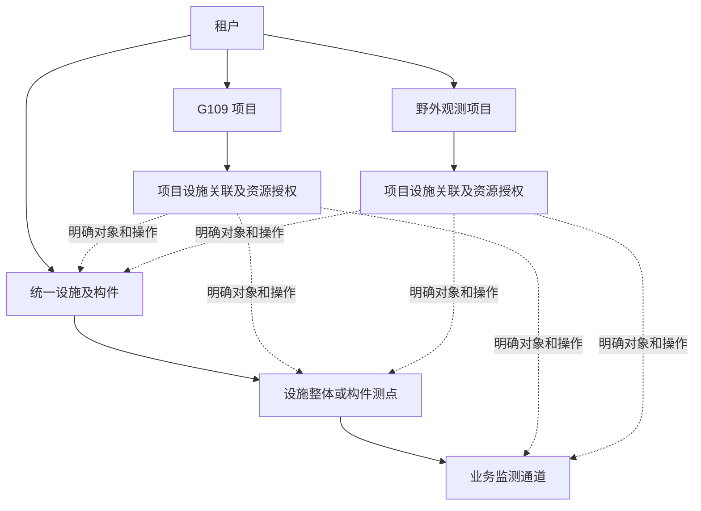
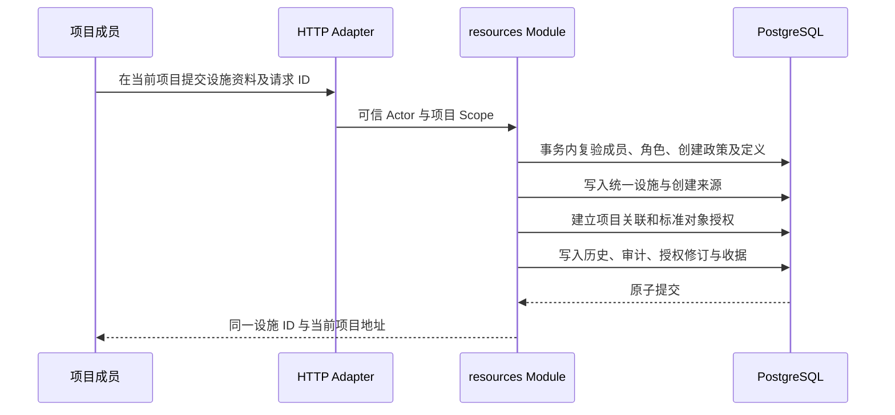

# 租户统一资源与项目授权管理重构详细方案

日期：2026-11-11。版本：V1.0。方案文档状态：**Accepted（用户于 2026-11-11 确认详细方案并授权实施）**。代码重构状态：**Awaiting acceptance（实现及自验完成，等待用户人工验收）**。

本方案指导设施、构件、测点和业务监测通道从“仅在租户工作空间维护”扩展为“租户统一保存、多个项目按授权使用和维护”。同一座 G109 桥梁可同时服务 G109 项目与覆盖 G109、G214 的野外观测项目，保留同一资源身份和连续变更历史。

用户已确认总体方向，并于 2026-11-11 确认本详细方案，授权按方案实施。原方案阶段仅交付文档的限制已被本次实施指令替代。本文的具体授权粒度、角色配置及交互规则已随详细方案确认采用；第 26 节集中列出业务取舍。文档检查、方案确认、功能自验和人工验收分别记录，不能互相替代。本次实现及自验已完成；在独立数据库完成迁移与恢复演练，未操作原业务数据库或部署生产。

文档检查记录：[方案检查](../verification/project-resource-management-refactor-plan.md)（保留方案阶段事实）。实施、自验及限制见[功能自验](../verification/project-resource-management.md)；独立运行入口与人工步骤见[操作手册](../operations/project-resource-management.md)。

实施基线：初始独立工作区 `/Users/hijacker/.codex/worktrees/e49a/InfraPro` 从已确认方案的 `4e92f95` 建立 `codex/project-resource-management` 分支；后续按用户要求合并回主工作树 `/Users/hijacker/Documents/ChatGPT/InfraPro`，保留原目录的账号、邀请流程及验收脚本修改。迁移前置 v9，新增 v10。第 26 节 D-01–D-12 随整份详细方案确认采用。

## 1 已确认方向与业务依据

| 编号 | 已确认方向 | 设计约束 |
| --- | --- | --- |
| CR-01 | 同一设施可能同时服务多个项目 | 设施与项目是多对多使用关系，不能把一个项目 ID 作为设施的唯一业务归属。 |
| CR-02 | 设施及其构件、测点、通道由租户统一管理 | 同一真实资源保存一份主档案；授权和项目切换不复制资源。租户表示系统内业务管理归属，不推定设施的法律产权。 |
| CR-03 | 项目按授权引用资源 | 角色权限、项目资源范围和资源状态共同决定操作能力。 |
| CR-04 | 项目工作台支持受限创建和维护 | 项目中的操作写回统一资源；不要求项目人员取得租户全域资源维护权限。 |
| CR-05 | 使用与维护分别授权 | 可以让两个项目读取同一测点，只让其中一个项目维护它。 |
| CR-06 | 关联设施不等于开放全部下级资源 | 支持部分构件、测点、通道授权；新对象的共享范围必须明确。 |
| CR-07 | 项目归档与资源生命周期分开 | 项目归档不删除设施、退役共享测点或停止其他项目业务。 |
| CR-08 | 业务覆盖范围不自动形成项目父子关系 | 野外观测项目通过获准资源覆盖 G109、G214；本轮不增加父子项目、路线目录或区域管理。 |
| CR-09 | 延续已确认的实例操作方式 | 直接创建和保存实际对象；不增加独立监测方案、实例草稿、完成度、发布或审批流程。 |
| CR-10 | 按已确认方案实施 | 2026-11-11 用户确认详细方案并授权重构，替代此前仅交付方案的阶段限制；功能自验与用户验收分开记录。 |

业务举例采用同一租户内的两个项目。跨租户共享、设施跨租户移交和外部单位协作另行设计，不能把本方案中的项目授权用于绕过租户隔离。

## 2 实施前基线与重构切入点

以下为方案编制时核对的基线，并非重构后的实现状态。核对工作区：`feature/tenant-project-engineering`，HEAD：`4e92f95e24eb14274d24deef2a926a56d1141c24`。源码迁移目标为 v9；本轮未连接数据库核实运行环境版本。工作区已有验收数据脚本及手册变更，本方案不覆盖这些内容。实施前重新记录实际基线。

| 当前实现 | 当前行为 | 本次需要改变的部分 |
| --- | --- | --- |
| [资源模型](../../packages/go/platform/resources/model.go)、[v9 迁移](../../packages/go/platform/migrations/00009_engineering_resources.sql) | 四类对象有稳定 UUID、tenant_id、设施内引用和编号保护，无项目使用关系 | 保留四类主表与身份，新增项目关联及明确资源授权。 |
| [资源策略](../../packages/go/platform/access/resource_catalog.go) | 所有资源操作使用租户 read/manage 权限 | 保留租户入口，新增项目策略；项目请求不得降级或回退为租户范围请求。 |
| [资源事务](../../packages/go/platform/resources/service.go)、[写操作](../../packages/go/platform/resources/mutations.go) | 同一事务执行授权、对象校验、修订、历史和收据；未检查项目引用 | 增加可信操作范围、对象授权、共享影响与原子建档授权。 |
| [资源查询](../../packages/go/platform/resources/queries.go) | 按 tenant_id 过滤列表和全设施历史 | 项目查询在 SQL 分页前应用对象授权，限制祖先摘要、历史与定义解析。 |
| [项目授权](../../packages/go/platform/access/project_authorization.go) | 已有项目成员、角色及上层资格；AllowedOperations 从项目策略枚举 | 将资源策略纳入枚举，补足统一的服务端归档写入检查，不能只扩展前端按钮。 |
| [资源前端范围](../../apps/console/src/features/resources/context.tsx) | 依赖 useTenant，列表、表单和 URL 写死租户入口 | 提炼显式范围适配，租户和项目复用同一组资源视图。 |
| [项目上下文](../../apps/console/src/features/projects/context.tsx) | 已有成员身份、授权刷新、范围清理和归档提示 | 纳入资源授权修订；相同角色权限下资源撤权也必须清理内容。 |
| [资源 HTTP 适配](../../services/api/internal/transport/http/resources/handler.go) | 按显式策略注册路由、严格解码和 256 KiB 请求上限 | 增加项目入口、授权治理入口和影响预览，继续调用完整业务操作。 |
| [平台审计](../../packages/go/platform/access/audit.go) | 排除项目事件及租户真实资源事件 | 同样排除新增授权和项目资源事件，覆盖详情、搜索与游标入口。 |

现有租户管理入口本身具有全租户资源权限。把其菜单或表单直接挂到项目下，仍会沿用全域查询和授权，不能作为本次重构的实现。

## 3 目标领域模型

### 3.1 对象关系



平台仍负责公共工程定义及系统治理。项目使用同一设施类型版本，不获得修改公共定义的能力。路线名称和项目名称不参与授权推导。

### 3.2 业务概念

| 概念 | 含义 |
| --- | --- |
| 租户统一资源 | 在租户中持有唯一身份的设施、构件、测点和通道。 |
| 项目设施关联 | 某项目使用某设施的一次关系，作为该设施资源授权的容器；结束后保留历史，重新关联建立新关系。 |
| 项目资源授权 | 租户向某项目授予指定资源的读取与可选维护能力；项目成员角色进一步限定个人可做的动作。 |
| 资源维护委托 | 项目资源授权中允许修改或新增等维护行为的部分，不改变资源归属。 |
| 上下文节点 | 为定位已授权对象而显示的最小祖先摘要；不等于获得祖先完整档案或操作能力。 |
| 创建来源项目 | 记录资源从哪个项目工作空间建档的历史事实；不授予访问权，不决定资源存续或当前主责。 |

项目关联和授权不是新的“监测方案”，没有方案编制、发布和启用流程。

### 3.3 G109 示例

| 资源 | G109 项目 | 野外观测项目 |
| --- | --- | --- |
| 桥梁 F109 及选定构件 | 可读；部分构件获准维护 | 可读 |
| 长期测点 P1 的位移通道 C1 | 可读、获准编辑 | 可读 |
| P1 的试验通道 C2 | 可读、获准编辑 | 未授权，不返回其存在性或数量 |
| 专项测点 P2 | 可读、获准维护 | 未授权 |
| G214 边坡 F214 及选定测点 | 未授权 | 可读、获准维护 |

同名、同坐标或同一指标不自动合并测点和通道。实际观测位置或不可变观测语义改变时，继续按现有规则创建新对象并处理旧对象状态。

## 4 本次重构交付范围

| 编号 | 交付 | 完成后的可观察行为 |
| --- | --- | --- |
| RR-01 | 保留统一资源并增加项目使用关系 | 同一 UUID 可在两个获准项目中打开，修改不产生副本。 |
| RR-02 | 租户管理项目资源授权 | 可按设施选择当前对象，授予读取、维护、新增及受限生命周期能力，预览、修改或撤销。 |
| RR-03 | 项目资源读取 | 列表、结构树、详情、搜索、历史、定义和计数均限定项目授权范围。 |
| RR-04 | 项目内建档 | 获准后可新建设施、构件、测点和通道；资源及当前项目授权原子保存。 |
| RR-05 | 项目内维护 | 具备角色和资源授权时修改共享档案；共享影响、并发冲突及受限操作有明确反馈。 |
| RR-06 | 生命周期和撤权 | 项目归档保留合法读取；资源授权撤销立即约束后端；结束关系不因恢复状态而复活。 |
| RR-07 | 单套前端资源视图 | 租户和项目入口复用资源表单、树、位置和历史视图，分别使用明确范围。 |
| RR-08 | 审计、收据与隔离 | 记录操作入口和授权来源；不泄露其他项目详情，旧请求不跨范围重放。 |
| RR-09 | 增量迁移和运行交付 | 保留全部已有身份和资料，默认不向任何既有项目自动授予资源。 |
| RR-10 | 自验及人工验收 | 完成共享、隔离、并发、迁移、真实浏览器及原功能回归，分别记录结果。 |

本次不实现：采集和设备控制、观测数据存储或数据时间窗授权、告警执行、报告、大屏、地图、路线目录、图纸或三维模型绑定、监测模板应用、跨租户共享、项目父子关系、批量审批、配额，以及资源独占租约。

项目告警、看板和业务成果将来归相应功能及项目管理；本轮不建立这些空表、占位菜单或虚构权限。资源读权限也不提前代表未来原始监测数据的读取权。

## 5 授权计算与作用范围

### 5.1 项目操作的必要条件

```text
项目读取 = 有效账号与会话
        ∧ 有效租户及本次租户成员关系
        ∧ 有效项目成员关系和项目角色操作权限
        ∧ 当前项目设施关联有效
        ∧ 目标对象具有当前明确授权
        ∧ 对象属于同一租户、设施且符合读取状态规则

项目维护 = 上述资格和对象范围
        ∧ 项目运行中
        ∧ 目标授权包含本次维护能力
        ∧ 对象及祖先状态允许
        ∧ 修订、共享影响、依赖与业务校验通过
```

角色之间依旧取有效权限并集；不同项目、租户与平台的权限不相加。资源授权是项目范围的上限，项目管理员不能通过给成员配置角色扩大这个上限。

本轮项目内具有相同读取权限的成员使用同一份项目资源范围；成员角色区分操作能力，不另增加成员级对象清单或个人资源 ACL。

租户入口继续使用租户角色。一个账号即使同时持有租户全域维护权和项目角色，从项目入口操作时也必须满足项目范围。需要使用租户能力时，主动切换工作空间并重新发起操作，不能由服务端静默回退。

### 5.2 没有既有目标的新设施创建

新设施创建没有可提前授权的对象，使用两个条件：租户为该项目开启“允许新建设施并维护新建资源”，且当前成员拥有项目新建设施及公共目录读取权限。该项目开关默认关闭，与已有设施的维护授权分开。

创建成功后同时建立资源、项目设施关联及标准创建授权。创建者没有额外个人所有者权限；后续访问仍由项目成员关系、角色和当前资源授权决定。关闭创建开关只禁止继续新建设施，不撤销已创建对象的现有授权。

### 5.3 默认拒绝及信息投影

- 跨租户、跨项目、未授权对象的直接请求统一返回不可访问；不先读取名称再判断范围。
- 搜索、分页、计数、树节点、定义依赖、历史、错误依赖和收据使用相同范围。
- 权限解释只返回当前项目的角色及资源授权来源；不能列出其他项目名称、人员或规则。
- 后端按数据库当前状态判断权限；Redis、浏览器状态和按钮是否可见均不能代替检查。

## 6 资源选择与授权规则

### 6.1 明确对象授权

每条有效对象授权必含读取能力，可附加第 7 节允许的维护能力。选择设施时建立设施基本档案的读取授权；构件、测点、通道分别选择，不向下自动继承。

“选择当前全部下级”是授权编辑器中的批量选取操作，服务端在预览时展开为当前明确对象 ID 集合。它不保存通配符、不订阅未来新增对象，也不把当前页勾选错误地解释为全部数据。

新增测点和通道的规则：

1. 租户入口新增：默认不加入任何项目；后续明确授权。
2. 项目入口新增：原子加入当前项目，并授予第 8 节规定的标准创建能力。
3. 其他项目：不因共享父设施、构件或测点而自动得到新对象。
4. 追加到其他项目：租户授权人员明确选中并提交；不需要复制对象。

### 6.2 祖先摘要及结构树

授权一个通道后，界面需要知道其测点、构件路径和设施。未被直接授权的祖先只返回上下文摘要：ID、名称、编号、类别键、父级关系和状态；不返回工程属性、精确位置、自由说明、历史、其他下级数量或操作按钮。

上下文节点使用 `visibility=context`，明确标注“仅用于定位已授权资源”。直接授权节点使用 `visibility=full`。上下文节点详情地址不能返回完整 Resource。根设施基本档案已随关联显式授权；中间构件或测点的摘要不隐式变为完整授权。

构件树只展开直接授权节点及通向获准后代的路径。相同祖先去重，未授权兄弟节点不出现。`has_visible_children` 只依据可见集合计算；不返回全库的 `HasChildren` 或隐藏对象数量。

### 6.3 关联与授权的生命周期

- 同一项目和设施最多一条有效关联；关联有 `active/revoked` 两态。
- 结束关联同时结束其全部当前对象授权，保留变更记录。
- 重新关联建立新 link_id，必须重新选择范围，不恢复原授权。
- 取消某对象的完整读取同时取消其维护能力；若仍是其他获准对象的祖先，可保留最小上下文摘要，预览必须说明。
- 取消设施根读取意味着结束整条关联，不能保留无根的对象授权。
- 更新能力或结束授权记录变更历史；已结束的对象授权再次授予使用新 grant_id。
- 资源授权授予项目，不绑在某个项目管理员身上。管理员交接不自动撤销合法项目资源范围；旧管理员结束成员关系后不能继续访问。

### 6.4 批量范围与提交边界

授权写操作以一个项目的一座设施为事务边界，每次最多处理 1,000 个明确对象；超过时要求分批选择和确认，不静默截断。批次内全部成功或全部失败。不同设施的提交分别有独立结果和收据，不承诺跨设施原子性。

预览与提交均验证同租户同设施、对象存在、状态可授权、能力适用、当前关联及项目状态。对“选择当前全部”的再次展开集合发生变化时返回预览失效，不把并发新增对象悄悄纳入授权。

## 7 维护能力及对象生命周期

### 7.1 能力矩阵

下表是资源授权可以包含的能力，不代替成员角色权限。`read` 由有效授权记录表达，其余能力使用明确字段保存。

| 目标 | read | update | create_component | create_point | create_channel | lifecycle |
| --- | --- | --- | --- | --- | --- | --- |
| 设施 | 完整设施基本档案 | 名称、属性、位置、说明 | 新增设施根构件 | 新增设施整体测点 | 不适用 | 项目不提供 |
| 构件 | 该构件完整档案 | 名称、属性、位置、说明 | 新增直接子构件 | 在该构件新增测点 | 不适用 | 受限退役、恢复 |
| 测点 | 该测点完整档案 | 现有可编辑资料及受控归属纠正 | 不适用 | 不适用 | 为该测点新增通道 | 受限退役、恢复 |
| 通道 | 该通道完整档案 | 名称、说明、计划采样描述 | 不适用 | 不适用 | 不适用 | 受限退役、恢复 |

通道的指标、单位、方向、参考基准、时间及统计含义继续按现有不可变语义处理。当前计划采样字段只描述计划，不产生设备控制。项目中的表单不改变这条约定。

### 7.2 结构修改

- 构件创建沿用类型版本、类别、允许父子关系、最大数量及无环校验；最少构件数量继续只作参考。
- 项目允许在明确获准的父对象下创建构件。创建根构件检查设施的 create_component；创建子构件检查直接父构件的该能力。
- 已有构件调整父级涉及整棵下级结构，本次保留在租户入口；项目 PATCH 中出现 parent_component_id 变更时明确拒绝，不忽略字段。
- 项目纠正测点所属构件，除测点 update 外，还要求目标构件完整读取及 create_point；改到设施整体则检查设施的 create_point。仍限同设施，并执行共享影响预览。
- 租户调整构件结构或测点归属后，明确对象授权仍跟随原 ID；各项目的祖先摘要重新计算，不根据新父级继承新权限。

### 7.3 退役与恢复

项目可以对明确授予 lifecycle 的构件、测点、通道执行受限退役和恢复，必须同时满足：项目运行中；所有实际受影响的下级对象都在本项目完整读取及 lifecycle 范围内；不存在其他未撤销项目关联对目标及受影响下级的直接或上下文依赖。已归档项目的有效引用也计入保护。

是否存在其他使用方依据未撤销关联和当前授权判断，不依据其他项目当前是否有人在线、成员是否暂时暂停或是否刚读取过数据。

上述条件不满足时返回需要租户统一处理的说明，不返回其他项目名称或未授权子项数量。恢复同样检查共享及下级范围，不能利用恢复操作改变其他项目依赖的资源状态。

设施整体退役、恢复，及所有种类的软删除，保留在租户入口。项目页面的“移出项目”表达资源授权撤销，不调用资源删除或退役接口。

租户可以按实际工程情况退役共享资源，但必须预览影响并填写原因；保留关联、授权及历史，其他项目显示实际退役状态并禁用不允许的写入。资源恢复不恢复已撤销的授权或已结束成员关系。

### 7.4 删除保护

在现有未删除子项保护之外，租户软删除还检查有效项目引用，包括已归档项目和上下文路径依赖。存在引用时拒绝，要求先明确解除相应授权；不得由删除动作自动撤销其他项目资源范围。

已撤销关联、历史授权和历史快照不阻止软删除，但保留原身份和编号。删除后不增加恢复或彻底清除入口。生命周期操作不包含未来采集任务停止、告警任务取消等未实现行为。

## 8 项目内创建与资源复用流程

### 8.1 已有设施进入项目

1. 租户有权人员从“项目资源授权”选择目标项目及已有设施。
2. 选择当前构件、测点和通道，以及允许的维护能力。
3. 预览实际新增、撤销及能力变化，确认后一次提交。
4. 项目有权成员在“项目设施”立即看到获准资源；不需要额外接受流程或再次复制设施。

项目工作台默认直接展示全部已授予设施，不增加第二层“已授权但还未加入项目”的开关。项目人员也不能查询租户全设施目录后自行关联；复用尚未授权的资源由租户授权人员完成。本轮不增加申请单或审批模块。

### 8.2 项目新建设施



标准创建授权为该对象在第 7.1 节的全部适用能力。设施不包括 lifecycle；构件、测点和通道的 lifecycle 仍受第 7.3 节限制。授权授予当前项目，实际成员操作继续与角色权限取交集。

开启项目新建政策、授予 create_component/create_point/create_channel 时，界面明确说明“项目可新增，并维护其新建对象及获准继续创建的下级”。不能将此解释为仅一次创建权，也不能因此维护已有兄弟对象。

### 8.3 在已有设施中创建下级

1. 项目成员选中完整授权的设施、构件或测点。
2. 服务端检查目标的对应 create 能力和成员角色权限。
3. 保存新对象，并在同一条有效项目设施关联中建立标准创建授权。
4. 增加项目资源授权修订，写入资源历史、授权历史、项目操作摘要和收据。
5. 其他项目的对象授权集合保持原值；当前项目创建来源不会向其暴露。

资源插入、关联或授权任一步失败，整个事务回滚。不得出现“保存成功，但项目人员无法读取刚创建对象”或“已授权一个不存在对象”的中间状态。

### 8.4 编号和重复建档

沿用现有编号唯一范围和删除后保留规则。项目新建设施的编号仍须在租户内唯一。与未授权资源编号冲突时只提示“编号已占用或保留”，不返回目标 ID、名称、项目或可访问链接。

不能仅凭名称、坐标、路线桩号自动去重或自动关联。界面提醒优先复用已获准的既有设施；无权访问的已有设施由租户授权人员核对。资源维护人后续变动不改写 created_by 或创建来源项目。

## 9 共享修改与影响预览

### 9.1 哪些操作必须预览

| 操作 | 预览规则 |
| --- | --- |
| 项目创建政策、关联和对象授权的设置或撤销 | 始终预览，列出实际范围及变化。 |
| 修改存在其他项目直接或上下文依赖的公共资源 | 预览实际修改字段及共享影响；填写原因。 |
| 测点归属纠正、租户构件父级调整 | 始终预览结构及引用影响；填写原因。 |
| 退役、恢复、删除 | 始终预览，包括不可执行原因。 |
| 单项目独用资源的一般资料编辑、新增对象 | 按普通保存处理，不增加确认弹窗；仍验证修订和权限。 |

字段没有实际变化时不生成资源变更历史，不借此绕过授权或收据校验。普通 PATCH 若在提交时发现对象已变为共享且未带有效预览，返回 preview_required，保留输入并引导完成预览。

### 9.2 展示内容

租户授权查看者可看到获准治理范围内的关联项目名称、对象和能力；同时要求租户项目治理读取权限。只有资源维护权而无授权查看能力时，仍可按既有职责维护，但影响提示只显示存在其他使用方，不暴露其项目列表。

项目视图显示当前项目的影响，以及“此修改会影响其他使用该资源的项目”。不显示其他项目数量、名称、成员、规则或未授权下级详情。服务端内部照常检查完整依赖，不能因投影受限而漏判。

### 9.3 预览一致性

沿用现有项目变更的“预览摘要—提交复验”方式。preview_hash 由规范化指令、Actor/操作范围、项目状态及版本、项目资源授权修订、关联和授权版本、目标资源修订、相关结构及实际影响集合计算。

提交在同一锁序下重新计算，摘要不一致返回 409 preview_changed。摘要用于一致性检查，不作为权限凭据；无论摘要是否匹配都重新执行授权与业务校验。预览本身不持久化业务变化，不新增审批状态或常驻任务。

## 10 项目及上层生命周期联动

| 变化 | 当前读取 | 新增和修改 | 关联及历史 |
| --- | --- | --- | --- |
| 项目运行中 | 满足角色和资源范围后允许 | 满足委托及对象规则后允许 | 正常维护 |
| 项目归档 | 保留当前合法读取 | 禁止项目资源写入、新建政策扩权、关联及授权扩张 | 租户可缩减或撤销范围；不删除统一资源 |
| 项目恢复 | 按当前成员、角色及授权重新判断 | 当前仍有效的授权可恢复执行 | 不恢复 revoked 关联、结束授权和已结束成员 |
| 租户停用 | 依照现有租户业务访问规则停止 | 停止 | 保留关系及历史；恢复后按当前真实资格计算 |
| 账号或租户成员暂停 | 该人失去访问 | 该人失去操作 | 项目资源关系仍属于项目，不因个人暂停消失 |
| 租户成员结束 | 旧项目成员资格结束 | 旧资格不能再写入 | 再加入使用新成员 ID；不继承旧成员角色或收据上下文 |
| 项目成员暂停、移除或角色撤权 | 按既有规则失去相应访问 | 即时拒绝不再获准操作 | 不改变其他成员及其他项目的资源范围 |
| 撤销一个对象授权 | 对象完整内容及历史不可再读取 | 停止全部对象维护 | 若为其他授权对象祖先，只保留必要摘要 |
| 撤销项目设施关联 | 关闭该关联下全部当前资源访问 | 停止 | 资源及其他项目关联保持有效；重新关联使用新 ID |

归档期间只允许严格缩减资源授权：after 的对象及能力集合必须为 before 的子集；关闭新建政策允许，开启禁止。不能通过“修改已有关系”伪装扩权。新建关联、新授予对象及恢复已结束关系均禁止。

项目归档保留读取的共享资源是当前档案，不是归档时整库快照。其他获准维护方仍可更新统一资源，页面标明“共享资源当前资料”，历史保留变更。需要固定交付时点的报告或资源快照属于后续成果功能，不在本次隐式建立。

撤权成功返回后，新请求必须使用新权限。已在撤权事务前取得授权锁并提交的合法写入不追溯撤销；测试通过控制事务顺序验证两种情况。浏览器通过授权修订、操作返回、聚焦和轮询感知变化，不承诺不存在的推送能力。

## 11 权限目录与角色接入

### 11.1 租户权限

保留 tenant.engineering.resource.read/manage。新增：

| 权限编码 | 用途 | 租户自定义角色可选 |
| --- | --- | --- |
| tenant.engineering.resource.authorization.read | 查看项目资源关联、授予能力及授权历史 | 是 |
| tenant.engineering.resource.authorization.manage | 配置新建政策、授予、缩减或撤销项目资源范围 | 是 |

授权读取同时要求资源 read 和 tenant.project.read；授权写入同时要求上述 read、authorization.read、authorization.manage 及 resource.manage。授权治理接口不要求操作者是目标项目成员，只返回资源治理需要的项目摘要，不开放项目私有业务内容。

### 11.2 项目权限

以下九项均可分配给项目自定义角色；自定义角色及普通成员角色不因升级自动取得它们，内置管理员的明确调整见第 11.3 节。

| 权限编码 | 行为与配套要求 |
| --- | --- |
| project.engineering.resource.read | 读取当前项目获准对象及自身授权解释。 |
| project.engineering.resource.update | 更新获准对象；还需 resource.read、对象 update 及项目可写。 |
| project.engineering.resource.history.read | 读取获准对象的经过投影的资源历史；还需 resource.read。 |
| project.engineering.resource.lifecycle | 对允许的构件、测点、通道退役或恢复；还需 read、目标 lifecycle 及第 7 节保护。 |
| project.engineering.facility.create | 新建设施；还需 read、catalog.read、项目新建政策及项目可写。 |
| project.engineering.component.create | 在获准父对象下新建构件；还需 read 和目标 create_component。 |
| project.engineering.point.create | 在获准设施或构件下新建测点；还需 read 和目标 create_point。 |
| project.engineering.channel.create | 在获准测点下新建通道；还需 read、catalog.read 和目标 create_channel。 |
| project.engineering.catalog.read | 为项目建档读取当前可采用的公共类型、指标与单位目录；不含平台草稿或租户私有模板。 |

读取现有资源携带的固定定义不另要求 catalog.read，且不因定义当前停用而失去历史解释。新增对象选择定义仍遵守现有可采用性和依赖检查。

### 11.3 内置角色及解释

- tenant_admin 增加两项租户资源授权能力；平台角色保持原有范围，不增加租户或项目旁路。
- project_admin 增加上述九项项目资源权限，能力仍受租户授予项目的对象范围及新建政策约束。
- 新增可手动分配的 project_resource_reader、project_resource_maintainer 预置角色，分别含 read/history 与九项项目资源权限，并配套 project.profile.read。维护角色不授予租户授权治理能力。
- project_member、其他既有预置角色及所有自定义角色不自动扩权；目录同步不自动向普通成员绑定新角色。
- 项目角色编辑器展示依赖要求和实际效果，复用既有角色授予覆盖检查；直接调用接口不能绕过配套权限。

必须同步修改策略注册、目录生成、内置角色、授权解释和测试断言。当前 ExplainProject 只遍历 projectPolicies，新增资源策略须进入统一的 project 类策略枚举。ProjectActiveOnly 与服务端 RequireProjectTx 必须一致禁止归档资源写入；不能只依靠 AllowedOperations、页面禁用或某个 HTTP handler 的局部校验。

## 12 数据结构及完整性约束

本节所有新增表和字段均为计划内容。继续使用 PostgreSQL 关系表、组合外键及显式检查，不新增通用权限引擎或以 JSON 权限树替代可校验的对象引用。

### 12.1 项目资源政策

`project_resource_policies`：

| 字段 | 规则 |
| --- | --- |
| tenant_id、project_id | 组合主键，组合外键指向同租户项目。 |
| allow_facility_create | 默认 false。 |
| revision | bigint，初始 1；该项目任何政策、关联或对象授权变化后递增。对外作为字符串。 |
| updated_at、updated_by | 服务端维护；初始化时 updated_by 可空，表示系统初始化，不伪造用户操作。 |

为已有项目初始化关闭政策；新建项目在既有创建事务中插入默认政策。资源事务发现缺行应报告结构异常，不把缺行解释为允许创建。项目资料 version 与资源授权 revision 分开，避免无关资料编辑阻塞授权表单。

### 12.2 项目设施关联

`project_facility_links`：id、tenant_id、project_id、facility_id、status、revision、created_at/by、revoked_at/by、revoke_reason。

- 同租户项目与设施组合外键；`UNIQUE(tenant_id,project_id,facility_id,id)` 供下级授权使用。
- `(tenant_id,project_id,facility_id) WHERE status='active'` 部分唯一索引。
- active 时撤销字段为空，revoked 时原因和操作者完整；revoked 不改回 active。
- 创建来源不决定关联主责。关联不能迁移到另一项目或设施，也不能物理删除。

该关联下的对象授权新增、能力修改、结束以及关联撤销都递增 link revision；同一次指令只递增一次。项目政策 revision 同时递增，单条 grant revision 只在该条能力或状态变化时递增。无实际变化的指令不写变更历史或递增修订，但可保存幂等收据。

### 12.3 明确对象授权

`project_resource_grants`：

| 字段 | 规则 |
| --- | --- |
| id、tenant_id、project_id、facility_id、link_id | 关联同一租户、项目、设施和 link_id；组合外键约束。 |
| resource_kind | facility、component、point、channel。 |
| component_id、point_id、channel_id | facility 时全空；其他 kind 只允许对应的一列非空，各列组合外键指向同租户同设施的真实对象。不能只存一个无外键的 resource_id。 |
| can_update、can_create_component、can_create_point、can_create_channel、can_lifecycle | 明确布尔字段；按第 7.1 节建立 kind 与能力组合 CHECK。有效行即包含 read。 |
| source | tenant_grant 或 project_create；由服务端决定。 |
| revision、granted_at/by、ended_at/by、end_reason | 每次修改保留历史；结束记录不复活。 |

每个 kind 分别建立“同 link_id、同目标、ended_at 为空”的部分唯一索引。对 facility 使用 link_id 唯一，对其余使用 link_id 与相应目标 ID 唯一；避免 PostgreSQL NULL 语义造成重复当前授权。

延迟约束或等价约束触发器保证：有效关联至少包含一条当前 facility 授权；revoked 关联不存在当前 grant；不能给已删除资源新增授权。允许给未删除的退役对象授予读取或能力，但实际维护仍受状态规则限制。

祖先摘要是查询结果，不持久化为可升级的授权行。撤销点位完整授权但保留其通道授权时，不需要删除通道授权；该点位会变成上下文节点。

### 12.4 授权历史和新操作收据

新增 `project_resource_access_changes`：tenant_id、project_id、access_revision、link_id（可空）、operation、actor_id、actor_scope、actor_membership_id、request_id、reason、before、after、changed_at。

before/after 保存本次政策或授权集合的必要快照；采用 `(tenant_id,project_id,access_revision)` 唯一约束。作为独立业务历史，不依赖普通账号安全事件的保留期，不允许日常更新或删除。

新增 `project_resource_operation_receipts`，供新增租户授权治理与项目资源操作使用：entry_scope、tenant_id、project_id、actor_id、request_id、operation、payload_hash、fingerprint_version、tenant_membership_id、project_membership_id（租户治理可空）、link_id（政策操作可空）、target_kind/id、result、created_at。

主键为 `(entry_scope,tenant_id,project_id,actor_id,request_id)`，指纹仍包含操作、完整目标、规范化内容及成员上下文。项目资源收据保存实际创建或使用的 link_id；租户治理收据不要求操作者成为项目成员。

### 12.5 现有表增量字段

- 四类工程资源增加 nullable created_project_id，使用同租户项目组合外键。旧资源保持 null，含义为既有租户来源；不根据创建人所属项目、名称或路线推断。新增来源列纳入不可变字段保护。
- engineering_resource_changes 增加 actor_scope、actor_project_id、actor_tenant_membership_id、actor_project_membership_id、actor_link_id。旧记录 actor_scope=tenant，无法确证的成员字段为 null；不回写既有 before/after。
- 资源返回中只在租户获准治理视图或当前创建来源项目中展示来源项目；其他项目不返回该 ID 或名称。
- 既有 engineering_resource_receipts 保留主键及历史数据。为扩展预览字段后的指纹兼容增加 fingerprint_version，旧行为按 v1 计算，新写入按 v2；旧租户收据不通过项目入口读取。
- 不给四类资源增加决定所有权的 owner_project_id 或必填 project_id，不迁移 UUID、编号、定义版本或业务内容。

### 12.6 索引与查询成本

为有效关联建立项目设施列表、设施反查项目索引；为当前 grant 按 link/kind/target 建立唯一及查询索引；授权历史按 project/changed_at/id、收据按其主键查询。共享影响使用直接授权及祖先关系的批量查询，不逐对象逐项目发起 N+1 查询。

默认列表 25 条，上限 100；授权预览上限见第 6.4 节。测试使用超过一页的数据验证分页前过滤。上线前在隔离测试数据上检查查询计划及实际延迟，不在本方案声称未经测量的容量或吞吐量。

## 13 后端 Module 与 Interface 设计

### 13.1 职责

| Module | 拥有的行为 | 不承担的行为 |
| --- | --- | --- |
| access | 账号/成员/角色有效性、平台统一权限目录、范围策略、授权锁和全局修订 | 不存放设施树、项目对象授权 SQL 或资源字段修改规则。 |
| resources | 实际资源、项目关联和对象授权、影响计算、完整事务、资源与授权历史、范围投影 | 不管理项目成员生命周期，不编制公共工程定义。 |
| projects | 项目、成员、角色、归档和恢复；新建时初始化资源政策 | 不复制资源 CRUD；归档依靠共同授权锁和项目状态约束，不逐个删除资源。 |
| engineering | 公共定义、可采用版本及固定依赖解析 | 不决定项目成员能操作哪些现场对象。 |
| HTTP Adapter | 严格解码，按注册路由构造范围，提供可信 Actor，映射响应 | 不拼接多个独立写事务，不依靠请求体选择授权范围。 |

依赖保持 resources → access/engineering、projects → access。在 projects 的既有创建事务中插入默认资源政策行，由数据库默认值确定关闭状态；resources 拥有后续政策业务规则。旧项目由迁移一次性补齐。projects 不导入 resources，也不复制授权治理业务。

### 13.2 范围与公开调用面

resources 使用一个显式 Scope 值，包含 kind（tenant/project）、tenant_id、project_id（仅 project 时必填）；从已注册路径构造。目标只表达资源 kind、facility、point 和 id，不能覆盖 Scope。非法组合在进入查询前拒绝。

保留 List、Detail、Changes、Mutate、Receipt 的完整业务操作形式；将现有租户参数改为 Scope，内部集中分派租户或项目授权。新增 PreviewMutation、AccessDetail、PreviewAccessChange、ChangeAccess、CatalogList、CatalogVersion 等按用例组织的操作。

所有公开写操作自行开始并完成事务。HTTP 不取得裸 pgx.Tx，不接受调用者传入“已授权=true”或任意 SQL 过滤片段。内部将当前有效资格与对象能力封装为只在本次事务有效的结果，供校验、查询和投影共用，不能长期缓存这个结果。

### 13.3 共享实现的改造顺序

1. 先使租户现有入口通过 Scope 运行，保持既有行为和测试通过。
2. 把对象字段校验、定义解析、结构校验、保存、历史写入留在共同内部函数。
3. 增加项目资格及对象授权解析，把授权条件应用到实际 SQL；不复制一套项目资源 CRUD。
4. 创建场景在共同保存流程后、同一事务内补充项目关联及授权。
5. 租户和项目分别投影详情、动作、历史、来源和影响，禁止返回全量 JSON 再在前端删字段。

engineering 对项目目录选择器提供有限的事务内公共查询与解析函数，复用现有可采用性规则。项目不能冒用 tenant.catalog 权限，也不能通过版本查询读取平台草稿、无关历史版本或租户私有模板。

## 14 事务与并发设计

### 14.1 锁模式

| 操作 | 授权状态锁 | 资源行锁及其他要求 |
| --- | --- | --- |
| 范围内读取、历史、预览 | 共享 | 需要一致资源快照时锁设施 FOR SHARE。 |
| 普通租户或项目资源编辑、生命周期操作 | 共享 | 当前账号/会话复验后锁设施 FOR UPDATE；项目状态及授权在共享授权锁期间稳定。 |
| 项目新建设施或下级对象 | 排他 | 会创建授权并递增授权修订，必须从事务开始取排他锁。 |
| 新建政策、关联、授权变更和撤权 | 排他 | 项目、政策、设施、关联及目标授权按统一顺序处理。 |
| 项目归档、成员和角色变更、租户停用 | 沿用既有排他授权锁 | 与资源操作序列化，避免先检查后撤权仍执行。 |

统一顺序：授权状态锁 → 相关账号按 UUID 排序 → 会话复验 → 租户/成员及项目状态 → 项目资源政策（需要修改时）→ 工程目录共享锁（涉及定义时）→ 设施按 UUID 排序 → 关联/对象授权 → 资源对象 → 历史、收据与审计。

创建新设施前没有设施行，先锁项目政策，再插入新设施和关联。已有设施下创建对象仍锁设施行，与原有触发器顺序一致。不得先取共享授权锁，再为写授权记录升级为排他锁。

普通资源资料变化不递增项目资源授权 revision；对应资源 revision 和必要的 structure_revision 继续负责内容并发。资源状态影响动作时，由当前数据重新计算，前端刷新相应资源。授权集合变化则递增项目政策 revision 并调用 access.Bump，不能借用资源 revision 代替授权修订。

### 14.2 一次提交的内容

项目新建对象：资源写入、创建来源、关联/授权、授权修订、资源历史、授权历史、项目审计及收据全部原子提交。

授权变更：政策/关联/授权差异、项目授权修订、全局授权修订、独立授权历史、各范围安全审计摘要及收据全部原子提交。

普通修改：当前资格和对象授权复验、共享影响、资源/结构修订、资源历史、当前操作范围审计和收据全部原子提交。

### 14.3 必须验证的竞争

- 撤销授权与创建测点：撤权先完成则创建拒绝；创建先完成则撤权预览必须重新反映新增授权。
- 项目归档与新建设施：不能留下已归档项目在归档后新增的资源或半条关联。
- 两项目编辑同一测点：共享同一资源 revision，后提交者收到冲突并保留输入。
- 租户“选择当前全部”与项目新增通道：提交集合变化触发 preview_changed。
- 退役/删除与追加项目引用：按完整当前引用决定结果，不能穿透保护。
- 项目重新关联与旧收据重放：旧 link_id 的收据不提供新关系的操作依据。

保持当前 PostgreSQL 授权锁方案，先验证正确性。锁粒度优化必须另有实测依据；本次不引入分布式锁或后台最终一致授权同步。

## 15 HTTP 契约

路径缩写：T=`/api/v1/tenants/{tenant_id}`，P=`T/projects/{project_id}`，TR=`T/engineering/resources`，PR=`P/engineering/resources`。缩写仅用于本文，OpenAPI 必须展开为实际路径。

操作标识同样区分入口：现有租户操作保留 Resource 命名空间；项目资源使用 ProjectResource；租户项目资源治理使用 ProjectResourceAccess。PolicyFor、策略注册、审计及收据不能让同一个 operation ID 同时代表租户和项目授权。

### 15.1 租户资源授权治理

| 方法及路径 | 用途 |
| --- | --- |
| GET T/engineering/resources/facilities/{facility_id}/project-usage | 分页查看当前使用设施的项目，包含归档项目；应用相同租户治理权限组合。 |
| GET T/projects/{project_id}/resource-access | 当前政策、授权修订及关联摘要，独立分页。 |
| GET T/projects/{project_id}/resource-access/changes | 授权历史；应用租户授权查看权限。 |
| POST T/projects/{project_id}/resource-access/policy/preview | 预览开启或关闭新建设施政策。 |
| POST T/projects/{project_id}/resource-access/policy | 按预览更新政策。 |
| GET T/projects/{project_id}/resource-access/facilities/{facility_id} | 当前关联、分页对象授权及候选树；候选分页独立参数，不一次返回整座设施。 |
| POST T/projects/{project_id}/resource-access/facilities/{facility_id}/preview | 预览 create_link、change_grants 或 revoke_link 指令。 |
| POST T/projects/{project_id}/resource-access/facilities/{facility_id}/changes | 执行已预览指令。 |
| GET T/projects/{project_id}/resource-access/requests/{request_id} | 仅当前操作者的租户授权治理收据。 |

授权变更使用增量 add/update/end，不用“用当前页替换全部授权”。要求 expected_access_revision、expected_link_revision（新关联为空）、request_id、reason、preview_hash。对象输入只允许一种类型引用及该类型适用能力；拒绝未知字段和跨设施 ID。

add 使用 kind 与相应 component_id/point_id/channel_id（facility 不填目标 ID，取路径设施），capabilities 为去重后的允许能力列表且必含 read。update 使用 grant_id、expected_revision 和完整的新能力列表；end 使用 grant_id、expected_revision。create_link 必须含且仅含一条设施根授权；revoke_link 不接受额外 add/update/end。

“选择当前全部下级”通过仅用于本次指令的 select_current 表达：明确根对象、所选种类和对应能力。预览与提交使用同一选择表达式，在设施锁内重新展开、去重和限制数量；预览返回规范化对象差异及摘要。表达式不存入长期授权，不支持任意条件语言；同一目标在 add/update/end 或展开结果中发生矛盾时拒绝。提交不能只发送旧预览中的 ID 数组并丢弃该选择意图。

以下为已有关系追加对象的预览输入；提交时保持内容与 request_id 不变，并追加返回的 preview_hash：

```json
{
  "request_id": "20000000-0000-4000-8000-000000000001",
  "action": "change_grants",
  "expected_access_revision": "7",
  "expected_link_revision": "2",
  "add": [
    {
      "kind": "point",
      "point_id": "20000000-0000-4000-8000-000000000002",
      "capabilities": ["read", "update", "create_channel"]
    },
    {
      "kind": "channel",
      "channel_id": "20000000-0000-4000-8000-000000000003",
      "capabilities": ["read"]
    }
  ],
  "update": [],
  "end": [],
  "reason": "将长期观测资源授权给本项目"
}
```

### 15.2 项目资源操作

| 方法及路径 | 用途 |
| --- | --- |
| GET/POST PR/facilities | 项目获准设施列表 / 新建设施。 |
| GET/PATCH PR/facilities/{facility_id} | 设施详情 / 获准修改。 |
| GET/POST PR/facilities/{facility_id}/components | 可见构件及上下文路径 / 获准新增构件。 |
| GET/PATCH PR/facilities/{facility_id}/components/{component_id} | 完整授权构件详情 / 允许字段修改。 |
| GET/POST PR/facilities/{facility_id}/points | 获准测点列表 / 新增测点。 |
| GET/PATCH PR/facilities/{facility_id}/points/{point_id} | 获准测点详情 / 修改。 |
| GET/POST PR/facilities/{facility_id}/points/{point_id}/channels | 获准通道列表 / 新增通道。 |
| GET/PATCH PR/facilities/{facility_id}/points/{point_id}/channels/{channel_id} | 获准通道详情 / 修改。 |
| POST 对应构件、测点、通道路径/retire 或 /restore | 第 7 节允许的受限生命周期操作。 |
| POST 对应资源路径/mutation-preview | 预览 update/retire/restore；不执行修改。 |
| GET PR/facilities/{facility_id}/changes | 只查询当前完整授权对象的资源历史。 |
| GET PR/requests/{request_id} | 当前操作者、当前项目及有效原关系的资源操作收据。 |
| GET P/engineering/catalog/{kind} | 可采用的公共 type-definitions、metrics、units 目录。 |
| GET P/engineering/catalog/{kind}/versions/{version_id} | 可采用公共版本详情；已有资源的固定历史版本由资源详情带出。 |

项目不注册设施 retire/restore、任何 delete 或授权扩张端点。注册缺失的路由按照现有受保护路由规则返回 404/405，禁止落到租户处理器。

### 15.3 现有租户接口

保留 TR 下的既有路径，增加相应 mutation-preview，并在 PATCH、retire、restore、delete 接受预览字段和必要原因。所有共享影响及引用保护同时覆盖租户入口，不能只保护新项目路由。

未共享对象的一般资料编辑保持原请求可用；需要预览的旧客户端请求返回明确 preview_required，而不是悄悄执行或返回不明错误。开发交付必须说明这一写入契约扩展，并同步 console 和 OpenAPI。

### 15.4 查询与响应约定

- 项目查询的作用范围、成员身份、link_id、access_revision 和规范化筛选参与游标范围；旧游标在授权变更后失效并要求回到第一页。
- 列表只按可见集合计算下一页及数量；历史先按当前明确授权过滤，再排序、分页和解析定义。
- 详情包含 resource、获准祖先/上下文摘要、固定 definitions、逐动作 actions、当前 access_revision/link_id、shared 布尔标识。
- actions 使用 read/update/create_component/create_point/create_channel/retire/restore 等逐项能力，不再用一个 canManage 控制全部按钮；对被拒动作给出适合当前范围的原因。
- 资源 revision 沿用现有字段类型；新增 bigint 授权修订通过十进制字符串传输，客户端不能自行递增。
- 写请求继续做 Origin、CSRF、严格 JSON、请求体上限和重复查询参数校验；预览 POST 也不能豁免。

项目写请求必须带 expected_access_revision；已有设施下的操作另带 expected_link_revision，新建设施不接受不存在的 link 修订。修改、退役、恢复还需目标 expected_revision；构件创建等实际结构操作继续要求 expected_structure_revision。租户普通资源请求不强制增加项目修订字段。预览读取这些期望值但不消费 request_id；正式提交才保存收据。

新增项目测点的请求形态示例，UUID 仅为文档示例：

```json
{
  "request_id": "10000000-0000-4000-8000-000000000001",
  "expected_access_revision": "7",
  "expected_link_revision": "2",
  "component_id": "10000000-0000-4000-8000-000000000002",
  "code": "P-G109-03",
  "name": "主梁位移观测点",
  "purpose": "长期位移观测",
  "position": null
}
```

响应除原有 ID 和修订外，携带实际 project_id、link_id、新 access_revision 及当前项目的可访问结果地址所需参数；不返回其他项目关系。路径租户和项目、来源项目及操作者都由服务端确定，请求体不能指定。

## 16 错误、修订及幂等处理

### 16.1 业务错误

| HTTP / code | 含义 | 前端行为 |
| --- | --- | --- |
| 403 permission_denied | 当前范围缺少操作权限 | 刷新授权；清理已失去读取资格的内容，保留仍可读取对象的非敏感输入。 |
| 404 project_not_found / resource_not_found | 项目或资源不存在、跨范围或无权访问 | 使用统一不可访问提示，不展示其他范围资料。 |
| 409 project_archived | 项目已归档，操作将写入或扩权 | 保留可读页面，结束写入并提示恢复项目后重新核对。 |
| 409 resource_access_changed | expected_access_revision 或关联修订失效 | 刷新当前范围，复核表单；不能自动重放写请求。 |
| 409 preview_required / preview_changed | 需要影响确认，或确认依据已变化 | 保留仍获准的输入，重新预览，由用户再次提交。 |
| 409 resource_revision_conflict / structure_revision_conflict | 对象或结构被并发修改 | 显示新的资料与冲突说明，不能静默覆盖或只换修订重试。 |
| 409 shared_resource_tenant_action_required | 项目生命周期操作影响其他项目或范围不完整 | 提示由租户有权人员统一处理，不透露隐藏对象数。 |
| 409 resource_referenced | 删除仍有子项或项目引用 | 按调用者权限展示依赖；无权查看的部分只给存在性提示。 |
| 409 resource_code_taken | 编号占用或保留 | 定位编号字段，不返回未授权对象的信息。 |
| 409 request_payload_conflict | 请求 ID 已用于其他内容 | 查询原请求结果；新意图使用新的请求 ID。 |
| 422 resource_invalid / grant_capability_invalid | 属性、结构、授权类型或能力非法 | 定位字段；数量上限错误不泄露隐藏实际数量。 |
| 503 unavailable | 数据库、授权复验或服务暂时故障 | 保留草稿，暂停写入，支持重新读取；不把故障当作永久失权。 |

新增错误复用统一错误响应形态，契约中逐项登记。错误 details 禁止夹带完整 SQL 对象、其他项目授权或未过滤依赖集合。

### 16.2 幂等顺序

写操作先验证当前身份、入口范围及执行本类动作的权限，再查当前入口的收据。同请求 ID、同指纹返回已提交结果；不同指纹返回冲突。已有收据不得因当前 expected_revision 已过期而被误判成一次新提交。

返回项目资源收据前还需检查：原租户/项目成员关系仍对应当前关系，原 link_id 仍有效，当前对结果目标仍有完整读取权限。创建政策关闭或项目归档后，若当前仍可读取目标，可查询已经完成的结果；查询不是再次执行写入。若失权则不返回资源结果，也不能再次执行旧请求。

提交重放与只读收据查询分开：提交重放仍受当前写动作资格约束；只读收据接口按上述读取条件决定是否返回。租户授权治理收据按当前治理权限查询，不要求其原关联继续有效。

请求指纹包括 entry_scope、tenant_id、project_id、操作、目标、原成员上下文及规范化内容。不同入口的同名操作不会读取对方收据。租户 v1 指纹兼容逻辑只适用于原租户端点，不能成为项目请求的兼容旁路。

## 17 页面及操作设计

### 17.1 导航与路由

| 工作空间 | 页面 | 计划路由 |
| --- | --- | --- |
| 租户 | 设施管理 | 保留 `/t/$tenantId/resources/facilities` 及设施详情。 |
| 租户 | 项目资源授权 | 新增 `/t/$tenantId/resource-access`，选择项目查看政策、关联和授权历史。 |
| 租户 | 指定项目资源授权 | `/t/$tenantId/resource-access/$projectId`，保存当前项目选择并支持直接进入。 |
| 租户 | 指定项目设施授权 | `/t/$tenantId/resource-access/$projectId/facilities/$facilityId`，支持可分享的范围明确地址。 |
| 项目 | 项目设施 | 新增 `/t/$tenantId/p/$projectId/resources/facilities`。 |
| 项目 | 设施及下级资源 | `/t/$tenantId/p/$projectId/resources/facilities/$facilityId`，查询参数表达当前构件、测点及历史页签。 |

租户设施详情增加“项目使用”入口，只有相应授权查看权限才显示项目明细。租户项目治理列表可进入指定项目的资源授权，仍属于租户工作空间，不因此进入项目私有业务。

### 17.2 租户授权编辑器

1. 顶部固定显示租户、项目、设施及项目状态。
2. 左侧按构件路径定位，右侧显示构件、测点和通道；所有数据分页加载。
3. 默认只读，维护能力按适用类型展开；快捷组合是勾选操作，保存仍为明确能力。
4. 提供“选择当前全部下级”并明确不会授权未来新增；超过单次上限时给出分批路径。
5. 当前已授权、拟新增、拟缩减和撤销分别展示，不能只用颜色区分。
6. 预览显示根设施关联、实际对象数量、将保留的上下文摘要、维护影响和归档限制。
7. 提交成功后刷新当前授权及修订；失败保留选择，取消确认不执行任何修改。

新建政策单独展示“允许新建设施并维护新建资源”，默认关闭；关闭时说明已有资源授权会保留。不要把新建开关混在某座已存在设施的编辑按钮里。

### 17.3 项目设施与资源操作

项目设施列表显示名称、编号、类型、实际状态和本人可执行能力。空态区分“没有获准设施”“无查看权限”“服务暂时不可用”；有新建资格时在空态保留新建设施入口。

设施详情复用现有构件树、测点、通道、位置和动态字段控件。每个新增按钮取决于所选父对象的 create 能力；上下文节点不能出现编辑或新增按钮。

只授权通道的场景中，测点作为上下文节点可承载该通道列表；列表仅返回获准通道。不能为了打开列表就要求完整测点授权，也不能因此返回测点完整详情或未授权通道数。

只读项目中不展示可编辑控件后等待提交失败；有条件受限动作显示简短原因。共享修改预览明确“保存后影响统一资源”，不向用户展示锁、数据库表名、授权哈希等实现细节。

项目管理员可配置本项目成员角色，但页面明确说明角色只能在租户已授予资源中生效。“没有资源授权”与“没有成员角色权限”分别解释。

### 17.4 表单、可访问性和响应式

沿用现有 shadcn/ui、DataTable、ResponsivePanel 和设计标记，不更换整站视觉体系。表单保留可见标签，错误靠近字段且通过 role=alert/aria-live 通知，提交有等待和明确结果。树节点、复选框及展开按钮可键盘操作，焦点关闭后回到发起按钮。

桌面使用结构树与资源内容分区，手机通过抽屉切换结构，保留当前选择和完整上下文；确认区不能在小屏遮挡主要操作。展开、分页、选择和取消按钮明确使用 button 类型，避免误提交资源表单。

临时故障保持表单挂载，确认读取资格丧失时清除相应资源和草稿；不要在每次后台刷新时销毁输入。用户修改期间的共享资源更新提示冲突，不自动用新数据覆盖输入。

## 18 前端范围与缓存

### 18.1 显式范围适配

将 useResources 对 useTenant 的直接依赖改为显式资源范围 Provider，提供 scope、API Adapter、queryPrefix、路径生成、对象 actions 及当前可用状态。

租户路由从租户上下文构造 tenant Scope，项目路由从 ProjectBoundary 构造 project Scope。项目页面不能因缺少租户资源权限而请求租户资源接口；仅有有效租户成员资格及项目权限的成员应能正常工作。

ResourceEditor、FacilityPage、ComponentTree、History 和 LifecycleForm 通过范围接口使用数据和导航，不自行拼接租户专用 URL。通用字段和位置控件继续保持无业务授权依赖。

### 18.2 查询身份

项目资源查询键至少包含 account_id、tenant_id、tenant_membership_id、project_id、project_membership_id、入口类型、project_resource_access_revision、资源 ID 与筛选。需要单关联并发的写操作另带 link_id/revision。

项目上下文响应增加 resource_access_revision 及新建政策可执行性。资源 Provider 在 ProjectBoundary 内以资源授权修订划分查询键和挂载身份，客户端另保存资源范围代次；角色不变的撤权也会清理对应内容。资源修订不加入整个 ProjectBoundary 的挂载 stamp，避免同一项目仍有权使用的成员、角色页面被一起销毁。

授权变更触发既有 access.Bump 和当前项目资源修订变化；后台每 30 秒及窗口聚焦时复验，相关接口响应发现变化时立即更新。撤权的服务端约束从事务提交后生效，已显示页面的清理依赖下一次复验，不把轮询描述为实时推送。

### 18.3 迟到响应与失权分级

- 请求携带发起时的账号代次、成员关系、项目、授权修订及 scope generation；响应不匹配时丢弃，不显示错误项目的成功提示。
- 退出或切换账号清理账号业务缓存；项目不可访问清理该项目；单个资源或资源权限撤销只清理相应资源范围，并保留仍可使用的项目成员等页面。
- 资源级 403/404 不直接解释为整个项目不存在，应结合 context 复验判断；503 不进行永久失权清理。
- 写入开始时固定 Scope，不读取稍后切换得到的项目值；取消浏览器请求不等于撤销已提交事务。
- Mutation 不自动重试；不确定结果用原 Scope、原请求 ID 查询，不能在新项目中重发。
- 相同物理资源在不同项目的缓存分别保存；共享修改只失效各范围缓存，不把一个范围的完整响应写入另一个范围。
- 本标签页保存后刷新当前设施与列表；其他项目或标签页通过聚焦/轮询重读。需要 BroadcastChannel 等加速时只能发送失效通知，不广播资源正文，且不作为正确性前提。

## 19 审计、资源历史与信息隔离

### 19.1 三类记录

| 记录 | 内容 | 可见范围 |
| --- | --- | --- |
| 资源变更历史 | 同一对象各修订的公共资料变化、实际来源范围和操作者 | 租户资源 read 可查完整公共资源变更；来源项目元数据另按治理权限投影。项目按当前对象授权及 history.read 读取投影。 |
| 项目资源授权历史 | 政策、关联、对象及能力的新增、缩减和撤销 | 租户 authorization.read；项目只通过自身审计摘要了解本项目变化。 |
| 安全及治理审计 | 谁在何范围执行何动作、结果和请求关联 | 沿用平台、租户、项目的既有隔离，不互相开放完整事件。 |

资源维护是公共事实，项目告警说明、研究结论或项目内部备注不写入共享资源字段。实际项目业务内容留给对应未来功能。

租户资源历史中的 actor_project_id、创建来源项目及 before/after 内同类字段，只有同时具有资源授权查看与项目治理读取权限时才展示项目标识和名称；其余租户资源读取者可查看公共资源变化及既有操作者记录，但来源统一显示“项目入口”。完整存储不等于向任意审计或历史入口完整返回。

### 19.2 项目读取共享历史

当前完整授权的对象可读取其既有资源修订，用于解释当前档案，不以本次关联时间截断公共档案历史。必须逐字段投影：

- 返回获准对象的公共业务字段、变化字段及时间。
- before/after 中曾关联但当前不可见的祖先只显示通用历史占位，不返回隐藏 ID、名称或其他资源正文。
- 对本项目产生的变更，可显示本项目操作者历史快照和本项目提交原因。
- 对租户或其他项目产生的变更，显示“其他授权范围更新”和系统生成的字段变更摘要；不返回其他项目 ID/名称、操作者账号、用户名或自由文本原因。
- 当前资源的 created_by、updated_by、创建来源项目也适用相同投影；不能因主表直接序列化而绕过历史保护。
- 历史筛选和分页在 SQL 中限定当前完整授权对象；definitions 只收集该页实际可见记录所需的固定公共依赖。

撤销读取后，资源详情及完整业务历史不再可用。项目自身操作审计可按 project.audit.read 保留当时的最小动作、对象标识和结果快照，但不通过审计接口重新开放当前资源内容、坐标或历史 before/after。新成员是否能查项目既有审计继续服从其当前项目审计角色。

### 19.3 写入与保留

项目资源操作写 project_id 和 actor_scope=project；租户操作保留 tenant 范围。统一资源历史独立保存完整事实，按读取入口投影。授权治理同时写租户治理摘要与目标项目的最小摘要，各自一次，不复制私有项目业务内容。

| 事件 | 对象类型及范围 | 安全审计中的内容 |
| --- | --- | --- |
| resource.create/update/retire/restore/delete | 保留既有 engineering_facility/component/point/channel，tenant 范围 | 继续记录租户操作最小摘要，完整对象变化保存在资源历史。 |
| project.resource.create/update/retire/restore | 相同资源对象类型，当前 project 范围 | 本项目操作及历史对象标识；不得加入其他项目详情。 |
| resource_access.policy.updated | project_resource_policy，tenant 范围 | 政策操作结果及目标治理标识，完整差异由授权历史保存。 |
| resource_access.link.created/revoked | project_facility_link，tenant 范围 | 关联动作结果；不直接保存完整资源授权集合到通用审计正文。 |
| resource_access.grants.changed | project_resource_grant_set，tenant 范围 | 授权变更动作及请求关联，完整对象/能力差异由授权历史保存。 |
| project.resource_access.changed | 对应政策/关联对象，目标 project 范围 | 本项目授权发生何种变化的摘要，不含其他项目、人员或资源正文。 |

上述带斜线的事件表示分别登记的明确事件值，不注册宽泛通配符。租户通用审计没有额外授权查看/项目治理读取权限时，不展开关联项目名称和资源范围；按最小摘要展示。需要查看完整授权差异时跳转到重新校验权限的授权历史接口，不能直接返回存储的 before/after。

新增授权对象类型及治理事件进入明确允许/排除列表。平台审计、个人安全记录、搜索名称关联、旧游标、事件详情和错误日志均不泄露租户资源或项目范围。独立资源历史、授权历史和必要收据的清理策略必须在实施运行手册中明确；本轮不增加自动清除业务历史任务。

## 20 增量迁移、上线及恢复

### 20.1 迁移内容

本次在 v9 后追加 v10 迁移；不改写 00009 或此前已发布迁移。包含第 12 节的新表、字段、约束、索引与必要触发器修订，并同步 migrations.Version。

保留原账号、密码记录、会话、租户/项目/成员/角色 ID、四类资源 ID、编号、父子关系、定义引用和历史。新增项目政策默认关闭，不创建任何项目设施关联或对象授权，不从 G109 等名称、路线文本或创建人推断归属。

既有租户资源维护能力继续可用。新增内置角色权限按第 11 节同步，自定义角色和普通成员绑定不自动改变。目录同步和检查必须可重复执行。

### 20.2 实施时的运行顺序

1. 记录真实程序版本、数据库版本、权限目录状态、资源/关系数量和关键身份摘要，保留无凭据的核对结果。
2. 备份数据库及匹配程序配置；在隔离数据库实际恢复，并核对原账号登录、成员关系和资源链，不以文件可读取代替恢复验证。
3. 在测试环境完成从旧 v9 数据和空库两条迁移路径，运行新约束负向测试及全量相关回归。
4. 按发布窗口停止业务写入，使用同版 CLI 执行 `pnpm infrapro database migrate`、`pnpm infrapro access sync`、`pnpm infrapro access check`。
5. 同步发布 API 与 console，确认 readyz 通过，原账号及租户资源入口仍正常；项目初始没有自动获准资源。
6. 使用隔离验收数据完成 G109/野外观测共享流程，再由有权人员明确配置实际业务项目的资源范围。
7. 保存版本、迁移结果、实际入口和自验结果，进入功能 Awaiting acceptance；用户明确人工验收后才标 Accepted。

本次在独立数据库执行迁移、权限同步和备份恢复验证，原业务环境与生产未操作。已有环境不清库、不重复 bootstrap、不删除数据卷。

### 20.3 回退限制

旧程序不理解项目资源授权和共享影响，且迁移检查要求程序与数据库版本匹配，不能在新库上直接恢复旧 API 并继续写入。优先停止写入并前向修复；必须恢复备份时，同步恢复匹配程序和数据，确认备份后的新增变化如何处理，按现有恢复流程撤销失效凭据再开放服务。

禁止通过 Down 删除新增授权和历史来伪装无损回退。上线前应验证恢复路径，并在实际交付中说明恢复演练环境、结果及时间点。本轮不声称已完成任何备份、恢复、迁移或部署。

## 21 技术选择及具体用途

| 技术 | 在本次设计中的用途 | 选择依据 |
| --- | --- | --- |
| Go + 现有 platform Module | 资源操作、作用范围、对象授权、共享影响及原子事务 | 复用现有完整业务操作，避免 HTTP/CLI/前端各写一套规则。 |
| Gin | 租户与项目显式路由、严格输入、CSRF/Origin 和错误响应 | 延续现有单 API，不新增服务或网关。 |
| PostgreSQL + pgx | 资源和授权关系、组合外键、行锁、修订、历史及收据 | 资源写入与授权变更必须在同一事务完成。 |
| Goose + infrapro CLI | 增量迁移、版本检查和统一运维 | 复用已存在的迁移及权限同步入口，保持旧数据身份。 |
| Redis | 继续承担现有会话缓存和限流 | 不把资源授权真相放入 Redis，也不增加异步授权同步。 |
| React + TypeScript | 两种工作空间的统一资源视图和范围类型 | 显式区分租户/项目 Adapter，避免字符串拼路由串范围。 |
| TanStack Router / Query / Table | 明确上下文路由、按身份和授权修订隔离缓存、服务器分页表格 | 复用当前前端架构及失权处理。 |
| shadcn/ui、React Hook Form、Zod、现有工程字段控件 | 授权编辑、对象表单、校验、响应式面板 | 保持已有操作体验；服务端仍执行最终校验。 |
| OpenAPI 与现有生成脚本 | 路径、DTO、错误和权限常量同步 | 使新范围可由契约和类型检查验证，不手工改生成文件。 |
| Go 测试、真实 PostgreSQL、HTTP 与 Playwright | 范围隔离、并发、迁移及完整页面验收 | 用业务结果验证授权，不只检查实现函数是否被调用。 |

不升级依赖作为本次重构的附带任务，不引入新的 IAM/ABAC 产品、消息队列或资源微服务。已有 Zustand 继续只保存布局等偏好，不持久化授权结论。

## 22 文件改造清单

下表是后续开发位置。本次文档交付不创建其中的实现文件；新文件名可在同一职责下调整，但不能遗漏行为或把 SQL/授权散落到 HTTP 和页面。

| 位置 | 计划改造 |
| --- | --- |
| packages/go/platform/resources/model.go、service.go、queries.go、mutations.go、input.go | Scope、公共事务、对象授权查询、共享影响接入、动作投影、来源、输入和兼容收据。 |
| packages/go/platform/resources/authorization.go、grants.go、projections.go、impact.go（计划新增） | 集中项目关联与对象能力、授权治理、当前范围投影和完整引用影响。 |
| packages/go/platform/access/resource_catalog.go、project_policy.go、project_authorization.go、builtins.go | 新权限/策略、统一策略枚举、归档写入检查、角色和授权修订。 |
| packages/go/platform/access/audit.go 及 tenancy/projects 的审计查询 | 新事件允许/排除及各范围安全投影。 |
| packages/go/platform/projects 的创建事务及 changes.go | 默认资源政策初始化、归档说明及禁止扩权的共同约束。 |
| packages/go/platform/engineering 的公共读取 Interface | 项目建档选择器所需的可采用目录和版本解析，不复制定义校验。 |
| packages/go/platform/migrations 的下一条迁移及 migrations.go | 新表、字段、约束、索引、兼容数据回填和版本。 |
| services/api/internal/transport/http/resources/handler.go 及业务装配 | 租户授权、项目资源、目录和预览的显式路由。 |
| contracts/openapi/api.yaml | 所有路径、逐范围响应、错误、请求字段及操作权限。 |
| packages/ts/api-client/src/resources.ts、projects.ts、engineering.ts、index.ts、identity.tsx | 显式范围方法、响应投影类型、资源限制事件、上下文修订；保持旧租户调用路径。 |
| packages/ts/api-client/src/schema.d.ts、permissions.generated.ts | 由脚本重新生成，禁止手工编辑。 |
| apps/console/src/features/resources | 通用资源范围、页面、树、表单、历史、动作和错误恢复。 |
| apps/console/src/features/resource-access（计划新增） | 租户资源授权页面、选择器、差异预览、政策及历史。 |
| apps/console/src/features/projects/context.tsx、scope.ts | 纳入资源授权修订、分级失权和缓存清理。 |
| apps/console/src/routes、config/navigation.ts | 两种工作空间路由、菜单、工作空间切换和返回地址校验。 |
| packages/go/platform 下业务测试、tests/http、tests/e2e | 第 24 节完整行为矩阵；使用隔离数据，不改用户真实授权。 |
| scripts/acceptance 下验收数据和校验脚本 | 实施时适配新预览与项目资源流程，另提供可验证角色隔离的验收身份；不覆盖当前验收工作区中的未提交改动。 |
| README、docs/architecture.md、operations 与 verification | 实施后更新实际能力、迁移/访问步骤、验证结果和人工验收状态。 |

已有 URL 安全校验只允许已知路径，增加项目资源和租户授权路径时必须同步；不能放开任意 return_to。routeTree.gen.ts 由路由工具生成。

## 23 小步实施顺序与完成门槛

| 阶段 | 实施内容 | 独立验证与进入下一步条件 |
| --- | --- | --- |
| M1 数据与权限基础 | 增量迁移、约束、政策初始化、目录和内置角色 | 空库/旧库升级通过；旧资源身份保留；默认无项目授权；非法跨范围引用被数据库拒绝。 |
| M2 统一资源 Scope | 提炼 tenant/project Scope 和公共内部操作，先保持租户行为 | 既有资源创建、位置、结构、生命周期、历史和收据回归通过。 |
| M3 租户授权治理 | 政策、关联、明确对象授权、预览/差异/撤销、授权历史 | 首次授予、缩减、结束、新关系及归档限制均可通过业务 Interface 测试。 |
| M4 项目只读链路 | 范围内列表、树、详情、目录、历史、计数与投影 | A/B 范围隔离、上下文节点、跨页过滤和权限解释通过；不使用模拟全量资源代替查询。 |
| M5 项目写入与共享保护 | 原子创建授权、受限编辑、影响预览、生命周期、并发和收据 | 原子回滚、共享编辑冲突、撤权/归档竞争、删除引用及旧收据兼容通过。 |
| M6 完整前端 | 双入口共用视图、授权编辑器、菜单、错误恢复、缓存和迟到响应 | 真实浏览器走完租户授予至项目创建/维护/撤权闭环，桌面和手机通过。 |
| M7 迁移及集成回归 | 真实备份恢复演练、HTTP/代理、权限同步及旧账号流程 | 无未解释失败；实际恢复核对与上线步骤具备可复现证据。 |
| M8 交付人工验收 | 提供独立验收身份、G109/野外观测数据、入口与操作手册 | 自验通过进入功能 Awaiting acceptance；等待用户人工验收，不能自动标 Accepted。 |

每阶段保持可评审差异，先修复当前范围失败再进入下一阶段。实施基线和工作区见本文开头；M1–M8 的实际检查结果与剩余人工验收分别记录在功能自验及操作手册。

## 24 自验矩阵

以下是实施验证要求，实际通过结果以功能自验记录为准。测试经由正式业务 Interface、HTTP 或页面观察行为；竞争测试使用可控事务同步，必须验证两种先后顺序。

| 交付 | 主要设计章节 | 自验覆盖 | 人工验收覆盖 |
| --- | --- | --- | --- |
| RR-01 | 3、12 | SV-01、SV-10、SV-36 | MA-01、MA-02、MA-05 |
| RR-02 | 5、6、9、11、15 | SV-13–SV-17、SV-25 | MA-02、MA-11–MA-13 |
| RR-03 | 5、6、15、19 | SV-02–SV-08、SV-29–SV-32 | MA-02、MA-03、MA-19、MA-25 |
| RR-04 | 7、8、14 | SV-09–SV-12、SV-27 | MA-04–MA-07 |
| RR-05 | 7、9、14、16 | SV-18–SV-24、SV-35 | MA-08–MA-10、MA-16–MA-18 |
| RR-06 | 10、14、18 | SV-17、SV-24–SV-28、SV-39 | MA-12–MA-15、MA-23 |
| RR-07 | 17、18 | SV-39–SV-41 | MA-21、MA-22、MA-26 |
| RR-08 | 16、19 | SV-29–SV-34 | MA-13、MA-19、MA-20、MA-25 |
| RR-09 | 12、20 | SV-36–SV-38、SV-42–SV-44 | MA-01、MA-24 |
| RR-10 | 23–25、27 | SV-01–SV-44 | MA-01–MA-26 |

| 编号 | 验证场景 | 预期结果 |
| --- | --- | --- |
| SV-01 | 同设施授予 A、B | 四类原有 ID、定义和内容不复制；两项目可读同一获准对象。 |
| SV-02 | 同设施不同测点/通道范围 | 项目只收到明确授权内容；无隐藏数量、ID 或名称泄漏。 |
| SV-03 | 单通道授权及祖先路径 | 可定位通道；祖先只有规定摘要，详情/编辑不升级。 |
| SV-04 | 只授权父设施、构件或测点 | 不自动得到下级或未来新增对象。 |
| SV-05 | 项目角色有能力、无资源授权 | 请求拒绝；管理员、创建人和负责人身份不能旁路。 |
| SV-06 | 有资源能力、成员角色缺权限 | 写入拒绝；多个角色只在本项目内取并集。 |
| SV-07 | 同账号兼具租户和项目角色 | 项目入口不回退租户全域权限，tenant/project 收据不互读。 |
| SV-08 | 租户角色无资源权限、项目资格充分 | 项目读取、目录及获准维护可成功，不要求租户全域 read/manage。 |
| SV-09 | 新建设施政策关闭、开启、关闭 | 默认拒绝，明确开启后可建；再次关闭不删除已有授权。 |
| SV-10 | 项目创建四类对象 | 统一资源、来源、关联/授权、修订、两类历史和收据原子提交。 |
| SV-11 | 授权/历史/收据任一写入失败 | 全事务回滚，不留下孤立资源或空授权。 |
| SV-12 | 项目新增下级与其他项目读取 | 仅创建项目自动获得标准能力；其他项目不自动扩权。 |
| SV-13 | 授权能力类型与引用约束 | 不适用能力、跨设施/租户/项目目标及重复当前 grant 被拒绝。 |
| SV-14 | 全部当前下级、分页和上限 | 服务端完整展开当前集合；超过上限明确拒绝，无静默截断。 |
| SV-15 | 授权预览后并发新建或改授予 | 提交返回 preview_changed，不偷带新对象或覆盖其他变化。 |
| SV-16 | 缩减读取但保留后代授权 | 完整档案不可读，必要祖先摘要仍可见，预览与结果一致。 |
| SV-17 | 结束关联后重新关联 | 新 link_id 和 grant_id；旧收据/成员上下文不能复活。 |
| SV-18 | 共享更新及两项目同时编辑 | 全局同一 revision；后写冲突；无权限项目不获得完整影响明细。 |
| SV-19 | 项目构件换父级、测点归属纠正 | 换父级拒绝；测点纠正需目标接纳能力，跨设施拒绝。 |
| SV-20 | 租户结构调整后项目读取 | 明确授权仍随 ID，路径重算，不继承新父级权限。 |
| SV-21 | 项目退役/恢复的影响范围 | 其他有效项目引用或缺下级 lifecycle 时拒绝；独用且完整授权时允许。 |
| SV-22 | 项目设施生命周期及所有删除 | 无可执行项目入口；不会绕到租户接口。 |
| SV-23 | 租户删除与项目引用 | 当前及归档项目引用均阻止删除；撤销后仍遵守原子项保护。 |
| SV-24 | 资源退役和恢复 | 保留资料历史，按祖先状态阻止操作，不恢复已撤销授权。 |
| SV-25 | 项目归档和恢复 | 读保留，写/扩权拒绝，缩权允许，恢复按当前真实关系计算。 |
| SV-26 | 授权撤销与写入竞争 | 撤销先提交则拒绝；写入先提交时撤销预览需包含真实新状态。 |
| SV-27 | 归档与创建、删除与新引用竞争 | 同一锁序决定合法先后，不产生半条资源或悬空授权。 |
| SV-28 | 账号、租户、两级成员启停和结束 | 原有状态联动保持；新成员 ID 不继承旧关系的角色/收据。 |
| SV-29 | 历史与定义解析 | 仅可见对象参与分页和定义集合；其他项目身份、原因和隐藏祖先被投影。 |
| SV-30 | 撤权后审计和收据 | 当前资源及完整历史不可读；最小本项目审计按独立审计权限保留。 |
| SV-31 | 搜索、游标、计数、错误和猜测 ID | 权限过滤先于分页；跨范围游标不可复用，无元数据泄漏。 |
| SV-32 | 平台和个人安全记录 | 新资源/授权事件不通过搜索、详情、旧游标或名称关联泄漏。 |
| SV-33 | 重复提交、超时查询和指纹冲突 | 同意图无重复对象；不同内容报冲突；只读收据不重新执行操作。 |
| SV-34 | 旧租户请求及 v1 收据 | 非共享普通写入保持可用；需影响确认时明确报错，旧收据可合法核对。 |
| SV-35 | 字段、定义与结构既有规则 | 最少数量参考、最大数量、真实零坐标、固定语义及编号保留均保持。 |
| SV-36 | 旧库迁移、空库和重复同步 | 原身份/数据保留，默认无资源授权；自定义角色无自动变化。 |
| SV-37 | 数据库直接非法写入 | 组合外键、当前唯一、类型能力、关联状态及不可变来源约束拒绝非法数据。 |
| SV-38 | 权限目录和 AllowedOperations | 新策略完整登记，归档检查在直接服务调用也生效，生成契约一致。 |
| SV-39 | 双账号、双项目、双标签迟到响应 | 不串缓存、草稿、结果、成功提示或导航；同角色下撤权仍生效。 |
| SV-40 | 503、409 与真实失权 | 临时故障保留输入、冲突需复核、失权清理；写入不自动重试。 |
| SV-41 | 桌面/手机/键盘及树按钮 | 树、分页、选择不提交表单，焦点与错误反馈可用，无新增横向溢出。 |
| SV-42 | 实际 HTTP/代理及原功能回归 | CSRF、Origin、请求上限、路径基址、只读项目和既有账号/租户/项目流程通过。 |
| SV-43 | 真实备份恢复 | 隔离恢复可登录、可读原资源，迁移后身份和授权结果符合预期。 |
| SV-44 | 较大授权集合查询 | 分页前过滤、查询计划与有界查询符合设计，无逐对象 N+1。 |

实施阶段使用仓库现有命令：

```bash
pnpm check
pnpm build
pnpm test:identity
pnpm test:http
pnpm test:e2e
pnpm test:e2e:preview
```

按阶段先执行对应模块和用例，集成交付执行需要的完整检查。测试连接专用隔离数据库/Redis，不把用户当前验收环境当作可丢弃测试库。生成契约和权限常量后必须通过 contracts:check 与 permissions:check。

## 25 人工验收步骤与预期

实施时准备独立测试租户 T、另一隔离租户 T2，项目 A=G109、B=野外观测，以及桥梁 F109、边坡 F214、长期测点 P1/通道 C1/C2、专项测点 P2。均为验收数据，不操作真实 G109 或野外观测业务资料。

至少准备租户授权人员、A 项目维护员、B 项目只读员和仅平台身份四种身份；项目人员不具备租户资源 read/manage。不能只用一个同时拥有所有角色的管理员证明隔离正确。提供实际运行入口、账号说明和所需权限，凭据放在受控本机文件，不写入仓库或本方案。

| 编号 | 人工操作 | 预期结果 |
| --- | --- | --- |
| MA-01 | 升级后用原账号打开原租户资源和项目 | 原资源、编号、结构、历史保留；项目未自动得到资源。 |
| MA-02 | 租户将 F109、P1/C1 授予 A 与 B，把 C2、P2 只给 A | 两项目有同一 F109/P1/C1 ID，B 看不到 C2/P2 和其数量。 |
| MA-03 | 仅把一个通道授予项目，查看祖先路径 | 可以定位通道，未完整授权的测点/构件只有摘要，不能编辑。 |
| MA-04 | 进入 A 的构件新增测点和通道 | 不切换租户即可保存；租户台账出现同一对象，B 不自动看到。 |
| MA-05 | 租户将新测点明确追加给 B | B 可读相同 ID，原记录没有复制或迁移。 |
| MA-06 | 先关闭、再开启 A 新建设施政策 | 关闭时不可建；开启且角色符合后可建，保存后立即可在 A 和租户台账打开。 |
| MA-07 | 使用没有租户资源角色的 A 维护员建档 | 获准范围内成功；不能进入租户全设施目录。 |
| MA-08 | B 只读员尝试修改、退役和新增 | 按钮及直接请求均不能执行，现有读取正常。 |
| MA-09 | A 修改共享 P1 的名称或位置说明 | 出现共享影响确认；保存后 B 读取到新公共资料，不显示 A 私有人员和原因。 |
| MA-10 | 两个有权窗口同时编辑 P1 | 第二次保存提示修订冲突，保留输入，不能覆盖第一份修改。 |
| MA-11 | 预览“当前全部”后另一个窗口新增通道 | 原预览不能直接提交新集合；重新预览后新增范围清楚可见。 |
| MA-12 | 租户撤销 B 的一个对象读取，再撤销 F109 关联 | B 内容和操作按最新授权失效；A 与统一资源保持可用。 |
| MA-13 | 再次给 B 关联 F109，尝试使用旧请求收据 | 需要重新选范围；新关联不会恢复旧授权，旧上下文收据不能重放。 |
| MA-14 | 归档 A，然后在 B 查看 F109/P1 | A 只读，禁止资源新增/编辑和授权扩张；B 正常；共享测点不自动退役。 |
| MA-15 | 归档时撤销部分授权，再恢复 A | 已撤销部分不恢复，仍有效的授权按当前资格可用。 |
| MA-16 | A 尝试退役 B 仍引用的 P1，再操作仅 A 使用的临时点 | 共享退役要求租户处理；独用且具备完整 lifecycle 时可执行。 |
| MA-17 | 租户尝试删除仍被项目引用的资源 | 明确阻止；解除授权后仍按原子项保护处理，不级联删除。 |
| MA-18 | 项目尝试构件换父级、测点跨设施调整 | 换父级须租户处理，跨设施拒绝；合法同设施测点纠正要求目标接纳能力。 |
| MA-19 | 修改 URL 中租户、项目、设施、测点 ID，复用其他范围游标 | 不读取或修改其他范围，不显示隐藏对象资料。 |
| MA-20 | 仅平台账号尝试租户及项目资源入口 | 无相应成员关系时不能访问；平台审计不泄露这些内容。 |
| MA-21 | 暂时阻断详情服务，恢复后保存；随后真正撤权 | 临时故障保留输入；确认失权后清理对应内容，不把两种情况混为一谈。 |
| MA-22 | 同一账号切换 A/B，并让原请求延迟返回 | 不回填错误项目，不显示错误成功提示；原写入仍只归原范围。 |
| MA-23 | 暂停或结束成员后恢复/重新加入 | 暂停按当前授权恢复；重新加入不继承旧成员角色或旧收据资格。 |
| MA-24 | 对历史资源采用的定义停用，再查看和新增 | 原档案仍能解释；新增不能采用不可用定义。 |
| MA-25 | 查看共享资源历史、来源、项目审计和授权历史 | 本项目与其他范围的信息投影符合第 19 节，撤权后审计不成为资源旁路。 |
| MA-26 | 手机和键盘操作树、分页、选择、确认、取消 | 信息可读、焦点清楚；非保存操作不提交，取消不改变后台结果。 |

开发环境沿用仓库启动方式和同一 console；实施交付时填写实际端口及完整租户/项目 URL，不将文档示例当作已运行入口。人工验收失败项在本迭代修复；新增业务要求单独更新范围。

## 26 已确认业务取舍

CR-01–CR-10 与下列 D-01–D-12 已随整份详细方案获得用户确认，本次按该规则实施。

| 编号 | 具体取舍 | 采用规则及原因 |
| --- | --- | --- |
| D-01 | 授权粒度 | 四类对象明确授权，不向下自动继承；符合同设施不同测点/通道共享。 |
| D-02 | 新对象共享 | 项目创建只自动授权当前项目；租户创建默认不授权项目，避免未来资源静默扩散。 |
| D-03 | 新建设施 | 租户逐项目开启新建政策，默认关闭；创建对象给予该项目标准维护能力，界面明确后续下级创建含义。 |
| D-04 | 租户与项目双身份 | 入口严格选择作用范围，不自动合并；方便解释与审计。 |
| D-05 | 同资源多方维护 | 允许租户明确向多个项目授予编辑能力，不另设唯一维护方或租约；通过共享提示和同一修订控制冲突。示例默认 A 维护、B 只读。 |
| D-06 | 破坏性和结构操作 | 设施生命周期、所有软删除、已有构件换父级留在租户；项目退役/恢复只允许独用且完整获准范围。 |
| D-07 | 其他项目信息 | 项目只知道存在共享影响，不取得其他项目名称、数量、人员和自由文本原因。 |
| D-08 | 共享历史 | 当前获准对象可查看经投影的既有公共档案历史，不按关联日期截断；原始监测数据历史另行设计。 |
| D-09 | 归档显示 | 项目归档继续显示获准共享资源的当前资料，不自动冻结整套资源快照；固定成果快照后续建设。 |
| D-10 | 现有数据接入 | 升级默认零关联、零对象授权；由租户明确配置，不按 G109 等名称自动迁移范围。 |
| D-11 | 内置角色 | 项目管理员拥有新项目动作权限，但仍须租户资源授权；普通成员及自定义角色不自动扩权。 |
| D-12 | 首次使用流程 | 租户授权完成即出现在项目中，不设二次接受、独立“加入项目”状态或审批流。 |

D-01–D-12 已随详细方案确认采用。后续业务调整须经用户确认。影响范围、迁移默认值、权限矩阵及验收项必须同步改写，不能在实现中凭局部便利改变业务含义。

## 27 交付条件和文档衔接

原方案阶段交付条件：已确认方向全部映射到具体设计；数据库、授权、接口、页面、并发、迁移及验收规则互相一致；本地文档链接、结构和示例检查通过；只有文档发生本次新增修改。

本次功能交付条件：RR-01–RR-10 全部实现；第 24 节相关检查通过；修复当前范围内失败；交付实际启动/访问方式、迁移及恢复证据、未验证项、已知限制和第 25 节人工验收步骤。功能自验完成才进入 Awaiting acceptance，用户明确验收后才进入 Accepted。

本文对后续项目资源能力补充并替代旧方案中“项目资源授权和维护委托不在本轮”的范围限制；不改变旧迭代当时的交付事实。以下既有规则继续适用：

- [工程资源实例方案](engineering-resource-management-plan.md)：统一资源身份、固定定义、直接保存、位置、编号、最少数量参考及通道不可变语义。
- [项目管理方案](project-management-plan.md)：同租户项目成员关系、角色、管理交接、归档恢复和上层联动。
- [工程类型定义方案](infrastructure-type-definition-plan.md)：公共定义、可采用版本、依赖与历史解释；其中已被实例方案取消的独立监测方案不恢复。
- [租户角色授权方案](tenant-role-authorization-plan.md)：权限来源、角色赋予边界及不跨范围继承。
- [当前架构](../architecture.md)与[前端开发约定](../frontend-development.md)：单 API、单 console、统一 CLI、依赖方向及前端共享约定。

实施期间发现与当前源码不同的基线，应先记录差异并修订本方案的相关章节，再实现；不能把本文中的计划路径和预期验证当作已交付能力。
