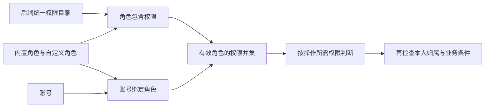

# 角色与权限完整方案

> 2026-11-10 展示调整：用户要求取消平台及租户的独立权限目录菜单，权限说明并入角色配置；底层权限定义、查询接口与鉴权保持。该调整的自验和人工验收状态另见[权限说明整合验证](../verification/permission-help.md)。

日期：2026-11-09。状态：**Awaiting acceptance（实现及自验完成，待用户人工验收）**。方案于 2026-11-09 获用户确认；实现与自验证据另见 `docs/verification/role-permission.md`，最终人工验收尚未完成。

本方案接续[账号管理与登录认证](account-management-plan.md)及[后端工程与统一 CLI](backend-organization-plan.md)，遵循[项目词汇表](../../GLOSSARY.md)。用户已明确：当前数据全部不保留，不需要兼容或迁移存量账号、邀请、会话和角色数据。以下按全新数据初始化设计。

## 1. 目标、范围与已确定原则

目标是在现有账号、密码、会话和邀请流程之上建立统一授权能力，使平台能配置角色、给账号绑定角色，并由后端按权限保护每项操作。

用户确定的原则：

1. 角色只是权限集合。操作能否执行由权限判断，不由角色名称、角色编码、账号创建途径或账号序号判断。
2. 只有“权限 → 角色 → 账号”这一种分配链路，禁止直接给账号分配权限。
3. 账号仍然只有一种类型，不增加管理员账号类型、超级用户标志或首个账号特权。
4. CLI 创建的账号默认通过内置角色获得全部平台管理权限。
5. 权限定义固定在后端代码中，并有唯一、集中的维护位置。网页只配置角色与现有权限的关系。
6. 不考虑现有数据迁移，重新建立本功能所需数据。

本方案建议并明确为本轮设计的其余业务规则：

- 一个账号可绑定多个角色，权限取并集；无角色或仅绑定停用角色时，没有业务操作权限。
- 内置“平台管理员”和“基础成员”两个角色；受邀开户只绑定基础成员，之后再按需分配角色。
- 基础成员具有本人资料、密码、会话、安全记录能力，默认没有邀请或平台管理能力。
- 邀请页面本轮不选择角色。持有邀请权限只能邀请基础成员，不能把自己的角色传给受邀者。
- 普通授权管理不得授出操作者本人未持有的权限；保护最后一个具有完整平台管理权限的正常账号。
- 本轮继续按单一组织设计，不引入租户、部门、项目数据范围、角色继承、拒绝型权限、临时授权或审批流程。

上述规则随本方案于 2026-11-09 获用户确认，按本方案实施。

### 交付范围

| 范围 | 内容 |
| --- | --- |
| 权限目录 | 集中定义、分组和说明、只读查询、代码与数据库投影校验、前端类型生成 |
| 角色管理 | 创建、查看、改名及说明、配置权限、启停、删除未绑定的自定义角色 |
| 账号授权 | 账号列表、详情、绑定/解绑角色、只读有效权限及来源、账号启停 |
| 当前功能接入 | 个人资料、改密、会话、安全记录、本人邀请统一挂接权限 |
| 初始化及维护 | CLI 初始化自动绑定管理员角色；权限目录同步/检查；受控恢复管理员角色 |
| 可靠性 | 即时生效、并发保护、越权限制、最后管理账号保护、审计、界面状态更新 |

账号密码重置继续使用已有 CLI 和一次性链接，不新增网页代改密码、代登录或查看他人密码功能。授权本身不赋予查看他人私人会话和邀请的能力。

## 2. 当前实现与本轮衔接点

本节保留方案评审时的衔接基线；当前实现及验证结果见[验证记录](../verification/role-permission.md)。

| 当前事实 | 代码位置 | 本轮衔接 |
| --- | --- | --- |
| API 与统一 CLI 已拆成独立 Go module，复用 platform | `services/api`、`tools/infrapro`、`packages/go/platform` | 新增共享 `platform/access`，两种入口共用规则 |
| `account bootstrap` 是当前唯一 CLI 开户入口；只能首次执行 | `tools/infrapro/internal/command/account.go` | 保留一次性初始化约束，在同一事务绑定内置管理员角色 |
| 首个账号只在初始化表中有记录，并无管理员字段 | `identity/repository.go`、`migrations/00001_identity.sql` | 初始化记录继续只用于判断是否初始化，不用于授权放行 |
| 受邀开户目前只创建账号和密码并消费邀请 | `identity/repository_invitations.go` | 同一事务增加基础成员角色绑定 |
| 所有受保护请求现在只校验身份，业务进一步检查本人归属 | `transport/http/router.go`、`identity/handler.go` | 在身份校验后增加权限校验，保留资源归属校验 |
| Redis 有会话快照，但每次认证仍检查 PostgreSQL 当前会话和账号 | `identity/service.go`、`repository_sessions.go` | 保留此行为，权限首版每次从数据库计算 |
| `GET /auth/me` 当前直接返回 Account，前端只按账号 ID 管理身份 | `identity/handler.go`、`api-client/src/identity.tsx` | 返回身份及权限上下文；前端增加授权更新和迟到响应保护 |
| 账号停用、恢复及“最后正常账号”保护在 CLI 共享业务中 | `identity/repository_maintenance.go` | 网页启停复用同一逻辑，增加最后完整管理账号保护 |
| 当前前端只有 console，导航和身份状态已集中 | `apps/console/src/config/navigation.ts`、`packages/ts/api-client` | 在现有应用增加管理页面，不另建管理应用 |

旧方案中的“所有账号权限相同”“所有账号都能邀请”“首个账号与其他账号功能完全相同”在本功能落地后由本方案的新授权规则替代。账号类型、密码规则、Cookie、CSRF、会话撤销、本人资料隔离与一次性凭证规则继续沿用。

## 3. 唯一授权模型



对于正常账号 a：

```text
有效权限(a) = 所有已绑定、启用且未删除角色的有效权限并集

允许操作 = 身份/会话有效
         AND 满足该操作明确要求的权限
         AND 满足资源归属与业务约束
```

停用账号不能通过认证；停用角色不贡献权限，但保留绑定关系。被代码目录停用的权限不生效。权限重复时去重，没有角色优先级，也没有用某个角色抵消另一个角色权限的规则。

例如，账号同时绑定“邀请办理”和“安全审计”两个自定义角色，会同时获得邀请和审计能力；解绑“邀请办理”只移除该角色独有的权限。若另一角色也包含同一权限，该权限仍然有效。

严格禁止：

- `account_permissions` 表、账号专属权限字段、对某账号额外放行的配置。
- `is_admin`、`is_superuser`、`account_type=admin` 等操作放行标志。
- 在业务处理、路由、菜单或按钮中使用 `role == platform_admin` 判断操作能力。
- 运行时 `*`、`platform.*`、空权限列表等价于全部允许，或未登记操作默认放行。
- 角色继承和角色等级；一个角色不包含另一个角色。

内置角色标识只用于初始化、维护内置配置和显示“内置/不可修改”；任何业务放行仍展开为具体权限判断。账号的有效权限及来源可以查询，但该查询结果不可编辑、不可作为客户端回传的授权凭据。

### 认证设施的明确例外

登录、退出当前会话、CSRF 获取、当前身份与权限上下文、会话活动和密码复验属于认证设施，不要求先持有业务权限。邀请/重置链接的检查及提交按一次性凭证校验，健康探针按原有公开策略处理。

这些操作在中央策略中逐项登记为 `public`、`credential` 或 `authenticated`，不是未经标注的默认放行。它们不能读取任意账号、分配角色或修改权限。退出当前会话始终可用；“退出全部设备”及撤销指定会话仍要求对应业务权限。

| 策略类别 | 精确登记的入口 |
| --- | --- |
| `public` | `GET /healthz`、`GET /readyz`、`GET /api/v1/public/account-help`、`GET /api/v1/auth/csrf`、`POST /api/v1/auth/login`、`POST /api/v1/auth/logout` |
| `credential` | `POST /api/v1/public/invitations/inspect`、`POST /api/v1/public/invitations/accept`、`POST /api/v1/public/password-resets/inspect`、`POST /api/v1/public/password-resets/complete` |
| `authenticated` | `GET /api/v1/auth/me`、`POST /api/v1/auth/reauthenticate`、`POST /api/v1/auth/activity` |

不设置 `/auth/*` 或 `/public/*` 的整段放行。公开分类不取消当前写请求的 Origin/CSRF、限流、密码或一次性凭证校验；退出只清理实际 Cookie 对应的会话并保留幂等行为。

## 4. 后端集中管理权限

唯一权限定义源：**`packages/go/platform/access/catalog.go`**。

建议结构：

```text
packages/go/platform/access/
  catalog.go          全部权限编码、名称、分组、范围、说明及风险标记
  policy.go           操作标识、所需权限、公开/认证设施分类和统一管理约束
  builtins.go         内置角色声明、开户角色预置、完整管理权限集合
  authorizer.go       有效权限计算与统一校验 Interface
  service.go          角色管理、角色绑定和授权变更事务编排
  repository*.go      授权 SQL、数据库锁、版本校验和审计写入
  catalog_sync.go     目录/内置角色的幂等同步与一致性校验
```

各文件属于同一授权 Module。它向调用者提供少量明确 Interface：读取权限快照、按操作鉴权、在事务中鉴权并执行、管理角色和账号角色绑定。查询组合、有效性、锁顺序、变更审计及越权约束集中在内部，调用者不自行拼接权限 SQL。

权限描述至少包含：`code`、中文名称、业务分组、说明、`scope`（本人/平台/未来业务）、风险级别、生命周期状态。编码采用稳定的 `域.资源.动作`，例如 `platform.account.assign_roles`。

权限说明必须写清“可以做什么、作用于本人还是平台范围”，不能只有“管理”“操作”等模糊词。编码改名按旧权限退役、新权限增加处理，不复用旧编码表达不同含义。

### 定义集中，调用引用

- 权限字面量只在 `catalog.go` 定义。其他 Go 文件引用类型化常量。
- 操作与权限的对应关系只在 `policy.go` 定义；路由和共享业务引用相同的操作常量。
- 禁止各 feature 自行登记权限、通过 `init()` 注册权限，或在配置、环境变量、数据库管理界面新增权限。
- 由中央 Go 目录生成 TS 权限常量、类型和 OpenAPI 权限枚举；前端不手写另一份权限清单。
- CI 检查目录编码唯一、描述完整、策略引用合法、路由都有策略、生成结果同步，以及业务代码中没有权限字面量或基于角色身份的放行分支。
- 合法的角色绑定/内置角色维护代码允许引用内置角色标识；检查不得误将这类数据管理引用当作权限绕过。

权限说明嵌入角色详情与权限配置，提供中文用途、作用范围、风险及配置限制；权限编码默认隐藏，可按需显示并参与搜索。不再提供平台独立权限目录菜单，旧 `/access/permissions` 链接跳转到 `/access/roles`，沿用角色页访问权限。没有新增权限、编辑权限编码、删除权限和临时授给账号的入口。

### 数据库投影与发布

为提供外键约束和查询，数据库保存 `permission_catalog`，但它只是代码定义的投影，不是权限定义源。HTTP 不提供写目录的接口。

拟新增 `infrapro access sync`，在数据库迁移后按当前发布版本同步目录与内置角色；`access check` 只检查一致性。同步只更新目录、内置角色的固定属性及其具体权限关系，不覆盖自定义角色，不重绑现有账号。

- 同步可重复执行，结果不重复；一个事务内写入目录版本、关系、审计与授权修订号。
- API 启动及就绪检查验证迁移和目录版本，不在启动时自行修改角色数据。
- 新权限默认不进入任何自定义角色。属于本人或平台范围的新权限通过发布同步进入内置平台管理员的具体权限行；基础成员只获得 `builtins.go` 明确列出的本人权限。
- 未来业务权限需要单独设计默认角色；不因前缀或通配符自动授给平台管理员。
- 权限退役时停止生效和分配，保留可解释的历史信息；自定义角色中的历史引用可移除，不能重新授予。未知或不匹配的目录使服务拒绝就绪，不能当作空目录或全部允许。
- API 与 CLI 使用同一发布版本及目录校验值；目录不兼容时采用停写切换，不能让旧实例继续按旧策略服务。

## 5. 首版完整权限目录

首版建议定义以下 **22 项**权限，覆盖现有功能和本轮管理功能。权限之间不隐式继承；界面可提示缺少配套查看权限，但不得偷偷增加授权。

| 权限编码 | 名称及能力 | 范围 |
| --- | --- | --- |
| `account.profile.read` | 查看本人完整资料、本人角色及权限来源 | 本人 |
| `account.profile.update` | 修改本人显示名称 | 本人 |
| `account.password.update` | 验证当前密码后修改本人密码 | 本人 |
| `account.session.read` | 查看本人有效会话 | 本人 |
| `account.session.revoke` | 撤销本人指定会话、退出全部设备 | 本人 |
| `account.security_event.read` | 查看本人安全记录 | 本人 |
| `platform.invitation.read` | 查看本人创建的邀请 | 平台能力，资源限本人 |
| `platform.invitation.create` | 创建只授予基础成员角色的邀请 | 平台能力，资源限本人 |
| `platform.invitation.revoke` | 撤销本人未使用邀请 | 平台能力，资源限本人 |
| `platform.invitation.regenerate` | 重新生成本人邀请，旧链接失效 | 平台能力，资源限本人 |
| `platform.account.read` | 查看账号列表、详情、角色及有效权限来源 | 平台 |
| `platform.account.assign_roles` | 为账号绑定、解绑角色 | 平台 |
| `platform.account.disable` | 常规停用账号 | 平台 |
| `platform.account.enable` | 恢复账号登录资格 | 平台 |
| `platform.role.read` | 查看角色、角色权限及绑定数量 | 平台 |
| `platform.role.create` | 创建空的自定义角色 | 平台 |
| `platform.role.update` | 修改自定义角色名称和说明 | 平台 |
| `platform.role.set_permissions` | 调整自定义角色所包含的权限 | 平台 |
| `platform.role.set_status` | 启用、停用自定义角色 | 平台 |
| `platform.role.delete` | 删除没有账号绑定的自定义角色 | 平台 |
| `platform.permission.read` | 查看完整权限目录及说明 | 平台 |
| `platform.audit.read` | 查看平台级账号和授权审计记录 | 平台 |

“重新生成邀请”同时要求 `platform.invitation.regenerate` 和 `platform.invitation.create`，因为它会产生新的开户凭证。全部要求在中央策略中明确声明为 AND，不由调用方猜测多个权限之间的逻辑关系。

后端对 `platform.account.assign_roles` 只接受角色 ID 列表；附加 `permissions`、`is_admin` 等字段必须报请求校验错误，不能静默接受或忽略。

## 6. 内置角色与账号初始角色

| 内置角色 | 固定标识 | 首版权限 | 分配场景 |
| --- | --- | --- | --- |
| 平台管理员 | `platform_admin` | 上表全部 22 项，逐项保存角色权限关系 | CLI 初始化创建的账号；由有权人员后续显式分配 |
| 基础成员 | `member` | 上表 6 项本人权限 | 邀请创建的账号 |

内置角色的名称、说明、权限集和启用状态由代码维护；网页不能修改、停用或删除。其账号绑定可正常管理，受权限范围和最后管理账号保护约束。

平台管理员拥有本人操作权限仍只能访问本人的私人资料、会话和邀请。查看全平台账号及审计来自另外的明确权限，不会把所有本人接口扩大到任意账号。

### CLI 首次初始化

当前已有且本轮接入的开户命令是 `infrapro account bootstrap`。不因本轮设计额外开放任意重复开户命令。

流程调整为：

1. 检查配置、数据库迁移、权限目录与内置角色已同步。
2. 终端输入用户名、显示名称和密码，继续无默认账号、无默认密码、密码不回显。
3. 同一个数据库事务中：锁初始化状态 → 创建账号与密码 → 绑定 `platform_admin` → 记录初始化完成 → 记录审计。
4. 任何一步失败都回滚；禁止留下“初始化成功但没有管理权限”的半成品。
5. 首次登录按正常账号路径登录，后端计算 22 项有效权限。没有首账号 ID 判断或认证绕过。

以后如新增 CLI 开户命令，默认角色也必须调用同一预置规则并形成真实绑定记录，不能另写“CLI 来源账号全部允许”的判断。

### 邀请开户

邀请创建继续复用原页面、一次性链接、有效期、限额和密码复验。邀请请求只有用途备注等现有字段，不接受角色或权限字段。

接受邀请的一个事务完成：检查邀请状态及邀请人当前资格 → 创建账号和密码 → 绑定 `member` → 消费邀请 → 写入审计。角色绑定失败不得消费邀请或留下无角色的新账号。

受邀账号开户后只具备本人功能；需要邀请、审计或管理能力时，再由有权人员在账号管理页绑定相应角色。邀请人自身角色不会自动复制，也不会与受邀账号建立后续授权继承关系。

## 7. 角色生命周期、绑定与越权限制

### 角色管理

- 自定义角色：稳定 UUID、名称、说明、启用/停用状态、版本号、创建/更新时间、删除时间。
- 名称建议 1–50 个 Unicode 字符，去除首尾空白后非空；未删除角色名称归一化后唯一。说明最多 500 字符。
- 创建角色只创建空权限集合，默认启用；配置权限是独立动作，防止仅有创建权限就能提交任意权限集合。
- 角色权限采用完整替换并带版本号，一次事务成功或失败，不分多次保存复选框。
- 停用立即使所有绑定账号失去该角色独有的权限；恢复时原绑定重新贡献权限，操作前展示影响人数及权限差异。
- 仅没有任何账号绑定时可以删除，包括停用账号的绑定也必须先解除。删除采用软删除，保留历史引用；不可静默级联解绑。
- 更名不影响权限；角色名称不被业务授权逻辑引用。

### 账号角色绑定

- 以角色 ID 列表完整替换，附带账号管理版本、操作原因；唯一约束防止重复绑定。
- 可以给停用账号预先配置角色，但配置不恢复登录资格。
- 只允许新增绑定启用且未删除的角色。已经绑定的停用角色在列表中明确显示，可保留或解除。
- 允许角色列表为空，页面明确提示“该账号将没有业务操作权限”。仍可登录看到待授权提示，并退出当前会话。
- 基础成员不是隐含权限：解绑后不再自动补回。其他角色如果包含相同本人权限，相关功能仍然可用。
- 查看有效权限时显示来自哪些角色、哪些绑定停用；没有直接增删权限的按钮。

### 防止通过授权功能提权

仅持有某项管理动作权限，不意味着可以处置任意权限范围。采用统一的“不能授出自己没有的权限”约束：

| 操作 | 动作权限之外的约束 |
| --- | --- |
| 修改角色权限 | 角色变更前、后所有仍有效的权限，均须属于操作者当前有效权限 |
| 改名、启停、删除角色 | 目标角色配置的有效权限须为操作者有效权限的子集；停用角色也检查完整配置 |
| 给账号绑定/解绑角色 | 本次新增或移除角色的有效配置权限须为操作者有效权限的子集，不因角色停用而跳过检查 |
| 停用/恢复账号 | 目标账号所有未删除绑定角色的有效配置权限并集须为操作者权限的子集，包括当前停用角色 |

这里的“有效配置权限”指目录仍有效的权限，不因目标角色停用而清空。退役权限可以清理，不要求操作者重新持有已经失效的权限。

所有检查用事务中的最新权限执行，自操作也遵循同样规则。操作者不能通过新建角色、编辑自己持有的角色、启用高权限停用角色或给自己绑定管理员角色，获得原本没有的权限。

例如，只持有邀请能力和有限角色管理权限的人可以配置“邀请办理”角色，但不能把 `platform.account.assign_roles` 加进去。判断依据是权限集合，不是操作者是否拥有某个管理角色名称。

## 8. 防止失去平台管理能力与 CLI 恢复

在至少已完成账号初始化的系统中，常规管理操作必须保持：**至少一个正常账号的有效权限包含当前内置平台管理员所定义的完整权限集合**。

该条件不要求账号必须绑定名为“平台管理员”的角色。多个自定义角色合起来具有完整管理权限，也算符合条件。这保证判定仍然基于权限。

以下操作都必须模拟变更后的权限并在同一事务内检查：解绑或替换账号角色、停用账号、停用角色、修改角色权限、删除角色、发布同步内置权限。保留原有“最后一个正常账号不能常规停用”规则，并增加此管理能力规则。

两个管理员互相停用、同时移除彼此管理角色或同时修改承担关键权限的两个角色，必须被同一个数据库串行化规则约束；不能分别先查人数再更新。

常规违规返回 `409 last_platform_manager`。前端提示先给另一个正常账号配置完整管理权限，并重新验证；不提供网页强制绕过。

现有 CLI 的 `account disable --emergency --reason ...` 保留用于已确认失陷的紧急停用，明确允许暂时没有正常或完整管理账号，并记录应急事件。此权能不暴露给 HTTP 请求。

拟新增 `infrapro access recover-admin --username ... --reason ...`：通过受控维护入口给一个已有账号添加内置管理员角色绑定。它不直接写账号权限，不创建账号，不修改密码，不恢复停用状态，不重新开放 bootstrap。

如果账号仍停用，由维护人员在完成凭据恢复后单独执行现有 `account enable`。所有账号被停用或密码丢失时也沿用这组显式恢复动作。

维护 CLI 的执行者依靠主机运维权限访问数据库，本来就不等同于已登录的应用账号。初始化、目录同步及应急恢复使用专用的维护 Interface；不得做成 HTTP 可传入的 `skip_auth` 或伪造“系统管理员账号”。最终结果仍只是同一组角色关系。

未来发布新增管理权限时，如果系统仅靠自定义角色维持完整管理能力，新增权限可能使其不再完整。同步预检查必须发现并阻止这一情况；维护人员可先明确给一个正常账号绑定内置管理员角色，再完成发布，不能静默扩充全部自定义角色。

## 9. 请求链路、事务与即时生效

正常请求：Cookie/CSRF 与 Origin → 现有认证 → 中央操作策略 → 最新有效权限 → 本人归属及业务校验 → 执行 → 审计。

HTTP 中间件负责尽早拒绝和统一错误；共享业务的执行 Interface 仍校验权限，防止只在路由层检查而被其他入口绕过。权限相关写入必须在执行事务内重新校验，不能相信请求开始时或前端传来的权限快照。

默认拒绝、每次请求校验和统一配置参考 [OWASP 授权指南](https://cheatsheetseries.owasp.org/cheatsheets/Authorization_Cheat_Sheet.html#validate-the-permissions-on-every-request)；具体权限集合与角色模型以用户要求和本方案为准。

### 首版不缓存授权结果

继续使用 Redis 会话缓存，但不把角色或权限放入 Cookie、会话持久快照、长期 JWT 或跨请求授权缓存。每次受保护操作从 PostgreSQL 计算有效权限，当前单组织规模下优先保证行为清楚、撤权及时。

- `auth_version` 继续只用于认证凭据/会话撤销。
- 新增全局 `authorization_revision`，用于标记授权数据变化和通知前端刷新，不作为前端提供的可信授权依据。
- 普通角色变更不强迫退出所有设备；同一会话下一次操作使用新权限。
- 停用账号、修改/重置密码仍按现有逻辑撤销会话。Redis 旧快照不能重新恢复权限。
- PostgreSQL 故障时不能计算授权，返回 503；Redis 故障继续沿用当前认证不可用策略，不回退为全部允许。

将来只有性能证据说明需要时才新增授权缓存，并另行设计版本校验及失效协议。

### 并发规则

新增 `authorization_state` 单行记录。首版使用明确的事务锁顺序：

1. 需要授权的普通业务事务先对该记录取共享锁；改变授权图、账号启停或目录的事务一开始就取排他锁，避免先共享后升级。
2. 在锁内读取最新权限；涉及浏览器写操作时复用现有账号/会话复验，按账号 ID 排序锁定相关账号，再按角色 ID 排序处理角色，之后处理会话、邀请及业务记录。
3. 进行权限范围、版本、最后管理账号及业务校验。
4. 一次事务提交业务变更、必要的邀请撤销、版本变化和审计，之后释放锁。

初始化需要初始化表锁时，顺序固定为授权状态 → 初始化记录 → 账号/角色 → 凭证记录。API、CLI、邀请开户及后台任务凡触及这些规则，均遵循同一顺序。原有只处理认证凭据且不读取授权状态的事务不能在持有账号锁后再反向获取授权状态锁。

共享锁保护整个已授权的数据库操作，权限变更的排他锁需要等待这些短事务结束。这样先完成的操作可以成功，撤权提交之后的新鉴权必须失败，不出现检查后被撤权仍继续落库的间隙。已经返回给客户端的数据无法追溯收回。

数据库锁的行为依据 [PostgreSQL 17 行锁文档](https://www.postgresql.org/docs/17/explicit-locking.html#LOCKING-ROWS)。密码哈希计算、交互输入、HTTP 网络调用不放在授权锁内；分页读取有上限，并设置事务超时。首版的代价是授权管理写入串行化，适合当前规模；后续若有吞吐瓶颈再细化锁粒度。

### 邀请资格撤销

权限图变更可能影响多个账号，事务中计算受影响账号变更前后的有效权限。凡失去 `platform.invitation.create` 的账号，其全部待使用邀请在同一事务中永久撤销；重新授予权限不会复活旧链接。

若移除一个角色但另一个角色仍提供创建邀请权限，不撤销邀请。只失去查看、撤销或重新生成权限，也不等同于失去开户资格。

邀请检查和最终接受均检查邀请人当前正常状态及创建邀请权限；最终提交与撤权遵循同一锁规则。对无效链接保持统一提示，避免公开接口泄露邀请人角色信息。开户成功的受邀账号不会因邀请人以后失权而级联停用。

## 10. 数据结构与一致性

使用现有 PostgreSQL，Goose 新增结构迁移；本轮不写历史账号权限回填逻辑。既有迁移保留，新库依次执行，避免把初始化数据来源分散到历史 SQL 中。

| 表/字段 | 核心内容与约束 |
| --- | --- |
| `permission_catalog` | `code` 主键；名称、分组、scope、说明、风险、生命周期、目录版本；仅代码同步维护 |
| `roles` | UUID 主键；名称及归一化唯一值、说明、`builtin_key` 可空且唯一、状态、`version`、时间及软删除字段 |
| `role_permissions` | `(role_id, permission_code)` 联合主键；分别引用角色和目录；同一权限不重复 |
| `account_roles` | `(account_id, role_id)` 联合主键；分配时间、分配来源和操作者信息；查询当前绑定，解绑历史由审计保存 |
| `authorization_state` | 固定单行；`revision`、目录校验值、同步时间；同时作为并发控制记录 |
| `accounts.management_version` | 账号启停或角色绑定变化时增加，用于管理表单的并发覆盖检查；不替代 `auth_version` |
| `account_security_events` 扩展 | 增加事件主体类型、对象类型和受控结构化详情，复用当前审计持久化与查询体系 |

索引至少包含 `account_roles(role_id, account_id)`、`role_permissions(permission_code, role_id)`、角色有效名称唯一索引和审计对象/时间索引。保留已有账号、会话、邀请、密码表，不建立账号权限表。

修改已有目标的写请求携带目标版本；版本不匹配返回 409，提示重新加载比较差异。创建操作没有旧目标版本。HTTP 返回角色 UUID，不允许客户端用角色名称作为关联键；所有 bigint 版本字段通过十进制字符串传输。未知账号、未知角色、退役权限、重复或超出长度限制的列表要有确定的校验结果。

同一个跨账号/角色业务事务只使用一个 `pgx.Tx`。identity 与 access 的 repository 接受同一事务，禁止各自提交后再补偿。权限 SQL 由 access 维护，密码/会话/邀请语义由 identity 维护，通过小型事务 Interface 协作；access 不反向导入 identity 的整个业务包。

## 11. API 契约与错误约定

沿用 `/api/v1` 和当前统一错误格式。下列契约现已实现，精确请求和响应字段见仓库 OpenAPI。

### 现有入口改造

| 接口 | 授权要求/调整 |
| --- | --- |
| `GET /auth/me` | 已认证；改为身份摘要 + 权限上下文，不要求业务权限 |
| `GET /account/profile`（新增） | `account.profile.read`；完整本人资料及角色/权限来源 |
| `PATCH /account/profile` | `account.profile.update`，继续限本人 |
| `POST /account/password` | `account.password.update`，继续验证当前密码 |
| `GET /account/sessions` | `account.session.read` |
| `DELETE /account/sessions/:id`、`POST /auth/logout-all` | `account.session.revoke`，只撤销本人会话 |
| `GET /account/security-events` | `account.security_event.read` |
| `GET /invitations` | `platform.invitation.read`，继续只返回本人邀请 |
| `POST /invitations` | `platform.invitation.create` + 最近 5 分钟密码复验 |
| `POST /invitations/:id/revoke` | `platform.invitation.revoke` + 本人归属 |
| `POST /invitations/:id/regenerate` | `platform.invitation.regenerate` AND `platform.invitation.create` + 本人归属 + 密码复验 |
| 公开邀请接受接口 | 校验凭证及邀请人当前资格；原子绑定基础成员 |

新的 `/auth/me` 响应示意：

```json
{
  "account": { "id": "<uuid>", "username": "example", "display_name": "示例", "status": "active" },
  "authorization": {
    "revision": "42",
    "permissions": ["account.profile.read", "account.profile.update"]
  }
}
```

`revision` 是十进制字符串，避免 PostgreSQL bigint 超出 JavaScript 安全整数范围。示例权限数组仅表示结构，不代表某个内置角色的完整内容。

身份摘要只包含页面识别当前登录身份所需信息，不借 `/auth/me` 绕过完整资料读取权限。登录接口也返回同一最小身份摘要；前端登录成功后重新取得完整授权上下文，加载完成前不渲染管理入口。

### 新增管理接口

| 接口 | 所需权限 | 说明 |
| --- | --- | --- |
| `GET /access/permissions` | `platform.permission.read` | 只读目录、分组、风险说明 |
| `GET /access/roles`、`GET /access/roles/:id` | `platform.role.read` | 角色列表、详情、权限及绑定数量 |
| `POST /access/roles` | `platform.role.create` | 创建空自定义角色 |
| `PATCH /access/roles/:id` | `platform.role.update` | 修改名称/说明 |
| `PUT /access/roles/:id/permissions` | `platform.role.set_permissions` | 完整替换权限集合 |
| `PUT /access/roles/:id/status` | `platform.role.set_status` | 启用/停用 |
| `POST /access/roles/:id/archive` | `platform.role.delete` | 逻辑删除，要求无账号绑定 |
| `GET /access/accounts`、`GET /access/accounts/:id` | `platform.account.read` | 账号摘要、状态和角色，不返回凭据或私人会话 |
| `GET /access/accounts/:id/authorization` | `platform.account.read` | 绑定角色、有效权限及来源，只读 |
| `PUT /access/accounts/:id/roles` | `platform.account.assign_roles` | 完整替换角色绑定 |
| `POST /access/accounts/:id/disable` | `platform.account.disable` | 常规停用，复用现有撤销行为 |
| `POST /access/accounts/:id/enable` | `platform.account.enable` | 恢复状态，不恢复旧凭据 |
| `GET /access/audit-events` | `platform.audit.read` | 账号和授权审计，按目标及时间过滤 |

管理写操作统一携带 `reason`（1–500 字符）；修改已有目标还需 `expected_version`。均要求最近 5 分钟通过密码复验，复用原复验接口。账号角色保存只接收 `role_ids`、版本和原因；角色权限保存只接收 `permission_codes`、版本和原因。

列表使用已有游标分页方式，默认 50、最大 100；支持账号用户名/显示名、角色、状态等必要过滤。角色详情若显示绑定账号明细，额外要求 `platform.account.read`；只有角色查看权限时只显示计数。

| 状态/错误码 | 处理 |
| --- | --- |
| 401 `unauthenticated` | 会话无效，进入登录流程 |
| 403 `permission_denied` | 有身份但缺少操作权限，刷新权限上下文并显示无权限 |
| 403 `grant_scope_exceeded` | 动作权限存在，但变更超出操作者当前权限范围 |
| 403 `reauthentication_required` | 弹出已有密码复验，成功后由用户重新提交 |
| 403 `csrf_invalid` / `origin_rejected` | 保持现有安全处理，不归类为权限不足 |
| 404 `not_found` / `invalid_link` | 记录不存在、本人资源不属于该账号，或链接不可用 |
| 409 `version_conflict` / `role_in_use` / `last_platform_manager` | 并发覆盖、角色仍被绑定，或将失去管理能力 |
| 400 `validation_failed` / 409 名称冲突 | 非法权限码、内置角色非法修改、格式错误或名称重复 |
| 503 `unavailable` | 数据库、认证依赖或目录不一致，拒绝执行 |

对受保护资源先判断调用权限，再读取目标细节；缺少权限时不根据目标是否存在返回可枚举的详情。归属型接口继续以 404 表示不可操作的他人记录。

## 12. 页面、导航与交互

沿用 console 的 AdminLayout、SettingsLayout、TanStack 文件路由、Query/Table、RHF/Zod 和已有 shadcn 共享组合，不重新设计一套视觉体系。

| 页面 | 入口条件 | 内容与操作 |
| --- | --- | --- |
| 账号管理 `/access/accounts` | `platform.account.read` | 查询账号、显示状态/角色；按具体权限提供角色配置、停用、恢复 |
| 账号授权详情 | 同上 | 角色多选、变更差异、有效权限及来源、待停用角色提示；只保存角色关系 |
| 角色管理 `/access/roles` | `platform.role.read` | 名称、内置/自定义、状态、权限数、绑定人数；各按钮分别检查动作权限 |
| 角色详情 | 同上 | 基本信息、按分组组织的权限复选框、搜索、全选/部分选中状态、变更预览 |
| 角色详情与配置内的权限说明 | 角色页要求 `platform.role.read`；目录数据仍要求 `platform.permission.read` | 就地展示中文说明、作用范围、风险和可选限制；编码默认隐藏，可按需显示 |
| 平台审计 `/access/audit` | `platform.audit.read` | 查看谁在何时修改了哪个账号或角色及其变化 |
| 个人资料/账号安全 | 按对应本人权限显示 | 延续当前功能，增加本人角色及权限来源的只读说明 |
| 本人邀请 | `platform.invitation.read` | 依照具体 create/revoke/regenerate 权限显示操作 |
| 无业务权限状态 | 已登录即可到达 | 显示当前身份、“尚未分配可用权限”、维护联系信息及退出入口 |

权限选择器展示用户可理解的名称与范围，代码作为辅助信息。搜索后的“全选”明确只作用于当前分组/筛选结果；高风险权限显示说明，保存前汇总增加、移除及影响人数。没有配套查看权限时提示该角色可能无法使用相应网页入口，由配置人明确选择，不进行隐式补权。

网页角色分配表单需要账号查看、角色查看和角色分配三项权限；角色权限编辑表单需要角色查看、权限目录查看和角色权限配置三项权限。后台单项动作仍按契约校验自己的操作权限；只授写权限不会自动附带读权限。

角色不可修改时采用只读展示并说明内置角色由系统维护。键盘可进入所有可用控件，复选框有标签及部分选中状态，错误靠近字段；沿用现有确认弹窗的焦点恢复、提交中防重复操作、桌面及窄屏布局。

普通菜单和按钮缺权时隐藏；直达页面显示 403。因最后管理账号保护、角色仍被绑定等业务条件不可执行时保留禁用按钮及原因。影响权限的保存不做乐观成功提示，必须等待服务端事务确认。

### 前端权限同步

- 在现有 IdentityProvider 中保存当前身份和权限上下文，提供 `can(permission)` / `canAll(...)`，内部只做权限集合包含判断。
- 导航、路由和按钮引用后端生成的权限常量；不能用角色名称判断。UI 判断只用于体验，后端仍是最终依据。
- 登录、重新获取焦点、页面恢复可见、授权保存后刷新 `/auth/me`；可见页面每 30 秒最多轻量刷新一次权限，不延长用户活动时间。
- API 可通过 `X-Authorization-Revision` 返回本次操作看到的版本。发现版本变化时合并刷新，不能用客户端旧版本要求后端继续放行。
- 403 按错误码处理：`permission_denied` 刷新上下文，`reauthentication_required` 打开复验；不能把所有 403 当成退出登录，也不自动重放修改请求。
- 全局 revision 变化后，若本人有效权限没有变化，保持现有草稿；若权限减少，取消并清除失权页面查询、敏感草稿与邀请明文，重新评估路由。失权后迟到的请求结果不得重新填回界面。
- 继续以账号 ID 隔离切换账号；增加授权状态代次，忽略旧身份或旧授权状态下的异步完成回调。新授予权限不要求重新登录。
- 权限只保存在会话内存，不写入可长期复用的 localStorage；可见页面最多 30 秒的显示延迟不影响后端下一次请求立即拒绝。

## 13. 技术选择与具体分工

精确依赖版本沿用当前 manifest 和锁文件，不为本轮升级技术栈。

| 技术 | 具体使用位置及原因 |
| --- | --- |
| Go / 现有 Go workspace | `platform/access` 实现类型化目录、权限计算、授权管理；API 与 CLI 可共享且不相互依赖 |
| Gin | `services/api/internal/transport/http/access` 增加 HTTP 适配及统一路由策略登记，业务规则不放在 handler |
| PostgreSQL + pgx | 存储角色关系、事务内权限查询、行锁、版本控制、外键及审计；沿用现有持久化能力 |
| Goose | `platform/migrations` 新增结构；目录及内置角色内容由 Go 同步，避免 SQL 和 Go 各维护一份权限编码 |
| Redis | 继续用于现有认证会话、活动及限流；本轮不缓存授权结果 |
| React / TypeScript / Vite | 在 console 添加账号授权、角色、目录和审计页面，无新应用 |
| TanStack Router / Query / Table | 路由入口校验、列表/详情缓存、账号隔离、游标表格和权限变更后刷新 |
| RHF / Zod / shadcn 共享包 | 权限与角色表单、原因校验、确认交互和可访问的复选框；遵守当前前端开发约定 |
| OpenAPI / 现有生成脚本 | 更新 AuthContext 和管理接口，生成 TS 请求类型；权限枚举从后端目录生成 |
| Go 测试 / Playwright / 现有 Docker 测试栈 | 验证并发授权、真实 API、跨标签页变化及 HTTP/CLI 部署流程 |

本轮使用关系表与集合运算即可表达全部规则，不引入独立身份服务或通用策略引擎。共享代码不依赖 Gin；runtime 负责装配 Authorizer、identity 和授权管理能力。会话验证仍复用 identity 的实现，经小型 Interface 或事务回调注入，不在 access 中复制密码、限流和会话有效期规则。

拟增加 `pnpm permissions:generate` / `permissions:check` 并接入 `pnpm check`，从中央目录生成 `packages/ts/api-client/src/permissions.generated.ts` 及 OpenAPI 的受管枚举片段。生成物允许分布在消费方，但禁止手工维护第二份定义。

## 14. 审计与故障处理

审计覆盖角色创建/编辑/启停/删除、角色权限替换、账号角色变化、账号启停、目录同步、初始化绑定和应急恢复。

复用 `account_security_events`，结构化记录操作者类型（账号/维护/发布）、操作者或目标账号 ID、角色 ID、操作、前后差异、原因、请求 ID、时间和来源。CLI 可补充本机运维标识用于排查，但不把该标识宣称为应用内已认证账号。

- 成功写操作与成功审计同事务提交，审计失败则业务变更回滚。
- 被拒绝的越权请求记录到统一安全日志，采用限流/聚合防止刷日志；不把回滚事务中的日志误当作已持久化审计。
- 本人安全页仅返回与本人相关的安全摘要；平台级变更详情需 `platform.audit.read`。
- 密码、Cookie、会话凭证、邀请/重置链接明文不进入日志或差异字段；沿用当前日志脱敏及保留期。
- 网络断开造成结果不确定时，读取当前版本及审计核对，不自动重新提交授权写入。
- 同步/初始化失败可重试；不自动重建数据库，不重开已经完成的初始化标记。

## 15. 全新数据部署与当前功能衔接

用户已明确不要现有数据，因此不提供旧账号升级、首账号追溯、保留原邀请能力或双模型过渡逻辑。本轮设计完成不等同于已清理数据库。

实施时按以下顺序切换：

1. 停止旧 API 和相关后台任务，确定本项目要重建的数据库/schema 及 Redis 命名空间；清理仅作用于这组应用数据。
2. 使用新版 CLI 对空库运行结构迁移，执行 `access sync` 建立代码目录投影及两个内置角色。
3. 执行 `access check` 校验一致性，再执行 `account bootstrap` 创建首个账号并绑定平台管理员。
4. 启动与 CLI 同版本的 API 和前端，验证 `/readyz`，使用新账号登录。
5. 通过邀请创建基础成员，再配置自定义角色并验证授权链路。

未来实施后的启动顺序示意（命令现已实现）：

```bash
pnpm setup:local
pnpm infrapro database migrate
pnpm infrapro access sync
pnpm infrapro access check
pnpm infrapro account bootstrap
pnpm dev
```

`setup:local` 的现有行为不保证清空旧数据，上述示意的前提是已经完成目标应用数据重建。权限上线不自动删除其他项目、数据库或 Redis 数据。新的生产运行手册应给出所选部署方式的准确步骤。

访问仍使用现有本地 console 地址 `http://127.0.0.1:5173/`，部署路径继续沿用 `/console/`。HTTP、Cookie、CSRF、一次性链接交付及维护联系方式保持现有约定。

## 16. 分步实施与交付物

| 迭代 | 实现与交付物 | 自验完成条件 |
| --- | --- | --- |
| RP-1 权限基础 | 中央目录与策略、关系表、目录同步/检查、内置角色、统一 Authorizer、bootstrap 绑定 | 从空库初始化、完整权限计算、原子回滚、目录一致性及禁止直接授权检查通过 |
| RP-2 现有功能接入 | 全部当前接口策略、邀请绑定基础成员、邀请失权撤销、新 AuthContext、前端按权限展示 | 基础成员本人功能正常；缺权直调 API 被拒绝；既有账号认证回归通过 |
| RP-3 授权管理闭环 | 角色和账号授权接口/页面、账号启停、有效权限来源、目录/审计页面 | 创建角色→分配权限→绑定账号→执行操作→撤权完整闭环；越权、并发、最后管理账号检查通过 |
| RP-4 运维与整体验证 | 应急恢复 CLI、数据重建及部署说明、真实 HTTP/CLI 测试、验证记录 | 同版本空库部署通过；全部接受标准有证据，进入 Awaiting acceptance |

各迭代可独立自验，前一阶段通过后再开展下一阶段；不把暂未接入的功能作为已经受权限保护的产品交付。最终形成实现、OpenAPI、集中目录生成器、运维手册和 `docs/verification/role-permission.md`。

方案已获用户确认；实现状态独立按 In progress → Awaiting acceptance → Accepted 跟踪，只有用户明确确认手工验收后才能标记 Accepted。

## 17. 验收矩阵

以下为原方案的验收目标；当前实现自验结果见[验证记录](../verification/role-permission.md)。用户可通过界面、CLI 和可复现的 API/测试场景核对预期；并发和故障类由自验证据辅助展示。

| 编号 | 操作/场景 | 预期 |
| --- | --- | --- |
| RA-01 | 空库迁移、同步目录、CLI bootstrap 后登录 | 账号仍是普通 Account 结构；有真实管理员角色绑定；22 项权限可用 |
| RA-02 | 再次 bootstrap，或初始化角色绑定/审计注入失败 | 已初始化拒绝重复；未提交失败全部回滚，可安全重试 |
| RA-03 | 查看角色权限说明及内置角色 | 目录只读；两个内置角色不可改名、改权限、停用或删除 |
| RA-04 | 邀请创建 B 并登录 | B 绑定基础成员，仅有本人能力，无邀请和管理入口 |
| RA-05 | 邀请提交额外角色/权限字段 | 后端拒绝；不创建账号，不消费邀请 |
| RA-06 | 创建自定义邀请角色、配置权限并绑定 B | B 不重新登录即可取得对应能力；可生成基础成员邀请 |
| RA-07 | 给 B 绑定两个有交集权限的角色，再解绑一个 | 权限取并集；另一角色仍提供的权限继续生效 |
| RA-08 | 重命名角色，或用多个自定义角色提供与管理员相同权限 | 权限不因名字变化；相同权限得到相同授权结果 |
| RA-09 | 无操作权限时直达页面、伪造按钮调用 API | 页面 403，后端 403；前端显示不能替代校验 |
| RA-10 | 向账号授权接口提交权限列表/超级用户字段 | 400；只有角色 ID 绑定模型，无直接账号权限写入 |
| RA-11 | 有有限授权管理权限的人尝试授予未持有权限 | 创建/编辑/启用/绑定等路径均无法提权，原数据不变 |
| RA-12 | 移除 B 的所有角色 | 仍可识别登录身份及退出；所有业务操作拒绝，不补回基础权限 |
| RA-13 | 停用自定义角色、再恢复 | 所有绑定者即时丢失/恢复该角色贡献权限；其他角色不受影响 |
| RA-14 | 删除仍被绑定角色，包括绑定者已停用 | 返回冲突；解绑后可软删除，审计保留 |
| RA-15 | 两个页面分别编辑同一角色或同一账号角色 | 后提交的旧版本冲突，不静默覆盖 |
| RA-16 | 撤销 B 权限后使用原 Cookie、旧页面和旧 Redis 快照操作 | 撤权提交后的新请求按新权限拒绝；不要求先退出登录 |
| RA-17 | 授权请求与撤权并发 | 按统一事务顺序完成或拒绝，没有检查后越权落库 |
| RA-18 | 移除最后管理权限、停用最后管理账号或关键角色 | 常规入口返回 409，管理能力仍存在 |
| RA-19 | 两个管理账号并发互相撤权或停用 | 最多一个破坏性操作成功，始终保留一个完整管理账号 |
| RA-20 | 账号以多个自定义角色拥有完整权限 | 最后管理账号判断按权限并集成立，无角色名称特判 |
| RA-21 | CLI 应急停用并恢复管理员角色，再恢复账号 | 应急可暂时锁闭；角色恢复通过绑定完成，不重开初始化、不复活旧会话 |
| RA-22 | 邀请人失去创建权限，再恢复；受邀人使用旧链接 | 未使用邀请永久失效；重新获得权限需生成新链接 |
| RA-23 | 移除一个邀请角色但另一角色仍提供创建权限 | 邀请资格不丢失，合法待用邀请保持有效 |
| RA-24 | 接受邀请与权限撤销同时发生 | 开户与角色绑定/消费原子完成，或拒绝；无半成品账号 |
| RA-25 | 管理员通过本人接口操作别人的会话或邀请 | 仍因归属不符返回 404；管理员角色不绕过归属 |
| RA-26 | A/B 切换、跨标签撤权，旧请求延迟返回 | 旧数据/草稿/凭证不泄露，失权页面内容不被迟到响应恢复 |
| RA-27 | 密码复验过期、CSRF 失败、数据库/Redis 不可用 | 按各自错误处理；不自动重放写入，不把故障当作空权限或放行 |
| RA-28 | 成功授权、拒绝越权、审计故障 | 成功有差异记录；拒绝有安全日志；审计失败时授权变更回滚 |
| RA-29 | 修改目录、权限码或策略但遗漏同步/路由登记 | 生成检查/测试或启动检查失败，不出现未保护入口 |
| RA-30 | 正常重复执行目录同步、未来新增权限 | 同步幂等，不覆盖自定义角色、不重绑账号；内置管理员包含明确新增项 |
| RA-31 | 执行当前登录、改密、重置、会话、限流、HTTP 回归 | 原认证及本人隔离行为保持，变化仅为本方案明确的授权规则 |
| RA-32 | 桌面与手机宽度操作列表/权限表单，使用键盘完成配置 | 标签、焦点、错误、部分选中、待提交/冲突状态清楚；窄屏可操作 |

自动验证优先复用现有隔离 PostgreSQL schema、Redis 前缀和 Docker HTTP 栈，补充授权的 Go race/事务并发场景及 Playwright 流程。预期执行 `pnpm check`、`pnpm build`、扩展后的 Go 业务测试、`pnpm test:e2e`、`pnpm test:e2e:preview` 和 `pnpm test:http`；不为文档设计声称这些测试已通过。

建议人工演示路径：初始化 A → A 邀请 B → B 无管理能力 → A 创建邀请角色并绑定 B → B 获得邀请能力 → A 撤权 → B 原会话立即无法邀请 → 尝试删除最后管理能力被阻止 → 查看完整审计差异。

## 18. 本轮设计核对记录

已完成的方案自查：

- 对照当前账号、会话、邀请、初始化、维护 CLI、路由和前端身份代码，确认本方案的衔接位置。
- 校验首版目录为 22 个不重复权限，其中 6 个本人权限；文档中的精确权限引用均在目录中。
- 校验 RA-01–RA-32 连续且不重复、内部文档链接有效、Markdown 代码围栏成对。
- 核对没有直接账号授权、角色身份放行、隐含基础权限、未指定策略路由或依赖缓存 TTL 的撤权规则。
- 对初始化失败、邀请失权后恢复、多角色权限重叠、停用角色提权、并发撤权及最后管理账号条件进行设计一致性检查。
- 核对数据方案为全新初始化，没有存量角色回填和旧账号兼容分支。

方案已确认，RP-1–RP-4 实现及自验已完成。实现、数据重建及自验的当前证据以[角色权限验证记录](../verification/role-permission.md)为准；最终人工验收尚未完成。
