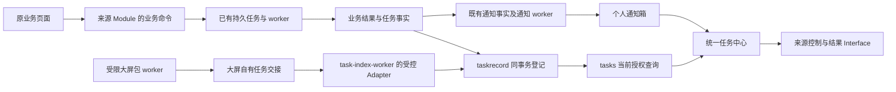

# 统一任务中心与现有任务接入：详细开发方案

日期：2026-11-13。版本：V1.0。状态：**Awaiting acceptance（2026-11-13 完整范围已实现并自验通过，待人工验收）**。

用户已认可[总体范围](platform-foundation-deepening-proposal.md)，本次要求形成可以指导代码开发的方案。本文件固定本轮交付、数据与接口契约、各模块改造和验收条件；详细设计的自检、用户确认、代码实现及功能验收分别记录。

## 1 目标、已确认决定与交付边界

本轮交付“统一任务中心、公共任务接入 Interface、已有来源完整接入”。用户继续从原业务页面提交工作，通过一个入口查看执行、处理失败、访问结果，并从站内通知返回对应任务。

### 1.1 已确认决定

| 决定 | 必须保持的行为 |
| --- | --- |
| 平台基础能力优先 | 不新增设备接入、数据解析、工程预警、专业分析方法或报告业务。现有监测工作只进行任务接入所需的改造。 |
| 默认“我的全部任务” | 汇总本人跨租户、跨项目发起且当前仍获准查看的任务；提供当前工作空间快捷筛选，切换空间不自动改掉默认视图。 |
| 按业务权限管理他人任务 | 对应管理人员可以查看最小任务摘要、执行获准的取消或重试；管理权不授予原始数据、成果及文件读取权。 |
| 沿用现有执行机制 | 监测／计算、空间转换、大屏包处理保留自己的队列、租约、执行身份、输入检查与产物发布机制。 |
| 与站内通知衔接 | 复用既有通知事实、接收规则及阅读状态；任务登记不依赖通知是否投递。 |
| 当前工作区开发 | 不自行创建分支、工作树；不覆盖大屏、通知等并行工作的未提交修改。 |

### 1.2 完整交付清单

| 编号 | 交付物 | 完成要求 |
| --- | --- | --- |
| TF-01 | 公共接入契约 | 类型注册、稳定任务身份、人员／执行身份、运行代次、尝试记录、阶段、结果引用、授权及动作 Adapter；有接入指南和契约测试。 |
| TF-02 | 统一任务中心 | 我的任务、管理视图、筛选、检索、分页、详情、执行历史、真实进度、错误说明、深链接和刷新恢复。 |
| TF-03 | 现有来源完整接入 | 第 10 节全部人员任务来源接入；自动工作和内部工作提供受控运行概况，不向个人列表倾倒内部工作单元。 |
| TF-04 | 取消与重试 | 按来源能力执行；校验当前资格、版本和输入；保留每代历史；重复提交及并发竞争无重复副作用。 |
| TF-05 | 结果与下一步 | 定位原批次、查询、固定成果、空间版本和大屏包，下载继续经过原拥有者检查；完成、有效、采用、发布分别表达。 |
| TF-06 | 通知联动 | 新通知定位固定任务代次，旧通知兼容；任务中心不重新发送结果通知，通知失败不阻塞任务查询。 |
| TF-07 | 权限、审计与诊断 | 个人／项目／租户隔离、管理摘要与结果分权、审计关联、来源健康、索引积压及可恢复对账。 |
| TF-08 | 工程与验收材料 | 增量迁移、历史纳入、独立索引维护进程、配置及启动、恢复、功能与浏览器验证、合成验收环境和交付核对。 |

只有任务列表、公共表或模拟 Adapter 可用，不构成本轮完成。八项交付以及各来源的真实业务操作、故障、权限和兼容检查必须一起完成。

### 1.3 明确不纳入

不新增通用定时计划、任意脚本执行、工作流编排、人工审批、待办派单、跨实例调度、全平台资源配额、计费或签名许可。文件公共服务、完整审计平台、独立运维平台继续是后续迭代；本轮复用它们已有的基础。没有通用“创建任意任务”“改任意任务状态”“下载任意对象”接口。

## 2 当前代码基线与必须修正的接入缺口

本次核查包含当前工作区未提交代码；通知及大屏在本次设计期间有并行改动，开工前须核对其最终代码和验证记录。以下是源码事实，不是本次重新运行系统后的验收结论。

| 依据 | 当前行为 | 本轮改造 |
| --- | --- | --- |
| [监测任务查询及控制](/Users/hijacker/Documents/ChatGPT/InfraPro/packages/go/platform/monitoring/jobs.go) | Jobs 固定 actor_id 和单个空间，先取 51 行再逐项核验；导出依赖个人快照。 | 新增批量摘要授权和跨空间查询接缝；公共分页不能沿用“先分页再丢弃”的结果。管理摘要不能伪造原发起人读取快照。 |
| [监测任务宿主](/Users/hijacker/Documents/ChatGPT/InfraPro/packages/go/platform/monitoring/task_host.go) | 注册类型有限；人工重试增加 notification_generation，但重置 attempts、错误及租约。 | 保留有限注册；在重置前封存旧代和尝试。共享宿主的通用历史只记录一次，业务含义由计算 Module 补充。 |
| [任务终结入口](/Users/hijacker/Documents/ChatGPT/InfraPro/packages/go/platform/monitoring/task_completion.go) | 任务终态和人员通知事实同事务提交，内部重试不通知。 | 在原事务补任务状态与历史；扩展固定代次引用，不能在任务索引消费端再发一遍通知。 |
| [计算运行](/Users/hijacker/Documents/ChatGPT/InfraPro/packages/go/platform/derivedmonitoring/runs.go) | 运行资格、目标和递归输入分别核验；重试还检查原执行资格。 | 拆出最小任务摘要／控制资格，与完整运行内容读取分开；完整输入和结果路径保持原检查。 |
| [空间任务](/Users/hijacker/Documents/ChatGPT/InfraPro/packages/go/platform/spatial/jobs.go) | 租户级任务；重试改 actor_id、清空错误报告并重置 attempt。 | 记录不可变原发起人、每代操作人及执行身份；先保存旧错误报告的受控引用，再开始新代。 |
| [大屏包处理](/Users/hijacker/Documents/ChatGPT/InfraPro/packages/go/platform/display/worker.go)、[上传命令](/Users/hijacker/Documents/ChatGPT/InfraPro/packages/go/platform/display/uploads.go) | 包 worker 只访问大屏表和对象空间；作业目前缺少统一任务用的修订和人工执行代次。 | 新增大屏自有任务交接；完整覆盖创建、领取、成功、失败、取消、重试和维护回收；保留受限 SQL 角色。 |
| [通知事务契约](/Users/hijacker/Documents/ChatGPT/InfraPro/packages/go/platform/notificationevent/event.go)、[通知迁移](/Users/hijacker/Documents/ChatGPT/InfraPro/packages/go/platform/migrations/00036_notifications.sql) | 通知有来源键及 schema_version=1；Target 仅 kind/id；大屏有独立交接。 | 以兼容版本增加可选固定任务引用，不改已存在通知的指纹、来源键和阅读状态。 |
| [通知路由映射](/Users/hijacker/Documents/ChatGPT/InfraPro/apps/console/src/features/notifications/targets.ts) | 通知进入原监测任务页、空间版本或大屏实例。 | 新任务通知可进入统一详情；旧链接及业务目标继续可用。 |
| [监测任务页面](/Users/hijacker/Documents/ChatGPT/InfraPro/apps/console/src/features/monitoring/jobs-page.tsx)、[计算运行页面](/Users/hijacker/Documents/ChatGPT/InfraPro/apps/console/src/features/derived-monitoring/runs-page.tsx) | 已有任务列表、进度、取消和业务详情，主要按空间组织。 | 提取共享进度与动作 UI，旧任务入口预置筛选进入公共视图；专业运行详情保留。 |
| [业务装配](/Users/hijacker/Documents/ChatGPT/InfraPro/packages/go/platform/runtime/business.go)、[通知装配](/Users/hijacker/Documents/ChatGPT/InfraPro/packages/go/platform/runtime/notifications.go) | runtime 装配跨域 Adapter，通知可只使用元数据 Reader。 | 任务查询及索引维护也使用元数据 Reader；不能为了看任务先要求 ClickHouse、转换器或大屏运行壳全部可用。 |

## 3 Module 划分与数据流

采用两个公共 Module 和已有来源 Adapter。这里的 Interface 包含类型、事务顺序、资格、不变量、错误和资源上限，不能只实现函数签名。

| Module | 拥有的行为 | 不拥有的行为 |
| --- | --- | --- |
| `taskrecord`（拟新增） | 中性类型、来源键、事务内任务登记、不可变执行历史、修订幂等和投影写入。仅依赖 pgx 及基础类型。 | 人员授权、通知接收人、业务计算、浏览器文案和执行队列。 |
| `tasks`（拟新增） | 类型目录、跨空间检索、当前授权后的摘要与详情、动作调度、结果导航、索引对账及诊断。 | 业务状态机、原始数据、成果文件、原任务执行资格的替代实现。 |
| 来源 Module | 真实工作、固定输入、执行资格、取消／重试、结果状态及持久任务变化。 | 人员通知箱、公共页面布局、其他来源任务的授权。 |
| `runtime` Adapter | 把有限来源 Interface 装配到 tasks；转译大屏自有交接。 | 复制全部来源 SQL／授权规则，或凭外部参数任意选择执行函数。 |
| `notifications` | 人员结果回执、偏好、投递和阅读状态。 | 任务索引、任务进度和业务操作成功与否的判断。 |



task-index-worker 只同步元数据、补齐索引和对账，不领取监测、转换或包执行任务。普通来源的业务状态与 taskrecord 同事务提交；大屏状态与自有交接同事务提交，再幂等转译。通知交接和任务交接分别消费。

## 4 任务身份、代次与状态

### 4.1 四种身份

| 对象 | 标识与规则 |
| --- | --- |
| 业务任务 | `task_id` 为 UUID；唯一来源键为 `(source_module, source_kind, source_root_id)`。所属空间、来源和原发起人登记后不可原地变更。 |
| 一次人工执行 | `generation` 为从 1 开始的十进制整数字符串。明确重试形成新代；内部退避或 worker 崩溃重领不增加代次。 |
| 一次 worker 尝试 | `(task_id, generation, unit_key, source_fence)` 唯一。保留开始、结束、原因和结果；`attempt_no` 是该工作单元内顺序。 |
| 内部工作单元／依赖 | 对应真实 source job、分片或上游运行引用；允许一个上游被多个任务引用。没有持久来源关系时不推测父子关系。 |

`originator_account_id` 表示初次发起人，决定默认“我的任务”筛选；`requested_by` 表示本代发起或重试操作者；`executor_kind/executor_ref` 表示实际执行主体。三者分别存储。自动任务使用既有委托；ReadSubject 任务不写入人员发起人字段。

同一输入和语义的人工重试保持 task_id。重新选择数据范围、改配置、重上传、重建快照是新业务任务，通过 `recreated_from` 关联旧任务。来源重试接口若实际新建 job，必须显式提供新旧映射，不能仅凭目标对象相同合并。

导入校验和采用是两个任务，通过同一批次关联，避免“校验成功”覆盖“采用失败”。一个用户操作明确创建多个运行时，可以有无执行器的展示分组；逐项状态和动作保留，分组不提供虚构的一键重试。既有历史回算的多个运行按原命令回执中的集合建立关系。

新回算命令一次生成多个运行时，在原命令回执保存唯一分组 task_id，注册 `derived.backfill_group` 为 display-only 类型，通过 member 关系列出实际运行。默认列表显示分组，子运行在详情展开并可直接访问；计数按可见根任务计算，不重复累计组与成员。组状态在读取时由获准成员实际状态计算，部分成员无权时不泄漏成员数量或名称，使用“部分执行信息受限”；无完整证据不能显示整组成功。旧回执无法证明成员集合时保持各运行独立显示。该展示分组不计入第 10 节的 14 类可执行人员任务。

### 4.2 统一执行状态

| 对外状态 | 来源映射或条件 | 操作语义 |
| --- | --- | --- |
| `queued` | 排队或等待首次 worker。 | 能否取消由来源返回。 |
| `running` | 正在准备、计算、转换、校验或封存。 | 用 phase 补充含义。 |
| `waiting` | 来源明确等待上游；不能仅按长时间无进度推断。 | 展示真实依赖和等待原因。 |
| `retry_wait` | 内部重试退避，仍属同一代。 | 不显示最终失败，不发送中间失败通知。 |
| `cancelling` | 已请求取消，尚未完成来源取消语义。 | 不提前显示执行已停止。 |
| `needs_action` | 来源要求重新授权、修复输入或人工处理。 | 提供有权限的原业务入口。 |
| `succeeded` | 来源真实成功，包括大屏 job 的 ready。 | 不等于成果正式采用／发布。 |
| `failed` | 最终失败、尝试耗尽或不可自动恢复。 | 有条件重试，或在原业务重建。 |
| `cancelled` | 来源已确立取消并阻止旧执行发布。 | 清理状态单独显示；不能声称外部进程已退出，除非有证据。 |

终态只能在新 generation 开始后回到 queued；旧 generation 不回退。来源状态 `canceled` 规范化为 `cancelled`，保留 source_state 用于排障。未知枚举返回 `unknown`、禁用动作并报告契约错误，不能默认为成功。

结果使用独立 `result_state`：`none / preparing / available / invalidated / expired / missing / restricted / unknown`；`next_step` 为来源返回的有限动作，例如查看校验报告、去采用、去配置发布。采用／发布状态和适用性由来源读取，公共索引仅保存引用及最后观察值。

列表快捷分组：进行中＝queued/running/waiting/retry_wait/cancelling；需处理＝failed/needs_action；已结束＝succeeded/failed/cancelled。需处理与已结束可以重叠，不将三组数量相加作为总数。成功但结果失效显示单独提示，不修改历史执行成功事实。

### 4.3 进度与历史

进度仅接受注册的 phase 和有单位的整数计数，整数和修订经 JSON 以字符串传递。已知同一阶段总量才显示百分比；阶段切换不把“已读字节”和“已生成文件”混为整体百分比。没有总量时显示阶段、已处理量和最近核实时间。持续时间根据真实时间计算，不能生成模拟完成速度。

每代保存固定输入／配置的引用及摘要 hash，不复制原始输入正文。终态摘要不可被后续重试清空；物理报告保留引用并继续执行源权限及保留策略。历史缺少尝试明细时标为 `history_incomplete`，不可把旧 attempts 数量生成 N 条虚构尝试。

## 5 权限与执行资格

### 5.1 三种读取和操作范围

1. **我的任务**：当前人员会话、originator 为本人、当前来源摘要资格同时满足。发起人身份不是永久授权。
2. **管理视图**：当前人员在原租户／项目拥有对应业务的任务管理或任务摘要读取资格；按精确作用空间筛选。租户角色不借项目入口兜底，项目引用租户资源不把租户任务变成项目任务。
3. **结果与控制**：任务最小摘要、取消、重试、专业详情和文件下载分别判断。只有管理资格时可得到类型、阶段、时间、脱敏原因和获准动作，不得到原始参数、通道名称、数据范围或文件正文。

接口从人员会话提取 account，不接受请求自带 actor。所有公共人员路由拒绝 ReadSubject、终端和无人员运行身份。平台管理员不自动取得各租户业务任务；跨租户汇总只合并本人逐租户已有资格。

### 5.2 权限目录改造

| 来源 | 本人查看 | 管理他人摘要和取消 | 重试及结果 |
| --- | --- | --- | --- |
| 监测导入 | 当前 imports.read、批次来源范围及原有资格。 | 新增 `tenant/project.monitoring.jobs.read` 与 `.jobs.manage`，限定原作用空间；manage 本身仅包含操作所必需的最小摘要。 | 重试仍检查 imports.manage、目标和原执行资格；采用必须走原业务命令。 |
| 监测导出／后台查询 | 当前原任务操作资格；原始快照的人员归属不转换。 | 使用上述 jobs 权限提供脱敏摘要与停止能力；无需冒用原发起人查询其快照正文。 | 本轮普通导出和查询不新增直接重试；提供按当前权限重新申请的新任务入口。下载保持原拥有者及数据检查。 |
| 派生、历史分析及成果导出 | 沿用相应 runs.read 和原业务资格。 | 使用现有 `tenant/project.derived.runs.read / runs.manage`；新增最小摘要和停止检查函数，不放宽原完整 Run／Artifact 接口。 | 由原运行／成果导出控制检查固定输入、目标、原执行主体；下载仍走原递归授权。 |
| 空间转换 | `tenant.spatial.read` 和当前租户有效资格；来源为租户任务。 | `tenant.spatial.manage`；没有原件下载权时可操作获准处理任务，但不返回原件链接。 | 复用草稿、原件未变、无成功产物等检查；重试按现有规则由当前操作人执行。 |
| 大屏包校验 | 项目范围与 `project.display.upload`。 | 同一项目内 upload 权限可操作符合来源条件的包处理任务；实例和项目状态继续校验。 | 保留失败且累计尝试未耗尽的条件；成果就绪不触发发布。 |

新监测 jobs 权限加入原权限目录、角色可分配列表、权限说明和生成器。既有自定义角色不自动获新增权限；其管理者可以显式赋予。内置租户／项目管理角色按版本化升级规则增加，保留升级与审计记录。旧本人路径保持可用，不要求普通导入／导出用户额外获得全范围 jobs.read。

monitoring_catalog 当前以位置索引关联部分权限和路由；新增项应追加并更新对应名称，或先改为显式 Code 映射并回归全部旧路由。不得因插入新项改变 imports.manage、exports.create 等既有权限的实际含义。只读角色不能因“目录增加”获得 jobs.manage。

来源 Module 增加 `TaskSummariesTx`、`TaskControlQualificationTx`、`TaskResultTargetTx` 或同等小型 Interface。最小摘要检查与原结果读取检查分开实现并分别测试；严禁直接删除 jobPermissionTx 中 actor 检查后把完整数据暴露给所有管理人员。

### 5.3 撤权、归档与人员变化

读取、动作提交和下载均检查当前资格。撤销业务可见资格后，同一记录不能继续出现在本人列表、计数和检索建议中；通知中的脱敏个人回执按原通知规则保留，但不提供任务或业务详情入口。

当前仍拥有任务管理资格的管理人员可以看到获准最小摘要，用于停止已失去输入资格的执行。重试必须复核实际执行主体，原账号失效或委托失效时返回 `execution_principal_unavailable`，不能借管理员会话隐式替换。

项目归档沿用来源动作分类：已有获准只读查询／导出及其取消可按原规则执行；导入、转换发布、业务重算等写入不能通过任务中心恢复。取消是停止控制，不等于新建业务。租户停用时沿用现有可访问和运维规则，不提供任务中心后门。

## 6 持久化设计

### 6.1 公共表

以下表由 `taskrecord/tasks` 拥有；所有表使用明确 FK、CHECK 和索引。`bigint` 经 HTTP 序列化为字符串。任务元数据没有级联清除业务结果的能力。

| 表 | 必需字段 | 主键、约束及用途 |
| --- | --- | --- |
| `task_protocol` | id=1、schema_version int、mode text、restore_epoch uuid、updated_at timestamptz | mode 为 registering/backfilling/ready/paused；版本不匹配不启用新接入。restore_epoch 用于废弃旧游标和同步租约。 |
| `task_records` | id uuid、source_module/source_kind text、source_root_id uuid、task_type text、scope_kind text、tenant_id/project_id uuid、originator_account_id uuid nullable、origin_kind text、created_at timestamptz、current_generation bigint、source_revision bigint、revision bigint、state/phase text、progress jsonb、result_ref jsonb、source_observed_at/projected_at timestamptz、history_incomplete bool | 唯一 `(source_module,source_kind,source_root_id)`；project 必有 tenant 且复合 FK 指向正确项目。origin_kind 为 person/delegated/internal/read_subject/legacy_unknown，person 必有账号；legacy_unknown 不冒认发起人。不可变来源、归属和已确认发起人。 |
| `task_executions` | task_id、generation、requested_by uuid nullable、executor_kind/ref、input_ref jsonb、input_hash text、started_at/finished_at、state、reason_code、result_ref、history_incomplete | PK `(task_id,generation)`；关闭后不覆盖旧输入和终态。只保存安全引用。 |
| `task_attempts` | task_id、generation、unit_key、source_fence bigint、attempt_no int、started_at/finished_at、outcome、reason_code、diagnostic_ref | 唯一 `(task_id,generation,unit_key,source_fence)`；尝试结束后不可改写。租约到期标明失联或被接替，不编造实际异常堆栈。 |
| `task_relations` | parent_task_id、child_task_id、relation_kind、generation nullable、source_ref | 唯一有向关系；kind 为 dependency/member/recreated_from；禁止自身和循环。关系不授予被关联任务读取权。 |
| `task_events` | id uuid、task_id、generation、source_revision、event_kind、actor_id nullable、occurred_at、safe_details jsonb、fingerprint | 唯一 `(task_id,source_revision,event_kind)`；生命周期和人工操作可追溯，不逐次持久化心跳。相同键不同内容必须报冲突。 |
| `task_source_states` | source_module、source_kind、backfill_cursor jsonb、backfill_complete bool、last_reconciled_at、lease_owner/lease_until/fence、restore_epoch、last_error_code | 每个来源独立回填和对账进度；不能使用通知投递水位。 |
| `task_worker_heartbeats` | worker_id、heartbeat_at、protocol_version、restore_epoch、safe_error_code | 元数据同步进程诊断，不存业务正文。 |

索引至少包含：`(originator_account_id,created_at DESC,id DESC)`、`(tenant_id,project_id,created_at DESC,id DESC)`、`(task_type,state,created_at DESC,id DESC)`、每任务的代次和事件倒序，以及各来源待交接记录的 available_at。管理视图先按获准 scope 缩小候选，不全表逐条调用业务服务。

本轮正式业务类型仅允许 tenant/project 范围：tenant 必有 tenant_id 且 project_id 为空，project 两者必有；账号和平台自动维护概况由原运维 Reader 提供，不用空 tenant 表示“所有租户”。将来新增其他 scope 必须独立扩展契约和授权。legacy_unknown 只有在找到真实创建审计／回执后，才可通过带证据与审计的对账操作补齐 originator；不从当前重试人猜测。

数据载荷限制：每个进度最多 32 个注册字段；safe_details 默认上限 8 KiB；错误、输入和结果大对象只存引用。公共 task_records 不保存下载 URL、密钥、原始监测值、完整任务 input 或源码日志。

### 6.2 来源表增量

在 monitoring_jobs、spatial_processing_jobs、display_package_jobs 增加 `task_revision bigint NOT NULL DEFAULT 0`，专用于任务投影顺序。每次需要投影的状态／阶段／代次变更，在锁定来源行的同一事务递增一次。普通心跳不增加该序列。

monitoring_jobs、spatial_processing_jobs 已有 notification_generation；本轮继续把它作为该 job 的人工执行代次，增加正数约束并与 task_executions 核对，避免建立两个可独立增长的代次计数器。display_package_jobs 新增 execution_generation、control_revision、created_at/updated_at（已有字段则复用），并保存不可变初始上传人、每代操作者及执行资格引用。

空间任务增加不可变 originator_account_id；原 actor_id 保持现有执行主体含义。历史数据优先从创建审计／回执恢复原发起人；只有当前 actor 且无法证明初始人时记录 `originator_unknown`，不把最后重试人冒认为原发起人。其任务仍可出现在获准管理视图及原业务页。

大屏新增 `display_task_handoffs`：id、job_id、task_revision、execution_generation、schema_version、事件种类、完整有限状态快照、fingerprint、occurred_at、translated_at、available_at、attempts、last_error_code；唯一 `(job_id,task_revision)`。只给包处理角色该表和新增大屏列的必要权限。它不能写 task_records 或 notification_events。

来源增加自己的执行证据记录：`monitoring_task_execution_evidence`、`spatial_task_execution_evidence`、`display_task_execution_evidence`，以 `(job_id,generation)` 唯一，保存原错误码、受控报告／进度快照、固定输入引用与 hash、执行身份及结束时间。原来只在 job.report/issues 中保存的报告须在重试清空前落到此处；不能保存一个最终仍指向被清空字段的假引用。公共历史只记录证据引用，读取仍由拥有者鉴权。大屏证据表属于其自有最小权限域，索引进程不需要读取报告正文。

### 6.3 历史不可变与清理

新开始的每次 worker 尝试都记录；人工重试必须在清空错误、报告或 attempts 前，同事务封存旧执行及最后尝试。旧 worker 只能按原 fence 写入，失去租约的结果不得变成新代历史中的有效结果。

同一代终态之后，结果被撤销、文件过期或权限变化通过结果拥有者表达，不改写当时任务结果。索引和可重建展示快照可以对账重建；新保存的历史和人工操作记录不能依赖当前一行任务表重新推算，因此必须纳入备份。本轮不提供用户删除任务历史或自动到期清除历史的功能。

## 7 事务接入与同步算法

### 7.1 普通来源

`taskrecord.ApplyTx(ctx, tx, Change) (TaskRef, error)` 是唯一公共事实写入口。Change 包括稳定 SourceRef、类型／范围、原发起人、task_revision、generation、状态快照、有限事件和本次关闭／开启的尝试；它不提供自行开事务或提交接口。

调用顺序：原资格及幂等校验 → 锁定来源和版本 → 原业务状态变更 → 封存旧代／记录尝试 → 增加 task_revision → ApplyTx → 原通知事实和审计 → 原事务提交。已有来源要求审计或通知先写时可保持原顺序，但全部必须同事务；任何一步失败整体回滚。

ApplyTx 按来源唯一键锁定任务行，核验不可变归属，记录事件唯一键与指纹；当前投影只接纳较新 task_revision。旧事件可补齐自己所属代的历史，但不能覆盖当前投影；相同修订不同载荷报 `task_fact_conflict`。generation 不得倒退或无原因跳增。先收到新代也必须有该代来源事实及旧代封存依据，缺失则标明待对账，不伪造中间历史。

所有直接 INSERT monitoring_jobs 和直接成功 UPDATE 都纳入接入清单，不只修改 EnqueueTaskTx。涉及 validate、publish、export、query summary、结果导出及各类计算的创建和终结路径均须核对。

### 7.2 大屏交接

受限 worker 在其原业务事务里增加 job.task_revision 并追加 display_task_handoffs。交接包含当时上传人／本代操作者、范围、状态、代次及尝试事实；不能在延迟消费时从已经变化的当前 job 重建旧事件内容。

task-index-worker 用 `FOR UPDATE SKIP LOCKED` 领取未完成交接，在同一数据库事务完成验证、ApplyTx 和 translated_at 标记。来源历史事实按原 job、实例、范围和修订验证，不要求旧事件状态仍等于 job 当前状态。暂时故障退避重试，非法归属或同键冲突进入失败诊断。

交接处理不使用“记住最大自增 ID，只读更大 ID”。较小编号可能晚提交；按未处理状态领取。重试保留原键和指纹，不新增假任务，不触发任何业务执行。

### 7.3 锁与故障隔离

控制命令沿用 access → 账号／租户／项目／资源 → 来源任务 → 公共任务记录的既有锁序；tasks 不先锁公共任务再进入来源命令。worker 领取队列时只做必要短事务，不能拿着队列锁调用网络、转换器或读取大文件。

公共历史写入参与普通来源事务，写入故障应使该次状态提交失败并按原机制恢复，不能吞掉登记错误。投影 worker 停止只延迟大屏交接与回填；已有任务查询仍可从获准来源核实。核心数据库不可用时明确不可服务，不宣称独立于该数据库仍能查看任务。

原通知 worker、task-index-worker 和各执行 worker 独立启停。各自进度、错误和重试不可互相复用；不存在依靠发送一条站内通知来判断通知系统自身是否健康的单一检测路径。

## 8 查询、分页、计数和当前资格

### 8.1 来源读取 Interface

`tasks.Source` 由 runtime Adapter 实现，注册后不可被请求动态修改。建议保持以下有限 Interface；其中 DTO 为拟新增契约类型，具体 Go 文件按第 14 节落地。

```go
type Source interface {
    // 同一个调用者和事务内批量返回获准摘要、动作及当前源修订。
    // 未授权与不存在均不返回条目；来源故障必须返回独立错误。
    ResolveTx(context.Context, pgx.Tx, access.Actor, []SourceRef, ResolveMode) ([]View, error)
    // 自己开启原业务事务，完成资格、版本、幂等、历史及审计。
    Control(context.Context, access.Actor, SourceRef, Command) (CommandResult, error)
    // 解析允许的业务位置或文件清单入口，绝不返回任意存储地址。
    TargetTx(context.Context, pgx.Tx, access.Actor, SourceRef, string) (Target, error)
    // 返回当前获准空间内的运行概况，未知和不支持显式表达。
    OperationsTx(context.Context, pgx.Tx, access.Actor, OperationsFilter) (Operations, error)
}
```

注册信息包含 task_type、来源、schema_version、支持范围、人员／自动分类、阶段字典、进度字段、动作白名单、结果类型、归档行为及通知策略。源 Module 提供自己的摘要与资格函数，Adapter 负责转换类型，不复制完整业务授权逻辑。

Resolved View 至少包含：task_id、source_ref、generation、control_revision、获准的 title/scope_label/actor_label、state/phase/progress、result_state、actions、observed_at、history_incomplete。源不可披露的字段必须缺省或使用固定安全标签；不能先返回到浏览器再遮挡。

摘要读取须区分“当前无读取资格”和“结果已过期／输入已失效”。前者收回任务内容；后者在当前仍有任务摘要资格时保留历史记录并给出结果状态。不能直接套用旧下载／快照接口，把 snapshot_expired 统统转换成任务不存在。管理摘要资格并不修复过期快照，也不延长成果文件寿命。

### 8.2 公共列表算法

1. 验证当前人员会话，拒绝 ReadSubject；规范化 mode、scope、type、group、time、q 和 page_size。mine 固定原发起人为当前账号；managed 先由权限目录生成当前获准 scope/type 候选集合。
2. 取得当前授权版本向量及 restore_epoch。向量覆盖账号／成员／角色、项目资源及监测数据授权的现有修订；游标上下文过期后返回 `task_cursor_stale`，不能继续沿用旧授权结果。
3. 在 task_records 中按不可变 `(created_at DESC,id DESC)` 扫描候选；同一翻页过程固定创建时间上界，后出现的任务通过首页刷新进入。按来源和空间分组批量 ResolveTx。
4. **在当前资格及当前状态筛选后形成用户页**，持续扫描直到得到 page_size+1 个获准条目或候选真实结束。不能把内部候选 LIMIT 当成用户页；不能合并各业务第一页后宣称已经统一分页。
5. 用户游标定位最后实际返回的可见项，绑定账号、mode、筛选 hash、创建上界、授权向量和 restore_epoch；采用服务端签名或现有同等防篡改机制。隐藏候选数量和内部扫描位置不返回。
6. 页内动作、结果状态来自当前来源。相同 task_id 不重复；状态筛选是实时列表，不承诺不同页之间冻结执行状态。状态改变后刷新首页重新排序筛选，不把进度变化当成新任务创建。

内部扫描默认每批最多 200 条，单请求最多 2,000 个候选，读取时间预算方案初值 2 秒、实现默认 5 秒（第 15.1 节）；这些是功能保护参数，不是性能成绩。候选真实结束前耗尽预算，返回可解释的 `task_query_budget_exceeded`，不伪造空页、完整页或 `has_next=false`；界面提示缩小时段／范围。实现时优先在源资格可安全转成 SQL 的部分提前缩小候选，避免无效扫描。

普通完整页的 next_cursor 只有确实发现下一条获准任务时才生成。来源被禁用或无法核验时，不能把该来源全部当作“无任务”；允许返回其他已核验来源时必须带 coverage=partial 和安全的来源状态，不提供完整总数。明确筛选单一不可用来源时返回 503。

若允许一个来源失败后继续读取其他来源，数据库错误必须在来源自己的 savepoint 回滚后再继续；不能在已经中止的事务中拼接“部分成功”。无法安全隔离时整个请求返回 503。任务关系及依赖的身份、名称和数量也分别授权，不能通过一个可见父任务读出无权子任务。

### 8.3 汇总与搜索

摘要统计复用同一授权及筛选逻辑。返回 `counts_state=exact/unavailable` 和 observed_at；预算不足或来源不完整时不返回误导性的 0、估计总数或总页数。页面使用上一页／下一页，不要求全历史精确总页数。顶部进行中数量不可用时隐藏数字并保留入口。

类型选项来自当前可用且获准的注册目录，租户／项目选项来自本人当前工作空间；不从全库 DISTINCT 名称生成筛选提示。q 限 100 个字符，检索获准任务标题或完整／前缀编号，不查询输入正文及日志。按名称匹配仍在来源披露资格核验后决定是否返回。

### 8.4 缓存、旧数据和依赖故障

响应使用 private/no-store；前端查询 key 含账号、mode、筛选和权限上下文。退出、切换账号、撤权响应时取消旧请求并清除相关缓存，迟到响应不能重新填回旧数据。后台轮询不延长闲置登录时间，人员真实操作沿用既有 activity 规则。

来源元数据仍可授权、但其结果存储不可用时，可展示已核验的任务摘要及 `result_state=unknown`；无法核验资格时不能展示上次缓存的敏感摘要。503、索引待同步、已过期、无权限和空结果分开表达。

## 9 控制命令、重试和幂等

### 9.1 共同命令契约

输入包括 `request_id` UUID、action、expected_generation、expected_control_revision、reason；generation/revision 均为字符串。取消他人任务和所有人工重试必须填写理由，长度沿用现有原因校验。前端可用动作由后端返回；按钮可见不代替提交时授权。

公共层定位 SourceRef 后调用来源 Control，不包裹一个外层业务事务。来源使用原事务框架完成：当前资格 → 原幂等回执 → 锁来源及版本 → 动作检查 → 封存历史 → 原状态变化 → 任务登记／自有交接 → 审计及原通知 → 回执。现有回执表继续按人员、空间、request_id 唯一，动作和完整请求 hash 纳入校验。

同一请求重复提交返回同一已提交业务结果，且再次裁剪当前可披露字段；相同 request_id 不同内容返回冲突。网络超时后用同一请求重试确认，不能自动生成新 request_id 再执行。任务控制不使用源页面 GET 接口副作用。

### 9.2 取消

取消只针对来源允许的活动任务。与成功竞争时，以原来源锁和 fence 下已经提交的结果为准；已成功则返回状态冲突和当前可见状态，不篡改为已取消。

monitoring 的运行中取消先设置 cancel_requested，列表映射为 cancelling，终态由 worker／回收路径提交；排队任务可以立即终止。空间和大屏按原 fence 立即取消发布资格时，可以记录 cancelled，但物理临时文件和进程清理未证实完成时显示 cleanup_state=pending/unknown，不能显示“资源已全部释放”。每次清理继续有界且幂等。

### 9.3 人工重试和身份

| 来源情形 | 本轮执行方式 |
| --- | --- |
| 计算运行、分析和已有成果导出重试 | 保留固定输入和原执行主体；管理人员获得控制资格后，来源仍须验证原主体／委托有效。操作者记录在新代 requested_by。原主体无效时阻止直接重试，提供合法重建入口。 |
| 空间转换重试 | 沿用当前原件未变、版本仍为草稿、无成功产物规则；新代显式记录当前管理操作人为执行者，初始发起人不变。 |
| 大屏包校验重试 | 同一已上传内容、失败状态、当前项目／实例允许操作且尝试上限未耗尽；新代不重置既有累计尝试保护。 |
| 导入“重试” | 当前 HTTP imports.retry 实际调用 QueueImport(validate)。其语义是重新校验，不是继续失败的采用。本轮把它呈现为原批次页面的“重新校验”，形成新任务并关联旧任务；不能将采用失败的 job 原地改为 validate。 |
| 普通数据导出及后台精确查询 | 当前没有等价的人员直接重试契约；按当前授权在原业务重建快照和请求，形成新任务。过期结果不通过管理员身份复活。 |

人工重试前保证旧代终态和原错误引用已持久化；新代与原输入内容 hash 相容。新输入、新快照或新计算配置不冒充原任务重试。旧代异步回调不得覆盖新代；回放旧通知仍指向旧代事实。

### 9.4 审计

继续使用来源审计事务，同时统一关联 task_id、generation、source_ref、request_id、trace_id、操作者、原发起人、动作、理由和前后状态。正文不写完整输入、文件地址或原始错误栈。公共层不再生成第二条表示同一业务成功的审计；允许另记查询／索引修复等不同事实。

## 10 各来源接入矩阵及代码修改

所有来源登记先覆盖创建、领取、阶段进度、内部退避、最终完成、取消、人工重试、租约耗尽和恢复路径。执行心跳只更新运行诊断，不逐次新增用户历史。

| 注册 task_type | 稳定 source_root_id | 范围与展示 | 控制和结果 |
| --- | --- | --- | --- |
| `monitoring.import.validate` | validate job ID | 原租户／项目；关联 batch ID。 | 原批次取消；完成后查看校验报告或去修正／采用；重校验新建任务。 |
| `monitoring.import.adopt` | publish job ID | 与校验独立，关联同一 batch。 | 取消遵守已采用事实不可改写；成功分 published/completed_noop；失败回原批次核查。 |
| `monitoring.export` | export job ID | 原人员及原空间。 | 取消；返回原 ExportFiles 入口及有效性；重新导出产生新任务。 |
| `monitoring.query` | 人员 mode=query 的 summary job ID | 仅已有持久化后台查询；非持久快查询不登记。 | 取消；返回原查询／快照入口；默认不增加人员结果通知。 |
| `derived.trial` | derived_runs.id | mode=trial 的持久试算。 | 复用运行取消／重试；结果 receipt 过期单独显示。 |
| `derived.backfill` | derived_runs.id | mode=backfill；历史修正按原命令目的记录。 | 原运行控制；多运行由真实原命令回执分组，逐项操作。 |
| `derived.replay` | derived_runs.id | mode=historical_replay。 | 原运行控制；固定依据回放结果。 |
| `analysis.trial` | derived_runs.id | mode=analysis 且原 job input.trial=true。 | 原运行控制；不假设数据库 mode 存在 analysis_trial。 |
| `analysis.run` | derived_runs.id | mode=analysis、非试算。 | 固定配置及成果；结果采用／发布语义继续由分析 Module 表达。 |
| `analysis.compare` | derived_runs.id | mode=comparison。 | 比较运行控制；结果绑定原固定左右版本。 |
| `analysis.export` | 原结果导出记录 ID | kind=analysis_export，关联 job 作为执行单元。 | 原成果导出取消／重试和下载资格。 |
| `derived.evidence.export` | 原依据导出记录 ID | kind=derived_evidence_export。 | 原依据导出控制和文件校验。 |
| `spatial.process` | spatial_processing_jobs.id | 租户任务；项目获准浏览其成果不自动看见转换任务。 | 原 ControlJob；成功指向具体资料版本，转换成功不自动发布。 |
| `display.package` | display_package_jobs.id | 项目任务，关联上传和实例。 | 原 upload.cancel/package.retry 条件；结果指向封存包及实例配置入口。 |

`source_module` 按业务拥有者区分 monitoring、derived、spatial、display；共享 monitoring_jobs 中的计算任务仅登记到 derived 来源，不生成第二条 monitoring 人员任务。task_type 是版本化产品目录，source_kind 为稳定底层对象种类，二者不能混为字符串路由。

### 10.1 monitoring

修改 imports.go 的 QueueImport，exports.go 的 CreateExport，summary_jobs.go 的 queueAnalytic，result_exports.go 的 CreateResultExportTx，以及 task_host.go 的 EnqueueTaskTx：在任务已建立且作用范围已核验后登记。返回原响应的同时增加可选 task_ref，旧字段保持兼容。

jobs.go 的 claim、finishJob、reapExpiredJobs、CancelImport/CancelJob，task_host.go 的 Progress/ControlTaskTx 和 task_completion.go 的 FinalizeTaskTx/RecordTaskOutcomeTx 共同覆盖完整生命周期。为直接写 succeeded 的 validation/publication/export 路径核对最终入口，防止只在一般 worker 收尾函数登记而漏掉实际发布。

新增 `monitoring/task_center.go`（拟定）集中提供当前摘要、来源映射、管理停止与结果定位。把可共享的原人员资格检查提成函数，旧 API 继续使用其原有权限；新增元数据管理检查不能放宽 ExportDownload、batchVisibilityTx 或快照归属。

### 10.2 derivedmonitoring

新增 `derivedmonitoring/task_center.go`，由它解释运行 mode、正式／试算、输出目标和固定成果。共享宿主负责 job 尝试历史，派生 Module 负责业务运行／输入／结果引用，不能两个模块分别登记两个 task_id。

runs.go 中拆分摘要、停止控制、重试控制和完整运行读取。管理人员取消已失去输入资格的任务时可使用获准最小控制路径；重试仍调用 AuthorizeExecutionTx 对真实执行主体复验。readRunTx、成果 Reader 和递归数据资格保持原完整检查。

backfill.go、backfill_dependencies.go、analysis_runs.go、analysis_comparisons.go、replay.go、analysis_exports.go、generation_exports.go 保存实际任务关系和来源引用。原有 automatic 运行不作为人员任务；管理视图可以进入获准运行概况。TaskLease.CompleteTx、publication、trial_execution、analysis_execution、comparison execution 统一登记真正终态。

### 10.3 spatial

jobs.go 增加初始发起人和本代执行者分离、每次领取和结束记录、重试前历史封存。保留转换器隔离与版本提交检查；任务元数据读取不调用 converter.Ready 或读取原文件。

空间列表及 job 详情补充“查看统一任务”引用；草稿编辑、模型挂载和发布仍在原空间页面。转换过程的报告按当前空间原权限读取，公共摘要只返回安全错误码及解释。

### 10.4 display

uploads.go 在 upload.complete 建立后台 job 时生成注册交接；上传浏览器进度仍是上传进度。upload.cancel 和 package.retry 更新控制修订、代次及交接；失败重试遵守现有 attempt<5 等保护，不自动增加业务额度。

worker.go 在 claim、就绪封存、失败时记录任务变化；maintenance.go 的过期租约耗尽、孤立上传及回收也必须登记。新增 `display/task_handoff.go`（拟定），有限 SQL Interface 仅访问大屏自有表。

新增 runtime/task_display.go Adapter 负责状态转译，新增 CLI 对账和安全重放。受限包 worker 继续不能读取 accounts、monitoring、task_records 或个人通知表；使用真实受限数据库角色验证，不能以超级用户通过作为权限测试。

### 10.5 自动任务及内部工作

自动派生、摘要维护、存储核验／迁移、ReadSubject 查询及通知投递不逐条列入“我的任务”。任务中心“运行概况”只显示当前获准来源的积压、运行、最终失败、最近核实时间及原诊断入口；区分 unknown/unavailable，不能没有指标就显示 0。

自动派生运行仍可在原获准计算运行详情查看和控制；本轮不增加全局批量停算按钮。通知投递概况只给通知运维资格／原 CLI，不把业务项目管理员升级成可查看所有收件人。原 CLI 维护任务沿用原运维授权，不通过人员通用任务接口开放。

## 11 与站内通知的精确衔接

### 11.1 固定任务引用

给通知事实增加可选 `task_reference={source_module,source_kind,source_root_id,generation}`。它只作为定位引用，不能提供权限；受限大屏 worker 可以写自己已有的源 ID 与代次，无须读取公共 task_id。

新引用使用通知 schema v2；新增兼容迁移允许 v1/v2，并增加 nullable 任务引用字段／JSON 约束。保留 v1 的序列化和指纹计算路径，不能因结构新增默认字段让同一旧来源键重放发生指纹冲突。历史通知不重新写入、不重算指纹、不重置已读。

通知 Resolver 按当前原业务资格和任务最小摘要资格解析 SourceRef 到 task_id，返回固定 generation 的白名单路由参数。任务索引暂未就绪时保留原业务入口或明确“任务索引准备中”；不能因此丢弃已持久化通知。没有资格时继续返回原通知脱敏回执，无任务入口。

### 11.2 事实与接收人

monitoring TaskOutcomeWriter、空间 jobNotificationTx、大屏通知 handoff 在真实来源终态处携带本代引用；task-index-worker 不发送完成通知。自动退避不产生新结果回执；人工重试的新代可以产生新的回执，键包含实际代次。

对本人任务，沿用原接收人。管理人员取消／重试他人任务时，原发起人可收到本人任务状态变化；本代重试操作者可收到所发起执行的结果，账号去重并逐人执行原偏好和披露规则，不向所有管理员群发。源 actor_id 变化不能导致原发起人的事实被覆盖；无法证明历史发起人时不猜测补发。

大屏通知交接增加固定 execution_generation 和来源引用；其延迟转译使用交接快照，不在当前 job 上读取一个已经更新的代次。取消结果只有来源真正提交取消时产生。对只读后台查询仍沿用原通知白名单，不因接入任务中心扩展通知噪声。

### 11.3 前端和兼容

更新 notifications Target DTO、runtime Resolver、OpenAPI、TS client 和 notificationDestination。新任务入口优先打开 `/tasks/:taskId?execution=N`；账号安全、成员和邀请通知仍进入原页面。

旧 monitoring_job/derived_job 的 `?job=`、空间 `?version=`、大屏 `?instance=` 继续解析。旧通知没有 generation 时，只展示其原通知发生时事实并进入当前任务或业务页，明确“旧通知未记录执行代次”；禁止默认宣称它指向当前代的成功结果。

## 12 HTTP Interface、DTO 与错误

### 12.1 路由清单

以下为拟新增接口，统一人员认证、CSRF 写保护和 access Policy 注册。GET 及轮询不产生业务写副作用。

| 方法与路径 | 输入／输出 |
| --- | --- |
| `GET /api/v1/tasks` | mode=mine/managed；tenant_id、project_id、type、group、from/to、q、cursor、limit。返回获准列表、next_cursor、coverage、observed_at。 |
| `GET /api/v1/tasks/summary` | 相同范围过滤；返回当前获准进行中／需处理等数量与 counts_state，不返回无权范围数字。 |
| `GET /api/v1/tasks/catalog` | 当前安装且可使用的任务类型、动作字典及版本；无任意动态代码注册。 |
| `GET /api/v1/tasks/resolve` | 有限 module/kind/source_id，将旧源引用定位到获准任务；未纳入返回 index_pending，未知与无权均为隐藏结果。 |
| `GET /api/v1/tasks/:id` | 可选 generation；当前获准详情、该代历史、动作和结果状态。 |
| `GET /api/v1/tasks/:id/executions` | 游标分页的执行代次；不一次加载全部历史。 |
| `GET /api/v1/tasks/:id/events` | generation、cursor；有限安全执行记录，内部堆栈不经此接口返回。 |
| `POST /api/v1/tasks/:id/commands` | cancel/retry、request_id、expected_generation、expected_control_revision、reason；返回 applied/requested、当前安全状态和执行代次。 |
| `GET /api/v1/tasks/:id/target` | generation 和有限 target_kind，返回白名单业务引用或 unavailable 原因；下载仍调用原业务文件 Interface。 |
| `GET /api/v1/tasks/operations` | 当前获准来源的运行概况；无全租户万能运维读取权。 |

类型、来源及动作分派全部来自服务端有限目录。静态路径 catalog/resolve/summary/operations 在路由上与 :id 明确区分。入口无统一“tasks.admin”超级权限；注册为 authenticated 后在 Module 内执行第 5 节完整资格规则。

### 12.2 列表 DTO 示例

以下 UUID 为文档示例；字段不可被当作授权凭证。

```json
{
  "id": "11111111-1111-4111-8111-111111111111",
  "type": "analysis.run",
  "title": "历史分析",
  "scope": {"kind": "project", "tenant_id": "22222222-2222-4222-8222-222222222222", "project_id": "33333333-3333-4333-8333-333333333333"},
  "generation": "2",
  "control_revision": "17",
  "state": "running",
  "phase": "computing",
  "progress": {"completed": "12000", "total": null, "unit": "rows"},
  "result_state": "preparing",
  "actions": [{"kind": "cancel", "enabled": true, "requires_reason": true}],
  "history_incomplete": false,
  "observed_at": "2026-11-13T08:00:00Z"
}
```

actions 对受支持但暂不可执行的操作返回稳定 reason_code；完全不支持的操作不出现。来源 task_revision 存入公共表的 source_revision，用于投影顺序；HTTP control_revision 和 expected_control_revision 表示来源动作的当前前置版本。monitoring/spatial 映射原 revision，display 映射新增 control_revision；三者不能混用为公共投影 revision。

### 12.3 错误与响应规则

| 情况 | HTTP／代码 | 前端行为 |
| --- | --- | --- |
| 未登录或会话失效 | 401，沿用现有认证错误 | 清理人员缓存并按原安全返回地址登录。 |
| 无权或不存在的具体任务 | 404 task_not_found | 不披露他人任务是否存在；关闭受限详情。 |
| 可见任务但操作权不足 | 403 task_action_denied | 更新动作，不自动换身份或改走旧接口。 |
| 来源版本／代次变化 | 409 task_revision_changed | 读取当前状态，保留用户理由，要求重新核对；不自动重复控制。 |
| 请求 ID 重用不同内容 | 409 request_id_reused | 显示具体冲突，不偷偷生成新请求执行。 |
| 旧游标／恢复代次变化 | 409 task_cursor_stale | 清页并从首页按当前资格重新读取。 |
| 输入、执行主体或成果已失效 | 409 input_changed/execution_principal_unavailable/result_unavailable | 提供合法原业务重建入口，不能替换固定输入。 |
| 来源无法核实或预算不足 | 503 task_source_unavailable/task_query_budget_exceeded | 保留安全错误和重试／缩小筛选入口，不显示空结果。 |
| 注册类型无法识别 | 503 task_type_unavailable | 禁止动作并显示兼容问题，记录诊断。 |

控制返回 200 表示命令已提交；对仅提出取消请求的情况可以返回 202，响应必须带 command_state=requested。执行状态由来源决定，不能把 HTTP 200 等同任务成功。所有错误使用既有统一 envelope、请求关联号和中文安全说明。

## 13 页面、路由和交互改造

### 13.1 页面结构

| 区域 | 内容及行为 |
| --- | --- |
| 全局入口 | WorkspaceShell 中与通知相邻的任务按钮；展示可核实的本人进行中数量，计数未知时不显示 0。不会切换当前业务工作空间。 |
| `/tasks` | 默认 mine，全空间；“我的任务／管理视图”切换；进行中／需处理／已结束、时间、类型、租户／项目筛选及检索。默认按提交时间倒序。 |
| 列表 | 名称、类型、范围、阶段／进度、提交与更新时间、结果状态；管理视图增加可披露发起人。普通列表不展示一堆内部 ID。 |
| `/tasks/:taskId` | 可直接打开的详情；列表进入时桌面侧面板、窄屏全屏；URL 保存 taskId、generation 和允许的返回筛选。刷新、浏览器后退、通知跳转均可恢复。 |
| 详情 | 概况、阶段、执行代次和记录、结果与下一步；错误首先说明原因及可做操作，技术码和关联号在高级区域。 |
| 运行概况 | 仅当前获准来源的积压／失败／最后核实及原诊断入口；不提供凭空的设备在线率或全实例业务数据。 |

使用现有 PageHeader、DirectoryTable、ResponsivePanel、Badge、Button、FormNotice 及布局 token；保留主题、密度和本地字体，不新增独立视觉体系。UX 检索中的营销页面模板不采用；采用与现有控制台匹配的紧凑表格、明确阶段反馈和键盘操作原则。

### 13.2 原页面修改

监测 jobs 路由保留，渲染统一视图并固定原 scope 和 monitoring/derived 类型；原 job 参数通过 resolve 定位。计算运行页保留输入、算法、版本和成果等专业信息，通用状态／进度／操作面板改用共享组件。

导入批次、导出、分析执行、空间资料版本和大屏上传区域增加“查看任务”入口。发起工作仍使用原表单。浏览器分片尚未上传完成时不能声称后台可独立继续；服务端实际建立 job 后才显示任务中心入口。

业务采用、发布、原件更换、快照重建和计算参数修改继续进入原页面。公共任务页不变成第二套业务配置界面。列表和详情共用同一动作元件及 Source 返回的 capability，旧页面不能保留更宽松的隐藏控制入口。

### 13.3 轮询与交互状态

任务页可见且有活动项时默认每 3 秒刷新，终态页默认 15 秒核对结果有效性，顶部摘要 15 秒；隐藏标签页暂停，聚焦、联网恢复和操作完成后立即核实。使用 TanStack Query 的共享 key 和 AbortSignal，清理定时器，避免每个行组件各自创建轮询。

刷新不能抢焦点或重新打开侧面板。初次加载用骨架／加载提示，后续刷新保留当前已授权内容和核实时间；403/404/权限代次变化立即清理。取消或重试显示提交中，失败保留理由与可恢复提示；不乐观修改为已取消或成功。

取消他人任务展示任务、当前代、影响和原因输入；重试明确“固定输入继续执行”或来源规定的当前操作人执行方式。只可在原业务重建时显示“重新申请／重新校验”，不能混标为重试。

状态同时有文字和图形；控件有可访问名称，弹窗支持 Escape 和焦点返回，窄屏触摸目标不小于 44×44；长错误换行，200% 缩放仍可操作。进度采用单个克制的 live region，不每 3 秒朗读全部列表。页面不依赖颜色区分失败与成功。

## 14 文件改造清单与技术选择

仓库根目录为 `/Users/hijacker/Documents/ChatGPT/InfraPro`。以下路径均相对该根目录；“新增”为拟新增代码，不表示当前已经存在。实际源函数以开工时最新代码复核，不能覆盖通知迭代正在修改的函数。

### 14.1 公共 Module 及契约

| 路径 | 修改内容 |
| --- | --- |
| 新增 `packages/go/platform/taskrecord/` | contract.go、record.go、executions.go、attempts.go、relations.go、protocol.go；完成唯一写 Interface、源身份校验、幂等和历史不变量。 |
| 新增 `packages/go/platform/tasks/` | registry.go、service.go、queries.go、visibility.go、commands.go、targets.go、backfill.go、worker.go、diagnostics.go；实现公共查询、控制 Adapter 调度及投影维护。 |
| 新增 `packages/go/platform/runtime/tasks.go`、`task_sources.go`、`task_display.go` | 类型目录和各来源 Adapter；完整 API 装配复用已配置 Business，索引进程使用仅元数据装配，不启动整个存储／转换依赖链。 |
| 新增 `services/api/internal/transport/http/tasks/`；修改 `router.go` | 第 12 节人员接口、请求验证、错误映射、CSRF、body 上限和响应缓存策略；所有路由有 Policy。 |
| 新增 `packages/go/platform/access/task_policy.go`；修改 catalog/policy/builtins/monitoring_catalog 等 | 注册公共路由及新增业务权限；保留现有角色可分配和管理员保护规则。 |
| 新增 `packages/ts/api-client/src/tasks.ts`；修改 `index.ts`、生成文件 | 列表、详情、代次、命令、目标和目录的类型化方法；所有请求支持 AbortSignal。 |
| 修改 `contracts/openapi/api.yaml`；新增 `scripts/task-contract.mjs` | 明确状态、nullable、字符串整数、动作原因和来源契约；与 Go／TS 类型一致。纳入 contracts:check。 |

taskrecord 的 Interface 不接受任意 SQL、表名或函数；注册类型 schema 在构建时固定，runtime 只装配已安装模块。tasks 不直接读写 monitoring_jobs 等来源状态，来源 Reader／Control 的 Implementation 保留在拥有者内。

### 14.2 来源、通知与授权

| 路径组 | 必须覆盖的改造 |
| --- | --- |
| `monitoring/{imports,exports,summary_jobs,result_exports,jobs,task_host,task_completion,validation,publication,maintenance}.go` | 全创建／结束路径、人工与自动重试区分、尝试封存、专用源修订、源任务引用、当前资格；不改变数据读写含义。 |
| 新增 `monitoring/task_center.go` | 原始任务的批量摘要、管理资格、控制入口和结果导航。 |
| `derivedmonitoring/{runs,backfill,backfill_dependencies,analysis_runs,analysis_comparisons,replay,analysis_exports,generation_exports,notification_outcomes}.go` | 运行分类、真实父子／依赖、原执行资格、固定成果和新旧代回执；共享宿主不重复建任务。 |
| 新增 `derivedmonitoring/task_center.go`；核对 publication/trial_execution/analysis_execution/analysis_comparison_execution | 批量摘要、最小控制和成果访问分离；所有直接成功发布路径接入统一历史。 |
| `spatial/{jobs,notification_events,notification_targets}.go`；新增 `spatial/task_center.go` | 原发起人／执行人分离、历史封存、租户范围摘要、结果引用和通知代次。 |
| `display/{uploads,worker,maintenance,notification_handoff,notification_targets}.go`；新增 `task_handoff.go`、`task_center.go` | 控制修订及代次、自有交接、有限 Reader、真实受限角色、包和任务状态映射。 |
| `notificationevent/event.go`、`notifications/`、`runtime/notifications.go`、`runtime/display_notifications.go` | v1 指纹兼容、v2 可选任务引用、源资格与任务入口双重检查，通知投递保持独立。 |
| access 角色目录与项目／租户目录同步测试 | 新权限不自动扩张自定义角色；内置管理角色升级可解释且可审计。 |

接口返回统一 `TaskRef={source_module,source_kind,source_root_id,generation,task_id?}`；普通同事务登记可返回 task_id，大屏异步登记先返回稳定源引用，前端使用 resolve。用户动作来源和权威结果不依赖“等索引成功”才算业务提交成功。

### 14.3 控制台

| 路径组 | 修改内容 |
| --- | --- |
| 新增 `apps/console/src/features/tasks/` | page、filters、task-table、detail、execution-history、progress、actions、provider、targets、search；数据逻辑与展示分开，所有来源共用。 |
| 新增 `apps/console/src/routes/_authenticated/tasks/` | 列表与详情的类型化路由；搜索参数验证，任意 URL／外部回跳不进入目标模型。 |
| `apps/console/src/app/workspace-shell.tsx`、`config/navigation.ts` | 全局 TaskProvider 和入口；如已有 AdminLayout actions slot 可直接用，不另写一套顶栏。 |
| `features/monitoring/{jobs-page,batch-page,export-form}.tsx` | 旧任务路由兼容和共享详情；原导入／导出结果保留。 |
| `features/derived-monitoring/{runs-page,run-panel,analysis-execution,export-tasks,artifact-export,generation-export}.tsx` | 共享任务状态／操作、固定成果跳转、代次引用和专业详情分工。 |
| `features/spatial/{asset-manager,draft-editor,workspace}.tsx` | 实际 job 建立后展示统一任务入口，复用现有空间操作与权限。 |
| `features/displays/workspace.tsx` | 上传与服务端包处理阶段分开；任务深链接，取消／重试结果一致。 |
| `features/notifications/targets.ts` 和相关 DTO | v2 任务代次跳转、旧目标兼容，不通过通知已读触发任务控制。 |
| `routeTree.gen.ts` | 通过现有 routes:generate 生成，不手改。 |

### 14.4 运行、迁移及工具

新增 `services/api/cmd/task-index-worker/`、`packages/go/platform/config/tasks.go`、`tools/infrapro/internal/command/tasks.go`。把命令加入 CLI 根入口，将 worker 加入 scripts/dev.mjs、Go 构建产物和本地／正式 Compose 材料；大屏包镜像只纳入新增大屏契约与交接权限。

迁移使用下一可用序号，当前已看到 00036_notifications，不能预先覆盖 00036，也不能改已应用的 00034/00035。至少分别管理公共表、来源表及大屏角色增量、通知 v2 兼容；同步 migrations.Version 和说明。

技术保持仓库锁定版本：Go/pgx 实现 Module、事务和 Adapter；PostgreSQL 保存事实、索引及历史；React/TypeScript/TanStack Query/Router 实现人员页面；S3/ClickHouse 仍由原业务使用。无需引入新的队列、搜索引擎、调度框架或浏览器推送通道。Redis 可以继续供原会话使用，不成为任务索引、动作回执或执行代次的真相来源。

## 15 配置、进程、迁移与恢复

### 15.1 配置和运行职责

拟新增 tasks 配置节，沿用现有文件配置和显式环境覆盖方式；浏览器无数据库或运维凭据。

| 项目 | 初始约定 | 行为 |
| --- | --- | --- |
| list_page_size / max_page_size | 50 / 100 | 服务端校验；不可由前端请求任意大页。 |
| candidate_batch / candidate_budget | 200 / 2,000 | 第 8 节授权前候选扫描保护。 |
| metadata_timeout | 2 秒（方案初值）；实现默认 5 秒 | 功能调试因现有同账号身份锁等待有界调整；候选上限及超时错误保留，不等于规模验收成绩。 |
| handoff_batch / poll_interval | 100 / 1 秒 | 空闲退避，收到停止信号后退出；故障只影响相应来源。 |
| handoff_retry_limit | 8 次，退避上限 5 分钟 | 耗尽进入诊断，人工重放保留原身份。 |
| reconcile_batch / reconcile_interval | 500 / 5 分钟 | 持久分页对账；不会每 5 分钟从头无界扫描全部历史。 |
| shutdown_grace | 10 秒 | 不领取新交接，完成或回滚当前短事务。 |

API 使用原业务配置处理需要存储／转换器的控制动作；task-index-worker 的启动和查询仅依赖必要 PostgreSQL 元数据。该进程不连大屏 runtime、不加载图模、不读取原始观测。

task-index-worker 使用独立数据库角色：仅可写公共任务投影／历史／同步状态，读取白名单来源元数据及证据身份，领取和确认专门交接。它不能更新 monitoring_jobs、spatial_processing_jobs、display_package_jobs 的执行状态，不能读取报告正文或通知内容；角色授权通过增量迁移和真实权限测试固定。来源执行 worker 所需的公共历史写权限单独授予，不借索引进程的账号执行业务命令。

CLI 至少提供 `tasks status`、`tasks backfill --source ...`、`tasks reconcile --source ...`、`tasks replay-handoff --id ... --reason ...`、`tasks verify`，参数校验和日志脱敏。这里 replay 只重放元数据交接，不重跑业务任务；业务 retry 只能走所属业务控制资格。

### 15.2 首次迁移和历史纳入

1. 固定开工代码基线，核对通知／大屏改动与迁移号；记录当前源码 manifest 和各进程版本。备份元数据与相关对象索引，不能把当前 HEAD 当作全部未提交代码。
2. 本轮采用协调升级：先停止新任务入口，执行 worker 有界退出，停止旧 API／相关 worker，再执行新增迁移及部署一致版本。当前 migrations.Check 要求精确版本，不宣称支持旧新进程任意滚动混跑。
3. 新来源开启登记，task_protocol 处于 backfilling。保留原业务入口；公共视图明确索引尚在准备，不能把只包含新任务的列表标成完整历史。
4. 每来源按不可变主键或创建时间键分批扫描所有仍保留的源任务，保存独立 cursor。回填不写通知，不执行来源控制，不修改原业务状态。来源晚提交与同时新增由新登记链保证，最后再做缺项反连接对账，不能只用最大 ID 认定完整。
5. 旧记录的 task_revision=0 作为 baseline，已有较新投影不被覆盖。保留已有 notification_generation；旧代信息确实不存在时标 history_incomplete，而不是补造 1 到 N 的历史。
6. 汇总各来源的身份、范围、数量和引用差异；检查活动任务、无人员任务、旧链接及权限。全部当前保留来源纳入并通过一致性检查后，标记 ready 并启用默认完整视图。

回填事务使用同一来源键幂等 ApplyTx，进程中断可恢复。若来源已清理，留存的历史引用显示 source_missing；不能按其他任务的同名目标拼出替代记录。无法证明旧空间任务初始发起人时，保留管理可查的未知归属事实，不给某人凭空新增“我的任务”。

### 15.3 回退和备份恢复

功能回退首先关闭公共入口和新任务引用展示，保留已有表和历史。若回到不写任务契约的旧程序，必须先停止新 writer 并安排重新升级后的对账；不能继续向用户声称索引完整。没有破坏性 Down，也不清空通知或执行历史。

备份同时包含来源队列、公共历史、源交接、任务协议、通知及其交接、权限元数据和引用文件清单。恢复时停止所有相关 writer／worker，按已有业务恢复程序协调恢复，推进 task restore_epoch，并按原方案推进会话／业务环境恢复代次。

恢复后旧游标、旧同步租约和进程回调作废。来源 worker 按原租约与环境恢复资格重新运行，任务索引进程只对账元数据。禁止仅恢复公共索引到旧点却继续接受来源新点的可执行控制；先校验来源映射及版本，状态不明时显示待核实并禁用动作。

执行历史和人工理由属于持久记录，不能仅靠重扫当前 job 恢复；索引恢复必须证明这些记录仍在。已丢失的备份后记录说明恢复点，不承诺凭空保留。恢复测试不得通过实际重跑已成功导入／发布来“修复”任务列表。

## 16 测试设计与验收矩阵

测试通过公共 Interface 和真实来源命令验证行为，不能只插一行 task_records 证明接入成功。纯状态／指纹契约可以做单元测试；事务、锁、权限及恢复使用隔离真实 PostgreSQL；涉及真实产物的旅程复用现有 S3／ClickHouse、空间转换及大屏包管线。

### 16.1 必须通过的功能场景

| 编号 | 场景和操作 | 可观察结果 | 范围 |
| --- | --- | --- | --- |
| TA-01 | 同一账号在两个租户、多个项目发起不同任务。 | 默认 mine 汇总当前获准任务；当前空间筛选可切回；相同资源引用不复制任务。 | TF-01/02/03 |
| TA-02 | 两个账号、一个有部分管理权的角色；混入无权任务。 | 本人、管理列表、计数、检索、类型选项及详情无泄漏；平台身份不自动越租户。 | TF-02/07 |
| TA-03 | 大量无权候选穿插于可见任务，翻页并并发新增任务。 | 授权后组成页；无假空页／假末页／重复 ID；新任务通过首页刷新出现；预算不足明确报错。 | TF-02/07 |
| TA-04 | 翻页期间撤权、结束成员资格或恢复数据库。 | 旧游标废弃、旧缓存清除；不能继续获取受限详情或文件。 | TF-02/07/08 |
| TA-05 | 实际导入校验后采用，包括校验需修正和 completed_noop。 | 两个真实任务状态分别正确；校验完成不等于采用，去采用不会由任务中心代办。 | TF-03/05 |
| TA-06 | 实际普通导出及耗时精确查询。 | 持久任务进入列表；快查询不产生假任务；文件过期与任务成功分别表达。 | TF-03/05 |
| TA-07 | 派生试算、回算／历史修正、原依据回放及一次命令的多个运行。 | 固定输入、真实依赖及结果关联正确；分组与子任务不重复计数；受限依赖不泄漏；原代和新代可区分。 | TF-03/04/05 |
| TA-08 | 历史分析试算、正式运行、成果比较、两类成果／依据导出。 | 第 10 节每类均有真实流程证据；不存在只接入普通 analysis 的遗漏。 | TF-03/05 |
| TA-09 | 实际空间处理失败后重试，并由另一管理人员操作。 | 初始发起人不变，本代执行者改变且明确；旧错误仍在；转换完成不自动发布。 | TF-03/04/05 |
| TA-10 | 大屏上传、包校验失败／就绪／取消／重试及租约耗尽。 | 任务状态正确，包就绪不等于发布；attempt 上限保留；受限 SQL 角色无法访问全局任务及通知。 | TF-03/04/07 |
| TA-11 | 管理人员只有任务管理权，没有结果数据权限。 | 能执行获准停止；摘要安全；不能读参数、专业成果或下载文件。 | TF-04/07 |
| TA-12 | 管理人员重试时原执行账号／委托失效。 | 拒绝隐式冒用或替换；给出可解释原因及合法重建入口；未开始新执行。 | TF-04/07 |
| TA-13 | 内部重试、人工重试、两个管理员并发重试及同请求重放。 | 内部重试同代；人工重试一次新代；相同请求无重复；不同载荷同键冲突；旧失败不覆盖。 | TF-01/04 |
| TA-14 | 取消与成功竞争、旧 worker 回调及清理中断。 | 原 fence 决定真实结果，旧代不能发布；取消请求、取消终态及清理状态准确。 | TF-04/07 |
| TA-15 | 任务交接重复、乱序、晚提交和消费者中途崩溃。 | 不重复建任务，不覆盖新状态；未完成交接可续办，不用自增水位漏掉晚提交。 | TF-01/08 |
| TA-16 | 停通知 worker、关闭偏好、停止 task-index-worker。 | 普通任务照常登记；通知按原事实后续投递；大屏索引延迟明确，来源任务不被重复执行。 | TF-06/08 |
| TA-17 | 旧通知和新通知，人工重试后再打开旧通知。 | v1 指纹和已读不变；有代次的定位旧代，无代次的明确历史限制；不把旧失败解释成新成功。 | TF-06 |
| TA-18 | 权限足够但 ClickHouse／对象存储／转换器暂不可用。 | 可授权的元数据仍可查看；结果或控制分别给出依赖错误，不把故障显示为正常／无任务。 | TF-05/07 |
| TA-19 | 在运行任务存在时迁移，回填中断后继续，部分来源旧历史缺失。 | 保留原状态；回填无通知／无重跑；未知历史明确标识，最终可对账。 | TF-08 |
| TA-20 | 完整备份在隔离环境恢复。 | 任务、执行历史、命令回执、交接和通知一致；旧游标失效；已成功业务无重复副作用。 | TF-08 |
| TA-21 | 项目归档、租户停用、成果失效和原文件过期。 | 各动作遵守来源生命周期；历史可读不代表可以重新执行写业务，结果状态独立。 | TF-04/05/07 |
| TA-22 | 自动派生、内部维护、ReadSubject 以及逐收件人通知投递。 | 不出现在人员任务清单；只提供获准运行概况或原诊断入口。 | TF-02/03/07 |
| TA-23 | 桌面、375px 窄屏、键盘、200% 缩放、深链接、后退和刷新失败。 | 核心操作可完成，焦点正确，理由不丢失，错误可恢复，未使用仅靠颜色的状态。 | TF-02/04 |
| TA-24 | 从原页面、旧任务 URL、旧通知及新任务入口访问同一工作。 | 状态、资格及操作一致；专业结果保持原入口；旧 API 和链接没有意外失效。 | TF-02/03/05/06 |

### 16.2 测试和交付文件

新增 taskrecord/tasks 的 Go 单元与 PostgreSQL 集成测试、各来源接入契约测试、`services/api/internal/transport/http/tasks_test.go`、`tests/unit/tasks-client.test.mjs`、`scripts/test-tasks.mjs`、`scripts/tasks-browser-check.mjs`、`scripts/fixtures/tasks-acceptance.mjs`。fixture 调用真实业务命令，人工构造投影只用于幂等或非法载荷单元场景。

人工验收夹具包含两个租户、至少三个项目、发起人 A/B 和仅部分任务管理权的 M，使用明确标记的合成 CSV／XLSX、图模及最小大屏包覆盖 14 类任务。复用当前仓库样本和隔离运行组件，用户无需提供设备、协议或原始业务文件。验收脚本输出实际访问地址、账号、任务编号和各步预期结果，临时凭证只写入被忽略的本地验收材料。

测试脚本显式选择相关功能回归，不误触既有 load/soak 路径。本轮不恢复用户已暂缓的性能、压力和长时观察；候选预算、请求有界、故障及并发正确性仍必须验证。

最终至少执行并记录：

- 现有 `pnpm check` 与 `pnpm build`，确保 Go 检查、前端类型／路由、权限和 OpenAPI 生成一致。
- 新增 `pnpm test:tasks`、`pnpm tasks:browser`；脚本内包含真实数据库、HTTP、来源和恢复场景，故障不允许吞掉或标为跳过通过。
- 现有监测、派生、空间、大屏及通知中受修改路径的功能回归；记录具体用例，已有基线无修改且已通过的检查不无故重复扩展。
- 真实大屏受限角色测试、通知 v1 指纹固定样例、迁移／回填／恢复、撤权和接口兼容回归。

验证记录写入拟新增 `docs/verification/task-center.md`，说明源码 manifest、环境、命令、时间、结果、失败修复和未验证范围；人工验收步骤写入 `docs/operations/task-center-acceptance.md`。截图与日志存入 `.artifacts/task-center/`，不含真实凭证及业务原始数据。

## 17 实施拆分与每步出口

以下是同一次完整交付的内部步骤，不作为缩减范围或中途交付依据。

| 步骤 | 工作 | 进入下一步前的检查 |
| --- | --- | --- |
| D1 契约及基线 | 固定当前通知／大屏代码、类型矩阵、权限和注册版本；核对迁移号；标出所有创建及终态出口。 | 每个来源有稳定身份、scope、actor／委托、代次、动作和结果映射，不存在“以后再接”的本轮来源。 |
| D2 持久记录 | 公共表、源修订、执行历史、事务登记和大屏交接；新增最小真实来源契约测试。 | 回滚、乱序、重复、旧代和恢复语义通过；不产生第二个业务执行队列。 |
| D3 资格与控制 | 各源批量摘要／动作 Interface、角色目录、公共查询及取消／重试。 | 管理最小摘要与数据结果分权，当前权限、命令幂等及分页通过。 |
| D4 全部来源接入 | monitoring、derived、spatial、display 的全部矩阵项及自动工作概况。 | 每个创建／直接成功／取消／回收路径有真实测试，初始发起人与每代操作者可追溯。 |
| D5 页面与通知 | 公共页面、旧页面共享组件、目标解析、通知 v2 与旧路由兼容。 | 用户路径无需手填 ID，通知固定代次，权限变化清理和弱网反馈正确。 |
| D6 工程收口 | worker、配置、迁移、回填、CLI、备份恢复、构建和全部功能回归。 | TA-01–TA-24 逐条有证据，无必要检查仍失败或靠模拟替代。 |
| D7 交付准备 | 可启动的隔离验收环境、合成账号和场景、操作／恢复说明、完整差异核对。 | 状态改为 Awaiting acceptance；用户明确确认后才能标 Accepted，部署状态单独记录。 |

## 18 新业务模块如何接入

后续文件处理、报告等模块按同一流程接入，不再复制任务页或通知箱：

1. 在注册目录声明业务 task_type、schema、scope、人员／委托类别、进度、动作及结果类型；选择真实业务运行作为 source_root，不用文件名或页面临时 ID。
2. 在原业务事务建立任务及执行身份，调用 ApplyTx；若进程权限受限，使用自有持久交接和有限 Adapter。登记失败不能静默丢弃。
3. 在领取、重试、进度、终结和恢复路径记录变更，保存 fence 及运行代次，声明固定输入与结果保留策略。
4. 提供批量当前摘要、管理控制、结果目标 Interface；保持源码中自己的业务资格，不让公共模块猜测。
5. 在 runtime 注册 Adapter，通知继续从真实终态发事实，明确哪些操作需要人员回执。
6. 原页面接收 TaskRef 并提供任务入口；专业配置和成果仍由原页面承载。
7. 通过公共契约测试和一个真实端到端场景，再启用生产类型。演示 Adapter 不能登记成正式已支持类型。

## 19 最终交付门槛与文档自检

开发交付必须同时具备：TF-01–TF-08 全部行为、14 类现有人员任务接入、受控自动工作概况、TA-01–TA-24 证据、迁移回填和恢复、全部必要构建检查、操作说明及可用验收环境。入口页面完成或单一来源通过均不足以宣布完成。

本文件详细设计自检包括：范围与已确认决定对应、源文件及函数依据、状态／权限／代次一致性、来源矩阵与修改清单、接口错误和兼容策略、迁移及验收可执行性、链接与文档格式。该自检不等于业务功能、性能、用户接受或生产部署已通过。

2026-11-13 方案阶段文档自检记录：TF-01–TF-08、14 类可执行人员任务及展示分组、TA-01–TA-24 已对应；本地引用、表格和空白检查通过。已额外核对导入 retry 的重新校验语义、空间重试覆盖 actor／错误的旧行为、大屏受限进程与通知 v1 指纹兼容。当时仅交付开发方案，尚未执行新增任务中心的构建、迁移、测试或部署；后续实施与验证以[完整自验记录](../verification/task-center.md)为准。
