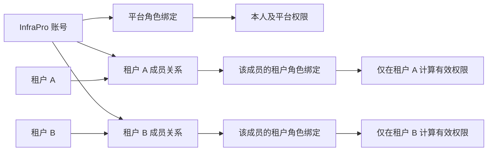
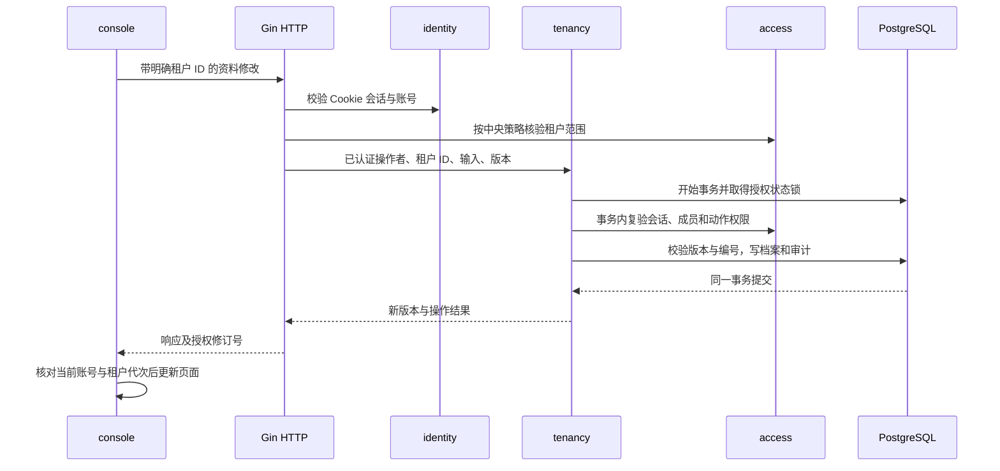

# 租户基础管理首轮迭代方案

日期：2026-11-09。版本：V0.2。方案状态：**Accepted（用户于 2026-11-09 确认）**。功能状态：**Awaiting acceptance（实现及自验通过，待人工验收）**。详见[验证记录](../verification/tenant-foundation.md)与[运行手册](../operations/tenant-foundation.md)；用户功能验收尚未进行。

本轮在现有账号管理、平台角色权限之上，交付“平台创建租户并指定管理员，管理员进入自己的租户并管理基础资料”的完整流程。范围限定为**创建、进入、管理、交接、隔离和审计**，为后续租户成员与项目功能建立归属基础。

范围依据是[规划账号权限后的下一步](codex://threads/01a1c07e-e171-7f02-bde7-b5c66f3adfb7)会话的最后一条建议，以及本次将其整理成完整方案的要求。认证继续作为 InfraPro 本项目的能力，不引入跨项目统一认证、OIDC 多客户端或单点登录体系。

## 1 交付目标与范围

### 1.1 用户可完成的业务

| 使用者 | 目标 | 本轮完成后的行为 |
| --- | --- | --- |
| 有租户治理权限的平台人员 | 建立客户或组织档案 | 查看、搜索、创建租户，修改名称、编号和说明 |
| 有创建权限的平台人员 | 指定首位管理员 | 从已有正常账号选择一人，租户、成员关系、角色绑定和审计一次成功 |
| 租户管理员 | 进入自己的工作空间 | 登录后查看“我的租户”，进入后明确显示租户名称与编号 |
| 租户管理员 | 维护租户档案 | 查看、修改本租户名称、编号和说明，查看本租户操作记录 |
| 有交接权限的平台人员 | 更换负责人员 | 指定新管理员，立即收回原管理员在该租户中的管理能力 |
| 账号维护人员 | 停用离职人员账号 | 先完成其负责租户的交接，再通过已有网页或 CLI 停用账号 |
| 同时管理多个租户的人员 | 在不同租户工作 | 切换租户，各租户的数据、草稿、请求和权限来源保持独立 |

“平台人员”“租户管理员”描述操作职责，不增加账号类型。是否允许操作，仍按实际持有的权限判断。

### 1.2 本轮交付清单

| 编号 | 内容 | 交付边界 |
| --- | --- | --- |
| TF-01 | 租户档案 | 平台列表、搜索、分页、创建、详情及编辑 |
| TF-02 | 初始管理员 | 选择已有正常账号；原子建立租户成员和内置角色绑定 |
| TF-03 | 租户入口 | 我的租户、进入、切换、当前上下文与无租户提示 |
| TF-04 | 租户资料管理 | 管理员查看和修改本租户基础资料 |
| TF-05 | 管理员交接 | 平台交接、旧权限回收、并发保护、管理员不可用提示 |
| TF-06 | 停用联动 | 网页与 CLI 常规停用保护；衔接已有应急停用和账号恢复 |
| TF-07 | 分范围授权 | 平台角色与租户角色分别计算，后端按租户核验成员与动作 |
| TF-08 | 权限解释 | 展示角色属于平台还是哪个租户，以及相应权限的来源 |
| TF-09 | 审计 | 创建、资料修改、管理员交接及应急影响的可追溯记录 |
| TF-10 | 工程交付 | 数据库迁移、OpenAPI、生成类型、测试、运行手册与验收记录 |

### 1.3 后续迭代范围

以下内容不作为本轮交付或验收条件：

- 租户普通成员邀请、接受、暂停、移除、自助退出，以及完整成员列表管理。
- 多名并列租户管理员、自定义租户角色、租户内任意角色分配。
- 项目、项目成员、项目角色、工程资源、监测数据及其使用授权。
- 租户停用、恢复、注销、删除、合并和租户归档。
- 部署租户数量限制、项目或设备配额、许可、计费与功能裁剪。
- 资源范围、数据时间范围、用途、授权有效期和审批。
- 后台任务、下载、实时订阅、终端、设备及服务身份的授权联动。
- 联系人档案、附件、组织结构、品牌设置、导入导出和批量操作。
- 新认证方式、邮箱验证、多因素认证和跨系统认证。

本轮建立的成员关系只服务初始管理员和管理员交接。不能据此宣称已经交付完整成员管理，也不将租户治理角色解释为未来全部业务数据的访问权。

## 2 当前基础与衔接原则

### 2.1 已有实现的复用位置

| 当前基础 | 实际位置 | 本轮衔接 |
| --- | --- | --- |
| 项目内账号、密码、会话、邀请和恢复 | `packages/go/platform/identity/` | 保留；租户直接引用现有稳定账号 ID |
| 22 项权限、平台管理员与基础成员两个内置角色 | `packages/go/platform/access/catalog.go`、`builtins.go` | 增加本轮所需权限及租户管理员内置角色 |
| 平台角色直接绑定账号 | `migrations/00002_access.sql` 中的 `account_roles` | 保留平台绑定；新增租户成员角色绑定 |
| 最新权限查询、授权状态锁、修订号、审计 | `access/authorizer.go`、`service.go`、`catalog_sync.go` | 扩展作用范围和事务内校验 |
| 网页和 CLI 共用账号启停规则 | `identity/repository_maintenance.go` | 增加租户管理员保护，避免入口行为不同 |
| 中央精确路由策略与默认拒绝 | `access/policy.go`、`services/api/internal/transport/http/router.go` | 注册新路由，并明确每个路由的授权范围 |
| 唯一 console 应用及权限刷新 | `apps/console/`、`packages/ts/api-client/` | 增加租户功能和上下文，沿用现有布局与登录 |
| PostgreSQL、Redis、Goose、运维 CLI | `platform/runtime/`、`platform/migrations/`、`tools/infrapro/` | 使用同一部署与迁移流程 |

以上是本轮设计的代码基线，不替代既有功能的验证记录或用户验收。现有交付记录见[账号管理验证](../verification/account-management.md)与[角色权限验证](../verification/role-permission.md)。

代码核对基线为 `feature/account-access-console` 分支、提交 `6997829`。开始实施时应核实期间的新变更，重新确认迁移编号和接入位置。

### 2.2 保持的规则

1. 账号仍只有一种身份模型；创建途径、角色名称和“首个账号”不构成授权依据。
2. 权限只通过角色分配。平台使用“账号—角色”，租户使用“账号—租户成员—角色”。
3. 权限目录继续以 Go 代码为唯一来源，数据库保存投影，前端使用生成结果。
4. 当前账号邀请只负责开户，不自动加入租户；租户创建也不顺便创建账号。
5. 平台治理权限允许管理租户档案和管理员关系，不自动形成任何租户成员关系。
6. 后端读取当前账号、成员和权限状态；菜单隐藏只用于界面体验。
7. 本轮采用增量迁移，保留现有账号、角色、邀请、会话和审计。上一轮重建数据的授权不延用到本轮。

## 3 本方案建议采用的业务规则

下列细节是对最终迭代范围的具体化，已随方案由用户确认。它们构成后文统一的设计前提。

| 编号 | 建议规则 | 目的及影响 |
| --- | --- | --- |
| D-01 | 一个租户本轮只有一名当前管理员；一个账号可管理多个租户 | 控制本轮范围，交接结果唯一明确；多管理员后续单独扩展 |
| D-02 | 平台指定和交接立即生效，不增加接任邀请或确认步骤 | 目标是已有正常账号，由有权平台人员线下核实后选择 |
| D-03 | 交接后结束原管理员的该租户成员关系，撤销对应角色绑定 | 本轮没有普通成员能力，不保留一个权限不明的普通成员身份 |
| D-04 | 平台有编辑权限者与本租户管理员都可修改名称、编号和说明 | 与本轮基础档案范围一致；所有变更记录前后值和原因 |
| D-05 | 编号在部署内唯一，旧编号永久保留归属，不分配给其他租户 | 编号可修改，历史身份不会被另一租户冒用 |
| D-06 | 常规停用当前租户管理员账号必须先交接其全部租户 | 网页与 CLI 使用同一事务规则；应急停用沿用明确例外 |
| D-07 | 保留当前资料和权限数据，不自动建立“默认租户” | 现有账号只有被明确指定后才获得租户身份 |
| D-08 | 租户管理员可查看本租户的三类业务审计 | 只提供创建、资料修改、管理员变化及相关不可用/恢复事件，不开放平台安全日志 |

若需要改变 D-01、D-02 或 D-03，应同步调整成员模型、交接流程和验收条件，不能只在页面上增加按钮。其他字段长度等参数可在评审中调整，但前后端和数据库必须保持一致。

## 4 业务对象与归属

| 对象 | 含义 | 归属与约束 |
| --- | --- | --- |
| 账号 Account | 登录 InfraPro 的身份 | 由本项目 identity 管理，不隶属于某一个租户 |
| 租户 Tenant | 一个独立客户或组织的业务归属单位 | 使用稳定 UUID；名称和编号变化不改变其身份 |
| 租户成员 TenantMembership | 一个账号在某个租户中的一次成员关系 | 每条关系固定关联一个账号和一个租户；结束后保留历史 |
| 平台角色绑定 | 将本人或平台权限集合绑定到账号 | 沿用现有 `account_roles` |
| 租户角色绑定 | 将租户权限集合绑定到租户成员 | 使用独立关系；不写入账号的平台角色集合 |
| 当前管理员关系 | 标识租户当前由哪条成员关系负责治理 | 用于交接和完整性检查；不能代替权限检查 |
| 授权上下文 | 本次操作所采用的账号及平台/具体租户范围 | 由后端核验，不能由浏览器声明“我是管理员” |



示例：甲同时是租户 A、B 的管理员，甲在 A、B 中有两条独立成员关系。将 A 交接给乙，只结束甲在 A 中的关系；甲的账号、平台角色及 B 的成员关系保持原状。

## 5 租户档案与字段

| 字段 | 填写与显示 | 规则 |
| --- | --- | --- |
| `id` | 系统生成，不要求用户输入 | UUID，作为 URL、外键和审计的稳定标识 |
| `name` | 名称，必填 | NFKC 规范化并去首尾空白后 1–100 个 Unicode 码点；允许不同租户重名 |
| `code` | 编号，必填 | 3–32 位 ASCII 字母、数字、短横线或下划线，首位为字母或数字；去首尾空白后转小写 |
| `description` | 说明，可选 | 最多 1,000 个 Unicode 码点；按纯文本保存和展示 |
| 当前管理员 | 创建时选择，详情只读显示 | 显示名称与用户名同时展示；变更走独立交接流程 |
| 管理员可用性 | 系统计算 | 显示“正常”或“管理员不可用，待处理”，不作为租户生命周期状态 |
| `version` | 不要求用户填写 | 十进制字符串；每次有效资料修改和管理员交接递增 |
| 创建/修改时间与操作者 | 系统记录 | 时间存 UTC，页面按明确时区显示；人工验收采用 Asia/Shanghai |
| `reason` | 每次创建、修改、交接填写 | 非空，最多 500 个 Unicode 码点，保存在审计中 |

编号修改后，旧编号继续指向其原租户的保留记录。其他租户不能使用该编号；原租户可以改回自己的旧编号。页面的访问路由使用 UUID，不因改编号而失效。历史审计保留当时的名称、编号和变更值，不批量替换为新值。

名称用于识别，不作为唯一键。说明不接受可执行 HTML。前端校验用于即时提示，Go 校验与 PostgreSQL 唯一约束作为最终保障。长度前端按 Unicode 码点计算，不能使用 JavaScript 字符串长度替代。

本轮所有租户创建后即可使用，不提供停用、删除或恢复字段。管理员不可用只是治理异常提示，不把该租户从平台列表隐藏。

## 6 平台创建与初始管理员

### 6.1 页面流程

1. 平台人员打开“平台管理 → 租户管理”，选择“创建租户”。
2. 填写名称、编号、说明，搜索并选择已有正常账号，填写创建原因。
3. 页面显示目标账号的显示名称与用户名，说明其将获得该租户的固定管理员权限。
4. 提交前复用已有最近密码复验；复验过期时保留非敏感输入，由用户复验后再次确认提交。
5. 服务端重新校验操作者权限和目标账号状态，在一个事务中完成创建。
6. 成功后显示租户名称、编号及管理员。操作者有查看权限时进入平台租户详情；否则仅显示本次创建成功的结果。

目标账号尚不存在时，由有账号邀请权限者先通过现有邀请流程完成开户。创建表单不生成开户邀请，不接受密码，不分配平台角色。

### 6.2 候选账号的可见范围

创建或交接能力包含“查找可接任账号”这一必需能力，但不包含完整账号管理。提供专用候选查询，只返回正常账号的 ID、用户名和显示名称。

- 仅持有 `platform.tenant.create` 或 `platform.tenant.transfer_admin` 的人员可调用。
- 至少输入 2 个字符才发起搜索；每页最多 20 条，继续查询使用游标。
- 不返回账号的平台角色、其他租户关系、会话、联系方式或安全记录。
- 无结果显示“没有符合条件的正常账号”，不能将数据库故障显示成无结果。
- 前端选择不锁定账号；事务提交前仍重新检查账号是否正常。

候选查询的 OR 权限是中央策略中明确登记的一种组合，不为所有接口新增隐式“任一权限即可”的规则。

### 6.3 原子性与重复提交

创建事务同时写入租户、编号保留记录、初始成员关系、租户管理员角色绑定、当前管理员关系、授权修订号及创建审计。任一步失败全部回滚。

浏览器为一次创建意图生成 `client_request_id`，超时重试沿用该值。数据库按“创建账号 ID + 请求 ID”去重，并保存规范化请求的摘要：

- 相同请求 ID、相同内容：返回原租户 ID 和重复请求标记，不重复创建和记审计。
- 相同请求 ID、不同内容：返回冲突，不能把旧请求改作新建另一租户。
- 不同请求 ID、相同已占用编号：返回编号冲突，页面提供查验已创建结果的引导。
- 每次重试仍检查当前登录与创建权限，不能靠旧请求 ID 绕过撤权。

创建者不会自动成为租户成员。创建时选择本人是一次显式管理员授予，仍按相同规则和审计执行。

## 7 管理员交接与账号停用

### 7.1 常规交接

平台租户详情显示当前管理员。有交接权限者选择新账号，填写原因，页面同时列出当前管理员、接任账号和影响：“原管理员将失去本租户访问与管理能力；其账号及其他租户权限不受影响。”

提交携带当前租户 `expected_version` 和新管理员账号 ID。服务端在同一事务内：

1. 校验平台交接权限、当前会话和最近密码复验。
2. 核对租户版本，锁定相关账号及租户，重新检查接任账号为正常状态。
3. 建立新成员关系并绑定内置租户管理员角色。
4. 更新当前管理员关系，结束原成员关系并撤销其租户角色绑定。
5. 增加租户版本及授权修订号，写入包含原/新管理员与原因的审计。
6. 提交后，新管理员的下一次请求取得权限，原管理员的下一次请求失去该租户权限。

选择当前管理员返回明确的“无需交接”，不产生新关系、版本或成功审计。两个平台人员并发交接同一租户，只有一个版本匹配的请求成功；另一个刷新并重新确认，不能覆盖前者。

### 7.2 成员历史与再次接任

原成员关系状态改为 `ended`，保存结束时间、交接原因和操作者。既有关系不物理删除，结束的角色绑定不重新启用。

原管理员将来再次接任时建立新的成员关系 ID，并显式绑定本轮角色。不能以“这个账号以前管理过该租户”为由恢复旧关系、旧角色或未来可能增加的其他授权。

本轮不提供管理员自助转交、普通成员保留和追加第二名管理员入口。交接属于平台独立动作，不使用“编辑资料”接口直接修改管理员字段。

### 7.3 常规账号停用

网页停用与 `account disable` 都检查目标账号是否为任何租户的当前有效管理员。只要仍有一个租户未交接，返回 `409 tenant_admin_transfer_required`，账号状态、会话和角色均不改变。

提示说明需要先交接的数量。有 `platform.tenant.read` 的操作者可查看受影响租户名称与编号；没有该权限时仅提示存在未交接职责，不能借账号停用接口读取租户档案。

停用权限不自动包含交接权限。有停用权限但无交接权限者需由具备交接权限的平台人员完成前置处理。一个账号管理多个租户时可以逐个交接，全部交接完成前停用持续被阻止。

原有最后正常账号、最后完整平台管理账号保护继续执行。任一约束失败都整体回滚。

### 7.4 应急停用与恢复

沿用已有 `account disable --emergency --reason ...`，用于账号失陷时优先停止登录。该入口允许暂时出现管理员不可用的租户，仍撤销该账号的会话及相关凭据；网页没有强制停用选项。

应急停用保留原成员关系和角色绑定，但账号状态使其不能生效。一次事务记录账号应急事件及受影响租户的治理事件。平台列表与详情显示“管理员不可用”，允许有权平台人员将租户交接给另一正常账号。

- 尚未交接时，明确执行现有账号恢复后，保留的成员关系可以恢复生效；旧会话不能复活。
- 已完成交接时，再恢复原账号也不能恢复其已结束的租户关系。
- 平台管理能力也丢失时，沿用 `access recover-admin` 和账号恢复流程，再从平台页面完成租户交接。
- 不重新开放 bootstrap，不提供 HTTP `force`、`skip_auth` 或租户代登录入口。

单个租户管理员不可用不应使整个 API 的 `/readyz` 失败，否则会阻止平台修复。服务就绪检查关注数据库、迁移与目录一致性；租户治理异常通过有权限的业务页面显示。

## 8 分范围角色与权限

### 8.1 本轮新增权限

| 权限编码 | 范围 | 能力 |
| --- | --- | --- |
| `platform.tenant.read` | 平台 | 查看租户列表、详情、当前管理员及其可用性 |
| `platform.tenant.create` | 平台 | 创建租户并指定固定初始管理员；查询最小候选账号信息 |
| `platform.tenant.update` | 平台 | 修改租户名称、编号、说明 |
| `platform.tenant.transfer_admin` | 平台 | 交接当前管理员；查询最小候选账号信息 |
| `tenant.profile.read` | 指定租户 | 查看该租户档案 |
| `tenant.profile.update` | 指定租户 | 修改该租户名称、编号、说明 |
| `tenant.audit.read` | 指定租户 | 查看该租户允许公开给管理员的业务审计 |

以上合计新增 7 项，按当前 22 项目录基线，实施后的预期目录为 29 项。权限仍集中在 `access/catalog.go`，操作映射集中在 `access/policy.go`，同步生成 TypeScript 常量与 OpenAPI 枚举。

本轮不增加“进入全部租户”权限。`我的租户`和本人租户上下文是经过认证、严格限定本人的发现入口，用于找到已有成员关系；不因此返回他人的租户档案。

### 8.2 内置角色与配置规则

| 角色 | 绑定对象 | 本轮结果 |
| --- | --- | --- |
| 平台管理员 | 账号 | 通过发布同步取得新增 4 项平台权限；不取得 3 项租户权限 |
| 基础成员 | 账号 | 保持现有 6 项本人能力；不自动加入租户 |
| 租户管理员 | 租户成员 | 固定包含 3 项租户权限，只在该成员所属租户生效 |
| 现有自定义平台角色 | 账号 | 可由有权人员配置新增平台权限，不自动扩权 |

增加角色的 `binding_scope`：`platform` 表示直接绑定账号的现有角色，`tenant` 表示绑定租户成员的角色。本人权限仍可包含在现有平台绑定范围内，权限的 `scope=self` 与角色绑定对象是两个不同维度。

平台角色配置只接受本人和平台权限。租户角色只接受租户权限。平台账号授权页面不能选择租户管理员角色，租户成员绑定也不能引用平台角色。后端、同步检查和数据库外键共同防止错误范围绑定。

租户管理员角色是系统维护的固定模板，没有网页修改、启停或删除入口。本轮不会创建租户自定义角色编辑器。未来如增加自定义租户角色，另行增加角色所属租户及其管理规则。

### 8.3 有效权限与授予规则

```text
平台有效权限(账号)
  = 账号绑定的有效平台角色中，本人及平台权限的并集

租户有效权限(账号, 租户)
  = 该账号在该租户的有效成员所绑定的有效租户角色权限并集

允许租户操作
  = 账号与会话有效
  AND 路由租户与所操作对象所属租户一致
  AND 当前成员关系有效
  AND 该租户范围的有效权限包含本次动作
  AND 满足版本等业务约束
```

甲在 A 中的权限不能用于 B；同名权限代码也不能跨租户合并。持有平台租户查看权限只能调用平台治理入口，不能绕过成员检查调用租户入口。

现有平台角色授予继续遵守“不能授出本人没有的权限”。指定租户管理员采用明确的跨范围治理规则：持有租户创建或交接权限者，可在对应操作中授予固定的租户管理员模板，无须先成为该租户管理员；不能传入其他角色或任意权限列表。此能力本身属于高风险平台权限，需要密码复验和审计。

### 8.4 权限来源展示

- 个人资料中的现有角色与权限区域明确标注“本人及平台权限”。
- “我的租户”每项显示该租户中本人角色；进入后可展开“当前租户权限”，查看成员关系、角色名称与权限说明。
- 同时管理 A、B 时分别展示，不能显示一份不带租户归属的合并租户权限。
- 平台账号详情的租户任职摘要同时要求 `platform.account.read` 与 `platform.tenant.read`；只有前者时仍仅显示原有账号及平台授权信息。
- 权限目录可展示全部权限定义及其范围，但看到定义不表示拥有能力。既有平台角色页面只列出可直接绑定账号的角色。

后续实施需相应更新 `GLOSSARY.md` 中“角色绑定”和“有效权限”的作用范围定义；本方案阶段不把尚未实施的模型写成现行事实。

## 9 租户入口与页面交互

### 9.1 页面与导航

下表路径是 console 应用内路径；正式部署统一带现有 `/console/` 前缀。

| 页面 | 路径 | 内容及操作 |
| --- | --- | --- |
| 首页与我的租户 | `/`、`/tenants` | 首页增加真实的租户入口；列表显示名称、编号、本人角色和进入操作 |
| 平台租户列表 | `/platform/tenants` | 搜索名称/当前或历史编号、分页、当前管理员、管理员可用性、创建入口 |
| 平台租户详情 | `/platform/tenants/$tenantId` | 档案、管理员、创建/修改信息；按权限显示编辑、交接和审计入口 |
| 租户资料 | `/t/$tenantId/profile` | 本租户名称、编号、说明、当前管理员；按权限显示编辑入口 |
| 租户操作记录 | `/t/$tenantId/audit` | 本租户允许查看的审计，按事件类型和时间筛选、分页 |
| 当前租户权限 | 租户页中的只读区域 | 展示本人在当前租户的角色、权限说明和来源 |

复用现有 AdminLayout、表单、表格、Dialog、反馈和主题组件。平台租户列表放在“平台管理”，我的租户放在“工作空间”；进入租户后新增“当前租户”导航分组。平台治理页面明确显示“平台管理”，租户页面始终显示当前租户名称与编号，避免将两种入口混淆。

已有账号、角色、权限目录、个人资料和安全页面继续保持原路径。登录后的默认入口仍为首页，不因为只有一个租户就自动跳转；深链接返回目标在验证当前成员关系后恢复。

### 9.2 页面状态

| 场景 | 预期呈现 |
| --- | --- |
| 本人没有租户 | 显示“尚未加入租户，请联系平台管理人员”，个人账号入口仍可用 |
| 平台尚无租户 | 有创建权限者看到创建入口；其他有查看权限者看到空态说明 |
| 加载中 | 显示骨架或加载反馈，不将旧租户内容作为新租户的占位数据 |
| 搜索无结果 | 显示明确的筛选结果空态，可清除筛选 |
| 管理员已不可用 | 平台详情显示待处理提示；有交接权限者可指定新管理员 |
| 已失去当前租户成员关系 | 清理当前租户内容，显示“当前租户不可访问”，提供返回我的租户 |
| 登录失效 | 清理账号及租户状态，进入登录流程 |
| 数据库或 Redis 故障 | 显示服务暂不可用与重试，不能显示“没有租户”或继续提交 |
| 版本冲突 | 保留仍有权查看的本地草稿，提示加载最新内容、比较后再次提交 |
| 提交结果未知 | 明确提示查验结果；创建重试沿用请求 ID，交接/编辑先刷新版本 |

创建和编辑使用带明确标签的表单；校验错误出现在字段附近。提交中防止重复点击，成功后刷新相关列表和详情。交接使用独立确认弹窗，显示完整的原/新账号信息；取消不改变任何数据。

桌面表格在 375px 手机视口改为可读卡片或纵向布局，不能让主要操作依赖横向滚动。弹窗支持键盘访问、焦点进入和关闭后返回原触发位置；状态与错误不能只靠颜色表达。沿用既有设计系统，不在本轮重做全站视觉风格。

### 9.3 租户选择与浏览器状态

当前租户由当前标签页的 URL 表达。服务端会话不保存一个对所有标签页生效的 `active_tenant_id`，请求也不依赖可变的全局租户请求头。

租户 A、B 可以同时在两个标签页打开。切换 A 页到 B 不改变另一标签页的上下文；账号退出或账号切换仍按现有规则影响共享登录状态。

进入租户必须先读取当前租户上下文，核验成员关系后再加载资料和审计。所有请求显式携带 URL 中的租户 ID；接口不接受正文中的另一个租户 ID 覆盖路由范围。

建议查询键包括账号、租户和成员关系：

```text
['platform', accountId, 'tenants', filters]
['account', accountId, 'my-tenants', filters]
['tenant', accountId, tenantId, membershipId, 'profile']
['tenant', accountId, tenantId, membershipId, 'audit', filters]
```

查询键包含影响查询结果的变量，使缓存按上下文独立，是 TanStack Query 的标准用法；本项目在此基础上加入账号、租户和成员关系维度。[TanStack Query 查询键说明](https://tanstack.com/query/latest/docs/framework/react/guides/query-keys)

### 9.4 切换与迟到响应

切换租户时先处理未保存输入：有草稿时由用户选择继续编辑或放弃后切换。提交正在进行时显示正在处理，避免让用户误以为已取消服务端写入；遇到超时可离开，但明确说明稍后需核实结果。

切换成功时增加本标签页 `tenantContextEpoch`，取消旧查询，卸载旧租户页面及表单，并清理旧租户的敏感缓存。查询必须把 `AbortSignal` 传递给底层 fetch；组件卸载本身不能作为请求已取消的证明。[TanStack Query 查询取消说明](https://tanstack.com/query/latest/docs/framework/react/guides/query-cancellation)

每个读写请求记录发起时的账号代次、租户 ID、成员关系 ID 和租户代次。响应到达时与当前上下文比较；不匹配则丢弃，不能更新新租户表单、弹出误导性成功提示或触发新租户导航。

浏览器取消请求不保证撤销已开始的数据库事务。写请求从发出时就固定目标租户，服务端仍在提交事务中检查权限；已合法提交给 A 的操作只能影响 A，不得因客户端切到 B 而改写 B。

### 9.5 授权变化后的刷新

沿用可见页面最多 30 秒刷新、重新获得焦点和响应修订号触发刷新的机制，并增加当前租户上下文及“我的租户”刷新。租户名称修改虽不改变权限，也通过查询失效或定期刷新更新显示。

不能仅比较 `/auth/me.permissions`：管理员交接时，原账号的平台权限可能完全不变。收到新的 `authorization_revision` 后，需要重新核验当前租户成员 ID 与权限集合；成员消失、变为结束或权限减少时清理当前租户内容并增加租户代次。与本人无关的修订不应无条件销毁尚未提交的草稿。

30 秒是可见页面自动刷新目标，不是后端授权有效期。撤权事务提交后，后端新请求即使用最新结果。后台休眠标签页恢复后先重新核验再恢复内容；不将权限写入 localStorage，也不把浏览器缓存当作授权凭证。

## 10 后端模块与请求链路

### 10.1 模块职责

| Module | 本轮职责 | 调用关系与限制 |
| --- | --- | --- |
| `platform/identity` | 继续管理账号与会话；向业务提供已认证操作者 | 调用 access 的账号状态保护；不导入 tenancy |
| `platform/access` | 目录、策略、平台与租户权限求值、锁、角色绑定、管理员保护及审计基础 | 不导入 identity 或 tenancy；按明确授权 SQL 读取成员事实 |
| 新增 `platform/tenancy` | 档案、编号保留、成员建立/结束、当前管理员交接、租户查询 | 调用 access，在一个事务内完成业务；不导入 Gin |
| HTTP tenancy Adapter | 请求解析、严格字段校验、响应及错误映射 | 从 identity 获得可信操作者，调用 tenancy 的 Interface |
| `platform/runtime` | 依赖装配 | 将共享数据库池、日志、identity、access、tenancy 连接起来 |
| console tenant feature | 页面、查询、表单和租户上下文 | 通过 api-client 调用 HTTP；共享 UI 不访问业务接口 |

tenancy 对外提供少量完整业务 Interface：查询我的租户、读取租户上下文、平台查询/创建/修改/交接、租户资料读写与本租户审计。初始成员建立、编号占用、角色绑定、版本与审计封装在内部，不要求 Handler 依次调用多个写接口拼出事务。

access 扩展显式范围参数，区分本人/平台和指定租户，并提供事务内的范围授权检查。HTTP 前置校验和业务事务内复验使用同一中央策略，不能出现 Handler 放行后其他入口直接调用裸 SQL。

管理员保护放在 access 可调用的共享事务检查中，由网页和 CLI 的 `SetStatusTx` 链路统一使用。其检查按成员、角色和目标权限求值；不能让 identity 与 tenancy 互相导入，也不能依赖前端先完成一个“是否可以停用”的查询。

### 10.2 调用链



所有写请求继续校验 Origin、CSRF、有效会话、动作权限和输入。创建、平台编辑、交接及租户资料编辑均复用最近密码复验，不新增另一套密码校验或复验有效期。

### 10.3 操作与隔离顺序

平台接口先检查平台动作权限，再读取目标租户；无平台权限时不通过“对象存在/不存在”的不同返回泄露信息。租户接口在读取资料前核验该账号的目标成员关系。

租户不存在与本人没有有效成员关系统一返回 `404 tenant_not_found`。有有效成员但缺少动作权限时返回 `403 permission_denied`。本轮固定管理员角色包含全部三个租户动作，此区别主要确保以后扩展角色时不必改变安全语义。

数据库查询、搜索、详情、审计分页和总数都带有范围条件。不能先查询全部租户再在 Go 或前端过滤；访问错误也不得包含其他租户名称、管理员身份或编号冲突的占用者。

## 11 数据结构与一致性

建议新增迁移 `packages/go/platform/migrations/00003_tenancy.sql`；若实施时编号已占用，按当前迁移序列顺延。以下是逻辑结构，具体 SQL 必须通过真实 PostgreSQL 测试。

### 11.1 表与字段

| 表 | 关键字段或变化 | 约束与用途 |
| --- | --- | --- |
| `tenants` | UUID、名称、当前编号、说明、当前管理员成员 ID、version、创建/修改账号和时间 | UUID 稳定；当前编号唯一；当前管理员成员必须属于该租户 |
| `tenants` 创建去重字段 | `creation_request_id`、`creation_payload_hash` | 与 `created_by` 构成唯一键；保存一次创建意图，非通用幂等平台 |
| `tenant_codes` | 规范化编号、tenant_id、首次使用时间 | 编号唯一，永久保留归属；当前编号与历史编号同受约束 |
| `tenant_memberships` | ID、tenant_id、account_id、`active/ended`、加入/结束时间、操作者和结束原因 | 同账号同租户最多一条 active 关系；ended 记录保留 |
| `tenant_member_roles` | tenant_id、membership_id、role_id、binding_scope、授予信息、撤销时间与操作者 | 只允许 tenant 范围角色；同成员同角色最多一条未撤销绑定 |
| `roles` | 新增 `binding_scope` | 现有记录回填 platform；租户管理员为 tenant；名称唯一约束纳入范围 |
| `account_roles` | 增加固定 platform 绑定范围及组合外键 | 不允许将 tenant 角色直接绑定到账号 |
| `permission_catalog`、`role_permissions` | 增加目录投影和角色权限行 | 仍共享现有模型；角色权限必须符合其绑定范围 |
| `account_security_events` | 增加可空 tenant_id、操作者上下文范围 | 复用审计存储；tenant_id 是受控列，不从任意 JSON 字段猜归属 |
| `authorization_state` | 保持现有单行锁和修订号 | 创建、交接、账号启停和角色目录变化递增 |

成员与角色绑定通过 `(tenant_id, membership_id)` 组合外键防止跨租户拼接。角色通过 `(role_id, binding_scope)` 组合外键限制绑定类型，绑定表自己的范围值用 CHECK 固定。

租户与首位成员存在创建引用顺序时，预先生成 UUID，在同一事务内使用可延迟检查的外键完成创建；当前管理员成员 ID 本身仍要求非空。延迟外键允许在事务结束时检查引用关系。[PostgreSQL 17 约束说明](https://www.postgresql.org/docs/17/sql-createtable.html) 不能通过“先提交无管理员租户，随后补管理员”的方式绕过原子性。

当前管理员指向成员关系，仅用于治理完整性；授权仍需要该关系有效、角色绑定有效且拥有动作权限。正常创建和交接提交时必须存在且仅存在本轮规定的一名当前有效管理员；应急停用保留指向但允许其账号不可用。

### 11.2 索引与版本

必要索引包括：租户当前编号唯一、编号保留表主键、租户分页排序、按账号查有效成员、按租户查成员、有效角色绑定、按租户和事件 ID 倒序查询审计。列表默认每页 20 条，最多 100 条；候选账号最多 20 条。

`version`、审计 ID 和 `authorization_revision` 对外都使用十进制字符串，避免 bigint 转换为 JavaScript Number 后失真。前端不自己增加或比较数据库行版本，授权修订的大小比较使用现有 BigInt 处理方式。

资料修改只增加租户行版本；创建和交接同时增加授权修订。没有实质变更的提交不产生新版本或成功变更审计。提交仍须校验调用者、字段与预期版本。

### 11.3 锁与并发

继续使用当前 `authorization_state` 单行锁：资料读写取共享锁；创建、交接、账号启停和授权图变化从事务开始就取排他锁，不能先共享后升级。

统一的加锁顺序为：授权状态 → 相关账号按 UUID 排序 → 会话复验所需记录 → 需要锁定的角色 → 租户按 UUID 排序 → 成员和绑定 → 编号及业务记录。涉及多个账号的交接，先收集操作者、原管理员和新管理员，再按同一顺序加锁。获取授权状态锁后才能发现并锁定这些对象，避免账号状态变更与交接发生反向锁依赖。

资料修改、成员核验和落库处于同一个短事务；交接的排他锁等待既有共享事务结束。因此先获得授权并已在事务内执行的操作可先提交，交接提交后新的旧管理员操作被拒绝。已经返回的数据无法追溯收回，网络中已经发出的响应也由前端代次检查处理。

上述方案使用 PostgreSQL 行级共享锁和排他锁的冲突关系；保持一致的加锁顺序可降低死锁风险。[PostgreSQL 17 显式锁文档](https://www.postgresql.org/docs/17/explicit-locking.html#LOCKING-ROWS)

沿用当前事务的锁等待与语句超时，不在锁内执行密码哈希、网络调用或等待用户输入。锁超时返回明确可重试错误，客户端不自动重放写操作。此首轮方案会串行化授权管理写入；并发性能优化需要实际测量后另行设计。

必须验证以下竞争结果：

| 竞争场景 | 合法结果 |
| --- | --- |
| 两次创建使用相同编号 | 一个成功，另一个编号冲突；无孤立成员或角色绑定 |
| 两次创建使用相同请求 ID | 同内容返回同一租户；异内容冲突 |
| 平台与租户管理员同时编辑档案 | 一个版本成功，另一个版本冲突 |
| 两次交接同一租户 | 一次成功，另一次版本冲突 |
| 交接给乙与停用乙并发 | 停用先完成则交接拒绝；交接先完成则常规停用拒绝 |
| 管理员提交修改与交接并发 | 修改先提交或撤权后拒绝，不能在撤权提交之后通过旧权限新增写入 |
| 创建/交接中的审计或绑定写入失败 | 整体回滚，编号、关系、版本、授权修订均不残留变化 |

## 12 接口契约

以下路径统一以 `/api/v1` 为前缀。所有新路由先进入 OpenAPI 和中央策略，再实现 Handler 与客户端。

### 12.1 接口清单

| 方法与路径 | 权限/范围 | 说明 |
| --- | --- | --- |
| `GET /platform/tenants` | `platform.tenant.read` | 平台列表；关键词、游标、页大小；可筛选管理员不可用 |
| `POST /platform/tenants` | `platform.tenant.create` | 创建租户和固定初始管理员 |
| `GET /platform/tenants/{tenant_id}` | `platform.tenant.read` | 平台治理详情 |
| `PATCH /platform/tenants/{tenant_id}` | `platform.tenant.update` | 编辑名称、编号、说明 |
| `POST /platform/tenants/{tenant_id}/administrator-transfer` | `platform.tenant.transfer_admin` | 独立管理员交接 |
| `GET /platform/tenant-admin-candidates` | 创建或交接权限，明确 OR | 最小候选账号搜索 |
| `GET /account/tenants` | 认证有效，范围固定为本人 | 我的有效租户列表与本人角色摘要 |
| `GET /tenants/{tenant_id}/context` | 认证有效且该租户成员有效 | 当前成员 ID、角色、权限来源和授权修订 |
| `GET /tenants/{tenant_id}/profile` | `tenant.profile.read`，该租户成员 | 本租户档案 |
| `PATCH /tenants/{tenant_id}/profile` | `tenant.profile.update`，该租户成员 | 本租户资料修改 |
| `GET /tenants/{tenant_id}/audit-events` | `tenant.audit.read`，该租户成员 | 严格过滤后的本租户业务审计 |
| `GET /access/accounts/{account_id}/tenant-memberships` | `platform.account.read` 且 `platform.tenant.read` | 账号当前租户任职摘要；无写操作 |
| 扩展 `GET /access/audit-events` | 既有平台审计权限；租户事件另需租户查看权限 | 增加租户筛选与治理事件展示 |

创建、编辑和交接权限不隐式包含查看权限。后台接口分别检查动作；页面对缺少配套查看权限的角色给出配置提示，不自动扩权。平台网页完整操作通常需要查看权限加对应写权限。

### 12.2 输入与返回

| 操作 | 允许的输入 |
| --- | --- |
| 创建 | `client_request_id`、`name`、`code`、`description`、`administrator_account_id`、`reason` |
| 编辑 | `expected_version`、需要修改的 `name/code/description`、`reason`；至少一个业务字段 |
| 交接 | `expected_version`、`new_administrator_account_id`、`reason` |

正文禁止额外的 `tenant_id`、`roles`、`permissions`、`is_admin`、`force`、`status` 等字段，严格拒绝未知字段。操作者、所属租户、授权范围和审计归属均由服务端确定。

创建首次成功返回 201 和 `tenant_id`、`version`、`replayed=false`；同一创建请求重试返回 200、相同 tenant_id 与 `replayed=true`。重复结果中的 version 表示查询时的当前版本，不能当作原创建快照自动继续写入。

编辑与交接返回 200 和 tenant_id、新 version、授权修订号；后续详情通过对应查看接口刷新。这样只有写权限的调用者不会顺带获得不属于该动作结果的完整读取能力。

租户上下文返回的权限只属于请求的租户，例如：

```json
{
  "tenant": { "id": "<tenant-uuid>", "name": "东河养护中心", "code": "donghe" },
  "membership_id": "<membership-uuid>",
  "roles": [{ "id": "<role-uuid>", "name": "租户管理员", "binding_scope": "tenant" }],
  "permissions": ["tenant.profile.read", "tenant.profile.update", "tenant.audit.read"],
  "permission_sources": { "tenant.profile.read": ["<role-uuid>"] },
  "authorization_revision": "42"
}
```

示例 UUID 是结构占位符；真实响应使用有效 UUID，且为每项有效权限返回完整来源。上下文只含进入与解释权限所需的信息，不返回租户说明、其他成员或跨租户关系。

### 12.3 错误约定

| HTTP / 业务码 | 条件 | 客户端行为 |
| --- | --- | --- |
| 400 `validation_failed` | 字段不合法、未知字段、请求 ID 格式错误 | 定位字段，保留允许保留的输入 |
| 401 既有认证错误 | 未登录、会话失效、账号停用 | 清理账号及全部租户上下文，进入登录 |
| 403 `permission_denied` | 无平台动作权限，或有效成员缺少租户动作权限 | 刷新对应权限，不自动重试写入 |
| 403 `reauthentication_required` | 最近密码复验不满足 | 复用现有弹窗，复验后再次明确提交 |
| 404 `tenant_not_found` | 租户不存在或本人无有效成员关系 | 当前租户内容清理，提供返回入口 |
| 409 `tenant_code_taken` | 编号被其他租户当前或历史占用 | 提示换编号，不返回占用者资料 |
| 409 `version_conflict` | 租户版本已变化 | 刷新、比较后重新确认 |
| 409 `administrator_unavailable` | 目标账号不存在或已不可用 | 重新选择，不能创建无管理员租户 |
| 409 `administrator_unchanged` | 接任账号就是当前管理员 | 提示无需交接 |
| 409 `tenant_admin_transfer_required` | 常规停用仍负有租户管理员职责的账号 | 提示先交接，按权限返回影响摘要 |
| 409 `idempotency_conflict` | 同一创建请求 ID 携带不同内容 | 查验原结果或明确重新发起创建 |
| 503 `unavailable` | 数据库、Redis、目录或依赖不可用 | 显示服务故障，不回退授权 |
| 503 `operation_busy` | 锁等待超时等短暂竞争 | 提示稍后核实并重试，不自动重放 |
| 500 `internal_error` | 其他内部失败，包括审计落库失败 | 不返回成功；通过请求 ID 排查 |

继续保留现有 CSRF、Origin 和限流错误语义。无权限时先拒绝，再检查对象细节；错误日志不记录 Cookie、密码、一次性凭证或完整请求正文。

## 13 审计与可见性

### 13.1 记录内容

| 事件 | 关键记录 |
| --- | --- |
| `tenant.created` | 租户名称、编号、说明、初始管理员及成员关系、创建原因 |
| `tenant.profile.updated` | 实际改变的字段及前后值、操作者采用的平台或租户上下文、原因 |
| `tenant.administrator.transferred` | 原/新账号、原/新成员关系、租户版本变化与交接原因 |
| `tenant.administrator.unavailable` | 应急停用导致的当前管理员不可用及原因，不包含其他租户的影响列表 |
| `tenant.administrator.available` | 未交接前账号显式恢复使当前管理员重新可用的记录 |

共同记录事件 ID、tenant_id、操作者 ID/类型、操作时的展示信息、时间、结果、请求 ID及必要的版本。账号和租户以后改名不改写历史事件。审计中的稳定 ID 与当时展示快照分别保留。

业务成功事件与业务变化同一事务写入，审计失败则业务回滚。拒绝和校验失败进入现有受控安全日志，不能记成成功事件，也不为了记录失败而提交部分业务变化。

### 13.2 查询权限

租户审计接口先要求有效成员及 `tenant.audit.read`，SQL 固定 tenant_id，并对白名单事件输出专用 DTO。只返回该租户档案和管理员治理所需内容，不返回来源 IP、User-Agent、账号密码操作、平台角色配置或其他租户信息。

平台审计继续要求 `platform.audit.read`；其中租户事件同时要求 `platform.tenant.read`。无租户查看权限时，通用审计列表排除租户事件；显式请求租户筛选时直接拒绝。不能只隐藏筛选控件但仍把租户事件混入全局结果。

个人安全记录沿用既有范围，新增租户业务事件通过租户审计读取，避免原管理员交接后借个人安全接口继续查询租户详情。平台有权者可以追溯原/新管理员，原管理员不能凭历史成员关系继续查租户审计。

沿用当前 `audit_retention` 配置，代码默认值为 `2160h`，即 90 天；实施时在运行手册明确租户审计也受该保留策略影响。成员历史和编号归属不随审计定时清理删除。若业务需要长期审计归档，应另行确定保留与备份要求，不能把本轮描述成永久保存全部事件。

## 14 技术选择与具体用途

本轮沿用当前依赖与锁文件，不通过新租户功能顺带升级框架，不增加服务、数据库实例、消息队列或专用权限引擎。

| 技术 | 具体使用位置 | 选择原因 |
| --- | --- | --- |
| Go | platform/tenancy、access 扩展及相关测试 | 与现有业务一致，共享事务规则供不同入口调用 |
| Gin | `services/api/internal/transport/http/tenancy/` | 复用现有路由、Cookie、CSRF、错误与请求追踪 |
| PostgreSQL 17 + pgx | 租户、成员、角色关系、编号保留、审计 | 同库事务、外键、唯一约束及行锁实现本轮一致性 |
| Goose | platform/migrations 和统一 CLI | 增量迁移与版本检查沿用现有部署流程 |
| Redis | 既有 identity 会话缓存与限流 | 保持现有认证机制；本轮不缓存租户授权结果 |
| React + TypeScript + Vite | console 的 tenant feature | 同一应用内交付页面，复用已有构建和类型约束 |
| TanStack Router | `/platform/tenants`、`/t/$tenantId/...` | URL 明确上下文，支持深链接、返回与标签页独立 |
| TanStack Query | 租户列表、资料、上下文和审计 | 管理带账号/租户范围的服务端状态、取消和刷新 |
| TanStack Table | 平台租户列表与审计表格 | 复用现有分页、排序与列呈现方式 |
| React Hook Form + Zod | 创建、修改、交接表单 | 共用已有字段校验和错误反馈模式，后端继续最终校验 |
| shadcn/ui 与现有共享包 | 导航、Dialog、表格、输入及状态反馈 | 延续现有交互、可访问性与主题 |
| Zustand | 仅沿用现有布局偏好 | 不承载可信权限，不将所有标签页的租户选择做成一个共享值 |
| OpenAPI + 生成工具 | `contracts/openapi/api.yaml` 与 api-client | 保持契约、客户端类型和权限枚举同步 |
| Go 测试、Playwright、Compose | 真实数据库集成、浏览器与 HTTP 验收 | 覆盖事务竞争、上下文隔离和部署路径 |

## 15 实施位置与交付文件

| 位置 | 计划变化 |
| --- | --- |
| `packages/go/platform/tenancy/` | 新增租户业务、数据访问、模型及测试 |
| `packages/go/platform/access/` | 范围化授权、角色绑定范围、目录、策略、停用保护、审计及同步检查 |
| `packages/go/platform/identity/` | 共用停用/恢复链路接入租户保护和治理事件；保持原认证逻辑 |
| `packages/go/platform/migrations/` | 新增增量迁移与迁移验证 |
| `packages/go/platform/runtime/` | 装配 tenancy，与 API/CLI 共享既有依赖 |
| `services/api/internal/transport/http/tenancy/` | 新增 HTTP Adapter |
| `services/api/internal/transport/http/router.go` | 注册路由与范围策略；启动时检查覆盖 |
| `tools/infrapro/` | 现有启停、目录同步和检查命令的联动及帮助说明；本轮不另建租户运维程序 |
| `contracts/openapi/api.yaml` | 接口、DTO、错误、作用范围和输入约束 |
| `scripts/permissions.mjs` 及生成物 | 范围与新权限的生成/校验支持 |
| `packages/ts/api-client/` | typed client、范围上下文、租户修订通知与请求代次支持 |
| `apps/console/src/features/tenant/` | 平台租户、我的租户、资料、交接和审计页面 |
| `apps/console/src/routes/` | 增加文件路由；routeTree 由工具生成 |
| `apps/console/src/config/navigation.ts` | 新导航及经过验证的动态租户路径 |
| `apps/console/src/app/` | 组合平台/租户导航，接入标签页独立的租户上下文 |
| `tests/e2e/`、`tests/http/` | 新租户流程与原认证回归；按变化补充共享 UI 验证 |
| `docs/operations/tenant-foundation.md` | 实施时新增迁移、启动、交接、故障和恢复手册 |
| `docs/verification/tenant-foundation.md` | 实施时新增逐项证据、已执行命令、未验证项和用户验收状态 |
| `GLOSSARY.md`、`docs/architecture.md`、README | 实施时更新实际模型、调用关系与入口，避免把方案写成已交付功能 |

当前 `safeReturn` 只接受静态路径列表。新增动态租户路由时应显式解析和校验本应用路由及 UUID，不允许任意外部 URL；也不能因旧白名单把所有租户深链接都重定向回首页。

## 16 分步实施与完成条件

| 步骤 | 实施内容 | 独立自验与阶段产物 |
| --- | --- | --- |
| T1 数据与授权基础 | 新表和增量迁移；角色绑定范围；固定租户角色；中央策略与范围授权 Interface | 空库与升级迁移、范围约束、目录同步幂等、旧平台授权回归通过 |
| T2 平台建档 | 候选查询、列表、详情、创建、编辑、编号历史与创建去重；同步完成常规停用保护 | 平台建档完整；创建故障回滚；无成员的创建者不能进入租户；新管理员不能被普通停用留下空缺 |
| T3 租户工作空间 | 我的租户、URL 上下文、资料读写、角色来源、租户审计、切换和迟到响应隔离 | 甲乙各自只能访问 A/B；同账号可切换；读写响应不跨上下文污染 |
| T4 交接与恢复 | 管理员交接、历史关系、应急停用/恢复联动、账号任职摘要与审计展示 | 老会话撤权、并发交接/停用、恢复不复活已结束关系等专项通过 |
| T5 部署与交付 | 完整构建、契约生成、HTTP 部署验证、运行手册、验证记录与人工验收数据说明 | 相关检查全部通过，功能状态转为 Awaiting acceptance |

每步仅推进当前目标，上一阶段失败项先修复。阶段测试可独立运行，但 T1–T4 中间结果不作为最终完整功能验收或对外正式部署。新增租户写入口首次可用时必须已经包含账号停用保护，不能把该保护留到最后补。

本方案只安排实施顺序，不凭空承诺人日或上线日期。最终工期受评审变动、现有测试基线和实际环境影响。

## 17 迁移发布与运行方式

### 17.1 增量迁移

本轮从现有账号和角色数据库升级：旧角色标为 platform 范围，既有账号角色关系原样保留；新租户表初始为空。不会把所有账号自动加入某租户，不会把基础成员角色解释为租户成员，也不会重置初始化状态。

迁移新增外键和范围限制前检查存量完整性，异常时停止并给出可定位的结果，不猜测修复。目录同步只维护内置角色与目录投影，不给自定义角色补权限，不重绑现有账号。

新增 4 项平台治理权限会扩充“完整平台管理能力”的集合。如果当前只依赖自定义角色维持管理能力，发布前须检查其结果；按现有 `access recover-admin` 流程显式保障至少一个正常账号持有内置平台管理员角色，再同步新版目录。不能静默扩充自定义角色。

`access check` 增加范围绑定、模板及结构一致性检查。管理员因应急停用而不可用属于可处理的业务状态，不应被等同为目录损坏导致全站拒绝就绪。

### 17.2 发布顺序

1. 确认目标为本项目环境，备份 PostgreSQL 并记录迁移与应用版本。
2. 停止旧版本 API 写入，完成数据库增量迁移。
3. 使用同一版本 CLI 执行 `access sync` 和 `access check`。
4. 发布匹配版本的 API 与 console；就绪检查通过后开放访问。
5. 进行创建、进入、隔离、交接及原账号登录流程的冒烟验证。

不能混跑不了解角色范围的旧 API。迁移或同步失败时保持停止对外服务，核实事务回滚结果后修复；已经写入租户数据后的版本回退优先采用前向修复，确需恢复备份时在停止写入条件下按原备份恢复与凭据撤销手册操作。不得使用 down 迁移直接丢弃成员历史。

### 17.3 实施完成后的本地使用

已有环境不执行清库或重复 bootstrap。实施完成后，在仓库根目录使用以下既有命令，运行手册需要随最终实现复核准确顺序：

```bash
pnpm infrapro database migrate
pnpm infrapro access sync
pnpm infrapro access check
make dev
```

全新环境先使用 README 中的依赖准备与 `pnpm setup:local`，再经交互终端执行一次 `pnpm infrapro account bootstrap`，不配置默认账号或默认密码。

本地入口为 `http://127.0.0.1:5173/`；平台租户页面为 `/platform/tenants`，我的租户为 `/tenants`。正式部署沿用现有 Nginx 同源入口和 `/console/` 前缀，不增加域名或端口。

以上运行顺序已在实施中验证。本机旧库已备份、隔离恢复演练并增量升级，现有账号保留，无默认租户；具体运行状态见交付记录。

## 18 开发自验证要求

### 18.1 验证层次

| 层次 | 覆盖内容 | 证据要求 |
| --- | --- | --- |
| 业务与真实数据库集成 | 原子创建、版本、编号占用、范围约束、交接、停用保护、失败回滚 | 使用真实 PostgreSQL；关键锁与竞争不得只用 mock 证明 |
| 授权与 HTTP | 未授权、跨租户、未知字段、会话、CSRF、复验、错误信息与候选账号投影 | 覆盖服务调用与 HTTP 两种入口，证明不是只在菜单拦截 |
| 浏览器 | 两租户、多人、多标签、草稿、慢响应、撤权、角色来源与移动视口 | Playwright 明确控制请求返回顺序，保留失败 trace 和截图 |
| 迁移与部署 | 空库、含账号角色的旧库、幂等 sync/check、版本不兼容、普通 HTTP | 专用测试 schema/Redis 前缀/Compose 项目，记录恢复路径验证范围 |
| 原功能回归 | 登录、邀请、个人资料、改密、密码恢复、会话、平台角色、最后管理员保护 | 保持原测试有效，覆盖租户扩展影响的共有链路 |

实施完成时按当前仓库命令执行：

```bash
pnpm check
pnpm build
pnpm test:identity
pnpm test:e2e
pnpm test:e2e:preview
pnpm test:http
```

若修改共享 UI 或布局，再执行 `pnpm test:ui`。实施前先验证测试脚本会覆盖新增 Go 包及浏览器用例；需要更新脚本时与功能一并交付。生成文件使用 `pnpm permissions:generate` 和 `pnpm contracts:generate`，最终由 check 确认没有漂移。

正常检查通过后，不无理由重复整套测试。新修改、失败或尚未覆盖的风险才触发对应回归。生产容量、长时间运行、未实现的任务/下载/订阅和新认证方式不属于本轮自动验证结论。

### 18.2 验收矩阵

以下每项在实施验证记录中标记“未执行 / 通过 / 失败”，并提供命令、用例或人工步骤证据。表中预期不是已通过结果。

| 交付范围 | 主要验收项 |
| --- | --- |
| TF-01 租户档案 | TA-01、03–05、09–10、29 |
| TF-02 初始管理员 | TA-02、06–08、18、33–34 |
| TF-03 租户入口 | TA-11、16、35–39 |
| TF-04 租户资料管理 | TA-09、12、29、32、40–43 |
| TF-05 管理员交接 | TA-19–23、28、30–32 |
| TF-06 停用联动 | TA-24–28、31 |
| TF-07 分范围授权 | TA-12–17、20–21、41 |
| TF-08 权限解释 | TA-16–17、39 |
| TF-09 审计 | TA-33、44–45 |
| TF-10 工程交付 | TA-42–43、46–50 |

| 编号 | 验证动作 | 预期结果 |
| --- | --- | --- |
| TA-01 | 首次打开无租户的平台列表与我的租户 | 显示正确空态；正常账号仍可访问其原有个人功能 |
| TA-02 | 平台创建 A、B，分别选择甲、乙 | 各租户均有完整成员、角色、管理员关系和审计 |
| TA-03 | 提交缺失字段、超长 Unicode、非法编号、额外 status/roles 字段 | 前后端明确拒绝，数据库不留下半成品 |
| TA-04 | 创建大小写或首尾空格归一后相同的编号 | 第二次冲突，唯一性口径一致 |
| TA-05 | 修改 A 编号，再让 B 使用 A 旧编号，再让 A 改回 | B 被拒绝；A 可改回；历史记录和 URL 保持正确 |
| TA-06 | 选择已停用账号或选择后被停用的账号创建 | 提交拒绝，不创建无有效管理员的租户 |
| TA-07 | 平台人员为甲创建 A，但自己不是成员 | 可按平台权限管理档案；我的租户不出现 A，租户接口拒绝其进入 |
| TA-08 | 相同请求 ID 重试创建，再用相同 ID 改内容 | 重试返回同一租户，审计不重复；不同内容冲突 |
| TA-09 | 平台与甲分别修改 A 的名称、编号、说明 | 保存生效，记录各自上下文及前后值 |
| TA-10 | 分别配置仅查看、创建、编辑、交接权限的角色 | 各 API 只允许对应动作；页面明确缺少配套查看权限 |
| TA-11 | 甲查询我的租户、分页、搜索和上下文 | 只出现甲的有效成员关系；不泄露 B 的存在和数量 |
| TA-12 | 甲伪造 URL、正文、查询参数或头部请求 B | 不得读取或修改 B；正文未知租户字段被拒绝 |
| TA-13 | 无成员关系的平台管理员调用租户资料、上下文、审计接口 | 均不能靠平台角色绕过成员检查 |
| TA-14 | 只有租户管理员角色者访问平台租户、全局账号、平台审计 | 对应接口拒绝；候选账号搜索也不开放 |
| TA-15 | 向账号绑定租户角色，或向平台角色写入租户权限 | 服务端与数据库范围约束拒绝；无直接账号权限旁路 |
| TA-16 | 同一账号管理 A、B，查看权限来源 | 分别显示成员及权限归属；不跨租户合并 |
| TA-17 | 给无平台业务角色的正常账号指定租户管理员 | 仅取得明确的该租户能力；账号登录/退出仍可用 |
| TA-18 | 使用原邀请功能创建新账号 | 仍只绑定基础成员，不自动进入任何租户 |
| TA-19 | 无交接权限、复验过期、CSRF 或 Origin 不合法时提交交接 | 全部拒绝；复验成功后也不自动重放交接 |
| TA-20 | 将 A 从甲交接给乙，沿用双方原登录会话 | 乙下一次请求获得能力，甲下一次请求被拒绝 |
| TA-21 | 甲同时管理 A、B，只交接 A | 甲在 B 的访问与编辑不受影响 |
| TA-22 | 交接后再把 A 交回甲 | 建立新的成员关系 ID，旧关系和绑定保留结束历史 |
| TA-23 | 把 A 交接给当前管理员 | 明确无需交接，无额外关系、版本或成功事件 |
| TA-24 | 停用仍管理多个租户的账号，并逐个交接 | 全部交接完成前始终阻止普通停用；失败时不撤销会话 |
| TA-25 | 网页和普通 CLI 分别停用当前租户管理员 | 同样阻止，且保留原有最后平台管理账号保护 |
| TA-26 | CLI 应急停用甲 | 甲会话失效，A 显示管理员不可用；全站仍可就绪并由平台修复 |
| TA-27 | 应急停用后、未交接前恢复甲 | 原关系重新生效，旧会话无效，治理恢复有审计 |
| TA-28 | 应急停用甲后将 A 交给乙，再恢复甲 | 甲不能重新访问 A，乙继续管理 |
| TA-29 | 两人基于同一版本编辑 A | 一次成功，一次 version_conflict，不覆盖已提交内容 |
| TA-30 | 并发向不同账号交接 A | 仅一次交接成功，最终只有一名当前管理员 |
| TA-31 | 创建/交接给乙与普通停用乙并发 | 只出现第 11.3 节规定的结果，不产生管理员空缺 |
| TA-32 | 甲修改 A 与平台交接 A 并发 | 修改先完成或因撤权被拒绝，不通过旧权限在交接后新增写入 |
| TA-33 | 注入角色绑定、成员写入或审计写入失败 | 租户、编号、关系、版本、授权修订和业务事件全部回滚 |
| TA-34 | 并发重复请求 ID 或相同编号创建 | 最多一份正式租户和一份创建事件，无孤立关系 |
| TA-35 | A 查询延迟返回期间切换到 B | A 结果不进入 B 表单、查询缓存或权限区域 |
| TA-36 | A 写操作响应延迟期间离开，再收到成功/失败响应 | 结果只属于 A，不改写 B、不误导跳转；回到 A 可查验实际结果 |
| TA-37 | 同一账号两个标签页分别打开 A、B | 各页上下文独立，切换一页不改变另一页 |
| TA-38 | A 页面退出后改用另一账号登录，或跨标签切换账号 | 旧租户缓存、草稿、请求和权限全部失效 |
| TA-39 | 交接仅改变租户关系而不改变平台权限 | 响应修订、焦点或可见页刷新能发现失权；后端立即拒绝新请求 |
| TA-40 | 编辑中失去成员关系或权限 | 清除失权页面和草稿；无关租户的修订不误清理当前草稿 |
| TA-41 | 直接访问隐藏页面，比较未知租户与无成员租户错误 | 后端拒绝，返回不泄露对象信息；前端有可恢复入口 |
| TA-42 | 桌面、375px 手机及键盘完成创建、编辑、交接 | 内容可读、控件不遮挡，弹窗焦点正确，错误可定位 |
| TA-43 | 区分无租户、筛选无结果、数据库故障和 Redis 故障 | 分别显示正确状态，不把故障误报为空数据 |
| TA-44 | 在 A、B 租户审计及全局审计中搜索、翻页、筛选 | 租户事件严格按权限和 tenant_id 隔离，保留变更前后值 |
| TA-45 | 检查租户审计 DTO、个人安全接口及请求日志 | 不输出其他租户关系、账号凭证、私人会话或原始敏感正文 |
| TA-46 | 从含账号、自定义角色和审计的旧库升级并重复 sync | 原数据保留，角色范围正确，同步幂等且不扩充自定义角色 |
| TA-47 | 空库部署后首次开户，使用本地及普通 HTTP `/console/` 路径 | 新权限和角色正确；登录、深链接及租户入口工作正常 |
| TA-48 | 回归原认证、邀请、恢复、会话及平台角色用例 | 既有规则和本人资源隔离继续通过 |
| TA-49 | 测试迁移/目录不匹配、同步失败及发布恢复路径 | 阻止不兼容实例服务，失败无静默半更新，恢复步骤有证据 |
| TA-50 | 检查页面与接口实际交付范围 | 没有未设计的成员管理、租户启停、配额或项目功能被当成本轮交付 |

## 19 用户人工验收流程

准备一个具备本轮平台权限的账号 P，以及通过现有开户流程创建的正常账号甲、乙。使用独立浏览器上下文区分 P 与甲/乙，避免同浏览器 Cookie 共享造成误判；同账号双标签场景再单独验证。

1. P 创建租户 A 指定甲、创建 B 指定乙。预期两条档案均完整，管理员正确，创建记录可查。
2. 甲登录“我的租户”。预期只见 A，可进入并修改名称、编号、说明；刷新后保存结果仍在。
3. 甲尝试直接访问 B 的页面和接口。预期不可读取或修改，不出现 B 的档案内容。
4. P 将 B 从乙交接给甲。预期甲可在 A、B 之间切换；打开两个标签页时各自内容正确。
5. 甲在 A 编辑时切换 B。预期未保存提示清楚，B 不出现 A 的输入；慢请求不会覆盖 B。
6. P 将 A 从甲交接给乙。预期乙无须重新登录即可进入 A；甲的原会话不能再操作 A，仍可管理 B。
7. P 尝试普通停用甲。预期提示先交接 B，甲账号与会话保持原状；交接 B 后可按原规则停用。
8. 在专用验收环境按运行手册验证应急停用与恢复。预期出现管理员不可用提示，有权平台人员可修复，已结束关系不因账号恢复而复活。
9. 分别从平台及租户审计查看上述创建、修改和交接。预期操作者、原因、前后变化清楚，各租户看不到另一租户记录。
10. 检查原个人资料、改密、退出、邀请和平台角色入口。预期本轮扩展没有改变原有身份与权限边界。

需要故障注入、数据库锁控制和网络延迟控制的条目由 Codex 提供自动证据；用户主要验证真实操作流程、业务规则和界面表达。任何人工未满足项继续在本迭代修复；新增需求另行更新范围和验收。

## 20 状态管理与交付边界

方案评审、功能自验和用户验收分别记录：

| 事项 | 本次状态 | 后续完成条件 |
| --- | --- | --- |
| 完整方案 | Accepted，用户于 2026-11-09 确认 | 范围和 D-01–D-08 已确认 |
| 功能开发 | T1–T5 已完成 | 实现已落在当前工作区 |
| 功能自验 | 通过 | 50 项证据见验证记录 |
| 功能交付 | Awaiting acceptance | 等待用户人工验收 |
| 用户验收 | 尚未进行 | 用户明确确认后才标记 Accepted |

本次功能实现、自验、旧库升级及本机启动已完成；验证结果与用户验收分开记录，尚未生产发布。运行方式、备份恢复范围及人工验收步骤见运行手册。

## 21 与参考需求的对应关系

参考文件为 `/Users/hijacker/Developer/Company/progma/docs/refactor/progma-requirements.md` 及其核心业务详细设计。它们用于校准对象关系和后续方向；本轮范围以所引用会话的最终建议为准。

| 参考要求 | 本轮落实 | 保留到后续的内容 |
| --- | --- | --- |
| RQ-ORG-001 平台租户管理 | 创建、配置基础资料、首位管理员及交接 | 租户停用恢复、部署数量上限 |
| RQ-ORG-003 账号与成员分离 | 本项目账号与租户成员分离 | 外部身份域/独立认证设计不适用；完整成员生命周期后续设计 |
| RQ-ORG-004 分层角色 | 平台和指定租户的角色绑定、权限计算分开 | 项目角色、资源范围及业务数据权限 |
| RQ-ORG-010 撤权生效 | 本轮 HTTP 读写及浏览器上下文撤权 | 任务、下载、实时订阅和终端尚不在本轮 |
| RQ-ORG-012 切换上下文 | 租户 URL、查询隔离、旧响应处理、多标签独立 | 项目切换与实时订阅 |
| 核心设计 B03 编号与历史 | 稳定 UUID、编号归一与保留归属、版本和审计 | 其他业务对象的编号规则 |
| 核心设计 B04 治理与成员 | 平台治理入口、初始管理员、最后管理员保护 | 联系人、配额、成员邀请及多管理员治理 |

认证复用现有 InfraPro identity，参考文档的 RQ-ORG-013、RQ-ORG-014 跨系统通用认证设计不进入本项目本轮范围。租户数量许可和其他配额也不能因为参考文件出现就被隐式加入验收。
