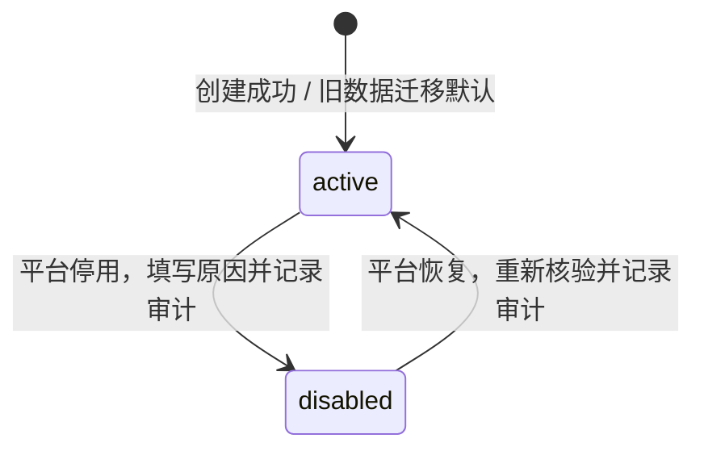

# 租户启停与恢复迭代方案

日期：2026-11-10。版本：V1.0。方案已由用户于 2026-11-10 确认（包括 D-01–D-12）；功能状态：**Awaiting acceptance**。实现及自验已完成，人工验收待用户执行并确认。实际验证结果、证据与限制见[验证记录](../verification/tenant-lifecycle.md)。

范围来源为[“规划账号权限后的下一步”会话](codex://threads/01a1c07e-e171-7f02-bde7-b5c66f3adfb7)最后一轮建议：租户角色与成员授权收尾后，先完成租户启停与恢复，随后推进项目基础管理。本文将其中的五项内容展开为可实施、可验证的方案；业务取舍已随本方案于 2026-11-10 获用户确认。

## 1 目标与交付范围

### 1.1 本轮目标

平台可以有记录地停用一个租户，统一阻止该租户的普通业务访问，同时保留治理和恢复能力。恢复时沿用原租户身份及历史，按照当前账号、成员和角色的真实状态重新计算访问资格。

同一账号属于租户 A、B 时，停用 A 只限制 A 的租户业务；该账号的登录、个人账号功能、平台授权和 B 的业务继续按各自规则判断。租户停用不等同于账号停用、成员暂停或角色停用。

### 1.2 与原会话逐项对应

| 原会话提出的内容 | 本方案覆盖 | 交付编号 |
| --- | --- | --- |
| 租户状态及平台操作：启用、停用、恢复，权限、原因、版本冲突与审计 | 两态生命周期、平台操作、预览、独立权限、事务与审计 | TL-01、TL-02、TL-07 |
| 现有入口统一校验，平台治理和恢复规则明确 | 租户接口清单、领域服务校验、平台例外和个人状态摘要 | TL-03、TL-05 |
| 邀请联动及恢复后待领取邀请处理 | 创建、查看、接受、过期、真实资格失效与恢复规则 | TL-04 |
| 区分租户停用、本人失权和系统故障 | 状态展示、错误契约、缓存清理、旧页面与多标签处理 | TL-05 |
| 保留身份和历史，恢复时按当前状态判断 | 恢复检查、管理员可用性、原关系与撤权历史保留 | TL-06、TL-08 |

### 1.3 交付清单

| 编号 | 交付项 | 可观察结果 |
| --- | --- | --- |
| TL-01 | 租户状态与增量迁移 | 新旧租户具备明确的启用/停用状态；旧数据不丢失 |
| TL-02 | 平台启停操作 | 查看影响、填写原因、确认停用/恢复，处理复验和并发冲突 |
| TL-03 | 服务端统一限制 | 已有租户业务读写、角色授权和邀请接受均无法绕过停用 |
| TL-04 | 邀请联动 | 停用期间不能邀请或加入；原邀请按保留、到期、资格失效分别处理 |
| TL-05 | 前端状态和反馈 | 平台、我的租户、旧页面和邀请页清楚显示限制及可执行动作 |
| TL-06 | 恢复与治理衔接 | 平台可先修复管理员任职；恢复不复活已失效关系或凭据 |
| TL-07 | 审计与权限 | 平台可追溯启停；租户恢复后只能看到允许公开的治理信息 |
| TL-08 | 工程验证与交付 | 契约、客户端、迁移测试、并发及浏览器验证、运行与验收说明 |

### 1.4 本轮边界

本轮覆盖当前真实存在的租户资料、成员、成员邀请、角色、授权说明和租户审计。沿用单个 console、现有 API 和统一运维 CLI。

项目管理、租户注销/删除、归档、定时启停、批量启停、审批流、到期自动停用、计费、许可、配额、功能开通、交付联系人、反馈工单、外部通知均不在本轮范围。恢复不新增重设密码、恢复会话或恢复备份功能。

尚未建设的采集、任务、导出、下载链接、实时订阅和设备身份只记录后续接入要求，不以本轮验收声称已经完成这些链路。参考设计中的许可校验须在许可模块实际落地时接入；本轮不实现永远返回通过的许可占位校验。

## 2 实施前基线与衔接前提

核对工作区：`/Users/hijacker/Documents/ChatGPT/InfraPro`，分支 `feature/account-access-console`，HEAD `776663fc125223a02df6f46a24e5d0cf7663a8da`。工作区存在成员和角色授权等未提交修改，本文依据实际文件，不把 HEAD 当作全部功能基线。

| 当前实现 | 核对事实 | 本轮衔接 |
| --- | --- | --- |
| [租户模型](../../packages/go/platform/tenancy/model.go)及查询 | 已有资料版本、管理员可用性，没有租户自身 status | 增加状态；管理员是否可用单独保留 |
| [范围授权](../../packages/go/platform/access/tenants.go) | 按账号、指定租户的 active 成员和角色授权 | 在可信租户范围内加入状态校验 |
| [角色授权解释](../../packages/go/platform/access/tenant_authorization.go) | 已区分配置权限、当前权限和可恢复权限 | 增加租户停用原因；避免将空的当前权限当成永久撤权 |
| [操作策略](../../packages/go/platform/access/policy.go) | 已集中登记 HTTP 路由、权限、近期复验及授权图写入 | 新增平台启停策略和明确的状态摘要策略 |
| [事务授权](../../packages/go/platform/access/authorizer.go) | 共享/排他授权锁、目录校验、授权修订号已有实现 | 复用同一事务和锁顺序，定义生效时点 |
| [邀请服务](../../packages/go/platform/tenancy/invitations.go) | 受邀者接受在 `/account/tenant-invitations/*`，不在租户 URL 下 | 从真实邀请解析 tenant_id，再检查租户状态 |
| [目录发布联动](../../packages/go/platform/access/tenant_catalog_sync.go) | 比较变更前后权限并作废失权邀请 | 停用租户中的真实失权也必须被识别 |
| [数据库迁移](../../packages/go/platform/migrations/migrations.go) | 源码目标版本为 v5，已有 `00005_tenant_role_authorization.sql` | 下一迁移暂定 v6；实施时核对实际编号和数据库版本 |
| [前端租户边界](../../apps/console/src/features/tenancy/context.tsx) | 已有账号/租户查询范围、30 秒可见页轮询、聚焦复验和失权清理 | 区分 tenant_disabled，补充最小状态摘要和迟到响应隔离 |

实施前已核对上一轮[租户角色与成员授权验证记录](../verification/tenant-role-authorization.md)：该轮自验通过，人工验收仍待用户确认。本轮接续实际工作区，不改变上一轮人工验收结论。

设计依据还包括[参考工程需求](/Users/hijacker/Developer/Company/progma/docs/refactor/progma-requirements.md)的 RQ-ORG-001、003、004、010、012，以及[核心业务设计](/Users/hijacker/Developer/Company/progma/docs/refactor/progma-core-business-design.md)的 B10 生命周期规则：创建即启用、停用关闭普通业务、上层状态不批量改写下层对象。参考工程其他目标不会自动扩大 InfraPro 本轮范围。

## 3 用户场景与领域规则

### 3.1 核心场景

1. 平台需要临时停止 A 的业务使用，先查看影响，填写原因后停用；A 的旧会话和直接 API 请求都受限制。
2. 用户同时属于 A、B；A 停用后仍能进入 B、维护个人资料和处理账号安全事项。
3. 用户已收到 A 的邀请但尚未接受；停用期间得到明确提示，恢复后仅在邀请仍有效且资格满足时加入。
4. 平台在 A 停用期间交接管理员，随后恢复；旧管理员的结束关系和作废邀请不被复活。
5. A 停用期间发生账号停用或平台预置角色发布；恢复后按变更后的事实授权。
6. 两个平台操作人员或两个旧页面同时操作；后提交者需核对新状态，不能覆盖先前结果。

### 3.2 状态模型

| 持久化值 | 界面文案 | 含义 |
| --- | --- | --- |
| `active` | 已启用 | 租户整体允许使用，具体访问仍须满足账号、成员、角色与资源范围条件 |
| `disabled` | 已停用 | 关闭普通租户业务；只保留明确列出的状态说明、平台治理和系统维护入口 |



“启用”和“恢复”对应同一 `disabled → active` 转换；按钮统一使用“恢复租户”。新建租户默认 active，不增加“待启用”状态。重复停用/恢复不是新的业务转换，不能重复写成功审计或刷新状态时间。

### 3.3 四层状态相互独立

| 对象 | 租户停用时 | 租户恢复时 |
| --- | --- | --- |
| 账号及个人会话 | 不停用账号、不撤销全局会话 | 不启用账号、不复活过期或撤销会话 |
| 租户成员关系 | 保留 active/suspended/ended 和成员 ID | active 才参与授权；suspended/ended 保持原样 |
| 角色与成员绑定 | 不批量停用角色、不批量撤销绑定 | 只使用当前启用角色及未撤销绑定；退役权限仍无效 |
| 租户身份和档案 | 保留 UUID、当前及历史编号、资料和管理员任职 | 沿用原身份，不创建替代租户、不重置版本或历史 |
| 成员邀请 | pending 保留；可领取性受限；有效期继续流逝 | 按当前邀请和资格重新判断；终态不回到 pending |

```text
允许普通租户操作 = 有效会话与正常账号
                AND 指定租户的有效成员关系
                AND 租户状态为 active
                AND 当前有效权限满足动作
                AND 资源归属该租户
                AND 业务状态、版本及保护条件满足。
```

平台角色不产生租户成员关系；租户管理员也不能自行恢复被平台停用的租户。成员没有可用权限时显示权限受限，不能把它描述成租户已停用。

## 4 停用期间的操作矩阵

| 入口或动作 | active | disabled | 校验与说明 |
| --- | --- | --- | --- |
| 登录、退出、本人资料、密码、会话、安全记录 | 按账号规则 | 按账号规则 | 租户状态不进入全局登录判定 |
| 我的租户列表 | 返回本人 active 成员关系 | 仍返回其中停用租户的最小卡片 | 不因租户停用让其无解释消失 |
| 本人租户状态摘要 | 可读 | 可读 | 正常账号且本租户成员 active；不要求业务权限 |
| 完整租户上下文和资料读取 | 按租户权限 | 拒绝 | 不提供停用租户的普通只读模式 |
| 资料修改 | 按租户权限 | 拒绝 | 包括旧表单和直接 PATCH |
| 成员列表/详情/授权解释、成员候选查找 | 按租户权限 | 拒绝 | 候选查找也属于租户邀请业务 |
| 成员暂停/恢复/移除、角色绑定 | 按租户权限 | 拒绝 | 管理员没有停用期内的租户业务例外 |
| 角色与权限目录、角色成员、影响预览 | 按租户权限 | 拒绝 | 覆盖读取及 POST 预览，不只限制写入 |
| 角色创建/复制/修改/配权/启停/删除 | 按租户权限 | 拒绝 | 平台角色接口也不能代替这些租户操作 |
| 租户邀请列表/详情/创建/撤销/重新生成 | 按租户权限 | 拒绝 | 保留后台历史，不开放租户操作 |
| 目标本人检查邀请 | 只展示其被定向邀请允许的信息 | 可展示最小状态及“暂不能加入” | 校验凭据和目标本人后再显示租户状态 |
| 目标本人接受邀请 | 资格满足时允许 | 拒绝 | 非租户 URL 必须显式接入状态校验 |
| 已接受邀请的本人结果查看 | 保留本人原接受结果 | 保留本人原接受结果及当前停用提示 | 历史结果不是访问租户业务的通行证 |
| 租户审计 | 按 tenant.audit.read | 拒绝 | 恢复后按权限查看经过过滤的历史 |
| 平台租户列表/详情、账号任职摘要 | 按平台权限 | 按平台权限 | 只限现有治理档案与最小任职信息 |
| 平台修改租户档案、交接管理员 | 按各自平台权限 | 按各自平台权限 | 状态保持 disabled；不顺带恢复租户 |
| 平台停用/恢复及预览 | 按目标动作权限 | 按目标动作权限 | 状态转换和恢复条件单独检查 |
| 平台审计 | 按 platform.audit.read | 按 platform.audit.read | 可追溯停用、交接、恢复及失败诊断 |
| 权限目录同步、账号应急处理、备份维护 | 按现有运维规则 | 按现有运维规则 | 不视为普通租户业务，保留原审计及恢复规范 |

平台治理入口使用明确的操作策略，不引入任意 `bypass_tenant_status=true` 参数。未知 tenant 操作默认受状态限制；新例外必须有明确用途、权限及测试。

## 5 平台权限与操作保护

### 5.1 权限目录

| 权限编码 | 类型 | 用途 |
| --- | --- | --- |
| `platform.tenant.read` | 已有 | 列表、档案、状态及必要的治理摘要 |
| `platform.tenant.disable` | 本轮新增 | 停用指定租户；预览与提交均需此权限 |
| `platform.tenant.enable` | 本轮新增 | 恢复指定租户；预览与提交均需此权限 |
| `platform.tenant.update` | 已有 | 修改治理档案，不授予启停能力 |
| `platform.tenant.transfer_admin` | 已有 | 修复或变更管理员任职，不授予启停能力 |
| `platform.audit.read` | 已有 | 查看完整平台操作记录及内部原因 |

新增权限为 platform 范围、高风险，租户自定义角色不可选择。平台管理员按现有内置角色和目录同步规则获得；已有自定义平台角色不会自动获得，须由有权人员明确配置。

启停预览和提交均要求 `platform.tenant.read` 加对应动作权限，确保操作者能核对对象及影响。停用权与恢复权可分别授予；请求中的目标状态不能替代后端对具体操作权限的判断。

### 5.2 保护规则

- 实际停用/恢复要求现有近期密码复验，沿用现行五分钟窗口；预览不要求近期复验，但仍鉴权并检查 CSRF/Origin。
- 不增加 MFA、审批人或第二套密码弹窗。复验通过后回到原确认界面，重新预览，再由用户确认；不自动重发写操作。
- 租户管理员保护继续按“当前任职及其结构”检查。A 已停用不意味着其管理员可以直接被常规停用账号，仍须先交接其全部管理员任职。
- 停用全部租户也不能导致平台治理人员失去本人的平台授权。平台权限复验始终独立于租户状态。
- 当前仅账号应急维护可能使租户管理员账号不可用；沿用已有受控运维流程，不新设网页绕过入口。

## 6 停用流程与影响预览

1. 平台人员打开租户详情，明确看到租户名称、编号、状态和管理员可用性，选择“停用租户”。
2. 后端在同一读取事务中计算预览，返回租户版本、授权修订、影响摘要和预览指纹。
3. 确认框说明普通业务读写将停止、其他租户和个人账号不受影响、已有配置保留、待领取邀请不延期。
4. 用户填写必填的内部操作原因及租户可见说明；可见说明预填明确的默认文案，并注明展示对象。
5. 提交时复验会话、当前平台权限、近期密码、版本、预览和目标状态。
6. 同一事务更新状态、增加租户版本及授权修订、写审计；全部成功后才返回成功。
7. 前端更新平台列表/详情，并触发本人相关状态查询失效；其他客户端按第 12 节重新核验。

### 6.1 预览字段及统计口径

| 字段/内容 | 口径 |
| --- | --- |
| 当前/目标状态、名称、编号 | 来自当前租户记录，不信任表单旧文案 |
| 当前成员关系数 | 分别统计 active、suspended；ended 为历史，不计入当前关系 |
| 当前可执行业务人数 | 正常账号、active 成员、至少一项当前有效 tenant 权限；不统计“在线人数” |
| 待领取邀请数 | pending 且按服务端当前时刻未过期；说明停用后暂不能领取 |
| 管理员情况 | 当前管理员、账号可用性、任职结构是否有效 |
| 配置和历史保留说明 | 不批量改写成员、角色、绑定、凭据和历史 |
| 阻断原因 | 状态不匹配、目录/结构异常等；不能把未知统计显示为零 |

预览只返回上述治理摘要和计数，不提供跨租户成员明细、完整角色定义、会话或邀请链接。预览失败时不能确认操作。

### 6.2 原因与公开说明

`reason` 为平台内部操作原因，去首尾空白后 1–500 个 Unicode 字符，不接受纯空白。停用时 `tenant_notice` 为租户可见说明，同样为 1–500 字符，默认“该租户已被平台停用，暂时无法使用。请联系维护人员。”。

界面清楚区分两个字段。租户人员和合法邀请目标只能看到公开说明；平台内部原因不会通过租户资料、上下文、邀请预览、错误响应或租户审计原样暴露。说明以纯文本渲染，不执行 HTML。

本轮不增加独立的停用说明编辑流程。停用后如确需纠正说明，作为后续需求设计；不能用重复停用悄悄改写审计事实。恢复原因仍必填，恢复提交不接收 `tenant_notice`，当前停用说明清空，旧说明保留在审计中。

## 7 恢复流程与前置检查

### 7.1 恢复检查

| 项目 | 是否阻断恢复 | 处理 |
| --- | --- | --- |
| 操作者当前权限、会话、近期复验不满足 | 是 | 按原身份/授权错误返回，不执行恢复 |
| 租户已是 active，或版本/预览过期 | 是 | 重新读取并核对；不重复执行 |
| 权限目录未同步、数据库或结构异常 | 是 | 先恢复依赖或修复异常，不能降级放行 |
| 当前管理员账号不可用 | 是 | 平台先通过已有账号维护或管理员交接流程解决 |
| 管理员关系非 active、管理员绑定/归属不合法 | 是 | 按既有结构保护处理；不可通过恢复自动修补 |
| 普通成员账号停用、成员暂停或已移除 | 否 | 保留真实状态，恢复后这些人仍不能因此进入 |
| 普通角色停用、权限已退役、绑定已撤销 | 否 | 相应权限保持无效；不自动配权 |
| 待领取邀请过期或已作废 | 否 | 原记录保持终态，需要时恢复后另行邀请 |

管理员可用性检查只针对当前管理员及其保留管理能力，不要求所有成员正常。普通成员“恢复后可以访问”的统计使用当前账号、成员和有效角色条件，不能直接使用忽略账号/成员限制的 `restorable_permissions` 代替。

### 7.2 执行恢复

恢复预览显示管理员检查结果、恢复后具备业务权限的人数、仍受限人数和仍有效的待领取邀请数。受限计数按独立原因展示，允许同一个成员同时命中多项原因，界面不将这些原因计数直接相加为总人数。

检查通过后，用户填写恢复原因并确认。事务只将租户恢复为 active、清除当前停用公开说明、更新版本和状态变更元数据、写恢复审计及授权修订。原成员、角色绑定、邀请、账号和会话不批量改写。

### 7.3 管理员不可用时的治理路径

平台详情一直显示管理员不可用状态和“交接管理员”入口，按 `platform.tenant.transfer_admin` 判断。交接仍执行原规则：正常账号且 active 成员可复用关系；没有当前关系的正常账号可以建立新关系；suspended 候选不能被交接过程隐式恢复。

停用期内不能从租户成员页面恢复 suspended 候选，应选用其他符合条件的候选，或先通过现有账号维护恢复当前管理员的账号。交接结束后租户仍 disabled，用户须另行执行恢复。旧管理员关系结束、角色撤销和其邀请作废按上一轮规则执行，恢复不撤销这些结果。

## 8 成员邀请联动

### 8.1 待领取邀请的推荐规则

租户停用是暂时的上层限制，**不因这一次状态转换批量作废 pending 邀请**。保留原 ID、token 哈希、版本及到期时间；当前邀请有效期仍为既有的 24 小时，不暂停计时，不顺延。

| 场景 | 邀请记录 | 可领取性/返回行为 |
| --- | --- | --- |
| 停用 A，已有未到期 pending 邀请 | 保持 pending | 目标本人检查时 `can_accept=false`、`blocked_reason=tenant_disabled` |
| A 停用期间尝试创建、重新生成、撤销 | 不产生变更 | 租户操作返回 tenant_disabled |
| A 停用期间尝试接受 | 不建成员、不绑定角色、不标 accepted | 返回 tenant_disabled；不消耗邀请 |
| 停用期间达到 expires_at | 按原规则成为 expired | 不因恢复再次可用；读取可按时间推导，清理可延后持久化 |
| 停用期间邀请人或目标真实资格失效 | 按原联动永久 invalidated，或已到期则 expired | 恢复租户、账号或权限均不复活该邀请 |
| 恢复时仍 pending、未过期且资格满足 | 保持原邀请 | 原链接可继续由目标本人明确接受 |
| 已 accepted/revoked/replaced/invalidated/expired | 保持原历史/终态 | 恢复不变更，不产生第二个成员关系 |

真正的资格失效包括账号停用、受控凭据恢复、邀请人成员关系结束或暂停、管理员交接导致失权、发布后失去邀请所需权限或固定普通成员授权覆盖等，沿用现有规则。本轮不把租户停用追加到永久失效原因列表。

### 8.2 授权计算必须区分两件事

1. **当前能否执行租户业务**：包含租户 active 条件，停用时权限对外为零。
2. **邀请人的基础授权资格是否真实丢失**：在账号、成员、角色、权限目录均按当前状态核验的基础上，仅排除租户整体停用这一临时因素。

领域层提供用途明确的邀请资格计算，供邀请接受与目录/账号/管理员联动复用。不能使用通用的“忽略所有状态”开关，也不能拿配置权限或可恢复权限代替有效资格。

特别检查 `tenant_catalog_sync.go` 和角色影响逻辑：如果直接比较停用租户两边均为空的当前权限，会漏掉真实失权；如果直接把停用视为失权，又会误作废全部邀请。发布前后比较基础资格并按实际失权作废，重复发布不重复作废或生成事件。随后重新授予权限也不能恢复已作废邀请。

### 8.3 邀请检查的展示及判定顺序

先核验登录账号、凭据格式/哈希和定向目标，再判断邀请真实状态、到期时间、基础资格及租户状态。错误账号、未知 token、无关租户均维持统一不可用结果，不能返回租户名称、停用时间、原因或目标身份。

合法 pending 目标在停用期间只得到租户最小标识、状态、公开说明、到期时间与处理提示；隐藏邀请人详细资料和普通业务内容。已经终止的邀请优先显示真实终态，不能统一包装成“稍后恢复即可领取”。已接受结果只展示其原接受快照与当前访问提示，不能复活旧关系。

接受接口在持有授权排他锁的事务内，从邀请记录获取可信 tenant_id，并重新检查 active；不能依赖之前 inspect 的 `can_accept`，也不接受客户端声明租户已恢复。

## 9 授权、事务与即时生效

### 9.1 模块职责

| 模块 | 本轮职责 |
| --- | --- |
| `platform/tenancy` | 状态领域操作、预览、资料/状态 DTO、邀请状态联动和治理查询 |
| `platform/access` | 权限登记、范围及状态校验、授权解释、基础邀请资格、事务锁、修订与审计 |
| `platform/identity` | 保持会话和账号职责；继续调用管理员保护和邀请失效联动 |
| HTTP tenancy/access 适配器 | 路由、精确请求校验、可信 Actor、错误和响应映射；不拼装多个独立写事务 |
| `@infrapro/api-client` | OpenAPI 类型、启停和可用性请求、结构化错误与修订传播 |
| console tenancy feature | 平台确认流程、状态卡片、租户边界、邀请受限展示 |

不新增服务、消息队列或分布式工作流。SQL 和事务仍在领域/数据访问层；HTTP 与将来的受控 CLI 应调用同一个完整操作，不直接更新 tenants.status。

### 9.2 两层校验

HTTP 策略检查用于及早拒绝；业务 service 必须在访问数据的同一事务里重新校验。租户读取也持有共享授权锁至读取完成，租户状态变更使用排他授权锁。

当前 `tenancy.transact` 和 `access.tenantTransaction` 中范围授权在 Actor 会话复验之前。本轮接入可识别的停用错误时，要在保持锁序的前提下调整为先复验可信 Actor，再披露成员可见状态；不能让被撤销的会话通过直接调用 service 得到租户停用信息。仅在 HTTP 中先登录校验不构成领域服务已满足这一条件。

状态检查集中在 `access` 的可信租户判定路径，供 `RequireScopedTx` 和租户角色事务复用。它应先验证操作者对该租户的成员关系，再向其返回 tenant_disabled，避免通过枚举 ID 查询他人租户状态。对于邀请接受，先验证定向凭据，再走该可信租户状态校验。

个人状态摘要是新的明确 self 用途操作；不能将完整 `TenantContext` 改成无条件放行。平台治理路径继续使用 platform 权限，不能通过身份角色名称获得任意租户业务读取权。

### 9.3 写事务顺序

1. 获取现有授权状态排他锁并核对目录校验值。
2. 按现有约定锁定相关账号，UUID 排序；复验 Actor 会话和近期密码。
3. 重验平台动作权限；锁定目标租户记录。
4. 校验 expected_version，计算当前预览；核验目标状态、恢复条件及 preview_hash。
5. 写 tenants 状态和元数据，version 加一。
6. authorization revision 加一，并写一条对应成功审计。
7. 原子提交，返回新版本与授权修订。

锁序保持“授权状态 → 相关账号 → 租户/成员/邀请 → 审计”；不得从已持有共享锁的事务中再无序升级为排他锁。重用当前有界事务的锁等待和语句超时，超时回滚并提示核实结果。

状态、版本、修订或审计中任意一步失败，全部回滚。读预览不修改状态、版本、邀请或成功审计；不得在持锁期间等待用户确认。

### 9.4 生效时点与并发保证

以**停用事务提交**为生效边界。先获得授权锁并完成的合法业务事务可以成功；停用提交后开始获得授权锁的租户业务必须看到 disabled 并拒绝。不存在先放行、解除锁，再在独立事务写入业务的路径。

“接受邀请”和“停用租户”并发时：接受先完成，则成员正常建立但随后受停用限制；停用先完成，则接受不产生任何成员或绑定。成员、角色和管理员变更与停用也遵循同一序列化结果。

已经发送给浏览器的历史内容不能撤回。较早完成事务的响应可能晚到，前端必须按租户边界及状态代次丢弃旧结果；不会把网络返回时间等同于服务端授权时点。

### 9.5 版本、预览与重复提交

沿用租户现有 version，资料修改、交接和状态转换共享该版本，防止旧详情页覆盖新事实。预览指纹绑定租户 ID、动作、租户版本、授权修订、目录校验值、管理员检查结果和影响统计；使用规范化排序，不把每次变化的生成时间放入指纹。

提交在事务内重算并比较，指纹不是授权凭据。邀请自然过期、成员或权限变化使影响变化时，返回 preview_changed，用户重新预览。当前全局授权修订可能使无关租户的变更也要求重新预览；本轮接受这一保守行为，不扩展每租户修订系统。

不新增专用启停幂等表。同一旧版本的重复请求只有一次可成功，随后返回 version_conflict；持有新版本却请求相同状态返回 tenant_status_unchanged，不写新事件。网络结果未知时先读取当前状态和平台审计，不能自动反复提交或声称原请求失败。

## 10 数据设计与迁移

### 10.1 tenants 新增字段

| 字段 | 建议类型 | 规则 |
| --- | --- | --- |
| `status` | text，NOT NULL，DEFAULT 'active' | CHECK 为 active/disabled |
| `status_changed_at` | timestamptz，nullable | 最近一次启停时间，由数据库写入 |
| `status_changed_by` | uuid，nullable，引用 accounts | 最近一次启停操作者 |
| `status_change_reason` | text，nullable | 最近一次内部操作原因，1–500 字符 |
| `status_notice` | text，NOT NULL，DEFAULT '' | 当前停用公开说明；active 时为空 |

状态变更三个元数据字段保持同时为空或同时有效；disabled 必须具备完整元数据和非空公开说明。新建及历史迁移的初始 active 可保留空元数据，原创建事件解释初始状态，不能伪造一次“平台恢复”。恢复后 active 保留真实最近变更元数据，但 status_notice 清空。

继续使用既有 version、updated_at、updated_by，并在真实状态转换时更新。不新增另一份成员/角色状态快照或软删除字段；完整历史保存在原审计表。

### 10.2 数据约束与兼容性

- 管理员结构约束对 active 和 disabled 租户均生效；不得为了能停用而放宽唯一管理员及合法绑定约束。
- 编号永久归属、成员外键、角色所属租户和终态约束保持有效；停用不是释放编号或清理数据的依据。
- 平台和租户 DTO 分开投影。当前若共用 Tenant 结构或 before/after 审计快照，必须避免自动序列化新增内部原因字段。
- 状态筛选先沿用现有分页；仅在实际查询计划显示需要时增加 `(status,id)` 索引，不在本轮预设大规模性能结论。

### 10.3 增量升级

建议新增 `00006_tenant_lifecycle.sql` 并将源码目标迁移版本递增；若上轮最终编号变化，以实施时最新序列为准。不得修改已经执行的 v3–v5 迁移。

旧租户全部回填 active，既有账号、口令哈希、会话、租户/成员/角色 ID、成员状态、角色状态、绑定、邀请 token 哈希及到期时间、审计和编号历史逐项保留。权限目录同步仅新增本轮平台权限及对应内置授予，不创建租户或改写自定义角色。

验证新库顺序初始化及含复杂 v5 数据的升级。迁移和目录同步可重复执行而不重复生成业务事件。记录源码版本与数据库版本，不能只根据本机文档推断库已经升级到 v5。

回退优先前向修复。禁止通过 Down 丢弃租户状态后启动旧 API，否则原停用租户可能重新开放；确需备份恢复时停服、恢复匹配版本，并按既有规程统一撤销旧凭据，再检查后启动。这与业务上的“恢复租户”是两项独立操作。

## 11 API 与错误契约

以下为本轮实现的新增/调整契约。以 `contracts/openapi/api.yaml` 为唯一类型来源，并纳入现有路由策略完整性检查。

### 11.1 新增接口

| 方法与路径 | 权限 | 输入/输出要点 |
| --- | --- | --- |
| `POST /api/v1/platform/tenants/{tenant_id}/disable/preview` | read + disable | 无业务写入；返回 TenantStatusPreview，目标固定 disabled |
| `POST /api/v1/platform/tenants/{tenant_id}/disable` | read + disable，近期复验 | expected_version、preview_hash、reason、tenant_notice |
| `POST /api/v1/platform/tenants/{tenant_id}/enable/preview` | read + enable | 返回恢复检查和 TenantStatusPreview，目标固定 active |
| `POST /api/v1/platform/tenants/{tenant_id}/enable` | read + enable，近期复验 | expected_version、preview_hash、reason |
| `GET /api/v1/account/tenants/{tenant_id}/availability` | 已认证 + 本人 active 成员关系 | 返回最小 TenantAvailability；不授予业务权限 |

分别使用 disable/enable 路由便于静态映射具体权限，不接受请求体覆盖 tenant_id、操作者、目标状态、时间或授权修订。预览提交固定 JSON 对象 `{}`，不接受额外字段；状态提交沿用现有严格 JSON 解码，未知字段、非法 UUID、版本和超长原因直接拒绝。

`TenantStatusPreview` 至少包含 tenant_id、名称/编号、current_status、target_status、expected_version、authorization_revision、catalog_checksum、preview_hash、generated_at、影响计数、管理员检查、can_submit、blocked_reasons。提交仍须重验，不信任 can_submit。

成功提交返回 tenant_id、status、version、status_changed_at、authorization_revision，并通过现有 `X-Authorization-Revision` 传播修订。返回成功表示事务已经提交，不返回完整成员、邀请或角色数据。

### 11.2 调整已有接口

| 接口/类型 | 调整 |
| --- | --- |
| 平台租户列表/详情 | 增加 status、状态时间、平台内部原因和公开说明；列表支持严格 `status=active/disabled` 筛选，保留管理员不可用筛选 |
| 个人租户列表 | 增加 status、can_enter、restriction_code；disabled 时只返回最小摘要，不把已有角色名称当成有效授权 |
| 平台账号租户任职摘要 | 增加独立租户状态，不混淆成员/管理员账号状态 |
| 完整租户 context、profile、成员/邀请/角色/审计 | 接入状态校验；仍受原权限及对象归属保护 |
| 租户授权解释内部模型 | 增加 tenant_status 和 tenant_disabled 原因；保留配置与角色状态，不把“可恢复权限”解释为恢复承诺 |
| 个人邀请 inspect | 增加 tenant_status、blocked_reason 和最小公开说明；区分 pending 的暂时限制与真实终态 |
| 个人邀请 accept | 在事务中检查可信租户状态，补充 tenant_disabled 错误 |
| tenant 审计 | 纳入生命周期事件并使用公开字段投影；停用期间仍不可读取 |

`TenantAvailability` 仅含租户 ID/名称/编号、status、status_changed_at、公开说明、can_enter 与 restriction_code。active 时 can_enter 只表示可进入租户上下文，不承诺任何具体业务权限；仍须随后读取 context。帮助联系方式复用既有公开帮助配置，不新增联系人系统。

### 11.3 错误和信息披露顺序

| HTTP / code | 场景 | 客户端行为 |
| --- | --- | --- |
| 401 / 既有身份错误 | 会话失效或账号不可用 | 进入现有身份处理，不能伪装为租户停用 |
| 404 / tenant_not_found 或现有邀请不可用码 | 无关系、关系已结束/暂停、跨租户或错误凭据 | 展示当前不可访问，不提供别人的租户状态 |
| 403 / tenant_disabled | 本人有权识别的租户已停用 | 卸载业务，读取最小 availability，展示公开状态 |
| 403 / 既有权限不足码 | 有效租户中缺少动作权限 | 告知权限不足；不清空其他租户或全局登录 |
| 403 / reauthentication_required | 高风险写入缺少近期密码复验 | 复验后重新核对并确认 |
| 409 / version_conflict | 租户记录版本变化 | 保留原因输入，刷新对象和影响 |
| 409 / preview_changed | 授权、邀请或影响发生变化 | 展示新的预览，要求重新确认 |
| 409 / tenant_status_unchanged | 当前状态已是操作目标 | 核对现状，不生成重复审计 |
| 409 / tenant_restore_blocked | 当前管理员不可用等可处理恢复条件不满足 | 显示明确阻断项和已有治理入口 |
| 400 / 既有字段校验错误 | 原因、说明、版本、请求格式不合法 | 定位字段，不清空合法输入 |
| 503 / 既有依赖或繁忙错误 | 数据库、目录、Redis 或锁等待异常 | 显示暂不可用和重试；不当作停用/失权 |

身份及可信关系先于租户状态披露；确认本人有权识别后，租户停用优先于普通业务权限不足。平台动作先鉴别平台权限，再提供其有权查看的恢复检查。错误响应复用 request_id，不携带内部原因或邀请明文 token。

## 12 页面与交互方案

沿用 React、shadcn/ui、现有页面布局、Badge、表单和复验组件，不新增视觉系统。状态同时用文字和颜色表达；按钮和表单保留清晰标签、键盘操作及反馈。

### 12.1 平台租户列表与详情

- 列表新增“租户状态”列，和“管理员可用性”分列；提供全部/已启用/已停用筛选，可与管理员不可用组合。
- 详情顶部同时展示租户状态、最近状态变更时间及管理员情况。内部原因和租户公开说明分别标注。
- active 显示“停用租户”，disabled 显示“恢复租户”，按具体权限控制入口。状态操作放在详情页，本轮不增加列表批量动作。
- 保留档案编辑、管理员交接和有权者的“查看平台操作记录”入口。缺少审计权限时不提供可访问完整记录的假链接。
- 状态变更后列表、详情和当前确认框一致更新；不会在请求未完成时乐观显示成功。

### 12.2 停用/恢复确认框

采用现有受控 Dialog/AlertDialog 能力，展示对象、影响、原因和确认按钮。停用使用明确的危险动作文案，默认焦点落在标题/说明或安全的取消操作，不将 Enter 意外绑定成提交。

提交中禁用重复确认；失败保留原因输入。字段错误靠近字段，预览过期时重新展示差异。取消关闭后焦点返回原触发按钮；确认成功后给出可被辅助技术读取的反馈。移动端内容可纵向滚动，主要动作可触达，不依赖 hover。

### 12.3 我的租户与受限页面

“我的租户”保留本人 active 关系对应的停用租户卡片，显示“已停用”及“查看状态”；不会提供看似可以正常进入业务的按钮。suspended/ended 关系继续按现有规则不出现在可进入列表中。

旧 URL、收藏链接或停用前已打开的页面进入统一受限视图：租户名称/编号、已停用、时间、公开说明，以及“返回我的租户”“重新检查”“联系维护人员”。不显示成员、角色、邀请或审计内容，也不提供租户人员自行恢复的按钮。

状态分类明确：租户停用显示已停用；本人关系/权限变化显示当前不可访问或权限不足；依赖故障显示服务暂不可用。零权限成员在 active 租户中显示暂无可用功能，不显示已停用。

### 12.4 缓存、草稿与迟到响应

1. 普通租户 API 收到 tenant_disabled，或状态轮询确认 disabled 时，立刻标记该租户边界受限、取消请求并卸载业务子树。
2. 清理该账号在该租户的完整 context、资料、成员、角色、邀请、审计和编辑草稿；只保留新的最小状态摘要。确认失权与已停用均不能继续显示旧敏感内容。
3. 查询与写操作回调按账号、tenant_id、membership_id 和本次边界代次校验。清理或切换后到达的成功响应、通知和 onSuccess 不得回填旧数据或更改新工作空间。
4. 受限页使用独立 availability 查询，避免其被普通业务缓存清理反复删除。恢复后重新请求 context，创建新边界代次，不自动恢复旧草稿或重提写请求。
5. 纯网络/依赖错误尚未证明失权时，沿用当前保留内存草稿、阻止提交、提示重试的规则；不能把 503 当成停用去清空草稿。
6. 清理仅作用于当前账号和指定租户。全局身份、B 的查询和个人页面不因 A 停用而被登出或清空。

当前可见前台标签页沿用 30 秒状态核验；在服务正常、没有后台节流的自动化环境中，验收目标为停用提交后 35 秒内进入受限页。请求被拒绝时立即切换，窗口重新聚焦/从后台恢复时先核验再展示业务内容。后台标签不承诺定时刷新，浏览器冻结或离线也不承诺推送到达；服务端每次请求的状态校验始终有效。

本轮不引入 WebSocket/SSE。停用页面继续轮询最小状态，恢复后重新加载当前授权；若成员同时已被移除，则显示失权，不因为租户恢复而重新进入。

### 12.5 邀请页

合法待领取邀请显示“租户已停用，暂时无法加入”、原到期时间和重新检查入口，接受按钮不可用。恢复后重新 inspect，资格通过后再由用户点击确认加入；不自动加入。

过期、撤销、替换、资格失效分别显示真实结果。已接受邀请仍显示本人历史结果，进入租户按钮遵守当前状态。凭据继续只保存在现有受控内存流程，不写入日志、查询键或本地存储。

## 13 审计、隐私与维护边界

新增事件 `tenant.disabled`、`tenant.enabled`，对象类型 tenant，actor_scope 为 platform，复用既有审计存储及请求编号。每次真实转换只写一条成功事件，不为所有成员制造大量“角色已撤销”记录。

事件记录租户 ID 与当时名称/编号、前后状态与版本、操作人、数据库时间、内部原因、当时公开说明、影响计数和授权修订。预览失败和授权拒绝沿用现有诊断记录，不伪造成功审计。不得记录密码、会话凭据、CSRF 或邀请明文链接。

平台完整审计继续受 platform.audit.read 控制；平台租户档案读权限可查看该租户最近状态原因及公开说明，不因此取得所有审计。

租户恢复后，有 tenant.audit.read 的人员可查看本租户生命周期事件的公开投影：状态转换、时间、公开说明及“平台操作”。内部原因、平台人员的非必要身份/网络信息与内部预览明细不下发。必须同时处理顶层 reason、details.before/after、actor 等字段，不能只在 UI 隐藏一列。

租户审计筛选同样基于公开投影；不能通过内部 reason 的搜索命中情况、总数或排序间接暴露内部原因。平台资料编辑/交接的快照若携带新增状态字段，也须遵守同一字段白名单，避免内部原因通过另一事件泄露。

现有备份、保留清理、目录同步和凭据维护不因租户停用而中断。未来采集与保全链应分别设计业务访问和可靠保管规则，本轮不增加停止数据处理的全局开关。

## 14 技术选型与使用位置

全部复用当前仓库工具链，不进行框架升级。下表说明使用位置及选择理由，不以软件版本是否最新作为依据。

| 技术 | 本轮具体使用 | 选择理由 |
| --- | --- | --- |
| Go、Gin | tenancy/access 领域操作与现有 HTTP 路由 | 沿用成熟的 Actor、策略与错误链路，避免第二套授权实现 |
| PostgreSQL、pgx | 状态字段、CHECK/外键、事务、行锁、影响查询与审计 | 用同一事务保证状态和授权/审计一致，数据库为状态事实来源 |
| Goose | v5 之后的顺序增量迁移及版本检查 | 保留既有迁移历史，支持旧库升级和新库初始化 |
| 现有 authorization_state | 启停排他锁、读共享锁、修订与目录校验 | 与成员、角色、账号变化在同一一致性模型中生效 |
| Redis | 沿用账号会话缓存、邀请限流等既有用途 | 不把租户状态长期缓存在 Redis 中作为授权依据；缓存故障不降级放行 |
| React、TypeScript、Vite | 扩展单 console 平台租户页、受限页与邀请页 | 复用当前页面和部署路径，不拆应用 |
| TanStack Router/Query/Table | 明确租户 URL、状态查询、精准取消/清理、平台列表筛选 | 复用现有范围隔离，保证状态切换时的数据归属 |
| React Hook Form、Zod、shadcn/ui | 原因/说明表单、确认与复验、错误提示、状态 Badge | 前后端规则一致，沿用可访问交互和现有视觉 |
| OpenAPI、openapi-typescript、权限生成脚本 | 新接口/响应/错误契约及客户端类型 | 避免手工维护多份权限和请求结构 |
| Go 集成测试、Playwright、Nginx/Compose 测试栈 | 真数据库并发、故障回滚、浏览器隔离、部署前缀与直接 HTTP 验证 | 覆盖停用对现有跨层流程的实际影响 |

不增加数据库状态机服务、通用审批系统、新缓存层或通知平台。新状态以现有模块内的小范围改动完成。

## 15 分步实施与交付物

实施须接续上一轮最终代码；每一步都能独立验证。以下是开发顺序，不是额外并行项目或工期承诺。

| 步骤 | 内容 | 阶段验证/产物 |
| --- | --- | --- |
| 1 基线与契约 | 核对上一轮结果和 DB 版本，确认第 20 节业务建议，登记新权限/操作与 OpenAPI 类型 | 路由覆盖清单、合法/非法输入和错误映射清楚；不改变运行数据库 |
| 2 数据与核心启停 | 新迁移、状态模型、平台预览/提交、恢复检查和审计 | 新旧库迁移、版本冲突、重复操作、审计失败原子回滚通过 |
| 3 全入口授权 | 普通租户服务统一检查、个人 availability、最小列表投影、平台治理例外 | 全路由状态矩阵、A/B 隔离、领域服务直接调用与管理员保护通过 |
| 4 邀请与发布联动 | 接受入口补校验、pending 保留、过期/真实失权区分、目录发布比较修正 | 停用/接受竞态、失权后再授权、停用期交接及发布测试通过 |
| 5 控制台与缓存 | 列表状态、启停确认、受限页、邀请页、迟到响应、键盘及移动端 | 多账号上下文、多标签、切换、草稿分类及三视口验证通过 |
| 6 回归与交付 | 完整相关检查、升级与恢复演练、运行手册、证据对照和人工验收 | 功能状态进入 Awaiting acceptance；由用户最终确认 Accepted |

预计修改位置：`packages/go/platform/{tenancy,access,migrations}`、必要的 identity 联动调用、`services/api/internal/transport/http/tenancy`、路由及授权检查、`contracts/openapi/api.yaml`、`packages/ts/api-client`、`apps/console/src/features/tenancy` 及相关平台/邀请页面。

预计新增或扩展验证：`tenant_lifecycle_test.go`、迁移升级测试、HTTP 路由与事务验证、`tests/e2e/tenant-lifecycle.spec.ts`、`tests/http/tenant-lifecycle.spec.ts`。文件拆分以职责和现有规模为准，不要求把所有逻辑放入单文件。

最终交付包括本方案的确认版、实际实现、迁移与契约、`docs/operations/tenant-lifecycle.md`、本轮验证记录和验收证据映射。运行手册已写入 `docs/operations/tenant-lifecycle.md`，实际自验结果另记于验证记录。

## 16 验收标准

以下为实现阶段必须满足的标准，实际执行及证据见[验证记录](../verification/tenant-lifecycle.md)。M 表示用户可在界面按第 18 节复验；A 表示 Codex 必须提供自动化/技术证据；M+A 同时要求两者。

| 编号 | 标准与预期 | 验证方式 |
| --- | --- | --- |
| TLA-01 | 新建租户默认 active；平台及个人列表状态一致 | M+A |
| TLA-02 | 旧库升级后租户为 active，原业务数据及凭据字段保持，未伪造恢复事件 | A |
| TLA-03 | 状态字段及元数据约束拒绝非法组合，管理员约束在 disabled 下仍有效 | A |
| TLA-04 | 平台列表能组合筛选租户状态、管理员不可用及搜索，并正确分页 | M+A |
| TLA-05 | 租户状态与管理员可用性分开显示，active 且管理员不可用不误显示 disabled | M+A |
| TLA-06 | 只有 read + disable 的平台人员能停用；enable 权限不能替代 disable | M+A |
| TLA-07 | 只有 read + enable 的平台人员能恢复；disable 权限不能替代 enable | M+A |
| TLA-08 | 租户管理员、普通成员、平台只读人员和无关账号不能通过直接 API 启停 | A |
| TLA-09 | 近期密码过期须先复验，再重新确认；没有自动重发写请求 | M+A |
| TLA-10 | 内部原因、公开说明的必填、空白、Unicode 长度和未知字段校验一致 | M+A |
| TLA-11 | 预览显示正确对象与真实影响，读取失败不能以零值继续提交 | M+A |
| TLA-12 | 成功停用只增加一次租户版本、授权修订和成功审计 | A |
| TLA-13 | 双击、重放旧版本和同状态操作不重复转换；结果未知可核对状态及事件 | M+A |
| TLA-14 | 并发修改资料、交接或另一状态操作导致旧版本冲突，输入可保留后重新核对 | M+A |
| TLA-15 | 预览后成员、角色、邀请到期或管理员条件变化，过期预览不能提交 | A |
| TLA-16 | 审计写入或其他事务步骤失败，状态/版本/修订全部回滚 | A |
| TLA-17 | 停用后旧会话直接读取/修改租户资料均拒绝，前端隐藏按钮不是唯一限制 | M+A |
| TLA-18 | 成员列表、详情、授权说明、查找、暂停/恢复/移除/配角色全部受限 | A |
| TLA-19 | 租户角色/权限目录、角色成员、预览和全部角色写入均受限 | A |
| TLA-20 | 邀请管理列表、详情、创建、撤销和重新生成均受限 | A |
| TLA-21 | 完整租户 context 和租户审计停用后不可读；不开放普通只读模式 | A |
| TLA-22 | 同账号在 B 的业务、个人功能和平台权限保持其原规则，不被 A 停用登出 | M+A |
| TLA-23 | 平台仍能读取治理档案、修改资料和交接；这些操作不自动恢复租户 | M+A |
| TLA-24 | 平台可以查看启停完整审计，未获 tenant 权限时不能借治理身份读业务数据 | M+A |
| TLA-25 | 停用租户的当前管理员仍受账号常规停用保护；所有租户停用不妨碍平台恢复 | A |
| TLA-26 | 本人 active 成员能看最小状态；无关、suspended、ended 关系不能枚举租户信息 | M+A |
| TLA-27 | 错误账号/未知邀请 token 不泄露租户名称、状态、原因、目标或邀请人信息 | A |
| TLA-28 | pending 邀请因停用被暂时限制，ID、token 哈希、版本和 expires_at 不因停用改变 | M+A |
| TLA-29 | 停用期间接受邀请失败，成员/角色绑定/accepted 状态和成功审计均不产生 | M+A |
| TLA-30 | 停用期间自然到期的邀请恢复后仍过期，不自动延时或重新生成 | M+A |
| TLA-31 | 恢复后未到期且资格满足的原链接可由本人明确接受 | M+A |
| TLA-32 | 账号/管理员/真实权限失效使邀请永久作废，即使发生在停用期间；分别验证失去邀请创建权和失去固定授予角色的权限覆盖 | A |
| TLA-33 | 停用期目录同步撤回邀请资格后再授回，旧邀请仍不可领取；重复同步不制造事件 | A |
| TLA-34 | accepted/revoked/replaced/invalidated/expired 状态不因租户恢复复活；原接受结果可查 | M+A |
| TLA-35 | 停用与接受并发只有先接受后受限或先停用后拒绝两种一致结果 | A |
| TLA-36 | 领域服务和 HTTP 两条入口均校验状态，URL 外的邀请接受不能绕过 | A |
| TLA-37 | 停用期间租户、成员、角色和绑定身份历史保留，没有批量改写下层状态 | A |
| TLA-38 | 恢复使用同一租户 ID、编号历史和原 active 成员 ID，不产生重复关系 | M+A |
| TLA-39 | 原暂停/移除成员、停用账号、停用角色、撤销绑定和退役权限恢复后仍无效 | M+A |
| TLA-40 | 管理员不可用阻断恢复，平台完成合法交接后可单独恢复；旧管理员关系不复活 | M+A |
| TLA-41 | 恢复不恢复旧会话或凭据，也不自动接受邀请和重新提交页面操作 | A |
| TLA-42 | 我的租户保留停用卡片，详情、旧 URL 和邀请页给出一致且可理解的停用提示 | M+A |
| TLA-43 | 可见页在健康测试环境 35 秒内发现停用；请求拒绝立即受限，重新聚焦先核验 | M+A |
| TLA-44 | 已确认停用/失权后清理当前租户数据及草稿；迟到读写回调不回填旧内容 | A |
| TLA-45 | 切换账号、租户及移除后重新加入时，旧 membership/边界响应不能污染新上下文 | A |
| TLA-46 | 503/离线和 tenant_disabled/权限不足有不同提示，纯故障保留草稿并禁止提交 | M+A |
| TLA-47 | 恢复后重新读取当前 context；若关系已结束仍不可进入，不使用旧权限或旧草稿 | M+A |
| TLA-48 | 内部原因不出现在租户 DTO、错误、邀请、审计 details 或筛选命中中 | A |
| TLA-49 | 本租户有权人员恢复后可看公开启停历史，不能看到其他租户或平台内部信息 | M+A |
| TLA-50 | 对 375/768/1440px、明暗主题和键盘操作验证通过；状态不只靠颜色表达 | M+A |
| TLA-51 | OpenAPI、权限生成、客户端及路由策略同步，无未登记或含糊放行的新入口 | A |
| TLA-52 | Nginx `/console/` 部署路径、严格 Origin/CSRF 和 JSON 错误保持正常 | A |
| TLA-53 | 新库、旧库升级、重复 migrate/sync/check 及隔离备份恢复验证通过 | A |
| TLA-54 | 原开户、登录、个人账号、平台角色、建档、成员邀请、管理员交接和租户授权回归通过 | M+A |
| TLA-55 | 运行手册、证据、未验证事项和版本信息齐全，自验与用户接受状态分别记录 | M+A |

## 17 自验证计划

### 17.1 自动验证重点

Go 集成测试使用现有独立 PostgreSQL schema 和 Redis 命名空间，真实执行事务与约束。通过同步屏障控制停用/邀请接受、资料更新、成员变更及角色发布先后顺序，不用脆弱的固定 sleep 模拟竞态。

建立操作覆盖表，从现有 `Policies()` 的全部 tenant 操作及 account 邀请入口逐一核对。验证应断言 HTTP 结果、数据库最终状态和审计数量；只断言菜单消失或 mock 的布尔值不够。

迁移测试准备 active/suspended/ended 成员、多角色及停用角色、历史编号、各邀请终态和管理员不可用等 v5 组合，升级前后比对旧列及关键标识。故障注入覆盖审计失败、锁超时、目录未同步和依赖故障。

浏览器测试使用独立账号上下文，包含共享 Cookie 的多标签、持有旧表单、邀请确认已打开、跨租户切换、网络延迟和迟到响应。敏感凭据不进入截图、trace 或证据文档。

### 17.2 检查命令

以下为可复现检查命令，实际执行结果见验证记录：

```bash
pnpm permissions:generate
make check
make build
make test-go
pnpm test:e2e tests/e2e/tenant-lifecycle.spec.ts
make test-e2e
pnpm test:e2e:preview
pnpm test:http
```

权限生成脚本已串联 OpenAPI 类型生成。先执行针对性测试定位并修复，再跑完整相关回归；发布构建预览和 Nginx/Compose 验证覆盖不同运行路径。若某项环境未具备，记录具体未执行项、原因和影响，不能以静态检查代替运行结果。

### 17.3 证据与状态

每条 TLA 记录实际命令/用例、代码版本、隔离环境、通过/失败、证据位置和缺口。自验完成才将**功能**移至 Awaiting acceptance；只有用户明确确认才是 Accepted。方案评审通过不能代替功能验收，上一轮自验不能算本轮结果。

## 18 人工验收路径

### 18.1 准备

准备平台人员 P、A/B 当前管理员 M、两租户共同普通成员 U、仅 A 的暂停成员 S、曾被移除成员 E、未加入的邀请目标 V/W，以及一个无启停权限的账号 N。为 U 在 A 配置可验证的业务角色，并另备一个停用角色/撤销绑定用于恢复检查。

通过现有页面建立数据，不修改正式库来制造状态。P、M、U、V/W 使用独立浏览器用户配置或隔离上下文；同一浏览器普通标签共享 Cookie，不能当作不同用户。

管理员账号不可用、真实过期及并发边界可以使用隔离演练数据和自动证据；不要为了人工验收给真实环境执行账号应急停用或全局撤销。

### 18.2 主验收步骤

| 步骤 | 操作 | 预期结果 |
| --- | --- | --- |
| 1 基线 | P 查看 A/B；U 分别进入 A/B 和个人资料 | 初始已启用；功能按当前权限可用，记录 A 的成员 ID |
| 2 邀请准备 | M 在 A 邀请 V；V 打开确认页但不接受；U 在 A 留一个未提交表单 | 邀请有原到期时间，尚未建立成员关系 |
| 3 停用预览 | P 查看 A 影响，填写不同的内部原因和公开说明，先取消再重开 | 对象及计数清楚；取消不改变状态、不写成功事件 |
| 4 执行停用 | P 明确确认停用 A | A 显示已停用，记录时间；平台治理与 B 保持可用 |
| 5 旧入口 | U 操作旧表单、刷新 A 的旧 URL，再查看我的租户 | 操作拒绝，旧业务内容/草稿清理；A 有停用卡片和处理提示 |
| 6 多租户隔离 | U 进入 B、修改本人资料或查看会话 | B 和个人功能按原权限正常，账号没有被登出 |
| 7 邀请限制 | V 在旧确认页重新检查并尝试加入；M 尝试 A 的邀请管理 | V 获知暂不能加入及原有效期；没有成员建立；管理接口受限 |
| 8 权限边界 | N 尝试平台停用/恢复；M 尝试恢复 A | 均被拒绝；不会获得平台治理能力 |
| 9 停用期治理 | P 修改 A 的治理说明；另一个旧平台标签尝试提交先前版本 | 平台修改允许且 A 仍停用；旧版本冲突，需重新核对 |
| 10 正常恢复 | P 查看恢复检查和受限成员说明，填写原因并确认 | A 恢复同一身份；U 重新读取授权后进入，成员 ID 不变 |
| 11 原邀请 | 在未过期前让 V 重新检查并明确接受 | 原链接可用且只生成一次成员关系；未自动加入 |
| 12 状态保留 | 检查 S、E、停用角色和撤销绑定；查看另一条已终止邀请 | 原暂停、结束、停用、撤销和邀请终态均保留 |
| 13 管理员修复 | 在隔离场景使用管理员不可用的停用租户，执行恢复及合法交接 | 先恢复被阻断；交接后仍停用；再明确恢复成功 |
| 14 审计及隐私 | P 看完整事件；恢复后 M 看租户公开事件，搜索内部原因 | 平台可追溯；租户看不到内部原因或通过搜索推断它 |
| 15 异常和终态 | 查看过期/作废邀请证据；模拟网络故障及复验过期 | 故障、失权、停用提示不同；未知结果先核实，不自动重试 |
| 16 交互 | 手机视口、键盘、明暗主题完成预览、取消、确认和重新检查 | 文案可读，焦点正确，无主要操作横向滚动或仅靠颜色识别 |

人工确认覆盖实际使用体验；并发、回滚、迁移和全部路由仍需第 17 节证据配套，不能仅凭主流程通过判定完整验收。

## 19 启动、升级与后续接入

### 19.1 实现后的本地使用

本机已完成 v5→v6 增量升级、目录同步及独立备份恢复核验；原凭据和业务数据保留。启动和验收说明见[运行手册](../operations/tenant-lifecycle.md)。

已有环境完成对应升级后，从仓库根目录启动：

```bash
cd /Users/hijacker/Documents/ChatGPT/InfraPro
make dev
```

默认 console 为 `http://127.0.0.1:5173/`；平台入口 `/platform/tenants`，个人入口 `/tenants`，租户业务入口 `/t/<租户 UUID>/profile`。`/healthz`、`/readyz` 的运行检查和现有端口规则保持不变。已有环境不重复 bootstrap，也不清库。

### 19.2 拟定升级顺序

1. 记录上一轮最终代码和实际迁移版本；完成备份及隔离恢复核验。
2. 停止旧 API 写入，发布匹配的 API/CLI/console；不得混跑不会识别租户状态的旧实例。
3. 执行 `pnpm infrapro database migrate`、`pnpm infrapro access sync`、`pnpm infrapro access check`。
4. 检查存量租户初始状态、成员/邀请/角色保留、权限目录和管理员保护。
5. 启动新程序，验证就绪探针及一次停用/恢复闭环，并记录环境和结果。

本机增量升级、目录同步及隔离恢复已执行，结果见验证记录。尚未提交、推送或生产部署。

### 19.3 项目基础管理的接入要求

本轮结束后回到原会话建议的项目基础管理主线。新项目创建/读取/修改必须复用租户状态校验，项目范围授权以租户 active 为前提；项目数量约束随项目创建具体设计。

未来后台任务、下载和实时订阅需分别明确创建时、执行时及续订时的状态校验，以及在途工作和可靠保管的边界。它们不得仅检查前端菜单，也不应为了复用本方案就停止独立的数据保全链。

## 20 已确认的业务决策

以下 D-01–D-12 已随用户 2026-11-10 的方案确认进入实施。若后续调整，应同步修改访问矩阵、契约和 TLA 验收。

| 编号 | 建议 | 主要取舍 |
| --- | --- | --- |
| D-01 | 仅 active/disabled 两态，新建及存量迁移默认 active | 复用已有建档，不引入待开通或归档流程 |
| D-02 | 停用和恢复拆为两项平台高风险权限，提交要求近期复验 | 可以分别授权；操作人员需配套租户查看权限 |
| D-03 | 停用关闭现有全部普通租户业务读写，包含审计和角色预览 | 已登录用户也受限；最小状态说明作为独立例外 |
| D-04 | 个人列表保留 active 成员的停用租户卡片，提供最小状态摘要 | 用户能理解原因；不额外开放历史/暂停关系查询 |
| D-05 | 平台治理档案、管理员交接、平台审计及受控系统维护继续可用 | 能修复并恢复；不授予平台任意业务数据访问权 |
| D-06 | pending 邀请保留原链接及到期时间，停用不延期、不自动作废 | 短暂停用可继续使用；过期或真实失权仍永久终止 |
| D-07 | 恢复须有可用的当前管理员；普通成员异常不阻断整体恢复 | 避免恢复为无人可管的租户，保留明确修复路径 |
| D-08 | 启停不批量修改账号、成员、角色、绑定和历史 | 恢复按现状计算，不复活已撤销能力 |
| D-09 | 内部原因与租户可见说明分开；恢复后租户审计只提供公开投影 | 平台可追责，租户能获知适当信息 |
| D-10 | 使用版本及预览指纹防覆盖，重复请求需核对结果 | 不增加专用幂等表；全局授权变化可能要求重新预览 |
| D-11 | 服务端事务提交后强制生效，前台沿用 30 秒核验及聚焦复验 | 本轮不建设推送服务；明确浏览器旧内容的发现时限 |
| D-12 | 仅覆盖当前业务和必要联动，下一主线为项目基础管理 | 许可、配额、反馈等按真实依赖另行迭代 |

方案确认、功能自验和用户接受分别记录；功能最终是否 Accepted 由用户人工验收决定。
