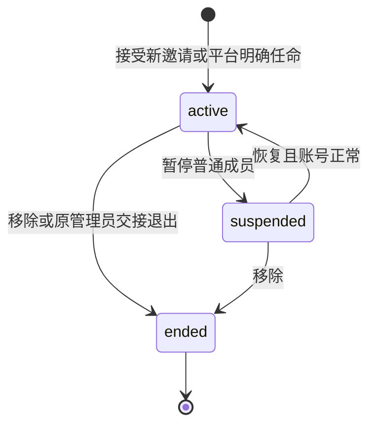
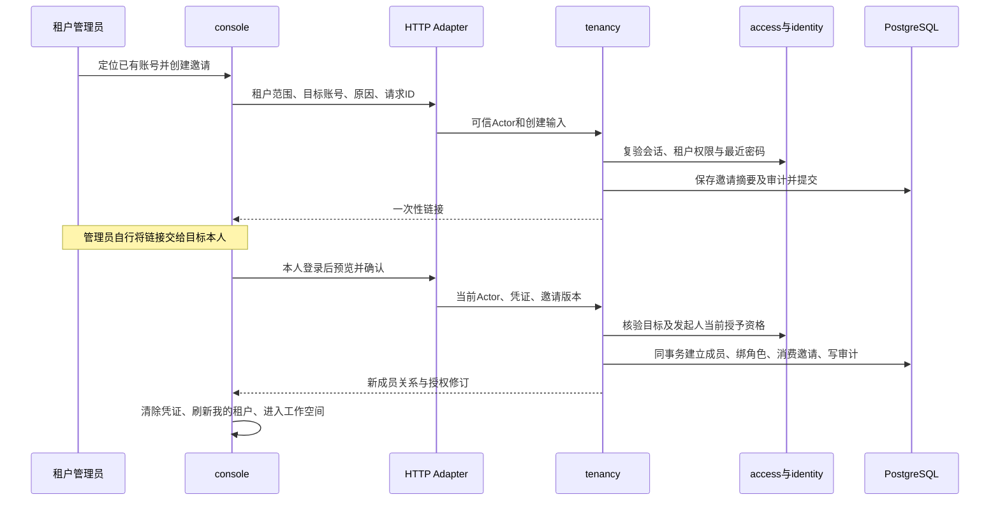

# 租户成员管理首轮迭代方案

日期：2026-11-10。版本：V1.0。方案状态：**Accepted（用户于 2026-11-10 确认，包含 D-01–D-12）**。功能实现状态：**Awaiting acceptance（开发与自验完成，待用户人工验收）**；详见[验证记录](../verification/tenant-membership.md)和[运行与验收手册](../operations/tenant-membership.md)。

本轮在租户基础管理之上，形成“管理员定向邀请已有账号 → 本人登录并确认加入 → 普通成员访问租户 → 暂停、恢复或移除 → 重新邀请加入”的完整流程，同时兼容已有管理员交接、账号启停、范围隔离和审计。

范围来源是[规划账号权限后的下一步](codex://threads/01a1c07e-e171-7f02-bde7-b5c66f3adfb7)最后一条关于“租户成员管理首轮”的建议。此前的[租户基础管理方案](tenant-foundation-plan.md)继续作为基础；本方案明确列出的成员模型、管理员接任和邀请联动规则，在实施后替代其对应的阶段性限制。认证继续由 InfraPro 自身管理。

## 1 目标与本轮范围

### 1.1 使用者与目标

| 使用者 | 需要完成的事情 | 本轮结果 |
| --- | --- | --- |
| 当前租户管理员 | 组织多人进入同一租户 | 邀请指定的已有正常账号，查看本租户成员和邀请进度 |
| 受邀账号本人 | 确认是否加入一个租户 | 登录后核对租户、当前账号和将获得的角色，主动确认加入 |
| 租户普通成员 | 进入所属组织工作空间 | 查看该租户基本资料及本人在其中的角色和权限 |
| 当前租户管理员 | 暂停或结束某人的租户访问 | 暂停、恢复、移除普通成员，看到明确影响和结果 |
| 同时属于多个租户的账号 | 独立使用各个租户 | A 的成员变化不会改变 B 的成员关系或本人登录资格 |
| 有平台交接权限的人员 | 将管理员职责交给已有成员或其他账号 | 仍由平台交接，兼容接任人已经是普通成员的情况 |
| 运维与审计人员 | 定位失败和追溯变更 | 通过原有 CLI、请求编号和分范围审计核实结果 |

### 1.2 交付清单

| 编号 | 内容 | 交付行为 |
| --- | --- | --- |
| TM-01 | 成员列表与详情 | 本租户当前成员、暂停成员和已结束历史；搜索、筛选、分页、角色及加入时间 |
| TM-02 | 定向邀请 | 按完整用户名定位已有账号，生成绑定该账号的邀请链接 |
| TM-03 | 邀请生命周期 | 查询、过期、撤销、重新生成；旧链接失效，历史保留 |
| TM-04 | 本人确认加入 | 登录与目标身份核验、加入前预览、显式确认、原子建立成员和固定角色 |
| TM-05 | 普通成员能力 | 固定“租户普通成员”角色；进入租户、查看基本资料与本人权限来源 |
| TM-06 | 成员状态管理 | 暂停、恢复、移除；原会话下一次租户请求使用最新状态 |
| TM-07 | 再次加入 | 移除后接受新邀请，建立新成员关系和新角色绑定，保留旧历史 |
| TM-08 | 管理员及账号联动 | 当前管理员保护、接任已有成员、账号停用和恢复、失权邀请处理 |
| TM-09 | 隔离与审计 | 跨租户、跨账号、跨成员关系隔离；全部有效业务变更可追溯 |
| TM-10 | 工程交付 | 增量迁移、契约与客户端、页面、自动验证、运行手册和人工验收记录 |

### 1.3 后续范围

自定义租户角色、任意成员角色配置、第二名并列管理员、租户管理员自行交接、成员自助退出、拒绝邀请的独立状态、审批、批量操作、导入导出、邮件或短信通知，作为后续需求分别处理。本轮通过管理员复制链接并自行交付，不建立通知中心或邀请收件箱。

项目及项目成员、工程资源、监测数据、数据用途和时间范围、成员授权到期、租户生命周期、许可与业务配额，也不在本轮内。邀请有效期只限定何时能够加入；加入成功后的成员关系不因该邀请过期而失效。

## 2 当前实现与衔接

### 2.1 已核对的基础

2026-11-10 最终核对的工作区为 `feature/account-access-console`，HEAD 为 `776663fc125223a02df6f46a24e5d0cf7663a8da`，已包含租户基础管理实现。本方案以该提交及工作区实际代码为设计基线。既有租户功能的[验证记录](../verification/tenant-foundation.md)仍标注 Awaiting acceptance，本方案不替其确认人工验收。

| 实际位置 | 已有能力或限制 | 本轮变化 |
| --- | --- | --- |
| `platform/identity` | 账号、登录、会话、开户邀请、恢复、启停 | 复用身份；补租户邀请在启停、受控密码重置和备份恢复中的失效联动 |
| `platform/access/catalog.go`、`builtins.go` | 29 项权限、3 个内置角色，已区分平台与租户 | 增加 8 项租户权限和 1 个普通成员内置角色 |
| `platform/access/tenants.go` | 按 active 成员求租户权限；结构检查要求每租户只有一个 active 成员 | 保留成员授权规则，改为多成员、唯一当前管理员检查 |
| `migrations/00003_tenancy.sql` | active/ended 成员；延迟触发器限制每租户 active 总数为 1 | 新迁移增加 suspended，替换总数约束和部分唯一索引 |
| `platform/tenancy/service.go` | 交接总是结束旧关系并新建接任关系 | 根据接任人的成员状态选择复用、新建或拒绝 |
| `platform/tenancy/queries.go` | 租户列表、上下文、候选账号与治理审计 | 新增成员、邀请查询；普通成员资料使用最小投影 |
| `features/tenancy/context.tsx` | URL 租户范围、成员上下文、30 秒刷新和失权清理 | 覆盖普通成员、暂停/恢复及同账号再次加入 |
| `features/auth/credential.ts` | 凭证取自 URL fragment，清除地址栏后仅保存在内存 | 新邀请按用途隔离凭证，衔接本项目登录 |
| 现有统一 CLI 与部署 | migrate、access sync/check、账号启停、恢复后撤销凭据 | 扩展已有命令覆盖本轮对象，不新增独立运维程序 |

仓库路径均相对根目录。正式实施前重新核对工作区、迁移最大编号和未提交变更；保留已有工作，不重置仓库或重建数据库。

### 2.2 本轮保持的原则

1. InfraPro 账号不归属于某一个租户，同账号可在多个租户拥有独立关系。
2. 平台角色绑定账号；租户角色绑定具体成员关系；权限按明确租户计算。
3. “基础成员”平台角色与“租户普通成员”角色分别表示本人功能和租户能力，不能混用。
4. 平台管理身份不自动获得租户成员、邀请或业务资料访问能力。
5. 开户邀请与租户加入邀请使用不同业务对象、路由和凭证用途。
6. 当前数据全部增量保留，包括账号、会话、租户、成员历史、角色、邀请和审计。
7. 认证方式、全站视觉和后端部署形态沿用当前工程。

## 3 本方案建议采用的业务规则

以下 D-01–D-12 已随用户对本方案的确认一并确定，并按同一口径实施。后续调整时同步更新流程和验收标准。

| 编号 | 建议规则 | 业务影响 |
| --- | --- | --- |
| D-01 | 邀请仅面向已有正常账号，以完整用户名精确定位、最终绑定稳定账号 ID | 未开户者先走既有开户流程；不在租户中提供全平台账号目录 |
| D-02 | 每租户一名当前管理员、多名普通成员；普通成员固定只读角色 | 本轮无需角色编辑器；不通过邀请产生第二名管理员 |
| D-03 | 待接受由邀请记录表达；接受成功才建立成员关系 | 待接受者不进入正式成员列表，也不能访问租户 |
| D-04 | 暂停保留原关系和绑定；恢复使用同一关系；移除结束关系并撤销绑定 | 暂停可恢复，移除后的再次加入必须产生新成员 ID |
| D-05 | 邀请固定有效 24 小时，每租户每目标账号最多一条待处理邀请 | 重新生成产生新记录和新链接，时限重新计算；不开放任意有效期输入 |
| D-06 | 邀请角色由后端固定为租户普通成员；邀请链接和目标账号身份必须同时匹配 | 链接不能转给另一账号领取，也不能由客户端夹带权限 |
| D-07 | 发起人失去邀请资格、任一相关账号停用，或发起人完成受控密码重置时，相关未领取邀请永久失效 | 恢复账号、重新任职或恢复权限不会复活旧邀请 |
| D-08 | 当前有权管理员可管理本租户邀请历史，重新生成以本次操作者重新授权 | 不强制限定只有原创建者可撤销；历史发起人不被改写 |
| D-09 | 平台交接给 active 普通成员时复用其关系并改授管理员角色；suspended 目标先恢复再交接 | 交接不隐式解除暂停；无当前关系或只有 ended 历史时新建关系 |
| D-10 | 交接后仍结束原管理员的该租户成员关系 | 延续已确认规则；若要保留为普通成员，后续通过新邀请明确加入 |
| D-11 | 普通成员不能查看完整成员列表、邀请或租户审计 | 查看资料不附送人员管理或历史治理信息 |
| D-12 | 成员恢复要求账号正常；账号恢复不自动解除成员暂停或移除 | 普通成员账号停用时仍允许管理员将其暂停或移除 |

## 4 业务对象与状态

### 4.1 账号、邀请与成员

| 对象 | 稳定标识 | 责任 |
| --- | --- | --- |
| Account | account_id | 登录身份与全局账号可用性，由现有 identity 管理 |
| Tenant | tenant_id | 租户档案与当前管理员指向 |
| TenantInvitation | invitation_id | 对特定账号的一次入租户授予意图、有效期和领取结果 |
| TenantMembership | membership_id | 账号在某租户中的一次正式任职关系，结束后保留 |
| TenantMemberRole | binding_id | 某次关系获得的租户角色及授予、撤销历史 |

显示名称和用户名用于核对，关联使用 account_id。一个账号加入 A、B 使用不同 membership_id；在 A 移除后再加入，也使用新的 membership_id。

### 4.2 成员状态



ended 是本条关系的终态。再次加入产生另一条 active 关系，不存在 ended → active 的更新操作。

| 状态 | 页面名称 | 是否保留未撤销角色绑定 | 是否可进入租户 | 允许的管理动作 |
| --- | --- | --- | --- | --- |
| active | 有效 | 是 | 账号正常且有相应权限时可以 | 普通成员可暂停、移除；管理员走交接 |
| suspended | 已暂停 | 是，显示“当前不生效” | 否 | 恢复、移除 |
| ended | 已移除或已交接退出 | 否；历史绑定仍保留 | 否 | 查看历史、发起新的加入邀请 |

成员状态与账号可用性分栏展示。active 成员的账号停用时显示“成员有效 · 账号不可用”，不能伪装成成员已暂停。其账号恢复后，只有仍 active 的关系重新具备访问条件；suspended、ended 不改变。

### 4.3 邀请状态

| 状态 | 含义 | 可执行的后续动作 |
| --- | --- | --- |
| pending | 尚未领取且尚未到期，资格有效 | 目标账号确认加入；管理员撤销或重新生成 |
| accepted | 已成功建立一次成员关系 | 查看结果；不能再领取或重新生成这条邀请 |
| expired | 到期未领取 | 管理员重新生成，或独立创建新邀请 |
| revoked | 管理员主动撤销 | 管理员重新生成，或独立创建新邀请 |
| replaced | 已由重新生成操作替代 | 只读历史，显示替代记录；不从这条历史再派生 |
| invalidated | 发起资格失效、账号停用、平台直接任命或恢复后撤销凭据等导致失效 | 当前管理员重新评估后新发；本条不能恢复 |

到期的 pending 记录即使尚未更新存储状态，也必须立即按 expired 展示并拒绝领取。读取不负责写成功审计；创建或重新生成前可在同事务将有关到期记录结转为 expired，释放待处理唯一约束。写操作先按当前有效状态判断，已经到期的记录不能再被描述为本次主动撤销或失权；重新生成校验用户看到的存储版本后，一次完成必要的到期结转和新建。

accepted 不随成员后来暂停、移除或升级为管理员而改成其他邀请状态；它记录当时已完成的事实。界面单独显示关联关系的当前状态。

## 5 固定角色与权限

### 5.1 内置角色

新增 builtin_key 为 `tenant_member` 的“租户普通成员”，binding_scope 为 tenant，首轮只含 `tenant.profile.read`。已有 `tenant_admin` 显式增加成员和邀请管理权限；保持本轮一名当前管理员。

角色与权限目录仍由 Go 代码维护并通过 `access sync` 投影。平台管理员和基础成员的权限集合不加入任何 tenant 范围权限，自定义平台角色也不能绑定 tenant 角色或配置 tenant 权限。

“进入租户、读取当前租户上下文”沿用有效登录与 active 成员检查，不另造角色名称快捷放行。普通成员通过上下文看到自己的角色、权限和来源，无需 `tenant.member.read`。

### 5.2 新增权限目录

| 编码 | 能力 | 默认授予 |
| --- | --- | --- |
| `tenant.member.read` | 查看本租户成员列表、详情和关系历史 | 租户管理员 |
| `tenant.member.suspend` | 暂停本租户普通成员 | 租户管理员 |
| `tenant.member.resume` | 恢复本租户暂停成员 | 租户管理员 |
| `tenant.member.remove` | 结束本租户普通成员关系 | 租户管理员 |
| `tenant.invitation.read` | 查看本租户邀请列表和详情 | 租户管理员 |
| `tenant.invitation.create` | 精确定位目标账号并创建固定普通成员邀请 | 租户管理员 |
| `tenant.invitation.revoke` | 撤销本租户待处理邀请 | 租户管理员 |
| `tenant.invitation.regenerate` | 替换邀请并重新生成链接，同时要求 create 权限 | 租户管理员 |

本轮按上述目录从 29 项扩展为 37 项权限、从 3 个扩展为 4 个内置角色。实施前如目录已变化，按实际基线重算；不得用数量代替逐项契约检查。

`tenant.audit.read` 保持原编码，说明扩展为查看本租户档案、成员与邀请治理记录。管理员角色使用明确权限清单，不按 `tenant.*` 通配自动取得未来业务数据能力。

### 5.3 能力矩阵

| 能力 | 平台治理人员但无该租户成员关系 | 本租户管理员 | 本租户普通成员 | 非成员受邀人 |
| --- | --- | --- | --- | --- |
| 平台档案及交接 | 按平台动作权限 | 另需平台权限 | 另需平台权限 | 另需平台权限 |
| 租户资料、本人租户权限 | 不可 | 可 | 可 | 加入前不可 |
| 修改租户资料 | 不可 | 可 | 不可 | 不可 |
| 成员列表与管理 | 不可 | 可，当前管理员受保护 | 不可 | 不可 |
| 本租户邀请列表及管理 | 不可 | 可 | 不可 | 不可 |
| 本租户审计 | 不可 | 可 | 不可 | 不可 |
| 本人邀请预览和确认 | 仅本人为目标且链接有效时 | 同左；已有当前关系时拒绝重复加入 | 同左 | 登录、目标匹配、凭证有效时可 |

所有操作由动作权限及对象范围判断。“当前管理员”指向用于防止治理空缺；不能替代权限检查。

## 6 成员列表与普通成员访问

### 6.1 管理员查看成员

租户工作空间增加“成员管理”，默认显示 active 与 suspended，已结束记录在“历史成员”筛选中查看。显示：显示名称、用户名、角色、成员状态、账号可用性、加入时间、最近状态变化时间及可执行操作。

- 支持按本租户用户名/显示名称搜索，按成员状态、管理员/普通成员筛选；默认每页 20 条，最多 100 条。
- 服务端查询始终限定 tenant_id，再做搜索、计数和分页；稳定按 joined_at 与 id 倒序排列，游标包含这两个字段。
- 同一账号多次加入在历史中显示多条关系，并可查看各自加入方式、结束时间和原因。
- 详情包含本次关系的角色授予、状态变化和关联邀请 ID。历史变更从审计读取，固定展示允许字段。
- 只显示全局账号“可用/不可用”；不返回平台角色、其他租户、登录历史、停用原因或联系方式。
- 当前管理员行显示职责标记，暂停和移除不可提交，并说明须先由平台交接。

### 6.2 普通成员查看资料

普通成员沿用“我的租户”与 `/t/$tenantId/profile`，显示租户名称、编号、说明，以及当前管理员的显示名称和用户名。本人权限区显示“租户普通成员”和 `tenant.profile.read` 的中文说明。

租户资料读取使用明确 DTO：租户 ID、名称、编号、说明、资料更新时间、管理员最小身份信息及管理员可用性。当前供治理使用的完整 Tenant 结构包含创建/修改账号等字段；本轮将租户资料响应与平台治理详情分开，普通成员不能通过复用完整 DTO 顺带取得额外治理信息。管理员编辑所需 version 保留。

普通成员不显示“编辑资料”“成员管理”“租户邀请”“租户操作记录”；手工输入其路由或调用接口仍由后端拒绝。工作空间切换只显示本人当前可访问的租户，暂停和已结束关系不出现在可进入列表。

## 7 定向邀请与本人确认

### 7.1 定位账号和创建邀请

1. 管理员在本租户“成员邀请”中点击“邀请成员”，输入完整用户名。
2. 服务端按现有用户名归一规则精确匹配，要求操作者在该租户具备邀请权限；禁止空查询、模糊目录和分页枚举。
3. 只返回可邀请账号的 ID、用户名、显示名称。账号不存在与账号不可用统一提示“未找到可邀请的账号”。
4. 管理员核对目标，页面固定展示“租户普通成员：可查看本租户基本资料”，填写内部操作原因。
5. 提交目标 account_id、原因及 client_request_id；服务端再次核验目标和操作者，不信任此前查询结果。
6. 创建成功展示目标、租户、准确到期时间和一次性可复制链接；管理员自行交付。

目标已有 active 关系时提示已是成员；已有 suspended 关系时提示使用恢复流程。只有 ended 历史允许重新邀请。已经存在待处理邀请时返回冲突并引导查看该邀请，不在后台悄悄轮换链接。自己已是当前管理员，不能邀请自己再次加入。

`reason` 规范化后为 1–500 个 Unicode 码点，存审计，不展示给受邀人。无需录入密码、邮箱、角色 ID、权限、成员到期时间或另一个租户 ID。

### 7.2 链接与登录衔接

链接示意为 `<配置的 console 基址>/tenant-invite#token=<随机凭证>`，正式部署包含既有 `/console/` 前缀。实际 host 来自已配置的公开入口，不从请求 Host 拼接。

凭证使用加密安全随机源生成 32 字节随机值，数据库只存 SHA-256 摘要；首次成功响应仅展示一次明文。该凭证与开户、密码重置凭证按用途隔离，不能互换。这里沿用高熵、一次消费、到期失效的设计原则；[OWASP 一次性令牌指南](https://cheatsheetseries.owasp.org/cheatsheets/Forgot_Password_Cheat_Sheet.html)提供的是令牌安全原则，本项目额外要求登录账号与邀请目标匹配。

页面载入时先提取 fragment 并清除地址栏中的 token，之后只保存在当前页面内存，按用途分别保存。不得放入查询参数、localStorage、sessionStorage、持久查询缓存、日志或错误上报；邀请页面及响应使用 no-store，不向第三方资源传递凭证。

未登录时，在同一应用中完成现有登录流程并返回邀请确认页；token 在这一次登录流程中保留于内存。正常登录完成不能被“切换账号清理”误清掉；显式退出、切换已登录账号、取消、成功或确定失效时清除。刷新或关闭页面导致内存丢失时，提示重新打开原邀请链接。错账号场景提示先切换到受邀账号、再重新打开链接，不显示正确账号的名称。

登录过程不消费邀请，登录成功也不自动加入；受邀者必须点击“确认加入”。

### 7.3 加入前预览

只有正常登录、token 匹配且目标 account_id 等于当前账号，才返回最小预览：租户名称和编号、当前账号、发起人显示身份、固定角色说明、到期时间和 invitation version。未匹配前不返回租户档案或目标账号信息。

目标账号匹配时可看到“已过期”“已撤销”“已替换”“邀请资格已失效”等处理提示；错误 token 或其他账号统一返回“邀请不存在、已失效或不属于当前账号”。受邀人没有租户成员关系，因此预览与接受按“本人目标邀请”授权，不要求其先拥有 tenant 权限，也不要求任何平台角色。

### 7.4 原子接受

确认请求进入一个数据库事务，依次完成：

1. 取得授权状态排他锁；锁定受邀账号、发起账号及相关会话、租户、成员和邀请。
2. 复验当前账号、会话、CSRF；确认目标账号匹配，邀请为 pending、version 匹配并未到期。
3. 确认发起时的 inviter_membership_id 仍 active，发起账号正常，当前仍拥有本租户 `tenant.invitation.create`；固定普通成员角色可用且权限仍在其可授予范围内。
4. 确认目标没有 active 或 suspended 关系，且邀请没有被撤销、替换或因其他操作失效。
5. 新建 membership_id，状态 active；绑定固定 tenant_member 角色。
6. 邀请改为 accepted，记录接受账号、时间及新 membership_id；增加邀请版本和授权修订。
7. 同事务写邀请接受、成员加入审计。任一步失败全部回滚，账号及其他租户关系不受影响。

接受人是本次操作 actor；邀请者是授予来源。成员 joined_by 记录接受人，角色 assigned_by 记录邀请发起人，审计同时记录二者及原始邀请和成员关系，避免把接受人误写成“自行授权”。

成功后显示租户和角色，刷新“我的租户”，提供进入入口。token 随即清除。预览可成功而提交失败，例如其间撤销、账号停用或发起人交接；必须展示提交时的真实结果。

### 7.5 重复提交与结果未知

- 创建和重新生成使用 client_request_id，唯一范围为租户、操作类型和操作者；同 ID 同内容返回原操作结果，同 ID 异内容返回 `idempotency_conflict`。
- 去重信息保存规范化输入摘要及结果对象，不保存明文 token。重放结果只返回邀请 ID、状态与 `link_unavailable=true`；若首次响应丢失，管理员查验后重新生成链接。
- 接受天然以 invitation_id 仅允许一次消费；并发点击或重复调用不会建立第二条关系，重复返回 `409 invitation_already_accepted`。匹配目标账号的预览可查询原接受结果，供超时后核实。
- 已接受邀请后来关联 suspended 或 ended 成员时，只显示原结果和当前状态；不借重试恢复关系或重复授权。历史结果读取不要求原发起人仍有授予权，但必须匹配原目标账号和 token；已无访问资格时只用接受时的显示快照，不读取租户新资料。
- 所有重试先重新验证当前访问资格。客户端不自动重放管理写请求；用户核实结果后决定重试。

### 7.6 撤销、重新生成与持续资格

撤销需要本租户 revoke 权限、当前邀请版本和原因。重新生成需要 regenerate 与 create 两项权限、原因和请求 ID；可处理 pending、expired、revoked、invalidated，不能处理 accepted 或 replaced。

重新生成在一个事务内终结旧凭据并创建新记录，新记录的发起人和发起成员关系取本次操作者，目标账号与固定角色不变，时限从本次成功创建重新计算。旧 pending 改为 replaced；旧记录已是其他终态时保留原终态并记录 replaced_by_id。一个旧邀请只允许派生一次，历史链可追溯。已存在另一条待处理邀请时提示处理该记录，不能派生并行邀请。

以下情况在原变更事务中使有关 pending 邀请终结为 invalidated，并记录原因：

| 触发事件 | 失效范围 |
| --- | --- |
| 发起人成员结束、暂停或失去邀请权限 | 绑定该发起成员关系的未领取邀请 |
| 发起账号常规或应急停用 | 该账号作为发起人的未领取租户邀请 |
| 目标账号停用 | 发给该账号的未领取租户邀请 |
| 发起人通过受控恢复流程完成密码重置 | 该账号发出的未领取租户邀请，衔接现有开户邀请的恢复语义 |
| 平台将目标账号直接指定为本租户管理员 | 该目标在本租户尚未领取的普通成员邀请 |
| 备份恢复后的统一凭据撤销 | 恢复库中全部未领取租户邀请 |

账号恢复、成员恢复、重新接任、角色权限恢复均不改变这些终态。发起人正常退出登录、会话自然到期或本人常规改密不等于撤销已发邀请；领取只要求发起账号与成员资格仍有效，不要求其原会话仍在线。

## 8 暂停、恢复、移除与管理员交接

### 8.1 成员操作

三个动作使用独立入口，均携带 membership_id、expected_version 和原因，并要求有效登录、动作权限、CSRF 与最近密码复验。

| 动作 | 前置状态与条件 | 成功后的结果 |
| --- | --- | --- |
| 暂停 | active 普通成员；即使其账号不可用也可暂停 | 原关系改为 suspended，保留角色绑定，记录操作者/时间/原因，增加成员版本与授权修订 |
| 恢复 | suspended 普通成员且目标账号正常 | 原关系改为 active，原绑定重新具备生效条件；不重发邀请、不生成新关系 |
| 移除 | active 或 suspended 普通成员 | 改为 ended，填写结束信息，撤销全部未撤销租户角色绑定，增加成员版本与授权修订 |

不允许用通用 PATCH 任意改 status，也不允许客户端提交“强制移除管理员”“恢复 ended”“重置角色”等字段。重复执行已经完成的动作返回状态或版本冲突，不重复增加版本、授权修订或成功审计。

暂停和移除不撤销全局登录会话，不修改平台角色，也不修改其他租户关系。恢复没有丢失的历史授权：本轮暂停仅保留明确存在的固定角色；移除则明确撤销，后续重新加入只有新邀请规定的普通成员角色。

### 8.2 当前管理员保护

事务内同时检查当前管理员指向与角色完整性。目标是当前管理员时，暂停和移除统一返回 `409 tenant_admin_transfer_required`；不能仅靠隐藏按钮防止失去治理人员。

交接入口继续使用 `platform.tenant.transfer_admin`。租户管理员没有平台交接权限时，页面提供“请联系平台完成交接”的说明；不新增代登录、租户自助交接或强制成员操作。

账号的常规停用继续要求先交接全部当前租户管理员职责；CLI 应急停用仍可暂时使管理员不可用。普通成员应急或常规停用不会使租户进入停用状态，其治理页面仍可由其他有权账号使用。

### 8.3 接任人状态处理

| 接任人在该租户的现状 | 本轮交接处理 |
| --- | --- |
| 已是当前管理员 | 返回 administrator_unchanged，无副作用 |
| active 普通成员，账号正常 | 保留 membership_id 和 joined_at；撤销普通成员角色绑定、授予管理员角色，增加成员版本 |
| suspended 普通成员 | 返回 administrator_membership_suspended，要求先由当前租户管理员恢复；平台也可另选正常候选人 |
| 无成员关系，账号正常 | 创建新关系并明确授予管理员角色，保持既有平台指定规则 |
| 只有 ended 历史，账号正常 | 创建新关系；不恢复旧关系和旧角色 |
| 账号不可用 | 拒绝交接，不改变任何对象 |

交接预览必须标明“接任已有成员”还是“新建成员关系”，同时说明原管理员的关系将结束。提交仍携带租户 expected_version；接任对象的状态在事务中重新检查，不能依赖预览结果。

一次交接事务完成：结束原管理员关系及角色 → 失效其发起的待领取邀请 → 处理接任成员及角色 → 失效发给接任人的本租户未领取普通成员邀请 → 更新当前管理员指向和租户版本 → 增加授权修订并写审计。中间状态不能提交。

升级为管理员后，成员加入时间保持原值，管理员任职开始时间从新角色绑定和交接审计读取。未来再被交接出去，按 D-10 结束整个关系；若再接受新邀请，只获得新的普通成员关系。

### 8.4 账号恢复与备份恢复

账号恢复只恢复登录资格，旧会话仍按现有规则失效。active 成员重新具备访问条件，suspended 继续暂停，ended 继续结束；被账号停用终结的邀请继续失效。

备份恢复后的现有统一撤销流程必须覆盖租户邀请，防止恢复库让已经用过或撤销过的旧链接重新可领取。沿用停止 API 写入、统一撤销会话与凭据、确认后重启的运行流程，不另建恢复账号或绕过审批的租户入口。

## 9 页面与交互

### 9.1 页面和入口

下列路径为 console 应用内路径，正式部署带 `/console/` 前缀。

| 页面 | 路径 | 主要内容 |
| --- | --- | --- |
| 租户成员 | `/t/$tenantId/members` | 当前/历史成员、筛选、分页、状态操作 |
| 成员详情 | `/t/$tenantId/members/$membershipId` | 本次关系、角色及允许查看的状态历史，关联邀请 |
| 租户成员邀请 | `/t/$tenantId/invitations` | 待处理和历史邀请、目标、状态、到期时间，创建/撤销/重新生成 |
| 邀请详情 | `/t/$tenantId/invitations/$invitationId` | 邀请历史链、授予来源、接受结果；不提供重取明文链接 |
| 本人加入确认 | `/tenant-invite` | 登录引导、本人邀请预览、确认、结果或失效提示 |
| 我的租户 | 既有 `/tenants` | 接受后出现新租户；暂停/移除后不可进入 |
| 租户资料与审计 | 既有 `/t/$tenantId/profile`、`/audit` | 普通成员最小资料视图；管理员查看新增治理事件 |
| 平台租户详情 | 既有 `/platform/tenants/$tenantId` | 管理员交接兼容已有成员，保持原平台授权 |

“成员”与“邀请”分别呈现，邀请页可按状态筛选“待接受”；不要把邀请记录伪装成已经加入的成员。已有“邀请管理”入口改为清楚的“账号开户邀请”，与当前租户下的“成员邀请”区分，不改变原开户能力。

### 9.2 关键交互

- 创建邀请表单先定位并核对账号，再显示固定角色、时限和操作原因。提交成功前不展示可复制链接。
- 明文链接成功弹窗显示租户与目标身份，复制成功有反馈，关闭即不能再取回；关闭前说明可通过重新生成获得新链接。
- 暂停确认说明“将失去本租户访问，可恢复”；移除确认说明“本次关系结束，再加入需要重新邀请”。确认区同时显示租户与目标账号，避免跨租户误操作。
- 暂停、移除、撤销和替换链接使用现有确认弹窗；恢复显示将恢复的范围。使用既有 Radix 版 shadcn AlertDialog，沿用其确认交互，不迁移组件实现。[shadcn Alert Dialog](https://ui.shadcn.com/docs/components/radix/alert-dialog)
- 错误紧邻字段；版本冲突先刷新目标和影响，再由用户重新确认。复验到期保留非敏感输入，复验成功后不自动执行原管理动作。
- 提交中防重复操作；网络超时显示“结果尚未确认”，提供查验入口，不显示确定失败或擅自重发。
- 受邀者看到本人当前登录账号、租户和角色说明，只有主动点击“确认加入”才提交；返回或关闭页面没有加入副作用。

### 9.3 页面状态和可访问性

| 场景 | 呈现与处理 |
| --- | --- |
| 尚无普通成员/邀请 | 说明当前状态；有权管理员看到邀请入口 |
| 搜索无结果 | 保留筛选，可清除筛选；区别于服务异常 |
| 加载 | 骨架或明确状态，不拿其他租户内容占位 |
| 账号不匹配/链接无效 | 通用提示，允许切换账号后重新打开链接，不暴露目标身份 |
| 确定成员失权 | 清理受保护内容与草稿，显示当前租户不可访问及返回入口 |
| 短暂网络、数据库或 Redis 故障 | 保留仍在本账号上下文内的非敏感草稿，阻止提交，显示重试 |
| 429 | 显示可重试时间，不将限流显示为账号不存在 |
| 当前管理员不可用 | 资料中的治理异常可见，普通成员已有只读能力不因此被移除 |

复用现有布局、颜色、字号、表格、表单和提示，不新增视觉体系。桌面使用表格；375px 窄屏使用可读纵向卡片，主要操作不依赖水平滚动。键盘可完成账号定位、弹窗确认和取消；弹窗打开/关闭正确移动并恢复焦点；错误和状态同时有文字，不只靠颜色。

## 10 上下文隔离与撤权生效

### 10.1 查询和请求归属

继续由当前标签页 URL 表达租户，后端会话不保存全局 active_tenant_id。新增查询键示意：

```text
['tenant', accountId, tenantId, membershipId, 'members', filters]
['tenant', accountId, tenantId, membershipId, 'member', targetMembershipId]
['tenant', accountId, tenantId, membershipId, 'invitations', filters]
['tenant', accountId, tenantId, membershipId, 'invitation', invitationId]
['account', accountId, 'my-tenants', filters]
```

邀请 token 不作为查询键，不进入可被开发工具或持久缓存复制的对象。本人邀请预览使用当前页面的短期内存状态，绑定账号代次与凭证用途；切换账号后清除。

所有列表、详情、计数、审计与写操作都在 SQL 中限定 tenant_id。membership_id 和 invitation_id 不能覆盖路径租户范围，正文中的额外 tenant_id 被拒绝。

### 10.2 生效口径

有效访问条件为：账号正常、会话有效、目标租户成员 active、有效租户角色提供本次动作权限。恢复一个条件不意味着其他条件同时恢复。

暂停、移除和交接事务提交后，**新请求立即使用新状态**；无需退出重登。已有读取事务若先取得共享授权锁，可以先完成；撤权事务等其结束后提交，不承诺撤回已发送到客户端的数据。

前端沿用可见页面最多 30 秒定期刷新，响应授权修订变化、页面重新获得焦点和从后台恢复时立即复核。30 秒是界面同步目标，不能作为后端仍放行旧权限的期限。本轮没有任务、下载或实时订阅，不据此宣称已完成未来所有链路的十秒撤权要求。

### 10.3 再次加入与迟到响应

- 退出、切换账号、切换租户、确认成员失权时，取消旧查询、清理对应缓存并卸载页面。
- 请求记录发起时的账号代次、租户 ID、成员 ID 和上下文代次；返回不匹配时丢弃，不写入新页面、不弹出错误归属的成功提示。
- 同账号同租户移除后再加入，新 membership_id 必须触发页面与草稿重建；不能只比较 account_id 和 tenant_id。
- 若暂停与恢复发生在两次刷新之间，当前已是合法 active 关系可正常访问；期间发起的每个请求仍按数据库当时状态判断。
- 查询把 AbortSignal 传递到底层 fetch；默认组件卸载不能当作请求被取消的证明。[TanStack Query 查询取消](https://tanstack.com/query/latest/docs/framework/react/guides/query-cancellation)
- 取消浏览器请求不能撤销已提交的数据库事务；写操作始终归属发出时的租户，超时通过对应对象查询核实。

## 11 技术选择与模块设计

### 11.1 技术及具体用途

| 技术 | 本轮在哪里使用 | 选用原因 |
| --- | --- | --- |
| Go、现有 Go workspace | platform/tenancy、access、identity 的成员规则和事务联动 | 复用已交付规则和工程，不增加服务间一致性问题 |
| Gin | API 的 HTTP Adapter，路由、严格输入、Cookie/CSRF、错误映射 | 与现有认证、中间件和精确策略一致 |
| PostgreSQL 17、pgx/pgxpool | 成员、邀请、角色绑定、去重结果、锁、版本和审计 | 权威数据同库，可在同事务保持原子性和归属约束 |
| Goose | 新增 00004 增量迁移及旧版本升级测试 | 沿用统一 CLI，已应用迁移保持不可变 |
| Redis 7.4、go-redis | 复用会话依赖，为候选定位和邀请入口提供限流 | 保持现有部署；不保存权威成员状态或邀请消费结果 |
| React、TypeScript、Vite | console 成员、邀请、接受页面 | 同应用内复用身份、主题、布局和发布流程 |
| TanStack Router/Query/Table | 文件路由、按上下文查询、分页、表格与刷新 | 已有工程能力，便于隔离状态和废弃旧请求 |
| React Hook Form、Zod | 账号定位、原因、提交及字段反馈 | 与现有表单保持一致，后端仍负责最终校验 |
| shadcn/ui、现有 UI/layout 包 | 表格、表单、AlertDialog、状态与反馈 | 复用现有组件及键盘交互 |
| OpenAPI、openapi-typescript、权限生成脚本 | 契约、错误、DTO、客户端和权限常量 | 防止 Go、前端及路由策略漂移 |
| Go 测试、Playwright、Compose/Nginx | 真库并发/迁移、浏览器、实际 HTTP 路径 | 验证事务结果与用户可见行为 |

具体依赖版本以当前 go.mod、package.json 和锁文件为准，本轮不安排升级。Redis 故障不能绕过登录、限流或成员检查。

### 11.2 Module 与 Interface

| Module | 对外 Interface 和职责 | Implementation 内部责任 |
| --- | --- | --- |
| tenancy | 成员列表/详情；创建、撤销、重新生成、检查和接受邀请；暂停/恢复/移除；管理员交接 | 对象归属、状态机、版本、去重、令牌、完整业务事务与审计 |
| access | 当前范围授权、锁与修订、角色绑定规则、管理员结构检查、撤销授予资格的事务级协作 | 目录与权限求值，不接管邀请页面或链接交付 |
| identity | 可信 Actor、会话及最近密码复验、账号启停与恢复 | 继续唯一拥有密码、会话和账号状态，不导入 tenancy |
| HTTP Adapter | 解析输入、取得 Actor、调用一个完整业务 Interface、映射响应 | 不分多次调用拼接成员建立、绑定和审计 |
| runtime | 装配数据库、Redis、配置及各 Module | 使用现有依赖，无新进程或消息服务 |
| console tenancy feature / api-client | 页面、类型化调用、上下文失效和交互 | UI 包不请求业务 API，业务规则不复制到 UI 包 |

沿用 tenancy 的深 Module 结构：Handler 调用 AcceptInvitation 时得到完整的加入结果；不让调用者先建成员、再绑角色、再消费邀请。成员写操作提供明确业务方法，不公开任意改状态或跳过管理员检查的 Interface。

账号启停、受控密码重置与备份恢复需要的邀请失效协作放在 access 的小型事务函数中，identity、tenancy 共用。函数只处理授予资格变化、对应邀请终结和安全审计；常规邀请业务仍归 tenancy，避免 identity ↔ tenancy 循环依赖。

现有 tenancy.transact 的目标账号锁定方式和所有唯一冲突均映射 tenant_code_taken 的处理必须调整：根据操作发现并锁定相关账号，按具体约束区分编号、当前成员、待处理邀请和请求去重冲突；不得让新业务错误落入租户编号提示。

### 11.3 核心数据流



## 12 数据结构与数据库约束

建议新增 `packages/go/platform/migrations/00004_tenant_membership.sql`；开始实施时如编号占用则顺延，不改已应用的 00003。

### 12.1 已有表调整

| 表 | 增量变化 | 规则 |
| --- | --- | --- |
| tenant_memberships | status 增加 suspended；新增 version、状态变更时间/操作者/原因、可空 source_invitation_id | active/suspended 无结束字段；ended 必须有完整结束信息；version 对外为十进制字符串 |
| tenant_memberships | 增加 `(tenant_id, account_id, id)` 唯一约束 | 支持邀请目标与接受结果的组合外键 |
| tenant_member_roles | 保留现有授予/撤销字段和组合归属外键 | 暂停不撤销；移除、旧管理员退出、普通成员晋任时明确记录撤销 |
| tenants | 保持 administrator_membership_id | 唯一当前管理员必须属于本租户、成员 active 且有有效管理员角色 |
| roles / role_permissions | 内置普通成员角色与管理员权限扩充 | 由目录同步维护；绑定范围仍为 tenant |
| account_security_events | 复用 tenant_id、actor_scope 和结构化详情 | 新事件进入明确的租户审计允许列表 |

旧 active/ended 成员回填 version=1，状态时间依据已有 joined_at/ended_at，操作者依据 joined_by/ended_by；不得伪造新的邀请、加入或权限授予事件。

### 12.2 新增租户邀请表

建议表名 `tenant_invitations`，字段分组如下：

| 字段组 | 主要字段 | 约束 |
| --- | --- | --- |
| 身份与归属 | id、tenant_id、target_account_id | UUID，引用现有租户与账号 |
| 授予来源 | inviter_account_id、inviter_membership_id | 组合外键保证发起成员属于同租户且关联该账号 |
| 固定角色 | role_key | 首轮 CHECK 固定 tenant_member；接受时按目录解析实际角色 |
| 凭证与时间 | token_hash、created_at、expires_at | 摘要唯一；到期时间晚于创建时间；不存明文 |
| 状态与版本 | status、version、closed_at、closed_by、close_reason | 状态枚举受限；终结必须有时间和可追溯原因，系统时限结转允许操作者为空 |
| 接受结果 | accepted_at、accepted_by、accepted_membership_id、accepted_context_snapshot | accepted 时必须完整，接受账号等于目标账号；快照只含当时租户名称/编号和固定角色说明 |
| 历史链 | replaces_id、replaced_by_id | 同租户同目标；一条记录至多一个替代；不改写原发起人 |
| 创建去重 | creation_request_id、creation_payload_hash | 创建者、租户、请求 ID 唯一；重新生成同样在新记录保存去重信息及操作类别 |

使用 `(tenant_id, target_account_id, accepted_membership_id)` 组合外键校验接受结果，source_invitation_id 与接受结果形成引用时使用事务内可延迟检查。邀请为 accepted 时，其关联关系可以随后 ended，不能错误要求它永远 active。

### 12.3 唯一性与治理完整性

- 将原“同租户同账号最多一个 active”索引替换为 `WHERE status IN ('active','suspended')` 的部分唯一索引，避免暂停后绕过唯一约束再建第二条当前关系。
- 新增邀请部分唯一索引 `(tenant_id,target_account_id) WHERE status='pending'`；时间过期由业务核验，创建前显式结转有关到期记录。不要把随时间变化的“当前未过期”当成静态唯一条件；索引表达式要求结果不依赖当前时间。[PostgreSQL 17 索引表达式限制](https://www.postgresql.org/docs/17/sql-createindex.html)
- 成员角色继续通过 `(tenant_id,membership_id)` 外键防止跨租户拼接，通过 binding_scope 防止平台角色被绑定到租户成员。
- 替换 check_tenant_administrator 和 access.CheckTenantStructure 中的 `active_count = 1` 规则：允许任意数量普通成员，但只能有一条未撤销的管理员角色绑定，且对应 tenants 指向的 active 成员。
- ended 成员不能保留未撤销角色绑定；当前管理员不能 suspended 或 ended。普通成员关系须有固定普通成员角色；本轮不通过对外接口引入其他角色组合。
- 保留延迟触发器，使创建和交接能够在同事务内调整关系，但提交时检查完整性。同步检查同时验证角色目录可用性与关系结构。
- 账号不可用与结构损坏分开：应急停用可以让当前管理员账号不可用，不能因这一业务状态使整个服务 readiness 失败。

部分唯一索引用于约束符合状态条件的行，符合 PostgreSQL 的既有能力。[PostgreSQL 17 部分唯一索引](https://www.postgresql.org/docs/17/indexes-partial.html)

### 12.4 索引、时间与版本

成员列表按 `(tenant_id,joined_at DESC,id DESC)` 建索引，按账号查当前关系保留合适索引。邀请建立租户分页、目标账号及 pending 发起成员查询索引；审计复用 tenant_id 与事件 ID 索引。所有分页有服务端上限，禁止列表逐行重复计算全部权限形成无界查询。

时间统一为 UTC timestamptz，页面显示明确时区；本轮人工验收使用 Asia/Shanghai。过期判断与最终消费使用获得相关锁之后的数据库当前时间，必要时在消费 UPDATE 中用 clock_timestamp()；等于 expires_at 即不可领取，避免事务开始未过期、等待锁后已过期却仍接受。PostgreSQL 的 now() 固定在事务起点，clock_timestamp() 表示实际当前时间。[PostgreSQL 17 时间函数](https://www.postgresql.org/docs/17/functions-datetime.html)

| 变化 | 成员 version | 邀请 version | 租户 version | authorization_revision |
| --- | --- | --- | --- | --- |
| 创建邀请 | 无 | 新建 1 | 不变 | 不变 |
| 撤销/替换/失效/落库结转过期 | 无 | 有实际变化则 +1 | 不变 | 单独邀请变化不递增 |
| 接受邀请 | 新建 1 | +1 | 不变 | +1 |
| 暂停/恢复/移除 | +1 | 如有关邀请失效则变化 | 不变 | +1 |
| 管理员交接 | 旧成员 +1；接任成员 +1 或新建 1 | 有关邀请失效则变化 | +1 | 整个事务递增一次 |
| 无效、重复、冲突或回滚 | 不变 | 不变 | 不变 | 不变 |

普通成员变化不占用租户资料版本，避免无关的成员操作使档案编辑持续冲突。版本、审计序号和授权修订对外使用字符串，客户端不自行增加数据库版本。

## 13 事务、并发与故障处理

### 13.1 锁顺序与事务边界

继续使用当前 authorization_state 单行锁。成员/权限读取取共享锁；邀请创建、撤销、重新生成、接受，成员状态变更、交接、账号启停和恢复后撤销凭据，从事务开始就取排他锁。是否需要排他锁与是否增加授权修订分别判断，不把两个语义绑在一个条件上。

统一顺序为：授权状态锁 → 相关账号按 UUID 排序 → 当前会话复验记录 → 需要锁定的角色 → 租户 → 成员和绑定 → 邀请与去重记录 → 审计。接受入口可在取得授权锁后先按摘要读取邀请以发现相关账号，随后按统一顺序加锁，并最终锁定/复验邀请；不得先锁邀请再反向锁账号。

账号启停、交接和邀请终结使用同一顺序。受控密码重置事务补充从授权锁开始的排序，以串行化重置撤销邀请和邀请消费；现有恢复后撤销凭据操作也统一该顺序，并继续要求停服执行。事务内不做密码慢哈希、HTTP 请求、发送通知或等待用户输入。

保持既有锁等待和语句超时；超时返回 operation_busy，显示请求编号并提示核实后重试。固定加锁顺序和短事务遵循 PostgreSQL 的锁与死锁处理原则。[PostgreSQL 17 显式锁](https://www.postgresql.org/docs/17/explicit-locking.html)

### 13.2 必须明确的竞争结果

| 竞争 | 允许结果 |
| --- | --- |
| 同目标并发创建邀请 | 最多一个 pending；另一请求返回既有结果或冲突，不产生并行可领取链接 |
| 同 token 并发接受 | 只有一次建立关系和角色，另一次报告已接受 |
| 接受与撤销/重新生成 | 接受先提交则撤销/替换被拒绝；撤销/替换先提交则旧链接拒绝 |
| 接受与发起人交接 | 接受先提交则新普通成员保留；交接先提交则原邀请失效 |
| 接受与目标账号停用 | 接受先提交则关系存在但账号停用后无法访问；停用先提交则不能接受 |
| 接受与平台指定目标为管理员 | 接受先提交则交接复用关系并晋任；任命先提交则普通邀请失效 |
| 暂停/恢复/移除同一成员 | 同一版本只允许一个有效变更；不能用旧恢复请求复活已移除关系 |
| 暂停普通成员与交接其为管理员 | 暂停先提交则交接被拒绝；交接先提交则暂停被管理员保护拒绝 |
| 移除后创建新邀请与旧请求返回 | 新旧关系分别保存，旧响应不能恢复旧成员或污染新页面 |
| 接受在等待锁时跨过到期时间 | 使用消费时的数据库时间，过期则拒绝 |
| 任一步角色/审计写入失败 | 邀请、成员、绑定、版本和授权修订全部回滚 |

授权变化仍串行化，这是本轮沿用既有实现的取舍。验证关注当前闭环正确性，不承诺尚未实测的大规模租户写入吞吐量；锁粒度优化另依据实测推进。

### 13.3 限流与恢复提示

建议本轮初始保护值：精确账号定位每操作者、每租户 20 次/分钟；创建与重新生成合计每操作者、每租户 10 次/分钟；本人邀请预览与接受合计每账号 30 次/分钟，并复用现有 IPRequestLimit、CredentialRequestLimit 的配置与时间窗口增加 IP 和凭证摘要维度保护（当前默认分别为 120、20 次/分钟）。以 Redis 原子计数实现，新增阈值集中在 tenancy 内部常量中，前后端不各自实现一套限制。

这些是入口防滥用保护，不是租户许可、成员名额或业务计费配额；本轮不限定成员总数。限流在数据库长事务前完成，429 带 Retry-After；依赖异常返回 503，不把故障解释为不存在或无权限。

邀请和成员历史本轮不提供删除功能，不纳入现有开户邀请清理 SQL。审计仍遵循当前部署的 audit_retention 配置（代码默认 2160 小时，即 90 天，实际部署可覆盖）；运行手册明确该保留期，不能把“保留关系历史”解释为审计永久保存。关系、邀请、绑定的关键终态和归属不能仅存在于可能过期的审计中。

## 14 HTTP 与 OpenAPI 契约

所有路径以 `/api/v1` 为前缀；新增路由登记中央精确策略和 OpenAPI，再实现 HTTP Adapter 与生成客户端。成员状态操作及邀请创建、撤销、重新生成均要求最近密码复验；本人接受只要求有效登录、目标匹配与显式确认，不另做一次密码复验。精确账号定位和邀请预览不要求最近复验。

### 14.1 新增接口

| 方法与路径 | 授权 | 输入或返回重点 |
| --- | --- | --- |
| `GET /tenants/{tenant_id}/members` | tenant.member.read | q、status、role、cursor、limit；当前/历史关系分页 |
| `GET /tenants/{tenant_id}/members/{membership_id}` | tenant.member.read | 关系详情与固定角色；关联历史按本租户过滤 |
| `POST /tenants/{tenant_id}/members/{membership_id}/suspend` | tenant.member.suspend | expected_version、reason |
| `POST /tenants/{tenant_id}/members/{membership_id}/resume` | tenant.member.resume | expected_version、reason |
| `POST /tenants/{tenant_id}/members/{membership_id}/remove` | tenant.member.remove | expected_version、reason |
| `POST /tenants/{tenant_id}/member-candidates/resolve` | tenant.invitation.create | 完整 username；返回最小目标身份 |
| `GET /tenants/{tenant_id}/member-invitations` | tenant.invitation.read | 状态、目标关键词、时间、游标及页大小 |
| `GET /tenants/{tenant_id}/member-invitations/{invitation_id}` | tenant.invitation.read | 当前状态、替代链、接受结果，无明文凭证 |
| `POST /tenants/{tenant_id}/member-invitations` | tenant.invitation.create | target_account_id、reason、client_request_id |
| `POST /tenants/{tenant_id}/member-invitations/{invitation_id}/revoke` | tenant.invitation.revoke | expected_version、reason |
| `POST /tenants/{tenant_id}/member-invitations/{invitation_id}/regenerate` | regenerate 且 create | expected_version、reason、client_request_id |
| `POST /account/tenant-invitations/inspect` | 正常登录且为该邀请目标 | token；最小预览、版本和是否可接受 |
| `POST /account/tenant-invitations/accept` | 正常登录且为该邀请目标 | token、expected_version；接受结果 |

所有 POST 都执行 Origin 和 CSRF 检查，包括只用于精确定位或预览的 POST。本人邀请入口不加入公开白名单，不使用“已是租户成员”的策略误阻新成员加入。

成员及邀请详情可直接读取关键关系字段；多次操作历史通过已有审计接口增加 object_type/object_id 筛选提供，仍要求 tenant.audit.read。默认管理员同时有此权限，未来权限拆分时不能通过成员详情绕过审计权限。

既有 `/account/tenants`、租户 context/profile/audit、平台 administrator-transfer、账号 tenant-memberships 摘要及 access sync/check 按本方案扩展。平台账号任职摘要仍需原有两项平台读权限，只展示其已授权的当前任职摘要，不因本轮开放完整租户成员历史。

### 14.2 DTO 和输入限制

| DTO | 核心字段 |
| --- | --- |
| Member | id、tenant_id、account 的最小身份、membership_status、account_available、roles、role_effective、joined_at、status_changed_at、version |
| MemberDetail | Member + 加入来源、结束时间/原因、关联 invitation_id；状态审计另按权限查询 |
| Invitation | id、tenant_id、target、inviter、role、status、created_at、expires_at、version、替代关联、接受结果 |
| InvitationCreated | invitation、首次返回的 link、replayed、link_unavailable |
| InvitationInspection | 状态、可否接受、有效预览；已接受时为本人提供原结果与当前关系状态 |
| MembershipMutationResult | tenant_id、membership_id、membership_status、membership_version、authorization_revision |
| AcceptanceResult | tenant_id、membership_id、membership_version、invitation_id、invitation_version、authorization_revision |

status 是服务端定义的有效展示状态，不由客户端随意提交。所有未知字段严格拒绝，特别是 roles、permissions、is_admin、force、跨范围 tenant_id、目标账号覆盖字段和任意角色有效期。

UUID、字符串版本、分页游标、枚举和长度统一校验。默认 20 条、最大 100 条；完整 username 沿用现有账号格式和归一规则。备注和原因作为纯文本；Go 与前端使用 Unicode 码点口径。

创建、重新生成首次返回 201；相同请求 ID 重放返回 200 且没有可重取的 token。其他成功读取和操作返回 200。有效授权变更返回 X-Authorization-Revision；目录和客户端类型由现有脚本生成。

### 14.3 错误语义

| HTTP / 业务码 | 使用场景 | 页面动作 |
| --- | --- | --- |
| 400 validation_failed | 无效输入、未知字段、非法版本或游标 | 展示字段问题，保留非敏感输入 |
| 401 unauthenticated | 未登录、会话撤销或账号失效 | 清理身份并登录；必要时重新打开邀请链接 |
| 403 permission_denied | active 成员缺少动作权限 | 不显示操作或提示无权执行 |
| 403 reauthentication_required | 管理操作最近密码复验过期 | 完成既有复验后再次确认，不自动重放 |
| 404 tenant_not_found | 无本租户有效成员或租户不存在 | 同一提示，不泄露租户存在性 |
| 404 member_not_found / tenant_invitation_not_found | 有范围权限，但目标不在此租户或不存在 | 刷新列表；不返回另一租户的信息 |
| 404 tenant_invitation_unavailable | 本人入口中凭证错误、用途错误或目标不匹配 | 通用失效提示，不返回目标账号 |
| 409 member_already_exists / member_suspended | 重复邀请 active/suspended 关系 | 分别查看成员或使用恢复流程 |
| 409 invitation_pending_exists | 已有待处理邀请 | 查看或明确重新生成 |
| 409 invitation_already_accepted | 同一邀请再次领取 | 查询既有结果，不创建新关系 |
| 409 invitation_not_pending | 匹配目标已知邀请过期、撤销、替换或失效 | 显示对应状态，请管理员重新邀请 |
| 409 member_state_conflict | 当前状态不允许该操作 | 刷新目标并重新评估 |
| 409 target_account_unavailable | 接受前目标失效，或恢复成员时账号不可用 | 管理入口提示账号不可用；本人会话失效优先返回 401 |
| 409 tenant_admin_transfer_required | 暂停/移除当前管理员 | 提示先完成平台交接 |
| 409 administrator_membership_suspended | 接任人处于暂停成员状态 | 先恢复或另选候选人 |
| 409 version_conflict / idempotency_conflict | 并发更新或重用请求 ID 提交不同内容 | 核实最新结果后重新确认 |
| 429 rate_limited | 超过入口限流 | 按 Retry-After 重试 |
| 503 operation_busy / unavailable | 锁超时、数据库/Redis/目录不可用 | 明确结果是否未知，提供核实和重试 |

上表通用认证、复验、限流与依赖码已按当前 identity/access 定义对齐；新增业务码在 OpenAPI 与客户端同时登记，不再引入同义通用码。终态判断在确认目标归属后进行；已接受重试先返回已处理结果，不被旧 expected_version 遮蔽成普通版本冲突。

## 15 审计与可见范围

### 15.1 业务事件

| 事件 | 必须记录的变化 |
| --- | --- |
| tenant.invitation.created | 租户、目标、发起账号及成员、固定角色、到期时间、创建原因 |
| tenant.invitation.revoked | 旧状态、新状态、撤销人和原因 |
| tenant.invitation.regenerated | 原/新邀请 ID、本次发起人、时限和原因；新旧历史关联 |
| tenant.invitation.invalidated | 具体资格变化来源、关联账号/成员、失效原因和相关操作 ID |
| tenant.invitation.expired | 仅在实际结转存储状态时记录；保存 expires_at 与结转时间，不虚构准点任务 |
| tenant.invitation.accepted | 接受账号、原发起账号/成员、新成员关系及固定角色 |
| tenant.member.joined | 新关系及加入来源；不把旧关系重写为新加入 |
| tenant.member.suspended / resumed / removed | 目标成员、前后状态/版本、角色是否仍生效、原因 |
| tenant.administrator.transferred | 延续现有事件，增加接任关系是复用还是新建及角色变化 |

所有状态写入和成功事件同事务提交。拒绝、限流、依赖错误写入现有脱敏运行日志，带请求编号；不写成成功业务事件。重复请求不重复制造“加入”或“移除”审计。

接受操作的 actor_scope 为 tenant，额外标明上下文为目标邀请确认、确认前无成员关系；记录接受者与授予者，不能伪称接受前已拥有治理权限。系统触发失效继承来源操作的 actor_type 与请求编号。

### 15.2 展示与保留

租户审计继续由 tenant.audit.read 控制，SQL 显式过滤 tenant_id 和允许事件类型。平台审计查看租户事件继续同时要求既有 platform.audit.read 与 platform.tenant.read；普通成员不通过个人安全记录获得整个租户的邀请和人员历史。

审计详情按事件定义投影，保存必要的当时显示名称/用户名快照以及稳定 ID；不返回密码、会话 ID、token、token_hash、原始请求体或内部账号停用原因。公开的“账号不可用”联动记录仅描述对本租户的影响。

成员/邀请列表和详情也不返回其他租户关系。历史关系和角色撤销记录始终保留，审计保留期限由运行手册列明，不在本轮改变现有部署的保留策略。

## 16 实施位置与分步交付

### 16.1 文件与模块清单

| 位置 | 计划变化 |
| --- | --- |
| packages/go/platform/tenancy/ | 新增成员和邀请模型、业务方法、集中 SQL、令牌与限流协作、并发和状态测试；调整 Transfer |
| packages/go/platform/access/ | 8 项权限、内置普通成员、策略、结构检查、失效协作及 scoped 授权测试 |
| packages/go/platform/identity/ | 共用 SetStatusTx、CompleteReset 和恢复后撤销流程覆盖租户邀请；保留原账号规则 |
| packages/go/platform/migrations/ | 00004 增量迁移、索引/触发器更新、旧库升级验证 |
| packages/go/platform/runtime/ | 按最终实现注入既有 Redis、配置及共享业务能力 |
| services/api/internal/transport/http/tenancy/ | 新路由和 DTO，最小资料投影、严格输入、错误及修订头 |
| contracts/openapi/api.yaml | 全部新操作、输入输出、范围和错误 |
| packages/ts/api-client/ | 新类型化方法、生成 schema 与权限常量；AbortSignal 和修订处理 |
| apps/console/src/features/tenancy/ | 成员、邀请、确认页、固定角色展示和状态交互 |
| apps/console/src/features/auth/ | 只调整凭证用途隔离、登录返回和必要清理 |
| apps/console/src/routes/、config/navigation.ts | 本轮文件路由和按权限导航；路由树仍由生成器生成 |
| tools/infrapro/ | 既有 migrate、sync/check、账号启停、备份恢复命令的联动与帮助 |
| tests/e2e/、tests/http/ | 邀请、成员、跨租户、迟到响应、普通 HTTP 与原功能回归 |
| docs/operations/tenant-membership.md | 实施时补启动、升级、邀请交付、成员治理、恢复及常见问题 |
| docs/verification/tenant-membership.md | 实施时逐项记录证据、自验、未验证项和用户验收 |
| README、GLOSSARY、architecture 等现行文档 | 实施后同步真实状态，明确被替代的单成员限制与交接规则 |

本次仅新增方案与 README 索引，不提前把未实现功能写入现行词汇表、运行手册或既有验证结果。

### 16.2 实施顺序

| 阶段 | 内容 | 可独立验证的完成条件 |
| --- | --- | --- |
| M1 数据与授权 | 状态模型、迁移、固定角色、权限与结构检查 | 旧数据升级保留；同租户可有多名普通成员；唯一管理员和当前关系约束成立 |
| M2 邀请业务 | 精确定位、邀请生命周期、本人接受、去重；同时接入账号/发起人失权与恢复撤销 | 真库完整邀请流程、身份不匹配、失效、并发消费和回滚测试通过 |
| M3 成员治理与交接 | 暂停/恢复/移除，已有成员接任和管理员保护 | 原会话撤权、多租户独立、再次加入及交接竞争通过 |
| M4 console 闭环 | 页面、登录返回、普通成员投影、状态/缓存隔离、桌面和手机 | 真实浏览器完成邀请至再次加入；无跨账号/跨租户迟到响应污染 |
| M5 发布与验收交付 | 契约生成、全套相关检查、升级恢复演练、HTTP 链路、运行/验证文档 | 自验全部通过，功能状态转 Awaiting acceptance，交付人工步骤 |

每步先修复当前失败项再进入下一步。中间步骤可单独测试，但不把半套成员功能发布为完整能力；新邀请入口对用户开放前，失权、账号停用和备份恢复联动必须齐备。方案不据未实施代码承诺人日或上线日期。

## 17 迁移、运行与恢复

### 17.1 增量升级

1. 核对目标环境、应用/迁移版本及工作区变更，备份 PostgreSQL；在隔离库验证备份可恢复。
2. 停止旧版本 API 写入。读取当前数据检查管理员指向、角色绑定和重复关系；发现异常则停止并给出定位结果，不自动挑一条保留。
3. 用新版 CLI 执行迁移，保留旧账号、会话、租户、成员和绑定 ID；新增字段回填，不自动创建普通成员或租户邀请。
4. 执行 access sync，补充普通成员内置角色和管理员的 8 项新权限；自定义平台角色不自动扩权。
5. 执行 access check，同时检查多成员结构、唯一管理员、成员角色和目录一致性。
6. 发布同版 API 与 console，readyz 通过后进行原账号登录、旧租户进入和新成员闭环冒烟。

数据库的新状态和角色必须与新程序一起发布，不能混跑仍要求 active_count=1 的旧 API。迁移过程中目录尚未同步的短暂状态不开放流量；重复 sync/check 不产生重复角色、授权或审计。

### 17.2 实施完成后的启动与入口

在已完成备份并停止旧 API 的既有本机环境中，使用现有命令：

```bash
pnpm infrapro database migrate
pnpm infrapro access sync
pnpm infrapro access check
make dev
```

开发入口为 `http://127.0.0.1:5173`，API 为 `http://127.0.0.1:8080`。先登录，进入“我的租户”，管理员打开成员管理或成员邀请；受邀人使用生成的链接完成登录和确认。正式 HTTP 部署通过既有 Nginx `/console/` 路径，生成链接使用配置的实际 console 地址。

已有环境不执行清库、重复 bootstrap 或删除数据卷。新环境仍按 README 首次安装、setup:local、交互 bootstrap 后启动，再创建租户和管理员。本机已执行备份、隔离恢复验证、v3→v4 增量迁移和重复 sync/check，并启动新版服务；原数据保留，详见运行手册。

### 17.3 故障与回退

迁移失败先核实事务是否回滚，保持旧 API 停止；sync/check 失败不绕过目录检查放行。应用故障优先前向修复，不用 down 迁移丢弃成员历史。

若必须恢复升级前备份，停止所有写入并恢复匹配旧版本的程序与数据；明确告知备份后变化将丢失。恢复后执行相应版本的全局凭据撤销；若恢复的是含本轮邀请的备份，新版撤销必须覆盖租户邀请。禁止恢复数据库后直接让旧令牌继续可用。

## 18 验证计划与人工验收

### 18.1 自验方法

| 验证层 | 重点 |
| --- | --- |
| Go 业务与真实 PostgreSQL | 状态迁移、组合归属约束、角色求值、真实锁顺序、并发两种先后、审计失败整体回滚 |
| 升级与恢复 | 由现有 v3 含真实关系形态的隔离测试库升级，比较稳定 ID 和内容；重跑迁移/同步；恢复后旧凭证失效 |
| HTTP 契约 | 每条路由的认证、动作权限、对象范围、CSRF、最近复验、严格输入、错误码、无 token 泄漏 |
| 浏览器 | 管理员与受邀者完整操作、错账号、双租户、多标签页、重新加入、故障和迟到响应 |
| 实际代理部署 | `/console/` 链接与登录返回、普通 HTTP Cookie/CSRF、Nginx 日志、CLI 联动 |
| 视觉与键盘 | 桌面与 375px、明暗主题、长名称、状态文案、弹窗焦点、无横向主操作溢出 |

采用行为测试，重点从完整业务 Interface 和 HTTP/页面观察结果；并发专项控制锁获取顺序，不能用偶然竞争一次通过代替两种顺序验证。旧账号、平台授权、租户建档/改档/交接与编号保留作为回归范围。

实施后运行的现有命令：

```bash
pnpm permissions:generate
pnpm check
pnpm build
pnpm test:identity
pnpm test:e2e
pnpm test:e2e:preview
pnpm test:http
```

共享 UI 或布局包确有变化时再运行 `pnpm test:ui`。自动检查完成后，将命令结果、失败修复、用例证据和截图位置写入本轮验证记录；本方案中的测试项当前全部是计划，不能当作通过证明。

### 18.2 人工验收准备

使用专门验收数据：平台治理账号 P，租户 A 管理员甲、租户 B 管理员丙，已有正常普通账号乙、丁、戊。P 是否是租户成员分别控制。至少使用两个隔离浏览器会话；乙可同时加入 A、B。创建账号和租户继续使用已交付流程，不提供默认密码或写入文档的凭证。

期限和并发测试可在隔离测试环境使用短时配置、受控时间或测试编排，不直接修改真实业务库来伪造产品结果。涉及 API 的验收由交付的测试脚本或浏览器开发工具复现，脚本及其输出不得泄漏凭证。

### 18.3 邀请与加入验收

| 编号 | 操作 | 预期结果 |
| --- | --- | --- |
| MA-01 | 甲在 A 精确输入乙用户名并创建邀请 | 显示乙身份、普通成员角色、24 小时到期和一次性链接；乙尚未出现在正式成员列表 |
| MA-02 | 输入空值、部分用户名、不存在或不可用账号 | 不提供全平台目录；无效输入/统一不可邀请提示；不泄漏其他租户和安全信息 |
| MA-03 | 乙尚未登录时打开链接，完成登录 | 返回确认页；登录本身未加入 A；确认后才成为普通成员 |
| MA-04 | 丁使用发给乙的链接 | 无法领取，不显示乙身份或 A 的预览资料 |
| MA-05 | 乙确认加入 A | 我的租户出现 A；成员、固定角色、邀请消费和两类审计均完整 |
| MA-06 | 乙连续点击或两标签并发确认同一邀请 | 最多一条新关系和一次角色授予；其他请求提示已接受，可查原结果 |
| MA-07 | 甲撤销 pending 邀请，受邀者再打开或提交 | 不可领取，记录撤销人和原因 |
| MA-08 | 甲重新生成邀请，分别访问新旧链接 | 旧链接拒绝，新链接仅目标账号可用；历史关联完整，原终态不被抹去 |
| MA-09 | 邀请到期，或请求等待锁后跨过到期时间 | 不能加入；重新生成后按新时限核验；无后台任务也不会放行过期邀请 |
| MA-10 | 相同请求 ID 重试创建/重新生成，另用同 ID 改内容 | 同内容仅一份结果、不重取 token；异内容冲突；超时丢链可重新生成 |
| MA-11 | 同租户同目标已有 pending 邀请，再创建 | 提示已有邀请；并发也不出现两条可领取记录 |
| MA-12 | 使用开户/重置凭证调用租户接受入口，或在接受正文夹带角色 | 错用途或未知字段拒绝，无账号创建、平台授权或额外租户角色 |

### 18.4 成员生命周期验收

| 编号 | 操作 | 预期结果 |
| --- | --- | --- |
| MA-13 | 乙以普通成员进入 A | 可看名称、编号、说明、管理员最小信息和本人权限；不能改资料、看成员/邀请/审计 |
| MA-14 | 乙也加入 B，甲暂停乙在 A 的关系 | 乙原会话新请求不能访问 A；B、登录和原有个人能力不变 |
| MA-15 | 甲恢复乙在 A 的暂停关系 | 使用同一 membership_id 和保留角色，A 重新可访问 |
| MA-16 | 对已暂停乙重新发邀请 | 提示使用恢复流程，不产生第二条当前关系 |
| MA-17 | 分别移除 active 和 suspended 普通成员 | 关系 ended、全部绑定撤销、结束原因可查，不能再通过 resume 恢复 |
| MA-18 | 移除乙后发新邀请并接受 | 新 membership_id/角色绑定；旧关系仍结束，无旧权限自动恢复 |
| MA-19 | 使用旧已接受邀请或旧恢复请求试图让乙再次加入 | 不新建、不恢复历史关系；只读原结果或报告冲突 |
| MA-20 | 重复暂停、重复恢复、重复移除，或提交旧版本 | 返回状态/版本冲突；无额外成功审计和版本变化 |
| MA-21 | 账号乙停用时查看其 active 成员，再暂停或移除 | 显示账号不可用与真实成员状态；可治理其关系；恢复成员被拒绝 |
| MA-22 | 恢复乙账号，分别检查其 active、suspended、ended 关系 | 只恢复 active 的访问条件，暂停和结束不被改变；旧会话仍不可用 |
| MA-23 | 搜索、分页、查看乙多次加入历史 | 仅当前租户数据；当前和历史关系各自清楚，空筛选不等同故障 |
| MA-24 | 仅持有平台管理员能力的 P 访问 A 的成员、邀请或租户资料 | 无该租户成员关系时拒绝；平台身份不构成旁路 |

### 18.5 管理员、隔离与并发验收

| 编号 | 操作 | 预期结果 |
| --- | --- | --- |
| MA-25 | 从 UI 和直接 API 暂停/移除甲这名当前管理员 | 均要求先交接，管理员关系和角色完整 |
| MA-26 | P 将 A 交接给 active 普通成员乙 | 复用乙关系、保留加入时间、撤销普通角色并授予管理员；甲关系结束 |
| MA-27 | 将 A 交给 suspended 成员、已 ended 历史账号或无关系账号 | 暂停者拒绝；后两者按正常账号条件新建关系，无历史复活 |
| MA-28 | 甲发邀请后被交接；乙再成为管理员或甲再次加入 | 原邀请永久失效；当前管理员重新生成使用自己的授予来源 |
| MA-29 | 发起账号或目标账号停用后恢复；另验证发起人受控密码重置 | 对应 pending 邀请持续失效；本人常规改密与受控重置按不同规则处理，新发邀请才可重新授予 |
| MA-30 | 甲发给戊邀请，平台直接将戊任命为 A 管理员 | 普通成员邀请失效，不出现两条当前关系或额外普通角色 |
| MA-31 | 普通/应急停用管理员账号，随后交接和恢复 | 既有常规保护、应急可恢复路径保持；邀请失效和租户可用性审计准确 |
| MA-32 | 乙已被接受后甲退出登录或交接 | 已成立的普通成员不因发起人离开而自动移除；未领取邀请按规则处理 |
| MA-33 | 修改路径 tenant_id、member/invitation ID，或向正文加其他租户 | 不能读取、计数、修改另一租户；不存在与无归属目标不泄漏详情 |
| MA-34 | 乙没有任何平台角色但有正常登录账号和定向邀请 | 可以本人确认并凭 tenant_member 进入租户，不能访问平台管理 |
| MA-35 | 受控并发接受/撤销/替换/停用/交接，分别让两边先提交 | 结果符合第 13.2 节，关系不重复、失权后不能新授予 |
| MA-36 | 并发暂停或移除乙与交接乙为管理员 | 只有合法顺序成立；不会留下暂停/结束的当前管理员 |
| MA-37 | 缺失 CSRF、错误 Origin、管理写入复验过期 | 请求被拒绝；复验后由用户重新确认，凭证不进入 URL 查询参数 |
| MA-38 | 删除或停用的高权限对象被伪装为成员操作提交 | 严格字段、范围、目标版本和管理员保护生效，不能借通用状态接口越权 |

### 18.6 数据、页面和交付验收

| 编号 | 操作 | 预期结果 |
| --- | --- | --- |
| MA-39 | 注入成员、角色、邀请消费或审计写入失败 | 单事务全部回滚，无半个成员、被误消费链接或孤立授权 |
| MA-40 | 使用真实 PostgreSQL 测试重复 active/suspended、跨租户绑定、第二管理员 | 数据库或结构检查阻止非法结果，允许合法多普通成员 |
| MA-41 | 从 v3 升级，重跑 migrate/sync/check | 原数据与 ID 保留，新增角色/目录正确，不制造普通成员、重复角色或历史事件 |
| MA-42 | 恢复含本轮邀请的备份并执行统一凭据撤销 | 恢复前分发的旧链接和旧会话均不可用；关系历史保持 |
| MA-43 | 打开 A/B 两标签，切换并让旧读写响应迟到 | A 数据与成功提示不会进入 B；服务端写入只影响原目标租户 |
| MA-44 | 乙移除后重新加入，同时让旧关系请求迟到 | 新关系页面不复用旧草稿、查询或权限；旧响应丢弃 |
| MA-45 | 退出并换账号、刷新邀请页或在错账号下打开链接 | 身份/凭证按规则清理；正常首次登录可继续，刷新丢凭证提示重开链接 |
| MA-46 | 暂停乙但不让其主动刷新；或后台标签重新获得焦点 | 新请求立即拒绝；可见页面在刷新目标内清除，焦点恢复先复核 |
| MA-47 | 断网、数据库/Redis 故障、429、操作超时 | 无绕过或假空态；合理保留非敏感草稿，清楚提示核实结果和重试 |
| MA-48 | 检查 API 响应、Nginx、审计、URL、浏览器持久存储及错误报告 | 明文只出现在指定的首次链接响应和受控提交中；列表/详情不返 token，日志/审计/持久浏览器存储不含 token、摘要或敏感请求体 |
| MA-49 | 用键盘与 375px 页面完成邀请和成员管理 | 标签、焦点、确认、取消和反馈可用；主要操作无需水平滚动 |
| MA-50 | 查看成员、邀请及平台/租户审计 | 业务变更、来源和前后状态正确；普通成员/其他租户无越权读取 |
| MA-51 | 实际 `/console/` 普通 HTTP 部署打开邀请并登录接受 | 入口基址、fragment、登录返回、Cookie/CSRF 和生成链接正确 |
| MA-52 | 回归开户、平台角色、租户建档/编辑/编号保留、旧管理员交接与启停 | 原功能保持；操作手册与最终实现一致，无未解释失败 |

### 18.7 用户主流程

人工验收可先按以下顺序完成可见业务，再查看上述专项证据：

1. 甲邀请乙加入 A；乙登录后确认，只读进入 A。
2. 丙邀请乙加入 B；乙能切换 A、B，看到各自角色。
3. 甲暂停乙在 A 的关系；乙 A 不可访问、B 正常；恢复后 A 可访问。
4. 甲移除乙；重新邀请，乙再次加入，历史展示两次独立关系。
5. 创建另一邀请，验证错账号、撤销、重新生成和旧链接失效。
6. P 将 A 管理员交接给乙；乙成为管理员，甲退出 A，相关旧邀请失效。
7. 核对本租户操作记录及页面中的实际变化；再按验证记录抽查越权、并发、迁移和恢复专项。

这些步骤通过后，由用户明确确认功能验收。自动测试通过和“方案已确认”均不能代替该确认。

## 19 状态与方案自查

方案和实现分别跟踪。方案在内容核对完成后进入 Awaiting acceptance，用户明确认可后才进入 Accepted；功能实现启动后按 In progress → Awaiting acceptance → Accepted 记录，自验证据和用户人工验收分别保存。

方案编制时已完成范围、实现衔接、状态/权限/事务一致性、接口页面、迁移和验收可执行性的逐项核对，共 19 个章节、10 个范围项、12 条规则、8 项新增权限、5 个实施阶段、52 项验收。用户确认后，开发与自验已经完成；实际命令结果及 MA-01–MA-52 证据映射另存于验证记录。用户人工验收尚未进行，不以方案确认或自动自验代替。

| 检查项 | 本方案对应位置 |
| --- | --- |
| 最后建议的成员列表、定向邀请、普通角色、生命周期、再次加入、管理员保护与审计 | 第 1、4–8、15 节，TM-01–TM-10 |
| 账号认证与租户成员分别负责；不扩展成跨系统认证 | 第 2、5、7、11 节 |
| 一名管理员与多名普通成员兼容现有数据约束 | 第 8、12、17 节 |
| 邀请目标与当前发起资格核验、终态不可复活 | 第 7、8、13、14 节 |
| 暂停不等于账号停用，移除后新关系不恢复旧授权 | 第 4、8、10 节 |
| 前端入口、权限、数据流、技术用途与实际实施文件 | 第 5、9–11、14、16 节 |
| 真实并发、原子性、增量升级及恢复凭据联动 | 第 12、13、17、18 节 |
| 全部交付范围有可观察验收项，未把计划写成通过证据 | 第 18 节 MA-01–MA-52 |

人工验收重点核对 24 小时邀请期限、精确用户名定位、本人确认、邀请资格失效不恢复、暂停接任人需先恢复，以及交接后结束原管理员关系。未满足本轮标准的项目继续修复；新业务要求另行确定范围。
