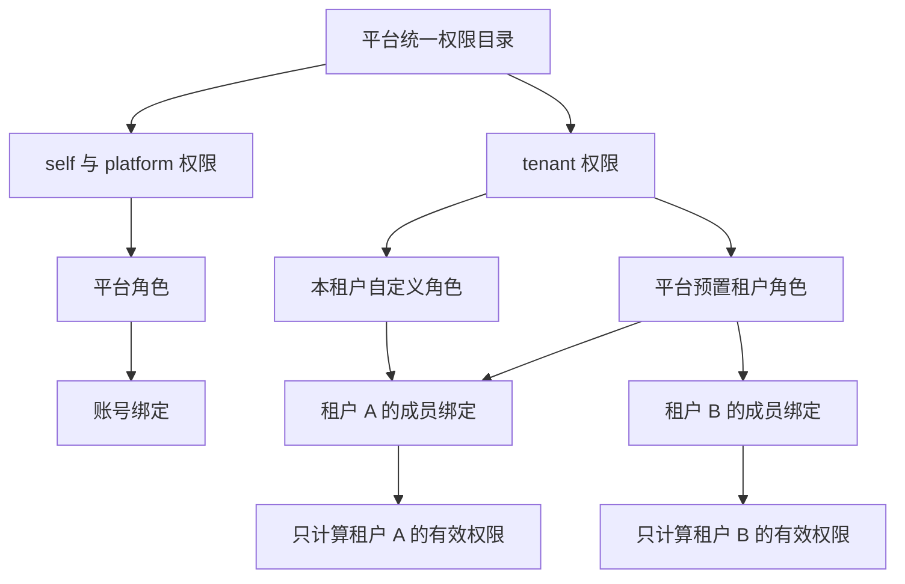

# 租户角色与成员授权迭代方案

> 2026-11-10 展示调整：独立租户权限目录入口并入角色详情与配置。旧目录链接跳转到同一租户的角色页；目录查询权限及管理员保留能力不变。自验和人工验收状态另见[权限说明整合验证](../verification/permission-help.md)。

日期：2026-11-10。版本：V1.0。方案状态：**Awaiting acceptance（用户已确认方案及 D-01–D-12，开发与自验通过，待人工验收）**。人工验收尚未进行；设计核对和后续功能验证分别记录在[验证记录](../verification/tenant-role-authorization.md)。

本轮让租户在平台统一权限模型下配置人员分工：可以直接选用平台预置的租户角色，也可以从平台权限目录创建本租户角色，再把一个或多个角色授予本租户成员。平台是权限定义的唯一管理方；租户管理角色及其绑定，不创造权限。

范围接续[规划账号权限后的下一步](codex://threads/01a1c07e-e171-7f02-bde7-b5c66f3adfb7)最后提出的“租户自定义角色与成员授权”，并纳入本次用户关于统一权限来源及平台角色复用的补充。此前的[角色权限方案](role-permission-plan.md)、[租户基础方案](tenant-foundation-plan.md)、[成员管理方案](tenant-membership-plan.md)继续适用；实施本方案后，以本文明确列出的变更替代其固定角色和单角色绑定限制。

## 1 目标与交付边界

### 1.1 已明确的要求

1. 所有权限沿用已有统一权限模式，由平台定义和管理。租户不能新增权限编码、修改权限含义或绕开权限校验。
2. 租户创建角色时能够查看平台允许其使用的权限，并将选中的权限组成角色。
3. 平台能够提供可复用角色，租户可以直接使用；平台定义的租户业务角色不应因为“来自平台”就被排除。
4. 本轮完成租户角色管理、成员多角色配置、有效权限解释、影响预览和审计，衔接已有成员及邀请生命周期。

“角色由谁提供”和“角色在哪里生效”分别表达。平台管理员、个人基础成员、平台预置租户角色虽然都由平台提供，适用范围并不相同。

### 1.2 本方案的主张

采用**平台预置租户角色直接使用，加上复制为租户自定义角色**的方式。首轮将预置角色纳入已有内置角色机制，由平台代码和发布流程维护；复制仅创建独立角色，不建立持续同步的模板关系。

这样，租户可以立即使用“资料维护员”等现成角色，需要调整时再复制修改。平台无需在本轮增加另一套模板发布、订阅、审批和版本选择系统。平台网页动态创建并发布共享角色，可以作为后续独立迭代；本轮平台角色页面提供预置租户角色的只读查看。

### 1.3 交付清单

| 编号 | 交付项 | 可见结果 |
| --- | --- | --- |
| TR-01 | 角色配置内的权限说明 | 可搜索、分组查看权限名称、说明、范围、风险及是否可选；编码默认隐藏；没有创建权限定义入口 |
| TR-02 | 平台预置租户角色 | 租户可查看、直接分配普通预置角色，或复制为本租户角色 |
| TR-03 | 租户自定义角色 | 创建、编辑名称与说明、配置权限、启停、删除无绑定角色 |
| TR-04 | 成员角色配置 | 对当前成员绑定、解绑多个角色，按成员关系保存历史 |
| TR-05 | 有效权限解释 | 区分已配置角色、当前有效权限、不生效原因，以及每项权限的全部来源 |
| TR-06 | 变更影响 | 保存前显示增减权限、涉及成员、实际失权人数及失效邀请数量 |
| TR-07 | 业务联动 | 邀请资格、成员暂停和恢复、移除、重新加入、管理员交接和账号启停遵守一致规则 |
| TR-08 | 平台查看 | 原角色页面区分平台角色与预置租户角色，明确维护方、适用范围和分配限制 |
| TR-09 | 数据与工程交付 | 增量迁移、API 契约、前后端实现、审计、自动验证、运行手册和人工验收记录 |

### 1.4 本轮以外

项目及项目角色、数据行或字段权限、租户自定义权限、直接给成员加权限、角色继承、拒绝型权限、临时授权、授权审批、批量授权、跨租户共享自定义角色、多个并列管理员、租户自行交接管理员、自助退出、权限套餐及租户订阅配额，均另行设计。

本轮不新增平台网页共享角色发布中心，不建立独立模板实体，也不允许租户把自己的角色发布给其他租户。邀请仍固定授予普通成员角色，接受后再配置职责；不把任意角色选择放入邀请流程。

## 2 当前基线与必须衔接的实现

核对日期为 2026-11-10，工作区为 `feature/account-access-console`，HEAD 为 `776663fc125223a02df6f46a24e5d0cf7663a8da`，同时存在租户成员管理的未提交实现。以下按实际工作区设计，不将 HEAD 当作全部功能基线。

| 当前源文件或对象 | 已有事实 | 本轮衔接 |
| --- | --- | --- |
| `packages/go/platform/access/catalog.go` | 37 项集中权限，其中 11 项为 tenant 范围 | 沿用唯一来源，补充 8 项本轮授权管理权限及租户可配置属性 |
| `access/builtins.go` | 平台管理员、基础成员、租户管理员、租户普通成员共 4 个内置角色 | 增加 4 个普通租户预置角色，明确可手动分配与受保护角色 |
| `access/tenants.go` | 仅按指定租户的有效成员和角色求权限，不混入平台账号角色 | 增加自定义角色归属检查和完整配置解释 |
| `access/service.go`、`repository.go` | 角色写服务服务于平台，列表限定 platform 范围；角色名称尚未按租户分域 | 保留平台服务边界，新增明确的租户角色服务入口和查询条件 |
| `migrations/00003_tenancy.sql` | 已有 scope 外键、租户成员绑定表和管理员指向 | 保留范围约束，增加角色所属租户及绑定合法性约束 |
| `migrations/00004_tenant_membership.sql` | 普通成员只能有一个固定普通角色，管理员只能有一个固定管理员角色 | 普通成员允许零到多个合法租户角色；继续保护唯一当前管理员 |
| `tenancy/members.go`、`service.go` | 暂停保留绑定，移除撤销全部绑定，管理员交接替换角色 | 多角色状态下逐项保留这些语义，更新版本与预览 |
| `access/tenant_invitations.go` | 已有资格失效时永久作废邀请的事务函数 | 增加基于变更前后有效权限的精确失权联动 |
| `features/tenancy` | 租户上下文、成员、邀请、审计和范围清理已有实现 | 新增角色页面和成员授权区，取消“普通成员只有一个角色”的展示假设 |

成员功能的[当前验证记录](../verification/tenant-membership.md)在本方案最终核对时已更新为 Awaiting acceptance，记录开发与自验完成、用户人工验收尚未进行。后续实施以该迭代实际代码及验证结果为衔接基础，不将其自验记作本轮通过，也不替用户确认其人工验收。

## 3 角色分类与统一授权模型

### 3.1 来源与作用范围

| 角色类别 | 谁维护 | 绑定对象 | 允许的权限范围 | 租户中的使用方式 |
| --- | --- | --- | --- | --- |
| 平台内置或自定义角色 | 平台系统或有权平台人员 | Account | self、platform | 不出现在租户成员的角色选择器中 |
| 平台预置租户业务角色 | 平台发布流程 | TenantMembership | tenant 中明确可配置的能力 | 所有租户可直接绑定；可复制后独立修改 |
| 租户管理员内置角色 | 平台发布流程及管理员交接流程 | 唯一当前管理员的成员关系 | 本轮明确列出的 tenant 业务和授权管理能力 | 展示但不能通过一般角色配置授予、撤销或复制 |
| 租户自定义角色 | 本租户有权管理员 | 本租户 TenantMembership | 平台允许租户配置的 tenant 权限 | 只在所属租户创建、维护和绑定 |

平台“基础成员”虽然不含平台管理动作，但它提供本人资料、密码和会话能力，仍绑定账号。它不会转换成租户角色，也不会因成员离开租户而被撤销。这是对“非平台管理角色可供租户使用”的必要范围细化：**能够复用的是适用范围为租户的角色，不是所有不叫平台管理员的角色。**

### 3.2 分配链路



```text
租户有效权限(account, tenant) =
  当账号正常且该租户成员关系 active 时，
  对其未撤销、角色启用且未删除、角色归属合法的绑定，
  取各角色中当前有效的 tenant 权限并集；否则为空。

允许租户操作 = 会话及账号有效
            AND 指定租户成员关系有效
            AND 当前租户有效权限满足该动作
            AND 资源属于该租户
            AND 满足版本、状态和管理员保护等业务条件。
```

没有按角色名称放行、权限通配符、角色等级或“最高角色覆盖其他角色”。平台管理员不因此获得租户成员资格；同时属于 A、B 的账号，其两份租户权限分别计算。

## 4 平台统一权限目录

### 4.1 定义、展示与配置边界

`packages/go/platform/access/catalog.go` 继续是权限唯一定义源；数据库 `permission_catalog` 只是投影，前端权限类型由既有生成流程产生。权限名称、含义、scope、生命周期、风险及租户可配置属性均由平台发布维护。

租户只读目录返回本租户上下文下的 tenant 权限。角色编辑器分为“可配置权限”和只读的“当前管理员保留能力”；不把平台权限或本人账号权限作为可选项。平台底层权限目录查询接口继续返回全部范围；平台角色配置只展示本人及平台范围，租户角色配置只展示当前租户范围。

建议增加显式属性 `tenant_custom_role_assignable`，默认 false。可配置必须同时满足 scope 为 tenant、生命周期 active、该属性为 true、操作者在当前租户实际持有该权限。后端按属性判断，不用名称前缀推断。

租户不能提交未知权限、别名、通配符、退役权限或保留能力。请求含此类内容时整体拒绝并定位错误，不静默丢弃、不部分保存。没有写权限目录的租户 API；平台网页同样不直接创建权限，新增产品能力通过代码发布登记。

### 4.2 当前允许组合的 11 项业务权限

| 权限编码 | 能力 | 必须说明的业务条件 |
| --- | --- | --- |
| `tenant.profile.read` | 查看本租户资料 | 不附带成员、邀请或审计查看权 |
| `tenant.profile.update` | 修改本租户资料 | 不附带平台创建租户、交接管理员等权限 |
| `tenant.member.read` | 查看成员及成员授权说明 | 只返回本租户人员信息、角色和权限来源 |
| `tenant.member.suspend` | 暂停普通成员 | 当前管理员及自己受保护；目标权限覆盖限制见第 9 节 |
| `tenant.member.resume` | 恢复暂停成员 | 账号须正常，不恢复已撤销绑定或旧邀请；受目标权限覆盖限制 |
| `tenant.member.remove` | 结束普通成员关系 | 撤销该关系全部绑定；当前管理员及自己受保护 |
| `tenant.invitation.read` | 查看本租户邀请 | 无需是原邀请人，但必须有本租户权限 |
| `tenant.invitation.create` | 邀请已有账号为普通成员 | 不允许在邀请中增加其他角色 |
| `tenant.invitation.revoke` | 撤销本租户待处理邀请 | 不扩大为平台开户邀请管理 |
| `tenant.invitation.regenerate` | 重新生成邀请 | 同时要求 create，不能单独依靠 regenerate |
| `tenant.audit.read` | 查看本租户业务和授权审计 | 不附带平台或其他租户日志访问权 |

查看权限不会隐式由写权限派生。编辑器对缺少配套查看权限的组合给出提示，并允许用户明确选择添加；服务端不暗中补权。预置角色会包含适合使用页面的配套读取权限。

### 4.3 本轮由平台登记的 8 项管理权限

| 权限编码 | 作用 | 本轮分配规则 |
| --- | --- | --- |
| `tenant.permission.read` | 查看本租户可用权限目录及说明 | 当前管理员角色固定提供 |
| `tenant.role.read` | 查看完整角色目录、配置和使用情况 | 当前管理员角色固定提供 |
| `tenant.role.create` | 创建本租户角色或从可复制角色创建副本 | 当前管理员角色固定提供 |
| `tenant.role.update` | 修改本租户角色名称和说明 | 当前管理员角色固定提供 |
| `tenant.role.set_permissions` | 修改本租户角色的权限集合 | 当前管理员角色固定提供 |
| `tenant.role.set_status` | 启用、停用本租户自定义角色 | 当前管理员角色固定提供 |
| `tenant.role.delete` | 删除无未撤销绑定的本租户角色 | 当前管理员角色固定提供 |
| `tenant.member.assign_roles` | 配置本租户普通成员的角色集合 | 当前管理员角色固定提供 |

这 8 项沿用既有权限模式，均设为不能加入租户自定义角色，也不进入普通预置角色。业务接口仍检查具体权限；“只由当前管理员负责”通过固定角色授予规则和数据约束成立，不通过角色名称跳过鉴权。

按当前基线，发布后为 45 项权限，其中 tenant 为 19 项；数量用于核对，不代替逐项权限和接口映射。以后新增权限仍须由平台登记并明确是否允许租户使用，不自动进入自定义角色。

## 5 平台预置角色与复制设计

### 5.1 首轮角色清单

| 名称与稳定标识 | 明确包含的权限 | 直接分配 | 复制 |
| --- | --- | --- | --- |
| 租户管理员 `tenant_admin` | 上述 11 项业务权限及 8 项管理权限，按清单逐项声明 | 仅创建租户和管理员交接流程 | 不允许 |
| 租户普通成员 `tenant_member` | `tenant.profile.read` | 加入时自动形成明确绑定；之后可手动授予 | 允许 |
| 租户资料维护员 `tenant_profile_maintainer` | `tenant.profile.read`、`tenant.profile.update` | 允许 | 允许 |
| 租户成员管理人员 `tenant_member_manager` | `tenant.profile.read`、`tenant.member.read`、`tenant.member.suspend`、`tenant.member.resume`、`tenant.member.remove` | 允许，目标范围仍受第 9 节限制 | 允许 |
| 租户邀请协作员 `tenant_invitation_coordinator` | `tenant.profile.read`、`tenant.invitation.read`、`tenant.invitation.create`、`tenant.invitation.revoke`、`tenant.invitation.regenerate` | 允许 | 允许 |
| 租户审计查看员 `tenant_auditor` | `tenant.profile.read`、`tenant.audit.read` | 允许 | 允许 |

本轮新增后共 8 个内置角色：2 个账号范围角色、6 个租户范围角色。所有预置租户角色在各租户共用定义，但绑定关系、成员人数、权限解释和审计按租户独立。

### 5.2 直接使用与复制的差别

| 项目 | 直接使用平台预置角色 | 复制为租户角色 |
| --- | --- | --- |
| 是否立即需要建角色 | 不需要，直接选角色授予成员 | 创建一个属于当前租户的新角色 |
| 能否改名、改权限、启停 | 租户不能修改共享定义 | 本租户管理员可以修改 |
| 平台更新源角色后 | 已绑定成员随发布使用新定义 | 副本不跟随，保持自己的权限清单 |
| 平台新增某项权限后 | 只有发布明确加入该预置角色才获得 | 不自动增加 |
| 平台退役某项权限后 | 该权限不再生效 | 同样不生效；副本不能维持已退役能力 |
| 对其他租户的影响 | 租户授予或撤销只影响本租户绑定 | 所有修改只影响本租户 |
| 来源说明 | “平台预置 · 随平台发布更新” | “本租户自定义 · 复制自某角色某版本” |

复制时预填名称、说明和当前权限，由用户核对新名称；一次事务创建独立角色，来源角色 ID 与版本只用于追溯。复制不复制任何成员绑定，也不在将来把源角色权限合并进来。

普通预置角色及本租户自定义角色可作为复制来源；已删除角色不可复制。复制表单可以调整权限；包含退役权限时须明确移除该项，再通过复制接口提交来源版本及最终权限集合，保留来源追溯。租户管理员角色不提供复制，接口同样拒绝，不能通过复制保留能力制造第二个管理员。

### 5.3 平台维护及发布行为

预置角色在现有 `builtins.go` 中维护，经 `access sync` 投影，租户端只读。平台角色页面增加“预置租户角色”分类，展示权限、分配限制和版本；不把它们列入“给平台账号绑定角色”的选择器。

直接使用意味着平台更新会影响所有正在使用的租户。本轮不做每租户版本锁定或逐租户批准；发布前必须在运维影响报告中列出角色差异、受影响租户和成员、失权邀请数量，经正常发布流程执行。角色版本、目录校验值和授权修订号随实际变更更新，重复同步不制造变更。

新增预置角色不自动绑定现有成员。更新现有预置角色不修改租户副本。预置角色不能被租户停用；不想继续使用时撤销本租户绑定，或改用本地副本。

正在被任何成员关系引用的预置角色不能从目录中直接消失；需要先设计替换、撤销及退役发布。权限退役要保留可解释的历史状态，复制角色的历史引用可删不可重新增加。范围、可配置属性变化必须审查受影响绑定，不能借修改元数据改变原权限语义。

## 6 租户自定义角色生命周期

### 6.1 创建与编辑

角色所属租户由已校验的 URL 上下文确定，客户端不能指定拥有者。名称使用现有 NFKC、去首尾空格和大小写归一规则，1–50 字符，说明最多 500 字符；所有写入记录 1–500 字符的操作原因。

同租户未删除角色名称唯一，不同租户可同名。当前预置租户角色的名称保留，禁止本地角色使用同一规范化名称，避免来源混淆。以后平台新增预置名称与存量本地名称冲突时，发布检查须提示并阻止同步，平台调整预置名称，不擅自改租户角色。

创建时可一次提交名称、说明和权限，全部成功或全部失败。创建非空权限角色和复制角色同时要求 create 与 set_permissions。可以创建空权限角色，但界面明确说明“该角色暂不授予操作能力”。新角色默认启用、未绑定成员，不因创建成功自动授权给创建者。

修改名称或说明不改变有效权限；修改权限对所有未撤销绑定立即产生相应影响，包括直接绑定及从前复制后成为当前独立角色的绑定。任何角色均不能包含另一角色。

### 6.2 启停与删除

| 动作 | 绑定如何处理 | 权限效果 | 约束 |
| --- | --- | --- | --- |
| 停用自定义角色 | 保留所有绑定 | 全部绑定者停止获得该角色贡献 | 预览实际失权人员与邀请影响后提交 |
| 恢复自定义角色 | 使用现有绑定 | 正常账号、active 成员重新获得该角色贡献 | 重验当前权限目录、可配置属性和操作者可授予范围 |
| 删除自定义角色 | 无未撤销绑定才可执行 | 软删除，历史可查 | suspended 成员、不可用账号上的绑定也阻止删除 |
| 解绑停用角色 | 撤销该成员的绑定 | 不产生新的失权 | 仍记录差异，避免日后启用又恢复授权 |

不能向成员新增停用角色绑定；已持有的停用角色可以在提交完整角色集合时保留或移除。角色停用、成员暂停、账号停用分别展示，不能合成一个模糊的“不可用”。删除后的历史名称与权限由审计快照解释；名称可被新角色使用，但新 ID 与旧记录不同。

停用角色仍含已退役权限时，启用前须明确移除退役项；不能通过启用操作悄悄补回、替换或恢复已经退役的能力。

## 7 成员角色配置与权限解释

### 7.1 授予流程

1. 管理员进入当前租户成员详情，看到成员状态、账号是否正常和当前角色。
2. “配置角色”仅列出可手动分配的预置租户角色及本租户自定义角色；当前管理员角色带保护说明，不能选中。
3. 选择一个或多个角色，查看每个角色的权限与来源，预览提交后的有效权限并集。
4. 系统显示新增和移除的绑定、实际新增和丢失的权限、仍被其他角色保留的权限，以及待领取邀请影响。
5. 填写原因，完成已有密码复验；服务端在同一事务重验身份、成员、角色、版本和预览依据后提交。
6. 保存后展示最终角色和权限解释，刷新该成员、角色人数和授权上下文。

绑定引用 membership_id，而非仅 account_id。把 A 的角色 ID、成员 ID 填入 B 的 URL，均不能跨租户生效。

### 7.2 默认角色、空角色集合与状态

成员接受邀请后，继续获得明确的 `tenant_member` 绑定。之后允许管理员替换完整角色集合，包括撤销普通成员角色；系统不在登录或查询时补回默认角色。

建议允许普通成员的角色集合为空。此时成员关系仍存在，可以读取最小本人租户上下文和返回个人工作空间，但不能读取受业务权限保护的租户资料或操作业务；界面显示“当前未获业务授权，请联系租户管理员”。成员被移除才结束关系，撤角色不等于移除成员。

| 目标状态 | 本轮角色配置规则 |
| --- | --- |
| active 且账号正常的普通成员 | 可增、可减；新权限提交后生效 |
| suspended 且账号正常的普通成员 | 可配置将来恢复时的角色，当前仍不生效；预览必须显示恢复后的能力 |
| 当前关系存在但账号不可用 | 允许撤销绑定，禁止新增绑定；不因此恢复账号 |
| ended 历史成员 | 只读历史，不能追加绑定；新加入使用新关系 |
| 当前租户管理员 | 一般成员角色配置不可修改，必须保留固定管理员角色；更换职责走平台交接 |

角色定义的后续修改可能改变暂停成员或不可用账号将来恢复时的能力，影响预览单独列出这种“恢复后影响”，不能只统计眼下在线或 active 人员。

### 7.3 可解释结果

成员详情分开显示：已配置角色及其启停状态、角色当前版本与维护方、账号和成员状态、当前有效权限、每项权限的全部提供角色。暂停或账号不可用时显示“已配置，当前不生效”，而不是显示“无角色”。

本人通过已有租户上下文查看自己的授权解释，不要求 member.read；查看其他成员需要 tenant.member.read。不得由详情接口顺带返回平台角色、其他租户成员、全局绑定人数或私人会话。

例如乙同时持有“资料维护员”和“邀请协作员”，两者都提供资料查看。移除资料维护员后，乙丢失资料修改，仍可查看资料并邀请；解释区清楚标记剩余来源。任何时候都不允许在解释区直接编辑某一条成员权限。

## 8 授予边界与管理员保护

角色创建、编辑权限、启用和成员绑定，都重新检查操作者在当前租户实际持有的权限，授出的权限不得超过此范围；不能拿平台权限或 B 租户权限补足 A 的授予能力。移除或修改既有授权时也检查被管理配置的当前有效权限覆盖范围，防止低权限操作者改动超出其管理能力的配置。

本轮 8 项授权管理权限只由固定租户管理员角色提供，普通成员无法获得这些权限。管理员职责由 `tenants.administrator_membership_id` 表达，角色绑定则提供实际操作权限；二者须一致，但职责字段不替代动作权限判断。

应保持以下不变量：

- 每个租户恰有一个当前管理员指向，其成员状态必须 active，并且恰有一个未撤销的管理员角色绑定。
- 管理员角色只能出现在该指向对应的成员关系；本轮当前管理员不再叠加其他租户角色。
- 普通成员可以拥有多个普通预置或本租户自定义角色，也可以没有角色，不能拥有受保护管理权限。
- 一般角色接口不能撤销管理员绑定、把普通成员变成管理员、停用或删除内置管理员角色。
- 账号常规停用前仍须交接其负责的全部租户；已有应急停用和管理员不可用流程继续存在。

内置标识用于维护固定绑定及数据完整性，业务操作始终按具体权限校验。平台有权交接管理员的人可以通过既有平台治理入口交接，不因此获得该租户角色配置接口的访问权。

固定普通成员邀请属于明确限定的业务授予：create 权限本身允许邀请目标取得普通成员的基础查看能力，不再要求邀请人另持有整个默认角色；不能借此选择任意角色。该规则沿用既有邀请语义，其资格失效仍以 create 为准。若将来提高邀请默认角色的能力，须单独评审，不能通过预置角色更新静默扩大邀请可授予范围。

## 9 成员生命周期与邀请联动

### 9.1 成员管理权限的操作范围

建议沿用既有平台授权管理的“不超出本人权限范围”原则：普通成员得到 suspend、resume、remove 后，只能管理其他非管理员成员，且目标配置中所有当前有效目录权限必须被操作者在本租户的有效权限覆盖。计算目标配置时包含停用角色仍配置的有效权限，避免恢复或启用形成绕过；退役权限不再计入能力。

因此仅持有“租户成员管理人员”的甲可以管理普通只读成员；乙另有邀请能力时，甲需要同时具有相应邀请能力，或者由当前管理员操作。这是本方案建议的业务约束，避免“恢复成员”间接恢复操作者无权授予的能力。

不得通过成员管理接口暂停、移除自己，本轮不借授权开放自助退出。当前管理员无论其角色如何展示，仍受交接保护。上述限制适用于 UI、API 和共享业务服务；不通过隐藏按钮实现。

### 9.2 暂停、恢复、移除与交接

| 事件 | 角色及权限 | 待领取邀请 |
| --- | --- | --- |
| 暂停成员 | 保留绑定，本租户有效权限为空 | 该成员在本租户发起的待领取邀请永久失效 |
| 恢复成员 | 使用此时仍有效的绑定和角色配置；账号须正常 | 不复活失效邀请 |
| 移除成员 | 结束本次关系，撤销全部绑定 | 该关系发起的待领取邀请永久失效 |
| 被移除后重新加入 | 新 membership_id，只明确授予普通成员角色 | 不恢复旧关系、旧角色和旧链接 |
| 账号停用及受控凭据恢复 | 沿用已有全局账号、会话及邀请规则 | 不因之后启用账号而恢复历史链接 |
| 交接给已有 active 普通成员 | 复用成员关系，撤销其原有全部角色，绑定固定管理员角色 | 该目标未领取的普通成员邀请按现有规则失效 |
| 原管理员退出 | 结束原成员关系并撤销全部角色 | 原关系发起的待领取邀请失效 |

交接给 suspended 成员继续拒绝，不隐式恢复。交接后的原管理员要保留为普通成员时，沿用新邀请重新加入。交接预览显示接任人将被替换的全部角色，不能只显示原固定普通角色。

### 9.3 精确处理邀请失权

在角色权限修改、停用、成员解绑、权限退役及预置角色同步时，以 `(tenant_id, membership_id)` 为单位比较变更前后的有效 `tenant.invitation.create`：

- 原来具有、变更后失去：同一事务永久作废该关系发起的、尚未到期的 pending 邀请；已到期的按 expired 结转。
- 另一角色仍提供 create：保留合法待领取邀请，不能因某个角色被解绑而全部撤销。
- 只失去 read、revoke 或 regenerate：不等同于失去 create，不能误作废邀请。
- 已 accepted 的邀请不撤回已建立成员关系；已失效的邀请不会因恢复权限而变回 pending。

接受邀请与撤权争用同一授权变更锁。接受先提交则产生完整合法成员，之后撤权不追溯移除；撤权先提交则领取失败。不得出现只消费邀请、未建立角色绑定的中间结果。

## 10 影响预览与审计

### 10.1 预览内容

修改角色权限、启停角色、删除角色、替换成员角色均提供服务端预览。名称说明编辑只显示字段差异，创建未绑定角色显示“当前不影响任何成员”。

| 指标 | 精确含义 |
| --- | --- |
| 绑定成员数 | 本租户所有未撤销绑定，包含暂停成员和不可用账号 |
| 当前有效成员数 | 账号正常且成员 active 的相关人员 |
| 实际增权或失权人数 | 按成员全部有效角色求并集后确实发生权限变化的人数 |
| 恢复后受影响人数 | 当前暂停或账号不可用，但配置将在恢复时产生变化的人数 |
| 将失效邀请数 | 实际失去 create 的关系所发出的、提交时仍待领取且未到期的邀请 |
| 受阻原因 | 管理员保护、角色仍被绑定、目标状态或授予范围不符等 |

成员名单按当前租户分页返回，仅有相应成员查看权限才可查看人员明细。统计按成员关系去重，不能用角色绑定行数或浏览器当前页行数代替。预览中保留“移除某角色，但某权限仍来自另一角色”的解释。

### 10.2 预览不是授权凭据

预览返回目标版本、有关角色版本、目录校验值和 `preview_hash`。指纹覆盖规范化变更、当前操作者与租户、涉及绑定和账号/成员状态、实际权限差异及邀请影响；不依赖客户端计算结果，也不把整个全局修订号作为唯一并发条件。

正式提交在锁内重算：授权与业务条件失效则拒绝；影响依据变化则返回 409 `impact_changed`，要求重新预览。其他租户无关变更不应无故使本租户预览过期。哈希只用于乐观并发比对，不赋予权限，不能替代实时鉴权。

### 10.3 审计记录

记录角色创建、复制、资料和权限修改、启停、删除、成员绑定变化、受影响授权及邀请失效。每条成功记录包含 tenant_id、操作者、actor_scope、对象 ID、请求编号、原因、时间、前后版本和差异；角色名称、权限说明及来源保留当时快照。

共享预置角色发布在平台层记录一条变更及影响汇总，并按受影响租户记录相关授权差异，租户只看到自己的影响。日志不含邀请明文 token、密码或私人会话。被拒绝操作写安全拒绝日志，不写成功业务审计；审计写入失败则整笔业务事务回滚。

## 11 页面与交互方案

继续使用现有 console、租户工作空间、共享组件、主题和导航，不另建管理应用。

| 页面 | 路径建议 | 内容与操作 |
| --- | --- | --- |
| 租户角色列表 | `/t/$tenantId/roles` | 平台预置、本租户自定义两个分类；名称、说明、权限数、状态、本租户绑定人数；创建、复制、搜索和筛选 |
| 租户角色详情 | `/t/$tenantId/roles/$roleId` | 权限分组、来源、版本、绑定成员及历史；可编辑性由后端描述；预置角色明确只读 |
| 租户权限说明 | 角色详情及创建、复制、配置表单 | 显示当前目录中可配置的业务权限、只读管理员保留能力、用途、范围、风险和限制；旧 `/t/$tenantId/permissions` 跳转到同租户角色页 |
| 成员详情授权区 | 已有 `/t/$tenantId/members/$membershipId` | 多角色展示、配置角色、当前及恢复后权限、全部来源和变更历史 |
| 本人授权 | 已有租户上下文及本人展示区 | 本租户成员关系、配置角色和有效权限；无授权时给出联系管理员及返回入口 |
| 平台角色页 | 已有 `/access/roles` | 平台角色及预置租户角色分类，明确绑定对象和维护方式 |

角色权限选择按“资料、项目、成员、邀请、审计”分组，每项显示中文名称、简明说明、作用范围和风险；权限编码默认隐藏，可按需显示并参与搜索。项目组承接项目管理迭代已定义的租户项目治理权限。搜索不会清空已选项；分组勾选只作用于当前组全部可选项，明确显示覆盖数量；全选不包含保留能力、退役项或当前不可选项。部分选中有明确状态。

成员角色选择支持查看详情再选择，保留已选但停用的角色及原因。保存按钮旁展示角色数、最终权限数；“角色变化”与“实际权限变化”分别呈现。解绑角色、清空角色、停用或删除时使用明确的影响确认内容，不能只问“是否确认”。

普通成员不能访问角色管理目录；有 member.read 的人员仍可在成员详情查看已授角色和权限来源。导航、路由和按钮按各自权限控制；直接访问受限 URL 返回可理解的无权状态。新增路由须加入当前安全返回路径白名单，保持 `/console/` 部署前缀兼容。

保留可见标签、键盘焦点、正确复选状态、字段附近错误和提交进度。取消确认后焦点返回触发按钮；成功后给出简短结果。375px 宽度下用分组卡片或纵向布局显示权限和影响，不靠宽表格横向滚动完成授权。

版本冲突时保留仍有权查看的草稿，刷新当前值供比较，用户重新提交；失权或切换账号/租户时立即清理相关草稿和缓存。密码复验完成后需重新确认提交，不自动重放授权写请求。

## 12 数据结构与约束

### 12.1 扩展现有表

复用 roles、role_permissions、tenant_member_roles，不另建一套权限系统。字段名称可在实施时根据既有风格调整，但业务约束保持不变。

| 对象 | 增量设计 | 用途 |
| --- | --- | --- |
| `roles` | `owner_tenant_id` 可空外键；保留 binding_scope、builtin_key、status、version | 区分全局角色定义和某租户独有角色 |
| `roles` | `source_role_id`、`source_role_version` 可空且成对；创建/修改操作者及创建请求去重信息 | 复制来源追溯、审计和创建幂等 |
| `permission_catalog` | 投影 `tenant_custom_role_assignable`，纳入代码 checksum | 让选择和后端校验使用同一规则 |
| 内置角色元数据 | 明确 `assignment_policy`，为 manual 或 administrator_transfer_only；投影并校验 | 表达普通预置与管理员角色的分配限制 |
| `tenant_memberships.version` | 角色绑定变化与成员状态变化都递增 | 避免暂停、移除和授权编辑互相覆盖 |
| `tenant_member_roles` | 沿用授予/撤销行；新授予创建新行，历史行不复活 | 多角色和重复授予历史 |
| `account_security_events` | 沿用 tenant_id、actor_scope、details | 保存配置差异、来源及实际影响 |

`source_role_id` 只是历史来源，不能参与权限求并集。角色被软删除后来源仍可解释，不级联删除副本。

### 12.2 角色结构必须满足的组合

| binding_scope | owner_tenant_id | builtin_key | 合法含义 |
| --- | --- | --- | --- |
| platform | null | 可空 | 既有平台内置或平台自定义角色 |
| tenant | null | 必须非空 | 平台预置租户角色；另由目录同步和检查核验内置声明 |
| tenant | 必须非空 | 必须为空 | 归属于一个租户的自定义角色 |

本轮不允许“tenant 范围、无所属租户、非内置”的全局可编辑角色。角色 scope、所属租户、builtin_key 创建后不可经业务 API 改写。

名称唯一索引拆分为平台角色域、全局租户预置角色域、每租户自定义角色域，均只约束未删除对象。另通过受控服务和数据库约束检查本地名称与当前预置保留名称冲突；同步时同样检查，不能仅依赖前端。

### 12.3 绑定与权限完整性

保留已有角色与权限 scope 组合外键，防止平台角色装入 tenant 权限，或租户角色装入 self/platform 权限。新增约束函数或延迟触发器，检查租户成员绑定的角色只能是：

```text
角色 binding_scope = tenant
AND (
  平台共享预置租户角色（owner 为空、builtin 标识非空）
  OR 角色 owner_tenant_id = 绑定 tenant_id
)
AND 遵守管理员角色分配限制。
```

成员归属仍由 `(tenant_id, membership_id)` 组合外键保障。自定义角色权限须属于允许配置的 tenant 目录；受保护管理权限不能写入自定义角色。退役权限的既有引用作为历史可留存，但新授予必须拒绝；不得利用停用/启用恢复退役能力。

改写 `tenant_structure_valid`，去掉普通成员“必须恰有一角色”的限制，保留唯一管理员及 ended 关系无未撤销绑定的规则。普通成员的未撤销绑定可以指向停用角色，这不是结构损坏。管理员角色仍必须启用且未删除。

角色归属、scope、保护规则及删除状态的改变也必须触发关联绑定检查，不能只在修改成员绑定时检查。角色停用允许保留普通绑定；有未撤销绑定的角色软删除必须失败。保留 `(membership_id, role_id)` 未撤销绑定唯一索引。

查询侧再次过滤角色归属及权限 scope，异常结构按错误处理，不把非法权限加入结果。`access check` 增加自定义租户角色、权限属性及跨租户绑定结构校验，不能将所有自定义角色当作未知内置数据。

数据库负责角色结构、归属、scope 和分配策略约束；内置标识及权限清单是否与当前代码声明一致，由同步、`access check` 和就绪校验负责。不能把“任意非空 builtin_key”当成代码已登记的证明，出现未知内置定义必须拒绝就绪。

### 12.4 索引与版本

增加按 `owner_tenant_id`、名称、状态、ID 的角色查询索引，以及按 `(tenant_id, role_id, membership_id)` 查询未撤销绑定的索引，支持分页、使用人数和影响分析。所有分页先限定租户及来源，再排序、计数与分页，默认 20、上限 100。

角色配置变化递增 role.version；成员绑定变化递增 membership.version；实际授权或目录变化递增已有 authorization_state.revision。成员有效权限受到角色定义变化时，不通过批量改写成员资料冒充逐个授权；以角色版本和授权修订号表达。

创建和复制使用 client_request_id、规范化请求哈希和操作者/租户唯一约束：相同请求返回同一结果，不重复角色或成功审计；同键不同内容返回冲突。目标已删除也不能借旧创建请求复活。

## 13 API 与契约

以下租户接口前缀均为 `/api/v1/tenants/:tenant_id`。具体 operation ID 在中央 `policy.go` 登记；预览也是受保护入口。

| 方法及后缀 | 所需权限 | 主要行为 |
| --- | --- | --- |
| `GET /permissions` | tenant.permission.read | 读取可用及保留目录与说明 |
| `GET /roles` | tenant.role.read | 当前租户可见角色、筛选和分页 |
| `GET /roles/:role_id` | tenant.role.read | 角色定义、来源、状态及本租户绑定统计 |
| `GET /roles/:role_id/members` | tenant.role.read + tenant.member.read | 只分页列出本租户绑定人员 |
| `POST /roles` | tenant.role.create；非空权限另需 set_permissions | 原子创建本租户角色 |
| `POST /roles/:role_id/copy` | tenant.role.read + tenant.role.create + tenant.role.set_permissions | 校验来源版本并创建独立副本 |
| `PATCH /roles/:role_id` | tenant.role.update | 修改本地角色名称说明 |
| `POST /roles/:role_id/permissions/preview` | tenant.role.set_permissions | 权限修改影响 |
| `PUT /roles/:role_id/permissions` | tenant.role.set_permissions | 带版本、原因和预览依据修改 |
| `POST /roles/:role_id/status/preview` | tenant.role.set_status | 启停影响 |
| `PUT /roles/:role_id/status` | tenant.role.set_status | 启停本地角色 |
| `POST /roles/:role_id/archive/preview` | tenant.role.delete | 删除条件与影响 |
| `POST /roles/:role_id/archive` | tenant.role.delete | 软删除未绑定本地角色 |
| `GET /members/:membership_id/authorization` | tenant.member.read | 成员配置与有效权限解释 |
| `POST /members/:membership_id/roles/preview` | tenant.member.assign_roles | 替换角色集合的影响 |
| `PUT /members/:membership_id/roles` | tenant.member.assign_roles | 原子替换普通成员角色集合 |

创建请求是否含权限、复制来源是否受保护，以及预览所需的附加读取能力，均由共享业务服务进一步校验。预览不能因“只读”绕过修改动作权限；不得提供任意 operation 字符串让客户端选择权限策略。

平台侧新增只读 `GET /api/v1/access/tenant-role-presets` 及 `/:role_id`，使用既有 platform.role.read，返回全局预置定义，不返回租户成员、使用名单或租户自定义角色。原平台角色 CRUD 继续只允许 binding_scope=platform 且 owner_tenant_id 为空的对象。

特别要检查现有以角色 ID 查询再修改的通用函数：新增本地空权限角色后，不能让平台接口因“其权限为空、通过覆盖检查”而修改它。列表筛选不能代替所有详情、修改、启停、删除、绑定路径的 scope 和归属检查。

### 13.1 请求和响应要点

- 租户、角色拥有者、操作者和 builtin 属性由服务端推导，不接受客户端写入。
- 配置权限接受 `permission_codes`；配置成员只接受 `role_ids`，禁止成员权限数组。
- 成员角色提交携带 `expected_membership_version`、相关 role_versions、preview_hash 和 reason；角色修改携带 expected_version。空数组表示明确清空，缺失、null、重复 ID 或超界输入拒绝。
- 返回 role、membership 的新版本及 authorization_revision，前端据此失效相关查询。创建成功返回 201，读取和变更结果返回 200，沿用现有错误格式及请求编号。
- 角色响应区分维护来源、owner_tenant_id、绑定范围、分配策略、是否可复制、角色状态和本租户统计。写能力由后端结合当前操作者计算，不能用客户端传回的 `can_edit` 授权。
- 本人上下文只包含导航所需最小租户信息、本人关系和授权；不因允许零角色成员读取 context 而泄露完整受保护资料。

### 13.2 失败行为

| 情况 | 结果 |
| --- | --- |
| 未登录或会话失效 | 401，沿用登录处理 |
| 本租户可访问但缺少操作权限、尝试超出本人范围 | 403，不写业务数据 |
| 租户不可访问、跨租户成员或本地角色、用错范围的角色 ID | 404，不暴露对象实际归属 |
| 未知字段、非法权限、重复 ID、错误类型或空必填字段 | 400，字段错误，不部分保存 |
| 版本变化、预览过期、名称冲突、角色被绑定、状态不符、管理员保护 | 409，明确可恢复方式 |
| 密码复验不足或 CSRF 失败 | 沿用既有错误约定，重新核验后由用户重新提交 |
| 数据库、目录、锁等待或依赖故障 | 按既有 5xx 约定，不降级为无权限列表或放行；写事务回滚 |

## 14 服务职责、事务与即时生效

### 14.1 模块分工

| 模块 | 本轮职责 |
| --- | --- |
| `packages/go/platform/access` | 唯一目录、预置角色、作用范围鉴权、租户角色 CRUD、授权并集与来源、绑定变更、影响计算、目录同步 |
| `packages/go/platform/tenancy` | 成员状态、目标关系及管理员职责、交接和邀请业务；在同一事务调用 access 的授权能力 |
| `packages/go/platform/identity` | 登录、会话、复验、账号状态；延续已有角色和邀请失效联动 |
| `services/api/internal/transport/http` | 严格 DTO 解析、认证/CSRF/策略入口、错误映射；不自行拼权限 SQL |
| `contracts/openapi/api.yaml`、TS api-client | 请求响应、错误和版本字段契约；生成前端权限与 API 类型 |
| `apps/console/src/features/tenancy` | 角色目录、权限编辑、成员授权、来源说明及影响确认 |

租户角色的校验与写入集中在 access 内部，向 tenancy 提供有限事务内接口；两者不能互相循环导入。成员授权接口可由 tenancy 编排目标关系检查后调用 access，复用授权事务，不开嵌套事务或独立提交。平台与租户业务入口清晰区分，不把“有没有 tenant_id”当成可切换的授权捷径。

### 14.2 授权变更事务

沿用已有 authorization_state 全局共享/排他锁，首轮不重构分布式授权缓存或细分锁体系。所有改变有效权限、成员资格或邀请领取结果的路径使用排他锁；读取和一般业务在当前约定下持有共享锁，并在业务事务内再验证权限。

建议统一顺序：授权状态锁 → 按 ID 排序的相关账号锁 → 租户/成员/角色及绑定 → 邀请和审计。普通读、成员状态、角色变更、交接、账号维护和目录同步必须遵守同一顺序，避免新旧路径形成锁顺序反转。

一次角色或绑定变更按以下顺序原子完成：

1. 校验精确登记的操作策略，锁定授权状态和相关对象。
2. 重验会话、账号、当前成员、密码复验及操作权限。
3. 核对对象归属、版本、角色合法性和可授予范围。
4. 计算变更前配置、有效权限和邀请资格，重算影响预览。
5. 写角色或绑定差异，检查管理员及租户结构。
6. 计算变更后结果，仅作废实际失去邀请资格的关系的邀请。
7. 写成功审计、对象版本和授权修订号，提交。

并发移除成员与配置其角色，最多一方按原版本成功；后者不能给 ended 关系重新绑定。并发给角色新增绑定与删除角色，不能出现“删完仍授予”。账号停用、交接或角色停用后，旧页面新提交必须按锁内现状拒绝。

### 14.3 前后端生效边界

撤权事务提交后的新业务请求立即使用数据库当前结果，不等待缓存 TTL，不要求重新登录。已在提交前完成授权并按锁顺序执行的请求可能先完成，文档及测试按此事务边界判断。

前端查询键包含 account_id、tenant_id、membership_id；成员重新加入后旧查询不复用。沿用身份和租户授权修订刷新、窗口聚焦重查及 30 秒上下文兜底刷新；403/404 立即清理失权内容，迟到响应不得恢复旧页面或旧草稿。界面刷新间隔不构成后端权限生效延迟。

本轮不承诺跨设备毫秒级推送。前端可用即时响应、已有同源会话通知和聚焦刷新改善反馈，最终允许或拒绝始终以服务端本次请求为准。

## 15 技术选择及具体用途

沿用仓库已经采用的技术栈和锁定版本，不因本轮引入新的授权服务或规则引擎。

| 技术 | 为什么选用 | 在本轮的具体使用 |
| --- | --- | --- |
| Go、Gin | 与现有 API、CLI 和共享业务同一实现语言及框架 | 角色与成员授权业务、统一策略、HTTP 处理和目录同步 |
| PostgreSQL、pgx | 当前关系、事务、外键及历史均在这里 | 角色所属租户、多角色绑定、唯一约束、延迟结构校验、乐观版本与审计原子提交 |
| 既有 Goose 迁移 | 已有版本化升级流程 | 新增角色归属和目录属性，替换固定单角色约束，保留旧 ID 和历史 |
| Redis | 当前会话设施已有依赖 | 继续承担现有会话用途；不作为授权关系的唯一事实源 |
| React、TypeScript、Vite | 现有 console 栈，避免另建入口 | 实现角色目录、编辑器、成员配置和授权解释页面 |
| TanStack Router、Query、Table | 已有路由、请求缓存和列表能力 | 租户路径隔离、作用域查询键、版本更新后的刷新、筛选与分页 |
| shadcn/ui、React Hook Form、Zod | 现有组件和表单约定 | 权限复选分组、确认对话框、可访问标签、字段校验；服务端仍重复验证 |
| OpenAPI、openapi-typescript、既有权限生成器 | 当前契约和常量可校验同源 | 新接口、版本与影响 DTO，生成 TS 客户端类型和权限常量 |
| 统一 infrapro CLI | 已有迁移、同步和检查的维护入口 | 扩展 access check、同步影响预览；复用备份恢复流程 |
| Go 测试及 race、Playwright、现有 HTTP 测试栈 | 已能覆盖真实数据库事务与浏览器流程 | 多角色并集、越权、并发、迁移、失权联动、移动视图和 HTTP 部署验证 |

前端不用自己的权限清单决定后端权利；数据库投影不变成可编辑权限源。数据库保留显式约束，既防业务遗漏，也防错误维护脚本绕开租户归属。

## 16 增量升级、发布与恢复

### 16.1 迁移策略

以实际迁移最大编号为准新增迁移；实施前工作区最大为 4，本轮已新增 `00005_tenant_role_authorization.sql`。不得改写已应用的 00002–00004，也不得重建数据库或重新初始化账号。

现有平台角色保留 ID、权限及账号绑定；已有 tenant_admin、tenant_member 保留 ID，owner_tenant_id 为空，作为平台预置角色。已有成员、状态、邀请、密码、会话、租户管理员指向和全部历史保留。

迁移先添加可兼容字段并核对现状，再替换索引和约束。若发现不符合旧模型的数据，停止升级并报告对象，不能擅自删除绑定或猜测所属租户。需要回填数据时沿用此前延迟触发器处理经验，避免待检查事件阻碍后续 ALTER。

迁移本身不为现有普通成员添加任何新角色；`access sync` 只更新预置定义及目录，不将新角色批量绑定给租户或账号。

### 16.2 发布顺序

1. 核对成员迭代已完成的自验及后续变更，准备同一版本的迁移、CLI、API 和前端。
2. 停止全部旧 API 写入，备份数据库及配套配置，并在独立环境实际恢复验证。
3. 执行 `pnpm infrapro database migrate`。
4. 执行 `pnpm infrapro access sync --dry-run`，只读输出目录/预置角色差异、名称冲突、受影响租户/成员和邀请统计，核对本次发布影响。
5. 执行 `pnpm infrapro access sync` 和 `pnpm infrapro access check`。
6. 启动新版本，检查 readyz、登录、已有租户、成员和授权页面，再进行人工验收。

`--dry-run` 已在本轮实现，并在隔离测试及本机升级中执行；具体结果见验证记录。同步前后权限比较必须使用同步前数据库中的目录生命周期与角色配置作为旧事实，再与新目录比较；不能用新代码的 known/active 判断先过滤掉已退役权限，造成漏撤邀请。

同步在同一授权事务处理共享角色影响、邀请失效、租户审计和修订号。真实变更才递增相关角色版本；重复同步无版本、绑定和审计副作用。锁等待和事务时长继续有界，若预览显示影响规模超出单事务维护窗口，应停止发布并另行设计批处理方案，不在本轮声称支持任意规模。

目录校验不一致时 API 不就绪。旧 API 不得继续服务已经升级目录的数据，不能依赖滚动混跑侥幸兼容。恢复采用经过验证的备份及匹配版本；恢复后按现有流程撤销旧会话和一次性凭据，不提供会丢失角色历史的自动 down 迁移。

### 16.3 开发环境与验收入口

已有环境在完成上述升级后，从仓库根目录运行 `make dev`，默认 console 为 `http://127.0.0.1:5173`，API 就绪探针为 `http://127.0.0.1:8080/readyz`。已有账号环境不重复 bootstrap。

人工验收入口：平台 `/access/roles`；租户 `/t/<tenant_id>/roles`、`/permissions`、`/members/<membership_id>` 及已有资料、邀请、审计页。实际完整路径由当前租户 URL 组成；正式 HTTP 环境保留既有 `/console/` 前缀。

## 17 分步实施与交付要求

按以下顺序推进，每一步都有可独立验证的结果，最后再做整体验收。实施前重新核对已有未提交修改，不能覆盖其他迭代的工作。

| 阶段 | 主要变化 | 本阶段检查 |
| --- | --- | --- |
| TR-I1 目录与数据基础 | 8 项管理权限、4 个普通预置角色、归属字段、约束及迁移；同步和检查扩展 | 旧库升级、重复同步、合法多角色、跨租户/混合范围/保留权限拒绝 |
| TR-I2 角色管理 | 租户角色查询、创建复制、修改、启停删除、平台只读预置目录 | 归属隔离、版本、名称冲突、权限来源、平台旧接口越权防护 |
| TR-I3 成员授权与联动 | 完整角色集合、权限解释、影响预览、邀请撤权、状态和交接兼容 | 并集、实际失权、暂停恢复、目标权限覆盖、并发与审计回滚 |
| TR-I4 界面与交付 | 页面、移动布局、错误状态、上下文清理、契约生成、运维文档 | 浏览器、生产构建、HTTP 部署和完整验收矩阵 |

实现位置建议包括 access 下的租户角色与授权专用文件、tenancy 的成员及交接衔接、HTTP 租户处理器、OpenAPI、API client 和 tenancy 前端目录。文件拆分服务于职责，不将本轮演变成全仓重构。

实施中记录 **In progress**；功能自验全部通过后为 **Awaiting acceptance**；只有用户明确确认功能人工验收后才记为 **Accepted**。方案确认、代码完成、自动自验、人工验收、提交、推送、部署分别记录，不互相代替。

## 18 验证计划与人工验收矩阵

### 18.1 验证层次

Go 业务及数据库测试覆盖真实权限并集、归属、事务竞争、约束、邀请联动、审计失败回滚和增量迁移。HTTP 覆盖严格字段、Cookie/CSRF、密码复验、跨范围伪造及真实部署前缀。Playwright 覆盖用户操作、多个标签页和租户切换、窄屏及失权后的迟到响应。

计划执行 `pnpm check`、`pnpm build`、`pnpm test:identity`、`pnpm test:e2e`、`pnpm test:e2e:preview`、`pnpm test:http`；按改动补充迁移和权限专项。结果及执行环境写入验证记录，不能用本方案的静态检查代替功能自验。

### 18.2 场景矩阵

界面场景供用户手工验收；需并发、数据库或故障注入的场景由可复现自验证据辅助核验。

| 编号 | 操作或场景 | 预期 |
| --- | --- | --- |
| TRA-01 | 管理员打开租户角色详情及编辑器 | 可就地查看统一权限说明；可配置能力可选，管理员保留能力只读；以当前目录为准，旧目录链接转至角色页 |
| TRA-02 | 查找或伪造创建权限、修改权限编码的入口 | 无租户写目录能力；不能产生新权限 |
| TRA-03 | 提交 platform、self、未知、重复、退役或保留权限 | 整体拒绝，不保存部分配置 |
| TRA-04 | 平台查看角色、租户查看预置角色、平台账号选择角色 | 范围明确；平台账号不能绑定租户角色，平台角色不能装进租户成员 |
| TRA-05 | 向本租户成员直接授予资料维护员 | 无需复制，成员立即可查看和修改本租户资料 |
| TRA-06 | 尝试修改、停用或删除平台预置角色 | 租户 UI 和 API 都拒绝，其他租户不受影响 |
| TRA-07 | 复制邀请协作员并删去撤销权限 | 生成本租户独立角色，来源版本可查，无成员被自动绑定 |
| TRA-08 | 平台更新源预置角色 | 直接使用者按发布更新，副本权限保持；每租户只看到本租户影响 |
| TRA-09 | 平台新增预置角色或新权限 | 现有自定义角色和成员不自动增加授权 |
| TRA-10 | 创建空权限角色 | 可创建、明确无能力，创建者不自动绑定 |
| TRA-11 | A、B 创建同名角色；A 再次创建同名或使用预置名 | A、B 独立；同租户重名及预置保留名拒绝 |
| TRA-12 | 修改本地角色名称说明 | ID 和权限保持，审计只记录实际字段差异 |
| TRA-13 | 两个租户使用同一个预置角色，A 解绑其成员 | 只改变 A 的绑定，不影响共享定义和 B |
| TRA-14 | 乙同时绑定资料维护员与邀请协作员 | 权限取并集，来源列出所有提供角色 |
| TRA-15 | 移除其中一个重复提供资料查看的角色 | 仍可查看资料，只失去该角色独有权限 |
| TRA-16 | 管理员清空普通成员全部角色 | 关系保留，仅最小本人上下文可读；业务拒绝，登录不补回默认角色 |
| TRA-17 | 无 role.read 的普通成员查询本人授权 | 本人上下文可看；完整角色目录拒绝 |
| TRA-18 | 有 member.read 者查看其他成员授权 | 仅本租户资料、角色和来源，不出现平台角色及其他租户信息 |
| TRA-19 | 停用多人使用的本地角色 | 保留绑定，实际独有权限立即失效，重叠权限仍有效 |
| TRA-20 | 恢复角色 | 仅符合账号和成员状态者恢复能力；历史失效邀请不复活 |
| TRA-21 | 新增停用角色绑定，或保留原停用绑定 | 新增拒绝；原绑定可保留或撤销，状态解释明确 |
| TRA-22 | 删除仍绑定暂停成员或不可用账号的角色 | 409；全部解绑后才能软删除 |
| TRA-23 | 给暂停成员配置角色后恢复 | 暂停期间不生效，恢复使用当前配置及同一成员 ID |
| TRA-24 | 不可用账号的角色绑定操作 | 可撤销，不能新增，不改变账号状态 |
| TRA-25 | 成员被移除后再次加入 | 新成员 ID、仅明确授予普通角色，旧自定义绑定不恢复 |
| TRA-26 | 一般接口授予/撤销/复制管理员角色 | 均拒绝，不产生第二名管理员或管理能力空缺 |
| TRA-27 | 当前管理员被暂停、移除或常规停用账号 | 受既有交接保护，不因新增角色功能失效 |
| TRA-28 | 平台交接给已有多角色普通成员 | 复用关系，旧角色全部撤销，固定管理员角色授予；原管理员结束关系 |
| TRA-29 | 交接给 suspended 成员 | 拒绝，不隐式恢复；交接预览正确显示现状 |
| TRA-30 | 仅有成员管理角色者恢复具有邀请能力的成员 | 因目标权限超出其覆盖范围拒绝；授予所需组合角色后可操作 |
| TRA-31 | 具有成员管理权限者暂停或移除自己 | 拒绝；不借该功能开放自助退出 |
| TRA-32 | 去掉某角色邀请权限，但另一角色仍提供 create | 待领取邀请保持有效 |
| TRA-33 | 通过解绑、改权限或停用角色失去最后 create 来源 | 该关系未领取邀请原子失效，恢复权限不复活 |
| TRA-34 | 只去掉 invitation.read 或 regenerate | 不误作废仍有 create 资格的合法邀请 |
| TRA-35 | 同账号在 A 失去邀请权限，在 B 仍持有 | 仅 A 对应关系的邀请失效 |
| TRA-36 | 邀请领取与角色撤权并发 | 按事务先后完整加入或拒绝，无半成品关系和角色 |
| TRA-37 | 已接受邀请之后邀请人失权 | 已加入成员不被追溯移除 |
| TRA-38 | 预览角色变更 | 分别显示绑定数、当前实效人数、恢复后影响和邀请数量，按成员去重 |
| TRA-39 | 预览后另一人改角色、成员、绑定或相关邀请 | 提交重验，实际影响改变返回冲突，要求重新预览 |
| TRA-40 | 其他租户无关授权变化 | 不仅因全局 revision 改变就使本次预览冲突 |
| TRA-41 | 两个页面同时改角色或成员角色集合 | 后提交旧版本冲突，不覆盖先提交结果 |
| TRA-42 | 配置角色与移除成员并发；授予与删除角色并发 | 不给 ended 关系绑定，不出现已删除角色仍被授予 |
| TRA-43 | 伪造 A/B 的租户、成员、角色 ID | UI/API/数据库约束各层阻止串用，无其他租户信息泄露 |
| TRA-44 | 用旧平台角色 API 操作租户空权限角色 | 明确因 scope/归属拒绝，不能利用空权限通过覆盖检查 |
| TRA-45 | 提交 builtin_key、owner_tenant_id、成员直接权限等未知字段 | 400，不产生受保护角色或直接授权 |
| TRA-46 | 撤权后用原 Cookie、旧页面、旧 Redis 数据调用业务 | 提交后的新请求按当前权限拒绝，不要求重新登录 |
| TRA-47 | 账号/租户切换、重新加入、迟到响应 | 旧成员数据、权限选择和草稿不显示到新上下文 |
| TRA-48 | 缺复验、CSRF 失败、锁超时或审计注入故障 | 不落半笔数据，不自动重放写请求，错误可定位 |
| TRA-49 | 重复创建/复制请求，含同键不同内容 | 同请求一个结果及一份成功审计；异内容冲突 |
| TRA-50 | 查看角色与成员授权审计 | 原因、操作者、版本、差异和作用租户完整；无敏感凭证 |
| TRA-51 | 从现有 v4 数据升级，重复迁移及同步 | 原 ID、账号密码会话、成员、邀请和审计保留，无隐含新增绑定 |
| TRA-52 | 直接写入跨租户绑定、混合权限、普通成员管理员绑定或删除在用角色 | 数据库拒绝；合法停用角色的绑定可保留 |
| TRA-53 | 目录退役权限、共享角色同步及 dry-run | dry-run 无写入；同步使用旧/新事实正确撤权，副本不能保留退役能力 |
| TRA-54 | 重复同步、目录不一致、旧 API 尝试运行 | 重复无版本审计噪声；不一致拒绝就绪，旧版本不继续服务 |
| TRA-55 | 平台预置新名称与存量本地名冲突 | 同步停止并列出冲突，不擅自改名或覆盖租户角色 |
| TRA-56 | 375px、键盘、错误及确认流程 | 权限选择、来源、影响、取消焦点和重试均可操作且含义清楚 |
| TRA-57 | 原登录、本人账号、平台授权、租户成员、交接和 HTTP 回归 | 原有范围隔离、凭据规则和部署能力保持 |

### 18.3 建议人工演示顺序

准备租户 A、B，各有当前管理员；乙为两个租户的普通成员，丙为 A 的普通成员。账号与测试数据通过已有合法流程建立。

1. A 管理员查看目录，确认无新增权限入口；直接给乙授予资料维护员。乙修改 A 的资料成功，访问 B 的管理操作失败。
2. 复制邀请协作员为“A 协作”，去掉撤销和重新生成能力，授予乙。乙可创建普通成员邀请，但不能撤销或重发。
3. 给乙两个包含 create 的角色并创建邀请；撤销一个来源，链接仍有效；撤销最后一个来源，原链接立即不能领取。
4. 查看乙的权限来源、暂停后的已配置权限、恢复后的结果；移除再加入，确认旧自定义角色不自动回来。
5. 停用一个多人使用的本地角色，核对影响预览、即时失权及审计；尝试删除仍有绑定的角色被阻止。
6. 尝试复制或一般分配管理员角色被拒绝；通过平台正规交接给已有多角色成员，核对原角色替换及唯一管理员。
7. 查看 B 的角色、成员及邀请保持不受 A 操作影响，完成窄屏与键盘核对。

## 19 已确认的业务建议

第 1.1 节是用户已明确的要求。以下 12 项业务选择已于 2026-11-10 经用户全部确认，作为本轮实施及验收依据。

| 编号 | 建议 | 主要取舍 |
| --- | --- | --- |
| D-01 | 采用可直接绑定的预置角色，并支持复制为独立租户角色 | 满足即用和定制，不维护两套模板/角色产品 |
| D-02 | 首轮预置角色由代码发布维护，平台页面只读查看 | 复用现有机制；平台网页动态发布共享角色后续再做 |
| D-03 | 直接绑定随平台发布变化，副本不自动跟随 | 共享维护与租户自主配置有清晰边界，无逐租户版本锁定 |
| D-04 | 预置普通成员、资料维护员、成员管理人员、邀请协作员、审计查看员；管理员受保护 | 覆盖当前已落地业务，不提前设计项目角色 |
| D-05 | 本轮仅当前管理员配置角色和成员授权，8 项管理权限不可下放 | 延续唯一管理员职责，业务工作可通过 11 项权限分工 |
| D-06 | 加入时授普通成员，之后可移除该绑定或清空普通成员角色集合 | 避免隐含基础授权；无角色关系保留但不能操作业务 |
| D-07 | 暂停成员可预配置角色；账号不可用时只允许减绑定 | 管理员可安排恢复后的职责，不隐式恢复资格 |
| D-08 | 成员暂停、恢复、移除受目标权限覆盖限制，且不能操作自己或当前管理员 | 防止通过状态管理间接恢复超出本人授权的能力 |
| D-09 | 管理员交接继续撤销接任人的原全部角色，授固定管理员；原管理员结束关系 | 与既有交接语义一致，避免保留隐蔽角色 |
| D-10 | 邀请仍固定授普通成员，失权按 create 的实际权限并集判断 | 邀请流程保持简单，多角色不会导致误撤或漏撤 |
| D-11 | 在用角色不删除，停用角色不接受新增绑定；名称按租户唯一并保留预置名称 | 保留授权历史，避免未来恢复产生意外权限 |
| D-12 | 采用增量保留和停写切换，复用全局授权事务锁 | 优先保证现有数据及一致性，本轮不扩展到大规模发布调度 |

## 20 交付物与当前状态

方案交付包括本文件、[业务词汇表](../../GLOSSARY.md)的权限来源与角色分类定义，以及[独立验证记录](../verification/tenant-role-authorization.md)。现已完成[租户角色运行与人工验收手册](../operations/tenant-role-authorization.md)，并在验证记录中将 TRA-01–TRA-57 映射到实际自验证据。

本轮第 17 节开发与自验已完成，状态为 Awaiting acceptance。本机已保留数据增量升级到 v5 并重启开发服务；未提交、未推送、未部署生产。功能自验与用户人工验收分别记录，只有用户明确确认后才标记 Accepted。
