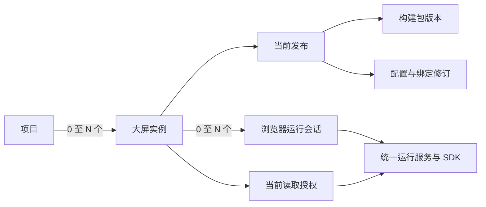
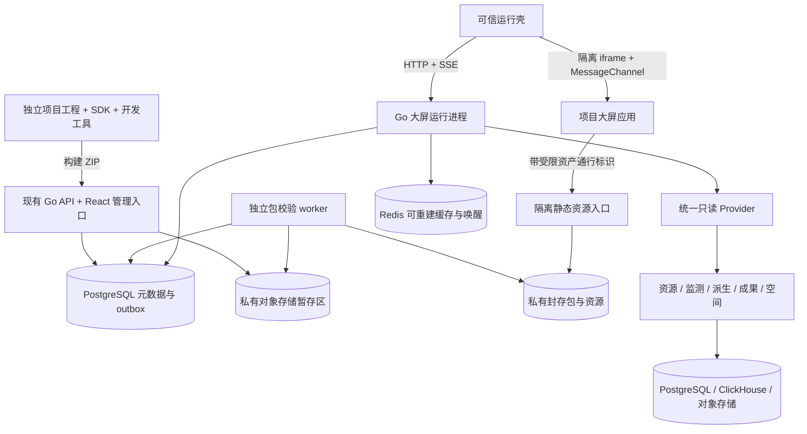

# 项目大屏 SDK 与运行机制完整交付范围及详细方案

日期：2026-11-13。**方案已获用户开发授权；实现与自验已完成，状态 Awaiting acceptance。** 用户已要求完整完成本轮 SDK、运行机制及配套基础能力，自验后交付人工验收。同日用户调整部署要求：本轮使用 HTTP，暂不交付 HTTPS／TLS 配置与证书流程；其余完整范围保持。

本轮交付项目大屏的开发接入、托管、配置、发布、访问、统一供数与运行管理机制。一个项目可以使用 0～N 个大屏，各大屏的程序和界面由项目开发者独立完成。平台复用已有监测业务，不规定大屏布局、图表库或交互方式。

本文说明本轮做什么、如何工作以及需要改造什么。交付编号表示范围，不表示实施顺序；实施与验收记录另行维护。本轮开发以用户已授权的完整范围及后续明确调整为准。

## 1 已确认方向与责任划分

平台提供框架无关的 JavaScript／TypeScript SDK、静态程序托管、项目配置、数据绑定、发布与运行服务。开发者在独立工程中开发，将构建完成的 ZIP 上传到项目内的大屏实例，平台生成访问入口。

| 责任方 | 负责内容 |
| --- | --- |
| 项目大屏开发者 | 应用页面、图表、交互及显示逻辑；声明能力与配置；使用 SDK；在本地构建程序。 |
| 平台大屏机制 | 项目 0～N 个大屏、包校验、配置绑定、访问身份、发布、受控 SDK 通信、数据订阅、恢复及诊断。 |
| 既有及后续业务模块 | 工程对象、正式观测、派生计算、告警事实、统计口径、空间资料和分析成果。 |

SDK 是应用调用入口；服务端的业务读取适配器（Provider）把这些调用接到现有领域服务，并保留其授权及数据规则。

相通的是数据能力与契约。每次读取仍受所属租户、项目、人员或终端以及大屏授权限制；同一设施被多个项目使用，不意味着这些项目具有相同的读取时段或范围。

本轮只提供技术接入样例，不交付任何项目的成品大屏或业务界面模板。上传、配置、发布和状态查看所需的管理功能属于本轮。

## 2 完整交付范围

| 编号 | 交付能力 | 本轮具体内容 |
| --- | --- | --- |
| DM-01 | 项目大屏管理 | 按需启用、0～N 个实例、独立名称和访问地址、启停、归档、历史及权限。 |
| DM-02 | 可独立使用的 SDK | 可分发的 JS／TS 客户端、类型、稳定公开导出、版本协商、使用文档；不依赖本仓库 workspace 或 React。 |
| DM-03 | SDK 业务数据能力 | 项目上下文、配置与绑定、资源／通道目录、最新值、趋势、明细、统计、派生状态、固定分析成果及空间资源。 |
| DM-04 | 订阅与运行生命周期 | 首屏快照、变化订阅、批量更新、取消、重连、重同步、状态通知、就绪及卸载。 |
| DM-05 | 本地开发工具 | 最小 TypeScript 接入工程、模拟与真实环境调试、预览、规范校验、打包及上传工具。 |
| DM-06 | 构建包接收与托管 | 静态 ZIP、manifest、分片上传、处理任务、路径与完整性校验、不可变封存、隔离资源服务。 |
| DM-07 | 配置与数据绑定 | 包声明的参数表单、固定／动态项目范围、命名绑定、指标语义检查、配置修订及变更影响。 |
| DM-08 | 预览与发布 | 草稿预览、发布准备、固定版本、稳定入口、独立升级、版本切换、回退及停用。 |
| DM-09 | 读取授权与身份 | 人员查看、开发预览、可选固定终端只读委托，当前资格复验及撤权清理。 |
| DM-10 | 独立运行与访问保护 | 可信运行壳、独立 Go 运行进程、包隔离、HTTP 部署、资源预算与共享查询。 |
| DM-11 | 数据能力扩展 | Provider 契约、能力发现及版本声明；为告警等尚未实现的模块保留明确接缝。 |
| DM-12 | 运行与维护支持 | 包处理及运行状态、脱敏诊断、基本终端管理、引用保护、备份恢复、部署和开发说明。 |

DM-03 的现有业务能力在本轮完成真实接入。DM-11 的告警能力交付命名、协商、类型与不可用行为以及服务端接缝；不包含告警规则引擎、事件生成和处置流程，不能声称已经能够返回真实业务告警。

固定终端能力属于本轮，但仅供需要长期播放的项目使用。普通人员访问大屏不需要登记终端或绑定硬件。

## 3 项目、大屏与版本模型

### 3.1 项目启用与大屏数量

项目大屏默认未启用，无默认实例。启用后可以在部署容量和技术预算允许范围内创建多个实例，也可以暂时没有实例；不为每个项目生成页面，也不为每个实例启动独立后端。

例如项目 A 不启用；项目 B 创建一个实例；项目 C 创建三个不同实例。三者共用同一运行机制，平台无需增加项目名称判断或专用接口。

项目级关闭停止全部大屏的新会话与供数，但保留包、配置和历史，不影响监测采集、查询或其他项目。单实例关闭只影响该实例；实例归档终止运行并保留历史。再次启用重新核验当前资格，不复活旧会话或旧游标。

项目归档后沿用现有只读原则：保留当前合法大屏读取，允许打开已发布大屏的只读浏览会话、停用和撤权；禁止新增实例、修改配置、发布、扩权及新登记终端。归档本身不冻结共享设施的监测数据，历史／跟随模式仍由实例配置与当前数据授权决定。

### 3.2 核心对象

| 对象 | 内容与约束 |
| --- | --- |
| 项目大屏设置 | 项目启用状态、修订和运行策略；归属租户／项目。 |
| 大屏实例 | 固定归属一个项目；名称、稳定标识、启停／归档状态、草稿和当前发布指针。 |
| 上传会话与包处理任务 | 上传进度、分片哈希、取消、校验、失败原因及重试；不会直接成为可执行发布。 |
| 构建包版本 | 封存程序、manifest、资源清单、哈希和兼容信息；内容不可覆盖。 |
| 配置修订 | 普通参数、业务范围、命名绑定、模式和资源版本；保存为不可变修订。 |
| 大屏读取授权 | 有效业务能力、对象／字段／时段、空间及成果资格、有效期及修订；可独立收窄或撤销。 |
| 发布版本 | 固定包、配置、所需能力及授权范围要求；当前资格在访问时继续判断。 |
| 运行会话 | 人员或终端、项目、实例、发布、环境代次、租约及已应用状态。 |
| 固定终端与分配 | 可选登记、独立凭据、获准实例、目标／实际发布、心跳与错误。 |
| 审计与运行事件 | 管理变更、发布指针变化、会话状态和控制事件；不保存原始访问凭据。 |



大屏实例是应用，不是物理显示器。一个应用可以有多个页面和多次并发访问。同一包可用于多个实例或项目，但每个实例的配置和授权独立。底层文件去重不允许跨项目读取或枚举其他项目的包。

### 3.3 状态含义

| 对象 | 状态约定 |
| --- | --- |
| 实例 | `enabled / disabled / archived`；当前发布为空时单独显示未发布，不能启动正式会话。 |
| 上传 | `receiving / uploaded / canceled / expired`；与处理任务状态分开。 |
| 包处理 | `queued / validating / ready / failed / canceled`；只有 ready 包可以用于发布。 |
| 发布 | 封存后不可修改；使用当前指针与撤回状态区分当前、保留及不可启动版本。 |
| 运行会话 | `starting / ready / degraded / closed / revoked / expired`；连接状态与场景就绪分别报告。 |

保留版本不能随意删除。实例、发布或有效运行会话引用的包有引用保护；临时上传和无引用失败产物按到期规则清理。所有操作保持项目归属，实例不能直接改属另一个项目。

## 4 SDK 交付与能力清单

### 4.1 SDK 是可在仓库外使用的产品

拟交付 `@infrapro/display-sdk` 的编译 JavaScript、TypeScript 声明、公开导出、许可证与说明，以及版本化安装包。SDK 核心不导入 React、内部 UI、管理端身份 Provider 或本仓库源码；开发者可选择自己的前端框架及图表引擎。

交付本地可安装的包文件，并支持使用内部 npm registry；不以发布到公共 npm 或联网安装为前提。当前 `@infrapro/api-client` 是私有 workspace 包且直接导出源码，本轮不能把它改名后当作外部 SDK 交付。[现有包定义](../../packages/ts/api-client/package.json)。包文件可采用标准 npm 打包形式。[npm pack 文档](https://docs.npmjs.com/cli/v11/commands/npm-pack/)

SDK、运行通信协议和业务能力版本分别声明：SDK 修复可以不改变协议；新增兼容字段不要求所有应用重发；破坏性变更增加主版本，并给出兼容和迁移说明。

### 4.2 本轮提供的公开能力

下表为拟定公开接口。方法与类型作为一套契约统一维护；名称可在方案讨论中调整，不表示目前已有相应代码。

| SDK 能力组 | 拟定公开方法 | 返回内容与边界 |
| --- | --- | --- |
| 连接与上下文 | `connect()`、`context.get()` | 当前租户／项目、实例、发布、运行模式、配置代次、时区默认值及服务端时间；不返回管理凭据。 |
| 能力发现 | `capabilities.list()`、`capabilities.get()` | 能力名称、协议版本、可用性、当前限制及所需授权；不泄露其他项目已安装模块。 |
| 实例配置 | `config.get()` | 当前发布的只读普通参数；修改通过管理功能形成新修订。 |
| 命名绑定 | `bindings.list()`、`bindings.resolve()` | 获准的资源引用、有效范围、语义及绑定状态；限制在当前实例。 |
| 资源目录 | `resources.list()`、`resources.get()`、`resources.summary()` | 项目设施／构件／测点、树形关系与授权后的分类计数；分页和搜索，不提供全部租户资源。 |
| 通道与指标 | `channels.list()`、`channels.get()` | 通道、owner、指标、单位、方向、基准、值类型、原始／派生类型及可读时段。 |
| 最新观测 | `monitoring.latest()` | 批量取得当前范围内的最新正式观测及派生状态；同一批通道不表示同刻采样。 |
| 历史明细 | `monitoring.details()` | 固定快照、时段与质量条件下的明细游标分页；不提供无界下载或导出任务。 |
| 趋势 | `monitoring.trends()` | 按当前视口、点数预算和既有摘要返回曲线，保留降采样、极值及覆盖说明。 |
| 统计 | `monitoring.statistics()`、`monitoring.overview()` | 现有数量、质量计数、覆盖、极值、均值、总体标准差、枚举分布及支持的日／月／年统计；不开放 SQL 或任意聚合表达式。 |
| 监测订阅 | `monitoring.subscribe()` | 最新值、趋势、概况或统计查询的快照与后续更新／状态；内部合并重复订阅。 |
| 数据来源 | `sources.get()`、`sources.history()` | 当前／历史设备输出来源的获准投影；需要来源资格，不默认开放完整设备台账。 |
| 固定分析成果 | `artifacts.list()`、`artifacts.get()`、`artifacts.read()` | 当前项目获准的固定成果版本、输出、数据与受影响状态；不运行或修改分析。 |
| 空间资料 | `spatial.list()`、`spatial.manifest()`、`spatial.objects()`、`spatial.placements()`、`spatial.readFile()` | 已授权空间版本、业务挂载、浏览产物与属性；不交付查看器，不默认提供原始 IFC／PDF 下载。 |
| 受控跳转 | `navigation.open()` | 根据当前上下文打开获准的资源、监测详情或另一大屏；由可信壳校验目标，实际页面另行检查人员资格，不接受任意外部 URL。 |
| 生命周期 | `runtime.on()`、`runtime.ready()`、`runtime.reportError()`、`dispose()` | 连接、上下文、发布、撤权、暂停／恢复与卸载；诊断限量且脱敏。 |

受控跳转应由用户操作触发并服从浏览器弹窗规则。终端身份不因跳转而取得普通控制台资格；进入需要人员身份的页面时重新登录。大屏内部页面之间的路由由项目应用自行管理。

SDK 中的资源和结果引用不构成独立授权凭证，不能复制到另一项目或会话中扩大读取范围。源数据、设备来源、空间与成果权限分别判断；有某一种资格不获得其他资格。

### 4.3 告警及后续业务能力

本轮为 `alerts.query`、`alerts.summary`、`alerts.subscribe` 定义能力名称、查询／响应契约和 Provider 接缝。读取内容以业务模块将来拥有的事件 ID、对象、等级、状态、发生／更新时间和事件版本为基础；等级及状态字典由业务模块提供，SDK 不预设工程安全分类。

目前没有完整告警业务模块，能力注册为 `unavailable`，调用返回 `capability_unavailable`。可选告警能力不阻塞其他功能；将告警声明为必需的应用不能以真实供数模式发布。开发夹具可模拟契约但持续标明模拟性质，不形成正式告警数据。

后续接入告警 Provider 后，已有 SDK 的身份、订阅、缓存、错误和恢复协议继续适用。通知、报告、科研等未纳入的数据类型也不能由 SDK 擅自构造。

### 4.4 生命周期与调用示意

应用加载后通过 `connect()` 完成握手，取得上下文和能力。数据查询支持 `AbortSignal`；订阅返回独立取消句柄。应用退出时 `dispose()` 取消未完成请求、订阅和资源句柄。修改查询参数产生新查询代次，旧返回不会覆盖新状态。

下面只说明 SDK 使用关系，不是已实现的示例程序：

```ts
const client = await connect();
const context = await client.context.get();
const query = { target: { binding: "focus_channels" } };
const initial = await client.monitoring.latest(query);
const subscription = await client.monitoring.subscribe(
  { kind: "latest", query },
  event => consume(event),
);
client.runtime.ready();
// 应用卸载时释放本次使用的资源。
subscription.unsubscribe();
client.dispose();
```

常用的“快照＋订阅”由 `subscribe()` 自带首屏完成，示意中的独立 latest 用来说明一次性查询也可使用。连续订阅本身不依赖先调用 latest，不以两次独立调用的时间间隙保证无遗漏。

## 5 SDK 查询语义与错误契约

### 5.1 项目上下文与查询目标

SDK 的业务查询不接受调用方任意指定租户／项目。上下文由已验证的运行会话确定，浏览器地址和传入参数不能改写授权。显式资源 ID 也必须属于当前项目及该实例有效范围。

查询目标支持命名绑定或当前上下文内的资源选择。资源选择可以是明确 ID 集合，也可以是已配置的设施／指标筛选；服务器规范化为有效通道与数据区间后复用现有选择集和快照，应用不需要操作内部数据库标识或自行拼接管理 API。

每次查询携带时段、质量过滤、时区和必要视口参数。全历史读取必须显式声明并受预算限制；固定快照中的视口只能收窄，不能扩大到原授权或快照范围之外。

### 5.2 精确值、时间与结果版本

整数、十进制值和可能超出安全整数的数量使用规范字符串，由服务器在序列化前保持精度，不能先转成 JavaScript Number 再包装成字符串；时间使用 UTC RFC3339Nano 字符串，保留纳秒，SDK 不用 JavaScript Date 悄悄截断正式值。时区用于日历分组和呈现，采样时刻不随显示时区改写。[现有数值与时间输出](../../packages/go/platform/monitoring/summary_state.go)

结果保留观测时刻、数据截至时间、读取完成时间、快照、源内容版本、授权代次和查询代次。派生结果保留配置／结果版本、质量、计算状态、待计算范围和上一有效结果；不同状态不会被压成一个普通数值。

最新值默认保留当前合法的各质量状态；趋势与统计沿用现有默认质量集合，并在结果中返回实际过滤条件。上一有效派生值与当前正式输出分别提供，不能借旧值制造持续更新的印象。

### 5.3 空结果、待准备与故障

正常数据结果使用 `ready / empty / pending / partial` 状态。partial 必须同时提供实际覆盖范围和缺少部分的原因；没有完整覆盖依据时不把部分结果标为完整。空结果只表示当前合法查询确实没有结果，不代表未开通模块或查询失败。

| 情况 | SDK 行为 |
| --- | --- |
| 能力缺失或未启用 | `capability_unavailable`，包含当前上下文可披露的原因。 |
| 参数或绑定不兼容 | `query_invalid / binding_invalid`，提供可定位的字段及原因。 |
| 无资格或对象不可披露 | 沿用不暴露对象存在性的错误策略；不附带受限对象详情。 |
| 人员退出、终端失效、租约到期 | `session_expired / revoked`，终止相关请求并清除数据句柄。 |
| 快照或游标过期 | 由订阅按契约重建；独立固定历史查询返回需重建状态，不擅自改变查询时段。 |
| 依赖故障或预算耗尽 | `dependency_unavailable / budget_exceeded`，有界退避或等待，不能无限重试。 |
| 协议不兼容 | `version_incompatible`，阻止建立正式运行环境。 |

连接中断和业务计算 pending 分开报告。应用可以在租约允许范围内保留上次完整结果，但 SDK 不把这些结果的真实截止时间改成当前时间。

### 5.4 数据操作边界

本轮 SDK 提供读取及运行控制，不提供资源维护、导入、原件导出、任意算法运行、阈值修改、告警确认／处置或项目权限管理。正式业务写操作继续由原控制台承担。

目录计数、观测积累、派生产出、分析成果数量分别定义，不能互相替代。统计使用授权后的去重对象及有效时段，不把分页内数量或项目重复引用相加作为总量。需要昂贵准备的概况通过 pending 返回进度或状态。


## 6 独立开发与构建包契约

### 6.1 开发工具及调试方式

交付 `@infrapro/display-devtools` 和一个最小 TypeScript 接入工程，提供以下命令能力。命令名为拟定名称，不要求开发者采用指定的 UI 框架。

| 工具能力 | 具体作用 |
| --- | --- |
| `init` | 生成 manifest、SDK 接入、清理函数和构建约定；不生成业务大屏版式。 |
| `dev` | 启动本地可信调试壳、应用地址代理和 SDK Bridge，复用正式消息协议。 |
| `login` | 关联平台人员登录和选定项目，取得短期开发预览会话。 |
| `validate` | 检查 manifest、配置／绑定 schema、入口、引用路径、文件限制和 SDK 兼容性。 |
| `pack` | 对开发者已构建的静态目录生成文件清单、哈希及 ZIP；不代替项目的构建工具。 |
| `upload` | 通过本人有权限的管理 API 上传到选定项目实例，显示服务器校验结果；上传不会自动发布。 |

本地调试有明确的模拟和真实两种模式。模拟模式使用固定、可复现夹具，覆盖正常、空结果、pending、断连、撤权及能力不可用，始终标明数据为模拟。真实模式读取本人当前有权访问的项目数据，不绕过服务器校验。

开发预览由控制台发起一次性配对：工具生成随机请求与校验信息，仅监听本机回环地址；本人在控制台选择项目、实例和开发会话，工具兑换短期会话。兑换要求证明持有本次工具生成的校验信息，限定回调、来源和有效期。凭据留在工具进程内存，不写入应用源码、构建包或提交记录；浏览器应用只接触本地 Bridge。断开开发会话或人员退出后停止真实供数。

项目选择与进入真实预览属于使用者操作，不建设第三方应用注册、通用 OAuth 服务或开发者账号体系。没有发布资格的开发者可以在自身获准范围内调试，不能凭开发会话上传、扩权或发布。

### 6.2 包的内容与兼容约定

包是构建完成的静态前端应用，可包含 HTML、JavaScript、CSS、字体、图片及声明的其他静态资源。Node.js 只参与开发工具和本地构建；服务器不执行上传包的安装、构建或后端脚本。

正式运行所需依赖在包内或通过已批准的平台能力取得，不依赖公共 CDN。应用使用相对资源路径；前端采用 hash 路由，或声明受托管服务支持的 history fallback 与资源基路径，不能硬编码根路径 `/assets`、管理 API 或生产域名。

manifest 的公共内容如下：

| 字段组 | 作用 |
| --- | --- |
| 格式、应用标识与版本 | manifest 主版本、应用 key、显示名称、应用版本；版本字符串不替代内容哈希。 |
| 入口与路由 | 包内 HTML 入口、相对资源基础路径、hash／history 路由方式及允许的回退路径。 |
| SDK／运行协议 | 接受的协议主版本和范围；平台决定是否能够实际建立会话。 |
| 必需／可选能力 | 能力名与版本；必需能力缺失阻止发布，可选能力允许应用降级。 |
| 参数 schema | 受限 JSON Schema 子集、默认值、说明和界限；不执行自定义脚本或远程引用。 |
| 绑定 schema | 对象类型、是否必需、数量、指标／值类型／单位维度等语义要求。 |
| 文件清单 | 路径、长度、媒体类型与 SHA-256；服务器独立重算。 |

下面是 manifest 主体示意；`pack` 另行补齐文件清单，故该片段本身不是完整可上传包：

```json
{
  "manifest_version": 1,
  "app_key": "project-monitoring-app",
  "version": "1.0.0",
  "entry": "index.html",
  "routing": { "mode": "hash" },
  "sdk_protocol": { "major": 1 },
  "required_capabilities": {
    "monitoring.latest": 1,
    "monitoring.trends": 1
  },
  "optional_capabilities": {
    "alerts.query": 1,
    "spatial.read": 1
  },
  "config_schema": {
    "type": "object",
    "additionalProperties": false,
    "properties": {
      "title": { "type": "string", "maxLength": 80 },
      "timezone": { "type": "string", "default": "Asia/Shanghai" }
    }
  },
  "binding_schema": {
    "focus_channels": {
      "kind": "channels",
      "required": true,
      "min_items": 1,
      "value_kind": "numeric"
    }
  }
}
```

能力标识按“可独立授权和协商的一项读取能力”定义，不要求与每个方法一一同名。例如 `spatial.read` 覆盖空间目录、manifest 和获准浏览文件，方法表与注册表明确对应；不会因方法存在就绕过能力检查。

配置的默认值与可选能力降级规则可以随包声明。项目资源 ID、人员权限、实际凭据和该项目最终绑定不固化到通用程序中。

### 6.3 上传、校验与封存

上传采用有作用域的分片会话，支持重复分片幂等、断点继续、主动取消和过期回收。合并前验证文件长度与整包哈希；整包进入私有暂存区，尚不能被浏览器执行。

独立包处理任务执行目录解析、文件解压、manifest／schema／路径校验和内容哈希复算。限制压缩包及解压后大小、文件数量、压缩倍率、路径深度、单文件大小、处理时间和临时空间；拒绝路径穿越、符号链接、硬链接、重复归一化路径、加密包、特殊文件以及清单外内容。嵌套压缩资源不会递归执行或解包，是否可作为普通资源由允许类型决定。

校验进程没有业务数据凭据，不执行包内 JavaScript 或安装脚本。失败返回结构化问题；校验通过后，在私有对象存储中封存不可变内容，再提交 ready 包版本。只有数据库登记为 ready 且清单匹配的文件可以被托管。

任务使用数据库租约、尝试代次及完成比较，防止取消后的旧 worker 又把任务提交成功。失败重试不覆盖既有包版本，临时对象通过数据库引用和到期规则清理。相同应用版本不同哈希明确显示冲突或作为不同构建，不能悄悄替换。

## 7 项目配置、数据绑定与读取授权

### 7.1 三类内容分别管理

| 内容 | 示例 | 谁决定 |
| --- | --- | --- |
| 普通参数 | 标题、时区、刷新偏好、应用自有展示参数。 | 包声明 schema，项目配置者填写。 |
| 数据绑定 | `focus_channels` 对应哪些通道；`site` 对应哪座设施；空间和成果固定哪个版本。 | 配置者从当前获准资源中选择，服务器校验。 |
| 读取授权 | 可以使用哪些业务能力、对象、字段、时段及有效期。 | 具有相应委托资格的授权管理者授予。 |

普通参数不存数据库密码、访问令牌或秘密。开发者需要地图／模型／成果时通过平台受控能力读取；把任意 URL 填入参数不会获得额外外联或读取权限。

修改参数或绑定形成新配置修订，先作为草稿使用。正式会话始终读取当前发布固定的修订，保存草稿不改变正在运行的大屏。

### 7.2 固定与动态绑定

默认使用明确对象集合和固定空间／成果版本，便于理解一次发布实际读取什么。命名绑定使程序通过业务含义取数，不把数据库 ID 写在组件代码中。

确实需要自动纳入新增测点或通道时，可选择动态绑定。动态绑定必须声明设施／构件范围、指标及通道筛选、是否包含后来新增对象，并受实例的读取授权上限约束。读取授权本身是否覆盖未来新增对象也必须明确；只有绑定和授权两者都允许，新增对象才会进入结果。

动态查询不能使用任意脚本、SQL 或跨租户条件。每次解析返回有效集合修订，集合变化触发订阅重建和范围变化事件。重新命名不改变引用身份；对象删除、移交、授权撤销或指标语义变化可以使绑定失效，不自动按相似名称替换。

### 7.3 语义检查与缺少绑定的行为

绑定不仅检查 ID 存在，还检查资源类型、原始／派生类别、值类型、指标定义、单位维度、方向、基准以及所需时段。设备输出来源只是通道数据来源，不替代通道和指标语义。

单位相容不代表服务器可以擅自换算；涉及换算时，契约必须声明目标单位与既有合法规则，并保留来源。SDK 本轮不增加任意公式计算能力。

必需绑定缺失或不兼容阻止发布；可选绑定缺失会返回明确不可用状态。运行期间失效则停止相应结果和订阅，并通知应用。应用不能继续把已撤权绑定的缓存作为有效数据显示。

## 8 项目如何配置、发布和访问

本节描述产品使用流程，便于明确运行结果；不是开发实施顺序。

### 8.1 管理入口与权限

在项目中增加“大屏”管理入口，提供启用设置、实例列表、包版本、草稿配置、读取授权、预览、发布记录和运行状态。功能未启用时不创建默认应用；没有当前发布时显示未发布。

管理权限划分为设置、实例管理、包上传、配置、授权、预览、发布／回退、查看及终端管理。不同操作可由同一个人承担，也可分开授予；不强制引入审批流。拥有发布资格不自动拥有授予业务数据的资格。

大屏查看资格和底层业务读取资格分别核验。普通成员可见的是自己允许访问的实例，不能通过实例列表推断受限项目或包版本。必要配置表单使用现有 React 控制台和现有权限交互约定，不开发拖拽画布。

### 8.2 配置与预览

项目负责人创建实例，为它上传 ready 包，填写普通参数并绑定资源。管理界面显示程序要求、现有业务能力、必需与可选绑定、读取范围以及不兼容原因。

预览固定选定包与草稿修订，使用相同隔离壳和 SDK 协议，同时标识预览身份。真实预览取本人权限、项目范围和预览读取授权的交集；不能借“模拟终端”获得本人不具备的数据。

预览可选择模拟夹具以检查不可用状态；模拟模式不能发布为真实业务环境。普通参数预览成功也不代表终端授权已齐备，发布准备会分别检查。

### 8.3 发布与稳定入口

发布准备生成待发布内容摘要：包哈希、配置修订、所需能力、绑定解析、读取授权要求及当前兼容结果。提交时重新验证这些条件和实例修订；并发变更返回冲突，由操作者查看差异后重新提交，不能覆盖别人的发布。

正式发布在一次数据库事务内创建不可变发布记录、更新当前发布指针、写审计和控制事件。重复提交使用幂等键获取同一结果，避免网络重试生成多个发布。

每个实例保持稳定访问入口，拟采用独立运行站点的 `/display/<instance-id>`。地址中的 ID 只定位应用，不是身份凭据。管理员可复制访问地址，普通用户登录后按当前权限进入；不需要固定终端登记。

具体管理端路由沿用当前租户／项目路由结构。正式旧版本默认不能通过改 URL 随意启动；查看历史包信息和恢复旧发布需要对应管理权限。

### 8.4 普通浏览器如何运行

浏览器打开稳定地址后，由可信运行壳处理登录或已有人员会话，取得服务器确认的项目、实例、当前发布与短期运行租约。跨站启动使用一次性兑换码及校验信息；不把控制台会话交给上传应用。

运行壳加载固定包，建立 MessageChannel，协商 SDK 和能力，传入配置与只读上下文。应用通过 SDK 发起查询、建立订阅并报告 ready。运行壳负责认证续期、撤权、重连、发布切换和致命故障提示。

一个实例可以同时被多个普通浏览器打开，不登记显示器数量。每次访问各有运行会话和人员权限；多个会话可复用合法的后台查询结果，但不共享对方身份。

### 8.5 可选固定终端

需要长期无人值守时，管理者登记终端并分配允许的大屏，终端通过一次性配对完成独立身份建立。终端获得只读运行资格，不保存某个管理人员账号密码，不具备配置、发布或其他业务写权限。

固定终端委托由租户／项目当前有效的授权资格约束，明确范围和有效期。创建者退出登录不会中断合法终端；项目停用、终端撤销、委托到期或业务范围撤销会使其失效。人员权限变化也不得借创建者快照保留超出当前项目及授权规则的资格。

本轮提供登记、配对、重置、撤销、实例分配、目标／实际发布、心跳及最近错误。基础分配只指定一个当前目标实例；不建设轮播编排、远程桌面、设备系统升级或硬件采购管理。

终端续期凭据由可信运行站点通过 HttpOnly、host-only 且路径受限的 cookie 管理；本轮 HTTP 部署设置 Secure=false，并配置明确的 SameSite 策略。凭据按终端代次可撤销、轮换，上传应用无法取得。首次配对和浏览器再次认证需人工操作，不承诺绕过浏览器与操作系统的自动启动策略。

## 9 发布切换、回退与权限变化

### 9.1 发布固定内容，授权持续变化

一个发布固定“构建包版本＋配置修订＋能力要求”；数据读取授权是独立的当前状态。回退只改变当前发布，不恢复旧人员权限、终端资格、对象授权或已撤销数据。

回退重新检查旧包兼容性、绑定语义及当前授权，成功后形成新的发布动作和审计记录。旧发布需要的能力已经移除或必需对象已失效时，不能强行恢复正式供数。

配置升级没有静默迁移。新包 schema 与旧配置不一致时，系统列出可继承项与需补齐项，由配置修订保存最终结果，不执行上传包提供的配置迁移脚本。

### 9.2 正在运行的会话如何切换

正式会话默认跟随实例当前发布。发现新发布时，运行壳准备新的包、配置和 Bridge；在目标应用完成握手和 ready 后切换，并释放旧资源。准备期间短时保留仍然合法的旧会话，受有限切换宽限约束。

目标加载失败时上报目标版本、实际版本及原因；旧会话只能在仍有资格且宽限未过时继续。不能把“控制事件送达”或“连接在线”当作目标已应用。发布失败不自动改回项目当前指针，是否回退由管理者明确操作。

权限撤销、项目停用、终端失效或明确的强制撤回不使用正常升级宽限，立即停止相关数据投递并销毁相关 Bridge、资源句柄和可清理状态。撤权优先于新旧发布过渡。

用户在当前应用中的视口和选择可以由应用使用内存保存，但协议不承诺跨不同程序版本恢复任意内部状态，也不通过程序重载永久保存敏感业务快照。

## 10 读取身份与当前业务服务的衔接

### 10.1 有效读取范围

人员会话取以下范围的交集：

`当前人员资格 ∩ 项目资源及数据授权 ∩ 大屏当前读取授权 ∩ 发布绑定范围 ∩ 本次查询范围`。

终端会话将人员资格替换为当前有效终端委托；仍执行项目、实例、绑定、业务字段／时段及成果递归授权。固定终端不是全项目的默认数据钥匙。

授权人在创建或扩大委托时必须具备相应管理及业务委托资格，授权不能超过项目已有范围。委托和业务授权有各自的修订与有效期；项目级授权撤销、租户／项目关闭及适用的当前资格变化都会触发重新评估。

### 10.2 不能直接复用个人会话或伪造系统账号

当前监测服务以 `access.Actor` 和人员会话为入口，选择集、快照使用非空 `actor_id`。固定终端如果仍伪装成人员，会混淆账号退出、委托寿命、快照归属和撤权。因此需要一个内部的 `ReadSubject` 接缝，表达已验证的人员读取或大屏只读身份。[当前访问主体](../../packages/go/platform/access/service.go)、[选择集与快照模型](../../packages/go/platform/migrations/00012_monitoring_metadata.sql)、[查询入口](../../packages/go/platform/monitoring/queries.go)

服务器从已验证会话构造 ReadSubject，应用不能提交任意主体或租户。人员身份继续通过现有 Actor 验证；终端身份通过大屏读取委托、项目范围和当前代次验证。ReadSubject 只用于读取，不能进入原有写操作或管理授权路径。

选择集、快照及相关准备任务增加显式归属类型，以人员账号或大屏运行主体二选一；保留租户／项目外键和数据库互斥约束，不用可空 actor_id 配合无约束字符串冒充所有者。旧记录保持人员归属，现有个人查询和分页行为不变。

### 10.3 Provider 与业务模块各自负责什么

统一运行层验证会话、能力、预算与调用格式；Provider 把公开请求映射为业务服务读取。资源、监测、来源、派生、成果和空间模块继续拥有各自的数据有效性和领域授权，运行层不复制这些规则。

读取授权与数据资格在业务查询的同一事务或既有一致性边界复验，沿用既有锁序，避免“先检查后任意读取”的间隙。耗时扫描、对象读取和推送采用带授权代次的租约，并在结果交付前再次核对；不为整个长连接持有数据库事务。

派生结果与分析成果保留对源输入和固定版本的递归授权，不因产物属于当前项目而跳过输入检查。空间浏览产物、原件、业务挂载和指标读取同样分别受控。

授权取消后停止终端或会话专属查询和结果投递。可以服务其他合法请求的公共摘要准备任务不必全部取消，但失去资格的订阅者不能继续获得结果。


## 11 实时供数与断线恢复

### 11.1 HTTP 查询与 SSE 推送

一次性查询和订阅管理使用受鉴权 HTTP 请求；运行壳通过 SSE 接收服务器事件，再经 MessageChannel 交给 SDK。上传应用不能直接持有运行服务凭据或自行建立越权事件流。

本轮数据流主要是服务器向浏览器更新，选择 HTTP＋SSE 足以覆盖；不同时实现另一套 WebSocket 供数栈。订阅增加、修改、取消仍走有权限检查的 HTTP 命令。SSE 的事件 ID 和重连机制只提供传输基础，业务连续性由服务器保存的游标及重新同步协议保证。[WHATWG SSE 规范](https://html.spec.whatwg.org/multipage/server-sent-events.html)

“实时”表示正式业务状态变化后，运行服务持续提供更新。当前数据来源中的导入、批量发布或未来设备接入，仍分别决定数据何时成为正式观测；大屏模块不承担设备协议解析、采集接入或弥补上游没有产生数据的问题。

### 11.2 从首屏到连续更新

建立订阅时，服务器固定查询、有效范围、授权／配置代次与源版本边界，生成快照和接续游标。初始结果可以 ready 或 pending；快照边界之后的合法变化通过游标补齐，不能简单先查一次、再从“现在”开始监听。

监测原始数据复用现有提交序号和变更事实；派生结果复用派生模块的正式版本及变化来源。大屏控制事件补充项目启停、授权变化、发布切换、终端撤销和配置范围变化，以同事务 outbox 保证控制状态提交后能被发现。[监测变化事实](../../packages/go/platform/monitoring/changes.go)、[派生变化消费](../../packages/go/platform/derivedmonitoring/changes.go)

不同来源没有现成的全局总序号，订阅游标记录各来源位置和读取代次。只对必要的版本边界使用短事务及现有锁序，不锁住整个历史扫描；读取到的源版本变化无法兼容时，明确重新建立快照。

事件至少送达一次，客户端按订阅、代次与序号去重；SDK 约定事件处理函数同步返回或返回的 Promise 成功完成，才确认该事件已应用；处理失败不推进游标。迟到的旧代次事件不能覆盖新查询结果。SDK 的事件及消费类型统一表达 snapshot、update、pending、reset、status 和 revoked。

### 11.3 如何减少重复读取

订阅不是把每条数据库行直接广播给所有大屏。后台将短时变化合并，判断哪些规范化查询受影响，再调用原业务读取能力；统计和趋势复用现有摘要，不在推送线程中重算全历史。

等价且授权范围一致的查询可以合并为一个后台任务，结果分发给多个合法订阅者。某个浏览器取消订阅只释放自己的引用；所有引用消失后才取消共享任务或等待其按业务任务规则结束。

动态绑定改变、派生版本改变、输入撤销和数据更正同样可能影响结果，不能只监听“新观测插入”。时间滚动窗口还需要受预算约束的时钟驱动刷新，不能因为没有新数据就永远保留已经过期的窗口统计。

### 11.4 断线与无法续接时的处理

运行壳重连时发送最后已应用游标。服务器重新验证会话、项目、实例、绑定和授权代次后，才允许在保留窗口内续接。

游标过期、事件缺口、动态范围变化或缓存丢失时，发送 reset 并重建受控快照；不假装补齐了缺失变化。断线缓冲和每次补发都有上限，超限进入重同步，避免积压拖垮服务器或浏览器。

固定历史查询保持原时段；跟随查询按声明的相对时间窗口重新计算。SDK 通知连接恢复、范围变化和结果更新，不规定应用必须切回某个首页。

## 12 浏览器隔离与静态资源托管

### 12.1 三种运行职责

管理控制台、可信运行站点、上传包资源站点分别承担管理、身份与供数、静态执行内容。它们使用不同 origin；同一部署内可以共用 Nginx 和基础服务，无需为每个项目采购域名或运行服务器。

可信运行壳由平台发布，不来自用户 ZIP。上传包放在独立资源 origin 的 iframe 中，默认 sandbox 仅开启应用所需脚本能力，不给同源访问、顶层导航、任意弹窗、表单提交或持久浏览器存储能力。跨源和 sandbox 约束共同使用，不能仅靠文件扩展名认定上传程序可信。[WHATWG iframe sandbox 规范](https://html.spec.whatwg.org/multipage/iframe-embed-object.html#attr-iframe-sandbox)

默认运行不允许公网脚本、广告、分析埋点或任意外部数据端点。受支持的 Worker、WASM、字体、图片与模型加载以包契约和隔离策略明确配置；普通 JS 应用及常用本地 WebGL／图表使用方式通过技术接入样例覆盖，不保证任意现成网站原封不动上传即可使用。

### 12.2 Bridge 不只是 postMessage 转发

运行壳以固定 iframe window、当前加载代次及一次性握手 nonce 识别子应用，握手后建立专用 MessageChannel。sandbox 子应用可能具有 opaque origin，不能把字符串 `null` 视作身份依据，也不能只检查消息里自报的项目 ID。

每个调用含协议版本、请求 ID、方法和经过 schema 校验的参数；运行壳只接受已注册方法，并限制并发、消息大小、订阅数和处理时间。父壳再次导航或 iframe 重新加载时，旧端口、nonce、未完成请求和结果句柄全部失效。

运行壳把 SDK 方法转为受控服务器请求。服务器仍独立校验身份与范围，Bridge 白名单不是服务器权限检查的替代品。业务凭据、续期 cookie 和管理 API 客户端不交给子应用。[MessageChannel 用法](https://developer.mozilla.org/en-US/docs/Web/API/Channel_Messaging_API/Using_channel_messaging)

### 12.3 包文件与业务文件区别处理

封存包保存在私有对象存储，不直接公开整个桶。运行壳取得仅允许本会话、固定发布和清单内路径的短期资产通行标识，资源服务器校验后返回对应 HTML、脚本和样式。标识可以出现在该包专用资源路径中，但不具有查询业务数据、枚举其他包或续期会话的权限；禁止写入访问日志和 Referer，随运行租约续期并可撤销。

这类静态资产路径可以被子应用看到，因此不能在构建包中放秘密。资源响应使用私有缓存和固定媒体类型；opaque iframe 的模块脚本／字体等所需 CORS 只对已校验包资产开放且不携带业务 cookie，业务 API 不开放通配跨域。

空间浏览文件和分析结果通过 SDK 受控文件句柄读取，核验当前范围和字节预算后传输 ArrayBuffer／分块数据，由应用或 SDK 创建可回收 Blob URL。大对象支持按需读取和取消，不把整个模型强制一次性放进内存；关联文件通过 manifest 中的受控引用取得。应用不会得到对象存储访问密钥或长期可分享下载地址。

停止或撤权会关闭会话、清除 SDK 管理的缓存及 Blob URL，并卸载受影响应用。浏览器已经接收的数据不能被服务器“追回”，也不能阻止恶意应用把其合法读取过的内容另行记忆；发布权限、包来源责任和最小数据范围仍是治理边界。平台不宣称提供 DRM。

### 12.4 本轮 HTTP 部署与代理配置

按用户最新要求，本轮控制台、可信运行站点和静态资源站点统一使用 HTTP，支持明确配置的本机及内网访问地址，不要求证书或 HTTPS 入口。三者仍使用不同 origin；精确 origin 校验、host-only cookie 与路径范围、跨站一次性启动、CSRF 防护及可信代理头校验继续实现。HTTP 模式统一设置 CookieSecure=false；浏览器握手、随机校验和 SDK 不依赖仅在安全上下文可用的 API，并对非 localhost 的 HTTP 使用场景进行自验。[现有配置](../../packages/go/platform/config/config.go)、[现有代理](../../deploy/nginx/default.conf)

Nginx 为运行事件流独立配置不缓冲及合适的空闲超时，为包资源和运行壳分别设置 CSP、frame-ancestors、缓存及类型策略。现有控制台和管理 API 的限制不全局放宽。部署提供明确的 HTTP 域名或 IP／端口配置说明；HTTPS、TLS 证书签发及续期留待后续单独安排。本轮 HTTP 不提供传输加密，不把本机配置成功等同生产部署完成。[Nginx 代理缓冲说明](https://nginx.org/en/docs/http/ngx_http_proxy_module.html#proxy_buffering)

## 13 服务结构、技术选型与持久化

### 13.1 模块与进程



保留现有 Go 模块化结构，在平台包增加显示机制模块和公开只读接缝；管理 HTTP adapter 放入现有 API。独立运行进程承接长连接、会话、查询调度及受控资产服务，独立包 worker 承接解压与校验。它们共用域模块代码与权威存储，不通过管理 API 的个人 HTTP 接口绕行。

运行进程故障不应拖住管理 API 或监测写入线程，包解压也不占用运行连接线程。进程隔离不代表数据库故障已被隔离，需要分别配置数据库连接池与资源预算。不是为每个项目创建一个服务，也不为每个包运行容器。

### 13.2 技术选择与使用位置

| 技术 | 具体位置与选择理由 |
| --- | --- |
| Go | 复用现有领域服务、事务与授权；管理模块、运行服务、包校验任务及 Provider adapter 使用 Go。 |
| TypeScript | SDK、公开类型、Bridge 和开发工具；适配独立前端工程，SDK 核心不含 React 依赖。 |
| React 与现有控制台栈 | 项目大屏管理页面；可信运行壳保持轻量，只负责平台运行职责。 |
| HTTP＋SSE＋MessageChannel | 分别处理查询／控制、服务器连续事件、可信壳与上传应用之间的受控调用。 |
| PostgreSQL | 项目设置、实例、修订、发布、授权、会话、终端、任务、游标及事务 outbox 的权威状态。 |
| 现有对象存储与 BlobStore | 上传暂存、不可变封存包及清单资产；复用存取机制，独立命名空间与授权。 |
| 现有 ClickHouse 及监测摘要 | 继续承担正式监测历史和已有统计路径；大屏不另建一套观测数据库。 |
| Redis | 可重建缓存、跨实例唤醒及短期去重；不保存唯一发布指针、唯一授权或唯一消费进度。 |
| Nginx | HTTP origin 分离、事件流代理、静态类型／缓存与 CSP；保持现有部署方式。 |
| npm 包文件与可选内部 registry | 分发独立 SDK 和工具，在内网环境也能安装和构建。 |

本轮不增加 Kafka、通用微前端平台、低代码引擎或 Kubernetes 依赖。模块分开编译与进程部署即可满足当前机制目标。

### 13.3 接口边界与 Provider 注册

公开接口分为管理操作、运行会话／控制、类型化业务读取。拟定管理路径归属于租户／项目下的 displays；运行路径归属于已验证会话，不能使用路径或 body 改写所属项目。

管理 API 继续维护 OpenAPI；SDK 请求、事件、错误和 manifest 使用版本化 schema，生成 Go／TS 类型并用契约样例保持一致。Provider 是显式注册的受限读取接口，不能通过字符串反射调用任意 Go 方法或代理任意 URL。

注册信息至少包含能力名／版本、可用性、所需授权、参数／结果类型、预算与订阅支持。运行服务组合根负责装配资源、监测、来源、成果和空间 adapter；业务模块不反向依赖具体的大屏模块，授权策略通过窄接口注入。[现有组合入口](../../packages/go/platform/runtime/business.go)

运行层只处理上下文、租约、路由、调度与投递；业务模块提供结果和有效性，SDK 提供稳定调用。这样后续告警模块接入时新增 Provider 和业务授权，项目程序通过能力发现使用它，不需要每个项目再造数据接口。

### 13.4 数据结构与迁移范围

拟新增项目设置、实例、上传／分片、包任务、包版本／文件、配置修订、读取授权、发布、运行主体／会话、终端／分配、控制 outbox 和消费进度表。命名统一使用 display 前缀；实际迁移号在实施时按当前仓库分配，不占用其他正在开发模块的序号。

所有项目内对象具有 tenant_id／project_id，并使用一致的复合约束；发布通过外键引用同项目实例、ready 包与配置。当前发布切换采用期望修订比较；包、配置和发布内容不可原位修改。

另需扩展监测选择集／快照及有关准备任务的主体归属、运行环境代次和引用保护。对当前个人查询保持兼容，不能依赖清空业务历史完成迁移。

文件采用内容哈希、独立命名空间和数据库清单引用。复用当前 BlobStore 的私有读写机制，不直接复制空间资料的业务表或转换流程。[现有 BlobStore](../../packages/go/platform/blobstore/store.go)

## 14 预算、故障与日常维护

### 14.1 资源预算与共享缓存

租户、项目、实例、会话和方法分别有技术预算，限制并发查询、订阅数、扫描点数、返回大小、文件读取量、解压量和队列积压。预算是保护现有服务的运行限制，不在本轮引入套餐、计费或业务用量购买机制。

查询缓存键包含规范化目标、能力／协议、时段／质量／时区／视口、绑定／配置修订、源内容及派生版本、授权范围指纹和环境代次。只有证明有效读取范围相同的请求才共享数据；无法证明时保留身份隔离。

命中缓存仍检查当前资格和代次，不能让缓存 TTL 代替撤权。人员／终端是否仍合法各自验证；公共准备结果和每个订阅者的投递资格分别判断。

### 14.2 故障行为

| 故障或变化 | 运行行为 |
| --- | --- |
| 管理 API 暂时不可用 | 只要独立运行服务和权威授权依赖可用，合法已发布会话可继续；修改、上传、发布暂时不可用。 |
| 运行服务重启或网络断开 | 重连、重新验证、按游标续接或重建；前端报告连接状态和实际数据截止时间。 |
| PostgreSQL 授权状态不可读 | 不创建新会话、不续期、不交付新的业务结果；仅允许在现有有限租约内保留已展示状态，到期清除。 |
| Redis 不可用 | 关闭缓存／唤醒优化，通过受预算约束的权威查询和 outbox 轮询恢复；压力超限明确降级。 |
| 监测、空间或对象存储故障 | 只对受影响能力返回不可用、pending 或明确部分覆盖，不伪造空数据。 |
| 包缺失、哈希不符、协议不兼容 | 拒绝启动该目标发布，管理界面记录原因；不自动加载未经校验的替代包。 |
| 项目或资格失效 | 停止受影响投递、撤销资产许可并释放会话；无法联网确认时租约限制旧状态保留时间。 |

应用自身长任务或 WebGL 崩溃需要开发者修复。iframe 和独立运行进程可以减少影响，但不承诺浏览器进程绝对的 CPU／内存隔离；运行壳提供超时、失败提示和受限重载，避免无限自动重启。

本轮支持内网部署：静态依赖本地可得、SDK 可离线安装。内网部署不等于断网冷启动；不提供长期脱离服务器的敏感数据离线包或 IndexedDB 业务快照。

### 14.3 可观察状态与维护入口

管理端区分包接收／校验、实例当前发布、会话目标／实际版本、连接、应用 ready、各数据能力准备状态及最后有效数据时间。心跳只表示有连接，不代表数据最新或应用成功呈现。

保存上传失败、发布／回退、资格变化、重同步、预算拒绝、应用错误和会话结束的结构化事件。诊断按租户／项目隔离，使用关联 ID；不记录 cookie、一次性码、资产通行标识、整包源代码或完整观测明细。

提供基本连接数、查询与事件延迟、重连、失败、包校验耗时及预算拒绝指标。日志与事件保留期限由部署设置限制；不以无限增长的运行日志替代正式业务审计。

### 14.4 引用、清理与恢复

包和资源清理由有效发布、保留发布、预览和运行引用共同决定；先标记回收并关闭新引用，再由后台任务确认无引用后删除，避免发布／清理竞争。停用实例不等于立即删除历史。

备份覆盖 PostgreSQL 中的大屏元数据和引用的封存对象，监测／派生／空间数据沿用各自备份边界。只恢复数据库而丢失包文件应被识别为不可启动，不能呈现正常状态。

恢复后切换运行环境代次，失效旧会话、资产许可、一次性码、终端续期状态及订阅游标，防止备份中的旧授权重新成为有效身份。终端需重新配对或通过明确的恢复操作重建委托，普通人员重新登录；持久的发布历史可以保留。

本轮提供备份、引用检查、恢复及故障排查操作说明。生产发布、真实环境恢复演练和具体项目大屏上线均不能由这份方案提前认定已完成。


## 15 结合当前项目需要补齐的基础能力

下面区分已有业务基础与本轮新增工作。“已有”指当前工作区存在相应实现与记录，不代表本方案已经完成集成或全系统已获人工验收。

| 基础能力 | 当前可复用内容 | 本轮必须补齐的部分 |
| --- | --- | --- |
| 项目与权限 | 现有项目生命周期、成员角色、资源／监测授权和保护规则。 | 大屏设置与权限项、实例范围、大屏读取委托及有效期、终端独立身份；更新权限目录与管理入口。 |
| 查询身份 | 现有人员 Actor、事务内检查、选择集和快照。 | 只读 ReadSubject、非人员归属及约束、终端撤权与准备任务处理；保持个人查询兼容。 |
| 数据读取契约 | 现有资源、通道、来源、最新值、趋势、明细和统计服务。 | 稳定且版本化的公开 DTO、批量目录／聚合读取、范围与状态映射、当前范围下的精确数值输出。 |
| 派生与成果 | 现有派生查询、固定成果、来源回放和递归授权。 | SDK 的可读投影、能力发现、状态传播、内容变化对订阅的失效通知；不重做计算引擎。 |
| 空间资料 | 现有版本、浏览产物、挂载、项目授权和私有 BlobStore。 | ReadSubject adapter、受控 manifest／文件读取及预算、SDK 资源释放；不重做转换和查看器。 |
| 连续供数 | 现有监测变更事实、派生变化消费；当前控制台主要以查询和轮询使用。 | 快照接续、多来源游标、outbox、共享订阅、SSE、重同步、取消及授权代次传播。 |
| 包托管与发布 | 现有对象存储、任务租约、版本化领域实现可借鉴。 | 独立的 ZIP／manifest 管线、不可变包／配置／发布、当前指针、引用保护、回退和资产通行机制。 |
| 外部 SDK 与开发工具 | 现有内部 TypeScript API client 和工程构建工具。 | 仓库外可安装的编译包、公开类型／契约、独立样例、mock／真实预览、校验／打包／上传工具。 |
| 浏览器和部署 | 当前控制台、Go API、Nginx、PostgreSQL、Redis、ClickHouse 及对象存储。 | 独立运行进程／包 worker、可信壳与隔离 origin、HTTP 配置、Bridge、SSE 代理及资源预算。 |
| 运维与恢复 | 现有业务审计、存储维护与备份工具。 | 运行状态和版本对账、受限日志、包引用检查、备份清单、恢复代次及终端重新配对说明。 |
| 告警扩展 | 当前没有完整工程告警模块。 | 明确契约、unavailable 状态和 Provider 接缝；实际告警事件引擎不纳入本轮。 |

这些基础改造属于本轮机制交付，不要求先单独完成整个身份平台、现场采集、科研、告警或报告体系。它们直接补足大屏读取、发布与运行所需的边界，其他业务模块后续通过同一能力机制接入。

### 15.1 主要代码落点

| 位置 | 拟议改动 |
| --- | --- |
| `packages/go/platform/display/`（新增） | 实例、包、配置、授权、发布、运行主体／会话、Provider 契约及控制事件。 |
| [access](../../packages/go/platform/access)、[projects](../../packages/go/platform/projects) | 权限目录与项目启停／归档联动，委托资格和只读主体衔接。 |
| [monitoring](../../packages/go/platform/monitoring)、[sources](../../packages/go/platform/sources)、[resources](../../packages/go/platform/resources) | 只读授权接缝、批量公开投影、快照归属和原始变化消费。 |
| [derivedmonitoring](../../packages/go/platform/derivedmonitoring)、[spatial](../../packages/go/platform/spatial) | 保留领域授权的结果／资料 adapter 与版本变化通知。 |
| [runtime](../../packages/go/platform/runtime) | 组合各 Provider 与授权实现，避免模块循环依赖。 |
| [现有 HTTP 入口](../../services/api/internal/transport/http/router.go)及新增 display adapter | 管理 API、运行启动／控制、类型化查询、SSE 与静态资产请求。 |
| `services/api/cmd/display-runtime/`、`services/api/cmd/display-package-worker/`（新增） | 运行服务和包校验独立入口；资源池、关闭、健康状态与任务恢复。 |
| `packages/ts/display-sdk/`、`packages/ts/display-devtools/`（新增） | 编译发布包、Bridge、公开契约、命令工具与独立安装说明。 |
| `apps/display-runtime/`（新增） | 可信运行壳；平台自行构建发布，不接受应用包覆盖。 |
| [现有项目前端](../../apps/console/src/features/projects)及新增 displays 功能目录 | 启用、实例、上传、配置、授权、预览、发布、终端和状态管理。 |
| [contracts](../../contracts)、[migrations](../../packages/go/platform/migrations)、[config](../../packages/go/platform/config)、[deploy](../../deploy) | 管理与 SDK schema、元数据迁移、HTTP／origin／预算配置及运行部署文件。 |
| `samples/display-sdk/`及运行／开发文档（新增） | 最小独立接入样例、构建产物规范和使用说明；不提供成品大屏页面。 |

以上为实现落点，本轮已完成实现与自验，等待人工验收。实施时延续仓库当前 Go／TypeScript 版本、锁文件及代码规范；涉及新增依赖再固定版本和许可证，不为大屏机制另起一套基础技术栈。

### 15.2 必须保持的现有业务含义

大屏读取正式采用的监测数据，不把上传未采用的批次当作实时值。历史数据更正、撤销和派生续算可能改变某些结果，SDK 保留版本和状态，运行订阅据此刷新。

空间资料或固定成果存在不意味着可以向所有项目展示。已有项目授权、监测可读时段、输入递归授权和原件／浏览资格继续成立，大屏包不能绕开这些约束。

现有数据统计不会自动成为工程安全评价。SDK 只提供已有明确定义的指标与状态，不从数据质量标记、设备在线或数值范围擅自生成“工程安全／危险”的结论。

## 16 本轮最终交付物与范围边界

### 16.1 最终应得到的交付物

| 交付物 | 使用者得到什么 |
| --- | --- |
| 平台管理功能 | 每项目可按需启用 0～N 个大屏，完成上传、绑定、授权、预览、发布和回退，看到实际运行状态。 |
| SDK 安装包与公开文档 | 独立项目可以安装 SDK，按统一方法读取真实已有业务、订阅变化、处理取消／异常和释放资源。 |
| 开发工具与最小接入样例 | 开发者在仓库外创建、调试、构建、校验、打包及上传自己的应用。 |
| 包规范与版本化契约 | manifest、配置／绑定 schema、方法／事件／错误、版本兼容及数据含义可查。 |
| 运行与校验服务 | 静态包托管、隔离浏览器环境、人员／可选终端访问、连续供数及独立资源限制。 |
| 项目数据能力 adapter | 目录、监测、统计、派生、来源、固定成果和空间资料实际接入；告警缺失有明确状态。 |
| 必要基础改造 | 只读身份、快照归属、控制事件、授权代次、HTTP／代理、引用清理和恢复支持。 |
| 使用与维护材料 | 开发指南、管理操作、部署配置、诊断、备份恢复及版本兼容说明。 |

使用者对本轮结果的预期是：**平台能够可靠接收和运行“别人独立开发的大屏”，并向它提供获授权的统一业务数据；项目自行决定大屏长什么样、展示什么、如何交互。**

### 16.2 本轮不包含的产品

不包含项目成品大屏、图表／三维业务模板、低代码拖拽设计器、租户公共模板市场、参观讲解内容或跨项目部门驾驶舱。技术样例只证明接入方式，不替代这些产品。

不包含告警规则与处置、设备自动接入、科研算法执行、正式报告、全平台用途权益、独立 OIDC／MFA 或通用第三方应用开放平台。大屏读取委托和 HTTP 隔离运行支持是本轮所需的局部基础，不宣称补齐上述整个模块。

不包含任意服务器程序上传、公共匿名分享、长期离线敏感数据包、跨租户组合大屏、复杂终端轮播与灰度编排。普通浏览器多会话、单目标固定终端、预览、正式切换和人工回退属于本轮。

### 16.3 本方案中的具体建议

下列细节属于本轮已授权实现范围：

- 静态 ZIP＋manifest，由平台托管；开发者自行选择前端框架并完成构建。
- 一个项目 0～N 个实例；启用默认关闭；普通登录访问无需登记硬件。
- SDK 核心框架无关且可在仓库外安装，现有业务能力真实接入。
- 程序包、配置修订、当前读取授权和发布版本分别管理。
- 部署统一使用 HTTP；查询使用 HTTP，连续更新使用 SSE，上传应用经隔离 Bridge 调用。本轮不要求 HTTPS／TLS 或证书。
- 固定终端作为可选使用方式提供基础能力；正常人员访问与终端委托分开。
- 告警保留真实接入契约与不可用状态，不把模拟事件当作业务交付。

## 17 依据与文档状态

本方案以当前 InfraPro 工作区为实现依据，以已确认的“SDK＋独立项目应用＋上传托管”方向确定本轮范围。引用旧 Progma 需求用于理解目标，不将旧版本中的终端、灰度或业务界面内容自动扩入本轮。

- [系统完成情况与差距分析](../analysis/system-completion-gap-2026-11-13.md)：已有基础、G10 大屏运行与 G05 告警差距。
- [监测数据详细方案](monitoring-data-development-plan.md)与[监测查询实现](../../packages/go/platform/monitoring/queries.go)：选择集、快照、查询范围和结果。
- [统计实现](../../packages/go/platform/monitoring/analytics.go)与[派生读取契约](../../packages/go/platform/monitoring/calculation_reader.go)：统计能力及正式派生语义。
- [派生监测与分析方案](derived-monitoring-and-analysis-development-plan.md)、[成果空间联动](../../packages/go/platform/derivedmonitoring/spatial_artifacts.go)：固定成果与递归资格。
- [空间功能与自验记录](../verification/spatial-visualization.md)：现有空间链路及其验证边界。
- [技术选型](../technology-selection.md)与[架构设计](../architecture.md)：现有基础栈与模块归属。
- [Progma 目标需求](/Users/hijacker/Developer/Company/progma/docs/refactor/progma-requirements.md)：RQ-DSP 系列的历史对照。

本文为开发范围基线，文档存在不代表功能已完成。实现进度与自验证据单独记录；自验通过后标记 Awaiting acceptance，人工验收和生产上线仍须分别确认。

方案编写时曾完成范围、链接、JSON 示例与格式自检；此记录不代表本轮功能自验完成。2026-11-13 按用户要求，将部署目标调整为 HTTP，并同步更新运行凭据、浏览器兼容、基础改造与交付边界。
