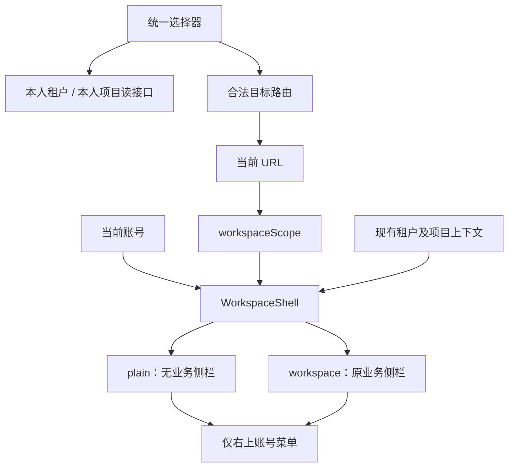

# 工作空间导航与账号布局重构实施方案 V1.0

日期：2026-11-11。适用项目：InfraPro / `apps/console`。

> 实施跟踪（2026-11-11）：用户已授权完整开发，S1–S4 已实现并通过自验，当前功能状态 Awaiting acceptance；S5 人工验收待用户确认。以下保留原方案交付时的状态描述；实际代码自验与人工验收分别见[实施验证记录](../verification/workspace-navigation-refactor.md)及[操作手册](../operations/workspace-navigation.md)。

## 1. 结论、状态与实施边界

用户已确认的方向是：普通登录默认进入首页，首页内容暂不改；首页没有左侧菜单；左上保留工作空间切换入口，进入具体空间后显示相应业务菜单；全站删除左下账号模块，只保留右上账号菜单。

这次交付是**用于指导代码开发的实施规格**，不是已经实现的功能。总体方向已确认；本详细方案状态为 **Awaiting acceptance**，文档自查见[方案文档检查](../verification/workspace-navigation-refactor-plan.md)。代码开发、功能自验、人工验收、部署均未开始。功能实现后另按 In progress → Awaiting acceptance → Accepted 记录，不将方向确认记作功能验收通过。

本方案替代此前原型中的全站顶栏、顶部分类导航、导航抽屉和“账号区默认窄栏”等提议。**首页没有侧栏，不是默认折叠侧栏。**不再创建原型，不合并原型分支；在当前正式前端上按下文进行局部重构。

### 1.1 必须交付的行为

| 编号 | 要求 |
| --- | --- |
| NW-01 | 普通登录默认到 `/`；首页正文、卡片、文案、数据与权限判断保持现状。 |
| NW-02 | 首页不渲染主侧栏、窄图标栏、侧栏占位、折叠按钮或侧栏拖拽边缘；左上切换器仍可直接使用。 |
| NW-03 | 租户、项目、平台沿用现有业务侧栏、内容框、工具栏、主题和响应式规则；菜单由当前 URL 与权限决定。 |
| NW-04 | 桌面、手机以及各工作空间都删除左下账号模块；右上账号菜单继续提供账号首页、个人资料、账号安全与退出。 |
| NW-05 | 取消账号侧栏中的“我的租户 / 我的项目”及两个独立列表页的正常呈现；选择任务统一到左上切换器。 |
| NW-06 | 选择器承接名称 / 编号搜索、分页、项目状态筛选、角色与可用状态说明、状态查看及错误重试。 |
| NW-07 | 旧 `/tenants`、`/projects`、首页既有卡片和历史书签继续可用，不能出现死链接或重定向循环。 |
| NW-08 | 普通登录落点、合法深链接回跳、邀请确认、前进后退和部署 basepath 行为明确且兼容。 |
| NW-09 | 不改变权限、成员资格、归档和租户停用规则；不增加跨标签页的“当前工作空间”全局状态。 |
| NW-10 | 保留租户“项目治理”、平台“租户管理”及各业务功能；不增加后端接口、数据迁移或新依赖。 |

### 1.2 不包含的工作

- 首页工作台内容设计、指标、待办、最近访问或自动恢复上次空间。
- 全站布局替换、全站统一顶栏、顶部业务导航或新增导航体系。
- 工程资源归属、项目治理规则、权限模型、账号开户邀请的业务重构。
- 停用、恢复、成员交接、角色授权、登录与会话机制的业务变更。
- 创建新的租户 / 项目选择页面、删除既有数据、合并其他未完成工作。

当前工作区已有其他迭代的代码及文档变更。实施前检查实际分支与差异，禁止用原型目录覆盖当前工作区。

## 2. 当前源码与改造切入点

核对基线：`feature/tenant-project-engineering`，HEAD 为 `4e92f95`，以及 2026-11-11 读取时工作区中的实际文件。后续实施应再次检查并发变更。

| 现状 | 代码位置 | 本次处理 |
| --- | --- | --- |
| 所有已登录页面都进入一个 AdminLayout | `apps/console/src/app/workspace-shell.tsx` | 按路由范围传入明确的布局模式。保留上下文读取、权限和退出逻辑。 |
| AdminLayout 总是挂载 SidebarProvider、AppSidebar 和折叠按钮 | `packages/ts/layouts/src/admin/admin-layout.tsx` | 增加无业务侧栏模式；业务模式保留当前结构。 |
| 用户菜单在顶部和 SidebarFooter 各渲染一次 | 同上；`admin/user-menu.tsx` | 移除底部实例和对应内部实现，仅保留顶部实例。 |
| 顶部 UserMenu 也无条件调用 useSidebar | `packages/ts/layouts/src/admin/user-menu.tsx` | 删除侧栏依赖，保证无 SidebarProvider 时仍能工作。 |
| 切换器使用 SidebarMenuButton、useSidebar | `apps/console/src/app/workspace-switcher.tsx` | 保留业务侧栏触发器；增加首页工具栏触发器，通过布局插槽接收宿主交互。 |
| 账号导航固定返回首页、我的租户、我的项目 | `apps/console/src/config/navigation.ts` | 账号范围返回空的业务菜单；保留账号快捷入口和业务范围菜单。 |
| 首页卡片直连 `/tenants` | `apps/console/src/features/account/home-page.tsx` | 文件保持不变，由兼容路由接住原链接。 |
| 我的项目和项目治理共用 ProjectList | `apps/console/src/features/projects/lists.tsx` | 仅移除账号列表分支；保留治理列表、创建、筛选和治理详情。 |
| 我的租户与租户 / 平台资料共处一个文件 | `apps/console/src/features/tenancy/pages.tsx` | 仅移除 MyTenantsPage 及其专属依赖，保留其他页面。 |
| 资格失效、状态页及邀请取消引用旧列表 | tenancy / projects 的 context、pages、accept-page 等 | 正常页改为打开选择器；离开流程的链接走兼容路由或首页。 |
| 测试默认先打开主导航，才能找到切换器 | `tests/helpers/navigation.ts`、`tests/e2e/workspace-switcher.spec.ts` | 区分首页切换器和业务菜单，取消“切换器必在侧栏”的假设。 |

既有[工作空间切换验收记录](../verification/workspace-switcher.md)中的空间隔离、层级分组、独立项目资格等规则继续生效；其中两个列表页兜底和左下账号入口由本方案明确替换。历史验收记录本身不改写成新功能证据。

## 3. 页面范围与布局规则

### 3.1 页面矩阵

| 路由 / 场景 | 外层布局 | 菜单行为 |
| --- | --- | --- |
| `/` | 无业务侧栏 | 左上切换器、右上工具；首页正文保持原样。 |
| `/profile`、`/security` | 无业务侧栏 | 由右上账号菜单进入；页面内部现有 SettingsLayout 导航保留，不新增全局侧栏。 |
| `/tenants`、`/projects` | 仅兼容跳转 | 不挂载旧列表，跳转到首页并打开对应类型的选择器。 |
| `/t/:tenantId/...`，不含项目路径 | 现有租户业务布局 | 租户资料、项目治理等当前有权功能。 |
| `/t/:tenantId/p/:projectId/...` | 现有项目业务布局 | 当前项目业务菜单。 |
| `/platform/...`、`/access/...`、`/invitations` | 现有平台业务布局 | 按原平台权限展示；账号开户邀请仍属于平台范围。 |
| 租户停用、项目失权等受限页 | 保留当前路由的空间身份 | 清除不再允许的菜单和数据，保留状态页及选择器；不能显示上一个空间的菜单。 |
| 认证、找回密码、邀请凭证流程 | 原 AuthLayout / 流程布局 | 不纳入本轮业务布局变更；只修正其退出目标。 |

个人资料、账号安全没有租户 / 项目范围，故与首页共用无业务侧栏外壳；这不是新增“个人工作空间”实体或权限范围。

### 3.2 首页外壳

1. 左上工作空间触发器放入现有顶部工具栏的左侧区域，继续使用既有品牌图标、名称和“选择工作空间”提示。
2. 右侧页面搜索、主题、账号菜单沿用原组件与顺序。只移除没有用途的侧栏按钮和相邻分隔线。
3. 主内容使用现有 PageContent、PageHeader 与卡片，不改变 HomePage 的 JSX、查询、文字、字段、快捷卡片或排序。可用宽度随侧栏移除自然变化。
4. 不渲染 Sidebar、SidebarRail、SidebarTrigger、SidebarFooter；不通过 visibility、空白 div 或隐藏菜单项保留旧侧栏宽度。
5. 保留当前内容容器的背景、圆角、阴影和间距风格。首页模式必要的容器样式显式复用原 token，不能依赖不存在的 sidebar peer 才产生样式。
6. 首页不注册侧栏快捷键，不读取或修改桌面侧栏偏好；`Cmd/Ctrl+B` 在首页不会产生“无界面的折叠”。

### 3.3 业务空间外壳

- 左上切换器仍在原 SidebarHeader；不迁到贯穿全站的新顶栏。
- SidebarContent 中的导航分组、选中态、宽度、展开 / 折叠、手机 Sheet 沿用现有实现。
- 右侧现有工具栏、内容框和业务页面保持原布局。移除 SidebarFooter 的账号模块后不留空白固定高度。
- SidebarRail 和折叠按钮只在存在业务侧栏时提供。
- 数据加载时按新 URL 显示当前空间的占位名称，不沿用旧空间名称与权限。禁止用“隐藏菜单”替代后端资格检查。
- 不创建“只有首页一项”的业务侧栏，不为填满侧栏新增菜单。

### 3.4 右上账号菜单

保留现有“账号菜单”可访问名称、头像、显示名称、用户名和退出忙碌状态。菜单项继续为“账号首页”、有权访问的“个人资料”“账号安全”，以及“退出登录”。

“账号首页”在每个空间均返回 `/`，不会恢复上次选择器或跳回旧空间。退出流程继续调用现有 client.logout / signedOut；失败反馈仍在当前外壳显示。不复制第二套退出、账号展示或权限判断。

## 4. 布局 Module 的 Interface 与职责

保持单一公开 AdminLayout；在其内部组织两种已有需求的呈现分支，不建立新的路由级布局系统。共享包依赖方向仍为 `console → layouts → ui`，layout 不导入 Router、API client 或应用目录。

### 4.1 AdminLayout Interface

保留现有用户、菜单、链接渲染、搜索导航、退出、notice 和 children 属性；明确加入 mode，并将 workspaceSwitcher 节点插槽替换为带宿主信息的渲染插槽：

```ts
type AdminLayoutMode = 'plain' | 'workspace';

type WorkspaceSwitcherHost = {
  placement: 'header' | 'sidebar';
  nestedInDrawer: boolean;
  ready: boolean;
  onSelected: () => void;
};

type WorkspaceSwitcherRenderer =
  (host: WorkspaceSwitcherHost) => ReactNode;

// 在现有 AdminLayout props 上变更：
// mode: AdminLayoutMode                        // 必填
// renderWorkspaceSwitcher?: WorkspaceSwitcherRenderer
// workspaceSwitcherOpen?: boolean             // 应用的打开意图，默认 false
// 删除旧 workspaceSwitcher?: ReactNode；其余属性保留。
```

约束：

- `plain` 不挂载 SidebarProvider，只渲染现有工具栏和内容容器；`groups` 应为空。
- `workspace` 挂载原 SidebarProvider、侧栏和内容区，使用原 Zustand 偏好。不是把整个布局改成新顶栏。
- 首页宿主传 `placement='header'`、`nestedInDrawer=false`、`ready=true`、无副作用的 onSelected。
- 业务宿主传 `placement='sidebar'`；手机 Sheet 中 nestedInDrawer 为 true；onSelected 只负责关闭手机导航。
- 应用把 Controller.state.open 传入 workspaceSwitcherOpen。业务布局在 SidebarProvider 内、Sheet 内容之外保留一个始终挂载的宿主协调点：收到打开意图且处于手机时，先设置 openMobile=true。不能把这段逻辑放在尚未挂载的 SidebarHeader 子树中。
- 手机侧栏打开前 ready=false，等待实际 Sheet 的打开焦点事件完成后才设为 true；关闭时重置。菜单实际打开条件为 Controller.state.open && host.ready。桌面及首页 ready 恒为 true。不能把普通组件挂载或 openMobile=true 当作焦点已就绪。
- 当前 Sidebar 未透传手机 SheetContent 的焦点回调，可增加一个可选的 mobileContentProps，只允许传递 onOpenAutoFocus / onCloseAutoFocus。layout 监听打开回调，不阻止 Sheet 的默认焦点行为，在该回调返回后的 microtask 中确认本次抽屉仍打开，再更新 ready；关闭回调清理 ready。使用实际事件顺序，不使用固定毫秒延时；保留基础组件默认行为和外观。
- 应用切换器负责关闭自身选择器和 Router 导航；layout 不解析租户 / 项目 ID，也不执行接口请求。
- 仅当调用方未提供切换器时继续使用现有品牌入口兜底，供共享布局演示使用。
- 所有 AdminLayout 调用点必须显式选择 mode，包括 `src/testing/ui-preview.tsx`。不根据菜单数量猜测首页身份。

这些宿主字段解决了真实差异：触发器位置、嵌套弹层、焦点准备和关闭手机导航。打开意图只用于把不可见的手机宿主显示出来，不能变成 layout 内的第二份业务选择器状态。不要向 layout 暴露查询、筛选、授权快照等业务细节。

### 4.2 UserMenu 解耦

- 移除 sidebar 属性、底部呈现分支、SidebarMenuButton、useSidebar 和底部专用图标。
- 下拉固定使用当前顶部菜单的 bottom / end 定位。
- 组件在没有 SidebarProvider 的独立环境中可渲染、可开关、可导航、可退出。
- 保留 ui 包通用 SidebarFooter / Avatar 等基础组件，不能因为 AdminLayout 不再使用就删除共享基础能力。

### 4.3 WorkspaceShell

WorkspaceShell 继续拥有账号身份、`workspaceScope`、权限过滤、当前租户 / 项目上下文订阅和路由跳转。由 `scope.kind === 'account'` 决定 plain，其他业务范围使用 workspace；不存在权限的业务菜单继续由 navigation 过滤，已有受限页规则保持不变。

`navigation()` 的账号分支返回 `[]`；`accountNavigation()` 不改为业务导航。页面搜索使用当前业务 groups 加账号快捷入口，因此首页搜索仍能找到账号首页、个人资料和账号安全，但不再索引两个旧列表页。

保留 allowedPath 检查、403 内容、logout notice、error-pages.tsx 对 WorkspaceShell 的复用。不能为了让首页可显示而绕过原鉴权逻辑。

## 5. 选择器状态与页面间调用

### 5.1 唯一状态所有者

在应用层增加 `apps/console/src/app/workspace-picker-context.tsx`，作为同一 WorkspaceShell 中“打开选择器”行为的集中入口。它只管理短暂的打开意图，不保存当前租户 / 项目，不持久化。

```ts
type WorkspaceFilter = 'all' | 'tenants' | 'projects';

type WorkspacePickerController = {
  state: { open: boolean; filter: WorkspaceFilter };
  open: (filter?: WorkspaceFilter) => void; // 默认 all
  close: () => void;
};
```

- Provider 位于 AdminLayout 和 Outlet 之上，按 account.id 隔离；更换账号或退出即销毁。
- 左上触发器、业务页“切换工作空间”按钮、旧路由兼容意图调用同一 open / close，不用 DOM 查询点击按钮或 window 自定义事件。
- 搜索输入、项目状态筛选、当前分页和加载状态放在选择器内部；关闭后清空输入并恢复默认条件。指定类型打开时，以该次 filter 初始化。
- open 本身不改变当前业务 URL。只有选中可访问目标时才导航。
- 普通业务跳转、返回首页、身份变化都关闭选择器；取消选择不会离开当前页面。
- 状态页若没有 Provider（如独立认证流程），使用兼容链接完成离开，不把 Provider 强行注入认证布局。

### 5.2 选择器呈现

保留现有“平台独立分组、租户分组、项目缩进到所属租户下”的结构及当前空间勾选。

在现有弹层内补齐以下控件，不新建列表页面：

1. 名称或编号搜索框，有明确 label。
2. 全部 / 租户 / 项目类型筛选。
3. 显示项目时提供“项目状态：全部 / 运行中 / 已归档”；默认全部，租户筛选时隐藏该控件。
4. 两类数据分别显示加载更多和错误重试，不虚构总数。
5. 删除原底部“我的租户 / 我的项目 → 查看全部与状态”两个页面入口。

工作空间选择与页面搜索继续分开：前者找租户 / 项目，后者找当前空间内功能。无需为此扩展 NavigationItem 为通用命令体系。

## 6. 数据读取、过滤与状态查看

### 6.1 使用现有读接口

下表中的路径均带 `/api/v1` 前缀：

| 用途 | 现有接口 / client 方法 | 本次用法 |
| --- | --- | --- |
| 当前账号的租户 | `GET /account/tenants` / myTenants | `q`、`cursor`、`limit=50`。 |
| 当前账号的项目 | `GET /me/projects` / myProjects | `q`、`status=all/active/archived`、`cursor`、`limit=50`。 |
| 停用租户的本人最小状态 | `GET /account/tenants/:id/availability` / tenantAvailability | 复用现有停用状态页，不能用平台接口代替。 |
| 租户 / 项目当前资格 | 原 tenantContext / projectContext | 仍由现有路由边界获取，选择器不能自行写入其缓存。 |

已有搜索在服务端匹配对象自身名称或编号。项目查询不会因为所属租户名匹配而自动返回该租户所有项目；本轮不扩展这一搜索契约。服务端现有大小写、字符和排序语义保持不变，不宣称增加字面转义或其他搜索能力。

### 6.2 查询约定

- 全部类型分别读取租户和项目；租户类型只读租户；项目类型只读项目，父租户作为分组标签。
- 输入按 250ms 防抖提交 q；清除输入立即重置查询。切换筛选后从首个游标开始，不在已加载的 50 条上做伪全量搜索。
- 建议 queryKey 为 `['account', accountId, 'my-tenants', 'workspace-picker', q]` 和 `['account', accountId, 'my-projects', 'workspace-picker', q, status]`，保留现有缓存失效前缀。
- 只有 authenticated 且选择器打开时启用所需查询。打开即重新确认数据，沿用 staleTime=0、焦点刷新；打开期间按现有列表的 30 秒间隔刷新，关闭后不轮询。
- queryFn 必须传递 AbortSignal。身份、输入或筛选变化后，旧请求不得覆盖新结果。
- authorization_revision 或已有资格失效事件使相应列表失效；选择器打开时重新读取。不得用旧列表的 can_enter 当作业务页的最终授权。
- 租户查询失败不阻断成功返回的独立项目入口，反之亦然。失败来源不显示可交互的过期结果，提供独立重试。
- 仅当当前启用的数据来源全部成功且结果为空时显示真正空状态。网络错误不显示“尚未加入”。

### 6.3 分组与分页

以 tenant ID 分组，以 project ID 去重；保留接口内的排序。项目先返回或父租户未在当前分页 / 搜索结果中时，从 project.tenant_id / tenant_name 创建分组标签，不能推断租户可进入。

后续租户页补到时合并同一分组，不重复租户头或项目。两种 next_cursor 独立推进。切换项目状态只影响项目查询，不丢弃当前租户列表。

### 6.4 资格与状态动作

取消列表页不能丢失原有本人角色和状态信息。选择器使用 MyTenant.roles、restriction_code 及 ProjectContext.authorization 中已返回的本人字段，按以下规则展示：

| 条目情况 | 展示与可执行动作 |
| --- | --- |
| 正常可进入租户 | 租户名称、编号、本人角色；选择后进入原租户 profile 路由。 |
| 停用租户 | 显示“已停用”，提供明确的“查看状态”动作；进入原 profile 路由，由 DisabledTenant 展示最小状态。 |
| 只有项目结果中的父租户 | 仅分组标签，不提供租户进入按钮。 |
| 正常可进入项目 | 名称、编号、所属租户、本人角色；进入原项目 profile 路由。 |
| 已归档但仍可进入项目 | 保留归档标记和进入动作；原页面继续限制编辑与扩权。 |
| 项目 can_enter=false | 显示接口给出的本人受限原因，不提供“进入项目”业务动作；保留明确的“查看本人状态”动作，沿用原 profile / 受限页流程。 |
| 成员关系已移除、目标失效 | 列表刷新后移除该项；请求期间失效时由现有路由边界拒绝，并提供重新选择 / 返回首页。 |

“查看状态”与“进入业务”在文案、可访问名称和动作模型上区分，不能把整行 can_enter=false 一律禁用后又丢失原列表的状态入口。状态查看不会授予任何权限；上下文拒绝时沿用现有受限说明，不增加绕过权限的请求。接口未返回的角色、历史或业务数据不得推算展示。

平台入口仍由 platformNavigation 返回的首个有权页面决定，不硬编码某个管理页。没有平台能力时不显示该入口。

## 7. 路由兼容与浏览器历史

### 7.1 路由表

| 路径 | 最终行为 |
| --- | --- |
| `/` | 原 HomePage；支持内部的一次性选择器请求。 |
| `/tenants` | 在鉴权后 replace 到 `/?workspace=tenants`，不渲染 MyTenantsPage。 |
| `/projects` | 在鉴权后 replace 到 `/?workspace=projects`，不渲染 MyProjectsPage。 |
| `/t/:tenantId/projects` 及其子路由 | 完整保留项目治理，不属于待删除账号列表。 |
| `/platform/tenants` 及其子路由 | 完整保留平台租户管理。 |
| 所有合法租户 / 项目业务深链接 | 路由与权限检查保持原行为。 |

`workspace` 只在首页路由 validateSearch 中接受 `tenants`、`projects` 两个值，其他值忽略。它是内部的一次性 UI 意图，不是新的空间身份，也不是需要推广的外部入口。

处理顺序必须明确：**先把有效意图交给 PickerController 并保持 open 状态，再 replace 清除该查询参数。**不能把 open 直接永久绑定到 query；否则清除参数会关闭弹层。严格模式重复 effect 不得导致重复导航或再次打开。其他路由不得继承 workspace 参数。

公共兼容地址仍是 `/tenants`、`/projects`。未登录访问这两个地址时，由原 `_authenticated.beforeLoad` 先引导登录；登录回到原别名后，再执行上述跳转。不要先跳到首页再丢失选择器意图。

### 7.2 历史约定

- 旧别名 → 首页、消费一次性参数，均使用 replace；不能生成一个无法停留的列表历史项。
- 打开 / 关闭选择器及改变筛选不写入浏览器历史。
- 选择不同工作空间使用正常业务导航记录；前进 / 后退由 URL 恢复空间和菜单。
- 从业务空间返回首页是普通导航；选择器为关闭状态。
- 返回由旧链接到达的首页时，不因历史残留参数反复弹出选择器。
- 选择当前已经位于的目标资料页，只关闭弹层，不重复追加同一 URL。

### 7.3 登录与安全回跳

普通访问 `/login` 或 `/` 登录后进入 `/`；不读取上次租户 / 项目作为默认落点。主动访问业务深链接或合法邀请流程产生的 returnTo，继续保留现有白名单回跳，不能强制送回首页而破坏用户明确目标。

safeReturn 保留两个旧别名的白名单，不因删除列表视图而删除合法兼容路径。不要为内部 workspace 参数开放任意 URL、query 或外部地址。未登录直接输入带内部 workspace 参数的首页地址时，按原规则回首页；需要跨登录保持选择意图的入口统一使用两个旧别名。

应用跳转始终经过 TanStack Router、relativePath 与 basepath；禁止用 `window.location='/...'` 绕过生产 `/console/`。验证开发 `/` 和生产 `/console/` 下的旧别名、回首页及业务深链接。

## 8. 所有旧入口的处理清单

| 入口 | 改造要求 |
| --- | --- |
| 账号侧栏“首页 / 我的租户 / 我的项目” | 账号范围不再渲染业务侧栏；右上“账号首页”保留。 |
| 选择器底部两个“查看全部与状态”入口 | 删除，搜索 / 分页 / 状态在选择器内提供。 |
| 首页“我的租户”卡片及无权限提示 | 本轮不改 HomePage。卡片由兼容路由接住，不能显示旧列表。 |
| CommandSearch 中旧列表项 | 移除；仅保留当前空间功能和账号快捷入口，不新增两个同义选择页面。 |
| ProjectBoundary 中“切换项目” | 改为同一选择器的项目筛选动作；不先跳回首页。 |
| 项目失权页“返回我的项目” | 改为“重新选择项目”动作，同时可返回首页。 |
| 租户失权、停用、本人授权页 | 使用“选择其他工作空间”或“重新选择租户”，保留必要的状态重新检查。 |
| 项目治理中“从我的项目进入”的提示 | 改为“通过左上角工作空间切换器进入项目”，治理功能本身不删。 |
| 租户邀请取消 | 保留 forgetCredential 等凭证清理；取消后可使用 `/tenants` 兼容目标，文案改为“取消并选择工作空间”。 |
| 独立认证 / 邀请完成或异常页 | 保留流程行为，退出目标为首页或合法兼容路径，不能在未确认加入前自动加入租户。 |
| 404 / 路由异常页 | 原返回首页、重试继续有效；右上账号入口和已有鉴权兜底不能因布局改造失效。 |
| README、前端说明和操作手册 | 实施完成后更新当前入口说明；历史验证记录保留历史事实，必要时仅增加后续方案指针。 |

实施时对 `/tenants`、`/projects`、两个中文列表名和“侧栏账号菜单”做全仓搜索，逐项区分兼容路由、API 路径、治理路径、历史记录与真正应移除的 UI。禁止全局字符串替换。

## 9. 状态、权限与数据流



| 状态 | 所有者与规则 |
| --- | --- |
| 当前账号及认证阶段 | 原 IdentityProvider，不新增身份副本。 |
| 当前空间 | URL，标签页各自独立；禁止持久化到全局 store。 |
| 业务权限 | 原 tenant / project / platform 授权结果，选择器列表不能代替。 |
| 列表查询 | TanStack Query，按账号、来源和筛选隔离。 |
| 选择器打开意图 | 应用层 PickerController，本标签页临时状态。 |
| 手机业务导航 | 原 SidebarProvider 的 openMobile，选择成功后关闭。 |
| 桌面业务侧栏偏好 | 原 Zustand `infrapro:layout` version 1，只保存 sidebarOpen。 |

首页没有侧栏，不能把 sidebarOpen 改成 false 来实现。进入首页不覆盖用户的业务侧栏展开偏好；再次进入业务空间时恢复原偏好。无需迁移 localStorage 键或新增账号区折叠状态。

租户 / 项目边界现有查询 key、epoch、成员变化清理、失权处理、焦点复核继续生效。切换器只读取列表，不写入官方 context 缓存，不用项目管理员 / 租户管理员等名称推导权限。

## 10. 手机、键盘与弹层约定

- 首页手机布局直接在顶部显示工作空间触发器，没有必须先打开的空白导航 Sheet。长名称截断但能获取完整名称，控件不挤出屏幕。
- 业务空间手机导航继续使用当前 Sheet；切换器嵌套时由宿主告知 nestedInDrawer，复用现有非重复模态锁行为。
- 业务页正文触发“重新选择”时，若选择器位于尚未打开的手机 Sheet，应先打开现有 Sheet，再在其焦点稳定后打开选择器；不能同时抢焦点，不能依赖固定延时或查询 DOM 点击。
- 上述顺序使用第 4.1 节定义的打开意图、外层协调点和 ready 条件；一次选择关闭两层，页面恢复可点击。取消选择器只关闭当前弹层，手机业务导航仍可按既有方式关闭。首页不创建这两层结构。
- Enter / Space 打开、方向键移动条目、Escape 取消。搜索框左右方向键编辑文字，不触发其他全局导航。
- 取消后焦点回到真实触发器。成功导航后目标旧触发器可能卸载，焦点落到新页面标题 / 主区域，不强制聚焦已删除节点。
- 类型和状态筛选暴露名称与选中状态；不可用原因不只靠颜色或 hover。
- 验证 375、768 / 1024、1440 像素及亮 / 暗主题；保留已有字体、主题 token、减少动画偏好与跳到主要内容入口。

## 11. 逐文件改造清单

下表新增文件名为建议落点；如果相关逻辑可在现有文件内清楚表达，不为凑模块数量拆出纯转发文件。

| 文件 | 具体改动与完成条件 |
| --- | --- |
| `apps/console/src/app/workspace-shell.tsx` | 传 mode；提供 renderWorkspaceSwitcher；包裹 PickerController；保留全部鉴权、上下文、notice 和异常 children 路径。 |
| `apps/console/src/app/workspace-switcher.tsx` | 拆除无条件 useSidebar；按 host 渲染原侧栏触发器或首页触发器；补查询、筛选、状态动作及受控开关。 |
| `apps/console/src/app/workspace-picker-context.tsx`（新增） | open / close 和一次性请求的唯一入口；无 Router 或权限的重复全局状态。 |
| `apps/console/src/config/navigation.ts` | 账号 groups=[]；旧别名继续可安全回跳；业务范围分类和权限规则不变。 |
| `apps/console/src/routes/_authenticated/index.tsx` | 验证并消费首页 workspace 请求；仍渲染原 HomePage。 |
| `apps/console/src/routes/_authenticated/tenants.tsx`、`projects.tsx` | 改为鉴权后的兼容跳转，去掉旧列表 import。 |
| `apps/console/src/features/tenancy/pages.tsx` | 删除 MyTenantsPage 专属实现，改本人授权页返回入口；不删平台 / 租户资料、编辑、审计。 |
| `apps/console/src/features/projects/lists.tsx` | 删除 MyProjectsPage 及账号 ProjectList 分支；保留并简化为租户治理列表，保留治理详情及全部筛选。 |
| `apps/console/src/features/tenancy/context.tsx`、`projects/context.tsx` | 只调整切换 / 返回入口及相关文案；保留边界、资格校验、缓存清理与禁用状态。 |
| `apps/console/src/features/tenancy/accept-page.tsx` | 调整取消文案与目标，保留凭证清除和明确确认加入语义。 |
| `packages/ts/layouts/src/admin/admin-layout.tsx` | 添加 mode / renderWorkspaceSwitcher；删除底部用户区域；业务分支结构保持；plain 分支不建立侧栏上下文。 |
| `packages/ts/layouts/src/admin/user-menu.tsx` | 只保留顶部实现，移除 sidebar 参数和 useSidebar。 |
| `packages/ts/layouts/src/shared/types.ts`、`src/index.ts` | 导出需要的宿主 / mode 类型，不扩大依赖方向。 |
| `packages/ts/ui/src/components/sidebar.tsx` | 只为手机 SheetContent 透传上述可选焦点回调；不改 Sidebar 的结构、宽度、主题和默认交互。 |
| `apps/console/src/testing/ui-preview.tsx` | 更新真实共享布局演示以覆盖 plain / workspace，两种模式均只有顶部用户菜单；不是新增产品原型。 |
| `tests/helpers/navigation.ts` | 首页可直接开选择器；业务移动端才先开侧栏；不再导航到两个旧列表完成选择。 |
| `tests/e2e/workspace-switcher.spec.ts` | 调整现有分组、资格、分页断言，补无侧栏、角色状态与旧入口兼容；使用真实身份及明确的异常响应模拟。 |
| `tests/e2e/workspace-navigation.spec.ts`（建议新增） | 集中验证本方案布局 / 路由行为及回归矩阵，不重复服务端权限测试。 |
| `tests/ui/components.spec.ts`、`tests/e2e/presentation.spec.ts` | 覆盖两种布局、移除底部菜单、侧栏偏好和三种视口。 |
| 其他 tenancy / projects / account E2E、HTTP 部署用例 | 按用户流程修正旧列表和菜单假设；不修改业务期望来迁就新 UI。 |
| `docs/frontend-development.md`、README、相关 operations 文档 | 实现完成后同步真实接口、入口和手工步骤。 |

明确不改：`features/account/home-page.tsx`、业务权限和 Go 服务、OpenAPI 契约、数据库迁移、现有主题基础组件。`routeTree.gen.ts` 仅在路由生成器确实产生变化时更新，不能手改。

## 12. 技术选型与使用位置

| 技术 | 用途及选择理由 |
| --- | --- |
| TypeScript + React | 现有应用与共享布局语言；类型表达布局模式、选择器宿主和状态动作，避免依赖隐式侧栏环境。 |
| TanStack Router | 继续使用文件路由、鉴权 beforeLoad、合法回跳、typed search 和 replace 导航；不另建路由系统。 |
| TanStack Query | 复用本人租户 / 项目读接口、独立游标、取消、刷新与账号缓存隔离。 |
| shadcn / Radix + Tailwind CSS | 复用现有 DropdownMenu、Input、Button、Sheet、Sidebar 和主题样式；减少视觉和键盘行为变化。应用仍通过 ui 包使用基础组件。 |
| Zustand | 只保留现有业务侧栏偏好；选择器临时状态使用 React Context / 本地状态，不持久化。 |
| Lucide | 沿用现有首页、租户、项目、平台和账号图标。 |
| Vite + pnpm | 沿用 workspace 编译、热更新、构建及路由生成；不增加 prototype 命令或功能开关。 |
| Playwright | 覆盖真实浏览器布局、选择流程、历史和多视口行为；直接验证用户能执行的操作。 |
| Go API / PostgreSQL / Redis | 保持现有服务与存储，前端通过既有接口读取；本次无新增表、迁移、权限目录同步或 Redis 键。 |

精确版本服从当前 package.json、pnpm-lock.yaml 及工程约定，本方案不升级依赖。

## 13. 开发顺序与独立交付点

| 步骤 | 实现内容 | 继续下一步的条件 |
| --- | --- | --- |
| S1：外壳与用户菜单 | mode、UserMenu 解耦、删除 SidebarFooter 账号模块；首页原内容进入 plain，业务页保留现结构。 | 两种布局可运行，主页无侧栏控制，顶部账号全部操作可用，业务侧栏偏好未被覆盖。 |
| S2：统一选择器 | 宿主插槽、Controller、搜索 / 类型 / 项目状态 / 分页 / 状态动作、手机层级与焦点。 | 选择器独立承担旧列表的发现和状态能力；跨空间和权限隔离检查通过。 |
| S3：列表退场与兼容 | 两个旧别名、一次性请求、删旧列表专属代码、清理各返回入口；保留 HomePage 与治理模块。 | 旧链接、首页卡片、受限页和邀请取消全部可达，浏览器历史不循环。 |
| S4：集成回归与文档 | 更新测试 helper、共享布局演示、操作手册，运行第 14 节检查。 | 修复全部本轮引入的问题，实际验证结果单独记录。 |
| S5：人工验收 | 按第 15 节在既有账号 / 数据上复验。 | 自验通过先标记 Awaiting acceptance；只有用户明确确认后才标记 Accepted。 |

实施应以小提交分隔上述步骤，提交说明对应最终行为。无需等待新原型或重新选择视觉方案。当前请求只交付此规格，不执行 S1–S5。

## 14. 开发自验证矩阵

下列均是**实施后必须执行的计划**，不是本次文档交付的已通过结果。

| 编号 | 可观察断言 | 覆盖要求 |
| --- | --- | --- |
| SV-01 | 普通登录到首页；没有主侧栏、图标栏、侧栏占位、折叠按钮及左下账号；首页字段 / 卡片仍存在。 | NW-01/02/04 |
| SV-02 | 首页顶部切换器、页面搜索、主题、账号菜单在无 SidebarProvider 时可操作。 | NW-02/04 |
| SV-03 | 租户 / 项目 / 平台保留原业务侧栏结构、位置、宽度、菜单过滤与当前空间标识。 | NW-03/09 |
| SV-04 | 在业务空间折叠侧栏 → 回首页 → 再进业务空间，恢复原偏好；首页不写 sidebarOpen。 | NW-02/03 |
| SV-05 | 全站只有一个可见账号入口；首页 / 个人资料 / 账号安全 / 退出 / 退出失败反馈可用。 | NW-04 |
| SV-06 | 搜索命中第二页以后的租户 / 项目；按名称 / 编号查询；更改筛选不混入旧游标结果。 | NW-06 |
| SV-07 | 运行中 / 已归档筛选正确，租户列表不受项目状态条件影响；无虚构总数。 | NW-06 |
| SV-08 | 两类来源独立重试、分页与空状态；单侧失败不禁用另一侧合法入口。 | NW-06/09 |
| SV-09 | 父租户只作为标签时不能进入租户，但独立项目 can_enter=true 时仍可进入。 | NW-09 |
| SV-10 | 停用租户和不可进入项目保留状态动作；归档项目按原规则读取；不能获得原本没有的业务能力。 | NW-06/09 |
| SV-11 | 登录后访问两个旧别名，跳首页并打开正确类型；消费参数后关闭 / 后退不自动再弹出。 | NW-05/07/08 |
| SV-12 | 未登录访问旧别名，登录后仍进入正确选择器；普通登录仍到首页，非法 returnTo 不能外跳。 | NW-01/07/08 |
| SV-13 | 合法业务深链接登录、刷新、前进后退、两个标签页选择不同空间均跟随各自 URL。 | NW-08/09 |
| SV-14 | 退出 / 换账号 / 权限收回后菜单和选择结果及时清理，旧请求不能重现旧身份条目。 | NW-09 |
| SV-15 | 租户 / 项目失权、404、读取失败页仍可重新选择、返回首页和使用右上账号功能。 | NW-07/09 |
| SV-16 | 项目治理列表、创建入口、状态 / 负责人 / 失管筛选、治理详情与平台租户管理完整保留。 | NW-10 |
| SV-17 | 邀请取消保留凭证清除；邀请登录后仍需明确确认加入，流程不被强制首页跳转打断。 | NW-08/09 |
| SV-18 | 手机首页直接开选择器；业务手机选择关闭两层弹窗后仍可点击页面；取消焦点正确。 | NW-02/03/06 |
| SV-19 | 375 / 768 / 1024 / 1440、亮暗主题、键盘输入 / Escape / 焦点、无横向溢出。 | NW-02/03/04/06 |
| SV-20 | `/console/` 部署下旧别名、首页、选择器和业务深链接正确，URL 不丢 basepath。 | NW-07/08 |
| SV-21 | HomePage 源码及业务内容未改；无原型切换条、示例数据、只读拦截器或 prototype 功能开关混入构建。 | NW-01/10 |

按真实改动运行检查，不用新增测试逐行复述 JSX。至少执行：

```bash
pnpm check
pnpm --filter @infrapro/console build
pnpm test:ui
pnpm test:e2e workspace-navigation.spec.ts workspace-switcher.spec.ts presentation.spec.ts account.spec.ts account-state.spec.ts route-error.spec.ts tenant-management.spec.ts tenant-membership.spec.ts tenant-lifecycle.spec.ts tenant-role-authorization.spec.ts projects.spec.ts
pnpm test:e2e:preview workspace-navigation.spec.ts workspace-switcher.spec.ts
git diff --check
```

若共享导航 helper 的调用方超出上列文件，补跑所有受影响调用方；同一覆盖已通过且无新增改动时不反复扩大测试。768px 补充断点检查，tablet 项目目前只匹配 presentation.spec.ts，不能把它算作其他测试文件的平板覆盖。

SV-20 使用实际 `/console/` 构建及已有部署测试环境验证，不能仅凭开发模式判断；必要时运行 `pnpm test:http` 中相关部署用例并更新依赖旧列表的断言。不可用的环境明确记录未验证项，不以文档自查代替运行证据。

测试数据由现有隔离测试环境准备。手工验收环境只操作选定验收账号，不重跑 bootstrap、seed 或业务迁移来验证布局。

## 15. 人工验收步骤

实施完成后使用已有验收站点 `http://localhost:25173/login`，或按实际交付地址执行。普通开发入口为仓库根目录 `make dev` 后的 `http://127.0.0.1:5173/`。本方案交付时这些页面仍是现有实现。

| 编号 | 操作 | 预期结果 |
| --- | --- | --- |
| MA-01 | 从普通登录入口登录 | 首页显示现有内容；左边没有菜单、窄栏和空白占位，左上仍能切空间。 |
| MA-02 | 在首页打开右上账号菜单，依次进入资料、安全和账号首页 | 均可到达；左下账号模块全程不存在。 |
| MA-03 | 左上选择一个租户 | 原位置出现该租户业务菜单，布局和视觉风格与当前后台一致。 |
| MA-04 | 从切换器直接选择该租户的项目 | 只显示该项目菜单；没有混入租户治理和平台功能。 |
| MA-05 | 选择平台空间 | 只显示有权的平台功能；无平台权限的账号看不到此入口。 |
| MA-06 | 折叠业务侧栏，再通过右上返回首页，然后重新进入业务空间 | 首页完全无侧栏，业务空间保留上次折叠偏好。 |
| MA-07 | 搜索租户 / 项目、切换类型和项目状态，加载更多 | 结果来自完整服务端查询，归档标识、角色和所属租户清楚，分页不重复。 |
| MA-08 | 查看停用租户或不可进入项目 | 可以获知本人状态；不会因此开放受限业务功能。 |
| MA-09 | 点击首页原“我的租户”卡片，再分别访问旧 `/tenants`、`/projects` | 卡片外观未变；均进入首页上的选择器，不显示旧列表页。 |
| MA-10 | 关闭选择器、选择项目、浏览器后退 / 前进 | 页面和菜单跟随 URL；没有重复弹出或死循环。 |
| MA-11 | 两个标签页分别停在不同项目 | 一边切换不会强行切换另一边；每页菜单对应自身项目。 |
| MA-12 | 在项目治理查看列表 / 详情，确认创建和治理筛选入口 | 原治理功能仍存在，与账号选择列表的删除无关。 |
| MA-13 | 手机打开首页选择器，再进入业务空间并再次切换 | 首页无需先开空导航；业务空间保持原手机抽屉；选择后页面仍可操作。 |
| MA-14 | 用键盘打开、搜索、选择、取消；切换亮暗主题 | 输入、焦点、滚动、文字和边界可用，没有布局溢出。 |
| MA-15 | 使用业务深链接登录及现有邀请确认 / 取消流程 | 深链接仍到合法目标；邀请不自动确认，取消后有可用落点。 |

自验记录单独写入 `docs/verification/workspace-navigation-refactor.md`；用户人工验收结果按 MA 编号记录，不能从自动测试通过推导 Accepted。

## 16. 发布、回滚与开发完成定义

这是前端导航与布局重构。只使用既有 API，不需要数据库迁移、权限同步、新 CLI 或新后端部署。前端构建产物与现有 API 配套即可；如实际实施发现确需新增后端能力，应先更新本方案范围，不能静默扩展。

发布应保留 SPA 路由回退与 `/console/` basepath 配置，使两个兼容路径可直接刷新。回滚为恢复上一版前端构建 / 本轮前端提交，不涉及账号、角色、租户、项目或数据库回退。

开发完成同时满足：NW 要求已实现、SV 检查有实际结果、HomePage 与治理功能保持、相关手册更新、未验证项如实列出、用户有明确 MA 步骤及可访问环境。之后状态为 Awaiting acceptance，等待人工验收。

本方案没有新增需要用户重新选择的业务取舍。代码实现必须遵守“首页无侧栏、业务布局沿用、只留右上账号”的已确认范围。
